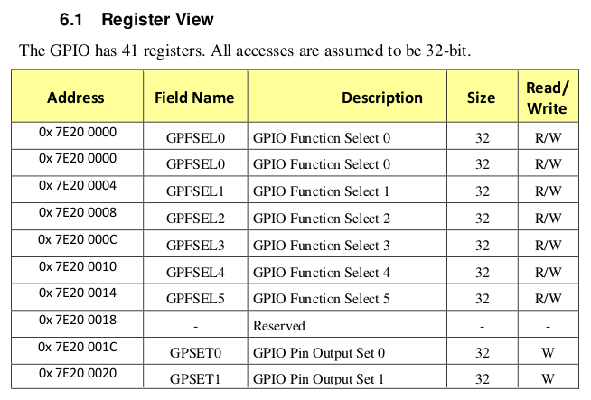
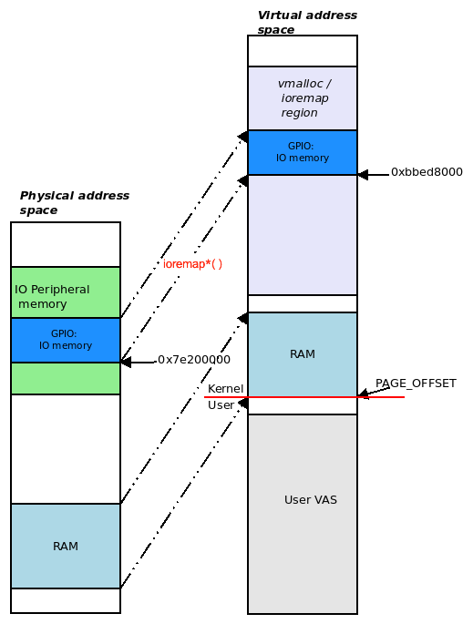

# Chương 3. Làm việc với hardware I/O memory

Trong chương này, chúng ta tập trung vào một khía cạnh quan trọng hardware-related khi viết device driver: chính xác cách truy cập và thực hiện I/O (input/output, đọc và ghi) trên hardware (hay peripheral) I/O memory — chip phần cứng ngoại vi mà bạn đang viết driver cho nó.

Động lực đằng sau kiến thức bạn sẽ thu được trong chương này rất rõ ràng: nếu không có nó, bạn sẽ thực sự điều khiển device bằng cách nào? Phần lớn device được điều khiển bằng các thao tác ghi và đọc được tính toán cẩn thận trên hardware register và/hoặc peripheral memory, còn gọi là hardware I/O memory. Linux, là OS virtual memory-based, đòi hỏi một mức trừu tượng hóa trong cách làm việc với peripheral I/O memory.

Trong chương này, chúng ta sẽ đề cập các chủ đề sau:

- Truy cập hardware I/O memory từ kernel

- Tìm hiểu và sử dụng memory-mapped I/O

- Tìm hiểu và sử dụng port-mapped I/O

Hãy bắt đầu!

## Yêu cầu kỹ thuật

Tôi giả định bạn đã đọc mục Để tận dụng tối đa cuốn sách này trong Lời nói đầu, đã chuẩn bị thích hợp một guest VM chạy Ubuntu 18.04 LTS (hoặc một bản phát hành ổn định mới hơn) và cài mọi package cần thiết. Nếu chưa, tôi rất khuyến nghị bạn làm việc này trước. Để tận dụng tối đa cuốn sách, tôi đặc biệt khuyến nghị bạn trước hết thiết lập môi trường workspace, bao gồm clone GitHub repository chứa code của sách, rồi hands-on trên đó. Có thể tìm repository ở đây: `https://github.com/PacktPublishing/Linux-Kernel-Programming-Part-2`.

## Truy cập hardware I/O memory từ kernel

Một vấn đề thú vị mà bạn, với tư cách người viết device driver, có thể gặp là: cần truy cập và làm việc trên I/O memory, hardware register và/hoặc hardware memory của một peripheral chip. Thực tế, đây thường là cách driver lập trình phần cứng ở mức “sát phần cứng”: gửi command cho nó qua các register và/hoặc peripheral memory. Tuy nhiên, có một vấn đề cần giải quyết khi truy cập trực tiếp hardware I/O memory trên Linux. Trong mục đầu tiên này, chúng ta xem xét vấn đề đó và đưa ra giải pháp.

### Tìm hiểu vấn đề với truy cập trực tiếp

Tất nhiên, hardware memory trên chip này, so-called I/O memory, không phải RAM. Linux kernel không cho phép người viết module hoặc driver truy cập trực tiếp các vị trí hardware I/O memory như vậy. Chúng ta đã biết lý do: trên OS hiện đại VM-based, mọi truy cập memory đều phải đi qua Memory Management Unit (MMU) và paging table.

Hãy nhanh chóng nhắc lại khía cạnh chính đã thấy trong tài liệu đồng hành Linux Kernel Programming, Chương 7, Kiến thức thiết yếu về Memory Management Internals: mặc định, memory được ảo hóa, có nghĩa mọi địa chỉ là virtual, không phải physical (bao gồm cả địa chỉ trong kernel segment hay VAS). Hãy nghĩ như sau: khi một virtual address được process (hoặc kernel) truy cập để đọc, ghi hoặc thực thi, hệ thống phải lấy nội dung memory tại physical address tương ứng. Việc này đòi hỏi chuyển đổi virtual address thành physical address lúc runtime; các tối ưu phần cứng (CPU cache, Translation Lookaside Buffer (TLB), v.v.) có thể tăng tốc. Quá trình được thực hiện như sau:

1\. Trước hết, các CPU cache (L1-D/L1-I, L2, v.v.) được kiểm tra để xem memory mà virtual address này tham chiếu đã nằm trên silicon của CPU cache hay chưa.

2\. Nếu memory đã có ở đó, chúng ta có cache hit và công việc hoàn tất. Nếu chưa (đó là Last Level Cache—LLC miss - tốn kém!), virtual address được đưa vào MMU của bộ vi xử lý.

3\. MMU lúc này tìm physical address tương ứng trong các TLB của bộ xử lý. Nếu có, chúng ta có TLB hit và công việc hoàn tất; nếu không, có TLB miss (điều này tốn kém!).

4\. MMU lúc này duyệt paging table của user space process đã thực hiện truy cập; hoặc, nếu kernel thực hiện truy cập, duyệt kernel paging table, chuyển đổi virtual address thành physical address tương ứng. Tại thời điểm này, physical address được đặt lên bus và công việc hoàn tất.

Hãy tham khảo Technical Reference Manual của TI cho OMAP35x tại `https://www.ti.com/lit/ug/spruf98y/spruf98y.pdf?ts=1594376085647` để biết thêm; chủ đề MMU Functional Description (trang 946) được minh họa bằng những sơ đồ xuất sắc (với mục đích của chúng ta, xem Hình 8.4, 8.6 và 8.7 — hình cuối là flowchart mô tả các quy trình phía trên).

Ngoài ra, cần đề cập rằng quy trình address translation thực tế tất nhiên phụ thuộc nhiều vào kiến trúc. Trên một số hệ thống, thứ tự như được trình bày ở đây; trên hệ thống khác (thường là ARM), MMU (bao gồm tra cứu TLB) được thực hiện trước, rồi mới kiểm tra CPU cache.

Vì vậy, hãy nghĩ xem: ngay cả các vị trí RAM thông thường cũng không thực sự được software chạy trên OS hiện đại truy cập trực tiếp; đó là vì memory được ảo hóa. Trong trường hợp như vậy, paging table (của mỗi process cũng như chính kernel) cho phép OS chuyển đổi virtual address thành physical address tương ứng lúc runtime. (Chúng ta đã trình bày khá chi tiết những lĩnh vực này trong sách đồng hành Linux Kernel Programming, Chương 7, Kiến thức thiết yếu về Memory Management Internals, mục Virtual addressing và address translation; hãy xem lại để ôn những điểm quan trọng này nếu cần.)

Bây giờ, nếu có một ngoại vi phần cứng hoặc chip chứa I/O memory, vấn đề có vẻ còn phức tạp hơn khi xét rằng memory này không phải RAM. Vậy memory này không được paging table map sao? Hay có? Trong mục tiếp theo, chúng ta xem hai giải pháp phổ biến cho vấn đề, hãy đọc tiếp!

### Giải pháp – map qua I/O memory hoặc I/O port

Để giải quyết vấn đề này, cần hiểu rằng bộ xử lý hiện đại cung cấp hai cách tổng quát để truy cập và làm việc với hardware I/O (peripheral chip) memory:

- Dành riêng một số region trong address space của bộ xử lý cho các peripheral device này; tức là dùng memory-mapped I/O (MMIO) làm kiểu mapping cho I/O.

- Cung cấp các lệnh assembly (và machine instruction tương ứng) riêng biệt của CPU để truy cập trực tiếp I/O memory. Dùng kiểu mapping như vậy cho I/O được gọi là port-mapped I/O (PMIO hay đơn giản PIO).

Chúng ta sẽ lần lượt xem xét cả hai kỹ thuật trong các mục Tìm hiểu và sử dụng memory-mapped I/O và Tìm hiểu và sử dụng port-mapped I/O. Tuy nhiên, trước đó, cần học cách lịch sự xin kernel cho phép dùng các I/O resource này!

### Xin phép kernel

Hãy nghĩ một chút: ngay cả khi biết API nào dùng để map hoặc làm việc trên I/O memory theo một cách nào đó, trước hết bạn cần xin phép OS. Xét cho cùng, OS là bộ quản lý tài nguyên tổng thể của hệ thống và bạn phải hỏi đàng hoàng trước khi dùng tài nguyên của nó. Tất nhiên còn hơn thế — khi hỏi, điều thực sự làm là yêu cầu nó thiết lập một số cấu trúc dữ liệu nội bộ cho phép kernel hiểu driver hay subsystem nào đang dùng I/O memory region hoặc port nào.

Trước khi thực hiện bất kỳ peripheral I/O nào, bạn cần yêu cầu kernel cho phép; nếu được chấp thuận, bạn thực hiện I/O. Sau đó, bạn cần release I/O region trở lại kernel. Quá trình này gồm các bước sau:

1\. Trước I/O: Yêu cầu quyền truy cập memory region hoặc port region.

2\. Sau khi được kernel core bật đèn xanh, thực hiện I/O thực tế: Dùng MMIO hoặc PMIO để làm việc này (chi tiết được cung cấp trong bảng sau).

3\. Sau I/O: Trả memory region hoặc port region về OS.

Vậy thực hiện các thao tác request, I/O và release này thế nào? Có các API làm được việc đó, và API nên dùng phụ thuộc vào việc bạn dùng MMIO hay PMIO. Bảng sau tóm tắt API nên dùng trước khi thực hiện I/O, rồi release region sau khi công việc hoàn tất (các API thực sự thực hiện I/O sẽ được trình bày sau):

| Phương thức truy cập I/O memory | MMIO | PMIO |
|---|---|---|
| Trước khi thực hiện bất kỳ I/O nào, yêu cầu quyền truy cập I/O memory/port region. | `request_mem_region()` | `request_region()` |
| Thực hiện thao tác I/O. | (Xem mục MMIO – thực hiện I/O thực tế) | (Xem mục PMIO – thực hiện I/O thực tế) |
| Sau khi thực hiện thao tác I/O, release region. | `release_mem_region()` | `release_region()` |

Các hàm trong bảng trên được định nghĩa dưới dạng macro trong header `linux/ioport.h`; signature như sau:

```
request_mem_region(start, n, name);  [...] ; release_mem_region(start, n);
request_region(start, n, name);      [...] ; release_region(start, n);
```

Mọi macro này về cơ bản là wrapper trên các API nội bộ `__request_region()` và `__release_region()`. Tham số của các macro như sau:

- `start` là điểm bắt đầu của I/O memory region hoặc port; với MMIO, đó là physical (hoặc bus) address, còn với PMIO, đó là port number.

- `n` là chiều dài region đang được yêu cầu.

- `name` là tên bất kỳ bạn muốn gắn với mapped region hoặc port range. Thường đó là tên driver thực hiện thao tác I/O (bạn có thể thấy trong proc filesystem; chúng ta sẽ xem chi tiết hơn khi trình bày cách dùng MMIO và PMIO).

Giá trị trả về của các API/macro `request_[mem_]region()` là pointer đến `struct resource` (một lần nữa, sẽ nói thêm trong mục Lấy device resource). Nếu trả về `NULL`, điều đó có nghĩa không reserve được resource; driver thường trả về `-EBUSY`, báo hiệu resource hiện bận hoặc không khả dụng (có thể vì một component/driver khác đã yêu cầu và đang dùng nó).

Chúng ta sẽ cung cấp một số ví dụ thực tế dùng các API/macro này trong những mục sắp tới. Bây giờ, hãy học cách thực sự map và làm việc với I/O memory. Chúng ta bắt đầu với cách phổ biến mà gần như mọi bộ xử lý hiện đại đều hỗ trợ; đó là MMIO.

## Tìm hiểu và sử dụng memory-mapped I/O

Với MMIO, CPU hiểu rằng một region (hoặc nhiều region) nhất định trong address space của nó được dành riêng cho I/O peripheral memory. Bạn thực sự có thể tra các region đó bằng cách xem physical memory map trong datasheet của bộ xử lý (hoặc SoC) cụ thể. Để làm rõ hơn, hãy xem ví dụ thực tế: Raspberry Pi. Như bạn biết, board phổ biến này dùng SoC Broadcom BCM2835 (hoặc mới hơn). Tài liệu BCM2835 ARM Peripherals tại `https://github.com/raspberrypi/documentation/blob/master/hardware/raspberrypi/bcm2835/BCM2835-ARM-Peripherals.pdf`, trang 90, cung cấp ảnh chụp một phần nhỏ physical memory map của nó. Mapping của các register General Purpose Input/Output (GPIO) của SoC thể hiện một phần hardware I/O memory trong address space của bộ xử lý:



Hình 3.1 – Physical memory map trên BCM2835 thể hiện GPIO register bank

Thực tế phức tạp hơn; SoC BCM2835 có nhiều MMU: một trong số đó — VC/ARM MMU (VC ở đây là viết tắt của VideoCore) — chuyển đổi ARM bus address thành ARM physical address, sau đó ARM MMU thông thường chuyển đổi physical address thành virtual address. Hãy xem sơ đồ ở trang 5 trong tài liệu BCM2835 ARM Peripherals nói trên để thấy điều này.

Như có thể thấy, đây là một register block (hay bank), tập hợp các register 32-bit phục vụ mục đích tương tự (ở đây là GPIO). Trong hình trên, cột quan trọng cho mục đích hiện tại là cột đầu, Address: đây là physical hay bus address, và là vị trí trong physical address space của bộ xử lý ARM nơi nó nhìn thấy GPIO register. Nó bắt đầu tại `0x7e20 0000` (vì đó là địa chỉ đầu tiên trong ảnh trên) và có chiều dài hữu hạn (ở đây, tài liệu nói có 41 register, mỗi register 32 bit, nên chúng ta lấy chiều dài region là 41 \* 4 byte).

### Dùng các API ioremap\*()

Như đã thấy trong mục Tìm hiểu vấn đề với truy cập trực tiếp, cố thực hiện I/O trực tiếp trên các physical hay bus address này đơn giản sẽ không hoạt động. Cách đúng là yêu cầu Linux map những bus address này vào VAS của kernel để có thể truy cập qua kernel virtual address (KVA)! Làm thế nào? Kernel cung cấp các API dành riêng cho mục đích đó; một API rất phổ biến mà người viết driver dùng là `ioremap()`. Signature như sau:

```
#include <asm/io.h>
void __iomem *ioremap(phys_addr_t offset, size_t size)
```

Header `asm/io.h` trở thành header file arch-specific theo yêu cầu. Chú ý tham số đầu tiên của `ioremap()` là physical (hoặc bus) address (kiểu dữ liệu là `phys_addr_t`). Đây là một trong những trường hợp hiếm trên Linux mà bạn, người viết driver, phải cung cấp physical address thay vì virtual address (trường hợp điển hình khác là khi thực hiện thao tác Direct Memory Access (DMA)). Tham số thứ hai rõ ràng; đó là kích thước hay chiều dài memory I/O region cần map. Khi được gọi, routine `ioremap()` sẽ map I/O chip hoặc peripheral memory bắt đầu từ `offset`, dài `size` byte, vào VAS của kernel! Điều này cần thiết — chạy với đặc quyền kernel, driver giờ có thể truy cập I/O memory region này qua pointer trả về và do đó thực hiện I/O trên memory region.

Hãy nghĩ xem! Giống system call `mmap()` cho phép memory map một region trong KVA space vào user space process, các API `[devm_]ioremap*()` (và những API tương tự) cho phép map một region của peripheral I/O memory vào KVA space.

API `ioremap()` trả về một KVA kiểu `void *` (vì đó là vị trí địa chỉ). Vậy directive `__iomem` peculiar-looking ở đây (`void __iomem *`) là gì? Nó đơn giản là compiler attribute bị loại bỏ lúc build; chỉ để nhắc con người chúng ta (cũng như thực hiện sanity checking hoặc xem static analysis code) rằng đây là I/O address chứ không phải RAM address thông thường! Vì vậy, với ví dụ trên, trên device Raspberry Pi, bạn có thể map GPIO register bank thành KVA bằng cách làm như sau (đây không phải code thực tế, mà là ví dụ cho thấy cách gọi API `ioremap()`):

```
#define GPIO_REG_BASE    0x7e200000
#define GPIO_REG_LEN     164    // 41 * 4
static void __iomem *iobase;
[...]
if (!request_mem_region(GPIO_REG_BASE, GPIO_REG_LEN, "mydriver")) {
    dev_warn(dev, "couldn't get region for MMIO, aborting\n");
    return -EBUSY;   // or -EINVAL, as appropriate
}
iobase = ioremap(GPIO_REG_BASE, GPIO_REG_LEN);
if (!iobase) // handle any error
    [... perform the required IO ... ]
iounmap(iobase);
release_mem_region(GPIO_REG_BASE, GPIO_REG_LEN);
```

Biến `iobase` lúc này giữ giá trị trả về từ `ioremap()`; đó là KVA, kernel virtual address. Bạn có thể dùng nó, miễn non-NULL (bạn phải xác minh điều này!). Vì vậy, trong ví dụ này, giá trị trả về từ `ioremap()` là vị trí trong kernel VAS nơi GPIO register (peripheral I/O memory) của Raspberry Pi giờ được map và sẵn có.

Khi xong, bạn phải unmap mapping (như thấy trong đoạn code trên) bằng API `iounmap()`; tham số của API `iounmap()` rất rõ — điểm bắt đầu I/O mapping (giá trị do `ioremap()` trả về):

```
void iounmap(volatile void __iomem *io_addr);
```

Vì vậy, khi map I/O memory (GPIO register) vào kernel VAS, chúng ta nhận KVA để có thể làm việc với nó. Thú vị là giá trị trả về của API `ioremap()` thường là địa chỉ trong vmalloc region của kernel VAS (xem lại tài liệu đồng hành Linux Kernel Programming - `Chapter 7`, Kiến thức thiết yếu về Memory Management Internals, để biết chi tiết). Đó là vì `ioremap` thường cấp phát và dùng virtual memory cần thiết để mapping từ vmalloc region của kernel (tuy nhiên không phải luôn vậy; các biến thể như `ioremap_cache()` có thể dùng region ngoài vmalloc). Ở đây, giả sử giá trị trả về — địa chỉ `iobase` — là `0xbbed 8000` (xem Hình 3.2: với VM split 2:2 GB ở đây, bạn có thể thấy return address `iobase` thực sự là KVA trong vmalloc region của kernel).

Sau đây là sơ đồ khái niệm thể hiện điều này:



Hình 3.2 – physical-to-virtual mapping của I/O peripheral memory

Một việc thú vị là so sánh sơ đồ trên (Hình 3.2) với sơ đồ chi tiết về kernel VAS trên Raspberry Pi đã trình bày trong tài liệu đồng hành Linux Kernel Programming, Chương 7, Kiến thức thiết yếu về Memory Management Internals (Hình 7.12).

(Cũng rất bổ ích khi xem sơ đồ tương tự thể hiện physical/virtual mapping của memory trên bộ xử lý Aarch64 hay ARM64; bạn có thể tra trong ARM documentation chính thức, cụ thể là ARM Cortex-A Series Programmer's Guide for ARMv8-A, mục The Memory Management Unit — xem Hình 12.2: `https://developer.arm.com/documentation/den0024/a/The-Memory-Management-Unit`.)

### Thế hệ mới hơn – các managed API devm\_\*

Giờ đã hiểu cách dùng `request_mem_region()` và các API `ioremap*()` just-seen, bạn biết không? Thực tế cả hai API này hiện được xem là deprecated; với tư cách người viết driver hiện đại, bạn được kỳ vọng dùng các resource-managed API `devm_*` tốt hơn. (Chúng ta trình bày API cũ vì một vài lý do, gồm việc nhiều driver cũ vẫn dùng rất nhiều, để hiểu kiến thức cơ bản về dùng resource management API `ioremap()`, và để đầy đủ.)

Trước hết, hãy xem resource-managed ioremap mới, tên `devm_ioremap()`, trong `lib/devres.c`:

```
/**
 * devm_ioremap - Managed ioremap()
 * @dev: Generic device to remap IO address for
 * @offset: Resource address to map
 * @size: Size of map
 *
 * Managed ioremap(). Map is automatically unmapped on driver detach.
 */
void __iomem *devm_ioremap(struct device *dev, resource_size_t offset,
               resource_size_t size)
```

Giống như đã học về các API rất phổ biến `kmalloc`/`kzalloc` (tham khảo tài liệu đồng hành Linux Kernel Programming, Chương 8, Cấp phát kernel memory cho người viết module – Phần 1), các API `devm_kmalloc()` và `devm_kzalloc()` giúp cuộc sống đơn giản hơn vì bảo đảm giải phóng memory đã cấp phát khi device detach hoặc driver removal. Tương tự, dùng `devm_ioremap()` có nghĩa không cần gọi tường minh API `iounmap()` vì devres framework của kernel sẽ xử lý khi driver detach!

Một lần nữa, vì sách không tập trung chủ yếu vào viết device driver, chúng ta chỉ đề cập mà không đi sâu chi tiết dùng Linux Device Model (LDM) hiện đại với các hook `probe()` và `remove()`/`disconnect()`. Có thể tìm tài liệu khác dành riêng cho chủ đề trong mục Đọc thêm ở cuối chương.

Lưu ý tham số đầu của mọi API `devm_*()` là pointer đến `struct device` (chúng ta đã chỉ cách lấy nó trong `Chapter 1`, Viết một misc character device driver đơn giản, khi trình bày cách viết driver `misc` đơn giản).

#### Lấy device resource

Tham số thứ hai của API `devm_ioremap()` (xem signature trong mục trước) là `resource_size_t offset`. Tên tham số hình thức `offset` hơi gây hiểu nhầm — nó thực sự là physical hay bus address của peripheral I/O memory region dùng để remap vào kernel VAS (thực ra, kiểu dữ liệu `resource_size_t` chỉ là `typedef` của `phys_addr_t`, một physical address).

Nội dung mục này và mục sau quan trọng với người viết Linux device driver vì giới thiệu một số ý tưởng chủ chốt (Device Tree (DT), platform API và `devres` API, v.v.) và bao quát một số chiến lược rất phổ biến.

Nhưng lấy tham số đầu này của API `devm_ioremap()` — bus hay physical address — bằng cách nào? Quả là câu hỏi thường gặp! Tất nhiên, điều này rất đặc thù theo device. Dù vậy, starting bus hay physical address chỉ là một trong nhiều I/O resource mà người viết driver có thể — và đôi lúc phải — chỉ định. Linux kernel cung cấp framework mạnh mẽ — I/O resource management framework — dành đúng mục đích này, cho phép lấy/đặt hardware resource.

Có một số loại resource sẵn có, gồm device MMIO range, I/O port range, interrupt request (IRQ) line, register offset, DMA và bus value.

Để tất cả hoạt động, I/O resource phải được chỉ định theo per-device. Có hai cách tổng quát để làm điều này:

- Cách truyền thống: hard-coding chúng (I/O resource) vào kernel source tree trong những file thường gọi là board-specific file. (Ví dụ, với ARM CPU phổ biến, thường tìm thấy chúng ở `arch/arm/mach->foo/...`, trong đó `foo` là tên machine (`mach`) hay platform/board. Thêm một ví dụ: số platform device được định nghĩa trong các board-specific file này là 1.670 với Linux 3.10.6; chuyển sang cách DT hiện đại đã giảm con số xuống 885 trong kernel source tree 5.4.0.)

- Cách hiện đại: Đặt chúng (I/O resource) sao cho OS có thể phát hiện lúc boot; với embedded system như ARM-32, AArch64 và PPC, điều này thường được thực hiện bằng cách mô tả hardware topology của board hoặc platform (mọi phần cứng trên đó, như SoC, CPU, ngoại vi, disk, flash chip, sensor chip, v.v.) qua một ngôn ngữ hardware-specific gọi là DT (tương tự VHDL). Các file Device Tree Source (DTS) nằm dưới kernel source tree (với ARM, trong `arch/arm/boot/dts/`) và được biên dịch lúc kernel build (qua DT compiler, tức `dtc`) thành binary format gọi là Device Tree Blob (DTB). DTB thường được bootloader truyền cho kernel lúc boot. Trong early boot, kernel đọc, flatten và diễn giải DTB, tạo platform device (và các device khác) khi cần, rồi bind chúng với driver thích hợp.

DT không hiện diện trên hệ thống x86\[\_64\]. Tương đương gần nhất có lẽ là ACPI table. Ngoài ra, lưu ý DT không phải công nghệ Linux-specific; nó được thiết kế OS-agnostic, và tổ chức chung được gọi là Open Firmware (OF).

Như đã đề cập, với mô hình hiện đại này, kernel và/hoặc device driver phải lấy thông tin resource (được điền bên trong một `include/linux/ioport.h:struct resource`) từ DTB. Bằng cách nào? Một cách phổ biến mà platform driver thường dùng là qua các API `platform_get_*()`.

Chúng tôi hy vọng làm rõ bằng ví dụ từ một Video For Linux (V4L) media controller driver trong kernel source. Driver này dành cho SP5 TV mixer trên SoC Samsung Exynos 4 (được dùng trong một số mẫu Galaxy S2). Thậm chí có kernel documentation về nó trong mục V4L driver-specific documentation: `https://www.kernel.org/doc/html/v5.4/media/v4l-drivers/fimc.html#the-samsung-s5p-exynos4-fimc-driver`.

Có thể tìm code sau tại `drivers/gpu/drm/exynos/exynos_mixer.c`. Ở đây, driver dùng API `platform_get_resource()` để lấy giá trị I/O memory resource; tức starting physical address của I/O memory cho peripheral chip đó:

```
    struct resource *res;
    [...]
    res = platform_get_resource(mixer_ctx-pdev, IORESOURCE_MEM, 0);
    if (res == NULL) {
        dev_err(dev, "get memory resource failed.\n");
        return -ENXIO;
    }
    mixer_ctx->mixer_regs = devm_ioremap(dev, res-start,
                            resource_size(res));
    if (mixer_ctx->mixer_regs == NULL) {
        dev_err(dev, "register mapping failed.\n");
        return -ENXIO;
    }
    [...]
```

Trong đoạn code trên, driver gọi API `platform_get_resource()` để lấy pointer đến resource structure cho resource kiểu `IORESOURCE_MEM` (MMIO memory!). Sau đó gọi API `devm_ioremap()` để map MMIO region này vào kernel VAS (như đã giải thích khá chi tiết trong mục trước). Dùng phiên bản `devm` loại bỏ nhu cầu unmap I/O memory thủ công khi xong (hoặc khi có lỗi), qua đó giảm khả năng leak!

#### Tất cả trong một với API devm\_ioremap\_resource()

Với tư cách người viết driver, bạn nên biết và dùng routine hữu ích này: managed API `devm_ioremap_resource()` thực hiện kiểm tra (tính hợp lệ) của I/O memory region được yêu cầu, yêu cầu region từ kernel (nội bộ qua API `devm_request_mem_region()`), và remap nó (nội bộ qua `devm_ioremap()`)! Điều này khiến nó trở thành wrapper hữu ích cho người viết driver như bạn, và được dùng khá phổ biến (trong kernel code base 5.4.0, nó được dùng hơn 1.400 lần). Signature như sau:

```
void __iomem *devm_ioremap_resource(struct device *dev, const struct
resource *res);
```

Đây là ví dụ sử dụng từ `drivers/char/hw_random/bcm2835-rng.c`:

```
static int bcm2835_rng_probe(struct platform_device *pdev)
{
    [...]
    struct resource *r;
    [...]
    r = platform_get_resource(pdev, IORESOURCE_MEM, 0);

    /* map peripheral */
    priv->base = devm_ioremap_resource(dev, r);
    if (IS_ERR(priv->base))
        return PTR_ERR(priv->base);
    [...]
```

Một lần nữa, như thường thấy với LDM hiện đại, code này được thực thi trong probe routine của driver. Ngoài ra (cũng rất phổ biến), API `platform_get_resource()` được dùng trước để lấy và đặt giá trị physical (hay bus) address vào một cấu trúc `resource`, có địa chỉ được truyền làm tham số thứ hai cho `devm_ioremap_resource()`. I/O memory, dùng MMIO, lúc này đã được kiểm tra, request và remap vào kernel VAS, sẵn sàng cho driver sử dụng!

Bạn có thể đã gặp API `devm_request_and_ioremap()` từng thường được dùng cho mục đích tương tự; năm 2013, nó được thay bằng API `devm_ioremap_resource()`.

Cuối cùng, có một số biến thể của `ioremap()`. Các API `[devm_]ioremap_nocache()` và `ioremap_cache()` là ví dụ, và ảnh hưởng đến caching mode của CPU.

Người viết driver nên đọc kỹ các comment (arch-specific) trong kernel source tại nơi có các routine này; ví dụ, trên x86 tại `arch/x86/mm/ioremap.c:ioremap_nocache()`.

Giờ đã trình bày mục quan trọng về cách lấy thông tin resource và dùng các managed API `devm_*()` hiện đại, hãy học cách diễn giải output từ `/proc` liên quan đến MMIO.

### Tra mapping mới qua /proc/iomem

Sau khi thực hiện mapping (qua một trong các API `[devm_]ioremap*()` just-covered), thực sự có thể nhìn thấy nó qua pseudo-file read-only, tức `/proc/iomem`. Thực tế, entry mới dưới `/proc/iomem` được tạo khi gọi thành công `request_mem_region()`. Muốn xem cần quyền root (chính xác hơn, non-root cũng xem được nhưng chỉ thấy mọi địa chỉ là `0`; vì lý do bảo mật). Vậy hãy xem trên guest VM Ubuntu x86\_64 đáng tin cậy của chúng ta. Trong output sau, do giới hạn chỗ và để rõ ràng, chúng ta trình bày có cắt bớt một phần:

```
$ sudo cat /proc/iomem
[sudo] password for llkd:
00000000-00000fff : Reserved
00001000-0009fbff : System RAM
0009fc00-0009ffff : Reserved
000a0000-000bffff : PCI Bus 0000:00
000c0000-000c7fff : Video ROM
000e2000-000ef3ff : Adapter ROM
000f0000-000fffff : Reserved
000f0000-000fffff : System ROM
00100000-3ffeffff : System RAM
18800000-194031d0 : Kernel code
194031d1-19e6a1ff : Kernel data
1a0e2000-1a33dfff : Kernel bss
3fff0000-3fffffff : ACPI Tables
40000000-fdffffff : PCI Bus 0000:00
[...]
fee00000-fee00fff : Local APIC
fee00000-fee00fff : Reserved
fffc0000-ffffffff : Reserved
$
```

Điều thật sự quan trọng cần hiểu là các address range trong cột left hand-side không phải virtual — chúng là physical (hoặc bus) address. Bạn có thể thấy RAM hệ thống (hay platform) được map ở đâu. Ngoài ra, bên trong đó, có thể thấy chính xác các section kernel code, data và bss nằm ở đâu (theo physical address). Thực tế, tiện ích `procmap` của tôi (`https://github.com/kaiwan/procmap`) dùng chính thông tin này (chuyển đổi physical address thành virtual).

Để đối chiếu, hãy chạy cùng lệnh trên device Raspberry Pi 3 (mẫu B+ có SoC Broadcom BCM2837 với ARM Cortex A53 quad-core). Một lần nữa, do giới hạn chỗ và để rõ ràng, chúng ta trình bày một phần output được cắt bớt:

```
pi@raspberrypi:~ $ sudo cat /proc/iomem
00000000-3b3fffff : System RAM
00008000-00bfffff : Kernel code
00d00000-00e74147 : Kernel data
3f006000-3f006fff : dwc_otg
3f007000-3f007eff : dma@7e007000
[...]
3f200000-3f2000b3 : gpio@7e200000
3f201000-3f2011ff : serial@7e201000
3f201000-3f2011ff : serial@7e201000
3f202000-3f2020ff : mmc@7e202000
[...]
pi@raspberrypi:~ $
```

Chú ý GPIO register bank xuất hiện dưới dạng `gpio@7e200000`, như đã thấy trong Hình 3.1, đó là physical address. Bạn có thể thắc mắc vì sao format trên ARM khác x86\_64. Cột trái giờ có nghĩa gì? Ở đây, kernel cho phép nhóm BSP/platform quyết định chính xác cách xây dựng và thiết lập (qua `/proc/iomem`) các I/O memory region để hiển thị, điều này hợp lý! Họ hiểu hardware platform nhất. Chúng ta đã đề cập, nhưng thực tế SoC BCM2835 (được Raspberry Pi dùng) có nhiều MMU. Một trong số đó là VC/ARM MMU với granularity thô, chuyển đổi ARM bus address thành ARM physical address, sau đó ARM MMU thông thường chuyển đổi physical address thành virtual address. Vì vậy, ở đây các giá trị ARM bus address `start-end` xuất hiện trong cột trái, còn ARM physical address được hiển thị theo sau ký hiệu `@` (`gpio@xxx`). Do đó, với GPIO register được map ở trên, ARM bus address là `3f200000`-`3f2000b3`, còn ARM physical address là `0x7e200000`.

Hãy kết thúc mục này bằng một vài điểm nữa về pseudo-file `/proc/iomem`:

- `/proc/iomem` hiển thị các physical (và/hoặc bus) address hiện được kernel và/hoặc các device driver map. Tuy nhiên, format hiển thị chính xác phụ thuộc rất nhiều vào kiến trúc và device.

- Một entry được tạo cho `/proc/iomem` mỗi khi API `request_mem_region()` chạy.

- Entry bị xóa khi API `release_mem_region()` tương ứng chạy.

- Có thể tìm kernel code liên quan tại `kernel/resource.c:ioresources_init()`.

Vậy, giờ I/O memory region đã được map thành công vào kernel VAS, bạn sẽ thực sự đọc/ghi I/O memory này thế nào? Các API cho MMIO là gì? Mục tiếp theo đi sâu vào chủ đề này.

### MMIO – thực hiện I/O thực tế

Khi làm việc với MMIO, peripheral I/O memory được map vào kernel VAS, nên đối với bạn — người viết driver — nó trông như memory thông thường, giống RAM. Cần cẩn thận ở đây: có những lưu ý và cảnh báo phải tuân thủ. Bạn không được xem region này như RAM thông thường và truy cập trực tiếp qua các routine C quen thuộc! Trong những mục sắp tới, chúng ta sẽ chỉ cách thực hiện I/O (đọc và ghi) cho bất kỳ peripheral I/O region nào đã được remap bằng MMIO. Chúng ta bắt đầu với trường hợp rất phổ biến là I/O nhỏ (1 đến 8-byte), rồi chuyển sang repeating I/O, trước khi xem cách `memset` và `memcpy` một MMIO region.

#### Đọc và ghi 1 đến 8-byte trên MMIO memory region

Vậy chính xác làm sao truy cập và thực hiện I/O (đọc và ghi) trên peripheral I/O memory qua MMIO? Kernel cung cấp API cho phép cả đọc lẫn ghi chip memory. Dùng các API này (hoặc macro/inline function), bạn có thể thực hiện I/O, như đọc và ghi, với bốn bit-widths có thể có: 8-bit, 16-bit, 32-bit và, trên hệ thống 64-bit, 64-bit:

- MMIO read: `ioread8()`, `ioread16()`, `ioread32()` và `ioread64()`

- MMIO write: `iowrite8()`, `iowrite16()`, `iowrite32()` và `iowrite64()`

Signature của các I/O read routine như sau:

```
#include <linux/io.h>
u8 ioread8(const volatile void __iomem *addr);
u16 ioread16(const volatile void __iomem *addr);
u32 ioread32(const volatile void __iomem *addr);
#ifdef CONFIG_64BIT
u64 ioread64(const volatile void __iomem *addr);
#endif
```

Tham số duy nhất của các API `ioreadN()` là địa chỉ vị trí I/O memory cần đọc. Thông thường, đó là giá trị trả về từ một trong các API `*ioremap*()` đã thấy, cộng một offset (offset có thể bằng `0`). Cộng offset vào base address (`__iomem`) rất phổ biến vì nhà thiết kế phần cứng cố ý bố trí register sao cho software dễ truy cập tuần tự, như một array (hay register bank)! Người viết driver tận dụng điều này. Tất nhiên, không có lối tắt vì không thể giả định gì — bạn phải nghiên cứu kỹ datasheet cho I/O peripheral cụ thể đang viết driver; vấn đề nằm trong chi tiết!

Kiểu trả về `u8` là `typedef` chỉ định kiểu dữ liệu unsigned 8-bit (ngược lại, tiền tố `s` chỉ kiểu dữ liệu signed). Tương tự với các kiểu dữ liệu khác (có `s8`, `u8`, `s16`, `u16`, `s32`, `u32`, `s64` và `u64`, tất cả đều rất hữu ích và không mơ hồ). Signature của các I/O write routine như sau:

```
#include <linux/io.h>
void iowrite8(u8 value, volatile void __iomem *addr);
void iowrite16(u16 value, volatile void __iomem *addr);
void iowrite32(u32 value, volatile void __iomem *addr);
#ifdef CONFIG_64BIT
void u64 iowrite64(u64 value, const volatile void __iomem *addr);
#endif
```

Tham số đầu của các API `iowriteN()` là giá trị cần ghi (có bit-width thích hợp), còn tham số thứ hai chỉ định vị trí ghi vào, tức MMIO address (một lần nữa, được lấy qua một trong các API `*ioremap*()`). Chú ý không có giá trị trả về. Đó là vì các I/O routine này thực sự làm việc trên phần cứng, nên không có chuyện thất bại: chúng luôn thành công! Tất nhiên, driver vẫn có thể không hoạt động, nhưng có thể do bất kỳ lý do nào (resource không khả dụng, map sai, dùng sai offset, vấn đề timing hoặc synchronization, v.v.). Tuy nhiên, các I/O routine vẫn hoạt động.

Một phép kiểm tra phổ biến mà người viết driver dùng để kiểm tra cơ bản tính đúng đắn của driver/phần cứng là ghi giá trị `n` vào register rồi đọc lại; bạn phải nhận cùng giá trị (`n`). (Tất nhiên, điều này chỉ đúng nếu register/phần cứng không lập tức thay đổi hoặc tiêu thụ nó.)

#### Thực hiện repeating I/O trên MMIO memory region

Các API `ioread[8|16|32|64]()` và `iowrite[8|16|32|64]()` chỉ làm việc trên lượng dữ liệu nhỏ từ 1 đến 8 byte. Nhưng nếu muốn đọc hay ghi vài chục hoặc vài trăm byte thì sao? Bạn luôn có thể đặt các API này trong loop. Tuy nhiên, dự liệu chính điều này, kernel cung cấp helper routine hiệu quả hơn, nội bộ dùng một assembly loop gọn. Đây là các phiên bản so-called repeating của MMIO API:

- Để đọc, có tập API `ioread[8|16|32|64]_rep()`.

- Để ghi, có tập API `iowrite[8|16|32|64]_rep()`.

Hãy xem signature của một trong số đó, tức repeating read 8-bit. Các read còn lại hoàn toàn tương tự:

```
#include <linux/io.h>

void ioread8_rep(const volatile void __iomem *addr, void *buffer, unsigned
int count);
```

Nó sẽ đọc `count` byte từ source address `addr` (một vị trí MMIO) vào destination buffer (kernel-space) do `buffer` chỉ định. Tương tự, sau đây là signature của repeating write 8-bit:

```
void iowrite8_rep(volatile void __iomem *addr, const void *buffer, unsigned
int count);
```

Nó sẽ ghi `count` byte từ source buffer (kernel-space) (`buffer`) vào destination address `addr` (một vị trí MMIO).

Ngoài các API này, kernel có vài helper là biến thể của chúng; ví dụ, với endianness, cung cấp `ioread32be()`, trong đó `be` là big-endian.

#### Set và copy trên MMIO memory region

Kernel cũng cung cấp helper routine cho các thao tác `memset()` và `memcpy()` khi dùng MMIO. Lưu ý bạn phải dùng các helper sau:

```
#include linux/io.h

void memset_io(volatile void __iomem *addr, int value, size_t size);
```

Nó sẽ đặt I/O memory từ starting address `addr` (một vị trí MMIO) thành giá trị do tham số `value` chỉ định, với chiều dài `size` byte.

Cho mục đích sao chép memory, có hai helper routine, tùy chiều truyền memory:

```
void memcpy_fromio(void *buffer, const volatile void __iomem *addr, size_t
size);
void memcpy_toio(volatile void __iomem *addr, const void *buffer, size_t
size);
```

Routine thứ nhất sao chép `size` byte memory từ vị trí MMIO `addr` đến destination buffer (kernel-space) (`buffer`); routine thứ hai sao chép `size` byte memory từ source buffer (kernel-space) (`buffer`) đến vị trí MMIO đích `addr`. Một lần nữa, chú ý mọi helper này đều không có giá trị trả về; chúng luôn thành công. Ngoài ra, với mọi routine trên, hãy bảo đảm include header `linux/io.h`.

Ban đầu, header `asm/io.h` thường được include. Tuy nhiên, giờ header `linux/io.h` là abstraction layer phía trên và include nội bộ file `asm/io.h`.

Cần biết rằng kernel có các helper routine cũ để thực hiện MMIO; đó là API helper `read[b|w|l|q]()` và `write[b|w|l|q]()`. Ở đây, chữ được thêm làm hậu tố vào read/write chỉ định bit width; thực sự rất đơn giản:

- `b`: Byte-wide (8 bit)

- `w`: Word-wide (16 bit)

- `l`: Long-wide (32 bit)

- `q`: Quad-word-wide (64 bit); chỉ có trên máy 64-bit

Lưu ý với kernel hiện đại, bạn không được kỳ vọng dùng các routine này mà nên dùng các API helper `ioread/iowrite[8|16|32|64]()` nói trên. Lý do duy nhất chúng ta đề cập ở đây là vẫn có một số driver dùng các helper routine cũ này. Cú pháp và ngữ nghĩa hoàn toàn tương tự helper mới, nên tôi để bạn tự tra nếu cần.

Hãy kết thúc mục này bằng cách tóm tắt (không quá chú trọng mọi chi tiết đã trình bày) chuỗi điển hình mà driver tuân theo khi thực hiện MMIO:

1\. Yêu cầu memory region từ kernel qua `request_mem_region()` (tạo entry trong `/proc/iomem`).

2\. Remap peripheral I/O memory vào kernel VAS qua `[devm_]ioremap[_resource|[no]cache()`; driver hiện đại thường dùng managed API `devm_ioremap()` (hoặc API `devm_ioremap_resource()`) để làm việc này

3\. Thực hiện I/O thực tế qua một hoặc nhiều helper routine hiện đại:

- `ioread[8|16|32|64]()`

- `iowrite[8|16|32|64]()`

- `memset_io() / memcpy_fromio() / memcpy_toio()`

- (Helper routine cũ: `read[b|w|l|q]()` và `write[b|w|l|q]()`)

4\. Khi xong, unmap MMIO region, tức `iounmap()`. Chỉ thực hiện nếu cần (khi dùng managed API `devm_ioremap*()`, không cần làm việc này).

5\. Trả MMIO region về kernel qua `release_mem_region()` (xóa entry trong `/proc/iomem`).

Vì MMIO là phương tiện mạnh mẽ để giao tiếp với peripheral chip, bạn có thể nghĩ mọi driver (bao gồm cả so-called bus driver) đều được thiết kế và viết để dùng nó (và/hoặc port I/O), nhưng không phải vậy. Đó là vì vấn đề hiệu năng. Xét cho cùng, thực hiện MMIO (hoặc PMIO) trên ngoại vi đòi hỏi tương tác và chú ý liên tục của bộ xử lý. Với nhiều lớp device (hãy nghĩ đến streaming nội dung media high-definition trên smartphone hay tablet!), điều này đơn giản là quá chậm. Vậy cách high-performance để giao tiếp với peripheral device là gì? Câu trả lời là DMA, chủ đề tiếc rằng nằm ngoài phạm vi sách (hãy xem mục Đọc thêm để tìm gợi ý sách driver hữu ích và tài nguyên về DMA). Vậy MMIO được dùng ở đâu? Thực tế, nó được dùng cho rất nhiều ngoại vi tốc độ thấp hơn, bao gồm các thao tác status và control.

Mặc dù MMIO là cách phổ biến nhất để thực hiện I/O trên ngoại vi, port I/O là một cách khác. Vì vậy, hãy học cách làm việc với nó.

## Tìm hiểu và sử dụng port-mapped I/O

Như đã nói trong mục Giải pháp – map qua I/O memory hoặc I/O port, ngoài MMIO, còn một cách thực hiện I/O trên peripheral device memory gọi là PMIO, hay thường đơn giản là PIO. Nó hoạt động khá khác MMIO. Ở đây, CPU có các lệnh assembly (và machine instruction tương ứng) riêng biệt cho phép trực tiếp đọc và ghi các vị trí I/O memory. Không chỉ vậy, I/O memory range này hoàn toàn là một address space riêng, khác RAM. Các vị trí memory này gọi là port. Đừng nhầm thuật ngữ port ở đây với cùng thuật ngữ dùng trong công nghệ mạng; hãy xem port này như hardware register vì gần đúng với ý nghĩa đó. (Mặc dù thường là 8-bit, register của peripheral chip thực sự có thể có ba bit width: 8, 16 hoặc 32 bit.)

Thực tế, phần lớn bộ xử lý hiện đại, ngay cả khi hỗ trợ PMIO với I/O port address space riêng, vẫn có xu hướng chủ yếu dùng MMIO cho peripheral I/O mapping. Họ bộ xử lý phổ biến thực sự hỗ trợ PMIO và thường xuyên dùng nó — ngoài MMIO — là x86. Trên các bộ xử lý này, như được ghi trong physical memory map, có một range vị trí địa chỉ dành riêng cho mục đích này. Nó gọi là port address range và thường — trên x86 — trải từ physical address `0x0` đến `0xffff`, tức dài 64 kilobyte. Region này chứa register nào? Thông thường, trên x86, có register (thường là data/status/control) cho nhiều I/O peripheral. Một số loại phổ biến gồm controller chip bàn phím/chuột i8042, DMA controller (DMAC), timer, RTC, v.v. Chúng ta sẽ xem chi tiết hơn trong mục Tra port qua /proc/ioports.

### PMIO – thực hiện I/O thực tế

Port I/O khá đơn giản so với mọi sự phức tạp đã thấy ở MMIO. Đó là vì bộ xử lý cung cấp machine instruction để trực tiếp làm việc. Tất nhiên, giống MMIO, bạn phải lịch sự xin kernel cho phép truy cập PIO region (đã trình bày trong mục Xin phép kernel). API để làm việc này là `request_region()` và `release_region()` (tham số giống hệt API MMIO tương ứng).

Vậy truy cập và thực hiện I/O (đọc và ghi) trên I/O port thế nào? Một lần nữa, kernel cung cấp API wrapper trên assembly/machine instruction bên dưới để đọc lẫn ghi. Dùng chúng, bạn có thể thực hiện I/O read và write với ba bit-widths: 8-bit, 16-bit và 32-bit:

- PMIO read: `inb()`, `inw()` và `inl()`

- PMIO write: `outb()`, `outw()` và `outl()`

Rất trực quan, `b` có nghĩa byte-wide (8 bit), `w` nghĩa word-wide (16 bit), và `l` nghĩa long-wide (32 bit).

Signature của các port I/O read routine như sau:

```
#include <linux/io.h>
u8 inb(unsigned long addr);
u16 inw(unsigned long addr);
u32 inl(unsigned long addr);
```

Tham số duy nhất của các wrapper `in[b|w|l]()` là port address của vị trí port I/O memory sẽ được đọc. Chúng ta đã trình bày trong mục Lấy device resource (mục thực sự quan trọng với nhà phát triển driver như bạn!). Port cũng là resource, có nghĩa có thể lấy theo cách thông thường: trên embedded system hiện đại, thực hiện bằng cách parse device tree (hoặc ACPI table); cách cũ là hard-code giá trị trong board-specific source file. Thực tế, với nhiều ngoại vi phổ biến, port number hay port address range là giá trị well-known, nên có thể hard-coded vào driver (thường trong header file của driver). Một lần nữa, tốt nhất đừng chỉ giả định điều gì; hãy bảo đảm tham khảo datasheet cho ngoại vi đang xét.

Bây giờ, quay lại API. Giá trị trả về là unsigned integer (bit-width thay đổi tùy helper routine được dùng). Đó là giá trị hiện tại trên port (register) tại thời điểm read được thực hiện. Signature của các port I/O write routine như sau:

```
#include <linux/io.h>
void outb(u8 value, unsigned long addr);
void outw(u16 value, unsigned long addr);
void outl(u32 value, unsigned long addr);
```

Tham số đầu là giá trị cần ghi vào phần cứng (port), còn tham số thứ hai là port address của port I/O memory cần ghi vào. Một lần nữa, giống MMIO, không có chuyện thất bại vì các helper I/O routine này luôn thành công. Ít nhất trên x86, một write đến I/O port được bảo đảm hoàn tất trước khi lệnh tiếp theo được thực thi.

#### Ví dụ PIO – i8042

Để làm rõ hơn, hãy xem một vài đoạn code từ device driver cho controller bàn phím và chuột i8042, dù hiện được xem khá cũ nhưng vẫn rất phổ biến trên hệ thống x86.

Bạn có thể tìm schematic cơ bản của controller 8042 tại đây: `https://wiki.osdev.org/File:Ps2-kbc.png`.

Những phần thú vị (ít nhất với chúng ta) nằm trong header file của driver:

```
// drivers/input/serio/i8042-io.h
/*
 * Register numbers.
 */
#define I8042_COMMAND_REG   0x64
#define I8042_STATUS_REG    0x64
#define I8042_DATA_REG      0x60
```

Trong đoạn code trên, có thể thấy I/O port hay hardware register mà driver làm việc với. Vì sao status register và data register lại cùng có I/O port address (`0x64`)? Chiều thao tác có ý nghĩa: đọc khiến I/O port `0x64` hoạt động như status register, còn ghi khiến nó hoạt động như command register! Hơn nữa, datasheet cho thấy đây là các register 8-bit; vì vậy, ở đây I/O thực tế được thực hiện qua helper `inb()` và `outb()`. Driver trừu tượng hóa chúng thêm trong các inline routine nhỏ:

```
[...]
static inline int i8042_read_data(void)
{
    return inb(I8042_DATA_REG);
}
static inline int i8042_read_status(void)
{
    return inb(I8042_STATUS_REG);
}
static inline void i8042_write_data(int val)
{
    outb(val, I8042_DATA_REG);
}
static inline void i8042_write_command(int val)
{
    outb(val, I8042_COMMAND_REG);
}
```

Tất nhiên, thực tế driver này còn làm nhiều việc hơn rất nhiều (so với những gì trình bày), bao gồm xử lý hardware interrupt, khởi tạo và làm việc với nhiều port, blocking read và write, flush buffer, nhấp nháy LED bàn phím khi kernel panic, v.v. Chúng ta không tìm hiểu thêm ở đây.

### Tra port qua /proc/ioports

Kernel cung cấp khung nhìn vào port address space qua pseudo-file `/proc/ioports`. Hãy xem trên guest VM x86\_64 (một lần nữa, chỉ trình bày một phần output):

```
$ sudo cat /proc/ioports
[sudo] password for llkd:
0000-0cf7 : PCI Bus 0000:00
  0000-001f : dma1
  0020-0021 : pic1
  0040-0043 : timer0
  0050-0053 : timer1
  0060-0060 : keyboard
  0064-0064 : keyboard
  0070-0071 : rtc_cmos
  0070-0071 : rtc0
[...]
  d270-d27f : 0000:00:0d.0
  d270-d27f : ahci
$
```

Chúng ta đã tô đậm các port bàn phím. Chú ý port number khớp với những gì i8042 driver code đã thấy trước chỉ định. Thú vị là chạy cùng lệnh trên Raspberry Pi không thu được gì; đó là vì không driver hay subsystem nào dùng I/O port. Tương tự MMIO, entry trong `/proc/ioports` được tạo khi API `request_region()` chạy, và ngược lại bị xóa khi API `release_region()` tương ứng chạy.

Bây giờ, hãy đề cập nhanh vài điều liên quan đến port I/O.

### Port I/O – một vài điểm còn lại cần lưu ý

Còn một vài điểm ít nhiều khác nhau về PIO mà bạn, người viết driver, nên lưu ý:

- Giống MMIO cung cấp repeating I/O routine (nhớ các helper `ioread|iowrite[8|16|32|64]_rep()`), PMIO (hay PIO) cung cấp chức năng lặp phần nào tương tự cho trường hợp muốn đọc hoặc ghi cùng I/O port nhiều lần. Đây là các phiên bản so-called string của port helper routine thông thường; chúng có chữ `s` trong tên để nhắc điều đó. Kernel source có comment tóm tắt gọn gàng như sau:

```
// include/asm-generic/io.h
/*
 * {in,out}s{b,w,l}{,_p}() are variants of the above that
repeatedly access a
 * single I/O port multiple times.
 */
we don't show the complete code below, just the 'signature' as such
void insb(unsigned long addr, void *buffer, unsigned int count);
void insw(unsigned long addr, void *buffer, unsigned int count);
void insl(unsigned long addr, void *buffer, unsigned int count);

void outsb(unsigned long addr, const void *buffer, unsigned int
count);
void outsw(unsigned long addr, const void *buffer, unsigned int
count);
void outsl(unsigned long addr, const void *buffer, unsigned int
count);
```

Vì vậy, ví dụ, helper routine `insw()` sẽ đọc tổng cộng `count` lần (tức count\*2-byte vì mỗi read là 2 byte hay 16-bit) từ starting `addr`, một I/O port address, vào những vị trí liên tiếp của destination buffer tại `buffer` (inline function `readsw()` là triển khai nội bộ).

Tương tự, helper routine `outsw()` ghi tổng cộng `count` lần (tức count\*2-byte vì mỗi read là 2 byte hay 16-bit), dữ liệu từ source buffer tại `buffer` đến I/O port tại `address` (inline function `writesw()` là triển khai nội bộ).

- Tiếp theo, kernel dường như cung cấp các helper API tương đương `in|out[b|w|l]()`, tức `in|out[b|w|l]_p()`. Ở đây, hậu tố `_p` có nghĩa đưa pause hay delay vào I/O. Ban đầu dành cho ngoại vi chậm; tuy nhiên, hiện nay điều này dường như trở thành chi tiết backward-compatible không còn ý nghĩa: các routine “delayed I/O” chỉ là wrapper đơn giản trên routine thông thường (thực tế không có delay).

- Cũng có các phiên bản user space tương đương của PIO API; ví dụ, bạn có thể sử dụng chúng để viết một user space driver. Dĩ nhiên, để gọi thành công các API `in|out[b|w|l]()` trong user mode, process thực hiện lời gọi phải gọi thành công các system call `iopl(2)`/`ioperm(2)`, mà những system call này đòi hỏi root access. Một cách khác là có capability bit `CAP_SYS_RAWIO` được đặt; cũng có thể thực hiện cách này vì mục đích bảo mật.

Đến đây, chúng ta kết thúc thảo luận về port I/O cũng như chương này.

## Tổng kết

Trong chương này, bạn đã học vì sao không thể chỉ làm việc trực tiếp với peripheral I/O memory. Tiếp theo, chúng ta trình bày cách, trong Linux device driver framework, truy cập và thực hiện I/O (đọc và ghi) trên hardware (hay peripheral) I/O memory. Bạn học rằng có hai cách tổng quát để làm: qua MMIO (cách phổ biến) và P(M)IO.

Chúng ta học rằng các hệ thống như x86 thường dùng cả hai cách vì ngoại vi được thiết kế như vậy. Truy cập MMIO và/hoặc PMIO là nhiệm vụ chính của mọi driver — xét cho cùng, đây là cách nói chuyện và điều khiển phần cứng! Không chỉ vậy, nhiều bus driver bên dưới (cho các bus trên Linux, như I2C, USB, SPI, PCI, v.v.) nội bộ dùng MMIO/PMIO để thực hiện peripheral I/O. Vì vậy, bạn đã làm tốt khi hoàn tất chương này!

Trong chương tiếp theo, chúng ta xem một lĩnh vực quan trọng khác hardware-related: tìm hiểu, xử lý và làm việc với hardware interrupt.

## Câu hỏi

Hãy tưởng tượng bạn đã map register bank 8-bit vào peripheral chip (qua API `devm_ioremap_resource()` trong method `xxx_probe()` của driver; giả sử thành công). Bây giờ muốn đọc nội dung hiện tại trong register 8-bit thứ ba. Sau đây là (pseudo)code có thể dùng để làm điều đó. Hãy nghiên cứu và tìm bug bên trong:

```
char val;
void __iomem *base = devm_ioremap_resource(dev, r);
[...]
val = ioread8(base+3);
```

Bạn có thể đề xuất cách sửa không?

Có thể tìm lời giải cho bài tập tại `https://github.com/PacktPublishing/Linux-Kernel-Programming-Part-2/tree/main/solutions_to_assgn`.

## Đọc thêm

- Sách Linux device driver hiện đại (và cũ): Làm việc với LDM:

- Linux Device Drivers Development, Madieu, Packt, tháng 10 năm 2017 – Đây là tài nguyên xuất sắc, trình bày hiện đại và bao quát rộng.

- Linux Driver Development for Embedded Processors, Alberto Liberal de los Ríos, ấn bản thứ hai, 2018.

- Essential Linux Device Drivers, Sreekrishnan Venkateswaran, Pearson, tháng 3 năm 2008 – Đây là sách cũ hơn nhưng trình bày xuất sắc hầu như mọi loại Linux driver!

- Linux Device Drivers, Rubini, Corbet, GK-Hartman, O'Reilly, tháng 2 năm 2005 – Đây là kinh thánh Linux driver cũ; làm sao có thể bỏ qua?

- Device tree:

- Đặc tả device tree: `https://www.devicetree.org/`.

- Device Tree Reference, eLinux: `https://elinux.org/Device_Tree_Reference`.

- Tạo và biên dịch device tree để config thiết lập phần cứng của board `Arietta` G25: `http://linux.tanzilli.com/` – Trang này cung cấp cấu hình rất thú vị và tương tác được cho device tree!

- DMA:

- Bài viết: Introduction to direct memory access, tháng 10 năm 2003: `https://www.embedded.com/introduction-to-direct-memory-access/`

- LWN kernel index: các bài viết về DMA: `https://lwn.net/Kernel/Index/#Direct_memory_access`

- Linux kernel documentation: tài liệu DMAEngine: `https://www.kernel.org/doc/html/latest/driver-api/dmaengine/index.html`

- Linux kernel có một kernel module “DMA test”; tài liệu: `https://www.kernel.org/doc/html/latest/driver-api/dmaengine/dmatest.html`

- Stack Overflow: From the kernel to the user space (DMA): `https://stackoverflow.com/questions/11137058/from-the-kernel-to-the-user-space-dma`

- Laurent Pinchart – mastering the dma and iommu apis \| ELC 2014: `https://www.youtube.com/watch?v=n07zPcbdX_w`

- Hardware/CPU:

- Kiến trúc Intel x86, Min: `https://www.slideshare.net/multics69/intel-x86-architecture`
