# Chương 4. Xử lý hardware interrupt

Trong chương này, chúng ta tập trung vào một khía cạnh thực sự then chốt khi viết device driver: hardware interrupt là gì và, quan trọng hơn, chính xác bạn xử lý chúng như thế nào với tư cách tác giả driver. Thực tế, một tỷ lệ lớn peripheral (mà bạn muốn viết device driver cho chúng) báo cho OS hoặc driver biết nhu cầu cần được xử lý ngay bằng cách assert hardware interrupt. Về bản chất, đây là một tín hiệu điện cuối cùng cảnh báo control unit của processor (thông thường, cảnh báo này phải chuyển hướng điều khiển đến interrupt handler routine của peripheral liên quan vì nó cần được chú ý ngay).

Để xử lý những interrupt này, bạn cần hiểu một số nền tảng về cách chúng hoạt động; tức là OS xử lý chúng như thế nào và, quan trọng nhất, với tư cách tác giả driver, bạn được kỳ vọng làm việc với chúng ra sao. Một tầng phức tạp bổ sung xuất hiện do Linux là một rich OS VM-based, đòi hỏi và sử dụng một mức abstraction trong cách làm việc với interrupt. Vì thế, bạn sẽ bắt đầu bằng việc học workflow (rất) cơ bản về xử lý hardware interrupt. Sau đó, chúng ta xem xét những chủ đề mà tác giả driver như bạn chủ yếu quan tâm: chính xác cách cấp phát IRQ và viết code cho chính handler routine—có những điều nên làm và không được làm rất cụ thể! Tiếp theo chúng ta trình bày động lực và cách sử dụng mô hình threaded interrupt mới hơn, enable/disable các IRQ cụ thể, xem thông tin IRQ line qua proc, và top half cùng bottom half dùng để làm gì, sử dụng chúng như thế nào. Chúng ta kết thúc chương bằng cách trả lời một số FAQ về interrupt handling.

Trong chương này, chúng ta trình bày các chủ đề sau:

- Hardware interrupt và cách kernel xử lý chúng

- Cấp phát hardware IRQ

- Triển khai interrupt handler routine

- Làm việc với mô hình threaded interrupt

- Enable và disable IRQ

- Xem tất cả interrupt (IRQ) line đã được cấp phát

- Hiểu và sử dụng top half cùng bottom half

- Giải đáp một số FAQ còn lại

Bắt đầu thôi!

## Yêu cầu kỹ thuật

Chương này giả định bạn đã đọc mục Để tận dụng tối đa cuốn sách này trong Lời nói đầu, đã chuẩn bị phù hợp một guest VM chạy Ubuntu 18.04 LTS (hoặc bản phát hành ổn định mới hơn) và cài đặt tất cả package cần thiết. Nếu chưa, tôi rất khuyến nghị bạn làm việc này trước. Để tận dụng tối đa cuốn sách, tôi đặc biệt khuyến nghị bạn thiết lập workspace environment trước, bao gồm clone GitHub repository của sách để lấy code, rồi hands-on trên đó. Repository ở đây: `https://github.com/PacktPublishing/Linux-Kernel-Programming-Part-2`.

## Hardware interrupt và cách kernel xử lý chúng

Nhiều, nếu không muốn nói là hầu hết, peripheral controller dùng hardware interrupt để báo cho OS hoặc device driver rằng cần thực hiện một hành động nào đó (thường là khẩn cấp). Ví dụ điển hình gồm network adapter (NIC), block device (disk), USB device, AV device, human interface device (HID) như keyboard, mouse, touchscreen và video screen, clock/timer chip, DMA controller, v.v. Ý tưởng chính đằng sau hardware interrupt là hiệu quả. Thay vì liên tục poll chip (trên thiết bị battery-backed, điều này có thể nhanh chóng làm cạn pin!), interrupt là cách để low-level software chỉ chạy đúng khi cần.

Sau đây là cái nhìn nhanh ở hardware-level (không đi quá sâu vào chi tiết): motherboard của hệ thống hiện đại có một loại interrupt controller chip nào đó, thường được gọi là \[IO\]\[A\]PIC, viết tắt của IO-\[Advanced\] Programmable Interrupt Controller, trên x86 (tài liệu kernel cho x86 IO-APIC ở `https://www.kernel.org/doc/html/latest/x86/i386/IO-APIC.html#io-apic`) hoặc generic interrupt controller (GIC) trên ARM. PIC (để đơn giản, chúng ta chỉ dùng thuật ngữ chung PIC) có một line đến interrupt pin của CPU. Các onboard peripheral có khả năng assert interrupt sẽ có một IRQ line đến PIC.

IRQ là dạng viết tắt thường dùng của Interrupt ReQuest; nó biểu thị interrupt line (hoặc các line) được cấp phát cho một peripheral device.

Giả sử peripheral device đang xét là network adapter (NIC) và một network packet được nhận. Luồng xử lý (đã được đơn giản hóa rất nhiều) như sau:

1\. Peripheral device (NIC) lúc này cần phát (assert) hardware interrupt; vì vậy nó assert line của mình trên PIC (logic thấp hoặc cao theo yêu cầu; tất cả đều diễn ra bên trong hardware).

2\. PIC, khi thấy một peripheral line được assert, lưu giá trị line được assert vào register.

3\. Sau đó PIC assert interrupt pin của CPU.

4\. Control unit trên processor kiểm tra sự hiện diện của hardware interrupt trên mỗi CPU sau khi từng machine instruction chạy xong. Do đó, nếu hardware interrupt xảy ra, chắc chắn nó sẽ biết gần như ngay lập tức. CPU sau đó phát hardware interrupt (tất nhiên interrupt có thể được mask; chúng ta thảo luận chi tiết hơn ở mục Enable và disable IRQ phía sau).

5\. low-level code (BSP/platform) trên OS được hook vào đây và phản ứng (đây thường là code ở mức assembly); ví dụ, trên ARM-32, low-level C entry point cho hardware interrupt là `arch/arm/kernel/irq.c:asm_do_IRQ()`.

6\. Từ đây, OS thực thi các code path cuối cùng gọi interrupt handler routine đã đăng ký của những driver phục vụ interrupt này. (Một lần nữa, mục đích của chương không phải tập trung vào hardware layer hay thậm chí các chi tiết hardware interrupt ở platform-level arch-specific. Tôi muốn tập trung vào những gì liên quan đến bạn với tư cách tác giả driver—cách xử lý chúng!).

Hardware interrupt thực sự có priority cao nhất trong Linux OS: nó preempt bất kỳ thứ gì đang chạy—dù là user code path hay kernel-space code path—để chạy. Tuy vậy, về sau chúng ta sẽ thấy trên Linux kernel hiện đại có thể dùng mô hình threaded interrupt làm thay đổi tình hình; xin kiên nhẫn một chút—chúng ta sẽ đến đó! Bây giờ, hãy tạm chuyển hướng. Chúng ta đã nhắc một ví dụ peripheral device điển hình là network controller (hay NIC), và về cơ bản nói rằng nó phục vụ truyền và nhận packet (Tx/Rx) qua hardware interrupt. Trước đây điều này đúng, nhưng không phải lúc nào cũng đúng với NIC high-speed hiện đại (thường 10 Gbps trở lên). Vì sao? Câu trả lời khá thú vị: tốc độ cực cao mà interrupt liên tục ngắt processor có thể khiến hệ thống rơi vào tình huống có vấn đề gọi là livelock; tình huống mà hệ thống không thể đáp ứng nhu cầu interrupt cực lớn! Cũng như deadlock (trình bày trong `Chapter 6`, Kernel synchronization – Phần 1), hệ thống thực tế có xu hướng freeze hoặc hang. Vậy phải làm gì với livelock? Phần lớn NIC hiện đại high-end hỗ trợ chế độ hoạt động polled; OS hiện đại như Linux có network receive path infrastructure gọi là NAPI (xin nhớ, chẳng liên quan gì đến em bé—đây là viết tắt của New API), cho phép driver chuyển giữa interrupt mode và polled-mode theo nhu cầu và nhờ đó xử lý network packet (trên receive path) hiệu quả hơn.

Sau khi giới thiệu hardware interrupt, hãy học cách bạn làm việc với chúng với tư cách tác giả driver. Phần lớn các mục còn lại của chương sẽ nói về điều này. Bắt đầu bằng cách học cấp phát hoặc đăng ký IRQ line.

## Cấp phát hardware IRQ

Thông thường, phần then chốt của việc viết device driver thực sự là bắt và xử lý hardware interrupt mà chip bạn đang viết driver phát ra. Bạn làm việc này như thế nào? Vấn đề là cách hardware interrupt được định tuyến từ interrupt controller chip đến CPU thay đổi rất nhiều; nó phụ thuộc mạnh vào platform. Tin tốt là Linux kernel cung cấp abstraction layer để che giấu mọi khác biệt ở hardware-level; nó được gọi là generic interrupt (hay IRQ) handling layer. Về cơ bản, nó thực hiện công việc cần thiết bên dưới và cung cấp các API cùng cấu trúc dữ liệu hoàn toàn tổng quát. Vì vậy, ít nhất về lý thuyết, code của bạn sẽ chạy trên mọi platform. Tất nhiên, generic IRQ layer là thứ chúng ta chủ yếu sử dụng với tư cách tác giả driver; mọi API và helper routine chúng ta dùng đều thuộc loại này. Nhớ rằng chính core kernel, ít nhất lúc ban đầu, xử lý interrupt (như đã học ở mục trước). Sau đó nó tham chiếu một array các linked list (cấu trúc dữ liệu rất phổ biến trong Linux; ở đây index của array là IRQ number) để xác định những hàm ở driver-level cần gọi. (Không đi quá sâu vào chi tiết, node trên các list là cấu trúc IRQ descriptor; tức `include/linux/interrupt.h:struct` `irqaction`.) Nhưng làm sao đưa interrupt handler function của driver vào list này để kernel có thể gọi nó khi interrupt từ device xảy ra? À, đó là điểm then chốt: bạn đăng ký nó với kernel. Linux hiện đại cung cấp ít nhất bốn cách (API) để đăng ký quan tâm đến một interrupt line, như sau:

- `request_irq()`

- `devm_request_irq()`

- `request_threaded_irq()`

- `devm_request_threaded_irq()` (được khuyến nghị!)

Hãy xử lý từng cách một (còn những routine bổ sung là biến thể nhỏ của chúng). Trong quá trình đó, chúng ta xem một số code từ vài driver và học cách làm việc với threaded interrupt. Có nhiều điều cần học và làm; bắt tay vào thôi!

### Cấp phát interrupt handler bằng request\_irq()

Giống như đã thấy với I/O memory và I/O port, IRQ line được xem là resource do kernel quản lý. Có thể xem kernel API `request_irq()` là cách truyền thống để tác giả driver đăng ký quan tâm đến IRQ và cấp phát resource này cho mình, nhờ đó kernel có thể gọi handler khi interrupt đến một cách asynchronous.

Bạn có thể thấy thảo luận này rất giống signal handling trong user space. Ở đó, chúng ta gọi system call `sigaction(2)` để đăng ký quan tâm đến một signal. Khi signal đến (asynchronous), kernel gọi signal handler routine (user mode) đã đăng ký! Có một số khác biệt then chốt. Thứ nhất, user space signal handler không phải interrupt; thứ hai, user space signal handler chỉ chạy trong user mode non-privileged; trái lại, kernel space interrupt handler của driver chạy (asynchronous) với kernel privilege và trong interrupted context!

Hơn nữa, một số signal thực sự là software side effect của việc phát processor exception; nói rộng ra, processor phát fault, trap hoặc abort khi có điều trái phép xảy ra và nó phải “trap” (chuyển) vào kernel space để xử lý. Process hoặc thread cố truy cập page không hợp lệ (hoặc không đủ permission) khiến MMU phát fault hoặc abort; điều này khiến OS fault handling code phát signal `SIGSEGV` lên process context (tức lên `current`)! Tuy nhiên, phát một loại exception nào đó không phải lúc nào cũng có nghĩa có vấn đề—system call chẳng qua là trap vào OS; tức programmed exception (qua `syscall / SWI` trên x86/ARM).

Comment sau (được trích lại một phần trong snippet dưới đây) từ kernel source cho chúng ta biết thêm API `request[_threaded]_irq()` làm gì:

```
// kernel/irq/manage.c:request_threaded_irq()
[...]
 * This call allocates interrupt resources and enables the
 * interrupt line and IRQ handling. From the point this
 * call is made your handler function may be invoked.
```

Thực ra, `request_irq()` chỉ là thin wrapper trên API `request_threaded_irq()`; chúng ta sẽ thảo luận API này về sau. Signature của API `request_irq()` như sau:

```
#include <linux/interrupt.h>

int __must_check
request_irq(unsigned int irq, irq_handler_t (*handler_func)(int, void *),
unsigned long flags, const char *name, void *dev);
```

Luôn include header file `linux/interrupt.h`. Hãy xem xét từng tham số của `request_irq()`:

- `int irq`: Đây là IRQ line bạn đang cố đăng ký hoặc trap/hook vào. Nghĩa là khi interrupt cụ thể này được kích hoạt, interrupt handler function của bạn (tham số thứ hai, `handler_func`) được gọi. Câu hỏi về `irq` là: làm sao tìm được IRQ number? Chúng ta đã đề cập vấn đề tổng quát này trong `Chapter 3`, Làm việc với hardware I/O memory, ở mục (thực sự then chốt) Lấy device resource. Nhắc lại nhanh, IRQ line là resource, nghĩa là nó được lấy theo cách thông thường—trên hệ thống embedded hiện đại, bằng cách parse Device Tree (DT); cách cũ là hard code giá trị trong source file board-specific (yên tâm, bạn sẽ thấy ví dụ truy vấn IRQ line qua DT trong mục Cấp phát IRQ—cách hiện đại—managed interrupt facility). Trên hệ thống PC-type, bạn có thể phải truy vấn bus chứa device (với cold device). Ở đây PCI bus (và các bus tương tự) rất phổ biến. Kernel thậm chí cung cấp PCI helper routine để bạn truy vấn resource từ đó, qua đó tìm ra IRQ line đã gán.

- `irq_handler_t (*handler_func)(int, void *)`: Tham số này là pointer đến interrupt handler function (trong C, chỉ cung cấp tên hàm là đủ). Tất nhiên, đây là code sẽ được gọi asynchronous khi hardware interrupt kích hoạt. Nhiệm vụ của nó là phục vụ interrupt (sẽ nói thêm sau). Làm sao kernel biết nó ở đâu? Nhớ `struct irqaction`, cấu trúc được routine `request_irq()` điền dữ liệu. Một member của nó là `handler`, được đặt bằng tham số thứ hai này.

- `unsigned long flags`: Đây là tham số thứ ba của `request_irq()`, một flag bitmask. Khi được đặt bằng zero, nó triển khai hành vi mặc định (chúng ta thảo luận một số interrupt flag then chốt trong mục Đặt interrupt flag).

- `const char *name`: Đây là tên code/driver sở hữu interrupt. Thông thường nó được đặt thành tên device driver (nhờ vậy, `/proc/interrupts` có thể hiển thị tên driver đang dùng interrupt; đây là cột right-most; chi tiết ở mục Xem tất cả interrupt (IRQ) line đã được cấp phát).

- `void *dev`: Đây là tham số thứ năm và cuối của `request_irq()`, cho phép bạn truyền bất kỳ dữ liệu nào mong muốn (thường gọi là cookie) đến interrupt handler routine, một kỹ thuật software phổ biến. Trong tham số thứ hai, bạn có thể thấy interrupt handler routine thuộc kiểu `void *`. Đây là nơi tham số này được truyền đến. Phần lớn driver real-world có một loại context structure hoặc private data structure nào đó để lưu mọi thông tin cần thiết. Hơn nữa, context structure này thường được nhúng vào device structure của driver (thường được subsystem hoặc driver framework chuyên biệt hóa). Thực tế, kernel thường giúp bạn làm việc này; ví dụ, network driver dùng `alloc_etherdev()` để nhúng dữ liệu vào `struct net_device`, platform driver nhúng dữ liệu vào member `platform_device.device.platform_data` của `struct` `platform_device`, I2C client driver dùng helper `i2c_set_clientdata()` để “đặt” private/context data vào cấu trúc `i2c_client`, v.v.

Lưu ý khi dùng shared interrupt (chúng ta giải thích ngay sau đây), bạn phải khởi tạo tham số này bằng giá trị non-NULL (nếu không, làm sao `free_irq()` biết cần free handler nào?). Nếu bạn không có context structure hoặc dữ liệu cụ thể để truyền, truyền macro `THIS_MODULE` ở đây sẽ đáp ứng được (giả sử bạn đang viết driver bằng loadable kernel module framework; đó là pointer đến metadata structure của kernel module; tức `struct module`).

Return value của `request_irq()` là số nguyên, theo convention kernel `0/-E` thông thường (xem tài liệu đồng hành Linux Kernel Programming - Chương 4, Viết kernel module đầu tiên – LKM Phần 1, mục Return convention 0/-E), bằng `0` khi thành công và giá trị `errno` âm khi thất bại. Như compiler attribute `__must_check` chỉ rõ, chắc chắn bạn được kỳ vọng kiểm tra trường hợp thất bại (dù thế nào đây cũng là thực hành lập trình tốt).

Dự án Linux Driver Verification (LDV): Trong tài liệu đồng hành Linux Kernel Programming, Chương 1 - Thiết lập kernel workspace, ở mục Dự án LDV - Linux Driver Verification, chúng ta đã nói dự án này có các “quy tắc” hữu ích liên quan đến nhiều khía cạnh lập trình Linux module (chủ yếu là driver) cũng như core kernel.

Liên quan chủ đề hiện tại, đây là một trong các quy tắc, một quy tắc phủ định, nghĩa là bạn không được làm điều này: “Không có delay khi probe IRQ” (`http://linuxtesting.org/ldv/online?action=show_rulerule_id=0037`). Thảo luận này thực sự áp dụng cho hệ thống x86\[\_64\]. Ở đây, trong một số hoàn cảnh, bạn có thể phải probe vật lý để tìm đúng IRQ line number. Vì mục đích đó, kernel cung cấp “autoprobe” facility qua các API `probe_irq_{on|off}()` (`probe_irq_on()` trả về bitmask các IRQ line tiềm năng có thể dùng). Vấn đề là cần có delay giữa các API `probe_irq_on()` và `probe_irq_off()`; không thực hiện delay này có thể gây sự cố. Trang LDV đã nhắc trình bày khá chi tiết, nên hãy xem. API thực tế dùng để delay thường là `udelay()`. Đừng lo, chúng ta trình bày nó (và một số API khác) chi tiết trong `Chapter 5`, Làm việc với kernel timer, thread và workqueue, ở mục Delay trong một thời gian cho trước trong kernel.

Bạn nên gọi API `request_irq()` (hoặc API tương đương) ở đâu trong code driver? Với gần như mọi driver hiện đại tuân theo Linux Device Model (LDM), kernel framework hiện đại cho device và driver, method `probe()` (thực ra là hàm) là chỗ thích hợp.

#### Giải phóng IRQ line

Ngược lại, khi driver được unload hoặc device được detach, method `remove()` (hoặc `disconnect()`) là nơi thích hợp để gọi routine ngược lại—`free_irq()`—nhằm trả IRQ line về kernel:

```
void *free_irq(unsigned int, void *);
```

Tham số đầu của `free_irq()` là IRQ line cần trả về kernel. Tham số thứ hai, một lần nữa, là cùng giá trị được truyền cho interrupt handler (qua tham số cuối của `request_irq()`), nên thường bạn phải điền nó bằng device structure pointer (nhúng context hoặc private data structure của driver) hoặc macro `THIS_MODULE`. Return value là đối số device name mà bạn đã truyền làm tham số thứ tư của routine `request_irq()` (đúng, đó là string) khi thành công và `NULL` khi thất bại.

Với tư cách tác giả driver, điều quan trọng là bạn cẩn thận thực hiện:

- Disable interrupt trên board trước khi gọi `free_irq()` khi IRQ line được chia sẻ

- Chỉ gọi nó từ process context

Ngoài ra, `free_irq()` chỉ trả về khi mọi interrupt đang thực thi cho IRQ line này đã hoàn tất.

Trước khi xem code, chúng ta cần trình bày ngắn gọn hai lĩnh vực bổ sung: interrupt flag và khái niệm level/edge-triggered interrupt.

### Đặt interrupt flag

Khi cấp phát interrupt (IRQ line) bằng các API `{devm_}request{_threaded}_irq()` (chúng ta trình bày các biến thể `request_irq()` ngay sau đây), bạn có thể chỉ định một số interrupt flag ảnh hưởng đến cấu hình và/hoặc hành vi của interrupt line. Tham số chịu trách nhiệm cho việc này là `unsigned long flags` (như đã nhắc trong mục Cấp phát interrupt handler bằng request\_irq()). Điều quan trọng là hiểu nó là bitmask; bạn có thể bitwise-OR nhiều flag để nhận hiệu ứng kết hợp. Các giá trị flag nhìn chung thuộc một vài lớp: flag liên quan đến chia sẻ IRQ line, interrupt threading và hành vi suspend/resume. Tất cả nằm trong header `linux/interrupt.h` theo dạng `IRQF_foo`. Sau đây là một số flag phổ biến nhất:

- `IRQF_SHARED`: Cho phép chia sẻ IRQ line giữa nhiều device (bắt buộc với device trên PCI bus).

- `IRQF_ONESHOT`: IRQ không được enable sau khi hardirq handler thực thi xong. Flag này thường được threaded interrupt sử dụng (trình bày trong mục Làm việc với mô hình threaded interrupt) để đảm bảo IRQ vẫn bị disable cho đến khi threaded handler hoàn tất.

Flag `__IRQF_TIMER` là trường hợp đặc biệt. Nó dùng để đánh dấu interrupt là timer interrupt. Như đã thấy trong tài liệu đồng hành Linux Kernel Programming, Chương 10, CPU scheduler - Phần 1, và Chương 11, CPU scheduler - Phần 2, khi xem xét CPU scheduling, timer interrupt kích hoạt theo chu kỳ và chịu trách nhiệm triển khai cơ chế timer/timeout của kernel, các công việc housekeeping scheduler-related, v.v.

Các timer interrupt flag được chỉ định bằng macro này:

```
#define IRQF_TIMER(__IRQF_TIMER | IRQF_NO_SUSPEND | IRQF_NO_THREAD)
```

Ngoài việc chỉ định đây là timer interrupt (`__IRQF_TIMER`), flag `IRQF_NO_SUSPEND` chỉ định interrupt vẫn được enable ngay cả khi hệ thống chuyển sang trạng thái suspend. Hơn nữa, flag `IRQF_NO_THREAD` chỉ định interrupt này không thể dùng mô hình threaded (chúng ta trình bày trong mục Làm việc với mô hình threaded interrupt).

Còn một số interrupt flag khác có thể dùng, gồm `IRQF_PROBE_SHARED`, `IRQF_PERCPU`, `IRQF_NOBALANCING`, `IRQF_IRQPOLL`, `IRQF_FORCE_RESUME`, `IRQF_EARLY_RESUME` và `IRQF_COND_SUSPEND`. Chúng ta không trình bày riêng chúng ở đây (hãy xem comment header mô tả ngắn gọn trong header file `linux/interrupt.h`).

Bây giờ, hãy tìm hiểu ngắn gọn level-triggered và edge-triggered interrupt là gì.

#### Hiểu level-triggered và edge-triggered interrupt—ghi chú ngắn

Khi peripheral assert interrupt, interrupt controller được kích hoạt để latch sự kiện này. Các đặc tính điện dùng để kích hoạt hardware interrupt trong CPU thuộc hai loại lớn:

- Level-triggered: Interrupt được kích hoạt khi level thay đổi (từ inactive sang active hoặc asserted); cho đến khi được deassert, line vẫn ở trạng thái asserted. Điều này xảy ra ngay cả sau khi handler trả về; nếu line vẫn asserted, bạn sẽ lại nhận interrupt.

- Edge-triggered: Interrupt chỉ kích hoạt một lần khi level thay đổi từ inactive sang active.

Ngoài ra, interrupt có thể được kích hoạt ở mức cao hoặc thấp, trên cạnh lên hoặc xuống của clock. Kernel cho phép cấu hình và chỉ định điều này qua các flag bổ sung như `IRQF_TRIGGER_NONE`, `IRQF_TRIGGER_RISING`, `IRQF_TRIGGER_FALLING`, `IRQF_TRIGGER_HIGH`, `IRQF_TRIGGER_LOW`, v.v. Những đặc tính điện low-level này của peripheral chip thường được pre-configured trong BSP-level code hoặc được chỉ định trong DT.

Level-triggered interrupt buộc bạn hiểu interrupt source để có thể deassert (hoặc ack) nó đúng cách (với shared IRQ, sau khi kiểm tra nó dành cho bạn). Thông thường đây là việc đầu tiên phải làm khi phục vụ nó; nếu không, nó sẽ tiếp tục kích hoạt. Ví dụ, nếu interrupt được kích hoạt khi một device register nào đó đạt giá trị `0xff`, driver phải đặt register về, chẳng hạn, `0x0` trước khi deassert! Điều này dễ hiểu nhưng có thể khó xử lý đúng.

Mặt khác, edge-triggered interrupt dễ làm việc hơn vì không cần biết interrupt source, nhưng cũng dễ bỏ lỡ! Nhìn chung, người thiết kế firmware dùng edge-triggered interrupt (dù đây không phải quy tắc). Một lần nữa, những đặc tính này thực sự nằm ở ranh giới hardware/firmware. Bạn nên nghiên cứu datasheet và mọi tài liệu liên quan (như Application Note từ OEM) được cung cấp cho peripheral mà bạn viết driver.

Đến đây bạn có thể nhận ra viết device driver (cho tốt!) đòi hỏi hai miền kiến thức riêng biệt. Thứ nhất, bạn cần hiểu sâu hardware/firmware và cách chúng hoạt động— theory of operation (TOO), control/data plane, register bank, I/O memory, v.v. Thứ hai, bạn cần hiểu (đủ) sâu OS (Linux) và kernel/driver framework, cách Linux hoạt động, memory management, scheduling, interrupt model, v.v. Ngoài ra, cần hiểu LDM hiện đại và kernel driver framework, cùng cách debug và profile chúng. Càng giỏi những điều này, bạn càng viết driver tốt!

Chúng ta sẽ học cách xác định kiểu triggering đang được dùng trong mục Xem tất cả (IRQ) line đã được cấp phát. Xem mục Đọc thêm để có các liên kết khác về IRQ edge/level triggering.

Bây giờ, tiếp tục với một điều thú vị. Để giúp tiếp thu những gì vừa học, chúng ta xem vài snippet code nhỏ từ Linux network driver!

#### Xem code 1—IXGB network driver

Đã đến lúc xem code. Hãy xem vài phần code nhỏ của Intel IXGB network adapter driver (điều khiển một số Intel network adapter thuộc dòng 82597EX). Trong nhiều sản phẩm trên thị trường, Intel có dòng sản phẩm tên IXGB network adapter. Controller là Intel 82597EX; đây thường là ethernet adapter 10-gigabit dành cho server (product brief của Intel cho controller này ở `https://www.intel.com/Assets/PDF/prodbrief/pro10GbE_LR_SA-DS.pdf`):

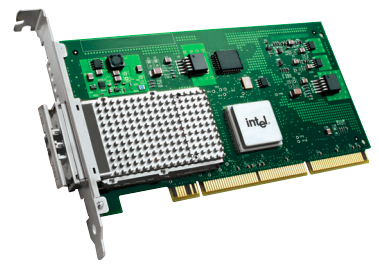

Hình 4.1—Network adapter Intel PRO/10GbE LR server adapter (IXGB, 82597EX)

Trước hết, xem nó gọi `request_irq()` để cấp phát IRQ line:

```
// drivers/net/ethernet/intel/ixgb/ixgb_main.c
[...]
int
ixgb_up(struct ixgb_adapter *adapter)
{
    struct net_device *netdev = adapter->netdev;
    int err, irq_flags = IRQF_SHARED;
    [...]
    err = request_irq(adapter->pdev->irq, ixgb_intr, irq_flags,
                      netdev->name, netdev);
    [...]
```

Trong code snippet trên, bạn có thể thấy driver gọi API `request_irq()` để cấp phát interrupt này trong method `ixgb_up()` của network driver. Method này được gọi khi network interface được bring up (bởi tiện ích networking như `ip(8)` hoặc `ifconfig(8)` cũ hơn). Hãy lần lượt xem các tham số truyền vào `request_irq()` ở đây:

- Ở đây, IRQ number—tham số đầu—được truy vấn từ member `irq` của cấu trúc `pci_dev` (vì device này nằm trên PCI bus). Structure pointer `pdev` nằm trong context (hoặc private) metadata structure của driver có tên `ixgb_adapter`. Member của nó tên `irq`.

- Tham số thứ hai là pointer đến interrupt handler routine (thường gọi là hardirq handler; chúng ta xem tất cả chi tiết hơn về sau); ở đây là hàm tên `ixgb_intr()`.

- Tham số thứ ba là bitmask `flags`. Bạn có thể thấy ở đây driver chỉ định interrupt này được chia sẻ (qua flag `IRQF_SHARED`). Việc các device trên bus chia sẻ interrupt line là một phần của đặc tả PCI. Điều này ngụ ý driver cần xác minh interrupt thực sự dành cho nó. Nó thực hiện trong interrupt handler (thường là code rất hardware-specific, thường kiểm tra một register cho trước có giá trị kỳ vọng hay không).

- Tham số thứ tư là tên driver xử lý interrupt. Nó được lấy qua member `name` của cấu trúc chuyên biệt `net_device` (đã được driver đăng ký với net framework của kernel bằng cách gọi `register_netdev()` trong probe method `ixgb_probe()`).

- Tham số thứ năm là giá trị cần truyền đến interrupt handler routine. Như đã nhắc, đó (một lần nữa) là cấu trúc chuyên biệt `net_device` (bên trong có nhúng context structure (`struct ixgb_adapter`) của driver!).

Ngược lại, khi network interface down, kernel gọi method `ixgb_down()`. Khi đó, nó disable NAPI và giải phóng IRQ line bằng `free_irq()`:

```
void
ixgb_down(struct ixgb_adapter *adapter, bool kill_watchdog)
{
    struct net_device *netdev = adapter->netdev;
    [...]
    napi_disable(&adapter->napi);
    /* waiting for NAPI to complete can re-enable interrupts */
    ixgb_irq_disable(adapter);
    free_irq(adapter-pdev->irq, netdev);
    [...]
```

Sau khi học cách bắt hardware interrupt qua `request_irq()`, chúng ta cần hiểu vài điểm then chốt về viết code cho chính interrupt handler routine, nơi thực hiện công việc xử lý interrupt thực tế.

## Triển khai interrupt handler routine

Thông thường, interrupt là cách hardware peripheral báo cho hệ thống—thực ra là driver—rằng dữ liệu đã có và cần lấy đi. Driver điển hình làm như vậy: lấy dữ liệu đến từ device buffer (hoặc port, hay nơi nào khác). Không chỉ thế, cũng có thể có process (hoặc thread) user mode muốn dữ liệu này. Vì vậy, rất có thể chúng đã mở device file và thực hiện system call `read(2)` (hoặc tương đương). Điều này khiến chúng hiện đang block (sleep) chờ chính sự kiện này; tức dữ liệu đến từ device.

Khi phát hiện hiện chưa có dữ liệu, read method của driver thường đưa process context vào sleep bằng một trong các API `wait_event*()`.

Vì thế, sau khi interrupt handler của driver lấy dữ liệu vào một kernel buffer, nó thường đánh thức reader đang sleep. Chúng lúc này chạy qua read method của driver (trong process context), lấy dữ liệu và truyền vào user space buffer theo yêu cầu.

Mục này được chia thành hai phần lớn. Trước tiên, chúng ta học điều có thể và không thể làm trong interrupt handler. Sau đó trình bày cách viết code.

### Hướng dẫn về interrupt context—điều nên và không nên làm

Interrupt handler routine là code C thông thường của bạn, với một số điểm cần lưu ý. Những điểm then chốt về thiết kế và triển khai hardware interrupt handler như sau:

- Handler chạy trong interrupt context, vì thế đừng block: Trước hết, code này luôn chạy trong interrupt context; tức atomic context. Trên preemptible kernel, preemption bị disable, nên có một số giới hạn về điều nó được và không được làm. Cụ thể, nó không được làm bất kỳ điều gì trực tiếp hoặc gián tiếp gọi scheduler (`schedule()`)! Thực tế, bạn không được làm các việc sau:

- Truyền dữ liệu qua lại giữa kernel và user space vì có thể gây page fault, điều không được phép trong atomic context.

- Dùng flag `GFP_KERNEL` khi cấp phát memory. Bạn phải dùng flag `GFP_ATOMIC` để việc cấp phát non-blocking—hoặc thành công hoặc thất bại ngay lập tức.

- Gọi bất kỳ API blocking nào (cuối cùng gọi `schedule()`). Nói cách khác, các code path phải hoàn toàn non-blocking. (Chúng ta đã trình bày lý do khá chi tiết trong Như đã thấy ở tài liệu đồng hành Linux Kernel Programming - Chương 8, Cấp phát kernel memory cho tác giả module – Phần 1, mục Không bao giờ sleep trong interrupt context hoặc atomic context).

- Interrupt masking: Theo mặc định, khi interrupt handler của bạn đang chạy, mọi interrupt trên local CPU core nơi handler đang thực thi được mask (disable), và interrupt cụ thể bạn đang xử lý được mask trên mọi core. Vì thế code của bạn vốn reentrant-safe.

- Hãy làm thật nhanh!: Bạn đang viết code thực sự ngắt các process khác—những “công việc” khác hệ thống đang chạy trước khi bạn đột ngột ngắt nó; vì thế bạn phải làm điều cần thiết nhanh nhất có thể rồi trả về, cho phép code path bị ngắt tiếp tục. Các system software metric quan trọng gồm worst-case interrupt length và worst-case interrupt's disabled time (chúng ta trình bày thêm ở mục Đo metric và latency cuối chương).

Những điểm này đủ quan trọng để cần giải thích thêm, nên chúng ta sẽ trình bày kỹ hơn trong các mục nhỏ sau.

#### Đừng block—nhận biết code path có thể blocking

Điều này thực chất quy về việc khi ở interrupt context hoặc atomic context, đừng làm bất kỳ điều gì gọi `schedule()`. Bây giờ, hãy xem điều gì xảy ra nếu pseudocode của interrupt handler như sau:

```
my_interrupt()
{
    struct mys *sp;
    ack_intr();
    x = read_regX();
    sp = kzalloc(SIZE_HWBUF, GFP_KERNEL);
    if (!sp)
        return -ENOMEM;
    sp = fetch_data_from_hw();
    copy_to_user(ubuf, sp, count);
    kfree(sp);
}
```

Bạn đã nhận ra những bug tiềm ẩn lớn (dù có lẽ vẫn tinh vi) ở đây chưa? (Hãy dành chút thời gian tìm trước khi đọc tiếp.)

Trước tiên, gọi `kzalloc()` với flag `GFP_KERNEL` có thể khiến kernel code của nó gọi `schedule()`! Nếu xảy ra, điều này dẫn đến “Oops”, một kernel bug. Trong môi trường production điển hình, điều này khiến kernel panic (vì sysctl tên `panic_on_oops` thường được đặt bằng `1` trong production; chạy `sysctl` `kernel.panic_on_oops` sẽ hiển thị thiết lập hiện tại). Tiếp theo, gọi `copy_to_user()` có thể gây page fault và do đó cần context switch, tất nhiên sẽ gọi `schedule()`; điều này hoàn toàn không thể—một lần nữa là bug nghiêm trọng—trong atomic context hoặc interrupt context!

Vì vậy, nói tổng quát hơn, giả sử interrupt handler gọi một hàm `a()`, với call chain của `a()` như sau:

```
        a() -- b() -- c() -- [...] -- g() -- schedule() -- [...]
```

Ở đây, bạn có thể thấy gọi `a()` cuối cùng dẫn đến gọi `schedule()`, mà như vừa chỉ ra sẽ dẫn đến “Oops”, một kernel bug. Vì thế câu hỏi là, bạn, người phát triển driver, làm sao biết khi gọi `a()` sẽ dẫn đến gọi `schedule()`? Có vài điểm bạn cần hiểu và tận dụng:

- (Như đã nhắc trong tài liệu đồng hành Linux Kernel Programming - Chương 8, Cấp phát kernel memory cho tác giả module – Phần 1) Một cách để biết trước kernel code có bao giờ đi vào atomic context hoặc interrupt context là xem trực tiếp kernel. Khi cấu hình kernel (một lần nữa, như đã thấy trong tài liệu đồng hành Linux Kernel Programming, nhớ `make` `menuconfig` từ Linux Kernel Programming - Chương 2, Build Linux kernel 5.x từ source – Phần 1), bạn có thể bật một kernel config option giúp nhận biết chính xác hoàn cảnh này. Hãy xem menu Kernel Hacking / Lock Debugging. Ở đó có một Boolean tunable tên Sleep inside atomic section checking. Hãy bật nó!

Config option tên `CONFIG_DEBUG_ATOMIC_SLEEP`; bạn luôn có thể grep config file của kernel để tìm nó. Như đã thấy trong tài liệu đồng hành Linux Kernel Programming - Chương 5, Viết kernel module đầu tiên - LKM Phần 2, mục Cấu hình debug kernel, chúng ta chỉ định option này nên được bật!

- Tiếp theo (hơi tỉ mỉ, nhưng sẽ giúp bạn!), hãy tạo thói quen tra tài liệu kernel về hàm đang xét (tốt hơn nữa là xem nhanh code). Việc đó là blocking call thường được tài liệu hóa hoặc chỉ rõ trong comment header.

- Kernel có helper macro tên `might_sleep()`; đó là công cụ hỗ trợ debug hữu ích cho đúng những tình huống này! Screenshot sau (từ kernel source, `include/linux/kernel.h`) giải thích rõ:

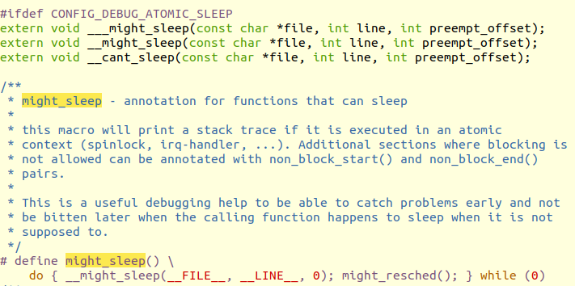

Hình 4.2—Comment cho might\_sleep() rất hữu ích

Tương tự, kernel cung cấp các helper macro như `might_resched()`, `cant_sleep()`, `non_block_start()`, `non_block_end(` `)`, v.v.

- Xin nhắc lại, chúng ta đã nói gần như cùng điều—không block trong atomic context—ở tài liệu đồng hành Linux Kernel Programming, Chương 8, Cấp phát kernel memory cho tác giả module Phần 1, mục Xử lý GFP flag (và những chỗ khác). Hơn nữa, chúng ta cũng chỉ ra dự án LDV hữu ích (đã nhắc trong tài liệu đồng hành Linux Kernel Programming, Chương 1, Thiết lập kernel workspace, mục Dự án LDV - Linux Driver Verification) đã phát hiện và sửa nhiều vi phạm như vậy trong code kernel và driver module.

Đầu mục này, chúng ta nói reader user space đang sleep thường block chờ dữ liệu đến. Việc dữ liệu đến thường được báo bằng hardware interrupt. Sau đó interrupt handler routine lấy dữ liệu vào kernel VAS buffer và đánh thức các sleeper. Này, điều đó không bị cấm sao? Không—các API `wake_up*()` vốn non-blocking. Điều cần hiểu là chúng chỉ chuyển trạng thái process (hoặc thread) từ asleep (`TASK_{UN}INTERRUPTIBLE`) sang awake, sẵn sàng chạy (`TASK_RUNNING`). Điều này không gọi scheduler; kernel làm việc đó ở opportunity point tiếp theo (chúng ta thảo luận CPU scheduling trong tài liệu đồng hành Linux Kernel Programming, Chương 10, CPU scheduler – Phần 1, và Chương 11, CPU scheduler – Phần 2).

#### Interrupt masking—mặc định và cách điều khiển

Nhớ rằng interrupt controller chip (PIC/GIC) có mask register. OS có thể lập trình nó để mask hoặc block hardware interrupt khi cần (tất nhiên một số interrupt có thể không mask được; non-maskable interrupt (NMI) là trường hợp điển hình sẽ thảo luận sau trong chương).

Tuy nhiên, điều quan trọng là nhận ra giữ interrupt được enable (unmask) nhiều nhất có thể là thước đo chất lượng OS thiết yếu! Vì sao? Nếu interrupt bị block, peripheral không thể được đáp ứng và hiệu năng hệ thống chậm hoặc suy giảm do đó (chỉ nhấn và thả một phím keyboard đã tạo ra hai hardware interrupt). Bạn phải giữ interrupt được enable lâu nhất có thể. Lock bằng spinlock sẽ khiến interrupt và preemption bị disable! Giữ critical section ngắn (chúng ta trình bày locking sâu trong hai chương cuối sách).

Tiếp theo, xét hành vi mặc định trong Linux OS: khi hardware interrupt xảy ra và interrupt đó không bị mask (luôn là mặc định), giả sử nó là IRQn (với n là IRQ number), kernel đảm bảo trong khi interrupt (hardirq) handler của nó thực thi, mọi interrupt trên local CPU core nơi handler thực thi đều bị disable và IRQn bị disable trên mọi CPU. Vì vậy handler code vốn reentrant-safe. Điều này tốt vì bạn không bao giờ phải lo:

- Tự mask interrupt

- Khi nào cần chạy atomically, đến hoàn tất và không bị ngắt, trên CPU core đó

Như sẽ thấy về sau, bottom-half vẫn có thể bị top-half ngắt, vì thế cần locking.

Trong khi IRQn thực thi trên, chẳng hạn, CPU core 1, các interrupt khác vẫn được enable (unmask) trên mọi CPU core ngoại trừ core 1. Vì thế, trên multicore system hardware, interrupt có thể chạy song song trên các CPU core khác nhau. Điều này ổn miễn là chúng không giẫm chân nhau về global data! Nếu có, bạn phải dùng locking, điều sẽ trình bày chi tiết trong hai chương cuối sách. Hơn nữa, trên Linux, mọi interrupt ngang hàng nên không có priority giữa chúng; nói cách khác, tất cả chạy cùng priority. Miễn không bị mask, bất kỳ hardware interrupt nào cũng có thể ngắt hệ thống bất kỳ lúc nào; interrupt thậm chí ngắt được interrupt! Tuy nhiên, thường chúng không làm điều sau. Vì như vừa học, khi interrupt IRQn chạy trên CPU core, mọi interrupt trên core đó đều bị disable (mask) và IRQn bị disable toàn cục (trên mọi core) cho đến khi hoàn tất; ngoại lệ là NMI.

#### Hãy làm thật nhanh

Interrupt đúng như tên gọi: nó ngắt công việc bình thường trên máy; đó là chút phiền toái phải chấp nhận. Context phải được lưu, handler phải được thực thi (cùng bottom half, sẽ trình bày trong mục Hiểu và sử dụng top half cùng bottom half), rồi context phải được khôi phục cho phần bị ngắt. Vì vậy, bạn hiểu ý rồi: đây là critical code path, đừng chậm chạp—hãy nhanh và non-blocking!

Điều này cũng đặt ra câu hỏi, nhanh là nhanh đến đâu? Tuy câu trả lời tất nhiên platform-dependent, một heuristic là: giữ interrupt processing nhanh nhất có thể, trong khoảng vài chục microsecond. Nếu liên tục vượt 100 microsecond, cần tính đến chiến lược thay thế. Chúng ta trình bày những việc có thể làm khi điều này xảy ra ở phần sau chương.

Với snippet pseudocode `my_interrupt()` đơn giản (trình bày trong mục Đừng block—nhận biết code path có thể blocking), trước tiên hãy tự hỏi, tôi có thực sự phải cấp phát memory trong critical code path non-blocking needs-to-execute-fast như interrupt handler không? Bạn có thể thiết kế module/driver để cấp phát memory trước đó (và chỉ dùng pointer) không?

Một lần nữa, thực tế đôi khi cần làm khá nhiều việc để phục vụ interrupt đúng cách (network/block driver là ví dụ tốt). Chúng ta sẽ trình bày một số chiến lược điển hình để xử lý việc này ngay sau đây.

### Viết chính interrupt handler routine

Bây giờ, hãy học nhanh phần cách thức thực hiện. Signature của hardware interrupt handler routine (thường gọi là hardirq routine) như sau:

```
static irqreturn_t interrupt_handler(int irq, void *data);
```

Interrupt handler routine được generic IRQ layer của kernel gọi khi hardware IRQ mà driver đã đăng ký quan tâm (qua API `request_irq()` hoặc API tương tự) được kích hoạt. Nó nhận hai tham số:

- Tham số đầu là IRQ line (số nguyên). Kích hoạt line này khiến handler được gọi.

- Tham số thứ hai là giá trị đã truyền qua tham số cuối của `request_irq()`. Như đã nhắc, nó thường là device structure chuyên biệt của driver, nhúng driver context hoặc private data. Vì vậy kiểu dữ liệu của nó là kiểu tổng quát `void *`, cho phép `request_irq()` truyền bất kỳ kiểu nào, typecast thích hợp trong handler routine rồi sử dụng.

Handler là code C thông thường, nhưng đi kèm mọi lưu ý ở mục trước! Hãy cẩn thận tuân theo các hướng dẫn đó. Dù chi tiết hardware-specific, thông thường trách nhiệm đầu tiên của interrupt handler là clear interrupt trên board, thực chất acknowledge nó và báo cho PIC. Điều này thường đạt được bằng cách ghi một số bit cụ thể vào hardware register chỉ định trên board hoặc controller; đọc datasheet của chip, chipset hoặc hardware device cụ thể để xác định. Ở đây, macro `in_irq()` trả về `true`, cho biết code hiện đang ở hardirq context.

Phần việc còn lại của handler hiển nhiên rất đặc thù device. Ví dụ, input driver muốn scan key code (hoặc tọa độ touchscreen, hay phím/chuyển động mouse, hoặc thứ gì khác) vừa được nhấn hoặc thả từ register hay peripheral memory location nào đó, rồi có thể lưu vào memory buffer. Hoặc nó có thể ngay lập tức truyền lên stack đến generic input layer bên trên. Chúng ta không đi sâu những chi tiết đó ở đây. Một lần nữa, driver framework là điều cần hiểu cho loại driver của bạn; điều này ngoài phạm vi sách.

Còn giá trị cần trả về từ hardirq handler thì sao? Return value `irqreturn_t` là một `enum` và có dạng:

```
// include/linux/irqreturn.h

/**
 * enum irqreturn
 * @IRQ_NONE interrupt was not from this device or was not handled
 * @IRQ_HANDLED interrupt was handled by this device
 * @IRQ_WAKE_THREAD handler requests to wake the handler thread
 */
enum irqreturn {
    IRQ_NONE = (0 0),
    IRQ_HANDLED = (1 0),
    IRQ_WAKE_THREAD = (1 1),
};
```

Comment header trên chỉ rõ ý nghĩa. Về cơ bản, generic IRQ framework yêu cầu trả về giá trị `IRQ_HANDLED` nếu driver đã xử lý interrupt. Nếu interrupt không dành cho bạn hoặc bạn không xử lý được, nên trả về giá trị `IRQ_NONE`. (Điều này cũng giúp kernel phát hiện spurious interrupt. Nếu không xác định được có phải interrupt của bạn không, chỉ cần trả về `IRQ_HANDLED`.) Chúng ta sẽ thấy cách dùng `IRQ_WAKE_THREAD` ngay sau đây.

Bây giờ, hãy xem thêm code! Trong mục tiếp theo, chúng ta xem hardware interrupt handler code cho hai driver (đã gặp trước đó trong chương này và chương trước).

#### Xem code 2—interrupt handler của driver i8042

Trong chương trước, `Chapter 3`, Làm việc với hardware I/O memory, mục Ví dụ PIO—i8042, chúng ta học cách device driver i8042 dùng một số helper routine rất đơn giản để thực hiện I/O (đọc/ghi) trên các I/O port của chip i8042 (thường là keyboard/mouse controller trên hệ thống x86). Code snippet sau cho thấy một phần code của hardware interrupt handler routine; bạn có thể thấy rõ nó đọc cả status register lẫn data register:

```
// drivers/input/serio/i8042.c
/*
 * i8042_interrupt() is the most important function in this driver -
 * it handles the interrupts from the i8042, and sends incoming bytes
 * to the upper layers.
 */
static irqreturn_t i8042_interrupt(int irq, void *dev_id)
{
    unsigned char str, data;
    [...]
    str = i8042_read_status();
    [...]
    data = i8042_read_data();
    [...]
    if (likely(serio && !filtered))
        serio_interrupt(serio, data, dfl);
 out:
    return IRQ_RETVAL(ret);
}
```

Ở đây, lời gọi `serio_interrupt()` là cách driver truyền dữ liệu đọc từ hardware lên “input” layer bên trên, nơi xử lý tiếp và cuối cùng chuẩn bị sẵn cho user space process tiêu thụ. (Xem mục Câu hỏi cuối chương; một bài tập để bạn thử là viết device driver “key logger” đơn giản.)

#### Xem code 3—interrupt handler của IXGB network driver

Hãy xem ví dụ khác. Ở đây chúng ta xem hardware interrupt handler của device driver Intel IXGB ethernet adapter, đã nhắc ở phần trước:

```
// drivers/net/ethernet/intel/ixgb/ixgb_main.c
static irqreturn_t
ixgb_intr(int irq, void *data)
{
    struct net_device *netdev = data;
    struct ixgb_adapter *adapter = netdev_priv(netdev);
    struct ixgb_hw *hw = &adapter-hw;
    u32 icr = IXGB_READ_REG(hw, ICR);

    if (unlikely(!icr))
        return IRQ_NONE; /* Not our interrupt */
    [...]
    if (napi_schedule_prep(&adapter-napi)) {
        [...]
        IXGB_WRITE_REG(&adapter-hw, IMC, ~0);
        __napi_schedule(&adapter-napi);
    }
    return IRQ_HANDLED;
}
```

Trong code snippet trên, chú ý cách driver truy cập private (hoặc context) metadata structure (`struct ixgb_adapter`) từ cấu trúc `net_device` (cấu trúc chuyên biệt cho network device) nhận làm tham số thứ hai; điều này rất điển hình. (Ở đây, helper `netdev_priv()` dùng để trích private structure của driver từ cấu trúc tổng quát `net_device` phần nào tương tự helper macro well-known `container_of()`. Thực tế, helper này cũng thường được dùng trong các tình huống tương tự.) Tiếp theo, nó thực hiện peripheral I/O memory read qua macro `IXGB_READ_REG()` (dùng cách tiếp cận MMIO—xem chương trước để biết chi tiết MMIO; `IXGB_READ_REG()` là macro gọi API `readl()` đã trình bày ở chương trước—routine kiểu cũ để thực hiện MMIO read 32-bit). Đừng bỏ lỡ điểm then chốt: đây là cách driver xác định interrupt dành cho nó hay không, vì hãy nhớ đó là shared interrupt! Nếu dành cho nó (trường hợp có khả năng cao), nó tiếp tục công việc; vì adapter hỗ trợ NAPI, driver lúc này lên lịch polled NAPI read để thu network packet khi chúng đến và gửi lên network protocol stack để xử lý tiếp (thực ra không đơn giản đến vậy; việc truyền memory thực tế sẽ được thực hiện qua DMA).

Bây giờ, tạm chuyển hướng nhưng rất quan trọng: bạn cần học cách cấp phát IRQ line theo cách hiện đại—qua các API `devm_*`. Đây được gọi là managed approach.

### Cấp phát IRQ—cách hiện đại—managed interrupt facility

Nhiều driver hiện đại dùng devres hoặc managed API framework của kernel cho nhiều mục đích. Managed API trong Linux kernel hiện đại mang lợi ích là không phải lo giải phóng resource đã cấp phát (chúng ta đã trình bày một số, gồm `devm_k{m,z}alloc()` và `devm_ioremap{_resource}()`). Tất nhiên, phải sử dụng đúng cách, thường trong probe method (hoặc code `init`) của driver.

Khi viết driver, bạn được khuyến nghị dùng kiểu API mới hơn này. Ở đây chúng ta chỉ cách dùng API `devm_request_irq()` để cấp phát (đăng ký) hardware interrupt. Signature như sau:

```
#include <linux/interrupt.h>

int __must_check
devm_request_irq(struct device *dev, unsigned int irq, irq_handler_t
handler,
                  unsigned long irqflags, const char *devname, void
*dev_id);
```

Tham số đầu là pointer đến cấu trúc `device` của device (như đã thấy trong `Chapter 1`, Viết misc character device driver đơn giản, phải lấy bằng cách đăng ký với kernel framework thích hợp). Năm tham số còn lại giống hệt `request_irq()`; chúng ta không lặp lại. Mục đích là sau khi đăng ký, bạn không còn phải gọi `free_irq()`; kernel tự động gọi khi cần (khi remove driver hoặc detach device). Điều này giúp rất nhiều để người phát triển tránh các bug kiểu resource leak phổ biến và tai tiếng.

Để làm rõ cách dùng, hãy xem nhanh ví dụ. Sau đây là một phần code từ V4L TV tuner driver:

```
// drivers/gpu/drm/exynos/exynos_mixer.c
[...]
    res = platform_get_resource(mixer_ctx->pdev, IORESOURCE_IRQ, 0);
    if (res == NULL) {
        dev_err(dev, "get interrupt resource failed.\n");
        return -ENXIO;
    }

    ret = devm_request_irq(dev, res->start, mixer_irq_handler,
                        0, "drm_mixer", mixer_ctx);
    if (ret) {
        dev_err(dev, "request interrupt failed.\n");
        return ret;
    }
    mixer_ctx-irq = res->start;
[...]
```

Như đã thấy khi lấy physical address cho MMIO trong `Chapter 3`, Làm việc với hardware I/O memory, mục Lấy device resource, ở đây cùng driver đó dùng API `platform_get_resource()` để trích IRQ number (chỉ định loại resource là IRQ line bằng `IORESOURCE_IRQ`). Sau khi có, nó gọi API `devm_request_irq()` để cấp phát hoặc đăng ký interrupt! Đúng như kỳ vọng, tìm `free_irq()` trong driver này không cho kết quả.

Tiếp theo, chúng ta học threaded interrupt là gì, cách làm việc với nó và, quan trọng hơn, lý do dùng nó.

## Làm việc với mô hình threaded interrupt

Như đã thấy trong tài liệu đồng hành Linux Kernel Programming - Chương 11, CPU scheduler – Phần 2, ở mục Chuyển mainline Linux thành RTOS, chúng ta trình bày real-time patch cho Linux (RTL), cho phép patch, cấu hình, build và chạy Linux như RTOS! Nếu chưa rõ, hãy xem lại. Chúng ta không lặp lại cùng thông tin ở đây.

Công việc của dự án Real-Time Linux (RTL) đã dần được back-ported vào mainline Linux kernel. Một thay đổi then chốt do RTL mang lại là merge tính năng threaded interrupt vào mainline kernel. Điều này xảy ra trong kernel phiên bản 2.6.30 (tháng 6 năm 2009). Công nghệ này làm điều thoạt nhìn rất lạ: nó “chuyển đổi” hardware interrupt handler thành, về cơ bản, một kernel thread.

Như sẽ học ở chương tiếp theo, kernel thread thực sự rất giống user mode thread—nó chạy độc lập, trong process context, có task structure riêng (do đó PID, TGID, v.v. riêng), nghĩa là có thể được schedule; tức khi ở trạng thái runnable, nó cạnh tranh với các thread khác để chạy trên CPU core. Khác biệt then chốt là user mode thread luôn có hai address space—process VAS mà nó thuộc về (user space) và kernel VAS mà nó chuyển sang khi thực hiện system call. Ngược lại, kernel thread chỉ chạy trong kernel space và không nhìn thấy user space; nó chỉ thấy kernel VAS nơi nó luôn thực thi (về kỹ thuật, giá trị `current-mm` của nó luôn là `NULL`!).

Vậy làm sao quyết định có nên dùng threaded interrupt? Chúng ta cần trình bày thêm vài chủ đề trước khi điều này hoàn toàn rõ ràng (với những bạn nóng lòng, câu trả lời ngắn là: dùng threaded interrupt handler khi (theo heuristic nhanh) công việc interrupt mất hơn 100 microsecond; nhảy đến mục Hardirq, tasklet, threaded handler—dùng gì khi nào và xem bảng ở đó để có cái nhìn nhanh).

Bây giờ, hãy học cách sử dụng mô hình threaded interrupt bằng cách xem các API sẵn có—cả loại thông thường lẫn managed. Sau đó, chúng ta học dùng phiên bản managed và đưa nó vào driver. Tiếp theo, xem cách triển khai nội bộ và tìm hiểu sâu hơn lý do dùng nó.

### Sử dụng mô hình threaded interrupt—API

Để hiểu hoạt động bên trong của mô hình threaded interrupt, hãy xem các API liên quan. Chúng ta đã trình bày cách dùng API `request_irq()`. Hãy xem cách triển khai:

```
// include/linux/interrupt.h
static inline int __must_check
request_irq(unsigned int irq, irq_handler_t handler, unsigned long flags,
const char *name, void *dev)
{
    return request_threaded_irq(irq, handler, NULL, flags, name, dev);
}
```

API này chỉ là thin wrapper trên API `request_threaded_irq()`! Signature như sau:

```
int __must_check
request_threaded_irq(unsigned int irq, irq_handler_t handler,
               irq_handler_t thread_fn,
               unsigned long flags, const char *name, void *dev);
```

Các tham số, trừ tham số thứ ba, giống hệt `request_irq()`. Sau đây là vài điểm then chốt cần lưu ý:

- `irq_handler_t handler`: Tham số thứ hai là pointer đến interrupt handler function thông thường. Bây giờ chúng ta gọi nó là primary handler. Nếu null và `thread_fn` (tham số thứ ba) non-null, một primary handler mặc định (của kernel) được auto-installed (nếu bạn thắc mắc về primary handler mặc định này, chúng ta trình bày chi tiết hơn trong mục Triển khai threaded interrupt bên trong).

- `irq_handler_t thread_fn`: Tham số thứ ba là pointer đến threaded interrupt function; hành vi API phụ thuộc việc bạn truyền tham số này là null hay không:

- Nếu non-null, việc phục vụ interrupt thực tế do hàm này thực hiện. Nó chạy trong context (process) của một kernel thread riêng—đó là threaded interrupt!

- Nếu null, là mặc định khi gọi `request_irq()`, chỉ primary handler chạy và không tạo kernel thread.

Primary handler, nếu được chỉ định (tham số thứ hai), chạy trong cái gọi là hardirq hay hard interrupt context (giống trường hợp `request_irq()`). Nếu primary handler non-null, bạn phải viết code của nó và (tối thiểu) thực hiện:

- Xác minh interrupt dành cho bạn; nếu không, trả về `IRQ_NONE`.

- Nếu dành cho bạn, có thể clear và/hoặc disable interrupt trên board/device.

- Trả về `IRQ_WAKE_THREAD`; điều này khiến kernel đánh thức kernel thread đại diện threaded interrupt handler. Tên kernel thread theo dạng `irq/irq#-name`. Kernel thread này lúc đó gọi nội bộ hàm `thread_fn()`, nơi bạn thực hiện công việc interrupt handling thực tế.

Mặt khác, nếu primary handler null, chỉ threaded handler—hàm được chỉ định bằng tham số thứ ba—được OS tự động chạy như kernel thread khi interrupt kích hoạt.

Như với `request_irq()`, return value của `request_threaded_irq()` là số nguyên, theo convention kernel `0/-E` thông thường: `0` khi thành công và giá trị `errno` âm khi thất bại. Bạn phải kiểm tra nó.

### Sử dụng mô hình managed threaded interrupt—cách được khuyến nghị

Một lần nữa, dùng managed API để cấp phát threaded interrupt là cách được khuyến nghị cho driver hiện đại. Kernel cung cấp API `devm_request_threaded_irq()` cho đúng mục đích này:

```
#include linux/interrupt.h

int __must_check
 devm_request_threaded_irq(struct device *dev, unsigned int irq,
               irq_handler_t handler, irq_handler_t thread_fn,
               unsigned long irqflags, const char *devname,
               void *dev_id);
```

Mọi tham số ngoài tham số đầu, là pointer đến device structure, đều giống `request_threaded_irq()`. Lợi ích then chốt là không phải lo giải phóng IRQ line. Kernel auto-free nó khi detach device hoặc remove driver, như đã học với `devm_request_irq()`. Như với `request_threaded_irq()`, return value của `devm_request_threaded_irq()` là số nguyên, theo convention kernel `0/-E` thông thường: `0` khi thành công và giá trị errno âm khi thất bại; bạn phải kiểm tra.

Đừng quên! Dùng managed API `devm_request_threaded_irq()` là cách hiện đại được khuyến nghị để cấp phát threaded interrupt. Tuy nhiên, lưu ý không phải lúc nào đó cũng là cách phù hợp; xem mục Các ràng buộc khi dùng threaded handler để biết thêm.

Signature của threaded interrupt handler function giống hệt hardirq interrupt handler:

```
static irqreturn_t threaded_handler(int irq, void *data);
```

Các tham số cũng có cùng ý nghĩa.

Threaded interrupt thường dùng interrupt flag `IRQF_ONESHOT`; comment kernel trong `include/linux/interrupt.h` mô tả rõ nhất:

```
 * IRQF_ONESHOT - Interrupt is not reenabled after the hardirq handler
finished.
 * Used by threaded interrupts which need to keep the
 * irq line disabled until the threaded handler has been run.
```

Thực tế, kernel yêu cầu dùng flag `IRQF_ONESHOT` khi driver tích hợp threaded handler và primary handler là mặc định của kernel. Không dùng flag `IRQF_ONESHOT` sẽ rất tai hại khi có level-triggered interrupt. Để an toàn, kernel báo lỗi—khi flag này không có trong tham số bitmask `irqflags`—ngay cả với edge-triggering. Nếu tò mò, code tại `kernel/irq/manage.c:__setup_irq()` kiểm tra chính điều này (liên kết: `https://elixir.bootlin.com/linux/v5.4/source/kernel/irq/manage.c#L1486`).

Có kernel parameter tên `threadirqs` mà bạn có thể truyền vào kernel command line (qua bootloader). Nó buộc mọi interrupt handler chạy threaded ngoại trừ những handler được đánh dấu rõ là `IRQF_NO_THREAD`. Để biết thêm kernel parameter này, xem `https://www.kernel.org/doc/html/latest/admin-guide/kernel-parameters.html`.

Trong mục nhỏ tiếp theo, chúng ta xem một trong những microcontroller STM32 của Linux driver. Ở đây tập trung vào cách cấp phát interrupt qua “managed” API vừa trình bày.

#### Xem code 4—threaded interrupt handler của microcontroller STM32 F7

STM32 F7 thuộc dòng microcontroller do STMicroelectronics sản xuất, dựa trên ARM-Cortex M7F core:

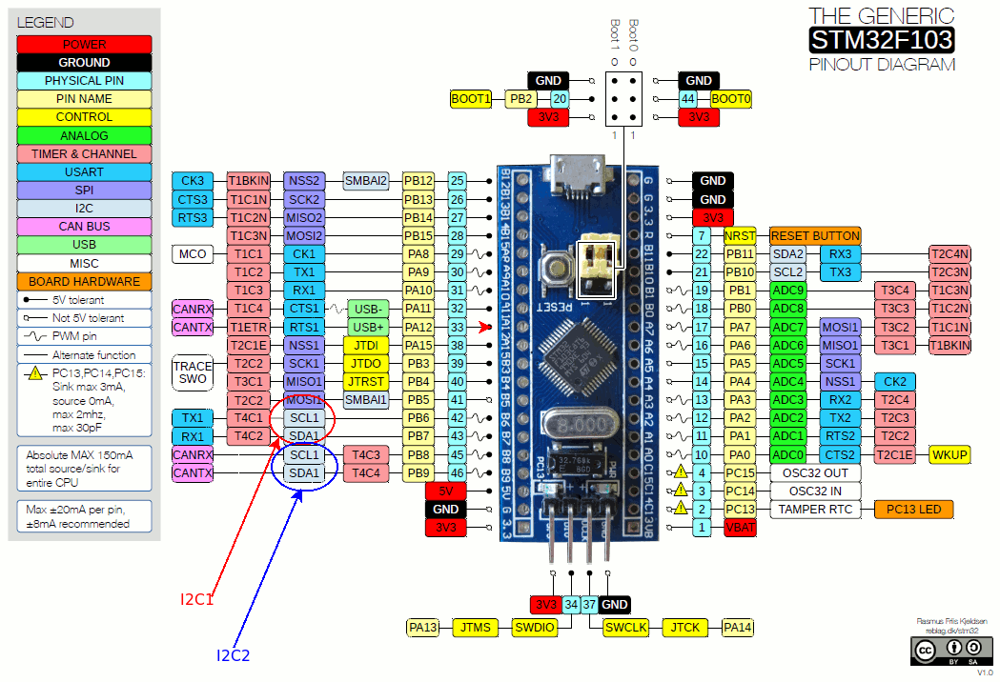

Hình 4.3—Pinout microcontroller STM32F103 với một số I2C pin được đánh dấu (xem phía dưới bên trái)

Nguồn ảnh: Ảnh trên, được tôi bổ sung đôi chút, lấy từ `https://www.electronicshub.org/wp-content/uploads/2020/02/STM32F103C8T6-Blue-Pill-Pin-Layout.gif`. Ảnh của Rasmus Friis Kjekisen. Ảnh thuộc Creative Commons CC BY-SA 1.0 (`https://creativecommons.org/licenses/by-sa/1.0/`).

Linux kernel hỗ trợ STM32 F7 qua nhiều driver và DTS file. Ở đây, chúng ta xem một chút code của I2C bus driver (`drivers/i2c/busses/i2c-stm32f7.c`) cho microcontroller này. Nó cấp phát hai hardware interrupt:

- Event IRQ line, qua API `devm_request_threaded_irq()`

- Error IRQ line, qua API `request_irq()`

Code cấp phát các IRQ line, đúng như dự kiến, nằm trong probe method:

```
// drivers/i2c/busses/i2c-stm32f7.c
static int stm32f7_i2c_probe(struct platform_device *pdev)
{
    struct stm32f7_i2c_dev *i2c_dev;
    const struct stm32f7_i2c_setup *setup;
    struct resource *res;
    int irq_error, irq_event, ret;

    [...]
    irq_event = platform_get_irq(pdev, 0);
    [...]
    irq_error = platform_get_irq(pdev, 1);
    [...]
    ret = devm_request_threaded_irq(&pdev->dev, irq_event,
                    stm32f7_i2c_isr_event,
                    stm32f7_i2c_isr_event_thread,
                    IRQF_ONESHOT,
                    pdev->name, i2c_dev);
    [...]
    ret = devm_request_irq(&pdev->dev, irq_error, stm32f7_i2c_isr_error, 0,
                   pdev->name, i2c_dev);
```

Hãy tập trung vào lời gọi `devm_request_threaded_irq()`. Tham số đầu là pointer đến device structure. Vì đây là platform driver (được đăng ký qua wrapper macro `module_platform_driver`), probe method nhận tham số `struct` `platform_device *pdev`; cấu trúc `device` được trích từ đó. Tham số thứ hai là IRQ line cần cấp phát. Một lần nữa, như đã thấy, nó được lấy qua helper routine. Ở đây là API `platform_get_irq()`. Tham số thứ ba chỉ định primary handler; tức hardirq. Vì non-null, routine này được gọi khi IRQ kích hoạt. Nó thực hiện xác minh hardware-specific trên device và I2C transfer; nếu mọi thứ ổn, trả về giá trị `IRQ_WAKE_THREAD`. Điều này đánh thức threaded interrupt routine, tham số thứ tư, và hàm `stm32f7_i2c_isr_event_thread()` chạy như kernel thread trong process context! Tham số `irqflags`, đặt bằng `IRQF_ONESHOT`, là điển hình với threaded handler; nó chỉ định IRQ line vẫn bị disable cho đến khi threaded handler hoàn tất (không chỉ hardirq). Threaded handler routine làm công việc của nó và trả về `IRQ_HANDLED` khi xong.

Vì error IRQ line được cấp phát qua API `devm_request_irq()`, và vì đã trình bày cách dùng API này (xem mục Cấp phát IRQ—cách hiện đại—managed interrupt facility), chúng ta không lặp lại thông tin về nó ở đây.

Bây giờ, hãy xem kernel triển khai mô hình threaded interrupt bên trong như thế nào.

### Triển khai threaded interrupt bên trong

Như đã nhắc, nếu primary handler null và thread function non-null, kernel dùng primary handler mặc định. Hàm tên `irq_default_primary_handler()` và chỉ trả về giá trị `IRQ_WAKE_THREAD`, qua đó đánh thức (và làm cho có thể schedule) kernel thread.

Hơn nữa, kernel thread thực tế chạy routine `thread_fn` được tạo trong code của API `request_threaded_irq()`. Call graph (ở Linux kernel phiên bản 5.4.0) như sau:

```
   kernel/irq/manage.c:request_threaded_irq() --  __setup_irq() --
          setup_irq_thread() -- kernel/kthread.c:kthread_create()
```

Lời gọi API `kthread_create()` như sau. Ở đây, bạn thấy rõ tên kernel thread mới theo dạng `irq/irq#-name`:

```
t = kthread_create(irq_thread, new, "irq/%d-%s", irq, new->name);
```

Ở đây (không hiển thị code), kernel thread mới được lập trình đặt scheduling policy `SCHED_FIFO` và real-time scheduling priority `MAX_USER_RT_PRIO/2`, thường có giá trị `50` (dải `SCHED_FIFO` từ `1` đến `99`, và `MAX_USER_RT_PRIO` bằng `100`). Chúng ta trình bày vì sao quan trọng trong mục Vì sao dùng threaded interrupt? Nếu chưa rõ thread scheduling policy và priority, hãy xem tài liệu đồng hành Linux Kernel Programming - Chương 10, CPU scheduler – Phần 1, mục Các POSIX scheduling policy. Kernel quản lý toàn bộ kernel thread đại diện threaded interrupt handler này. Như đã thấy, nó tạo thread khi cấp phát IRQ qua API `[devm_]request_threaded_irq()`; sau đó kernel thread chỉ sleep. Nó được kernel đánh thức theo nhu cầu, mỗi khi IRQ đã cấp phát được kích hoạt; kernel hủy nó khi gọi `free_irq()`. Đừng lo chi tiết lúc này; chúng ta trình bày kernel thread và những chủ đề thú vị khác ở chương tiếp theo.

Đến đây, tuy đã học cách dùng mô hình threaded interrupt, bạn vẫn chưa được giải thích rõ vì sao (và khi nào) nên dùng. Mục tiếp theo trình bày chi tiết.

### Vì sao dùng threaded interrupt?

Một câu hỏi then chốt thường gặp là vì sao phải dùng threaded interrupt khi đã có interrupt hardirq-type thông thường? Câu trả lời đầy đủ hơi dài; sau đây là các lý do chính:

- Để thực sự đạt real time.

- Nó loại bỏ/giảm softirq bottleneck. Vì threaded handler thực sự chạy code trong process context, nó không được xem là code path critical như hardirq handler; do đó bạn có thể dành lâu hơn một chút cho interrupt handling.

- Trong khi hardirq thực thi IRQn, IRQ line đó bị disable trên tất cả core của hệ thống. Nếu mất khá lâu mới thực thi xong (tất nhiên nên thiết kế để không như vậy), khả năng đáp ứng hệ thống có thể giảm đáng kể; ngược lại, khi threaded handler thực thi, hardware IRQ line mặc định được enable. Điều này tốt cho hiệu năng và khả năng đáp ứng. (Lưu ý có nhiều trường hợp driver không muốn hành vi này; tức muốn IRQ bị disable trong khi xử lý. Để làm vậy, chỉ định flag `IRQF_ONSEHOT`.)

Tóm lại, theo quy tắc kinh nghiệm nhanh, khi interrupt handling liên tục mất hơn 100 microsecond, hãy dùng mô hình threaded interrupt (xem bảng trong mục Hardirq, tasklet, threaded handler—dùng gì khi nào).

Trong các mục nhỏ sau, chúng ta mở rộng những điểm này.

#### Threaded interrupt—để thực sự đạt real time

Đây là điểm then chốt và cần giải thích.

Thứ tự ưu tiên trên Linux OS tiêu chuẩn đi từ priority cao nhất đến thấp nhất như sau (chúng ta ghi context chạy ở cuối mỗi bullet; là process hoặc interrupt. Nếu chưa rõ, điều rất quan trọng là phải hiểu; hãy xem tài liệu đồng hành Linux Kernel Programming - Chương 6, Những nội dung thiết yếu của kernel internals – Process và thread, mục Hiểu process context và interrupt context để biết thêm):

- Hardware interrupt: Chúng preempt mọi thứ. Hardirq handler chạy atomically (đến hoàn tất, không bị ngắt) trên CPU; `context:interrupt`.

- Real-time thread (scheduling policy `SCHED_FIFO` hoặc `SCHED_RR`), cả kernel lẫn user space, với real-time priority (`rtprio`) dương; `context:process`:

- Kernel thread ở cùng realtime priority (`current-rtprio`) được tăng nhẹ priority so với user space thread có cùng realtime priority.

- Processor exception: Gồm system call (thực ra là synchronous exception; ví dụ `syscall` trên x86, `SWI` trên ARM), page fault, protection fault, v.v.; `context:process`.

- User mode thread: Mặc định dùng scheduling policy `SCHED_OTHER` với `rtprio` bằng `0`; `context:process`.

Sơ đồ sau cho thấy mức ưu tiên tương đối trên Linux (sơ đồ này hơi đơn giản; sơ đồ tinh chỉnh hơn xuất hiện về sau ở Hình 4.10 và Hình 4.11):

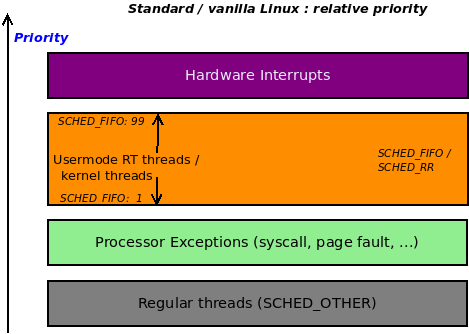

Hình 4.4—Mức ưu tiên tương đối trên Linux OS tiêu chuẩn

Giả sử bạn đang làm việc với real-time multithreaded application. Trong hàng chục thread đang tồn tại trong process, ba thread (để đơn giản gọi là A, B và C) được xem là thread “real-time” critical. Theo đó, bạn cho app cấp scheduling policy `SCHED_FIFO` và real-time priority lần lượt 30, 45 và 60 cho thread A, B và C (nếu chưa rõ những điểm này, xem tài liệu đồng hành Linux Kernel Programming - Chương 10, CPU scheduler - Phần 1, và Chương 11, CPU scheduler - Phần 2, về CPU scheduling). Vì là real-time app, thời gian tối đa những thread này được dùng để hoàn tất công việc bị giới hạn. Nói cách khác, có deadline; trong ví dụ, giả sử worst-case deadline để thread B hoàn tất công việc là 12 millisecond.

Bây giờ, xét priority tương đối thì điều này hoạt động thế nào? Để đơn giản, giả sử hệ thống có một CPU core. Một thread khác, X (chạy với scheduling policy `SCHED_OTHER` và real-time priority `0`, là giá trị scheduling policy/priority mặc định), hiện đang thực thi code trên CPU. Tuy nhiên, nếu “sự kiện” mà bất kỳ real-time thread nào đang chờ xảy ra, nó sẽ preempt thread đang thực thi và chạy. Đây là điều được kỳ vọng; nhớ quy tắc cơ bản của real-time scheduling rất đơn giản: runnable thread có priority cao nhất phải là thread đang chạy. Tốt, điều đó ổn. Bây giờ cần xét hardware interrupt. Hardware interrupt, như đã thấy, có priority cao nhất. Nghĩa là nó preempt mọi thứ, kể cả thread real-time (so-called vậy) của bạn (xem sơ đồ trên)! Giả sử interrupt processing mất 200 microsecond; trên rich OS như Linux, điều này không được xem là quá tệ. Tuy nhiên, trong tình huống này, năm hardware interrupt tiêu thụ 1 millisecond; nếu device bận (ví dụ nhiều data packet đến) và phát, chẳng hạn, 20 hardware interrupt liên tục thì sao? Chắc chắn chúng được ưu tiên và tiêu thụ (ít nhất) 4 millisecond! real-time thread của bạn chắc chắn bị preempt khi interrupt processing chạy và không thể lấy CPU cần thiết cho đến khi đã quá muộn! Deadline (12 ms) đã hết từ lâu và hệ thống thất bại (nếu thật sự là real-time app, điều này có thể thảm khốc).

Sơ đồ sau biểu diễn tình huống về mặt khái niệm (để ngắn gọn và rõ ràng, chỉ hiển thị một user space `SCHED_FIFO` real-time thread; tức thread B ở `rtprio` 45):

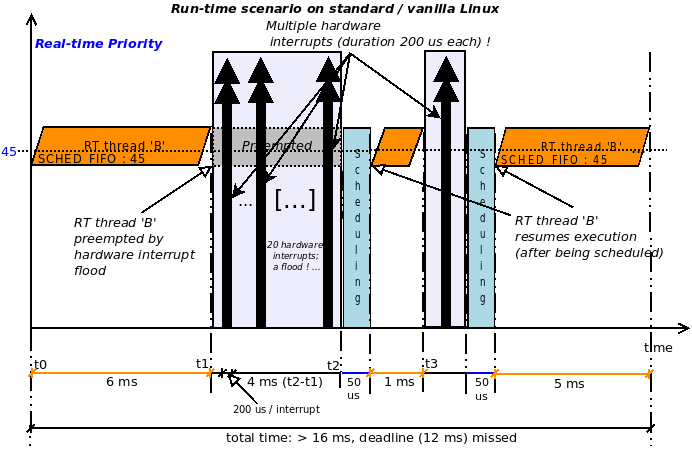

Hình 4.5: Mô hình hardirq—user mode RT SCHED\_FIFO thread bị ngắt bởi hardware interrupt flood; trễ deadline

Real-time thread B được biểu diễn chạy từ thời điểm `t0` (trên x-axis; y-axis biểu diễn real-time priority; `rtprio` của thread B là 45); nó có 12 ms (hard deadline) để hoàn tất công việc. Tuy nhiên, giả sử sau 6 ms (tại `t1`), hardware interrupt kích hoạt. Trong Hình 4.5, chúng ta không hiển thị low-level interrupt setup code được thực thi. Lúc này hardware interrupt kích hoạt tại `t1` khiến interrupt handler được gọi; tức hardirq (biểu diễn bằng double-arrow dọc lớn màu đen trong sơ đồ trên). Hiển nhiên hardware interrupt preempt thread B. Giả sử nó mất 200 microsecond để thực thi; không nhiều, nhưng nếu một đợt interrupt flood (chẳng hạn 20 interrupt, tiêu thụ 4 ms) đến thì sao! Điều này được biểu diễn trong sơ đồ trên: interrupt tiếp tục ở tốc độ cao cho đến `t2`; chỉ sau khi tất cả hoàn tất, context mới được khôi phục. Vì vậy scheduling code chạy và (giả sử) context switch trở lại thread B, cấp processor cho nó (trên Intel CPU hiện đại, chúng ta lấy thời gian context switching bảo thủ 50 microsecond: `https://blog.tsunanet.net/2010/11/how-long-does-it-take-to-make-context.html`). Tuy nhiên, ngay sau đó, tại `t3`, hardware interrupt lại kích hoạt, tiếp tục preempt B. Điều này có thể kéo dài vô hạn; RT thread cuối cùng sẽ chạy (khi interrupt storm kết thúc) nhưng có thể đạt hoặc không đạt deadline! Đây là vấn đề chính.

Vấn đề mô tả ở đoạn trước không biến mất chỉ bằng cách tăng real-time priority của user mode thread; hardirq hardware interrupt vẫn luôn preempt chúng, bất kể priority.

Bằng cách backport threaded interrupt từ dự án RTL vào mainline Linux, chúng ta giải quyết được vấn đề. Như thế nào? Hãy nghĩ: với mô hình threaded interrupt, phần lớn interrupt handling hiện do một kernel thread `SCHED_FIFO` chạy ở real-time priority `50` thực hiện. Vì vậy, chỉ cần thiết kế user space application có các `SCHED_FIFO` RT thread với real-time priority cao hơn `50` ở những nơi thiết yếu. Điều này đảm bảo chúng được chạy ưu tiên hơn hardware interrupt handler!

Ý tưởng then chốt là user mode thread theo policy `SCHED_FIFO` và real-time priority 50 thực tế có thể preempt hardware interrupt (threaded)! Quả là điều đáng kể.

Vì thế, trong ví dụ, bây giờ giả sử dùng threaded interrupt. Tiếp theo, điều chỉnh thiết kế user space multithreaded app: gán ba real-time thread policy `SCHED_FIFO` cùng real-time priority 60, 65 và 70. Sơ đồ sau mô tả tình huống về mặt khái niệm (để rõ ràng, chỉ hiển thị một user space `SCHED_FIFO` thread, thread B, lần này ở `rtprio` bằng `65`):

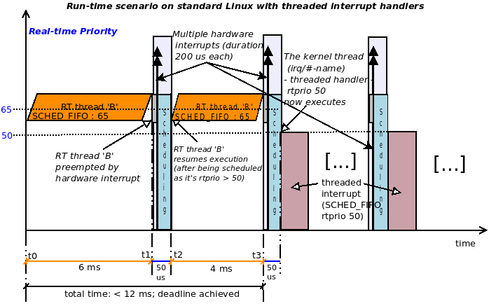

Hình 4.6—Mô hình threaded interrupt—user mode RT SCHED\_FIFO rtprio 50 thread có thể preempt threaded interrupt; đạt deadline

Trong sơ đồ trên, RT thread B lúc này có scheduling policy `SCHED_FIFO` với `rtprio` bằng `65`. Nó có tối đa 12 ms để hoàn tất (đạt deadline). Một lần nữa, giả sử nó thực thi 6 ms (`t0` đến `t1`); tại `t1`, hardware interrupt kích hoạt. Ở đây, low-level setup code và hardirq handler (mặc định của kernel hoặc của driver) thực thi ngay, preempt mọi thứ trên processor. Tuy nhiên, hardirq hay primary handler mất rất ít thời gian để thực thi (tối đa vài microsecond). Như đã thảo luận, primary handler đang thực thi; nó chỉ làm công việc tối thiểu cần thiết trước khi trả về giá trị `IRQ_WAKE_THREAD`, khiến kernel đánh thức kernel thread đại diện threaded handler. Tuy nhiên—đây là điểm then chốt—threaded interrupt, là `SCHED_FIFO` với priority `50`, lúc này cạnh tranh CPU resource với các runnable thread khác. Vì thread B là `SCHED_FIFO` real-time thread với rtprio `65`, nó giành CPU trước threaded handler và chạy thay vì handler! Tóm lại, trong sơ đồ trên diễn ra:

- Từ `t0` đến `t1`: user mode RT thread (`SCHED_FIFO`, `rtprio 65`) thực thi code (trong 6 ms)

- Tại `t1`, thanh xám mảnh biểu diễn hardirq low-level setup/BSP code.

- Đường dọc double-arrow màu đen mảnh biểu diễn primary hardirq handler (cả hai phần trên chỉ mất vài microsecond để hoàn tất).

- Thanh màu xanh dương là scheduling code.

- Thanh tím (tại `t3` + 50 us) biểu diễn threaded interrupt handler chạy ở rtprio `50`.

Kết quả của tất cả điều này là thread B hoàn tất công việc dư sức trong deadline (ở đây, làm ví dụ, nó đạt deadline chỉ sau hơn 10 ms).

Trừ khi ràng buộc thời gian cực kỳ khắt khe, dùng mô hình threaded interrupt để xử lý interrupt của device hoạt động rất tốt với phần lớn device và driver. Tại thời điểm viết, những device có xu hướng tiếp tục dùng cách top/bottom half truyền thống (trình bày chi tiết trong mục Hiểu và sử dụng top half cùng bottom half) thường là network, block và (một số) multimedia device high-performance.

### Các ràng buộc khi dùng threaded handler

Điều cuối về threaded handler: kernel không cho phép dùng threaded handler một cách mù quáng cho bất kỳ IRQ nào; nó tuân theo một số ràng buộc. Khi đăng ký thread handler (qua các API `[devm_]request_threaded_irq()`), nó thực hiện vài kiểm tra tính hợp lệ, một trong số đó đã nhắc: phải có `IRQF_ONESHOT` cho threaded handler.

Điều này còn phụ thuộc IRQ line thực tế; ví dụ, tôi từng thử dùng threaded handler cho IRQ `1` trên x86 (thường là interrupt line của chip keyboard/mouse controller i8042). Nó thất bại, kernel hiển thị:

```
genirq: Flags mismatch irq 1. 00002080 (driver-name) vs. 00000080 (i8042)
```

Từ output trên, thấy i8042 chỉ chấp nhận bitmask `0x80` cho IRQ flag, trong khi tôi truyền giá trị `0x2080`; kiểm tra một chút sẽ thấy flag `0x2000` chính là `IRQF_ONESHOT`; rõ ràng nó gây mismatch và không được phép. Không chỉ vậy, chú ý ai phát hiện lỗi—chính generic IRQ layer (`genirq`) của kernel kiểm tra bên dưới. (Lưu ý kiểu kiểm tra lỗi này không giới hạn ở threaded interrupt.) Ngoài ra, một số device critical sẽ thấy threaded handler thực sự làm chậm chúng; điều này khá điển hình với NIC hiện đại, block device và một số multimedia device. Chúng thường dùng cơ chế hardirq top half và tasklet/softirq bottom half (sẽ giải thích trong mục Hiểu và sử dụng top half cùng bottom half).

### Làm việc với hardirq handler hoặc threaded handler

Trước khi kết thúc mục này, còn một điểm thú vị cần xem xét: kernel cung cấp IRQ allocation API mà tùy hoàn cảnh sẽ thiết lập interrupt handler là hardirq handler truyền thống hoặc threaded handler. API tên `request_any_context_irq()`; tuy nhiên lưu ý chỉ được export dạng GPL-only. Signature như sau:

```
int __must_check
request_any_context_irq(unsigned int irq, irq_handler_t handler,
            unsigned long flags, const char *name, void *dev_id);
```

Các tham số giống hệt `request_irq()`. Khi được gọi, routine quyết định interrupt handler function—tham số `handler`—chạy trong atomic hardirq context hay process context sleep-capable của kernel thread—nói cách khác là threaded handler. Làm sao biết `handler()` sẽ chạy trong context nào? Return value cho biết dựa trên context mà `handler()` sẽ chạy:

- Nếu sẽ chạy trong hardirq context, trả về giá trị `IRQC_IS_HARDIRQ`.

- Nếu sẽ chạy trong process/threaded context, trả về giá trị `IRQC_IS_NESTED`.

- `errno` âm được trả về khi thất bại (bạn phải kiểm tra).

Tuy nhiên, điều này thực sự có nghĩa gì? Về cơ bản, có các controller trên slow bus (I2C là ví dụ rất rõ); chúng sinh ra handler dùng so-called “nested” interrupt, thực sự có nghĩa handler vốn không atomic. Nó có thể gọi hàm sleep (một lần nữa, hàm I2C là ví dụ tốt), do đó bắt buộc phải preemptible. Dùng API `request_any_context_irq()` đảm bảo nếu đúng trường hợp này, generic IRQ code bên dưới phát hiện và cung cấp handling interface phù hợp. GPIO-driven matrix keypad driver là ví dụ khác dùng API này (`drivers/input/keyboard/matrix_keypad.c`).

Qua phần trình bày này, bạn đã hiểu threaded interrupt là gì và vì sao rất hữu ích. Bây giờ, xem chủ đề ngắn hơn: bạn, với tư cách tác giả driver, có thể enable/disable có chọn lọc IRQ line như thế nào.

## Enable và disable IRQ

Thông thường core kernel code (và/hoặc code arch-specific) xử lý low-level interrupt management. Việc này gồm mask interrupt khi cần. Tuy nhiên, một số driver cũng như OS đòi hỏi khả năng điều khiển fine-grained khi enable/disable hardware interrupt. Vì driver hoặc module code chạy với kernel privilege, kernel cung cấp helper routine (được export) cho phép làm chính điều này:

| Comment ngắn | API hoặc helper routine |
|---|---|
| Disable/enable mọi interrupt trên local processor |  |
| Disable vô điều kiện mọi interrupt trên local (current) processor core. | `local_irq_disable()` |
| Enable vô điều kiện mọi interrupt trên local (current) processor core. | `local_irq_enable()` |
| Lưu trạng thái (interrupt mask) rồi disable mọi interrupt trên local (current) processor core. Trạng thái được lưu trong tham số `flags` được truyền vào. | `local_irq_save(unsigned long` `flags);` |
| Khôi phục trạng thái (interrupt mask) được truyền, qua đó enable interrupt trên local (current) processor core theo tham số `flags`. | `local_irq_restore(unsigned` `long flags);` |
| Disable/enable một IRQ line cụ thể |  |
| Disable IRQ line `irq`; đợi—và đồng bộ—mọi interrupt đang chờ (trên IRQ line đó) hoàn tất trước khi trả về. | `void disable_irq(unsigned int` `irq);` |
| Disable IRQ line `irq`; không đợi interrupt đang chờ nào (trên IRQ line đó) hoàn tất (`nosync`). | `void` `disable_irq_nosync(unsigned` `int irq);` |
| Disable IRQ line `irq` và đợi active hardirq handler hoàn tất trước khi trả về. Trả về `false` nếu có threaded handler nào thuộc IRQ line này đang active (yêu cầu GPL). | `bool disable_hardirq(unsigned` `int irq);` |
| Enable IRQ line `irq`; hoàn tác tác dụng của một lần gọi `disable_irq()`. | `void enable_irq(unsigned int` `irq);` |

Các helper `local_irq_disable() / local_irq_enable()` được thiết kế để disable/enable mọi interrupt (trừ NMI) trên local hoặc current processor core.

Cách triển khai `local_irq_disable()`/`local_irq_enable()` trên x86\[\_64\] dùng cặp machine instruction nổi tiếng/tai tiếng `cli`/`sti`; ngày xưa chúng disable/enable interrupt trên toàn hệ thống, mọi CPU. Giờ chúng hoạt động theo per-CPU.

Các helper `disable_{hard}irq*()`/`enable_irq()` được thiết kế để disable/enable có chọn lọc một IRQ line cụ thể và được gọi theo cặp. Một số routine trên có thể gọi từ interrupt context, dù phải cẩn thận! An toàn hơn là đảm bảo gọi từ process context. Lời nhắc “cẩn thận” có vì một số helper hoạt động bằng cách gọi nội bộ các non-blocking routine như `cpu_relax()`, chờ bằng cách lặp lại một số machine instruction trên processor. (`cpu_relax()` là ví dụ tốt của trường hợp “cần dùng cẩn thận”, vì nó gọi machine instruction `nop` trong vòng lặp vô hạn; vòng lặp thoát khi bất kỳ hardware interrupt nào kích hoạt, chính là điều đang chờ! Tuy nhiên, chờ một lúc khi ở interrupt context bị xem là sai; vì vậy mới có lời nhắc “cẩn thận”.) Kernel commit cho `disable_hardirq()` (liên kết: `https://github.com/torvalds/linux/commit/02cea3958664723a5d2236f0f0058de97c7e4693`) giải thích nó dành cho các tình huống như netpoll cần disable interrupt từ atomic context.

Khi disable interrupt, cẩn thận đảm bảo bạn không giữ (đã lock) bất kỳ shared resource nào mà handler có thể dùng. Điều này gây (self) deadlock! (Locking và nhiều tình huống của nó sẽ được giải thích chi tiết hơn trong hai chương cuối sách.)

### NMI

Mọi API và helper trên hoạt động với mọi hardware interrupt trừ non-maskable interrupt (NMI). NMI là interrupt arch-specific, dùng để triển khai các thứ như hardware watchdog và tính năng debug (ví dụ, kernel stack dump vô điều kiện cho mọi core; chúng ta sắp xem ví dụ). Ngoài ra, NMI interrupt line không thể được chia sẻ. Có thể minh họa nhanh việc khai thác NMI bằng so-called magic SysRq facility của kernel. Để xem keyboard hotkey được gán cho magic SysRq, phải gọi hoặc kích hoạt bằng tổ hợp phím `[Alt][SysRq][letter]`.

Kích hoạt magic SysRq: Thay vì xoắn cả ngón tay gõ `[Alt][SysRq][letter]`, có cách dễ hơn—và quan trọng hơn là non-interactive: chỉ cần echo ký tự liên quan vào proc pseudofile (tất nhiên dưới quyền root): `echo letter/proc/sysrq-trigger`.

Nhưng cần gõ ký tự nào? Output sau cho thấy cách nhanh để tìm hiểu. Đây là một dạng quick-help cho magic SysRq (tôi thực hiện trên Raspberry Pi 3B+):

```
rpi # dmesg -C
rpi # echo ? /proc/sysrq-trigger
rpi # dmesg
[ 294.928223] sysrq: HELP : loglevel(0-9) reboot(b) crash(c) terminate-all-
tasks(e) memory-full-oom-kill(f) kill-all-tasks(i) thaw-filesystems(j)
sak(k) show-backtrace-all-active-cpus(l) show-memory-usage(m) nice-all-RT-
tasks(n) poweroff(o) show-registers(p) show-all-timers(q) unraw(r) sync(s)
show-task-states(t) unmount(u) show-blocked-tasks(w) dump-ftrace-buffer(z)
rpi #
```

Điều đang quan tâm được in đậm—ký tự `l` (chữ L viết thường)—`show-backtrace-all-active-cpus(l)`. Sau khi kích hoạt, nó thực sự làm đúng như tên—hiển thị stack backtrace của kernel-mode stack trên mọi active CPU! (Đây có thể là công cụ debug hữu ích vì bạn thấy mỗi CPU core hiện đang chạy gì.) Bằng cách nào? Nó gửi NMI đến chúng; tức đến mọi CPU core! Đây là một cách thấy chính xác CPU đang làm gì vào đúng thời điểm lệnh được kích hoạt! Điều này rất hữu ích khi có gì đó làm hệ thống hang.

Ở đây, `echo l /proc/sysrq-trigger` (dưới quyền root) là đủ! Screenshot một phần sau cho thấy output:

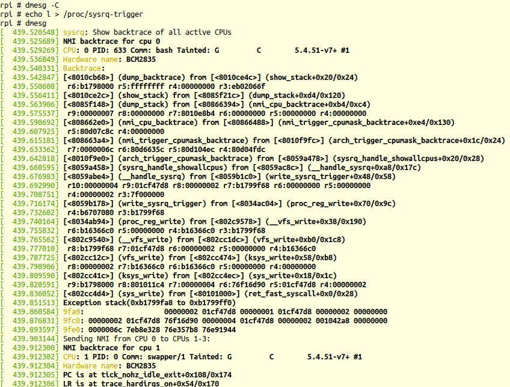

Hình 4.7—Output khi NMI được gửi đến mọi CPU, hiển thị kernel stack backtrace trên từng CPU

Trong screenshot trên, bạn thấy `bash` PID 633 đang chạy trên CPU `0` và kernel thread `swapper/1` chạy trên CPU `1` (có thể thấy kernel stack của từng bên; hãy đọc bottom-up).

Code của magic SysRq facility ở `drivers/tty/sysrq.c`; xem qua khá thú vị. Sau đây là call graph gần đúng của những gì xảy ra trên x86 khi kích hoạt magic SysRq `l`:

```
include/linux/nmi.h:trigger_all_cpu_backtrace()
arch_trigger_cpumask_backtrace()
    arch/x86/kernel/apic/hw_nmi.c:arch_trigger_cpumask_backtrace()
    nmi_trigger_cpumask_backtrace()
```

Hàm cuối thực sự trở thành code tổng quát (không arch-specific) tại `lib/nmi_backtrace.c:nmi_trigger_cpumask_backtrace()`. Code ở đây kích hoạt CPU backtrace bằng cách gửi NMI đến từng CPU. Việc này đạt được qua hàm `nmi_cpu_backtrace()`. Hàm này tiếp đến hiển thị thông tin đã thấy trong screenshot trên bằng cách gọi routine `show_regs()` hoặc `dump_stack()`, cuối cùng trở thành code arch-specific để dump CPU register cũng như kernel-mode stack. Code cũng đủ thông minh để không cố hiển thị backtrace trên CPU core đang ở low power (idle) state.

Một lần nữa, thực tế không phải lúc nào cũng đơn giản; xem bài của Steven Rostedt về những vấn đề phức tạp người ta gặp với x86 NMI và cách xử lý: The x86 NMI iret problem, tháng 3 năm 2012: `https://lwn.net/Articles/484932/`.

Đến đây, chúng ta vẫn chưa thực sự thấy cách kernel thể hiện các IRQ line đã cấp phát; interface tất nhiên qua filesystem `procfs`; hãy tìm hiểu.

## Xem tất cả interrupt (IRQ) line đã được cấp phát

Giờ bạn đã hiểu đủ chi tiết về IRQ và interrupt handling, chúng ta (cuối cùng!) có thể dùng filesystem `proc` của kernel để nhìn các IRQ hiện được cấp phát. Có thể làm bằng cách đọc nội dung pseudofile `/proc/interrupts`. Chúng ta hiển thị vài screenshot: ảnh đầu (Hình 4.8) cho thấy IRQ status—số interrupt được phục vụ trên mỗi CPU cho mỗi I/O device—trên Raspberry Pi ZeroW của tôi, còn ảnh thứ hai (Hình 4.9) cho thấy điều này trên x86\_64 Ubuntu 18.04 VM “thường lệ”:

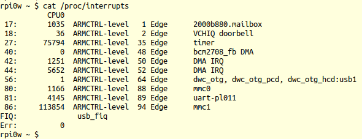

Hình 4.8—IRQ status trên Raspberry Pi ZeroW

Trong output `/proc/interrupts` trên, mỗi IRQ line của hệ thống có một dòng (hay record). Hãy diễn giải từng cột output:

- Cột đầu là IRQ number đã được cấp phát.

- Cột thứ hai (trở đi) hiển thị số hardirq được từng CPU core phục vụ (từ khi hệ thống khởi động đến hiện tại). Số này biểu diễn số lần interrupt handler chạy trên CPU core đó (số cột thay đổi tùy số active core đang xử lý IRQ trên hệ thống). Trong screenshot trên, Raspberry Pi Zero chỉ có một CPU core, trong khi x86\_64 VM có hai CPU core (virtualized) để phân phối và xử lý interrupt (sẽ nói thêm trong mục Load balancing interrupt và IRQ affinity).

- Cột thứ ba (hoặc sau đó) hiển thị interrupt controller chip. Trên x86 (cột thứ tư trong Hình 4.9), tên IO-APICs nghĩa là interrupt controller cải tiến được dùng trên multicore system để phân phối interrupt đến nhiều core hoặc CPU group (trên hệ thống high-end, có thể có nhiều IO-APIC).

- Cột kế tiếp hiển thị loại interrupt triggering đang dùng; tức level hoặc edge triggering (đã thảo luận trong mục Hiểu level-triggered và edge-triggered interrupt). Ở đây, `Edge` cho biết IRQ là edge-triggered. Số đứng trước (ví dụ `35 Edge` trong screenshot trên) phụ thuộc hệ thống rất nhiều. Nó thường biểu diễn interrupt source (mà kernel map thành IRQ line; nhiều embedded device driver thường dùng GPIO pin làm interrupt source). Tốt nhất đừng cố diễn giải (trừ khi thực sự biết cách) và chỉ dựa vào IRQ number (cột đầu).

- Cột cuối bên phải nêu owner hiện tại của IRQ line. Thường là tên device driver hoặc kernel component (đã cấp phát IRQ line này qua một trong các API `*request_*irq()`).

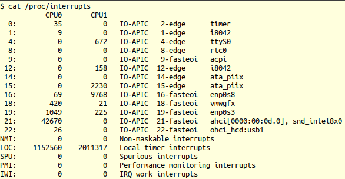

Hình 4.9—IRQ status trên x86\_64 Ubuntu 18.04 VM (screenshot được cắt bớt)

Từ kernel 2.6.24, với hệ thống x86 và AMD64 (hay x86\_64), ngay cả non-device (I/O) interrupt (system interrupt) cũng được hiển thị ở đây, như NMI, local timer interrupt (LOC), PMI, IWI, v.v. Bạn thấy trong Hình 4.9, dòng cuối hiển thị `IWI`, tức Inter-Work Interrupt.

Kernel procfs code hiển thị output `/proc/interrupts` trên—tức method `show`—ở `kernel/irq/proc.c:show_interrupts()` (liên kết: `https://elixir.bootlin.com/linux/v5.4/source/kernel/irq/proc.c#L438`). Đầu tiên in header line, sau đó tạo “record” one-line cho mỗi IRQ line. Thống kê chủ yếu lấy từ metadata structure cho mỗi IRQ line—`struct irq_desc`; trong mỗi IRQ, nó lặp qua từng processor core (qua helper routine `for_each_online_cpu()`), in số hardirq đã phục vụ cho từng core. Cuối cùng (cột cuối), nó in “owner” của IRQ line qua member `name` của `struct` `irqaction`. Interrupt arch-specific cho x86 (như IRQ `NMI`, `LOC`, `PMI` và `IWI`) được hiển thị qua code tại `arch/x86/kernel/irq.c:arch_show_interrupts()`.

Trên x86, IRQ `0` luôn là timer interrupt. Trong tài liệu đồng hành Linux Kernel Programming - Chương 10, CPU scheduler - Phần 1, chúng ta học rằng về lý thuyết timer interrupt kích hoạt `HZ` lần mỗi giây. Trên thực tế, để hiệu quả, giờ nó được thay bằng periodic high-resolution timer (HRT) theo per-CPU; nó xuất hiện là IRQ tên LOC (viết tắt LOCal) cho timer interrupt trong `/proc/interrupts`. Điều này thực sự giải thích vì sao số hardware timer interrupt dưới hàng `timer` rất thấp; hãy xem (trên x86\_64 guest có bốn CPU (virtual)):

```
$ egrep "timer|LOC" /proc/interrupts ; sleep 1 ; egrep
"timer|LOC" /proc/interrupts
  0:         33          0          0          0   IO-
APIC   2-edge      timer
LOC:      11038      11809      10058       8848   Local
timer interrupts
  0:         33          0          0          0   IO-
APIC   2-edge      timer
LOC:      11104      11844      10086       8889   Local
timer interrupts
$
```

Chú ý IRQ `0` không tăng, nhưng IRQ `LOC` thực sự tăng (theo từng CPU core).

Pseudofile `/proc/stat` cũng cung cấp một số thông tin về việc sử dụng để phục vụ interrupt theo per-CPU và số interrupt có thể được phục vụ (xem man page `proc(5)` để biết thêm).

Softirq, được giải thích chi tiết trong mục Hiểu và sử dụng top half cùng bottom half, có thể xem qua `/proc/softirqs`; sẽ nói thêm sau.

Đến đây, bạn đã học cách xem IRQ line được cấp phát. Tuy nhiên, còn một khía cạnh lớn của interrupt handling: hiểu sự phân đôi so-called top-half/bottom-half, vì sao tồn tại và cách làm việc với chúng. Chúng ta xem ở mục tiếp theo.

## Hiểu và sử dụng top half cùng bottom half

Chúng ta nhấn mạnh nhiều rằng interrupt handler phải hoàn tất công việc nhanh chóng (như giải thích trong mục Hãy làm thật nhanh và những chỗ khác). Tuy vậy, một vấn đề thực tế xuất hiện. Xét tình huống: bạn cấp phát IRQn và viết interrupt handler function để xử lý khi interrupt đến. Như có thể nhớ, hàm đang nói đến, thường gọi là hardirq hay ISR (Interrupt Service Routine) hoặc primary handler, là tham số thứ hai của API `request_{threaded}_irq()`, thứ ba của API `devm_request_irq()` và thứ tư của API `devm_request_threaded_irq()`.

Như đã nhắc, có heuristic nhanh cần tuân theo: nếu xử lý trong hardirq routine liên tục vượt 100 microsecond thì cần chiến lược thay thế. Giả sử handler hoàn tất dư sức trong thời gian này; lúc đó hoàn toàn không có vấn đề! Nhưng nếu thực sự cần lâu hơn thì sao? Có lẽ low-level specification cho peripheral yêu cầu bạn làm một số việc khi interrupt đến (giả sử 10 mục cần hoàn tất). Bạn viết code đúng để làm vậy, nhưng gần như luôn vượt giới hạn thời gian (100 microsecond theo quy tắc kinh nghiệm)! Vậy làm gì? Một bên là những người làm kernel thúc giục hoàn thành nhanh; bên kia low-level spec cho peripheral yêu cầu tuân theo vài bước then chốt để xử lý interrupt đúng! (Đúng là tiến thoái lưỡng nan!)

Như đã gợi ý, có hai chiến lược lớn được dùng trong các trường hợp này:

- Dùng thread interrupt để xử lý phần lớn công việc; được xem là cách hiện đại.

- Dùng “bottom half” routine để xử lý phần lớn công việc; cách truyền thống.

Chúng ta đã trình bày chi tiết khái niệm, cách dùng thực tế và lý do của threaded interrupt trong mục Làm việc với mô hình threaded interrupt. Trong mô hình top-bottom-half, cách tiếp cận là:

- so-called top half là hàm được gọi ban đầu khi hardware interrupt kích hoạt. Vì thế bạn đã quen—nó chính là hardirq, ISR hoặc primary handler routine đăng ký qua một trong các API `*request_*irq()` (để rõ: qua một trong các API `request_irq()` / `devm_request_irq()` / `request_threaded_irq()` / `devm_request_threaded_irq()`).

- Chúng ta còn đăng ký so-called bottom half routine để thực hiện phần lớn interrupt handling.

Nói cách khác, interrupt handling chia thành hai half—top và bottom. Tuy nhiên, đây không hẳn là cách mô tả thỏa đáng (vì từ tiếng Anh half khiến bạn trực giác nghĩ các routine có kích thước xấp xỉ nhau); thực tế giống thế này hơn:

- Top half thực hiện tối thiểu công việc bắt buộc (thường acknowledge interrupt, có thể tắt trên board trong thời gian top half chạy, rồi thực hiện bất kỳ công việc hardware-specific (tối thiểu) nào, gồm nhận/gửi dữ liệu cần thiết từ/đến device).

- Bottom half routine đảm nhiệm phần lớn interrupt handling.

Vậy bottom half là gì? Chỉ là hàm C được đăng ký thích hợp với kernel. Registration API thực tế cần dùng phụ thuộc loại bottom half định sử dụng. Có ba loại:

- Cơ chế bottom-half cũ, hiện deprecated; viết tắt BH (bạn gần như có thể bỏ qua).

- Cơ chế hiện đại được khuyến nghị (nếu ngay từ đầu bạn dùng công nghệ top-bottom-half): tasklet.

- Cơ chế kernel bên dưới: softirq.

Bạn sẽ thấy tasklet thực ra được xây trên kernel softirq.

Điểm ở đây là: top half—hardirq handler đã làm việc đến giờ—như đã nói, thực hiện công việc tối thiểu; rồi “schedule” bottom half và thoát (trả về). Từ schedule ở đây không nghĩa là gọi `schedule()`, vì như thế thật vô lý (dù sao đang ở interrupt context!); đó chỉ là từ dùng để mô tả sự việc. Kernel đảm bảo bottom half chạy sớm nhất có thể khi top half hoàn tất; đặc biệt, không user thread hay kernel thread nào preempt nó. Nhưng khoan: ngay cả làm tất cả điều này—chia handler thành hai half và cùng thực thi công việc—thì tiết kiệm được thời gian ra sao? Đó mới là ý định ban đầu. Chẳng phải bây giờ còn mất lâu hơn với overhead gọi hai hàm thay vì một? À, điều này dẫn đến điểm thực sự then chốt: top half (hardirq) luôn chạy với mọi interrupt bị disable (mask) trên current CPU và IRQ đang xử lý bị disable (mask) trên mọi CPU, nhưng bottom half handler chạy với mọi interrupt được enable.

Lưu ý bottom half vẫn hoàn toàn chạy trong atomic context hoặc interrupt context! Vì thế, những lưu ý áp dụng cho hardirq (top half) handler cũng áp dụng cho bottom-half handler:

- Không được truyền dữ liệu (đến hoặc từ user/kernel space).

- Chỉ được cấp phát memory (nếu thật sự phải làm) với flag `GFP_ATOMIC`.

- Không bao giờ được trực tiếp hay gián tiếp gọi `schedule()`.

bottom-half handling này là một tập con của khả năng được gọi là deferred functionality của kernel; kernel có một số cơ chế deferred functionality:

- Workqueue (dựa trên kernel thread); `context:process`

- Bottom half/tasklet (dựa trên softirq); `context:interrupt`

- Softirq; `context:interrupt`

- Kernel timer; `context:interrupt`

Chúng ta trình bày kernel timer và workqueue trong `Chapter 5`, Làm việc với kernel timer, thread và workqueue.

Mọi cơ chế này cho phép kernel (hoặc driver) chỉ định một công việc phải được thực hiện sau (được deferred), khi an toàn để làm.

Tại đây, bạn nên hiểu cơ chế threaded interrupt đã thảo luận phần nào giống cơ chế deferred functionality. Đây được xem là cách hiện đại nên dùng; tuy nhiên một lần nữa, dù hiệu năng chấp nhận được cho phần lớn peripheral, một số device class—thường network/block/multimedia—vẫn có thể cần cơ chế top-bottom-half truyền thống để đạt hiệu năng đủ cao. Ngoài ra, nhấn mạnh lại: cả top half và bottom half luôn chạy trong atomic (interrupt) context, trong khi threaded handler thực sự chạy trong process context; có thể xem đây là lợi thế hoặc bất lợi. Thực tế, tuy threaded handler về kỹ thuật ở trong process context, tốt nhất vẫn thực hiện các thao tác non-blocking nhanh trong đó.

### Chỉ định và sử dụng tasklet

Khác biệt then chốt giữa tasklet và cơ chế softirq của kernel là tasklet đơn giản dễ làm việc hơn, nên là lựa chọn tốt cho driver điển hình. Tất nhiên, nếu dùng được threaded handler thay thế thì hãy làm vậy; về sau, chúng ta đưa ra bảng giúp quyết định dùng gì khi nào. Một yếu tố then chốt làm tasklet dễ dùng hơn là (trên SMP system) một tasklet cụ thể không bao giờ chạy song song với chính nó; nói cách khác, tasklet cho trước chỉ chạy trên đúng một CPU tại một thời điểm (khiến nó non-concurrent, hay serialized, đối với chính nó).

Header comment trong `linux/interrupt.h` còn cho biết một số thuộc tính quan trọng của tasklet:

```
[...] Properties:
   * If tasklet_schedule() is called, then tasklet is guaranteed
     to be executed on some cpu at least once after this.
   * If the tasklet is already scheduled, but its execution is still not
     started, it will be executed only once.
   * If this tasklet is already running on another CPU (or schedule is
     called from tasklet itself), it is rescheduled for later.
   * Tasklet is strictly serialized wrt itself, but not
     wrt another tasklets. If client needs some intertask synchronization,
     he makes it with spinlocks. [...]
```

Chúng ta sẽ xem hàm `tasklet_schedule()` ngay sau đây. Điểm cuối trong comment block trên được trình bày trong hai chương cuối sách.

Vậy dùng tasklet thế nào? Trước hết phải thiết lập bằng API `tasklet_init()`; sau đó schedule để thực thi. Hãy học cách làm.

#### Khởi tạo tasklet

Hàm `tasklet_init()` khởi tạo tasklet; signature như sau:

```
#include <linux/interrupt.h>
void tasklet_init(struct tasklet_struct *t, void (*func)(unsigned long),
unsigned long data);
```

Hãy xem các tham số:

- `struct tasklet_struct *t`: Cấu trúc này là metadata biểu diễn tasklet. Như đã biết, bản thân pointer không có memory! Nhớ cấp phát memory cho cấu trúc dữ liệu rồi truyền pointer ở đây.

- `void (*func)(unsigned long)`: Đây chính là tasklet function—“bottom half” chạy khi hardirq hoàn tất; bottom half function thực hiện phần lớn interrupt handling process.

- `unsigned long data`: Bất kỳ dữ liệu nào muốn truyền đến tasklet routine (cookie).

Công việc khởi tạo nên làm ở đâu? Thường trong probe function (hoặc `init`) của driver. Vậy giờ đã khởi tạo và sẵn sàng, gọi nó thế nào? Hãy tìm hiểu.

#### Chạy tasklet

Tasklet là bottom half. Vì thế trong top half, tức hardirq handler routine, điều cuối nên làm trước khi trả về là “schedule” tasklet để thực thi:

```
void tasklet_schedule(struct tasklet_struct *t);
```

Chỉ cần truyền pointer đến tasklet structure (đã khởi tạo) vào API `tasklet_schedule()`; kernel xử lý phần còn lại. Kernel làm gì? Nó schedule tasklet này để thực thi; thực tế, function code của tasklet được đảm bảo chạy trước khi quyền điều khiển trở về task vốn bị ngắt ban đầu (dù user thread hay kernel thread). Chi tiết hơn ở mục Hiểu cách kernel chạy softirq.

Về tasklet, có vài điều cần rõ:

- Tasklet thực thi code trong interrupt (atomic) context; thực ra là softirq context. Vì thế nhớ rằng mọi giới hạn áp dụng cho top half cũng áp dụng ở đây! (Xem mục Hướng dẫn về interrupt context—điều nên và không nên làm để biết chi tiết các giới hạn)

- Đồng bộ hóa (trên SMP box):

- Tasklet cho trước không bao giờ chạy song song với chính nó.

- Tasklet khác nhau có thể chạy song song trên CPU core khác nhau.

- Bản thân tasklet có thể bị hardirq ngắt, kể cả IRQ của chính bạn! Vì tasklet mặc định chạy với mọi interrupt được enable trên local core, và tất nhiên hardirq có priority cao nhất trên hệ thống

- Những hệ quả về locking thực sự quan trọng—chúng ta trình bày chi tiết trong hai chương cuối sách (đặc biệt khi nói về spinlock).

Một số sample code (driver tổng quát) như sau (để rõ ràng, không hiển thị error path):

```
#include <"convenient.h">               // has the PRINT_CTX() macro
static struct tasklet_struct *ts;
[...]
static int __init mydriver_init(void)
{
    struct device *dev;
    [...]
    /* Register the device with the kernel 'misc' driver framework */
    ret = misc_register(&keylog_miscdev);
    dev = keylog_miscdev.this_device;

    ts = devm_kzalloc(dev, sizeof(struct tasklet_struct), GFP_KERNEL);
    tasklet_init(ts, mydrv_tasklet, 0);

    ret = devm_request_irq(dev, MYDRV_IRQ, my_hardirq_handler,
                    IRQF_SHARED, OURMODNAME, THIS_MODULE);
    [...]
```

Trong code snippet trên, chúng ta khai báo global pointer `ts` đến `struct` `tasklet_struct`; trong code `init` của driver, đăng ký driver thuộc kernel framework `misc`. Tiếp theo cấp phát RAM cho tasklet structure (qua API hữu ích `devm_kzalloc()`). Sau đó khởi tạo tasklet qua API `tasklet_init()`. Chú ý chúng ta chỉ định tên hàm (tham số thứ hai) và chỉ truyền `0` làm tham số thứ ba, tức cookie cần truyền (nhiều driver thực truyền context/private data structure pointer ở đây). Sau đó cấp phát IRQ line (qua API `devm_request_irq()`).

Tiếp tục xem code của driver tổng quát này:

```
/ * Our 'bottom half' tasklet routine */
static void mydrv_tasklet(unsigned long data)
{
    PRINT_CTX();   // from our convenient.h header
    process_it();  // majority of the interrupt work done here
}

/* Our 'hardirq' interrupt handler routine - our 'top half' */
static irqreturn_t my_hardirq_handler(int irq, void *data)
{
    /* minimal work: ack/disable hardirq, fetch and/or queue data, etc ...
*/
    tasklet_schedule(ts);
    return IRQ_HANDLED;
}
```

Trong code trên, hãy tưởng tượng chúng ta làm mọi công việc tối thiểu cần thiết trong top half (hàm `my_hardirq_handler()`). Sau đó chuẩn bị tasklet để chạy bằng cách gọi API `tasklet_schedule()`. Bạn sẽ thấy tasklet chạy gần như ngay sau hardirq (trong code trên, tasklet function tên `mydrv_tasklet()`). Trong tasklet, bạn phải làm phần lớn interrupt processing. Trong đó, chúng ta gọi macro `PRINT_CTX()`; như sẽ thấy trong mục Xác định đầy đủ context, nó in nhiều chi tiết về current context, hữu ích cho debug/học tập (bạn sẽ thấy trong số thông tin khác, nó cho biết hiện đang chạy trong interrupt context).

Thay vì API `tasklet_schedule()`, có thể dùng routine thay thế qua API `tasklet_hi_schedule()`. Bên trong, nó khiến tasklet trở thành softirq có priority cao nhất (softirq priority `0`)! (Thông tin thêm ở mục Hiểu cơ chế kernel softirq.) Lưu ý gần như không bao giờ làm vậy; priority (softirq) mặc định của tasklet thường dư sức đáp ứng. Đặt lên mức `hi` thực sự chỉ dành cho trường hợp cực đoan; tránh nhiều nhất có thể.

Trong Linux phiên bản 5.4.0, có 70-odd chỗ driver dùng hàm `tasklet_hi_schedule()`. Các driver thường là network driver high-performance—một số GPU, crypto, USB và mmc driver, cùng vài driver khác.

Về tasklet, kernel tiếp tục tiến hóa. Các patch gần đây (tại thời điểm viết, tháng 7 năm 2020) của Kees Cook và những người khác đang tìm cách hiện đại hóa tasklet routine (callback). Để biết thêm, xem `https://www.openwall.com/lists/kernel-hardening/2020/07/16/1`.

### Hiểu cơ chế kernel softirq

Tại đây, bạn hiểu bottom half, tức tasklet, là cơ chế deferred functionality mà khi chạy không mask interrupt. Chúng được thiết kế để kết hợp ưu điểm của cả hai: cho phép driver thực hiện interrupt processing khá dài nếu tình huống đòi hỏi, theo cách deferred an toàn, đồng thời vẫn cho phép công việc hệ thống (qua hardware interrupt) tiếp tục.

Bạn đã học cách dùng tasklet—ví dụ rất tốt của cơ chế deferred functionality. Nhưng chúng được triển khai bên trong thế nào? Kernel triển khai tasklet qua facility bên dưới gọi là cơ chế softirq (hay software-interrupt). Dù bề ngoài tương tự threaded interrupt đã thấy, nó thực sự rất khác ở nhiều điểm quan trọng. Những đặc điểm softirq sau giúp bạn hiểu:

- Softirq là cơ chế deferred functionality thuần nội bộ kernel, theo nghĩa được gán tĩnh khi compile kernel (tất cả đều hard-coded trong kernel); bạn không thể tạo động softirq mới.

- Kernel (ở phiên bản 5.4) cung cấp tổng cộng 10 softirq riêng biệt:

- Mỗi softirq được thiết kế phục vụ một nhu cầu cụ thể, thường gắn với hardware interrupt hoặc kernel activity rất cụ thể. (Ngoại lệ có lẽ là các soft IRQ dành cho generic tasklet: `HI_SOFTIRQ` và `TASKLET_SOFTIRQ`.)

- 10 softirq này có thứ tự priority (và được xử lý theo thứ tự đó).

- Tasklet thực ra là thin abstraction trên một softirq cụ thể (`TASKLET_SOFTIRQ`), một trong 10 softirq sẵn có. Tasklet là loại duy nhất có thể đăng ký, chạy và hủy đăng ký tùy ý, khiến nó là lựa chọn lý tưởng cho nhiều device driver.

- Softirq chạy trong interrupt—softirq—context; macro `in_softirq()` trả về `true` ở đây, ngụ ý bạn đang trong softirq context (hoặc tasklet context).

- Mọi softirq servicing được xem là priority cao trên hệ thống. Sau hardware interrupt (handler `hardirq/ISR/primary`), softirq có priority cao nhất hệ thống. Pending softirq được kernel xử lý trước khi khôi phục process context vốn bị ngắt ban đầu.

Sơ đồ sau mở rộng mô tả priority trên Linux tiêu chuẩn ở phần trước; lần này có softirq (trong đó có tasklet):

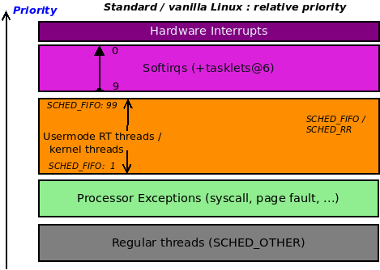

Hình 4.10—Priority tương đối trên Linux tiêu chuẩn, gồm cả softirq

Đúng, như có thể thấy, softirq là cơ chế high-priority trên Linux; có 10 loại riêng ở priority khác nhau. Chúng là gì và dùng làm gì được trình bày ở mục nhỏ tiếp theo.

#### Các softirq sẵn có và mục đích

Công việc do softirq cho trước thực hiện được compile tĩnh vào kernel image (cố định). Việc ghép softirq với action của nó (thực chất code nó chạy, qua function pointer `action`) được làm bằng code sau:

```
// kernel/softirq.c
void open_softirq(int nr, void (*action)(struct softirq_action *))
{
    softirq_vec[nr].action = action;
}
```

Sơ đồ sau biểu diễn khái niệm về các softirq sẵn có và priority level trên Linux (ở kernel phiên bản 5.4), với `0` cao nhất và `9` thấp nhất:

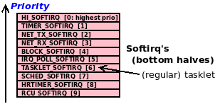

Hình 4.11—10 softirq trên Linux theo thứ tự priority (0:cao nhất, 9:thấp nhất)

Bảng sau tổng hợp từng softirq của kernel theo thứ tự priority (`0`: `HI_SOFTIRQ` cao nhất), cùng action hay vector, chức năng, và comment nêu use case:

| Softirq# | Softirq | Comment (dùng để làm gì/thực hiện gì) | Hàm "action" hoặc "vector" |
|---|---|---|---|
| `0` | `HI_SOFTIRQ` | Hi-tasklet: Softirq priority cao nhất; dùng khi gọi `tasklet_hi_schedule()`. Không được khuyến nghị cho phần lớn use case. Thay vào đó dùng tasklet thông thường (softirq #`6`). | `tasklet_hi_action()` |
| `1` | `TIMER_SOFTIRQ` | Timer: Bottom half của timer interrupt chạy expired timer cùng các tác vụ "housekeeping" khác (gồm cập nhật scheduler CPU `runqueue` + `vruntime`, tăng biến well-known `jiffies_64`, v.v.). | `run_timer_softirq()` |
| `2` | `NET_TX_SOFTIRQ` | Net: Bottom half của network stack transmit path (qdisc). | `net_tx_action()` |
| `3` | `NET_RX_SOFTIRQ` | Net: Bottom half của network stack receive path (NAPI polling). | `net_rx_action()` |
| `4` | `BLOCK_SOFTIRQ` | Block: Block processing (hoàn tất I/O op; gọi complete function của block MQ, `blk_mq_ops`). | `blk_done_softirq()` |
| `5` | `IRQ_POLL_SOFTIRQ` | irqpoll: Triển khai polled IRQ mode của block layer trong kernel (tương đương NAPI processing của network layer). | `irq_poll_softirq()` |
| `6` | `TASKLET_SOFTIRQ` | Regular tasklet: Triển khai cơ chế tasklet bottom-half, softirq động (linh hoạt) duy nhất: driver có thể đăng ký, sử dụng và hủy đăng ký khi cần. | `tasklet_action()` |
| `7` | `SCHED_SOFTIRQ` | sched: Được dùng để load balancing định kỳ bởi CFS scheduler trên SMP; di chuyển task sang runqueue khác nếu cần. | `run_rebalance_domains()` |
| `8` | `HRTIMER_SOFTIRQ` | HRT: Được dùng cho high-resolution timer (HRT). Nó bị loại bỏ trong phiên bản 4.2 và được đưa lại vào kernel dưới dạng tốt hơn trong phiên bản 4.16. | `hrtimer_run_softirq()` |
| `9` | `RCU_SOFTIRQ` | RCU: Thực hiện xử lý read copy update (RCU), một dạng công nghệ lock-free được dùng trong core kernel. | `rcu_core_si() /` `rcu_process_callbacks()` |

Thật thú vị; network stack và block stack là các code path có priority rất cao (timer interrupt cũng vậy), nên code của chúng phải chạy sớm nhất có thể. Vì thế, chúng có các softirq riêng để phục vụ những code path quan trọng này.

Có thể xem các softirq đã được kích hoạt đến nay không? Tất nhiên, rất giống cách xem hardirq (qua pseudofile `proc/interrupts`). Chúng ta có pseudofile `/proc/softirqs` để theo dõi softirq. Đây là ảnh chụp ví dụ từ hệ thống Ubuntu x86\_64 native (four-core) của tôi:

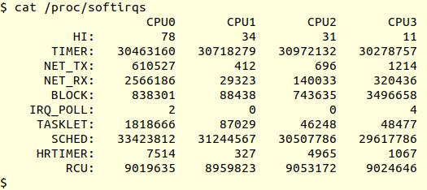

Hình 4.12 – Output của /proc/softirqs trên hệ thống x86\_64 native với 4 CPU core

Giống `/proc/interrupts`, những con số trong ảnh trên biểu diễn số lần một softirq cụ thể xảy ra trên CPU core cụ thể kể từ khi khởi động hệ thống. Ngoài ra, để bạn biết thêm, công cụ mạnh mẽ `crash` có lệnh hữu ích `irq` hiển thị thông tin về interrupt; `irq -b` hiển thị các softirq được định nghĩa trên kernel đó.

#### Tìm hiểu cách kernel chạy softirq

Sau đây là call graph (gần đúng) được dùng trên x86 khi hardware interrupt được kích hoạt:

```
do_IRQ() -> handle_irq() -> entering_irq() -> hardirq top-half runs ->
exiting_irq() -> irq_exit() -> invoke_softirq() -> do_softirq() -> ...
bottom half runs: tasklet/softirq ... -> restore context
```

Một số code path phía trên phụ thuộc kiến trúc. Lưu ý rằng việc “đánh dấu context là interrupt” thực sự là một quy ước của hệ thống. Kernel được đánh dấu đã vào context này trong hàm `entering_irq()` và đã rời khỏi khi `exiting_irq()` trả về (trên x86). Nhưng khoan! Inline function `exiting_irq()` gọi hàm `kernel/softirq.c:irq_exit()` (`https://elixir.bootlin.com/linux/v5.4/source/kernel/softirq.c#L403`). Chính trong routine này, kernel xử lý và tiêu thụ mọi softirq đang chờ. Call graph cơ bản (từ `do_softirq()` trở đi) như sau:

```
   do_softirq() --  [assembly]do_softirq_own_stack -- __do_softirq()
```

Công việc thực sự diễn ra trong routine nội bộ `__do_softirq()` (`https://elixir.bootlin.com/linux/v5.4/source/kernel/softirq.c#L249`). Chính ở đây, mọi softirq đang chờ được tiêu thụ theo thứ tự priority. Chú ý việc xử lý softirq diễn ra trước khi context được khôi phục cho task bị interrupt.

Bây giờ, hãy tập trung ngắn gọn vào một số chi tiết nội bộ của việc thực thi tasklet, rồi đến cách dùng kernel thread ksoftirqd để chuyển bớt công việc softirq.

##### Chạy tasklet

Một vài điều về nội bộ việc gọi tasklet: chúng ta hiểu tasklet softirq chạy qua `tasklet_schedule()`. API này cuối cùng gọi hàm nội bộ `__tasklet_schedule_common()` của kernel (`https://elixir.bootlin.com/linux/v5.4/source/kernel/softirq.c#L471`), hàm này gọi nội bộ `raise_softirq_irqoff(softirq_nr)` (`https://elixir.bootlin.com/linux/v5.4/source/kernel/softirq.c#L423`). Việc này raise softirq `softirq_nr`; với regular tasklet, giá trị là `TASKLET_SOFTIRQ`, còn khi tasklet được schedule qua API `tasklet_hi_schedule()`, giá trị là `HI_SOFTIRQ`, softirq có priority cao nhất! Hãy hiếm khi dùng nó, nếu thực sự phải dùng. Giờ ta biết chức năng “schedule” đã thiết lập softirq; ở đây, việc thực thi thực tế diễn ra khi softirq ở mức priority đó (`0` hoặc `6` trong trường hợp này) thực sự chạy. Hàm chạy softirq có tên `do_softirq()`; với regular tasklet, cuối cùng nó gọi softirq vector `tasklet_action()` (như bảng trên); vector này gọi `tasklet_action_common()` (`https://elixir.bootlin.com/linux/v5.4/source/kernel/softirq.c#L501`), rồi (sau một số thiết lập list) enable hardware interrupt (qua `local_irq_enable()`), sau đó lặp qua per-CPU tasklet list, tiêu thụ (chạy) các tasklet function trên đó. Bạn có nhận thấy gần như mọi hàm được đề cập ở đây đều arch-independent không? Đó là điều tốt.

##### Sử dụng kernel thread ksoftirqd

Softirq có thể đặt tải khổng lồ lên hệ thống khi cả một lượng lớn đang chờ xử lý. Điều này đã nhiều lần xuất hiện trong network layer (và phần nào trong block layer), dẫn đến phát triển polled mode IRQ handling; nó được gọi là NAPI cho network (receive) path và đơn giản là interrupt-poll handling cho block layer. Nhưng nếu ngay cả khi xử lý polled mode, lượng softirq vẫn quá lớn thì sao? Kernel còn một thủ thuật: nếu xử lý softirq vượt quá 2 millisecond, kernel chuyển công việc softirq đang chờ sang các per-CPU kernel thread tên `ksoftirqd/n` (trong đó `n` biểu diễn CPU number, bắt đầu từ `0`). Lợi ích là vì kernel thread phải cạnh tranh tài nguyên CPU với thread khác, user space không bị thiếu CPU hoàn toàn (điều có thể xảy ra với tải hardirq/softirq thuần túy).

Nghe có vẻ là giải pháp tốt, nhưng thực tế lại khác. Tháng 2 năm 2019, một loạt patch thiết lập softirq vector fine-grained masking có vẻ hứa hẹn nhưng cuối cùng dường như đã lắng xuống (hãy đọc chi tiết rất thú vị trong mục Đọc thêm). Email sau của Linus Torvalds làm rõ vấn đề thực sự rất tốt (`https://lore.kernel.org/lkml/CAHk-=wgOZuGZaVOOiC=drG6ykVkOGk8RRXZ_CrPBMXHKjTg0dg@mail.gmail.com/#t`):

```
... Note that this is all really fairly independent of the whole masking
logic. Yes, the masking logic comes into play too (allowing you to run
a subset of softirq's at a time), but on the whole the complaints I've
seen have not been "the networking softirq takes so long that it
delays USB tasklet handling", but they have been along the lines of
"the networking softirq gets invoked so often that it then floods the
system and triggers [k]softirqd, and _that_ then makes tasklet handling
latency go up insanely ..."
```

Phần cuối của phát biểu đã nói trúng vấn đề.

Vậy câu hỏi đặt ra là: có thể đo các lần hardirq/softirq và latency không? Chúng ta trình bày trong mục Đo metric và latency.

#### Softirq và concurrency

Như đã học về tasklet, cần hiểu một số điểm về concurrency liên quan đến softirq:

- Như đã lưu ý với tasklet (trên SMP), một tasklet không bao giờ chạy song song với chính nó; tính năng này giúp dễ sử dụng hơn. Điều này không đúng với softirq: cùng một softirq vector thực sự có thể chạy song song với chính nó trên CPU khác! Vì thế, softirq vector code phải đặc biệt cẩn thận khi dùng locking (và tránh deadlock).

- Một softirq luôn có thể bị hardirq interrupt, bao gồm IRQ đã khiến nó được raise (vì giống tasklet, softirq chạy với mọi interrupt được enable trên local core).

- Một softirq không thể preempt softirq khác đang thực thi, dù có các mức priority; chúng được tiêu thụ theo thứ tự priority.

- Thực tế, kernel cung cấp API như `spin_lock_bh()`, cho phép disable xử lý softirq trong khi giữ lock. Điều này cần để ngăn deadlock khi cả hardirq handler và softirq handler cùng làm việc trên shared data. Các hệ quả của locking thực sự quan trọng. Chúng ta sẽ trình bày chi tiết trong hai chương cuối sách.

### Hardirq, tasklet và threaded handler – dùng gì khi nào

Như bạn đã biết, hardirq code chỉ dành cho thiết lập và interrupt handling tối thiểu, để phần lớn interrupt processing được thực hiện an toàn qua các cơ chế deferred functionality đã nói, tasklet và/hoặc softirq. Việc xử lý “bottom half” cũng như deferred functionality này được thực hiện theo thứ tự priority — trước hết là softirq kernel timer, rồi tasklet (cả hai chỉ là trường hợp đặc biệt của cơ chế softirq bên dưới), sau đó threaded interrupt, cuối cùng workqueue (hai loại cuối dùng kernel thread bên dưới). Vậy câu hỏi lớn là khi viết driver, bạn nên dùng loại nào? Có nên dùng deferred mechanism không? Điều này thực sự phụ thuộc vào thời gian để hoàn tất toàn bộ interrupt processing. Nếu toàn bộ interrupt processing luôn có thể hoàn tất trong vài microsecond, chỉ cần dùng top-half hardirq; không cần gì khác.

Nhưng nếu không phải vậy? Hãy xem bảng sau; cột đầu chỉ tổng thời gian cần để hoàn tất interrupt processing, còn các cột khác đưa ra gợi ý sử dụng cùng ưu và nhược điểm:

| Thời gian: Nếu hardware interrupt handling luôn cần | Việc nên làm | Ưu/nhược điểm |
|---|---|---|
| \<= 10 microsecond | Chỉ dùng hardirq (top half); không cần gì khác. | Trường hợp tốt nhất; không điển hình. |
| Từ 10 đến 100 microsecond | Chỉ hardirq hoặc cả hardirq lẫn tasklet (softirq). | Chạy stress test/workload để xem thực sự cần tasklet không. Việc dùng nó phần nào không được khuyến khích, thay vào đó ưu tiên threaded handler hoặc workqueue. |
| 100 microsecond, device non-critical | Dùng primary handler (hardirq); tức handler function riêng (nếu cần công việc hardware-specific) hoặc chỉ dùng mặc định của kernel cùng một threaded handler. Hoặc, nếu chấp nhận được, chỉ dùng workqueue (trình bày trong chương tiếp theo). | Tránh xử lý softirq, giúp giảm system latency nhưng có thể xử lý chậm hơn một chút. Đó là vì threaded handler cạnh tranh CPU time với các thread khác. Workqueue cũng dựa trên kernel thread và có đặc điểm tương tự. |
| 100 microsecond, device quan trọng (thường là network, block và một số multimedia device) | Dùng primary handler (hardirq/top half) và tasklet (bottom half). | Ưu tiên device hơn mọi thứ khi một lượng lớn interrupt đến. Đây cũng là nhược điểm vì có thể gây vấn đề “livelock” và latency dài khi softirq tràn ngập! Hãy kiểm thử và xác định. |
| 100 microsecond, công việc/device cực kỳ quan trọng | Dùng primary handler (hardirq/top half) và hi-tasklet hoặc (có thể) softirq riêng (mới!). | Trường hợp khá cực đoan, ít khả năng xảy ra; để thêm softirq riêng, bạn cần thay đổi kernel code nội bộ (GPL-ed). Điều này khiến chi phí bảo trì cao (trừ khi các thay đổi core kernel cùng driver được đóng góp upstream!). |

Thời gian tính bằng microsecond trong cột đầu tất nhiên có thể tranh luận, arch-and-board-dependent, và có thể (sẽ) thay đổi theo thời gian. Giá trị gợi ý 100 microsecond làm mốc chỉ là heuristic. Như đã nói, bản thân xử lý softirq nên hoàn tất trong vài trăm microsecond; một lượng lớn softirq chưa được xử lý có thể lại dẫn đến livelock. Kernel giảm thiểu (hoặc de-risks) theo hai cách tổng quát:

- Threaded interrupt hoặc workqueue (cả hai dựa trên kernel thread)

- Gọi các kernel thread `ksoftirqd/n` để tiếp quản xử lý softirq

Các trường hợp trên chạy trong process context, qua đó giảm vấn đề các thread (user space) thực sự cần CPU bị bỏ đói, thông qua scheduler (vì chính kernel thread cũng phải cạnh tranh tài nguyên CPU).

Với hàng cuối bảng trên, cách duy nhất để tạo softirq mới là thực sự đi vào kernel code và sửa nó. Ý là sửa kernel code base (theo GPL license). Trong embedded project, sửa kernel source không hiếm. Tuy nhiên, thêm softirq được xem là (rất) hiếm và hoàn toàn không phải ý hay vì latency có thể đã cao ngay cả khi chưa phải xử lý thêm softirq! Việc này đã không xảy ra trong nhiều năm.

Về real time và determinism, trong tài liệu đồng hành Linux Kernel Programming, Chương 11, CPU Scheduler – Phần 2, mục Xem kết quả, chúng ta đề cập jitter (độ biến thiên thời gian) trong interrupt processing trên bộ vi xử lý chạy Linux chuẩn ở mức +/- 10 microsecond. Với RTL kernel, tốt hơn nhiều, nhưng vẫn chưa deterministic một trăm phần trăm. Vậy có thể hoàn toàn deterministic với interrupt handling trên Linux không? Một cách thú vị là dùng — nếu được enable và khả thi — FIQ, cơ chế so-called fast interrupt mà một số bộ xử lý, đặc biệt ARM, cung cấp. Chúng hoạt động ngoài phạm vi Linux kernel, chính vì vậy viết FIQ interrupt handler sẽ loại bỏ mọi jitter kernel-induced. Xem bài này để biết thêm: `https://bootlin.com/blog/fiq-handlers-in-the-arm-linux-kernel/`.

Cuối cùng, có lẽ nên đề cập rằng (tại thời điểm viết) đang có khá nhiều suy nghĩ lại ở đây: một số nhà phát triển kernel cho rằng toàn bộ cơ chế top-half bottom-half không còn cần thiết. Tuy nhiên, thực tế cơ chế này đã ăn sâu vào kernel, khiến việc loại bỏ non-trivial.

### Hiểu đầy đủ context

Mục Hướng dẫn cho interrupt context – nên và không nên làm gì đã nêu rõ: khi ở bất kỳ interrupt context (hay atomic context) nào, không gọi API có thể blocking (cuối cùng gọi `schedule()`); thực sự quy về vài điểm chính (như đã thấy). Một là không truyền dữ liệu từ kernel sang user space (hoặc ngược lại); một điểm khác, nếu buộc phải cấp phát memory, hãy dùng flag `GFP_ATOMIC`.

Tất nhiên, câu hỏi là: làm sao biết driver (hoặc module) code hiện đang chạy trong process context hay interrupt (atomic) context? Hơn nữa, nếu chạy trong interrupt context, là top half hay bottom half? Câu trả lời ngắn gọn là kernel cung cấp một số macro để xác định. Các macro được định nghĩa trong header `linux/preempt.h`. Thay vì lặp thông tin không cần thiết, chúng ta trình bày comment header liên quan của kernel; nó nêu tên và mô tả rõ các macro:

```
// include/linux/preempt.h
[...]
/*
 * Are we doing bottom half or hardware interrupt processing?
 *
 * in_irq()       - We're in (hard) IRQ context
 * in_softirq()   - We have BH disabled, or are processing softirqs
 * in_interrupt() - We're in NMI,IRQ,SoftIRQ context or have BH disabled
 * in_serving_softirq() - We're in softirq context
 * in_nmi()       - We're in NMI context
 * in_task()      - We're in task context
 [...]
```

Chúng ta đã trình bày một phần chủ đề này trong tài liệu đồng hành Linux Kernel Programming, Chương 6, Kiến thức thiết yếu về Kernel Internals – Process và Thread, mục Xác định context.

Vì vậy, khá đơn giản; trong header `convenient.h` (`https://github.com/PacktPublishing/Linux-Kernel-Programming-Part-2/blob/main/convenient.h`), chúng ta định nghĩa convenience macro `PRINT_CTX()`, khi được gọi sẽ in context hiện tại vào kernel log. Thông báo được định dạng rất có chủ ý. Sau đây là ví dụ output điển hình mà nó phát khi được gọi:

```
001)  rdwr_drv_secret :29141   |  .N.0   /* read_miscdrv_rdwr() */
```

Ban đầu format có vẻ lạ. Tuy nhiên, tôi đơn giản tuân theo format output Ftrace (latency) của kernel để thể hiện context (ngoại trừ cột `DURATION`; ở đây không có). Format output Ftrace được nhà phát triển và người dùng kernel hỗ trợ và hiểu rõ. Output sau chỉ cách diễn giải:

```
The Ftrace 'latency-format'
                                    _-----= irqs-off           [d]
                                   / _----= need-resched       [N]
                                  | / _---= hardirq/softirq    [H|h|s] [1]
                                  || / _--= preempt-depth      [#]
                                  ||| /
 CPU TASK              PID        ||||        FUNCTION CALLS
 |    |                 |         ||||         |   |   |   |
001)  rdwr_drv_secret :29141    | .N.0    /* read_miscdrv_rdwr() */

[1] 'h' = hard irq is running ; 'H' = hard irq occurred inside a softirq
```

Điều này có thể rất hữu ích vì giúp hiểu và do đó debug những tình huống khó! Bạn không chỉ thấy thứ đang chạy (tên và PID, cũng như trên CPU core nào), mà còn bốn cột thú vị (in đậm (`.N.0`)). Hình ASCII art của bốn cột trên thực sự giống hệt cái Ftrace tự tạo. Hãy diễn giải bốn cột này (trong ví dụ, giá trị là `.N.0`):

- Cột 1: IRQ state. Hiển thị `.` nếu interrupt được enable (thường là vậy) và `d` nếu disable.

- Cột 2: Trạng thái bit `TIF_NEED_RESCHED`. Nếu `1`, kernel sẽ gọi `schedule()` tại opportunity point tiếp theo (trở về từ syscall hoặc interrupt, tùy cái nào đến trước). Hiển thị `N` nếu được đặt và `.` nếu bị xóa.

- Cột 3: Nếu ở interrupt context, có thể dùng thêm macro để kiểm tra đang trong hardirq (top half) hay softirq (bottom half) context. Nó hiển thị như sau:

- `.`: Process (task) context

- Interrupt / atomic context:

- `h`: Hardirq đang chạy

- `H`: Hardirq xảy ra bên trong softirq (tức hardirq xảy ra khi softirq đang thực thi, interrupt nó)

- `s`: Softirq (hoặc tasklet) context

- Cột 4: Một giá trị integer (suy ra từ bitmask) gọi là `preempt_depth`. Về cơ bản, nó tăng mỗi khi lấy lock và giảm mỗi khi unlock. Vì vậy, nếu dương, có nghĩa code đang trong critical section hoặc atomic section.

Sau đây là (một phần) triển khai code của macro `convenient.h:PRINT_CTX()` (hãy nghiên cứu kỹ code và dùng macro trong code của bạn để hiểu):

```
// convenient.h
[...]
#define PRINT_CTX() do {                                      \
  int PRINTCTX_SHOWHDR = 0;                                   \
  char intr = '.';                                            \
  if (!in_task()) {                                           \
      if (in_irq() && in_softirq())                           \
          intr = 'H'; /* hardirq occurred inside a softirq */ \
      else if (in_irq())                                      \
          intr = 'h'; /* hardirq is running */                \
      else if (in_softirq())                                  \
          intr = 's';                                         \
  }                                                           \
  else                                                        \
      intr = '.';                                             \
```

Về cơ bản, nó dựa vào điều kiện `if`, kiểm tra code có trong process (hay task) context không qua macro `in_task()`, từ đó xác định có trong interrupt (hay atomic) context không.

Bạn có thể đã thấy macro `in_interrupt()` được dùng trong tình huống này. Nếu trả về `true`, code nằm trong interrupt context, còn nếu trả `false` thì không. Tuy nhiên, khuyến nghị cho code hiện đại là không dựa vào macro này (và `in_softirq()`) vì disable bottom-half có thể ảnh hưởng hoạt động đúng của nó). Vì vậy, chúng ta dùng `in_task()` thay thế.

Hãy tiếp tục xem code của macro `PRINT_CTX()`:

```
[...]
if (PRINTCTX_SHOWHDR == 1) \
    pr_debug("CPU) task_name:PID | irqs,need-resched,hard/softirq,preempt-
depth /* func_name() */\n"); \
pr_debug( \
    "%03d) %c%s%c:%d | " \
    "%c%c%c%u " \
    "/* %s() */\n" \
    , smp_processor_id(), \
    (!current-mm?'[':' '), current-comm, (!current-mm?']':' '), current-
pid, \
    (irqs_disabled()?'d':'.'), \
    (need_resched()?'N':'.'), \
    intr, \
    (preempt_count() && 0xff), __func__); \
} while (0)
```

Nếu biến `PRINTCTX_SHOWHDR` được đặt thành `1`, nó in một header line; mặc định là `0`. Đây là nơi macro phát printk (debug-level) (qua `pr_debug()`), thể hiện thông tin context theo format Ftrace (latency), như đoạn trên.

#### Xem context – ví dụ

Ví dụ, trong misc driver code `ch1/miscdrv_rdwr` (thực tế cả một số driver khác), chúng ta dùng chính macro này (`PRINT_CTX()`) để hiển thị context. Đây là output mẫu khi ứng dụng đơn giản `rdwr_drv_secret` đọc “thông điệp bí mật” từ driver (để rõ ràng, tôi đã bỏ timestamp của `dmesg`):

```
CPU) task_name:PID | irqs,need-resched,hard/softirq,preempt-depth /*
func_name() */
001)  rdwr_drv_secret :29141   |  .N.0   /* read_miscdrv_rdwr() */
```

Header line cho biết cách diễn giải output. (Thực tế, header line này mặc định tắt. Tôi tạm thay giá trị biến `PRINTCTX_SHOWHDR` thành `1` để hiển thị ở đây.)

Sau đây là ví dụ khác từ một driver (out of tree) khi chạy code của tasklet (bottom-half) (chúng ta đã trình bày tasklet trong mục Tìm hiểu và sử dụng top half và bottom half):

```
000)  gnome-terminal- :3075   |  .Ns1   /* mydrv_tasklet() */
```

Hãy diễn giải output trên chi tiết hơn; từ trái sang phải:

- `000)`: Tasklet chạy trên CPU core `0`.

- Task bị interrupt bởi việc này là process `gnome-terminal-` có PID `3075`. Thực tế, có lẽ nó đã bị hardirq kích hoạt trước khi tasklet này chạy interrupt, và chỉ tiếp tục thực thi — trong trường hợp tốt nhất — khi tasklet hoàn tất.

- Có thể suy ra những điều sau từ output four-column trên (phần `.Ns1`):

- `.`: Mọi interrupt (trên local core, core `#0`) được enable.

- `N`: Bit `TIF_NEED_RESCHED` được đặt (ngụ ý scheduler code sẽ chạy khi gặp scheduling “opportunity point” tiếp theo; hãy hiểu rằng rất có thể nó sẽ được thread `gnome-terminal-` chạy (trong process context)).

- `s`: Tasklet là interrupt context — chính xác hơn là softirq context (cụ thể là softirq `TASKLET_SOFTIRQ`); một atomic context; điều này đúng mong đợi — chúng ta đang chạy tasklet!

- `1`: Giá trị `preempt_depth` là `1`; ngụ ý hiện đang giữ một (spin)lock (một lần nữa, ngụ ý đang trong atomic context).

- Driver function chạy trong tasklet context có tên `mydrv_tasklet()`.

Thường khi xem bản ghi như vậy trong interrupt context, task bị interrupt xuất hiện là kernel thread `swapper/n` (trong đó `n` là số CPU core). Điều này thường ngụ ý kernel thread `swapper/n` đã bị hardirq interrupt, từ đó cho biết interrupt được kích hoạt khi CPU đó ở trạng thái idle (vì các thread `swapper/n` chỉ chạy lúc đó), điều khá phổ biến trên hệ thống tải nhẹ.

### Cách Linux ưu tiên các hoạt động

Giờ đã học nhiều lĩnh vực, chúng ta có thể nhìn tổng thể cách Linux kernel ưu tiên mọi thứ. Sơ đồ (khái niệm) sau — mở rộng từ các sơ đồ tương tự trước — tóm tắt gọn điều này:

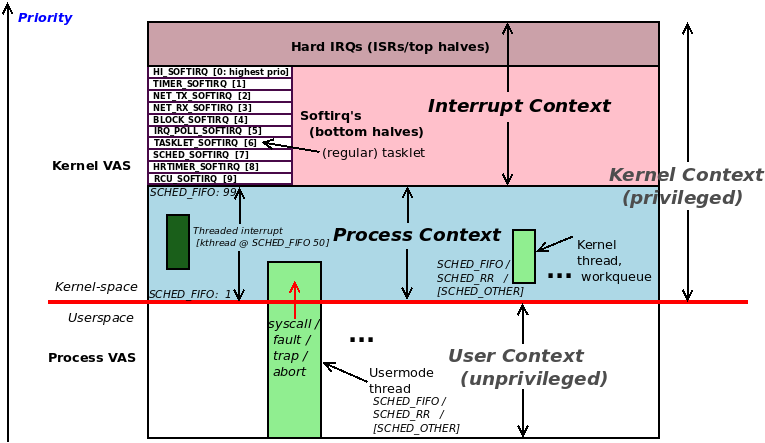

Hình 4.13 – Priority tương đối trên toàn stack - user, kernel process context và các kernel interrupt context

Sơ đồ này self-explanatory, hãy nghiên cứu kỹ.

Trong mục dài này, bạn đã học interrupt handling qua cả cơ chế top-half và bottom-half, lý do tồn tại của chúng, cách tổ chức và cách driver sử dụng. Giờ bạn hiểu mọi bottom-half mechanism đều được triển khai nội bộ qua softirq; tasklet là bottom-half mechanism chính mà bạn, người viết driver, có thể dễ dàng dùng. Tất nhiên, điều này không có nghĩa phải dùng — nếu chỉ top-half là đủ, hoặc tốt hơn nữa, chỉ threaded handler, thì rất tốt. Mục Hardirq, tasklet và threaded handler – dùng gì khi nào đã trình bày chi tiết các cân nhắc này.

Đến đây gần xong rồi! Tuy nhiên, vẫn còn một số lĩnh vực khác cần tìm hiểu. Hãy đi vào bằng format FAQ quen thuộc!

## Giải đáp một vài FAQ còn lại

Đây là một vài FAQ về hardware interrupt và cách xử lý. Chúng ta chưa đề cập các lĩnh vực này:

- Trên multicore system, có phải mọi hardware interrupt đều được route đến một CPU? Nếu không, chúng được load balancing thế nào? Có thể thay đổi không?

- Kernel có duy trì IRQ stack riêng không?

- Làm sao lấy metric về interrupt? Có đo interrupt latency được không?

Mục đích ở đây là đưa ra câu trả lời ngắn; chúng tôi khuyến khích bạn tìm hiểu sâu và tự thử! Dù có lặp lại, hãy nhớ cách thực nghiệm là tốt nhất!

### Load balancing interrupt và IRQ affinity

Trước hết, trên multicore (SMP) system, cách hardware interrupt được route đến CPU core thường rất đặc thù theo board và interrupt controller. Dù vậy, generic IRQ layer trên Linux cung cấp abstraction rất hữu ích: cho phép (và triển khai) interrupt load balancing để không CPU nào (hay nhóm CPU nào) bị quá tải. Thậm chí có frontend utility `irqbalance(1)` và `irqbalance-ui(1)` cho phép admin (hoặc root user) thực hiện IRQ balancing (`irqbalance-ui` là frontend `ncurses` cho `irqbalance`).

Có thể thay đổi interrupt được gửi đến các processor core không? Có, qua pseudofile `/proc/irq/IRQ/smp_affinity`! Đó là bitmask chỉ định CPU mà IRQ này được phép route đến. Vấn đề là thiết lập mặc định luôn cho phép mọi CPU core xử lý interrupt. Ví dụ, trên hệ thống tám core, giá trị `smp_affinity` cho IRQ line là `0xff` (nhị phân `1111 1111`). Vì sao là vấn đề? CPU caching. Nói ngắn gọn, nếu nhiều core xử lý cùng interrupt, cache bị xáo trộn và do đó có thể xảy ra nhiều cache invalidation (để giữ memory coherent với CPU cache), dẫn đến đủ loại vấn đề hiệu năng; đặc biệt trên hệ thống high-end có hàng chục core và nhiều NIC.

Chúng ta trình bày thêm các vấn đề CPU caching trong `Chapter 7`, Kernel Synchronization - Phần 2, mục Ảnh hưởng của cache và false sharing.

Khuyến nghị là gắn affinity một IRQ line quan trọng (như Ethernet interrupt) với một CPU core cụ thể (hoặc tối đa một physical core có hyperthreading). Không chỉ vậy, gắn các network application process và thread liên quan với cùng core sẽ (có lẽ) cho hiệu năng tốt hơn (chúng ta đã trình bày CPU affinity của process/thread trong tài liệu đồng hành Linux Kernel Programming - Chương 11, CPU Scheduler - Phần 2, mục Tìm hiểu, truy vấn và đặt CPU affinity mask).

Hãy xem thêm vài điểm:

- Output của `/proc/interrupts` phản ánh IRQ affinity (và IRQ balancing), cho phép thấy chính xác bao nhiêu interrupt đã được route đến CPU core nào trên hệ thống. (Chúng ta đã trình bày chi tiết cách diễn giải trong mục Xem mọi interrupt (IRQ) line đã cấp phát.)

- Service `irqbalance` thực sự có thể gây vấn đề vì đưa thiết lập IRQ affinity về mặc định khi khởi động (`https://unix.stackexchange.com/questions/68812/making-a-irq-smp-affinity-change-permanent`); bạn có thể muốn disable nó nếu đang tinh chỉnh cẩn thận (có thể lúc boot qua script `rc.local` hoặc `systemd` tương đương.) Các phiên bản `irqbalance` mới hơn cho phép ban IRQ line và sẽ không đặt (lại) chúng.

### Kernel có duy trì IRQ stack riêng không?

Trong tài liệu đồng hành Linux Kernel Programming, Chương 6, Kiến thức thiết yếu và Kernel Internals – Process và Thread, mục Tổ chức process, thread và stack của chúng – user space và kernel space, chúng ta đã trình bày vài điểm chính: mỗi user space thread có hai stack: user space stack và kernel space stack. Khi thread chạy trong user space non-privileged, nó dùng user mode stack; khi chuyển sang kernel space có đặc quyền (qua system call hoặc exception), nó dùng kernel-mode stack (xem lại Hình 6.3 trong tài liệu đồng hành Linux Kernel Programming). Tiếp theo, kernel-mode stack có kích thước rất hạn chế và cố định — chỉ dài 2 hoặc 4 page (lần lượt tùy kiến trúc 32-bit hay 64-bit)! Vì vậy, tưởng tượng driver code (chẳng hạn method `ioctl()`) đang chạy trong code path lồng sâu. Điều này có nghĩa kernel-mode stack của process context đó đã chứa khá nhiều metadata — stack frame của từng hàm đã gọi. Bây giờ hardware interrupt đến! Cuối cùng, đây cũng là code phải chạy nên cần stack. Có thể đơn giản dùng kernel-mode stack hiện tại, nhưng như vậy tăng đáng kể khả năng stack overflow (vì đang lồng sâu và stack nhỏ). Stack overflow trong kernel là thảm họa vì hệ thống đơn giản sẽ treo/chết mà không có manh mối thực sự về nguyên nhân gốc (kernel config `CONFIG_VMAP_STACK` được đưa vào để giảm chính loại vấn đề này và được đặt mặc định trên x86\_64).

Vì vậy, nói ngắn gọn, trên gần như mọi kiến trúc hiện đại, kernel cấp phát một kernel space stack riêng cho mỗi CPU để xử lý hardware interrupt. Nó gọi là IRQ stack. Khi hardware interrupt đến, vị trí stack (qua CPU stack pointer register thích hợp) được chuyển sang IRQ stack của CPU đang xử lý interrupt (và khôi phục khi IRQ exit). Một số kiến trúc (PPC) có kernel config `CONFIG_IRQSTACKS` để enable IRQ stack. Kích thước IRQ stack cố định, giá trị phụ thuộc kiến trúc. Trên x86\_64, dài 4 page (16 KB, với page size 4K điển hình).

### Đo metric và latency

Chúng ta đã phần nào thảo luận latency (độ trễ) là gì và cách đo scheduling latency trong tài liệu đồng hành Linux Kernel Programming - Chương 11, CPU Scheduler – Phần 2, mục Latency và cách đo. Ở đây, chúng ta xem thêm các khía cạnh của system latency và việc đo chúng.

Như đã biết, `procfs` là nguồn thông tin phong phú; chúng ta đã thấy cả số hardirq lẫn softirq sinh ra trên mỗi CPU core có thể xem qua các (pseudo) file `/proc/interrupts` và `/proc/softirqs`. Thông tin tương tự có qua `/proc/stat`.

#### Đo interrupt với \[e\]BPF

Trong tài liệu đồng hành Linux Kernel Programming - Chương 1, Thiết lập Kernel Workspace, mục Tracing và phân tích hiệu năng hiện đại với \[e\]BPF, chúng ta chỉ ra cách hiện đại để tracing, đo và phân tích hiệu năng trên Linux (4.x gần đây) là \[e\]BPF, enhanced Berkeley Packet Filter (cũng chỉ gọi là BPF). Trong vô số công cụ có sẵn (`https://github.com/iovisor/bcc#tools`), hai công cụ phù hợp mục đích trước mắt là trace, đo và phân tích interrupt (cả hardirq và softirq). (Trên Ubuntu, tên công cụ là `toolname-bpfcc`, trong đó `toolname` là tên công cụ đang xét, như `hardirqs-bpfcc` và `softirqs-bpfcc`). Chúng trace interrupt động (tại thời điểm viết, chưa dựa trên kernel tracepoint). Bạn cần quyền root để chạy những công cụ \[e\]BPF này.

Quan trọng: Có thể cài BCC tool cho Linux distro host thông thường bằng cách đọc hướng dẫn tại đây: `https://github.com/iovisor/bcc/blob/master/INSTALL.md`. Vì sao không làm trên guest Linux VM? Bạn có thể làm khi chạy distro kernel (như kernel do Ubuntu cung cấp hoặc Fedora-supplied). Lý do có thể làm là việc cài BCC toolset bao gồm (và phụ thuộc vào) cài package `linux-headers-$(uname -r)`; package `linux-headers` này chỉ tồn tại cho distro kernel (không có cho custom kernel 5.4 mà bạn có thể đang chạy trên guest).

##### Đo thời gian phục vụ từng hardirq

Công cụ `hardirqs[-bpfcc]` hiển thị tổng thời gian phục vụ hardirq (hardware interrupt). Ảnh sau cho thấy chạy `hardirqs-bpfcc`. Ở đây, có thể thấy tổng thời gian phục vụ hardirq mỗi 1 giây (tham số đầu) trong 3 giây (tham số thứ hai):

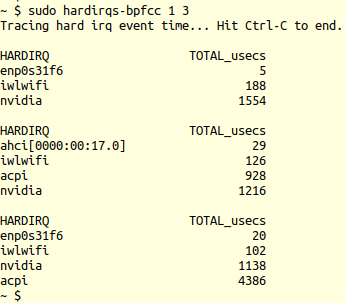

Hình 4.14 – hardirqs-bpfcc thể hiện thời gian phục vụ hardirq mỗi 1 giây trong 3 giây

Ảnh sau cho thấy dùng cùng công cụ để tạo histogram phân bố thời gian hard IRQ (qua switch `-d`):

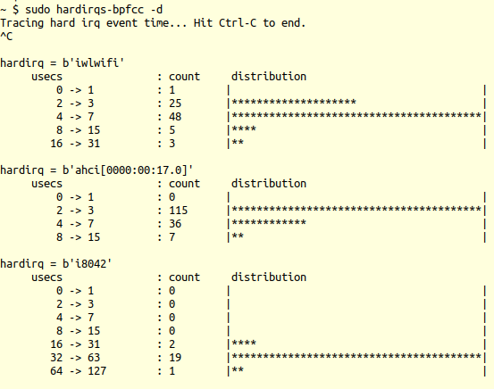

Hình 14.15 – hardirqs-bpfcc -d thể hiện histogram

Chú ý phần lớn network hardirq (`iwlwifi`, 48 lần) chỉ cần từ 4 đến 7 microsecond để hoàn tất, dù một vài (ba lần) cần từ 16 đến 31 usec.

Có thể tìm thêm ví dụ dùng công cụ `hardirqs[-bpfcc]` tại `https://github.com/iovisor/bcc/blob/master/tools/hardirqs_example.txt`. Tra man page cũng hữu ích.

##### Đo thời gian phục vụ từng softirq

Tương tự việc đã làm với hardirq, giờ dùng công cụ `softirqs[-bpfcc]`. Nó hiển thị tổng thời gian phục vụ softirq (software interrupt). Một lần nữa, bạn cần quyền root để chạy các công cụ \[e\]BPF này. Trước hết, hãy đặt hệ thống (x86\_64 native chạy Ubuntu) dưới một mức stress (ở đây là network download, network upload và disk activity). Ảnh sau cho thấy chạy `softirqs-bpfcc`, cung cấp thông tin tổng thời gian phục vụ softirq mỗi 1 giây (tham số đầu) mãi mãi (không có tham số thứ hai):

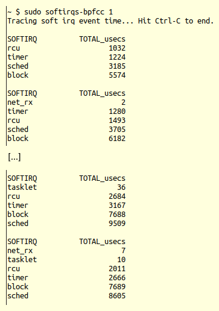

Hình 4.16 – softirqs-bpfcc hiển thị thời gian phục vụ softirq mỗi 1 giây (dưới một mức I/O stress)

Chú ý tasklet softirq cũng tham gia. Hãy xem ví dụ khác dùng cùng công cụ để tạo histogram phân bố thời gian soft IRQ (qua switch `-d`, một lần nữa khi hệ thống chịu I/O stress — network và disk). Ảnh sau là output sau khi chạy lệnh `sudo` `softirqs-bpfcc -d`:

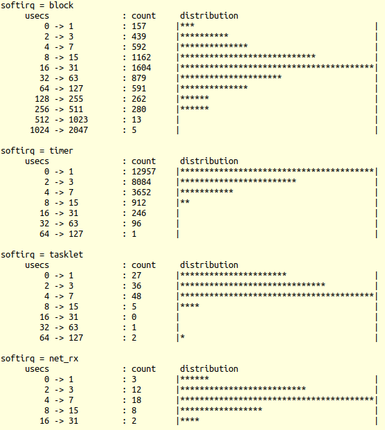

Hình 4.17 – softirqs-bpfcc -d thể hiện histogram (dưới một mức I/O stress)

Một lần nữa, trong tập mẫu nhỏ này, phần lớn instance `NET_RX_SOFTIRQ` chỉ cần từ 4 đến 7 microsecond, còn phần lớn instance `BLOCK_SOFTIRQ` cần từ 16 đến 31 microsecond để hoàn tất. Các công cụ \[e\]BPF này cũng có man page (cũng kèm ví dụ). Tôi khuyến nghị cài những công cụ \[e\]BPF này trên Linux native (xem tài liệu đồng hành Linux Kernel Programming - Chương 1, Thiết lập Kernel Workspace, mục Tracing và phân tích hiệu năng hiện đại với \[e\]BPF). Hãy xem và tự thử công cụ.

#### Dùng Ftrace để nắm system latency

Linux có tracing engine rất mạnh tích hợp ngay trong kernel tên Ftrace. Giống như có thể trace system call qua tiện ích `strace(1)` (rất hữu ích) (và library API qua `ltrace(1)`) trong user space, bạn cũng có thể trace gần như mọi hàm chạy trong kernel space qua Ftrace. Tuy nhiên, Ftrace vượt xa một function tracer đơn thuần — nó là framework, thành phần trụ cột của tracing infrastructure bên dưới kernel.

Steven Rostedt là tác giả ban đầu của Ftrace. Bài viết Finding Origins of Latencies Using Ftrace của ông rất đáng đọc. Có thể tìm tại đây: `https://static.lwn.net/images/conf/rtlws11/papers/proc/p02.pdf`.

Trong mục này, chúng ta không định trình bày in-depth cách dùng Ftrace vì thực sự không thuộc nội dung đang xét. Học dùng Ftrace không khó, và là vũ khí quý trong bộ công cụ kernel debug! Nếu chưa quen, hãy xem các liên kết Ftrace đã cung cấp trong mục Đọc thêm ở cuối chương.

Latency là độ trễ giữa thời điểm điều gì đó lẽ ra xảy ra và thời điểm thực sự xảy ra (sự khác nhau nói vui giữa lý thuyết và thực hành). System latency trong OS có thể là nguyên nhân bên dưới của vấn đề hiệu năng. Trong đó có interrupt latency và scheduling latency. Nhưng nguyên nhân thực sự là gì? Theo bài viết của Steve Rostedt (đề cập ở trên), bốn sự kiện gây các latency này:

- Interrupt bị disable: Nếu IRQ tắt, interrupt không thể được phục vụ cho đến khi bật lại (ở đây tập trung đo điều này.)

- Preemption bị disable: Nếu vậy, một thread đã được wake up không thể chạy cho đến khi preemption được enable.

- Scheduling latency: Độ trễ giữa lúc thread được schedule để chạy và lúc thực sự chạy trên core (đã trình bày cách đo trong tài liệu đồng hành Linux Kernel Programming - Chương 11, CPU Scheduler - Phần 2, mục Latency và cách đo.)

- Interrupt inversion: Khi interrupt chạy trước một task có priority cao hơn (tương tự priority inversion, có thể xảy ra trong hard real-time; tất nhiên, như đã học, chính vì vậy threaded handler rất quan trọng).

Ftrace có thể ghi lại tất cả trừ điều cuối. Ở đây tập trung học cách dùng Ftrace để tìm (hay thực sự là lấy mẫu) thời gian trường hợp worst-case mà hardware interrupt bị disable. Đây được gọi là `irqsoff` latency tracing. Bắt đầu thôi!

##### Tìm latency thời gian interrupt bị disable trong trường hợp worst-case bằng Ftrace

Ftrace có một số plugin (hay tracer) để làm việc. Trước hết, cần bảo đảm latency tracer `irqsoff` (hay plugin của Ftrace) thực sự được enable trong kernel. Có thể kiểm tra theo hai cách:

- Kiểm tra kernel config file (`grep` tìm `CONFIG_IRQSOFF_TRACER` trong đó).

- Kiểm tra tracer (hay plugin) sẵn có qua Ftrace infrastructure.

Ở đây chúng ta dùng cách sau:

```
$ sudo cat /sys/kernel/debug/tracing/available_tracers
hwlat blk mmiotrace function_graph wakeup_dl wakeup_rt wakeup
function nop
```

Trong output trên, tracer `irqsoff` — thứ chúng ta cần — bị thiếu! Đây thường là trường hợp gặp phải, ngụ ý bạn phải configure kernel (bật nó) và (re)build custom kernel 5.4. (Việc này sẽ là bài tập trong mục Câu hỏi cuối chương.) Chúng tôi cũng khuyến nghị cài frontend rất hữu ích cho Ftrace là tiện ích `trace-cmd(1)` (đã đề cập trong tài liệu đồng hành Linux Kernel Programming - Chương 1, Thiết lập Kernel Workspace, và dùng trong Chương 11, CPU Scheduler - Phần 2, mục Trực quan hóa với trace-cmd).

Lockdep có thể gây vấn đề ở đây: nếu được enable, thực sự tốt nhất nên disable tính năng lockdep của kernel khi latency tracing (có thể thêm quá nhiều overhead). Chúng ta sẽ thảo luận khá chi tiết lockdep trong `Chapter` `7`, Kernel Synchronization - Phần 2.

Khi đã enable `CONFIG_IRQSOFF_TRACER` (và cài `trace-cmd`), làm theo các bước để latency tracer của Ftrace xác định interrupts-off latency trong trường hợp worst-case. Tất nhiên, phải thực hiện với quyền root:

1\. Lấy một root shell (bạn cần đặc quyền root để làm):

```
sudo /bin/bash
```

2\. Reset Ftrace framework (có thể làm qua frontend `trace-cmd(1)` cho Ftrace):

```
trace-cmd reset
```

3\. Chuyển đến directory dành cho ftrace:

```
cd /sys/kernel/debug/tracing
```

Thường tìm thấy ở đây. Nếu pseudo filesystem `debugfs` được mount dưới directory khác, hãy `cd` đến đó (và đến directory `tracing` bên dưới).

4\. Tắt mọi tracing bằng `echo 0 tracing_on` (bảo đảm có khoảng trắng giữa `0` và ký hiệu \>).

5\. Đặt tracer `irqsoff` làm current tracer:

```
echo irqsoff current_tracer
```

6\. Bây giờ bật tracing:

```
echo 1 tracing_on
 ... it runs! ...
```

7\. Output sau thể hiện `irqsoff latency` trong trường hợp worst-case (thường hiển thị bằng microsecond; đừng lo, chúng ta sẽ sớm trình bày lần chạy mẫu):

```
cat tracing_max_latency
[...]
```

8\. Lấy và đọc báo cáo đầy đủ. Mọi output Ftrace được giữ trong pseudofile `trace`:

```
cp trace /tmp/mytrc.txt
cat /tmp/mytrc.txt
```

9\. Reset Ftrace framework:

```
trace-cmd reset
```

Output nhận được sẽ như sau:

```
# cat /tmp/mytrc.txt
# tracer: irqsoff
#
# irqsoff latency trace v1.1.5 on 5.4.0-llkd01
# -----------------------------------------------------------------
---
# latency: 234 us, #53/53, CPU#1 | (M:desktop VP:0, KP:0, SP:0 HP:0
#P:2)
#    -----------------
#    | task: sshd-25311 (uid:1000 nice:0 policy:0 rt_prio:0)
#    -----------------
# = started at: schedule
# = ended at: finish_task_switch
[...]
```

Ở đây, `irqsoff` latency trong trường hợp worst-case là 234 microsecond (xảy ra khi task `sshd` có PID 25311 đang thực thi), ngụ ý hardware interrupt đã tắt trong khoảng thời gian đó. Để thuận tiện, tôi cung cấp wrapper Bash script đơn giản (`ch4/irqsoff_latency_ftrc.sh`) thực hiện cùng công việc.

Bây giờ, chúng ta đề cập vài công cụ hữu ích khác để đo system latency.

#### Công cụ khác

Sau đây là vài công cụ đáng đề cập về ghi nhận và phân tích system latency (và hơn nữa):

- Bạn có thể học thiết lập và dùng toolset Linux Tracing Toolkit – next generation (LTTng) mạnh mẽ để ghi trace của hệ thống đang hoạt động. Tôi đặc biệt khuyến nghị dùng Trace Compass GUI xuất sắc để phân tích. Thực tế, trong tài liệu đồng hành Linux Kernel Programming - Chương 1, Thiết lập Kernel Workspace, mục Linux Tracing Toolkit next generation (LTTng), chúng ta đã trình bày ảnh thú vị (Hình 1.9) của Trace Compass GUI dùng để hiển thị và phân tích IRQ line 1 và 130 (lần lượt là interrupt line cho i8042 và Wi-Fi chipset trên hệ thống x86\_64 native của tôi).

- Bạn cũng có thể thử công cụ `latencytop` để xác định user space thread nào đang block trên kernel operation nào. Phải bật `CONFIG_LATENCYTOP` trong kernel config để làm việc này.

- Ngoài latency metric, có thể dùng `dstat(1)`, `mpstat(1)`, `watch(1)`, v.v. để có cái nhìn giống “top” về interrupt (`https://unix.stackexchange.com/questions/8699/is-there-a-utility-that-interprets-proc-interrupts-data-in-time`).

Đến đây, chúng ta hoàn tất mục này và chương này.

## Tổng kết

Chúc mừng! Chương này dài nhưng đáng công. Bạn đã học được nhiều về làm việc với hardware interrupt. Chúng ta bắt đầu bằng xem ngắn gọn cách OS xử lý interrupt rồi học cách bạn, người viết driver, phải làm việc với chúng. Để làm vậy, bạn học cách cấp phát IRQ line (và giải phóng) qua một số phương thức, cùng triển khai hardware interrupt routine. Ở đây, nhiều hạn chế và lưu ý, về cơ bản quy về việc đây là hoạt động atomic, đã được thảo luận. Sau đó trình bày cách thức và lý do của mô hình “threaded interrupt”; thường được xem là cách hiện đại được khuyến nghị để xử lý interrupt. Tiếp đó, chúng ta hiểu và học làm việc với hardirq/softirq cùng top/bottom half. Cuối cùng, theo kiểu FAQ quen thuộc, chúng ta trình bày thông tin về interrupt load balancing, IRQ stack, và cách dùng một số framework cùng công cụ hữu ích để đo interrupt metric và latency.

Tất cả đều là kiến thức thiết yếu để xây dựng một driver well-written, phải làm việc với hardware interrupt!

Chương tiếp theo trình bày các lĩnh vực làm việc với thời gian: delay và timeout trong kernel space, tạo và quản lý kernel thread, dùng kernel workqueue. Tôi đề nghị bạn chăm chỉ làm bài tập của chương này, xem nhiều tài nguyên trong mục Đọc thêm, rồi nghỉ ngơi (chỉ làm mà không chơi khiến Jack buồn tẻ, đúng không!?) trước khi quay lại! Hẹn gặp bạn ở đó!

## Câu hỏi

1\. Trên hệ thống x86 (VM cũng được), chứng minh rằng trong khi số timer interrupt (IRQ `0`) giữ nguyên, một periodic system interrupt khác thực sự liên tục tăng (do đó theo dõi thời gian theo per-CPU). Gợi ý: dùng một `proc` pseudo-file liên quan đến interrupt.

2\. keylogger\_simple ; chỉ x86 native \[chỉ dùng cho ethical hacking; có thể không hoạt động trên VM\] (Nâng cao hơn một chút) Viết keyboard logger driver đơn giản dùng kernel framework “misc”. Bắt vào IRQ 1 của i8042 để “bắt” sự kiện nhấn/thả phím và đọc key scancode. Dùng cấu trúc dữ liệu `kfifo` để giữ keyboard scancode trong kernel space memory. Cho user mode process (hoặc thread) định kỳ đọc các mục dữ liệu từ `kfifo` của driver vào user space buffer rồi ghi chúng vào log file. Viết ứng dụng (hoặc dùng thread khác) để diễn giải các phím. Gợi ý:

1\. Có thể bảo đảm chỉ chạy trên x86 (như đúng ra phải vậy) không? Có; dùng `#ifdef` `CONFIG_X86` ngay đầu code!

2\. Có thể bảo đảm chỉ chạy trên native system, không trong VM không? Có, dùng script `virt-what` trong wrapper script để nạp driver; chỉ thực hiện `insmod` (hoặc `modprobe`) nếu không ở VM.

3\. Viết driver thực sự là cách khó (và khá không cần thiết!) để triển khai key logger (ở đây chỉ làm như bài tập để biết cách làm việc với hardware interrupt trong device driver). Thực sự đơn giản và tốt hơn là làm việc ở abstraction cao hơn — về cơ bản, truy vấn layer `events` của kernel để lấy keystroke. Một cách đơn giản là dùng công cụ giám sát và ghi nhận event — `evtest(1)` rất tốt! (chạy với quyền root; `https://www.kernel.org/doc/html/latest/input/input_uapi.html`).

Tài liệu tham khảo cho bài tập:

- Dùng kernel kfifo: `https://elixir.bootlin.com/linux/latest/source/samples/kfifo/bytestream-example.c`

- US keyboard map và cách diễn giải: `http://www.philipstorr.id.au/pcbook/book3/scancode.htm`; `http://www.osdever.net/bkerndev/Docs/keyboard.htm`

4\. Kernel cung cấp các cơ chế “deferred functionality” thường gọi là \_\_\_\_\_\_; chúng được thiết kế có chủ ý để có lợi từ cả hai phía: (i) \_\_\_\_\_\_\_\_\_\_\_\_ và (ii) \_\_\_\_\_\_.

1\. Top half; chạy hardirq sớm nhất có thể; ngay sau đó khôi phục context bị interrupt.

2\. Bottom half; cho phép người viết driver thực hiện interrupt processing khá dài nếu tình huống đòi hỏi. Làm theo cách deferred, an toàn trong khi cho phép hệ thống tiếp tục hoạt động.

3\. Better half; làm nhiều việc hơn trong interrupt context để không phải trả giá sau đó.

4\. Bottom half; chạy interrupt code với interrupt bị disable và để chạy lâu.

5\. Dùng công cụ duyệt code (`cscope(1)` là lựa chọn tốt) để tìm driver dùng API `tasklet_hi_schedule()`.

6\. Dùng plugin latency tracer `irqsoff` của Ftrace để tìm thời gian tối đa interrupt bị tắt. Gợi ý: Cần dùng plugin `irqsoff` (`CONFIG_IRQSOFF_TRACER`); nếu mặc định chưa bật, phải configure kernel để có nó (và các tracer khác khi cần; có thể tìm dưới `make` `menuconfig : Kernel Hacking / Tracers`). Sau đó, phải build kernel và tắt nó. Gợi ý: Khi đo như system latency (interrupts-off, interrupts-and-preemption-off, scheduling latency), tốt nhất disable `lockdep`. Tham khảo: Finding Origins of Latencies Using Ftrace, Steven Rostedt, RedHat: `https://static.lwn.net/images/conf/rtlws11/papers/proc/p02.pdf`.

Có thể tìm lời giải cho một số câu hỏi trên tại `https://github.com/PacktPublishing/Linux-Kernel-Programming-Part-2/tree/main/solutions_to_assgn`.

## Đọc thêm

- Kernel documentation: Linux generic IRQ handling: `https://www.kernel.org/doc/html/latest/core-api/genericirq.html#linux-generic-irq-handling`

- LWN kernel index về interrupt: `https://lwn.net/Kernel/Index/#Interrupts`

- Kích hoạt interrupt theo level/edge:

- Edge Triggered versus Level Triggered interrupts, tháng 3 năm 2013: `http://venkateshabbarapu.blogspot.com/2013/03/edge-triggered-vs-level-triggered.html`

- Level-triggered versus Edge-triggered Interrupts, tháng 11 năm 2008: `https://www.garystringham.com/level-triggered-vs-edge-triggered-interrupts/`

- How do I disable non-maskable interrupts programmatically?: `https://stackoverflow.com/questions/55394608/how-do-i-disable-non-maskable-interrupts-programmatically`

- Threadable NAPI polling, softirqs, and proper fixes, Jon Corbet, tháng 5 năm 2016, LWN: `https://lwn.net/Articles/687617/`

- Hướng đi có thể trong tương lai: softirq vector fine-grained masking:

- Per-vector software-interrupt masking, Jon Corbet, tháng 2 năm 2019, LWN: `https://lwn.net/Articles/779738/`

- Soft-interruptible softirqs (or per vector masking), Frederic Weisbecker, SuSe: `https://linuxplumbersconf.org/event/4/contributions/420/attachments/375/609/lpc_softirq.pdf`

- IRQ balancing và affinity:

- IRQ Balancing, ntop project: `https://www.ntop.org/pf_ring/irq-balancing/`

- Setting interrupt affinity systems, RHEL8: `https://access.redhat.com/documentation/en-us/red_hat_enterprise_linux/8/html/monitoring_and_managing_system_status_and_performance/configuring-an-operating-system-to-optimize-cpu-utilization_monitoring-and-managing-system-status-and-performance#setting-interrupt-affinity-systems_configuring-an-operating-system-to-optimize-cpu-utilization`

- Cách hiện đại để đo và phân tích hiệu năng với eBPF:

- Linux bcc/eBPF tracing tools, Brendan Gregg: `https://github.com/iovisor/bcc#tools`

- bcc Tutorial: `https://github.com/iovisor/bcc/blob/master/docs/tutorial.md#bcc-tutorial`

- Ftrace:

- Kernel doc: ftrace – Function Tracer: `https://www.kernel.org/doc/Documentation/trace/ftrace.txt`

- Sau đây là tập hợp liên kết đến bài viết về Ftrace trên LWN (một số được đề cập ở đây): `https://lwn.net/Kernel/Index/#Ftrace`

- Debugging the kernel using ftrace - part 1, Steven Rostedt, LWN, tháng 12 năm 2009: `https://lwn.net/Articles/365835/`

- Secrets of the ftrace function tracer, Steven Rostedt, LWN, tháng 1 năm 2010: `https://lwn.net/Articles/370423/`

- trace-cmd: a frontend for ftrace, Steven Rostedt, LWN, tháng 10 năm 2010: `https://lwn.net/Articles/410200/`

- Finding Origins of Latencies Using Ftrace, Steven Rostedt, tháng 10 năm 2011: `https://static.lwn.net/images/conf/rtlws11/papers/proc/p02.pdf`

- LWN Kernel index về Latency: `https://lwn.net/Kernel/Index/#Latency`
