# Chương 5. Làm việc với Kernel Timer, Thread và Workqueue

Nếu đặc tả cấp thấp của device driver yêu cầu có delay 50 millisecond giữa việc thực thi `func_a()` và `func_b()` thì sao? Hơn nữa, tùy tình huống, delay phải hoạt động khi bạn chạy trong process context hoặc interrupt context. Nếu ở phần khác của driver, bạn cần một hàm giám sát nào đó được thực thi asynchronously và định kỳ (chẳng hạn mỗi giây) thì sao? Hay bạn cần một thread (hoặc nhiều thread) âm thầm thực hiện công việc ở background nhưng bên trong kernel?

Đây là những yêu cầu rất phổ biến trong mọi loại phần mềm, bao gồm góc nhỏ của chúng ta trong vũ trụ – phát triển Linux kernel module (và driver)! Trong chương này, bạn sẽ học cách thiết lập, hiểu và sử dụng delay khi chạy trong kernel space, cũng như cách làm việc với kernel timer, kernel thread và workqueue.

Trong chương này, bạn sẽ học cách thực hiện tối ưu các tác vụ này. Tóm lại, chúng ta sẽ đề cập các chủ đề sau:

- Delay một khoảng thời gian nhất định trong kernel

- Thiết lập và sử dụng kernel timer

- Tạo và làm việc với kernel thread

- Sử dụng kernel workqueue

Hãy bắt đầu!

## Yêu cầu kỹ thuật

Tôi giả định bạn đã đọc phần Để tận dụng tối đa cuốn sách này trong Lời nói đầu, chuẩn bị phù hợp một guest VM chạy Ubuntu 18.04 LTS (hoặc bản phát hành ổn định mới hơn), và cài đặt mọi package cần thiết. Nếu chưa, tôi rất khuyến nghị làm việc này trước. Để tận dụng tối đa cuốn sách, tôi đặc biệt khuyến nghị trước tiên thiết lập workspace environment, bao gồm clone GitHub repository chứa code của cuốn sách, và thực hành trên đó. Repository ở đây: `https://github.com/PacktPublishing/Linux-Kernel-Programming-Part-2`.

## Delay một khoảng thời gian nhất định trong kernel

Thông thường, kernel code hoặc driver code cần chờ một khoảng thời gian nhất định trước khi chuyển sang instruction tiếp theo. Trong Linux kernel space, có thể thực hiện điều này qua một tập delay API. Ngay từ đầu, điểm quan trọng cần hiểu là bạn có thể thực hiện delay theo hai cách chính:

- Delay qua các API non-blocking hoặc atomic, sẽ không bao giờ khiến process sleep (nói cách khác, không bao giờ schedule out)

- Delay qua các API blocking khiến process context hiện tại sleep (nói cách khác, bằng cách schedule out)

(Như chúng ta đã trình bày chi tiết trong sách đồng hành Linux Kernel Programming, ở các chương về CPU scheduling là Chương 10, CPU Scheduler – Phần 1, và Chương 11, CPU Scheduler – Phần 2), đưa process context vào sleep ngụ ý rằng bên trong, hàm cốt lõi `schedule()` của kernel được gọi tại một thời điểm nào đó, cuối cùng gây ra context switch. Điều này dẫn đến điểm thực sự quan trọng (chúng ta đã đề cập trước đây!): bạn tuyệt đối không bao giờ được gọi `schedule()` khi chạy trong bất kỳ atomic context hoặc interrupt context nào. Thông thường, như trường hợp chèn delay ở đây, bạn phải xác định code tại vị trí dự định chèn delay đang chạy trong context nào. Chúng ta đã đề cập điều này trong sách đồng hành Linux Kernel Programming - Chương 6, Kiến thức cốt lõi về Kernel Internals – Process và Thread, trong phần Xác định context; hãy tham khảo lại nếu chưa rõ. (Chúng ta còn đi sâu hơn về điều này trong `Chapter 4`, Xử lý Hardware Interrupt.)

Tiếp theo, hãy suy nghĩ kỹ: nếu bạn thực sự ở trong atomic context (hoặc interrupt context), có thật sự cần delay không? Toàn bộ mục đích của atomic context hoặc interrupt context là giới hạn việc thực thi trong đó ở thời lượng ngắn nhất có thể; bạn rất nên thiết kế theo cách này. Điều đó ngụ ý không chèn delay vào atomic code trừ khi không thể tránh.

- Dùng loại thứ nhất: Đây là các API non-blocking hoặc atomic không bao giờ gây sleep. Bạn nên dùng chúng khi code ở trong atomic context (hoặc interrupt context) và thực sự cần non-blocking delay với thời lượng ngắn; nhưng ngắn đến mức nào? Theo nguyên tắc kinh nghiệm, dùng các API này cho non-blocking atomic delay không quá 1 millisecond. Ngay cả khi cần delay hơn một millisecond trong atomic context – chẳng hạn trong code của interrupt handler (nhưng tại sao lại delay trong interrupt!?) – hãy dùng các API `*delay()` này (ký tự `*` biểu thị wildcard; ở đây, như bạn sẽ thấy, nó biểu thị các routine `ndelay()`, `delay()` và `mdelay()`).

- Dùng loại thứ hai: Đây là các API blocking khiến process context hiện tại sleep. Bạn nên dùng chúng khi code ở trong process context (hoặc task context), cho các delay có bản chất blocking và thời lượng dài hơn; thực tế là delay trên một millisecond. Các kernel API này có dạng `*sleep()`. (Một lần nữa, không đi quá sâu, hãy nghĩ: nếu ở trong process context nhưng bên trong critical section của spinlock, đó là atomic context – nếu buộc phải thêm delay, bạn phải dùng các API `*delay()`! Chúng ta sẽ trình bày spinlock cùng nhiều nội dung khác trong hai chương cuối cuốn sách.)

Giờ hãy xem các kernel API này và cách dùng chúng. Chúng ta bắt đầu với các atomic API `*delay()`.

### Hiểu cách dùng các atomic API \*delay()

Không chần chừ nữa, hãy xem bảng tóm tắt nhanh các kernel API `*delay()` non-blocking hoặc atomic có sẵn cho chúng ta, những người viết module; chúng dành cho mọi atomic context hoặc interrupt context mà bạn không thể block hay sleep (hoặc gọi `schedule()`):

| API | Chú thích |
|---|---|
| `ndelay(ns);` | Delay `ns` nanosecond. |
| `udelay(us);` | Delay `us` microsecond. |
| `mdelay(ms);` | Delay `ms` millisecond. |

Bảng 5.1 – Các API non-blocking \*delay()

Có vài điểm cần lưu ý về các API này, cách triển khai bên trong và cách dùng chúng:

- Luôn include header `<linux/delay.h>` khi dùng các macro/API này.

- Bạn cần gọi routine phù hợp với thời lượng phải delay; ví dụ, nếu cần atomic non-blocking delay, chẳng hạn 30 millisecond, hãy gọi `mdelay(30)` thay vì `udelay(30*1000)`. Kernel code đề cập đúng điểm này: `linux/delay.h` – "Dùng udelay() cho các khoảng thời gian lớn hơn vài millisecond có thể có nguy cơ overflow trên máy có loops\_per\_jiffy cao (bogomips cao) ...".

- Cách triển khai bên trong các API này, cũng như nhiều API trên Linux, có những chi tiết tinh tế: có cách triển khai trừu tượng hóa cấp cao cho các hàm (hoặc macro, tùy trường hợp) này trong header `<linux/delay.h>`; thường có cách triển khai cấp thấp đặc thù arch trong một header đặc thù arch (`<asm-<arch>/delay.h>` hoặc `<asm-generic/delay.h>`; tất nhiên `arch` nghĩa là CPU), tự động thay thế phiên bản cấp cao tại thời điểm gọi (linker sẽ bảo đảm điều này).

- Trong cách triển khai hiện tại, cuối cùng các API này đều quy về wrapper trên `udelay()`; bản thân hàm này lại quy về một assembly loop chặt chẽ thực hiện điều được gọi là "busy looping"! (Với x86, code ở `arch/x86/lib/delay.c:__const_udelay()`.) Không đi vào chi tiết phức tạp, ở giai đoạn đầu của boot process, kernel hiệu chỉnh một vài giá trị: giá trị gọi là bogomips – bogus MIPS – và loops per jiffy (lpj). Về cơ bản, kernel xác định trên hệ thống cụ thể đó phải lặp loop bao nhiêu lần để 1 timer tick hay một jiffy trôi qua. Giá trị này được gọi là bogomips của hệ thống và có thể xem trong kernel log. Ví dụ, trên laptop Core-i7 của tôi, nó như sau:

```
Calibrating delay loop (skipped), value calculated using timer
frequency.. 5199.98 BogoMIPS (lpj=10399968)
```

- Với delay trên `MAX_UDELAY_MS` (được đặt là 5 ms), bên trong kernel sẽ gọi hàm `udelay()` trong một loop.

Nhớ rằng phải dùng các API `*delay()` khi cần delay trong bất kỳ atomic context nào, chẳng hạn interrupt handler (top half hoặc bottom half), vì chúng bảo đảm không bao giờ có sleep – và do đó không có lời gọi `schedule()`. Xin nhắc lại (chúng ta đã đề cập trong `Chapter 4`, Xử lý Hardware Interrupt): `might_sleep()` được dùng hỗ trợ debug; bên trong kernel (và driver) dùng macro `might_sleep()` ở những chỗ trong code base chạy trong process context; tức là nơi có thể sleep. Nếu `might_sleep()` được gọi trong atomic context, điều đó hoàn toàn sai – khi ấy một printk stack trace ồn ào được phát ra, giúp bạn phát hiện sớm và sửa những vấn đề này. Bạn cũng có thể dùng các API `*delay()` trong process context.

Trong các thảo luận này, bạn thường gặp kernel variable `jiffies`; về cơ bản, hãy xem `jiffies` là giá trị unsigned 64-bit toàn cục được tăng sau mỗi timer interrupt (hoặc timer tick; bên trong nó được bảo vệ chống overflow). Vì vậy, biến tăng liên tục này được dùng để đo uptime, cũng như triển khai timeout và delay đơn giản.

Giờ hãy xem loại delay API có sẵn thứ hai – loại blocking.

### Hiểu cách dùng các blocking API \*sleep()

Hãy xem bảng khác tóm tắt nhanh các kernel API blocking `*sleep*()` có sẵn cho chúng ta, những người viết module; chúng chỉ dành cho process context khi sleep an toàn; tức là nơi gọi `schedule()` không gây vấn đề. Nói cách khác, delay được triển khai bằng việc process context thực sự sleep trong thời lượng delay rồi được đánh thức khi hết thời gian:

| API | Được "hỗ trợ bởi" bên trong | Chú thích |
|---|---|---|
| `usleep_range(umin, umax);` | `hrtimers` (high-resolution timer) | Sleep trong khoảng `umin` đến `umax` microsecond. Dùng khi thời điểm wakeup linh hoạt. Đây là API được khuyến nghị. |
| `msleep(ms);` | `jiffies`/`legacy_timers` | Sleep `ms` millisecond. Thường dành cho sleep có thời lượng từ 10 ms trở lên. |
| `msleep_interruptible(ms);` | `jiffies`/`legacy_timers` | Biến thể interruptible của `msleep(ms);`. |
| `ssleep(s);` | `jiffies`/`legacy_timers` | Sleep `s` giây. Dành cho sleep \> 1 s (wrapper trên `msleep()`). |

Bảng 5.2 – Các blocking API \*sleep\*()

Có vài điểm cần lưu ý về các API này, cách triển khai bên trong và cách dùng chúng:

- Bảo đảm include header `<linux/delay.h>` khi dùng các macro/API này.

- Bên trong, mọi API `*sleep()` này đều được triển khai sao cho khiến process context hiện tại sleep (tức là bằng cách gọi `schedule()` bên trong); vì vậy, tất nhiên chỉ được gọi chúng trong process context khi "sleep an toàn". Một lần nữa, chỉ vì code ở trong process context không nhất thiết có nghĩa sleep an toàn; ví dụ, critical section của spinlock là atomic; vì vậy không được gọi các API `*sleep()` nói trên ở đó!

- Chúng ta đã đề cập `usleep_range()` là API ưu tiên/được khuyến nghị khi muốn sleep ngắn – nhưng tại sao? Điều này sẽ rõ hơn trong phần Hãy thử – delay và sleep thực sự mất bao lâu?

Như bạn biết, sleep trên Linux có thể thuộc hai loại: interruptible và uninterruptible. Loại sau nghĩa là không signal task nào có thể "làm phiền" sleep. Vì vậy, khi gọi `msleep(ms);`, nó đưa process context hiện tại vào sleep trong `ms` bằng cách gọi nội bộ như sau:

```
__set_current_state(TASK_UNINTERRUPTIBLE);
return schedule_timeout(timeout);
```

Routine `schedule_timeout()` hoạt động bằng cách thiết lập một kernel timer (chủ đề tiếp theo!) sẽ expire sau thời gian mong muốn, rồi lập tức đưa process vào sleep bằng cách gọi `schedule()`! (Nếu tò mò, hãy xem code ở đây: `kernel/time/timer.c:schedule_timeout()`.) Cách triển khai `msleep_interruptible()` rất tương tự, ngoại trừ nó gọi `__set_current_state(TASK_INTERRUPTIBLE);`. Theo nguyên tắc thiết kế, hãy theo mô hình UNIX cung cấp mechanism, không cung cấp policy; theo đó, gọi `msleep_interruptible()` có thể là ý hay khi nếu userspace app hủy công việc (có lẽ do người dùng nhấn `^C`), kernel hoặc driver ngoan ngoãn giải phóng task: process context của nó được đánh thức, chạy signal handler thích hợp rồi mọi thứ tiếp tục. Trong tình huống quan trọng là kernel space không bị signal do người dùng tạo ra làm phiền, dùng biến thể `msleep()`.

Một lần nữa, theo nguyên tắc kinh nghiệm, dùng các API sau tùy thời lượng delay:

- Với delay trên 10 millisecond: `msleep()` hoặc `msleep_interruptible()`

- Với delay trên 1 giây: `ssleep()`

Như bạn có thể dự đoán, `ssleep()` là wrapper đơn giản trên `msleep();` và trở thành `msleep(seconds * 1000);`.

Có thể xem một cách đơn giản triển khai tương đương (xấp xỉ) API `sleep(3)` của user space trong header `convenient.h` của chúng ta; cốt lõi, nó dùng API `schedule_timeout()`:

```
#ifdef __KERNEL__
void delay_sec(long);
/*------------ delay_sec --------------------------------------------------
 * Delays execution for @val seconds.
 * If @val is -1, we sleep forever!
 * MUST be called from process context.
 * (We deliberately do not inline this function; this way, we can see it's
 * entry within a kernel stack call trace).
 */
void delay_sec(long val)
{
    asm (""); // force the compiler to not inline it!
    if (in_task()) {
        set_current_state(TASK_INTERRUPTIBLE);
        if (-1 == val)
            schedule_timeout(MAX_SCHEDULE_TIMEOUT);
        else
            schedule_timeout(val * HZ);
    }
}
#endif /* #ifdef __KERNEL__ */
```

Giờ bạn đã học cách delay (vâng, hãy cười nào), hãy tiếp tục học một kỹ năng hữu ích: lấy timestamp cho kernel code. Điều này cho phép nhanh chóng tính một đoạn code cụ thể mất bao lâu để thực thi.

### Lấy timestamp trong kernel code

Khả năng lấy timestamp chính xác rất quan trọng vì kernel thường dùng chức năng này. Ví dụ, tiện ích `dmesg(1)` hiển thị thời gian kể từ khi hệ thống boot theo định dạng `seconds.microseconds`; Ftrace trace thường hiển thị thời gian một hàm mất để thực thi. Khi ở user mode, chúng ta thường dùng system call `gettimeofday(2)` để lấy timestamp. Trong kernel có một số interface; thông thường họ routine `ktime_get_*()` được dùng để lấy timestamp chính xác. Với mục đích của chúng ta, routine sau hữu ích:

```
u64 ktime_get_real_ns(void);
```

Bên trong, routine này truy vấn wall (clock) time qua API `ktime_get_real()` rồi đổi kết quả thành đại lượng nanosecond. Chúng ta không đi sâu chi tiết nội bộ ở đây. Ngoài ra còn có một số biến thể API; ví dụ `ktime_get_real_fast_ns()`, `ktime_get_real_ts64()`, v.v. Hàm đầu vừa nhanh vừa NMI-safe. Giờ đã biết lấy timestamp, bạn có thể tính thời gian code thực thi với độ chính xác khá tốt, thậm chí độ phân giải nanosecond! Có thể dùng pseudocode sau để làm điều đó:

```
#include <linux/ktime.h>
t1 = ktime_get_real_ns();
foo();
bar();
t2 = ktime_get_real_ns();
time_taken_ns = (t2 -> t1);
```

Ở đây, thời gian thực thi các hàm (giả định) `foo()` và `bar()` được tính, và kết quả – theo nanosecond – có trong biến `time_taken_ns`. Bản thân kernel header `<linux/ktime.h>` include header `<linux/timekeeping.h>`, là nơi định nghĩa họ routine `ktime_get_*()`.

Một macro giúp tính thời gian giữa hai timestamp đã được cung cấp trong header file `convenient.h`: `SHOW_DELTA(later,` `earlier);`. Bảo đảm truyền timestamp sau làm tham số thứ nhất và timestamp đầu làm tham số thứ hai.

Ví dụ code ở phần tiếp theo sẽ giúp chúng ta dùng cách tiếp cận này.

### Hãy thử – delay và sleep thực sự mất bao lâu?

Đến đây, bạn biết cách dùng các API `*delay()` và `*sleep()` để tạo delay và sleep (lần lượt non-blocking và blocking). Nhưng khoan – chúng ta chưa thực sự thử trong kernel module. Không chỉ thế, delay và sleep có chính xác như chúng ta được dẫn dắt tin tưởng không? Như thường lệ, hãy thực nghiệm (điều này quan trọng!) và đừng giả định. Hãy tự mình thực sự thử!

Demo kernel module chúng ta xem trong phần này thực hiện hai loại delay theo thứ tự:

- Đầu tiên, nó dùng các routine `*delay()` (bạn đã học trong phần Hiểu cách dùng các atomic API \*delay()) để triển khai atomic non-blocking delay 10 ns, 10 us và 10 ms.

- Tiếp theo, nó dùng các routine `*sleep()` (bạn đã học trong phần Hiểu cách dùng các blocking API \*sleep()) để triển khai blocking delay 10 us, 10 ms và 1 giây.

Chúng ta gọi code cho việc này như sau:

```
DILLY_DALLY("udelay() for     10,000 ns", udelay(10));
```

Ở đây, `DILLY_DALLY()` là macro tùy chỉnh. Cách triển khai như sau:

```
// ch5/delays_sleeps/delays_sleeps.c
/*
 * DILLY_DALLY() macro:
 * Runs the code @run_this while measuring the time it takes; prints the
string
 * @code_str to the kernel log along with the actual time taken (in ns, us
 * and ms).
 * Macro inspired from the book 'Linux Device Drivers Cookbook', PacktPub.
 */
#define DILLY_DALLY(code_str, run_this) do {    \
    u64 t1, t2;                                 \
    t1 = ktime_get_real_ns();                   \
    run_this;                                   \
    t2 = ktime_get_real_ns();                   \
    pr_info(code_str "-> actual: %11llu ns = %7llu us = %4llu ms\n", \
        (t2-t1), (t2-t1)/1000, (t2-t1)/1000000);\
} while(0)
```

Ở đây, chúng ta triển khai phép tính time delta một cách đơn giản; cách triển khai tốt sẽ kiểm tra giá trị `t2` lớn hơn `t1`, không có overflow, v.v.

Chúng ta gọi nó với nhiều delay và sleep trong hàm `init` của kernel module như sau:

```
    [ ... ]
    /* Atomic busy-loops, no sleep! */
    pr_info("\n1. *delay() functions (atomic, in a delay loop):\n");
    DILLY_DALLY("ndelay() for         10 ns", ndelay(10));
    /* udelay() is the preferred interface */
    DILLY_DALLY("udelay() for     10,000 ns", udelay(10));
    DILLY_DALLY("mdelay() for 10,000,000 ns", mdelay(10));

    /* Non-atomic blocking APIs; causes schedule() to be invoked */
    pr_info("\n2. *sleep() functions (process ctx, sleeps/schedule()'s
out):\n");
    /* usleep_range(): HRT-based, 'flexible'; for approx range [10us -
20ms] */
    DILLY_DALLY("usleep_range(10,10) for 10,000 ns", usleep_range(10, 10));
    /* msleep(): jiffies/legacy-based; for longer sleeps (> 10ms) */
    DILLY_DALLY("msleep(10) for      10,000,000 ns", msleep(10));
    DILLY_DALLY("msleep_interruptible(10)         ",
msleep_interruptible(10));
    /* ssleep() is a wrapper over msleep(): = msleep(ms*1000); */
    DILLY_DALLY("ssleep(1)                        ", ssleep(1));
```

Đây là một số đầu ra mẫu khi kernel module chạy trên Ubuntu VM x86\_64 đáng tin cậy của chúng ta:

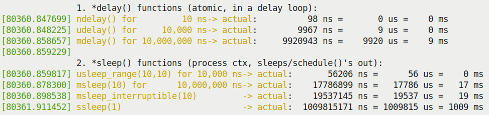

Hình 5.1 – Screenshot một phần cho thấy đầu ra của kernel module delays\_sleeps.ko

Hãy nghiên cứu kỹ đầu ra trên; lạ là cả routine `udelay(10)` lẫn `mdelay(10)` dường như hoàn tất thực thi trước khi khoảng delay mong muốn kết thúc (trong đầu ra mẫu, lần lượt trong `9 us` và `9 ms`)! Tại sao? Thực tế là các routine `*delay()` có xu hướng kết thúc sớm hơn. Điều này được ghi lại trong kernel source. Hãy xem phần code liên quan ở đây (tự nó đã rõ ràng):

```
// include/linux/delay.h
/*
 [ ... ]
 * Delay routines, using a pre-computed "loops_per_jiffy" value.
 *
 * Please note that ndelay(), udelay() and mdelay() may return early for
 * several reasons:
 * 1. computed loops_per_jiffy too low (due to the time taken to
 * execute the timer interrupt.)
 * 2. cache behavior affecting the time it takes to execute the
 * loop function.
 * 3. CPU clock rate changes.
 *
 * Please see this thread:
 * http://lists.openwall.net/linux-kernel/2011/01/09/56
```

Các routine `*sleep()` có đặc điểm ngược lại; chúng gần như luôn có xu hướng sleep lâu hơn yêu cầu. Một lần nữa, đây là vấn đề được dự đoán trong OS không phải real-time như Linux chuẩn. Có thể giảm nhẹ các vấn đề này theo vài cách:

- Trên Linux chuẩn, ở user mode, làm như sau:

- Trước hết, tốt nhất nên dùng các interface High-Resolution Timer (HRT) để có độ chính xác cao. Một lần nữa, đây là code được merge từ dự án RTL vào mainstream Linux (từ tận năm 2006). Nó hỗ trợ timer cần độ phân giải nhỏ hơn một jiffy (như bạn biết, jiffy gắn chặt với timer "tick", giá trị kernel `CONFIG_HZ`); ví dụ, với giá trị `HZ` là 100, một jiffy là 1000/100 = 10 ms; với `HZ` là 250, một jiffy là 4 ms, v.v.

- Sau khi làm vậy, tại sao không dùng tính năng soft RT scheduling của Linux? Ở đây, bạn có thể chỉ định scheduling policy là `SCHED_FIFO` hoặc `SCHED_RR` và priority cao cho user mode thread (phạm vi là `1` đến `99`; chúng ta đã đề cập chi tiết trong sách đồng hành Linux Kernel Programming - Chương 10, CPU Scheduler – Phần 1).

Hầu hết hệ thống Linux hiện đại có hỗ trợ HRT. Tuy nhiên, khai thác nó thế nào? Rất đơn giản: bạn được khuyến nghị viết timer code trong user space và dùng các POSIX timer API chuẩn (như system call `timer_create(2)` và `timer_settime(2)`). Vì cuốn sách tập trung vào phát triển kernel, chúng ta không đi sâu các user space API này ở đây. Thực tế, chủ đề này đã được trình bày khá chi tiết trong cuốn trước của tôi, Hands-On System Programming with Linux, ở Chương 13, Timer, phần Cơ chế POSIX (interval) timer mới hơn.

- Các kernel developer đã bỏ công ghi lại rõ ràng một số khuyến nghị rất tốt khi dùng các delay API và sleep API này trong kernel. Điều thực sự quan trọng là bạn đọc tài liệu này trong kernel documentation chính thức: `https://www.kernel.org/doc/Documentation/timers/timers-howto.rst`.

- Configure và build Linux OS thành RTOS; điều này giảm đáng kể scheduling "jitter" (chúng ta đã đề cập chi tiết trong sách đồng hành Linux Kernel Programming - Chương 11, CPU Scheduler – Phần 2, phần Chuyển mainline Linux thành RTOS).

Thú vị là dùng target checkpatch trong Makefile "tốt hơn" có thể rất hữu ích. Hãy xem nó (checkpatch Perl script của kernel) đã phát hiện gì (trước tiên bảo đảm bạn ở đúng source directory):

```
$ cd <...>/ch5/delays_sleeps
$ make checkpatch
make clean
[ ... ]
--- cleaning ---
[ ... ]
--- kernel code style check with checkpatch.pl ---

/lib/modules/5.4.0-58-generic/build/scripts/checkpatch.pl --no-tree -f --
max-line-length=95 *.[ch]
[ ... ]
WARNING: usleep_range should not use min == max args; see
Documentation/timers/timers-howto.rst
#63: FILE: delays_sleeps.c:63:
+ DILLY_DALLY("XXXXXXXXXXXXXXXXXXXXXXXXXXXXXXXXX", usleep_range(10, 10));

total: 0 errors, 2 warnings, 79 lines checked
[ ... ]
```

Thật tốt! Bảo đảm dùng các target trong `Makefile` "tốt hơn" của chúng ta (chúng ta đã đề cập chi tiết trong sách đồng hành Linux Kernel Programming - Chương 5, Viết Kernel Module đầu tiên LKMs – Phần 2, phần Template Makefile "tốt hơn" cho kernel module).

Như vậy, chúng ta đã xem xong kernel delay và sleep trong kernel. Với nền tảng này, bạn sẽ học cách thiết lập và dùng kernel timer, kernel thread và workqueue trong các phần còn lại của chương.

### Các driver "sed" – minh họa kernel timer, kthread và workqueue

Để chương này thú vị và mang tính thực hành hơn, chúng ta bắt đầu phát triển một miscellaneous class character "driver" gọi là driver simple encrypt decrypt – viết tắt là sed (đừng nhầm với tiện ích `sed(1)` nổi tiếng). Không, bạn sẽ không nhận giải lớn vì đoán được nó cung cấp một dạng hỗ trợ mã hóa/giải mã text – rất đơn giản. Điểm chính là chúng ta tưởng tượng trong đặc tả driver này có điều khoản yêu cầu công việc (thực tế là chức năng mã hóa/giải mã) được thực hiện trong khoảng thời gian nhất định – thực chất trong một deadline nhất định. Để kiểm tra, chúng ta thiết kế driver có kernel timer sẽ expire trong khoảng thời gian đó; driver kiểm tra chức năng có thực sự hoàn tất trong ràng buộc thời gian này không!

Chúng ta sẽ phát triển một loạt driver `sed` và các đối tác user space (app) của chúng:

- Driver đầu tiên – driver `sed1` và user mode app (`ch5/sed1`) – làm điều vừa mô tả: demo user mode app dùng system call `ioctl` để giao tiếp với driver và khởi động chức năng mã hóa/giải mã message. Driver tập trung vào kernel timer mà chúng ta thiết lập để expire tại deadline cho trước. Nếu nó expire, chúng ta xem thao tác thất bại; nếu không, timer bị hủy và thao tác thành công.

- Phiên bản thứ hai, `sed2` (`ch5/sed2`), làm giống `sed1`, ngoại trừ chức năng mã hóa/giải mã message thực tế ở đây được thực hiện trong context của một kernel thread được tạo riêng! Điều này thay đổi thiết kế dự án.

- Phiên bản thứ ba, `sed3` (`ch5/sed3`), lại làm giống `sed1` và `sed2`, ngoại trừ lần này chức năng mã hóa/giải mã message thực tế được một kernel workqueue thực hiện!

Giờ bạn đã học cách thực hiện delay (cả atomic và blocking) và lấy timestamp, hãy học cách thiết lập và dùng kernel timer.

## Thiết lập và sử dụng kernel timer

Timer cung cấp cho phần mềm cách nhận thông báo asynchronously khi một khoảng thời gian chỉ định đã trôi qua. Mọi loại phần mềm, trong user space lẫn kernel space, đều cần timer; thường bao gồm triển khai network protocol, block layer code, device driver và nhiều kernel subsystem. Timer cung cấp cách thông báo asynchronous, cho phép driver thực hiện công việc song song với timer đang chạy. Câu hỏi quan trọng là làm sao biết khi nào timer expire? Trong user space app, thông thường kernel gửi signal đến process liên quan (signal thường là `SIGALRM`). Trong kernel space, có vài chi tiết tinh tế. Như bạn biết từ thảo luận top half và bottom half cho hardware interrupt (xem Chương 4, Xử lý Hardware Interrupt, phần Hiểu và sử dụng top half và bottom half), sau khi top half (hoặc ISR) của timer interrupt hoàn tất, kernel bảo đảm chạy bottom half của timer interrupt, hay timer softirq (như đã thể hiện trong bảng ở `Chapter 4`, Xử lý Hardware Interrupt, phần Các softirq có sẵn và công dụng). Đây là softirq có priority rất cao gọi là `TIMER_SOFTIRQ`. Chính softirq này xử lý các timer đã expire! Thực chất – và điều này rất quan trọng cần hiểu – hàm "callback" của timer – hàm chạy khi timer expire – được timer softirq chạy nên chạy trong atomic (interrupt) context. Vì vậy, nó bị giới hạn về những việc có thể và không thể làm (một lần nữa, điều này đã được giải thích chi tiết trong Chương 4, Xử lý Hardware Interrupt).

Trong phần tiếp theo, bạn sẽ học cách thiết lập và dùng kernel timer.

### Sử dụng kernel timer

Để dùng kernel timer, bạn phải theo vài bước. Sau đây là tóm lược những việc cần làm (chúng ta sẽ thảo luận chi tiết hơn sau):

1\. Khởi tạo timer metadata structure (`struct timer_list`) bằng macro `timer_setup()`. Những mục chính được khởi tạo ở đây là:

- Thời điểm expire (giá trị mà `jiffies` phải đạt để timer expire)

- Hàm cần gọi khi timer expire – thực chất là hàm "callback" của timer

2\. Viết code cho timer callback routine.

3\. Khi phù hợp, "arm" timer – tức là cho nó bắt đầu – bằng cách gọi hàm `add_timer()` (hoặc `mod_timer()`).

4\. Khi timer timeout (expire), OS tự động gọi callback function của timer (hàm thiết lập ở bước 2); nhớ rằng nó chạy trong timer softirq hay atomic context hoặc interrupt context.

5\. (Tùy chọn) Timer không có tính cyclic, mặc định chỉ chạy một lần. Để timer chạy lại, bạn phải gọi API `mod_timer()`; đây là cách thiết lập interval timer – timer timeout sau một khoảng thời gian cố định nhất định. Nếu không làm bước này, timer là one-shot timer - đếm ngược và expire đúng một lần.

6\. Khi xong, xóa timer bằng `del_timer[_sync]()`; cũng có thể dùng để hủy timeout. Nó trả về giá trị cho biết pending timer đã được deactivate hay chưa; tức là trả về `1` khi hủy active timer hoặc `0` khi hủy inactive timer.

Cấu trúc dữ liệu `timer_list` liên quan đến công việc ở đây; trong đó, các member liên quan đến chúng ta (người viết module/driver) được thể hiện:

```
// include/linux/timer.h
struct timer_list {[ ... ]
    unsigned long expires;
    void (*function)(struct timer_list *);
    u32 flags;
[ ...] };
```

Dùng macro `timer_setup()` để khởi tạo nó:

```
timer_setup(timer, callback, flags);
```

Các tham số của `timer_setup()` như sau:

- `@timer`: Pointer đến cấu trúc dữ liệu `timer_list` (trước hết phải cấp phát memory cho nó; ngoài ra, thêm tiền tố `@` vào tên formal parameter là quy ước phổ biến).

- `@callback`: Pointer đến callback function. Đây là hàm OS gọi (trong softirq context) khi timer expire. Signature của nó là `void` `(*function)(struct timer_list *);`. Tham số nhận trong callback function là pointer đến cấu trúc dữ liệu `timer_list`. Vậy làm sao truyền và truy cập dữ liệu tùy ý trong timer callback? Chúng ta sẽ sớm trả lời câu hỏi này.

- `@flags`: Đây là các timer flag. Thông thường chúng ta truyền `0` (ngụ ý không có hành vi đặc biệt). Các flag có thể chỉ định là `TIMER_DEFERRABLE`, `TIMER_PINNED` và `TIMER_IRQSAFE`. Hãy xem cả hai trong kernel source code:

```
// include/linux/timer.h
/**
 * @TIMER_DEFERRABLE: A deferrable timer will work normally when
the
 * system is busy, but will not cause a CPU to come out of idle
just
 * to service it; instead, the timer will be serviced when the CPU
 * eventually wakes up with a subsequent non-deferrable timer.
  [ ... ]
 * @TIMER_PINNED: A pinned timer will not be affected by any timer
 * placement heuristics (like, NOHZ) and will always expire on the
CPU
 * on which the timer was enqueued.
```

Dùng flag `TIMER_DEFERRABLE` hữu ích khi cần chú ý mức tiêu thụ điện (chẳng hạn trên thiết bị dùng pin). Flag thứ ba, `TIMER_IRQSAFE`, chỉ dành cho mục đích đặc biệt; tránh dùng nó.

Tiếp theo, dùng API `add_timer()` để arm, hay khởi động timer. Sau khi gọi, timer "sống" và bắt đầu đếm ngược:

```
void add_timer(struct timer_list *timer);
```

Tham số của nó là pointer đến cấu trúc `timer_list` vừa khởi tạo (qua macro `timer_setup()`).

#### Kernel timer module đơn giản của chúng ta – xem code 1

Không chần chừ nữa, hãy đi vào code kernel timer đơn giản, viết bằng Loadable Kernel Module (LKM) framework (ở `ch5/timer_simple`). Như hầu hết driver, chúng ta giữ một context structure hoặc private data structure chứa thông tin cần khi chạy; ở đây gọi là `st_ctx`. Chúng ta tạo instance là biến `ctx`. Chúng ta cũng chỉ định thời gian expire (420 ms) trong biến toàn cục tên `exp_ms`:

```
// ch5/timer_simple/timer_simple.c
#include <linux/timer.h>
[ ... ]
static struct st_ctx {
    struct timer_list tmr;
    int data;
} ctx;
static unsigned long exp_ms = 420;
```

Giờ hãy xem phần đầu của init code:

```
static int __init timer_simple_init(void)
{
    ctx.data = INITIAL_VALUE;

    /* Initialize our kernel timer */
    ctx.tmr.expires = jiffies + msecs_to_jiffies(exp_ms);
    ctx.tmr.flags = 0;
    timer_setup(&ctx.tmr, ding, 0);
```

Điều này khá đơn giản. Trước hết, chúng ta khởi tạo cấu trúc dữ liệu `ctx`, đặt member `data` bằng `3`. Điểm mấu chốt là cấu trúc `timer_list` nằm trong cấu trúc `ctx`, nên phải khởi tạo nó. Việc đặt các giá trị timer callback function (tham số `function`) và tham số `flags` thì đơn giản; còn đặt thời gian expire? Bạn phải đặt member `timer_list.expires` bằng giá trị mà biến `jiffies` (thực ra là macro) trong kernel phải đạt; tại thời điểm đó, timer expire! Vì vậy, chúng ta chuẩn bị để timer expire sau 420 millisecond bằng cách cộng giá trị jiffies hiện tại với giá trị jiffies tương ứng thời lượng 420 ms trôi qua, như sau:

```
ctx.tmr.expires = jiffies + msecs_to_jiffies(exp_ms);
```

Convenience routine `msecs_to_jiffies()` giúp chúng ta vì nó chuyển giá trị millisecond được truyền vào sang `jiffies`. Cộng kết quả này với giá trị `jiffies` hiện tại cho giá trị mà `jiffies` sẽ đạt trong tương lai, sau 420 ms kể từ bây giờ, là lúc chúng ta muốn kernel timer expire.

Code này là inline function ở `include/linux/jiffies.h:msecs_to_jiffies()`; comment giúp hiểu cách hoạt động. Tương tự, kernel có các helper routine dạng (inline) function là `usecs_to_jiffies()`, `nsecs_to_jiffies()`, `timeval_to_jiffie` `s()` và `jiffies_to_timeval()`.

Phần init code tiếp theo như sau:

```
    pr_info("timer set to expire in %ld ms\n", exp_ms);
    add_timer(&ctx.tmr); /* Arm it; let's get going! */
    return 0;     /* success */
}
```

Như thấy, bằng cách gọi API `add_timer()`, chúng ta đã arm (khởi động) kernel timer. Giờ nó đang chạy và đếm ngược... trong (khoảng) 420 ms, nó sẽ expire. (Tại sao chỉ khoảng? Như thấy trong phần Hãy thử – delay và sleep thực sự mất bao lâu?, các delay API và sleep API không hoàn toàn chính xác. Thực tế, một bài tập gợi ý làm sau là kiểm tra độ chính xác timeout; bạn có thể tìm trong phần Câu hỏi/kernel\_timer\_check. Ngoài ra, trong lời giải mẫu, chúng ta sẽ cho thấy dùng macro `time_after()` là ý hay; nó kiểm tra tính hợp lệ để bảo đảm timestamp thứ hai thực sự sau timestamp thứ nhất. Các macro tương tự ở `include/linux/jiffies.h`; xem comment trước dòng: `include/linux/jiffies.h:#define time_after(a,b)`).

#### Kernel timer module đơn giản của chúng ta – xem code 2

`add_timer()` đã khởi động kernel timer. Như vừa thấy, nó sẽ sớm expire. Bên trong, như đã đề cập, timer softirq của kernel chạy callback function của timer. Trong phần trước, chúng ta khởi tạo callback function thành hàm `ding()` (ha, phép tượng thanh – từ gợi ra âm thanh nó mô tả – đang được áp dụng!) qua API `timer_setup()`. Vì vậy, code này chạy khi timer expire:

```
static void ding(struct timer_list *timer)
{
    struct st_ctx *priv = from_timer(priv, timer, tmr);
    /* from_timer() is in fact a wrapper around the well known
     * container_of() macro! This allows us to retrieve access to our
     * 'parent' driver context structure */
    pr_debug("timed out... data=%d\n", priv->data--);
    PRINT_CTX();

    /* until countdown done, fire it again! */
    if (priv->data)
        mod_timer(&priv->tmr, jiffies + msecs_to_jiffies(exp_ms));
}
```

Có vài điều cần nhớ về hàm này:

- Timer callback handler code (`ding()` ở đây) chạy trong atomic (interrupt, softirq) context; vì vậy bạn không được gọi hay thực hiện blocking API, cấp phát memory ngoài trường hợp có flag `GFP_ATOMIC`, hoặc bất kỳ dạng truyền dữ liệu nào giữa kernel space và user space (chúng ta đã trình bày chi tiết trong chương trước, phần Hướng dẫn về interrupt context – nên và không nên làm gì).

- Callback function nhận tham số là pointer đến cấu trúc `timer_list`. Vì chúng ta (rất có chủ ý) đặt `struct timer_list` trong context structure hoặc private data structure, có thể dùng macro `from_timer()` hữu ích để lấy lại pointer đến private structure; tức `struct st_ctx`). Dòng code đầu tiên ở trên làm việc này. Nó hoạt động thế nào? Hãy xem cách triển khai:

```
 // include/linux/timer.h
 #define from_timer(var, callback_timer, timer_fieldname) \
           container_of(callback_timer, typeof(*var),
timer_fieldname)
```

Nó thực sự là wrapper trên macro `container_of()`!

- Sau đó, chúng ta in và giảm giá trị `data`.

- Sau đó, gọi macro `PRINT_CTX()` (nhớ rằng được định nghĩa trong header file `convenient.h`). Nó cho thấy chúng ta đang chạy trong softirq context.

- Tiếp theo, miễn là data member còn dương, chúng ta buộc một timeout khác (cùng khoảng thời gian) bằng cách gọi API `mod_timer()`:

```
int mod_timer(struct timer_list *timer, unsigned long expires);
```

Như thấy, với `mod_timer()`, thời điểm timer kích hoạt lại hoàn toàn tùy bạn; đây được xem là cách hiệu quả để cập nhật thời điểm expire của timer. Dùng `mod_timer()` thậm chí có thể arm inactive timer (công việc `add_timer()` làm); trường hợp này return value là `0`, còn không là `1` (ngụ ý đã sửa active timer hiện có).

#### Kernel timer module đơn giản của chúng ta – chạy thử

Giờ hãy kiểm tra kernel timer module. Trên Ubuntu VM x86\_64, chúng ta dùng convenience script `lkm` để load kernel module. Screenshot sau cho thấy một phần thao tác này và kernel log:

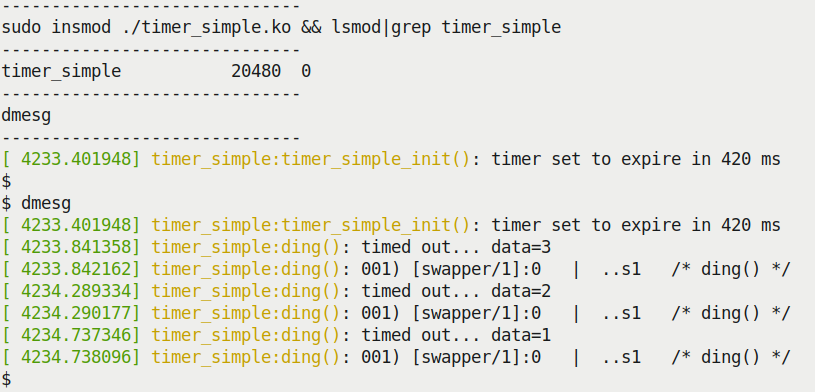

Hình 5.2 – Screenshot một phần khi chạy kernel module timer\_simple.ko

Hãy nghiên cứu đầu ra `dmesg` (kernel log) ở đây. Vì đặt giá trị ban đầu của member `data` trong private structure bằng `3`, kernel timer expire ba lần (đúng như logic yêu cầu). Hãy xem timestamp ở cột ngoài cùng bên trái; lần timer expire thứ hai ở `4234.289334` (sec.us) và lần thứ ba ở `4234.737346`; phép trừ nhanh cho thấy chênh lệch thời gian là 448.012 microsecond; tức khoảng 448 millisecond. Điều này hợp lý vì yêu cầu timeout 420 ms (hơi vượt một chút; overhead của printk cũng có ảnh hưởng).

Đầu ra macro `PRINT_CTX()` cũng cho thấy nhiều điều; hãy xem lần thứ hai trong screenshot trên:

```
[ 4234.290177] timer_simple:ding(): 001) [swapper/1]:0   |  ..s1   /*
ding() */
```

Điều này cho thấy (như được giải thích chi tiết trong Chương 4, Xử lý Hardware Interrupt) code chạy trên CPU 1 (`001)`) trong softirq context (`s` trong `..s1`). Hơn nữa, process context bị interrupt – bởi timer interrupt và softirq – là kernel thread `swapper/1`; đây là CPU idle thread chạy trên CPU 1 khi nó idle. Điều này hợp lý và khá điển hình trên hệ thống idle hoặc tải nhẹ. Hệ thống (hoặc ít nhất CPU 1) đang idle khi timer interrupt được khởi phát và softirq tiếp theo xuất hiện, chạy timer callback.

### sed1 – triển khai timeout với demo driver sed1

Trong phần này, chúng ta viết driver thú vị hơn một chút (code ở `ch5/sed1/sed1_driver`). Chúng ta thiết kế nó để mã hóa và/hoặc giải mã một message cho trước (tất nhiên theo cách rất đơn giản). Ý tưởng cơ bản là user mode app (ở `ch5/userapp_sed`) làm user interface cho nó. Khi chạy, app mở device file của `misc` character driver (`/dev/sed1_drv`) và thực hiện system call `ioctl(2)` trên đó.

Chúng tôi cung cấp tài liệu trực tuyến giúp hiểu cách giao tiếp kernel module hoặc device driver với user space process qua một số phương pháp phổ biến: procfs, sysfs, debugfs, netlink socket và system call `ioctl()` (`https://github.com/PacktPublishing/Learn-Linux-Kernel-Development/blob/master/User_kernel_communication_pathways.pdf`)!

Lời gọi `ioctl()` truyền một cấu trúc dữ liệu đóng gói dữ liệu được truyền, độ dài của nó, thao tác (hoặc transform) cần thực hiện trên đó, và field `timed_out` (để xác định thất bại do lỡ deadline hay không). Các op hợp lệ như sau:

- Mã hóa: `XF_ENCRYPT`

- Giải mã: `XF_DECRYPT`

Do giới hạn dung lượng, chúng ta không định trình bày code thật chi tiết ở đây – dù sao, đã đọc nhiều đến thế, giờ bạn có đủ khả năng tự duyệt và cố hiểu code! Tuy nhiên, một số chi tiết chính liên quan phần này sẽ được trình bày.

Hãy xem thiết kế tổng thể:

- Driver `sed1` (`ch5/sed1/sed1_driver/sed1_drv.c`) thực sự là pseudo driver, theo nghĩa nó không thao tác trên peripheral hardware controller hoặc chip mà trên memory; tuy vậy, đây là `misc` class character device driver đầy đủ.

- Nó đăng ký dưới dạng thiết bị `misc`; trong quá trình đó, kernel tự tạo device node (ở đây gọi là `/dev/sed1_drv`).

- Chúng ta bố trí driver có cấu trúc "context" (`struct stMyCtx`) chứa các member chính được dùng xuyên suốt; một trong số đó là cấu trúc `struct` `timer_list` dành cho kernel timer, được khởi tạo trong init code path (với API `timer_setup()`).

- User space app (`ch5/sed1/userapp_sed/userapp_sed1.c`) mở device file của driver `sed1` (được truyền làm tham số cùng message cần mã hóa). Nó gọi system call `ioctl(2)` – command là mã hóa – và tham số `arg`, là pointer đến cấu trúc đã được điền đầy đủ mọi thông tin cần thiết (bao gồm message payload cần mã hóa). Hãy xem nhanh:

```
 kd->data_xform = XF_ENCRYPT;
 ioctl(fd, IOCTL_LLKD_SED_IOC_ENCRYPT_MSG, kd);
```

- Method `ioctl` của driver `sed1` tiếp quản. Sau khi kiểm tra tính hợp lệ, nó sao chép metadata structure (qua `copy_from_user()` thông thường) và khởi chạy hàm `process_it()`, hàm này gọi routine `encrypt_decrypt_payload()`.

- `encrypt_decrypt_payload()` là routine then chốt ở đây. Nó làm như sau:

- Khởi động kernel timer (với API `mod_timer()`), đặt expire sau `TIMER_EXPIRE_MS` millisecond kể từ bây giờ (ở đây đã đặt `TIMER_EXPIRE_MS` bằng `1`).

- Lấy timestamp, `t1 = ktime_get_real_ns();`.

- Khởi động công việc thực sự – là thao tác mã hóa hoặc giải mã (chúng ta giữ rất đơn giản: chỉ một thao tác `XOR` rồi tăng mỗi byte của payload; ngược lại khi giải mã).

- Ngay khi công việc hoàn tất, làm hai việc: lấy timestamp thứ hai, `t2 = ktime_get_real_ns();`, và hủy kernel timer (với API `del_timer()`).

- Hiển thị thời gian hoàn tất (qua macro `SHOW_DELTA()`).

- Sau đó user space app sleep 1 giây (để lấy lại bình tĩnh) rồi chạy `ioctl` giải mã, khiến driver giải mã message.

- Cuối cùng, nó kết thúc.

Sau đây là code liên quan từ driver `sed1`:

```
// ch5/sed1/sed1_driver/sed1_drv.c
[ ... ]
static void encrypt_decrypt_payload(int work, struct sed_ds *kd, struct
sed_ds *kdret)
{
        int i;
        ktime_t t1, t2;   // a s64 qty
        struct stMyCtx *priv = gpriv;
        [ ... ]
        /* Start - the timer; set it to expire in TIMER_EXPIRE_MS ms */
        mod_timer(&priv->timr, jiffies +
msecs_to_jiffies(TIMER_EXPIRE_MS));
        t1 = ktime_get_real_ns();

        // perform the actual processing on the payload
        memcpy(kdret, kd, sizeof(struct sed_ds));
        if (work == WORK_IS_ENCRYPT) {
                for (i = 0; i < kd->len; i++) {
                        kdret->data[i] ^= CRYPT_OFFSET;
                        kdret->data[i] += CRYPT_OFFSET;
                }
        } else if (work == WORK_IS_DECRYPT) {
                for (i = 0; i < kd->len; i++) {
                        kdret->data[i] -= CRYPT_OFFSET;
                        kdret->data[i] ^= CRYPT_OFFSET;
                }
        }
        kdret->len = kd->len;
        // work done!
        [ ... // code to miss the deadline here! (explained below) ... ]
        t2 = ktime_get_real_ns();

        // work done, cancel the timeout
        if (del_timer(&priv->timr) == 0)
                pr_debug("cancelled the timer while it's inactive!
(deadline missed?)\n");
        else
                pr_debug("processing complete, timeout cancelled\n");
        SHOW_DELTA(t2, t1);
}
```

Hầu như chỉ có vậy! Để cảm nhận cách hoạt động, hãy xem nó chạy thực tế. Đầu tiên phải insert kernel driver (LKM):

```
$ sudo insmod ./sed1_drv.ko
$ dmesg
[29519.684832] misc sed1_drv: LLKD sed1_drv misc driver (major # 10)
registered, minor# = 55,
               dev node is /dev/sed1_drv
[29519.689403] sed1_drv:sed1_drv_init(): init done (make_it_fail is off)
[29519.690358] misc sed1_drv: loaded.
$
```

Screenshot sau cho thấy một lần chạy mẫu mã hóa và giải mã (ở đây cố ý chạy phiên bản debug Address Sanitizer (ASan) của app này; nó có thể phát hiện bug, vậy tại sao không!):

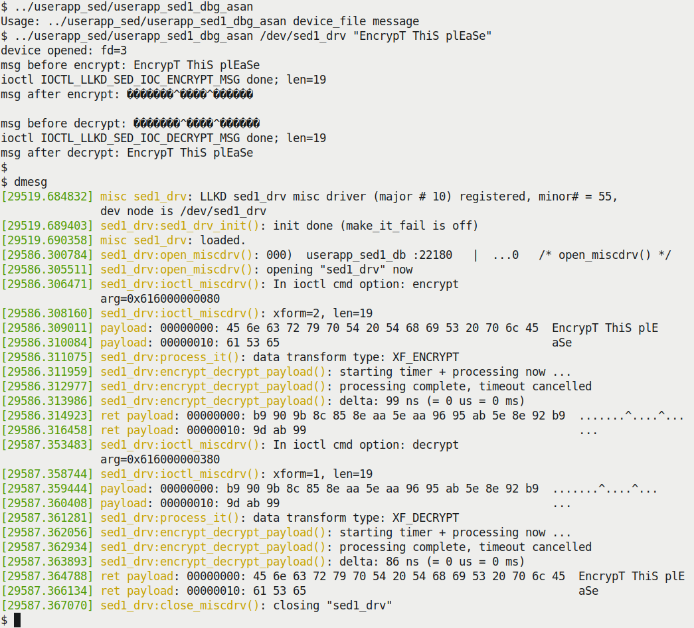

Hình 5.3 – Mini-project sed1 mã hóa và giải mã message trong deadline quy định

Mọi thứ diễn ra tốt ở đây. Hãy xem code callback function của kernel timer. Ở đây, trong driver `sed1` đơn giản, chúng ta chỉ cho nó làm như sau:

- Đặt atomically một số nguyên trong private structure, `timed_out`, bằng `1`, biểu thị thất bại. Vì sao chép cấu trúc dữ liệu trở lại user mode app (qua `ioctl()`), app có thể dễ dàng phát hiện và báo cáo/ghi log lỗi (chi tiết dùng atomic operator và nhiều nội dung khác sẽ được trình bày trong hai chương cuối cuốn sách).

- Phát `printk` ra kernel log (ở mức `KERN_NOTICE`), biểu thị đã timeout.

- Gọi macro `PRINT_CTX()` để hiển thị chi tiết context.

Code callback function của kernel timer như sau:

```
static void timesup(struct timer_list *timer)
{
    struct stMyCtx *priv = from_timer(priv, timer, timr);

    atomic_set(&priv->timed_out, 1);
    pr_notice("*** Timer expired! ***\n");
    PRINT_CTX();
}
```

Có thể thấy code này – hàm timer expiry `timesup()` – chạy không? Tiếp theo chúng ta bố trí để làm đúng điều đó.

#### Cố tình lỡ chuyến xe

Phần tôi bỏ qua lúc trước là chi tiết thú vị: ngay trước khi lấy timestamp thứ hai, chúng ta chèn code để cố tình lỡ deadline bất khả xâm phạm! Bằng cách nào? Thực sự rất đơn giản:

```
static void encrypt_decrypt_payload(int work, struct sed_ds *kd, struct
sed_ds *kdret)
{
    [ ... ]
    // work done!
    if (make_it_fail == 1)
        msleep(TIMER_EXPIRE_MS + 1);
    t2 = ktime_get_real_ns();
```

`make_it_fail` là module parameter mặc định bằng `0`; vì vậy, chỉ nếu muốn sống nguy hiểm (vâng, hơi cường điệu!) bạn mới truyền nó bằng `1`. Hãy thử và xem kernel timer expire. User mode app cũng phát hiện và báo thất bại:

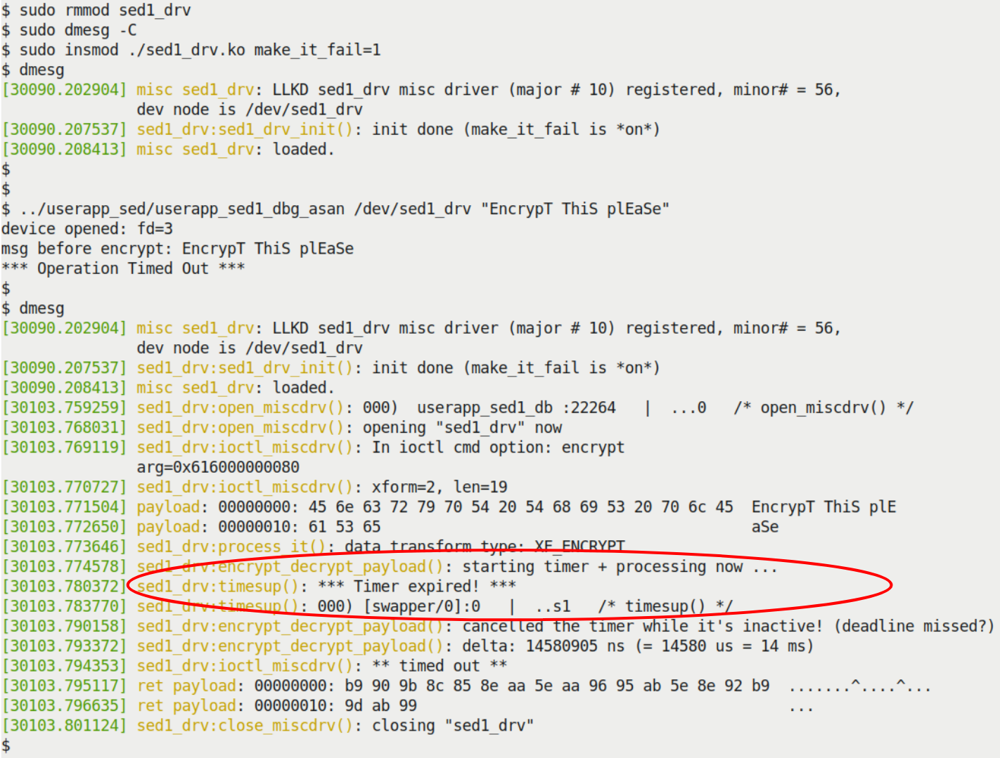

Hình 5.4 – Mini-project sed1 chạy với module parameter make\_it\_fail bằng 1, khiến lỡ deadline

Lần này, deadline bị vượt trước khi timer bị hủy, nên timer expire và kích hoạt. Callback function `timesup()` sau đó chạy (được tô nổi trong screenshot trên). Tôi rất khuyến nghị bạn dành thời gian đọc chi tiết code driver và user mode app rồi tự thử.

Hàm `schedule_timeout()` đã dùng sơ qua trước đó là ví dụ tuyệt vời về dùng kernel timer! Có thể xem cách triển khai nội bộ ở: `kernel/time/timer.c:schedule_timeout()`.

Thông tin bổ sung về timer có trong filesystem `proc`; các (pseudo) file liên quan gồm `/proc/[pid]/timers` (POSIX timer per-process) và pseudofile `/proc/timer_list` (chứa thông tin mọi high-resolution timer đang pending, cũng như mọi clock event source. Lưu ý pseudo-file `/proc/timer_stats` biến mất sau kernel phiên bản 4.10). Bạn có thể tìm hiểu thêm trong man page về `proc(5)` ở `https://man7.org/linux/man-pages/man5/proc.5.html`.

Trong phần tiếp theo, bạn sẽ học cách tạo và dùng kernel thread có lợi cho mình. Hãy đọc tiếp!

## Tạo và làm việc với kernel thread

Thread là một execution path; nó chỉ quan tâm thực thi một hàm nhất định. Hàm đó là cuộc sống và phạm vi của nó; khi return khỏi hàm, nó chết. Trong user space, thread là execution path trong process; process có thể single-threaded hoặc multi-threaded. Kernel thread rất giống user mode thread ở nhiều mặt. Trong kernel space, thread cũng là execution path, ngoại trừ chạy trong kernel VAS với kernel privilege. Điều này nghĩa là kernel cũng multi-threaded. Nhìn nhanh đầu ra `ps(1)` (chạy với option switch `aux` theo kiểu Berkeley Software Distribution (BSD)) cho thấy các kernel thread – tên của chúng nằm trong dấu ngoặc vuông:

```
$ ps aux
USER         PID %CPU %MEM    VSZ   RSS TTY        STAT START   TIME
COMMAND
root           1  0.0  0.5 167464 11548 ?          Ss   06:20   0:00
/sbin/init splash 3
root           2  0.0  0.0      0     0 ?          S    06:20   0:00
[kthreadd]
root           3  0.0  0.0      0     0 ?          I<   06:20   0:00
[rcu_gp]
root           4  0.0  0.0      0     0 ?          I<   06:20   0:00
[rcu_par_gp]
root           6  0.0  0.0      0     0 ?          I<   06:20   0:00
[kworker/0:0H-kblockd]
root           9  0.0  0.0      0     0 ?          I<   06:20   0:00
[mm_percpu_wq]
root          10  0.0  0.0      0     0 ?          S    06:20   0:00
[ksoftirqd/0]
root          11  0.0  0.0      0     0 ?          I    06:20   0:05
[rcu_sched]
root          12  0.0  0.0      0     0 ?          S    06:20   0:00
[migration/0]
[ ... ]
root          18  0.0  0.0      0     0 ?          S    06:20   0:00
[ksoftirqd/1]
[ ... ]
```

Đa số kernel thread được tạo cho mục đích xác định; thường được tạo khi hệ thống khởi động và chạy mãi (trong infinite loop). Chúng tự đặt vào trạng thái sleep, và khi cần làm việc thì thức dậy, thực hiện rồi quay lại sleep ngay. Ví dụ tốt là các kernel thread `ksoftirqd/n` (thường một thread cho mỗi CPU core; đó là ý nghĩa của `n` – số core); khi tải softirq quá nặng, kernel đánh thức chúng để giúp xử lý các softirq pending (chúng ta đã thảo luận trong `Chapter 4`, Xử lý Hardware Interrupt, phần Sử dụng các kernel thread ksoftirqd; trong đầu ra `ps` trên có thể thấy chúng trên VM dual-core; PID là 10 và 18). Tương tự, kernel cũng dùng các worker thread "kworker" mang tính động – xuất hiện rồi biến mất khi có công việc (chạy nhanh `ps aux | grep kworker` sẽ cho thấy vài thread).

Hãy xem vài đặc điểm kernel thread:

- Chúng luôn thực thi trong kernel VAS, ở kernel mode với kernel privilege.

- Chúng luôn chạy trong process context (tham khảo sách đồng hành Linux Kernel Programming - Chương 6, Kiến thức cốt lõi về Kernel Internals – Process và Thread, phần Hiểu process context và interrupt context) và có task structure (do đó có PID cùng mọi thuộc tính thread điển hình khác, dù credential luôn được đặt bằng `0`, ngụ ý quyền root).

- Chúng cạnh tranh CPU resource với các thread khác (kể cả user mode thread) qua CPU scheduler; kernel thread (thường viết tắt kthread) được tăng priority một chút.

- Vì chỉ chạy trong kernel VAS, chúng không thấy user VAS; vì vậy, giá trị `current->mm` luôn là `NULL` (thực tế, đây là cách nhanh để nhận diện kthread).

- Mọi kernel thread đều xuất phát từ kernel thread tên `kthreadd`, có PID `2`. Nó được kernel tạo (về kỹ thuật là kthread `swapper/0` đầu tiên với PID `0`) trong early boot; có thể xác minh bằng `pstree -t -p` `2` (tra man page `pstree(1)` để biết chi tiết sử dụng).

- Chúng có quy ước đặt tên. Kthread được đặt tên khác nhau, dù có tuân theo một số quy ước. Thường tên kết thúc bằng `/n`; điều này biểu thị per-CPU kernel thread. Số cho biết CPU core mà nó được affined để chạy trên đó (chúng ta đã đề cập CPU affinity trong sách đồng hành Linux Kernel Programming - Chương 11, CPU Scheduler – Phần 2, phần Hiểu, truy vấn và đặt CPU affinity mask). Hơn nữa, kernel thread được dùng cho mục đích cụ thể và tên phản ánh điều đó; ví dụ `irq/%d-%s` (trong đó `%d` là PID và `%s` là tên) là threaded interrupt handler (đã trình bày trong Chương 4, Xử lý Hardware Interrupt). Bạn có thể học cách tìm tên kthread và nhiều cách dùng thực tế (cùng cách tinh chỉnh để giảm jitter) bằng cách đọc kernel documentation, Giảm OS jitter do per-cpu kthread, ở `https://www.kernel.org/doc/Documentation/kernel-per-CPU-kthreads.txt`.

Điều chúng ta quan tâm là kernel module và device driver thường cần chạy code path nhất định ở background, song song với công việc khác mà chúng và kernel thường xuyên thực hiện. Giả sử bạn cần block trên một asynchronous event đang xảy ra, hoặc khi có event cần thực thi user mode process từ trong kernel, vốn tốn thời gian. Kernel thread chính là thứ phù hợp; vì vậy chúng ta tập trung cách bạn, người viết module, tạo và quản lý kernel thread.

Vâng, bạn có thể thực thi user mode process hoặc app từ bên trong kernel! Kernel cung cấp các API user mode helper (umh) để làm vậy, API phổ biến là `call_usermode_helper()`. Có thể xem cách triển khai ở: `kernel/umh.c:int call_usermodehelper(const char` `*path, char **argv, char **envp, int wait)`. Nhưng hãy cẩn thận; bạn không nên lạm dụng API để gọi app tùy ý từ kernel – đó đơn giản là thiết kế tồi! Rất ít use case thực tế dùng API này trong kernel; dùng `cscope(1)` để kiểm tra.

Tốt; giờ hãy học cách tạo và làm việc với kernel thread.

### Demo đơn giản – tạo kernel thread

API chính để tạo kernel thread (được cung cấp cho chúng ta, người viết module/driver) là `kthread_create()`; đây là macro gọi API `kthread_create_on_node()`. Thực tế, chỉ gọi `kthread_create()` không đủ để kernel thread làm gì hữu ích; vì dù macro tạo kernel thread, bạn cần cho nó thành ứng viên scheduler bằng cách đặt state thành running rồi đánh thức nó. Có thể làm bằng API `wake_up_process()` (khi thành công, nó được enqueue vào CPU runqueue, trở thành schedulable để chạy trong tương lai gần). Tin tốt là helper macro `kthread_run()` có thể dùng để gọi cả `kthread_create()` lẫn `wake_up_process()` cùng lúc. Hãy xem cách triển khai trong kernel:

```
// include/linux/kthread.h
/**
 * kthread_run - create and wake a thread.
 * @threadfn: the function to run until signal_pending(current).
 * @data: data ptr for @threadfn.
 * @namefmt: printf-style name for the thread.
 *
 * Description: Convenient wrapper for kthread_create() followed by
 * wake_up_process(). Returns the kthread or ERR_PTR(-ENOMEM).
 */
#define kthread_run(threadfn, data, namefmt, ...) \
({ \
    struct task_struct *__k \
        = kthread_create(threadfn, data, namefmt, ## __VA_ARGS__); \
    if (!IS_ERR(__k)) \
        wake_up_process(__k); \
    __k; \
})
```

Comment trong code snippet trên làm rõ tham số và return value của `kthread_run()`.

Để minh họa cách tạo và dùng kernel thread, chúng ta viết kernel module tên `kthread_simple`. Sau đây là code liên quan của method `init`:

```
// ch5/kthread_simple/kthread_simple.c
static int kthread_simple_init(void)
{   [ ... ]
    gkthrd_ts = kthread_run(simple_kthread, NULL, "llkd/%s", KTHREAD_NAME);
    if (IS_ERR(gkthrd_ts)) {
        ret = PTR_ERR(gkthrd_ts); // it's usually -ENOMEM
        pr_err("kthread creation failed (%d)\n", ret);
        return ret;
    }
    get_task_struct(gkthrd_ts); // inc refcnt, marking the task struct as
in use
    [ ... ]
```

Tham số thứ nhất của `kthread_run()` là nguồn sống của kthread mới – hàm của nó! Ở đây không định truyền dữ liệu cho kthread mới sinh, nên tham số thứ hai là `NULL`. Các tham số còn lại là format string kiểu printf chỉ định tên. Khi thành công, nó trả về pointer đến task structure của kthread mới (chúng ta đã trình bày khá chi tiết task structure trong sách đồng hành Linux Kernel Programming - Chương 6, Kiến thức cốt lõi về Kernel Internals – Process và Thread, phần Hiểu và truy cập kernel task structure). Inline function `get_task_struct()` quan trọng – nó tăng reference count của task structure được truyền vào. Điều này đánh dấu task đang được dùng (sau đó, trong cleanup code, chúng ta gọi helper routine `kthread_stop()`; nó làm thao tác ngược, giảm reference count của task structure (và cuối cùng giải phóng nó)).

Giờ hãy xem chính kernel thread (chỉ trình bày các code snippet liên quan):

```
static int simple_kthread(void *arg)
{
    PRINT_CTX();
    if (!current->mm)
        pr_info("mm field NULL, we are a kernel thread!\n");
```

Ngay khi `kthread_run()` tạo kernel thread thành công, nó bắt đầu chạy code song song với phần còn lại của hệ thống: giờ là schedulable thread! Macro `PRINT_CTX()` cho thấy nó chạy trong process context và thực sự là kernel thread. (Chúng ta mô phỏng truyền thống đặt tên trong dấu ngoặc vuông để cho thấy điều đó. Kiểm tra pointer `mm` hiện tại là `NULL` xác nhận cùng điều này.) Có thể thấy đầu ra trong Hình 5.5. Mọi code trong kernel thread routine sẽ chạy trong process context; do đó có thể thực hiện blocking operation (khác với interrupt context).

Tiếp theo, mặc định kernel thread chạy dưới quyền sở hữu root và mọi signal đều masked. Tuy nhiên, như test case đơn giản, có thể bật vài signal qua helper routine `allow_signal()`. Sau đó chỉ chạy loop (chúng ta sắp nói về routine `kthread_should_stop()`); trong loop body, tự đưa vào sleep bằng cách đặt state của task thành `TASK_INTERRUPTIBLE` (ngụ ý sleep có thể bị signal interrupt) rồi gọi `schedule()`:

```
    allow_signal(SIGINT);
    allow_signal(SIGQUIT);
    while (!kthread_should_stop()) {
        pr_info("FYI, I, kernel thread PID %d, am going to sleep now...\n",
            current->pid);
        set_current_state(TASK_INTERRUPTIBLE);
        schedule(); // yield the processor, go to sleep...
        /* Aaaaaand we're back! Here, it's typically due to either the
         * SIGINT or SIGQUIT signal hitting us! */
        if (signal_pending(current))
            break;
    }
```

Vì vậy, chỉ khi được đánh thức– xảy ra khi bạn gửi kernel thread signal `SIGINT` hoặc `SIGQUIT` – chúng ta mới tiếp tục thực thi. Khi đó, thoát loop (lưu ý cách trước tiên xác minh đúng trường hợp này bằng helper routine `signal_pending()`!). Giờ kthread tiếp tục thực thi ngoài loop, chỉ để (cố ý, và khá kịch tính) chết:

```
    set_current_state(TASK_RUNNING);
    pr_info("FYI, I, kernel thread PID %d, have been rudely awoken; I
shall"
            " now exit... Good day Sir!\n", current->pid);
    return 0;
}
```

Cleanup code của kernel module như sau:

```
static void kthread_simple_exit(void)
{
    kthread_stop(gkthrd_ts);   /* waits for our kthread to terminate;
                                * it also internally invokes
                                * the put_task_struct() to decrement task's
                                * reference count
                                */
    pr_info("kthread stopped, and LKM removed.\n");
}
```

Ở đây, trong cleanup code path, bạn cần gọi `kthread_stop()`, thực hiện cleanup cần thiết. Bên trong, nó thực sự chờ kthread chết (qua routine `wait_for_completion()`). Vì vậy, nếu gọi `rmmod` mà chưa kill kthread bằng signal `SIGINT` hoặc `SIGQUIT`, process `rmmod` có vẻ bị treo ở đây; nó (tức process `rmmod`) đang chờ (thực ra `kthread_stop()` mới là thứ đang chờ) kthread chết! Vì vậy, nếu kthread chưa nhận signal, điều này có thể gây vấn đề. Phải có cách tốt hơn để dừng kernel thread so với gửi signal từ user space. Quả thật có: cách đúng là dùng routine `kthread_should_stop()` làm điều kiện (đảo) của loop `while` nó chạy, nên chúng ta làm đúng như vậy! Trong code trên có:

```
while (!kthread_should_stop()) {
```

Routine `kthread_should_stop()` trả về giá trị Boolean là true nếu kthread cần dừng (kết thúc) ngay! Gọi `kthread_stop()` trong cleanup code path khiến `kthread_should_stop()` trả về true, do đó kthread thoát loop `while` và kết thúc bằng `return 0;` đơn giản. Giá trị này (`0`) được truyền ngược về `kthread_stop()`. Nhờ vậy, kernel module được unload thành công ngay cả khi chưa từng gửi signal đến kernel thread. Chúng ta để việc kiểm tra trường hợp này làm bài tập đơn giản cho bạn!

Lưu ý return value của `kthread_stop()` có thể hữu ích: đó là số nguyên và là kết quả của thread function đã chạy – thực chất cho biết kthread có thành công (trả về `0`) trong công việc hay không. Giá trị là `-EINTR` nếu kthread chưa bao giờ được đánh thức.

### Chạy demo kernel thread kthread\_simple

Giờ hãy thử (`ch5/kthread_simple`)! Có thể insert module qua `insmod(8)`; module được insert vào kernel như dự định. Kernel log trong screenshot sau, cùng một lệnh `ps` nhanh, chứng minh kernel thread mới toanh thực sự được tạo. Ngoài ra, như thấy từ code (`ch5/kthread_simple/kthread_simple.c`), kthread tự đưa vào sleep (bằng cách đặt state thành `TASK_INTERRUPTIBLE` rồi gọi `schedule()`):

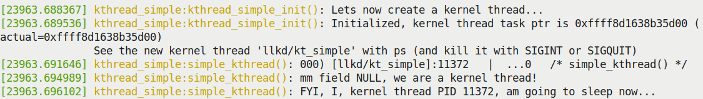

Hình 5.5 – Screenshot một phần cho thấy kernel thread được sinh ra, còn sống – và, vâng, đang sleep

Chạy nhanh `ps(1) grep` theo tên kernel thread cho thấy kthread còn sống khỏe (và đang sleep):

```
$ ps -e |grep kt_simple
 11372   ?        00:00:00 llkd/kt_simple
$
```

Hãy khuấy động một chút bằng cách gửi signal `SIGQUIT` đến kthread. Điều này khiến nó thức dậy (vì đã đặt signal mask cho phép các signal `SIGINT` và `SIGQUIT`), đặt state thành `TASK_RUNNING`, rồi đơn giản thoát. Sau đó dùng `rmmod(8)` để remove kernel module như screenshot sau:

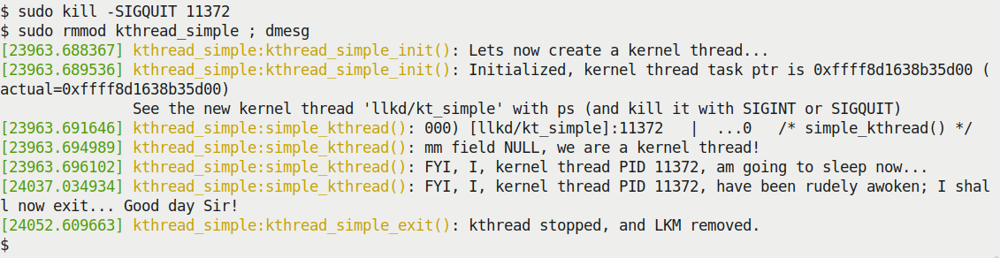

Hình 5.6 – Screenshot một phần cho thấy kernel thread thức dậy và module được unload thành công

Giờ đã hiểu cách tạo và làm việc với kernel thread, hãy tiếp tục thiết kế và triển khai phiên bản thứ hai của driver `sed`.

### Driver sed2 – thiết kế và triển khai

Trong phần này (như đề cập ở phần Các driver "sed" – minh họa kernel timer, kthread và workqueue), chúng ta viết bước phát triển tiếp theo của driver `sed1`, tên `sed2`.

#### sed2 – thiết kế

Mini-project `sed` v2 (`sed2`; code: `ch5/sed2/`) rất giống project `sed1`. Khác biệt chính là lần này thực hiện "công việc" qua kernel thread do driver tạo riêng cho mục đích này. Các khác biệt chính so với phiên bản trước như sau:

- Chỉ có một shared memory buffer toàn cục giữ metadata cùng payload; tức message cần mã hóa/giải mã. Đây là member `struct` `sed_ds->shmem` trong driver context structure, `struct stMyCtx`.

- Công việc mã hóa/giải mã giờ được thực hiện trong kernel thread (do driver này spawn); chúng ta giữ kernel thread sleep. Chỉ khi có công việc, driver mới đánh thức kthread và cho nó xử lý (thực thi) công việc.

- Giờ chúng ta chạy kernel timer trong context của kthread và hiển thị nếu nó expire sớm (biểu thị không đáp ứng deadline).

- Kiểm tra nhanh cho thấy loại bỏ các printk `pr_debug()` trong critical section của kernel thread giúp giảm đáng kể thời gian hoàn thành công việc! (Bạn luôn có thể sửa biến `EXTRA_CFLAGS` trong Makefile để undefine symbol `DEBUG` nếu muốn bỏ overhead này (bằng `EXTRA_CFLAGS += -UDEBUG`)!). Vì vậy, ở đây deadline dài hơn (10 ms).

Vậy, tóm lại, ý tưởng ở đây chủ yếu minh họa dùng kernel thread tùy chỉnh cùng kernel timer để timeout một thao tác. Điểm quan trọng cần hiểu làm thay đổi thiết kế tổng thể (đặc biệt cách user space app tương tác driver `sed2`) là vì chạy công việc trong context kernel thread, nó không cùng context với process được thực hiện `ioctl()`. Do đó, rất quan trọng phải nhận ra:

- Không thể đơn giản truyền dữ liệu từ process context của kernel thread sang user space process – chúng hoàn toàn khác nhau (chạy trong virtual address space khác nhau: user mode process có VAS đầy đủ và PID riêng, v.v.; kernel thread thực sự sống trong kernel VAS với PID và kernel mode stack riêng). Do đó, dùng routine `copy_{from|to}_user()` (và tương tự) để giao tiếp từ kthread đến user mode app là không thể.

- Nguy cơ race nguy hiểm rất lớn; kernel thread chạy asynchronously so với user process context; vì vậy có thể tạo bug liên quan concurrency nếu không cẩn thận. Đây là toàn bộ lý do có hai chương cuối cuốn sách, nơi chúng ta trình bày khái niệm và công nghệ kernel synchronization, locking (cùng những nội dung liên quan). Hiện tại hãy kiên nhẫn – chúng ta giữ mọi thứ đơn giản nhất có thể bằng vài thủ thuật polling đơn giản thay cho synchronization đúng cách.

Chúng ta có bốn thao tác trong project `sed2`:

- Mã hóa message (đồng thời lấy message từ user space vào driver; vì vậy phải làm trước).

- Giải mã message.

- Lấy message (gửi từ driver đến user space app).

- Hủy message (thực chất reset – memory và metadata được xóa sạch trong driver).

Điều quan trọng cần nhận ra là do nguy cơ race, không thể đơn giản truyền dữ liệu trực tiếp từ kthread đến user space app. Vì vậy phải làm như sau:

- Thực hiện thao tác lấy và hủy trong process context của user space process bằng các system call `ioctl()`.

- Thực hiện thao tác mã hóa và giải mã trong process context của kernel thread, asynchronously so với user space app (chạy trong kernel thread vì muốn, không phải vì buộc phải vậy; dù sao đây chính là mục đích của chủ đề này!).

Có thể tóm tắt thiết kế bằng sơ đồ ASCII-art đơn giản:

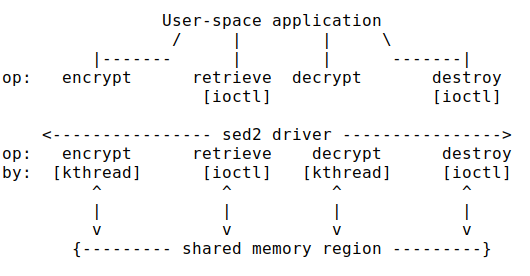

Hình 5.7 – Thiết kế cấp cao của mini-project sed2

Được rồi, giờ hãy xem cách triển khai code liên quan cho `sed2`.

#### Driver sed2 – triển khai code

Về code, code method `ioctl()` trong driver `sed2` cho thao tác mã hóa như sau (để rõ ràng, không trình bày mọi code kiểm tra lỗi ở đây; chỉ những phần liên quan nhất). Code đầy đủ ở `ch5/sed2/`:

```
// ch5/sed2/sed2_driver/sed2_drv.c
[ ... ]
#if LINUX_VERSION_CODE >= KERNEL_VERSION(2, 6, 36)
static long ioctl_miscdrv(struct file *filp, unsigned int cmd, unsigned
long arg)
#else
static int ioctl_miscdrv(struct inode *ino, struct file *filp, unsigned int
cmd, unsigned long arg)
#endif
{
    struct stMyCtx *priv = gpriv;

[ ... ]
switch (cmd) {
    case IOCTL_LLKD_SED_IOC_ENCRYPT_MSG: /* kthread: encrypts the msg
passed in */
        [ ... ]
        if (atomic_read(&priv->msg_state) == XF_ENCRYPT) { // already
encrypted?
            pr_notice("encrypt op: message is currently encrypted; aborting
op...\n");
            return -EBADRQC; /* 'Invalid request code' */
        }
        if (copy_from_user(priv->kdata, (struct sed_ds *)arg, sizeof(struct
sed_ds))) {
         [ ... ]

        POLL_ON_WORK_DONE(1);
        /* Wake up our kernel thread and have it encrypt the message ! */
        if (!wake_up_process(priv->kthrd_work))
            pr_warn("worker kthread already running when awoken?\n");
        [ ... ]
```

Driver, sau khi thực hiện vài kiểm tra tính hợp lệ trong method `ioctl()`, bắt đầu làm việc: với thao tác mã hóa, kiểm tra payload hiện tại đã được mã hóa chưa (hiển nhiên có state member trong context structure được cập nhật để giữ thông tin này; tức `priv->msg_state`). Nếu mọi thứ ổn, nó sao chép message (cùng metadata cần thiết trong `struct sed_ds`) từ user space app vào. Sau đó, đánh thức kernel thread (qua API `wake_up_process()`; tham số là pointer đến task structure của nó, cũng là return value từ API `kthread_create()`). Điều này khiến kernel thread tiếp tục thực thi!

Trong code `init`, chúng ta tạo kthread bằng API `kthread_create()` (không phải macro `kthread_run()`) vì không muốn kthread chạy ngay! Thay vào đó, muốn giữ nó sleep, chỉ đánh thức khi cần nó làm việc. Đây là cách tiếp cận điển hình nên theo khi dùng worker thread (gọi là mô hình manager-worker).

Code sau trong method `init` tạo kernel thread:

```
static int __init sed2_drv_init(void)
{
    [ ... ]
    gpriv->kthrd_work = kthread_create(worker_kthread, NULL, "%s/%s",
DRVNAME, KTHREAD_NAME);
    if (IS_ERR(gpriv->kthrd_work)) {
        ret = PTR_ERR(gpriv->kthrd_work); // it's usually -ENOMEM
        dev_err(dev, "kthread creation failed (%d)\n", ret);
        return ret;
    }
    get_task_struct(gpriv->kthrd_work); // inc refcnt, marking the task
struct as in use
    pr_info("worker kthread created... (PID %d)\n",
task_pid_nr(gpriv->kthrd_work));
    [ ... ]
```

Sau đó, timer được khởi tạo (qua API `timer_setup()`). Code (rút gọn) của worker thread như sau:

```
static int worker_kthread(void *arg)
{
    struct stMyCtx *priv = gpriv;

    while (!kthread_should_stop()) {
        /* Start - the timer; set it to expire in TIMER_EXPIRE_MS ms */
        if (mod_timer(&priv->timr, jiffies +
msecs_to_jiffies(TIMER_EXPIRE_MS)))
            pr_alert("timer already active?\n");
        priv->t1 = ktime_get_real_ns();

        /*--------------- Critical section begins -------------------------
-*/
        atomic_set(&priv->work_done, 0);
        switch (priv->kdata->data_xform) {
        [ ... ]
        case XF_ENCRYPT:
            pr_debug("data transform type: XF_ENCRYPT\n");
            encrypt_decrypt_payload(WORK_IS_ENCRYPT, priv->kdata);
            atomic_set(&priv->msg_state, XF_ENCRYPT);
            break;
        case XF_DECRYPT:
            pr_debug("data transform type: XF_DECRYPT\n");
            encrypt_decrypt_payload(WORK_IS_DECRYPT, priv->kdata);
            atomic_set(&priv->msg_state, XF_DECRYPT);
            break;
        [ ... ]
        priv->t2 = ktime_get_real_ns();
        // work done, cancel the timeout
        if (del_timer(&priv->timr) == 0)
        [ ... ]
```

Ở đây, có thể thấy timer được khởi động (`mod_timer()`), các hàm mã hóa/giải mã thực sự được gọi khi cần, timestamp được lấy, rồi kernel timer bị hủy. Đây là những gì xảy ra trong `sed1`, ngoại trừ lần này (`sed2`) công việc diễn ra trong context kernel thread! Sau đó kernel thread function tự vào sleep và nhường processor bằng cách (như được trình bày trong sách đồng hành Linux Kernel Programming - Chương 10, CPU Scheduler – Phần 1, và Chương 11, CPU Scheduler – Phần 2) đặt task state thành sleep state (`TASK_INTERRUPTIBLE`) rồi gọi `schedule()`.

Khoan một chút – trong method `ioctl()`, bạn có để ý lời gọi macro `POLL_ON_WORK_DONE(1);` ngay trước khi kernel thread được đánh thức không? Hãy xem code sau:

```
        [ ... ]
         POLL_ON_WORK_DONE(1);
        /* Wake up our kernel thread
         * and have it encrypt the message !
         */
        if (!wake_up_process(priv->kthrd_work))
            pr_warn("worker kthread already running when awoken?\n");
        /*
         * Now, our kernel thread is doing the 'work';
         * it will either be done, or it will miss it's
         * deadline and fail. Attempting to lookup the payload
         * or do anything more here would be a
         * mistake, a race! Why? We're currently running in
         * the ioctl() process context; the kernel thread runs
         * in it's own process context! (If we must look it up,
         * then we really require a (mutex) lock; we shall
         * discuss locking in detail in the book's last two chapters.
         */
        break;
```

Poll được dùng để tránh race có thể xảy ra: nếu một thread (user mode) gọi `ioctl()` để, chẳng hạn, mã hóa message cho trước, đồng thời trên CPU core khác một user mode thread khác gọi `ioctl()` để, chẳng hạn, giải mã message cho trước thì sao? Điều này gây vấn đề concurrency! Một lần nữa, hai chương cuối sách dành cho việc hiểu và xử lý chúng; nhưng ngay tại đây và lúc này làm được gì? Hãy triển khai giải pháp synchronization đơn sơ: polling. Không lý tưởng nhưng tạm phải dùng. Chúng ta tận dụng việc driver đặt một atomic variable trong driver context structure, tên `work_done`, bằng `1` khi công việc hoàn tất; nếu không thì bằng `0`. Chúng ta poll giá trị này trong macro:

```
/*
 * Is our kthread performing any ongoing work right now? poll...
 * Not ideal (but we'll live with it); ideally, use a lock (we cover
locking in
 * this book's last two chapters)
 */
#define POLL_ON_WORK_DONE(sleep_ms) do { \
        while (atomic_read(&priv->work_done) == 0) \
            msleep_interruptible(sleep_ms); \
} while (0)
```

Để code phần nào chấp nhận được, chúng ta không chiếm hết processor; nếu công việc chưa xong, sleep một millisecond (qua API `msleep_interruptible()`) rồi thử lại.

Đến đây đã trình bày code liên quan chức năng mã hóa và giải mã của `sed2` (cả hai chạy trong context worker kthread). Giờ hãy xem hai chức năng còn lại – lấy và hủy message. Chúng được thực hiện trong user space process context ban đầu – process (hoặc thread) thực hiện các system call `ioctl()`. Code liên quan như sau:

```
// ch5/sed2/sed2_driver/sed2_drv.c : ioctl() method
[ ... ]
case IOCTL_LLKD_SED_IOC_RETRIEVE_MSG: /* ioctl: retrieves the encrypted msg
*/
        if (atomic_read(&priv->timed_out) == 1) {
            pr_debug("the encrypt op had timed out! returning -
ETIMEDOUT\n");
            return -ETIMEDOUT;
        }
        if (copy_to_user((struct sed_ds *)arg, (struct sed_ds
*)priv->kdata, sizeof(struct sed_ds))) {
           //  [ ... error handling ... ]
        break;
    case IOCTL_LLKD_SED_IOC_DESTROY_MSG: /* ioctl: destroys the msg */
        pr_debug("In ioctl 'destroy' cmd option\n");
        memset(priv->kdata, 0, sizeof(struct sed_ds));
        atomic_set(&priv->msg_state, 0);
        atomic_set(&priv->work_done, 1);
        atomic_set(&priv->timed_out, 0);
        priv->t1 = priv->t2 = 0;
        break;
[ ... ]
```

Giờ đã xem code `sed2` (liên quan), hãy thử!

#### sed2 – chạy thử

Hãy xem một lần chạy mẫu mini-project `sed2` qua vài screenshot; bảo đảm xem thật kỹ:

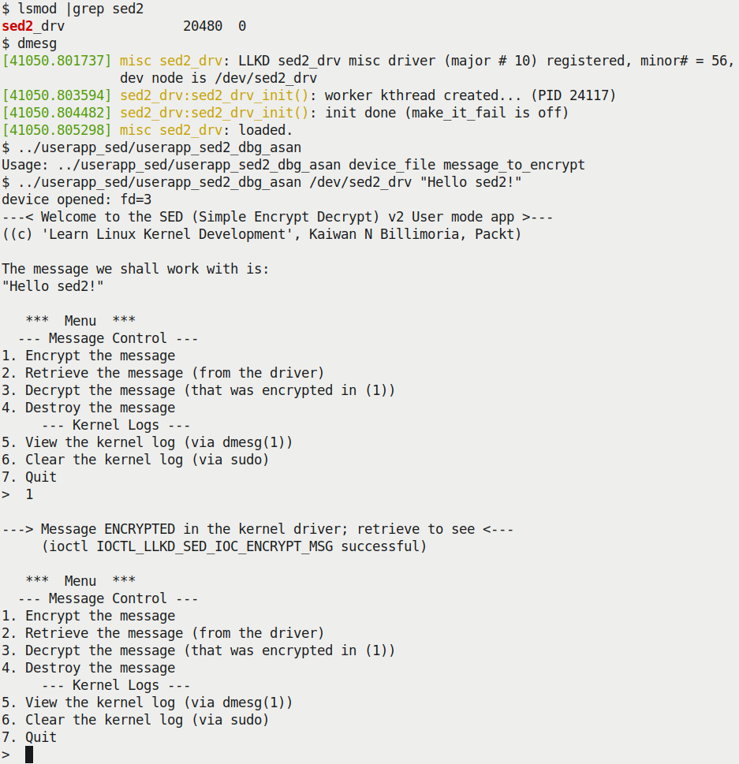

Hình 5.8 – Mini-project sed2 thể hiện hệ thống menu tương tác. Ở đây message đã được mã hóa thành công

Vậy chúng ta đã mã hóa message, nhưng xem nó thế nào? Đơn giản: dùng menu! Chọn option `2` để lấy message (đã mã hóa) (nó sẽ được hiển thị để bạn thong thả xem), option `3` để giải mã, option `2` lần nữa để xem, và option `5` để xem kernel log – khá hữu ích! Một số option được thể hiện trong screenshot sau:

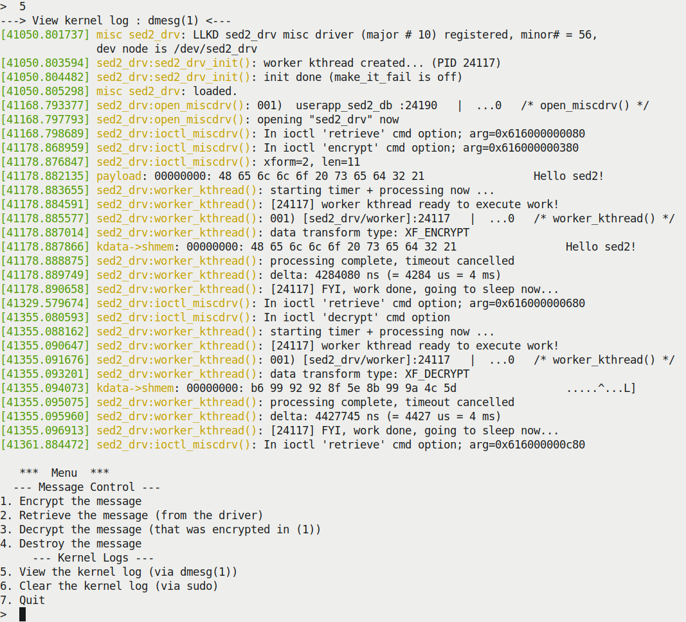

Hình 5.9 – Mini-project sed2 thể hiện hệ thống menu tương tác. Ở đây message đã được mã hóa thành công

Như thể hiện trong kernel log, user mode app (`userapp_sed2_dbg_asan`) đã mở device và thực hiện thao tác lấy, rồi thao tác mã hóa vài giây sau (timestamp ở góc dưới bên trái screenshot trên giúp xác định điều này). Sau đó driver đánh thức kernel thread; có thể thấy đầu ra printk cũng như đầu ra `PRINT_CTX()` ở đây:

```
[41178.885577] sed2_drv:worker_kthread(): 001) [sed2_drv/worker]:24117   |
...0   /* worker_kthread() */
```

Sau đó thao tác mã hóa hoàn tất (thành công và trong deadline; timer bị hủy):

```
[41178.888875] sed2_drv:worker_kthread(): processing complete, timeout
cancelled
```

Tương tự, các thao tác khác được thực hiện. Chúng ta không trình bày code user space app ở đây vì đó là chương trình "C" user mode đơn giản. Lần này (khác thường), nó là app tương tác với menu đơn giản (như screenshot); hãy xem thử. Tôi để bạn tự đọc hiểu chi tiết code `sed2` rồi tự thử.

### Truy vấn và đặt scheduling policy/priority của kernel thread

Để kết lại, làm sao truy vấn và/hoặc thay đổi scheduling policy và priority (real-time) của kernel thread? Kernel cung cấp API cho việc này (API `sched_setscheduler_nocheck()` thường được dùng trong kernel). Ví dụ thực tế, kernel cần kernel thread để phục vụ interrupt – mô hình threaded interrupt đã trình bày trong `Chapter 4`, Xử lý Hardware Interrupt, phần Triển khai threaded interrupt bên trong).

Nó tạo các thread này (qua `kthread_create()`) rồi thay đổi scheduling policy và real-time priority qua API `sched_setscheduler_nocheck()`. Chúng ta không trình bày cụ thể cách dùng ở đây vì đã đề cập trong sách đồng hành Linux Kernel Programming - Chương 11, CPU Scheduler – Phần 2. Thú vị là API `sched_setscheduler_nocheck()` chỉ là wrapper đơn giản trên routine bên dưới `_sched_setscheduler()`. Tại sao? API `_sched_setscheduler()` hoàn toàn không được export nên người viết module không dùng được; wrapper `sched_setscheduler_nocheck()` được export qua macro `EXPORT_SYMBOL_GPL()` (ngụ ý chỉ code có license GPL thực sự dùng được!).

Còn truy vấn và/hoặc thay đổi scheduling policy và priority (real-time) của user space thread? Thư viện Pthreads cung cấp wrapper API để làm đúng việc này; cặp `pthread_[get|set]schedparam(3)` dùng được ở đây vì là wrapper quanh các system call như `sched_[get|set]scheduler(2)` và `sched_[get|set]attr(2)`. Chúng yêu cầu quyền root và, vì bảo mật, capability bit `CAP_SYS_NICE` được đặt trong binary executable file.

Mặc dù sách chỉ trình bày kernel programming, tôi đề cập ở đây vì đây là khả năng rất mạnh: thực chất người thiết kế/phát triển user space app có thể tạo và triển khai application thread hoàn toàn phù hợp mục đích: real-time thread với scheduling policy khác nhau, real-time priority từ 1 đến 99, non-RT thread (với base nice value bằng `0`), v.v. Tạo kernel thread bừa bãi không được tán thành, lý do rất rõ – mỗi kernel thread bổ sung thêm overhead cả memory lẫn CPU cycle. Khi ở giai đoạn thiết kế, hãy dừng lại suy nghĩ: có thực sự cần một hoặc nhiều kernel thread? Hay có cách tốt hơn? Workqueue thường chính là cách tốt hơn đó!

Giờ hãy xem workqueue!

## Sử dụng kernel workqueue

Workqueue là abstraction layer trên việc tạo và quản lý kernel worker thread. Chúng giúp giải quyết vấn đề thiết yếu: làm việc trực tiếp với kernel thread, nhất là khi có nhiều thread, không chỉ khó mà còn dễ dẫn đến bug nguy hiểm như race (và do đó nguy cơ deadlock), cũng như quản lý thread kém, gây tổn thất hiệu quả. Workqueue là bottom-half mechanism dùng trong Linux kernel (cùng tasklet và softirq).

Cách triển khai workqueue hiện đại trong Linux kernel – gọi là concurrency managed work queue (cmwq) – thực sự là framework khá phức tạp, với nhiều chiến lược cung cấp động và hiệu quả kernel thread dựa trên yêu cầu cụ thể.

Trong sách này, chúng ta ưu tiên tập trung cách dùng kernel-global workqueue thay vì thiết kế và triển khai nội bộ. Nếu muốn tìm hiểu internals, tôi khuyến nghị đọc kernel documentation "chính thức" ở: `https://www.kernel.org/doc/Documentation/core-api/workqueue.rst`. Phần Đọc thêm cũng có một số tài nguyên hữu ích.

Các đặc điểm chính của workqueue như sau:

- Các workqueue task (callback) luôn thực thi trong preemptible process context. Điều này hiển nhiên khi nhận ra chúng được kernel (worker) thread thực thi, vốn chạy trong preemptible process context.

- Mặc định, mọi interrupt đều enabled và không acquire lock nào.

- Các điểm trên ngụ ý có thể làm công việc dài, blocking, I/O-bound trong workqueue function (điều này hoàn toàn đối lập atomic context như hardirq, tasklet hoặc softirq!).

- Như đã học về kernel thread, không thể truyền dữ liệu đến và từ user space (qua các routine điển hình `copy_[to|from]_user()` và tương tự); vì workqueue handler (hàm) thực thi trong process context riêng – của kernel thread. Như biết, kernel thread không có user mapping.

- Kernel workqueue framework duy trì worker pool. Thực sự đó là nhiều kernel worker thread được tổ chức theo các cách khác nhau tùy nhu cầu. Kernel xử lý mọi phức tạp trong quản lý, cũng như vấn đề concurrency. Screenshot sau cho thấy một số workqueue kernel worker thread (chụp trên guest VM Ubuntu 20.04 x86\_64 của tôi):

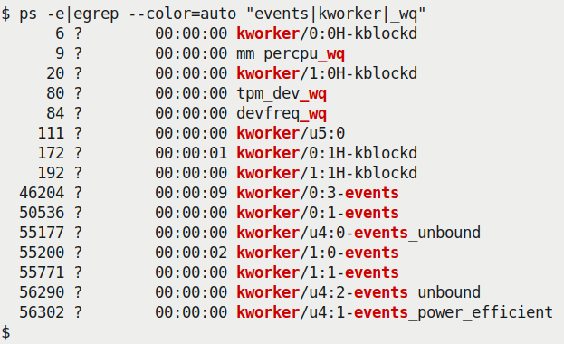

Hình 5.10 – Một số kernel thread phục vụ bottom-half mechanism của kernel workqueue

Như đề cập ở phần Tạo và làm việc với kernel thread, một cách xác định tên kthread và tìm hiểu nhiều ứng dụng thực tế (cùng cách tinh chỉnh để giảm jitter) là đọc kernel documentation liên quan; tức Giảm OS jitter do per-cpu kthread (`https://www.kernel.org/doc/Documentation/kernel-per-CPU-kthreads.txt`).

Về cách dùng workqueue (và bottom-half mechanism khác), tham khảo lại `Chapter 4`, Xử lý Hardware Interrupt, phần Hardirq, tasklet và threaded handler – dùng gì khi nào, đặc biệt bảng ở đó.

Điều quan trọng là hiểu kernel có default workqueue luôn sẵn sàng; gọi là kernel-global workqueue hoặc system workqueue. Để tránh tạo áp lực hệ thống, rất nên dùng nó. Chúng ta dùng kernel-global workqueue, enqueue các work task vào đó và để nó xử lý công việc.

Thậm chí có thể dùng và tạo các loại workqueue khác! Kernel cung cấp framework cmwq phức tạp cùng tập API giúp tạo các loại workqueue cụ thể. Chúng ta sẽ xem chi tiết hơn ở phần tiếp theo.

### Workqueue internals tối thiểu

Chúng ta không đi quá sâu workqueue internals ở đây; thực tế chỉ lướt trên bề mặt (như đã đề cập, mục đích chỉ tập trung dùng kernel-global workqueue).

Luôn khuyến nghị dùng default kernel-global (system) workqueue để xử lý công việc background asynchronous. Nếu thấy không đủ, đừng lo – có các interface cho phép tạo workqueue riêng. (Nhớ rằng làm vậy tăng áp lực hệ thống!) Để cấp phát workqueue instance mới, có thể dùng API `alloc_workqueue()`; đây là API chính dùng để tạo (cấp phát) workqueue (qua framework cmwq hiện đại):

```
include/linux/workqueue.h
struct workqueue_struct *alloc_workqueue(const char *fmt, unsigned int
flags, int max_active, ...);
```

Lưu ý nó được export qua `EXPORT_SYMBOL_GPL()`, nghĩa là chỉ module và driver dùng license GPL mới dùng được. `fmt` (và các tham số sau `max_active`) chỉ định cách đặt tên workqueue thread trong pool. Tham số `flags` chỉ định bitmask của các giá trị hành vi đặc biệt hoặc đặc điểm khác, như sau:

- Dùng flag `WQ_MEM_RECLAIM` khi workqueue cần bảo đảm forward progress dưới memory pressure.

- Dùng flag `WQ_HIGHPRI` khi work item cần được worker pool gồm các kthread có priority cao phục vụ.

- Dùng flag `WQ_SYSFS` để cho user space thấy một số chi tiết workqueue qua sysfs (thực tế, xem dưới `/sys/devices/virtual/workqueue/`).

- Tương tự, còn một số flag khác. Xem kernel documentation chính thức để biết thêm (`https://www.kernel.org/doc/Documentation/core-api/workqueue.rst`; nó trình bày thú vị về giảm "jitter" do workqueue thực thi trong kernel).

Tham số `max_active` được dùng để chỉ định số kernel thread tối đa trên mỗi CPU có thể được gán cho một work item.

Nói chung có hai loại workqueue:

- Single-threaded (ST) workqueue hoặc ordered workqueue: Ở đây, chỉ một thread có thể active tại thời điểm bất kỳ trên toàn hệ thống. Có thể tạo bằng `alloc_ordered_workqueue()` (thực sự chỉ là wrapper trên `alloc_workqueue()` chỉ định ordered flag với `max_active` bằng đúng `1`).

- Multi-threaded (MT) workqueue: Đây là tùy chọn mặc định. Các `flags` cụ thể chỉ định hành vi; `max_active` chỉ định số worker kernel thread tối đa mà work item có thể có trên mỗi CPU.

Mọi workqueue đều có thể tạo qua API `alloc_workqueue()`. Code tạo như sau:

```
// kernel/workqueue.c
int __init workqueue_init_early(void)
{
    [ ... ]
    system_wq = alloc_workqueue("events", 0, 0);
    system_highpri_wq = alloc_workqueue("events_highpri", WQ_HIGHPRI, 0);
    system_long_wq = alloc_workqueue("events_long", 0, 0);
    system_unbound_wq = alloc_workqueue("events_unbound", WQ_UNBOUND,
WQ_UNBOUND_MAX_ACTIVE);
    system_freezable_wq = alloc_workqueue("events_freezable", WQ_FREEZABLE,
0);
    system_power_efficient_wq = alloc_workqueue("events_power_efficient",
WQ_POWER_EFFICIENT, 0);
    system_freezable_power_efficient_wq =
alloc_workqueue("events_freezable_power_efficient",
                          WQ_FREEZABLE | WQ_POWER_EFFICIENT, 0);
[ ... ]
```

Điều này xảy ra sớm trong boot process (thực sự trong early init kernel code path). Mục đầu tiên được in đậm; đây là kernel-global workqueue hay system workqueue đang được tạo. Worker pool tên `events`. (Tên kernel thread thuộc pool này tuân theo quy ước và có từ `events` trong tên; xem lại Hình 5.10. Điều tương tự xảy ra với kthread thuộc worker pool khác.)

Framework bên dưới đã phát triển rất nhiều; legacy workqueue framework trước đây (trước 2010) từng dùng API `create_workqueue()` và các API liên quan; tuy nhiên giờ chúng được xem là deprecated. Framework concurrency managed workqueue (cmwq) hiện đại (khoảng 2010 trở đi), thú vị là tương thích ngược với framework cũ. Bảng sau tóm tắt mapping từ workqueue API cũ sang cmwq API hiện đại:

| Workqueue API legacy (cũ và deprecated) | Workqueue API hiện đại (cmwq) |
|---|---|
| `create_workqueue(name)` | `alloc_workqueue(name,WQ_MEM_RECLAIM, 1)` |
| `create_singlethread_workqueue(na` `me)` | `alloc_ordered_workqueue(name,` `WQ_MEM_RECLAIM)` |
| `create_freezable_workqueue(name)` | `alloc_workqueue(name, WQ_FREEZABLE \|` `WQ_UNBOUND \| WQ_MEM_RECLAIM, 1)` |

Bảng 5.3 – Mapping từ workqueue API cũ sang cmwq API hiện đại

Sơ đồ sau tóm tắt (đơn giản, về khái niệm) kernel workqueue subsystem:

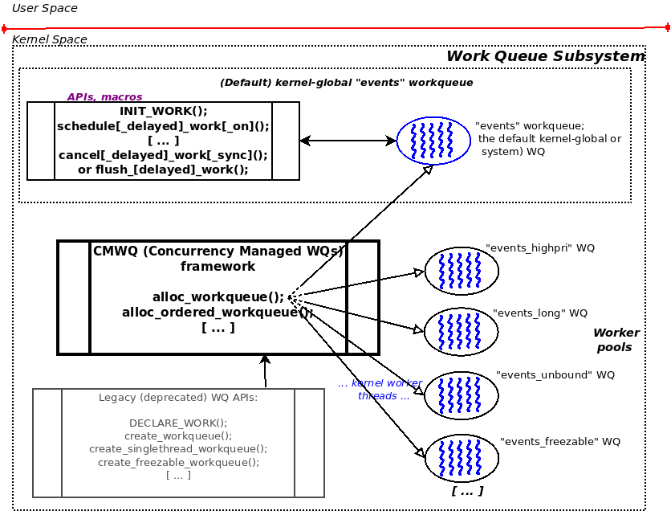

Hình 5.11 – Góc nhìn khái niệm đơn giản về workqueue subsystem trong kernel

Workqueue framework của kernel duy trì động các worker pool (gồm kernel thread) này; một số, như workqueue `events` (tương ứng kernel-global workqueue), là general-purpose, còn những pool khác được tạo và duy trì cho mục đích cụ thể (thể hiện ở tên kernel thread, như block I/O, `kworker*blockd`, memory control, `kworker*mm_percpu_wq`, loại đặc thù device như tpm, `tpm_dev_wq`, CPU frequency governor driver, `devfreq_wq`, v.v.). Lưu ý kernel workqueue subsystem duy trì tự động, tinh tế và hiệu quả mọi workqueue này (cùng worker pool kernel thread liên quan).

Vậy thực sự dùng workqueue thế nào? Phần tiếp theo cho thấy cách dùng kernel-global workqueue. Tiếp đó là demo kernel module minh họa rõ cách sử dụng.

### Sử dụng kernel-global workqueue

Trong phần này, chúng ta học chính xác cách dùng kernel-global workqueue (cũng gọi là system hay events workqueue, vốn là mặc định). Thường bao gồm khởi tạo workqueue với work task của bạn, để nó xử lý công việc, cuối cùng cleanup.

#### Khởi tạo kernel-global workqueue cho task – INIT\_WORK()

Enqueue công việc vào workqueue này thực sự rất dễ: dùng macro `INIT_WORK()`! Macro nhận hai tham số:

```
#include <linux/workqueue.h>
INIT_WORK(struct work_struct *_work, work_func_t _func);
```

Cấu trúc `work_struct` là cấu trúc chủ lực của workqueue (ít nhất từ góc nhìn người viết module/driver); bạn cần cấp phát memory và truyền pointer làm tham số thứ nhất. Tham số thứ hai cho `INIT_WORK()` là pointer đến workqueue callback function – hàm được các worker thread của workqueue xử lý! `work_func_t` là `typedef` chỉ định signature hàm này, là `void (*work_func_t)(struct work_struct *work)`.

#### Cho work task thực thi – schedule\_work()

Gọi `INIT_WORK()` đăng ký work structure và function chỉ định với default kernel-global workqueue nội bộ. Nhưng chưa thực thi nó! Bạn phải cho biết khi nào thực thi "công việc" bằng cách gọi API `schedule_work()` đúng lúc:

```
bool schedule_work(struct work_struct *work);
```

Rõ ràng, tham số của `schedule_work()` là pointer đến cấu trúc `work_struct` (đã khởi tạo qua macro `INIT_WORK()`). Nó trả về Boolean (trích trực tiếp source): `%false if @work was already on the kernel-global` `workqueue and %true otherwise True`. Thực chất, `schedule_work()` kiểm tra function chỉ định (qua work structure) đã nằm trên kernel-global workqueue hay chưa; nếu chưa, enqueue vào đó; nếu đã có, giữ nguyên vị trí (không thêm instance nữa). Sau đó đánh dấu work item để thực thi. Điều này thường xảy ra ngay khi các kernel thread bên dưới tương ứng workqueue được schedule, cho bạn cơ hội chạy công việc.

Để hai work item (hàm) trong module hoặc driver thực thi qua kernel-global workqueue (mặc định), chỉ cần gọi macro `INIT_WORK()` hai lần, mỗi lần truyền work structure và function khác nhau. Tương tự, với nhiều work item hơn, gọi `INIT_WORK()` cho từng mục... (Ví dụ, xét kernel block driver này (`drivers/block/mtip32xx/mtip32xx.c`): dường như cho Micron PCIe SSD, nó gọi `INIT_WORK()` tám lần liên tiếp (!) trong probe method, dùng mảng giữ mọi item).

Lưu ý có thể gọi `schedule_work()` trong atomic context! Lời gọi non-blocking; chỉ schedule work item để được xử lý vào thời điểm deferred (và an toàn) sau đó, khi chạy trong process context.

##### Các biến thể schedule work task

Có vài biến thể của API `schedule_work()` vừa mô tả, đều có qua các API `schedule[_delayed]_work[_on]()`. Hãy liệt kê ngắn gọn. Trước hết xem inline function `schedule_delayed_work()`, có signature như sau:

```
bool schedule_delayed_work(struct delayed_work *dwork, unsigned long
delay);
```

Dùng routine này khi muốn delay việc thực thi workqueue handler function một khoảng thời gian chỉ định; tham số thứ hai, `delay`, là số `jiffies` muốn chờ. Chúng ta biết biến `jiffies` tăng `HZ` jiffy mỗi giây; vì vậy, để work task delay `n` giây, chỉ định `n * jiffies`. Tương tự, luôn có thể truyền giá trị `msecs_to_jiffies(n)` làm tham số thứ hai để nó thực thi sau `n` millisecond kể từ bây giờ.

Tiếp theo, lưu ý tham số thứ nhất của `schedule_delayed_work()` khác; đó là cấu trúc `delayed_work`, bản thân chứa cấu trúc `work_struct` giờ đã quen thuộc làm member, cùng các housekeeping member khác (kernel timer, pointer đến workqueue structure và CPU number). Để khởi tạo, chỉ cần cấp phát memory rồi dùng macro `INIT_DELAYED_WORK()` (cú pháp vẫn giống `INIT_WORK()`); nó xử lý mọi khởi tạo.

Một biến thể hơi khác nữa là routine `schedule[_delayed]_work_on()`; `on` trong tên cho phép chỉ định CPU core nào sẽ schedule work task khi thực thi. Đây là signature của inline function `schedule_delayed_work_on()`:

```
bool schedule_delayed_work_on(int cpu, struct delayed_work *dwork, unsigned
long delay);
```

Tham số thứ nhất chỉ định CPU core để thực thi work task, hai tham số còn lại giống tham số của routine `schedule_delayed_work()`. (Có thể dùng routine `schedule_delayed_work()` để schedule task – ngay lập tức – trên CPU core nhất định).

#### Cleanup – cancel hoặc flush work task

Đến một lúc, bạn muốn bảo đảm các work task đã thực sự thực thi xong. Có thể muốn làm vậy trước khi hủy workqueue (giả sử là workqueue tự tạo, không phải kernel-global) hoặc, nhiều khả năng hơn, khi dùng kernel-global workqueue trong cleanup method của LKM hay driver. API điển hình ở đây là `cancel_[delayed_]work[_sync]()`. Các biến thể và signature như sau:

```
bool cancel_work_sync(struct work_struct *work);
bool cancel_delayed_work(struct delayed_work *dwork);
bool cancel_delayed_work_sync(struct delayed_work *dwork);
```

Thực sự khá đơn giản: dùng `cancel_work_sync()` sau khi dùng các routine `INIT_WORK()` và `schedule_work()`; dùng hai routine sau khi đã delay work task. Lưu ý hai routine có hậu tố `_sync`; ngụ ý cancellation là synchronous – kernel chờ các work task hoàn tất thực thi trước khi các hàm này return! Đây thường là điều mong muốn. Chúng trả về boolean: `True` nếu có công việc pending, còn không là `False`.

Trong kernel module, không cancel (hoặc flush) work task trong cleanup code path (`rmmod`) là cách chắc chắn gây vấn đề nghiêm trọng; bảo đảm thực hiện!

Kernel workqueue subsystem cũng cung cấp vài routine `flush_*()` (bao gồm `flush_scheduled_work()`, `flush_workqueue()` và `flush_[delayed_]work()`). Kernel documentation (`https://www.kernel.org/doc/html/latest/core-api/workqueue.html`) cảnh báo rõ rằng các routine này không dễ dùng nhất vì dễ gây deadlock. Bạn được khuyến nghị dùng các API `cancel_[delayed_]work[_sync]()` nói trên thay thế.

#### Tóm tắt nhanh workflow

Khi dùng kernel-global workqueue, xuất hiện pattern (workflow) đơn giản:

1\. Khởi tạo work task.

2\. Tại thời điểm thích hợp, schedule nó để thực thi (có thể có delay và/hoặc trên CPU core cụ thể).

3\. Cleanup. Thông thường, trong cleanup code path của kernel module (hoặc driver), cancel nó. (Ưu tiên thực hiện với synchronization để mọi work task pending hoàn tất trước. Ở đây, chúng ta giữ việc dùng các routine `cancel*work*()` được khuyến nghị, tránh `flush_*()`).

Hãy tóm tắt bằng bảng:

| Sử dụng kernel-global workqueue | Work task thông thường | Work task delayed | Thực thi work task trên CPU cho trước |
|---|---|---|---|
| 1\. Khởi tạo | `INIT_WORK()` | `INIT_DELAYED_WORK()` | \< ngay lập tức hay delayed đều được \> |
| 2\. Schedule work task để thực thi | `schedule_work()` | `schedule_delayed_work()` | `schedule_delayed_work_on()` |
| 3\. Cancel (hoặc flush); foo\_sync() để bảo đảm hoàn tất | `cancel_work_sync()` | `cancel_delayed_work_sync()` | \< ngay lập tức hay delayed đều được \> |

Bảng 5.4 – Sử dụng kernel-global workqueue – tóm tắt workflow

Trong các phần tiếp theo, chúng ta viết kernel module đơn giản dùng kernel-default workqueue để thực thi work task.

### Work queue kernel module đơn giản của chúng ta – xem code

Hãy thực hành với work queue! Trong các mục sau, chúng ta viết demo kernel module đơn giản (`ch5/workq_simple`) minh họa cách dùng kernel-default workqueue để thực thi một work task. Nó thực ra được xây dựng trên LKM trước, dùng để minh họa kernel timer (`ch5/timer_simple`). Hãy xem ở mức code (như thường lệ, không trình bày toàn bộ code, chỉ những phần liên quan nhất). Chúng ta bắt đầu với private context data structure và init method:

```
static struct st_ctx {
    struct work_struct work;
    struct timer_list tmr;
    int data;
} ctx;
[ ... ]
static int __init workq_simple_init(void)
{
    ctx.data = INITIAL_VALUE;
    /* Initialize our work queue */
    INIT_WORK(&ctx.work, work_func);
    /* Initialize our kernel timer */
    ctx.tmr.expires = jiffies + msecs_to_jiffies(exp_ms);
    ctx.tmr.flags = 0;
    timer_setup(&ctx.tmr, ding, 0);
    add_timer(&ctx.tmr); /* Arm it; let's get going! */
    return 0;
}
```

Một điểm quan trọng cần suy nghĩ: làm sao truyền một số dữ liệu hữu ích cho work function? Cấu trúc `work_struct` chỉ có một atomic long integer dùng cho mục đích nội bộ. Một thủ thuật tốt (và rất điển hình!) là nhúng cấu trúc `work_struct` trong context structure của driver; rồi trong work task callback function, dùng macro `container_of()` để truy cập parent context data structure! Đây là chiến lược thường dùng. (`container_of()` là macro mạnh nhưng không thực sự dễ giải mã! Chúng tôi cung cấp vài liên kết hữu ích trong mục Đọc thêm.) Vì vậy, trong code trên, context structure của driver nhúng một `struct work_struct`. Bạn có thể thấy việc khởi tạo work task trong macro `INIT_WORK()`.

Khi timer đã được arm (`add_timer()` làm việc này), nó sẽ hết hạn sau khoảng 420 millisecond và timer callback function chạy trong timer softirq context (đây rõ ràng là atomic context):

```
static void ding(struct timer_list *timer)
{
    struct st_ctx *priv = from_timer(priv, timer, tmr);
    pr_debug("timed out... data=%d\n", priv->data--);
    PRINT_CTX();
    /* until countdown done, fire it again! */
    if (priv->data)
        mod_timer(&priv->tmr, jiffies + msecs_to_jiffies(exp_ms));
    /* Now 'schedule' our work queue function to run */
    if (!schedule_work(&priv->work))
        pr_notice("our work's already on the kernel-global workqueue!\n");
}
```

Sau khi giảm biến `data`, nó thiết lập timer kích hoạt lại (sau 420 ms, qua `mod_timer()`), rồi qua API `schedule_work()`, schedule work queue callback để chạy! Kernel nhận biết work queue function lúc này phải được thực thi (tiêu thụ) sớm nhất khi khả thi. Nhưng khoan — work queue callback phải và sẽ chỉ chạy trong process context, qua một global kernel worker thread — các thread gọi là events. Vì thế, chỉ khi đã ra khỏi softirq context này và (một trong) các “events” kernel worker thread nằm trên CPU runqueue và thực sự chạy, work queue callback function mới được gọi. Đừng lo — sẽ sớm thôi... Toàn bộ ý nghĩa của việc dùng workqueue là kernel không chỉ đảm nhiệm hoàn toàn thread management, mà hàm còn chạy trong process context, nơi có thể thực hiện blocking operation hoặc I/O operation kéo dài.

Một lần nữa, sớm là bao lâu? Hãy thử đo: chúng ta lấy timestamp (qua inline function `ktime_get_real_ns()` thông thường) ngay sau `schedule_work()` và ở dòng code đầu tiên trong work queue function. Macro `SHOW_DELTA()` đáng tin cậy hiển thị chênh lệch thời gian. Như dự kiến, nó nhỏ, thường trong khoảng vài phần trăm microsecond (tất nhiên phụ thuộc nhiều yếu tố, gồm hardware platform, kernel version, v.v.). Hệ thống tải cao khiến context switch sang các events kernel thread mất lâu hơn, có thể gây chậm thực thi chức năng work queue. Bạn sẽ thấy trong lần chạy mẫu ở ảnh chụp (Hình 5.12) trong mục tiếp theo.

Code sau là work task function. Đây là nơi dùng macro `container_of()` để truy cập context structure của module:

```
/* work_func() - our workqueue callback function! */
static void work_func(struct work_struct *work)
{
    struct st_ctx *priv = container_of(work, struct st_ctx, work);

    t2 = ktime_get_real_ns();
    pr_info("In our workq function: data=%d\n", priv->data);
    PRINT_CTX();
    SHOW_DELTA(t2, t1);
}
```

Hơn nữa, output của macro `PRINT_CTX()` cho thấy chắc chắn hàm này chạy trong process context.

Hãy cẩn thận khi dùng `container_of()` trong delayed work task callback function — phải chỉ định tham số thứ ba là member `work` của `struct delayed_work` (một câu hỏi bài tập yêu cầu thử chính điều này! Cũng có lời giải...). Tôi đề nghị nắm vững kiến thức cơ bản trước khi tự thử.

Trong mục tiếp theo, chúng ta chạy kernel module.

### Work queue kernel module đơn giản của chúng ta – chạy thử

Hãy chạy thử! Xem ảnh sau:

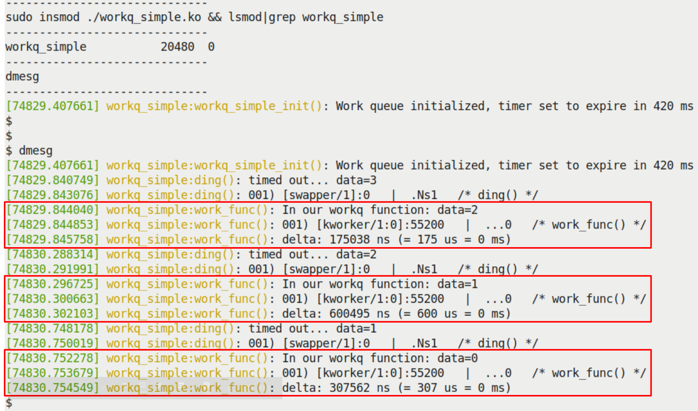

Hình 5.12 – LKM workq\_simple.ko với phần thực thi work queue function được tô nổi bật

Hãy xem code này chi tiết hơn:

- Qua helper script `lkm`, chúng ta build rồi `insmod(8)` kernel module, tức `workq_simple.ko`.

- Kernel log được hiển thị qua `dmesg(1)`:

- Ở đây, workqueue và kernel timer được khởi tạo và arm trong init method.

- Timer hết hạn (sau khoảng 420 ms); bạn có thể thấy các printk của nó (hiển thị `timed out...` và giá trị biến `data`).

- Nó gọi API `schedule_work()`, khiến workqueue function chạy.

- Như được tô nổi bật trong ảnh trên, work queue function `work_func()` thực sự chạy; hiển thị giá trị hiện tại của data variable, chứng minh đã truy cập đúng “context” hay private data structure.

Lưu ý chúng ta dùng macro `PRINT_CTX()` trong LKM này (nằm trong header `convenient.h`) để cho thấy điều thú vị:

- Khi chạy trong context của timer callback function, các status bit chứa ký tự `s` (ký tự thứ ba trong field bốn ký tự — `.Ns1` hoặc tương tự), cho thấy đang chạy trong softirq (interrupt, atomic) context.

- Khi chạy trong context của work queue callback function, ký tự thứ ba của status bit không bao giờ chứa `s`; luôn là `.`, chứng minh workqueue luôn thực thi trong process context!

Tiếp theo, macro `SHOW_DELTA()` tính và đưa ra chênh lệch thời gian giữa lúc workqueue được schedule và lúc thực sự thực thi. Như thấy (ít nhất ở đây, trên guest VM x86\_64 tải nhẹ), nằm trong khoảng vài trăm microsecond.

Vì sao không tra kernel worker thread thực tế được dùng để tiêu thụ work queue? Chỉ cần `ps(1)` trên PID. Trong trường hợp cụ thể này, đó là một trong các generic workqueue consumer thread theo từng CPU core của kernel — một kernel worker thread (`kworker/...`):

```
$ ps -el | grep -w 55200
 1 I     0   55200       2  0  80  0 -    0 -    ?       00:00:02
kworker/1:0-mm_percpu_wq
 $
```

Tất nhiên, kernel code base có rất nhiều nơi dùng workqueue (đặc biệt nhiều device driver). Hãy dùng `cscope(1)` để tìm và duyệt các code đó.

### Mini project sed3 – xem rất ngắn gọn

Hãy kết thúc chương bằng cách xem rất ngắn gọn sự phát triển từ project `sed2` thành `sed3`. Mini-project này giống hệt `sed2`, ngoại trừ đơn giản hơn! Công việc (en/de)crypt giờ được thực hiện bởi work task (hàm) qua chức năng workqueue hay bottom-half mechanism của kernel. Chúng ta dùng workqueue — kernel-global workqueue mặc định — để làm việc thay vì tạo và quản lý kthread thủ công (như trong `sed2`)!

Ảnh sau cho thấy truy cập kernel log của một lần chạy mẫu; trong lần chạy, ứng dụng user mode encrypt, rồi decrypt, rồi lấy message để xem. Chúng ta tô nổi bật phần thú vị — việc thực thi work task qua worker thread của kernel-global workqueue — trong hai hình chữ nhật đỏ:

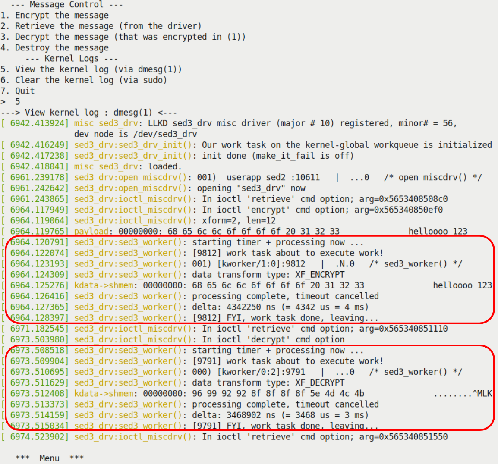

Hình 5.13 – Kernel log khi chạy driver sed3; work task chạy qua kernel-global workqueue mặc định được tô nổi bật

Nhân tiện, ứng dụng user mode giống hệt ứng dụng dùng trong `sed2`. Ảnh trên cho thấy (qua macro `PRINT_CTX()` đáng tin cậy) các kernel worker thread thực tế mà kernel-global workqueue dùng để chạy công việc encrypt và decrypt; trong trường hợp này là `[kworker/1:0]` PID 9812 cho encrypt và `[kworker/0:2]` PID 9791 cho decrypt. Chú ý cả hai chạy trong process context. Chúng tôi để bạn tự duyệt code `sed3` (`ch5/sed3`).

Đến đây kết thúc mục này. Bạn đã học kernel workqueue infrastructure thực sự hữu ích cho người viết module/driver vì giúp thêm abstraction layer mạnh mẽ trên các chi tiết bên dưới về kernel thread, việc tạo cùng quản lý và thao tác phức tạp. Nó giúp rất dễ thực hiện công việc trong kernel — đặc biệt dùng kernel-global workqueue (mặc định) có sẵn — mà không cần lo những chi tiết rắc rối.

## Tổng kết

Làm tốt lắm! Chúng ta đã trình bày nhiều nội dung trong chương này. Trước hết, bạn học cách tạo delay trong kernel space, cả loại atomic và blocking (lần lượt qua các routine `*delay()` và `*sleep()`). Tiếp theo, học cách thiết lập và dùng kernel timer trong LKM (hoặc driver) — nhiệm vụ rất phổ biến và cần thiết. Tạo và làm việc trực tiếp với kernel thread có thể là trải nghiệm đầy hứng khởi (và cả khó khăn), nên bạn đã học những điều cơ bản để làm vậy. Sau đó, xem kernel workqueue subsystem, giải quyết vấn đề phức tạp (và concurrency). Bạn học nó là gì và cách dùng thực tế kernel-global workqueue (mặc định) để work task thực thi khi cần.

Chuỗi ba demo driver `sed` (simple encrypt decrypt) mà chúng ta thiết kế và triển khai thể hiện một use case phức tạp hơn đôi chút cho những công nghệ thú vị này: `sed1` với triển khai timeout, `sed2` thêm kernel thread để thực hiện công việc, và `sed3` dùng kernel-global workqueue để tiêu thụ công việc khi cần.

Hãy dành thời gian làm các Câu hỏi/bài tập sau cho chương này và xem tài nguyên Đọc thêm. Khi xong, tôi đề nghị nghỉ ngơi xứng đáng rồi quay lại. Chúng ta gần đến đích: hai chương cuối trình bày chủ đề thực sự quan trọng — kernel synchronization!

## Câu hỏi

1\. Tìm bug trong pseudocode sau:

```
static my_chip_tasklet(void)
{
    // ... process data
    if (!copy_to_user(to, from, count)) {
        pr_warn("..."); [...]
    }
}
static irqreturn_t chip_hardisr(int irq, void *data)
{
    // ack irq
    // << ... fetch data into kfifo ... >>
    // << ... call func_a(), delay, then call func_b() >>
    func_a();
    usleep(100); // 100 us delay required here! see datasheet pg
...
    func_b();
    tasklet_schedule(...);
    return IRQ_HANDLED;
}
my_chip_probe(...)
{
    // ...
    request_irq(CHIP_IRQ, chip_hardisr, ...);
    // ...
    tasklet_init(...);
}
```

2\. `timer_simple_check`: Nâng cấp kernel module `timer_simple` để kiểm tra thời gian đã trôi qua giữa lúc thiết lập timeout và lúc thực sự được phục vụ.

3\. `kclock`: Viết kernel module thiết lập kernel timer hết hạn mỗi giây. Sau đó dùng nó để in timestamp vào kernel log, thực chất tạo một “clock app” đơn giản trong kernel.

4\. `mutlitime`: Phát triển kernel module nhận tham số là số giây trước khi gọi timer callback. Mặc định bằng zero (ngụ ý không có timer và do đó là validity error). Hoạt động như sau: nếu số truyền vào là 3, phải tạo ba kernel timer; timer đầu hết hạn sau 3 giây, timer thứ hai sau 2 giây, timer cuối sau 1 giây. Nói cách khác, nếu số truyền vào là “n”, phải tạo “n” kernel timer; timer đầu hết hạn sau “n” giây, timer thứ hai sau “n-1” giây, timer thứ ba sau “n-2” giây, v.v. cho đến khi số đếm về zero.

5\. Build và chạy các mini-project `sed[123]` được cung cấp trong chương, xác minh (bằng cách xem kernel log) chúng hoạt động đúng như phải vậy.

6\. `workq_simple2`: LKM `ch5/workq_simple` được cung cấp thiết lập và “tiêu thụ” một work item (hàm) qua kernel-global workqueue; nâng cấp để thiết lập và thực thi hai “work” task. Xác minh hoạt động đúng.

7\. `workq_delayed`: Phát triển từ bài tập trước (`workq_simple2`) để thực thi hai work task, cộng thêm một task (từ init code path). Task này (thứ ba) phải delayed; thời gian delay phải được truyền làm module parameter tên `work_delay_ms` (tính bằng millisecond; mặc định 500 ms). \[Gợi ý: Cẩn thận khi dùng `container_of()` trong delayed work task callback function; phải chỉ định tham số thứ ba là member `work` của `struct delayed_work`; xem lời giải chúng tôi đã cung cấp\].

Bạn sẽ tìm thấy lời giải cho một số câu hỏi trong GitHub repo của sách: `https://github.com/PacktPublishing/Linux-Kernel-Programming-Part-2/tree/main/solutions_to_assgn`.

## Đọc thêm

- Kernel documentation: Delay, sleep mechanism: `https://www.kernel.org/doc/Documentation/timers/timers-howto.tx`

- Kernel Timer Systems: `https://elinux.org/Kernel_Timer_Systems#Timer_information`

- Workqueue:

- Đây là bài trình bày rất tốt: Async execution with workqueues, Bhaktipriya Shridhar: `https://events.static.linuxfound.org/sites/events/files/slides/Async%20execution%20with%20wqs.pdf`

- Kernel documentation: Concurrency Managed Workqueue (cmwq): `https://www.kernel.org/doc/html/latest/core-api/workqueue.html#concurrency-managed-workqueue-cmwq`

- Giải thích macro `container_of()`:

- The Magical container\_of() Macro, tháng 11 năm 2012: `https://radek.io/2012/11/10/magical-container_of-macro/`

- Understanding of container\_of macro in Linux kernel: `https://embetronicx.com/tutorials/linux/c-programming/understanding-of-container_of-macro-in-linux-kernel/`
