# Chương 6. Kernel Synchronization - Phần 1

Như bất kỳ nhà phát triển nào quen lập trình trong môi trường multithreaded (hoặc ngay cả single-threaded, nơi nhiều process làm việc trên shared memory, hoặc có khả năng xảy ra interrupt) đều hiểu rõ, cần synchronization mỗi khi hai hay nhiều thread (nói chung là code path) có thể race; tức không thể dự đoán kết quả. Bản thân code thuần túy không bao giờ là vấn đề vì quyền của nó là read/execute (`r-x`); đọc và thực thi code đồng thời trên nhiều CPU core không chỉ hoàn toàn ổn và an toàn mà còn được khuyến khích (cho throughput tốt hơn và là lý do multithreading là ý hay). Tuy nhiên, ngay khi làm việc trên shared writeable data, bạn cần bắt đầu hết sức cẩn thận!

Các thảo luận về concurrency và kiểm soát nó — synchronization — rất đa dạng, đặc biệt trong context một phần mềm phức tạp như Linux kernel (các subsystem và vùng liên quan như device driver), là thứ chúng ta đang làm việc trong sách này. Vì vậy, để tiện, chúng ta chia chủ đề lớn thành hai chương, chương này và chương tiếp theo.

Trong chương này, chúng ta sẽ đề cập các chủ đề sau:

- Critical section, exclusive execution và atomicity

- Các vấn đề concurrency trong Linux kernel

- Mutex hay spinlock? Dùng loại nào khi nào

- Dùng mutex lock

- Dùng spinlock

- Locking và interrupt

Hãy bắt đầu!

## Critical section, exclusive execution và atomicity

Hãy tưởng tượng bạn viết software cho multicore system (ngày nay làm việc với multicore system là điều điển hình, ngay cả trên phần lớn embedded project). Như đã nói trong phần giới thiệu, chạy nhiều code path song song không chỉ an toàn mà còn đáng mong muốn (nếu không thì tốn tiền làm gì, đúng không?). Ngược lại, với các concurrent code path (song song và đồng thời) truy cập shared writeable data (còn gọi là shared state) theo bất kỳ cách nào, bạn phải bảo đảm tại mỗi thời điểm chỉ một thread được làm việc trên dữ liệu đó! Điều này thực sự then chốt; vì sao? Hãy nghĩ xem: nếu cho nhiều concurrent code path làm việc song song trên shared writeable data, bạn thực sự tự chuốc rắc rối: hậu quả có thể là data corruption (một “race”).

### Critical section là gì?

Code path có thể thực thi song song và làm việc trên (đọc và/hoặc ghi) shared writeable data (shared state) được gọi là critical section. Chúng cần được bảo vệ khỏi parallelism. Xác định và bảo vệ critical section khỏi thực thi đồng thời là yêu cầu ngầm để software đúng mà bạn — người thiết kế/kiến trúc sư/nhà phát triển — phải xử lý.

Critical section là đoạn code phải chạy exclusively, tức một mình (serialized), hoặc atomically, tức không thể chia cắt, đến khi hoàn tất, không bị interrupt.

Exclusively ngụ ý tại bất kỳ thời điểm nào chỉ một thread chạy code của critical section; rõ ràng cần vậy để an toàn dữ liệu.

Điều này cũng dẫn đến khái niệm atomicity quan trọng: một atomic operation đơn lẻ là thao tác không thể chia cắt. Trên mọi bộ xử lý hiện đại, hai thao tác được xem luôn atomic; tức không thể bị interrupt và sẽ chạy đến hoàn tất:

- Thực thi một machine language instruction đơn lẻ.

- Đọc hoặc ghi một primitive data type được align, nằm trong word size của bộ xử lý (thường 32 hoặc 64 bit); ví dụ, đọc hay ghi số nguyên 64-bit trên hệ thống 64-bit được bảo đảm atomic. Thread đọc biến đó không bao giờ thấy kết quả ở giữa chừng, torn hoặc dirty; chỉ thấy giá trị cũ hoặc mới.

Vì vậy, nếu có vài dòng code làm việc trên shared writeable data (global hoặc static), không thể bảo đảm chạy exclusively khi thiếu cơ chế synchronization tường minh. Lưu ý đôi khi cần code của critical section chạy cả atomically lẫn exclusively, nhưng không phải mọi lúc.

Khi code critical section chạy trong process context an toàn để sleep (như file operation điển hình trên driver qua user app (open, read, write, ioctl, mmap, v.v.), hoặc execution path của kernel thread hay workqueue), có thể chấp nhận critical section không thực sự atomic. Tuy nhiên, khi code chạy trong non-blocking atomic context (như hardirq, tasklet hoặc softirq), nó phải chạy cả atomically lẫn exclusively (chúng ta trình bày chi tiết hơn trong mục Mutex hay spinlock? Dùng loại nào khi nào).

Một ví dụ khái niệm giúp làm rõ. Giả sử ba thread (từ các user space app) cố mở và đọc từ driver gần như đồng thời trên multicore system. Không can thiệp, chúng có thể chạy code critical section song song, qua đó làm việc trên shared writable data song song, rất có thể làm hỏng dữ liệu! Hiện tại, hãy xem sơ đồ khái niệm để thấy vì sao thực thi không exclusive trong code path của critical section là sai (ở đây chưa nói đến atomicity):

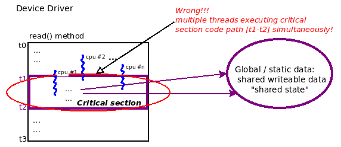

Hình 6.1 – Sơ đồ khái niệm thể hiện code path của critical section bị vi phạm khi có \>1 thread chạy đồng thời bên trong

Như sơ đồ trên, trong device driver, ở method (chẳng hạn) read, bạn cho chạy code để làm nhiệm vụ (đọc dữ liệu từ phần cứng). Hãy xem sơ đồ sâu hơn theo các truy cập dữ liệu tại những thời điểm khác nhau:

- Từ `t0` đến `t1`: Không truy cập dữ liệu hoặc chỉ truy cập local variable. Điều này concurrent-safe, không cần bảo vệ và có thể chạy song song (vì mỗi thread có private stack riêng).

- Từ `t1` đến `t2`: Truy cập global/static shared writeable data. Điều này không concurrent-safe; đây là critical section nên phải bảo vệ khỏi concurrent access. Chỉ nên chứa code chạy exclusively (một mình, đúng một thread mỗi lần, serialized) và có lẽ atomically.

- Từ `t2` đến `t3`: Không truy cập dữ liệu hoặc chỉ truy cập local variable. Điều này concurrent-safe, không cần bảo vệ và có thể chạy song song (vì mỗi thread có private stack riêng).

Trong sách này, chúng tôi giả định bạn đã biết nhu cầu synchronize critical section; không thảo luận thêm riêng chủ đề đó. Ai quan tâm có thể tham khảo sách trước của tôi, Hands-On System Programming with Linux (Packt, tháng 10 năm 2018), trình bày chi tiết những điểm này (đặc biệt Chương 15, Multithreading with Pthreads Part II – Synchronization).

Biết vậy, giờ có thể phát biểu lại khái niệm critical section, đồng thời nói khi nào tình huống phát sinh (thể hiện trong ngoặc vuông và chữ nghiêng trong các bullet). Critical section là code phải chạy như sau:

- (Luôn luôn) Exclusively: Một mình (serialized)

- (Khi trong atomic context) Atomically: Không thể chia cắt, đến hoàn tất, không bị interrupt

Trong mục tiếp theo, chúng ta xem tình huống kinh điển — tăng một global integer.

### Trường hợp kinh điển – global i ++

Hãy nghĩ ví dụ kinh điển: số nguyên global `i` được tăng trong concurrent code path, nơi nhiều thread thực thi có thể chạy đồng thời. Hiểu đơn giản về hardware và software có thể khiến bạn tin thao tác này hiển nhiên atomic. Tuy nhiên, thực tế hardware và software hiện đại (compiler và OS) tinh vi hơn nhiều bạn tưởng, gây đủ loại tối ưu hướng hiệu năng vô hình (với app developer).

Ở đây không cố đi quá chi tiết, nhưng thực tế bộ xử lý hiện đại cực kỳ phức tạp: trong nhiều công nghệ nhằm tăng hiệu năng, có superscalar và super-pipelined execution để lần lượt thực thi nhiều instruction độc lập và nhiều phần của các instruction khác nhau song song, thực hiện instruction reordering và/hoặc memory reordering tức thời, cache memory trong on-CPU cache phân cấp phức tạp, false sharing, v.v.! Chúng ta đi sâu một số chi tiết trong `Chapter 7`, Kernel Synchronization – Phần 2, các mục Ảnh hưởng của cache – false sharing và Memory barrier.

Bài What every systems programmer should know about concurrency của Matt Kline, tháng 4 năm 2020, (`https://assets.bitbashing.io/papers/concurrency-primer.pdf`) rất xuất sắc và nhất định nên đọc về chủ đề; hãy đọc!

Tất cả tạo tình huống phức tạp hơn vẻ ngoài ban đầu. Hãy tiếp tục với `i ++` kinh điển:

```
static int i = 5;
[ ... ]
foo()
{
    [ ... ]
    i ++;     // is this safe? yes, if truly atomic... but is it truly
atomic??
}
```

Phép tăng này tự nó an toàn không? Câu trả lời ngắn là không, bạn phải bảo vệ. Vì sao? Đây là critical section — đang truy cập shared writeable data cho read và/hoặc write operation. Câu trả lời dài hơn là phụ thuộc phép tăng có thực sự atomic (không thể chia cắt) không; nếu có, `i ++` không nguy hiểm khi có parallelism — nếu không, có nguy hiểm! Vậy biết `i ++` thực sự atomic hay không thế nào? Hai thứ quyết định:

- Instruction Set Architecture (ISA) của bộ xử lý, xác định (trong nhiều thứ liên quan bộ xử lý ở mức thấp) các machine instruction thực thi lúc runtime.

- Compiler.

Nếu ISA có khả năng dùng một machine instruction để tăng integer, và compiler đủ thông minh để dùng, thì thực sự atomic — an toàn và không cần locking. Nếu không, không an toàn và cần locking!

Hãy thử: mở trình duyệt đến website compiler explorer tuyệt vời này: `https://godbolt.org/`. Chọn C làm ngôn ngữ lập trình rồi trong khung trái khai báo global integer `i` và tăng trong một hàm. Compile ở khung phải với compiler và compiler option thích hợp. Bạn sẽ thấy machine code thực tế sinh ra cho câu lệnh C bậc cao `i ++;`. Nếu thực sự chỉ một machine instruction, sẽ an toàn; nếu không, cần locking. Nhìn chung, bạn sẽ thấy không thực sự biết chắc: thực chất không thể giả định — phải mặc định không an toàn và bảo vệ! Có thể thấy trong ảnh sau:

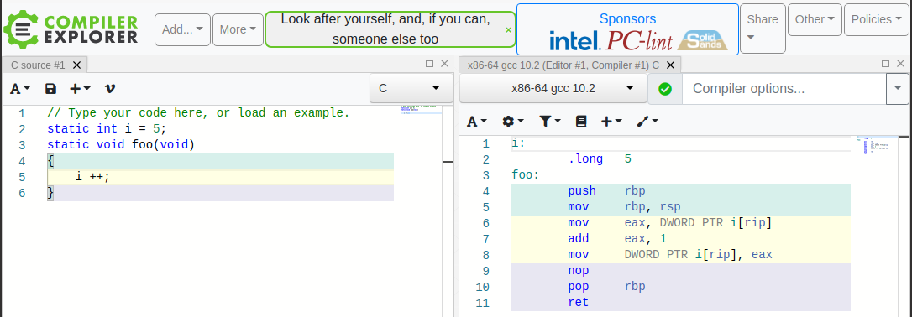

Hình 6.2 – Ngay cả với phiên bản gcc stable mới nhất nhưng không tối ưu, gcc x86\_64 sinh nhiều instruction cho i ++

Ảnh trên cho thấy rõ: vùng nền vàng trong khung trái và phải lần lượt là C source và assembly tương ứng do compiler sinh (dựa trên ISA x86\_64 và mức tối ưu compiler). Mặc định, không tối ưu, `i ++` thành ba machine instruction. Đúng như dự kiến: tương ứng fetch (memory đến register), increment và store (register đến memory)! Điều này không atomic; hoàn toàn có thể sau một machine instruction thực thi, control unit can thiệp và chuyển instruction stream sang điểm khác. Thậm chí có thể dẫn đến process hay thread khác được context switch vào!

Tin tốt là chỉ cần thêm `-O2` trong cửa sổ `Compiler options...`, `i` `++` thành một machine instruction — thực sự atomic! Tuy nhiên, không dự đoán được trước; một ngày code có thể chạy trên hệ thống ARM (RISC) khá thấp cấp, tăng khả năng cần nhiều machine instruction cho `i ++`. (Đừng lo — chúng ta trình bày công nghệ locking tối ưu riêng cho integer trong mục Dùng atomic integer operator).

Ngôn ngữ hiện đại cung cấp native atomic operator; với C/C++, khá gần đây (từ 2011); chuẩn ISO C++11 và ISO C11 cung cấp atomic variable tích hợp sẵn. Tìm nhanh trên Google sẽ thấy. Glibc hiện đại cũng dùng chúng. Ví dụ, nếu làm việc với signaling trong user space, bạn biết dùng kiểu dữ liệu `volatile sig_atomic_t` để truy cập và/hoặc cập nhật atomic integer an toàn trong signal handler. Còn kernel? Chương tiếp theo, bạn học giải pháp Linux kernel cho vấn đề chính này. Chúng ta trình bày trong các mục Dùng atomic integer operator và Dùng atomic bit operator.

Linux kernel tất nhiên là concurrent environment: nhiều thread thực thi chạy song song trên nhiều CPU core. Không chỉ vậy, ngay trên uni-processor system (UP/một CPU), sự hiện diện của hardware interrupt, trap, fault, exception và software signal có thể gây vấn đề data integrity. Tất nhiên bảo vệ khỏi concurrency tại các điểm cần thiết trong code path nói dễ hơn làm; xác định và bảo vệ critical section bằng công nghệ như locking — cùng synchronization primitive và công nghệ khác — là tuyệt đối thiết yếu, vì vậy là nội dung cốt lõi chương này và chương sau.

### Khái niệm – lock

Chúng ta cần synchronization vì không can thiệp, thread có thể thực thi đồng thời critical section đang làm việc trên shared writeable data (shared state). Để ngăn concurrency, cần loại bỏ parallelism và serialize code trong critical section — nơi shared data được xử lý (để đọc và/hoặc ghi).

Để buộc code path serialized, kỹ thuật phổ biến là dùng lock. Về cơ bản, lock bảo đảm đúng một thread thực thi có thể “lấy” hay sở hữu lock tại bất kỳ thời điểm nào. Vì vậy, dùng lock bảo vệ critical section trong code cho điều mong muốn — chạy code critical section exclusively (và có lẽ atomically; sẽ nói thêm):

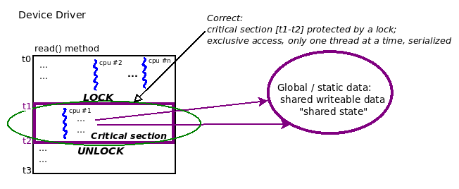

Hình 6.3 – Sơ đồ khái niệm thể hiện code path critical section được tuân thủ, bảo đảm exclusivity bằng lock

Sơ đồ trên cho thấy một cách sửa tình huống đã nói: dùng lock bảo vệ critical section! Lock (và unlock) hoạt động về khái niệm thế nào? Tiền đề cơ bản là mỗi khi có contention — tức nhiều thread cạnh tranh (giả sử `n` thread) cố acquire lock (thao tác `LOCK`) — đúng một thread thành công. Gọi là “winner” hay “owner” của lock. Nó thấy lock API là non-blocking call nên tiếp tục chạy vui vẻ — và exclusively — khi thực thi code critical section (thực chất là code giữa lock và unlock!). Điều gì xảy ra với `n-1` thread “loser”? Chúng (có lẽ) thấy lock API là blocking call; trên thực tế chúng chờ. Chờ gì? Tất nhiên unlock operation do owner của lock (thread “winner”) thực hiện! Khi unlock, `n-1` thread còn lại cạnh tranh vị trí “winner” tiếp theo; tất nhiên đúng một thread “thắng” và đi tiếp; trong lúc đó `n-2` loser chờ unlock của winner (mới); lặp lại cho đến khi cả `n` thread (cuối cùng và tuần tự) acquire lock.

Locking tất nhiên hoạt động, nhưng — điều này khá trực quan — gây overhead (khá lớn!), vì triệt tiêu parallelism và serialize execution flow! Để hình dung, nghĩ đến cái phễu, cuống hẹp là critical section, chỉ một thread vừa vào mỗi lần. Mọi thread khác bị nghẽn; locking tạo bottleneck:

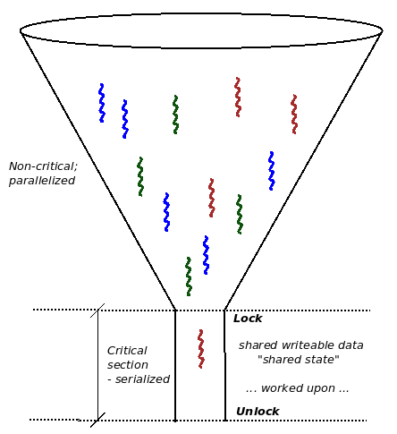

Hình 6.4 – Lock tạo bottleneck, tương tự phễu vật lý

Ví dụ vật lý khác thường được nhắc là đường cao tốc nhiều làn nhập thành một làn rất đông và nghẽn (có thể trạm thu phí thiết kế kém). Một lần nữa, parallelism — xe (thread) chạy song song với xe khác ở làn (CPU) khác — bị mất, cần hành vi serialized — xe buộc xếp hàng nối đuôi.

Vì vậy, chúng ta, kiến trúc sư software, phải cố thiết kế sản phẩm/project để cần locking tối thiểu. Mặc dù loại bỏ hoàn toàn global variable không khả thi trong phần lớn project thực tế, cần tối ưu và giảm thiểu sử dụng. Chúng ta trình bày thêm, gồm vài kỹ thuật lockless programming rất thú vị, ở phần sau.

Một điểm then chốt khác là lập trình viên mới có thể ngây thơ giả định đọc shared writeable data object hoàn toàn an toàn nên không cần bảo vệ tường minh (ngoại trừ primitive data type được align nằm trong kích thước bus của bộ xử lý); điều này không đúng. Có thể dẫn đến dirty read hoặc torn read, tình huống có thể đọc stale data khi writer thread khác đồng thời ghi trong lúc bạn — sai vì không locking — đọc chính dữ liệu đó.

Về atomicity, như vừa học, trên bộ vi xử lý hiện đại điển hình, chỉ những thứ được bảo đảm atomic là một machine language instruction hoặc đọc/ghi primitive data type được align nằm trong độ rộng processor bus. Vậy đánh dấu vài dòng code “C” thực sự atomic bằng cách nào? Trong user space, thậm chí không khả thi (có thể gần đạt nhưng không bảo đảm atomicity).

Làm sao “gần đạt” atomicity trong user space app? Bạn luôn có thể tạo user thread dùng policy `SCHED_FIFO` và real-time priority `99`. Như vậy, khi muốn chạy, gần như không gì ngoài hardware interrupt/exception có thể preempt nó. (Triển khai audio subsystem cũ phụ thuộc nhiều vào điều này.)

Trong kernel space, có thể viết code thực sự atomic. Chính xác thế nào? Câu trả lời ngắn là dùng spinlock! Chúng ta sớm học chi tiết hơn.

#### Tóm tắt các điểm chính

Hãy tóm tắt vài điểm chính về critical section. Rất quan trọng phải xem kỹ, giữ để tham khảo và bảo đảm dùng trong thực tế:

- Critical section là code path có thể thực thi song song và làm việc trên (đọc và/hoặc ghi) shared writeable data (còn gọi “shared state”).

- Vì làm việc trên shared writable data, critical section cần được bảo vệ khỏi:

- Parallelism (tức phải chạy một mình/serialized/theo cách mutually exclusive)

- Khi chạy trong atomic (interrupt) non-blocking context — atomically: không thể chia cắt, đến hoàn tất, không bị interrupt. Khi đã bảo vệ, có thể truy cập shared state an toàn cho đến khi “unlock”.

- Mọi critical section trong code base phải được xác định và bảo vệ:

- Xác định critical section là việc then chốt! Review code cẩn thận và bảo đảm không bỏ sót.

- Có thể bảo vệ bằng nhiều công nghệ; kỹ thuật rất phổ biến là locking (cũng có lock-free programming, sẽ xem trong chương tiếp theo).

- Lỗi phổ biến là chỉ bảo vệ critical section ghi global writeable data; cũng phải bảo vệ critical section đọc global writeable data, nếu không có nguy cơ torn read hay dirty read! Để làm rõ, hình dung dữ liệu unsigned 64-bit được đọc và ghi trên hệ thống 32-bit; thao tác không thể atomic (cần hai load/store operation). Vậy nếu khi một thread đọc giá trị, thread khác đồng thời ghi!? Writer thread lấy một “lock” nào đó nhưng vì nghĩ đọc an toàn, reader thread không lấy lock; do trùng hợp timing không may, có thể thực hiện partial/torn/dirty read! Chúng ta học khắc phục bằng các kỹ thuật trong phần sau và chương tiếp theo.

- Lỗi chết người khác là không dùng cùng lock để bảo vệ một dữ liệu nhất định.

- Không bảo vệ critical section dẫn đến data race, tình huống kết quả — giá trị thực tế dữ liệu được đọc/ghi — là “racy”, nghĩa là thay đổi tùy hoàn cảnh và timing lúc runtime. Đây là bug. (Một bug mà khi ra “thực địa” cực kỳ khó thấy, tái hiện, xác định nguyên nhân gốc và sửa. Chúng ta trình bày những thứ rất mạnh giúp xử lý trong chương tiếp theo, mục Lock debugging trong kernel; hãy đọc!)

- Ngoại lệ: Bạn an toàn (ngầm, không cần bảo vệ tường minh) trong những tình huống sau:

- Khi làm việc trên local variable. Chúng được cấp phát trên private stack của thread (hoặc trong interrupt context, trên local IRQ stack), do đó theo định nghĩa là an toàn.

- Khi làm việc trên shared writeable data trong code không thể chạy trong context khác; tức bản chất đã serialized. Trong context của chúng ta, init và cleanup method của LKM đáp ứng (chạy đúng một lần, tuần tự, chỉ trên `insmod` và `rmmod`).

- Khi làm việc trên shared data thực sự constant và read-only (tuy nhiên đừng để keyword `const` của C đánh lừa!).

- Locking vốn phức tạp; phải suy nghĩ, thiết kế và triển khai cẩn thận để tránh deadlock. Chúng ta trình bày chi tiết hơn trong mục Hướng dẫn locking và deadlock.

## Các vấn đề concurrency trong Linux kernel

Nhận ra critical section trong kernel code là tối quan trọng; làm sao bảo vệ nếu không thấy? Sau đây là hướng dẫn giúp bạn, nhà phát triển kernel/driver mới, nhận ra nơi vấn đề concurrency — và do đó critical section — có thể phát sinh:

- Sự hiện diện của Symmetric Multi-Processor (SMP) system (`CONFIG_SMP`)

- Sự hiện diện của preemptible kernel

- Blocking I/O

- Hardware interrupt (trên SMP hoặc UP system)

Đây là những điểm quan trọng cần hiểu, chúng ta thảo luận từng điểm trong mục này.

### Multicore SMP system và data race

Điểm đầu khá hiển nhiên; hãy xem pseudocode trong ảnh sau:

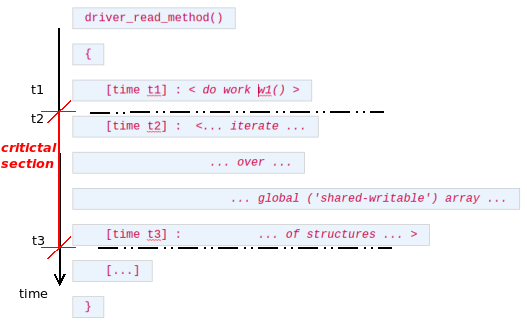

Hình 6.5 – Pseudocode – critical section trong read method của driver (giả tưởng); sai vì không locking

Tình huống tương tự Hình 6.1 và 6.3; chỉ khác ở đây thể hiện concurrency bằng pseudocode. Rõ ràng từ `t2` đến `t3`, driver làm việc trên global shared writeable data, nên là critical section.

Hình dung hệ thống có bốn CPU core (SMP system); hai user space process, P1 (chạy trên CPU 0 chẳng hạn) và P2 (chạy trên CPU 2 chẳng hạn), có thể đồng thời mở device file và cùng gọi system call `read(2)`. Cả hai process đồng thời thực thi read “method” của driver, do đó cùng làm việc trên shared writeable data! Phần này (code giữa `t2` và `t3`) là critical section, và vì vi phạm quy tắc exclusivity cơ bản — chỉ một thread thực thi critical section tại mỗi thời điểm — hoàn toàn có thể làm hỏng dữ liệu, ứng dụng, hoặc tệ hơn. Nói cách khác, giờ là data race; tùy trùng hợp timing tinh vi, có thể sinh lỗi (bug) hoặc không. Chính sự bất định — trùng hợp timing tinh vi — khiến tìm và sửa cực kỳ khó (có thể lọt qua kiểm thử).

Châm ngôn này tiếc thay quá đúng: Kiểm thử có thể phát hiện sự hiện diện của lỗi, không phải sự vắng mặt. Hơn nữa, còn tệ hơn nếu kiểm thử không bắt được race (và bug), để chúng tự do ngoài thực địa.

Bạn có thể nghĩ vì sản phẩm là embedded system nhỏ chạy một CPU core (UP), thảo luận kiểm soát concurrency (thường qua locking) không áp dụng. Chúng tôi không đồng ý: gần như mọi sản phẩm hiện đại, nếu chưa, sẽ chuyển sang multicore (có thể ở thế hệ tiếp theo). Quan trọng hơn, ngay UP system cũng có vấn đề concurrency, như sẽ tìm hiểu.

### Preemptible kernel, blocking I/O và data race

Hình dung chạy kernel module hay driver trên Linux kernel được configure là preemptible (tức bật `CONFIG_PREEMPT`; đã trình bày trong tài liệu đồng hành Linux Kernel Programming, Chương 10, CPU Scheduler – Phần 1). Process P1 đang chạy read method code của driver trong process context, làm việc trên global array. Khi trong critical section (giữa `t2` và `t3`), nếu kernel preempt P1 và context switch sang P2 đang chờ thực thi chính code path này thì sao? Nguy hiểm, một lần nữa là data race. Có thể xảy ra ngay trên UP system!

Tình huống khác phần nào tương tự (cũng có thể trên single core (UP) hay multicore system): P1 chạy qua critical section của driver method (giữa `t2` và `t3;` xem lại Hình 6.5). Lần này, nếu trong critical section gặp blocking call thì sao?

Blocking call là hàm khiến process context gọi nó được đưa vào sleep để chờ event; khi event xảy ra, kernel “wake up” task, tiếp tục thực thi nơi đã dừng. Còn gọi blocking on I/O, rất phổ biến; nhiều API (gồm một số user space library call và system call, cũng như kernel API, bản chất là blocking). Trong trường hợp đó P1 thực chất context switch khỏi CPU và sleep, nghĩa là code `schedule()` chạy, enqueue nó vào wait queue. Trong lúc đó, trước khi P1 được switch trở lại, nếu P2 được schedule chạy thì sao? Nếu process đó cũng chạy chính code path này? Hãy nghĩ — khi P1 trở lại, shared data có thể đã thay đổi “ngay bên dưới”, gây đủ loại lỗi; lại là data race, bug!

### Hardware interrupt và data race

Cuối cùng, hình dung: P1 lại vô tư chạy read method code của driver; đi vào critical section (giữa `t2` và `t3`; xem lại Hình 6.5). Tiến được một chút nhưng rồi hardware interrupt kích hoạt (trên cùng CPU)! Trên Linux OS, hardware (peripheral) interrupt có priority cao nhất; mặc định preempt mọi code (kể cả kernel code). Vì vậy process (hay thread) P1 ít nhất tạm bị gác lại, mất bộ xử lý; interrupt handling code preempt nó và chạy.

Bạn có thể thắc mắc, thì sao? Đúng vậy, hoàn toàn phổ biến! Hardware interrupt phát rất thường xuyên trên hệ thống hiện đại, thực chất (và đúng nghĩa) interrupt đủ loại task context (chạy nhanh `vmstat 3` trên shell; cột `in` dưới `system` thể hiện số hardware interrupt phát trên hệ thống trong 1 giây vừa qua!). Câu hỏi chính: interrupt handling code (hardirq top half hoặc cái gọi tasklet hay softirq bottom half, tùy thứ xảy ra) có chia sẻ và làm việc trên cùng shared writable data của process context vừa bị interrupt không?

Nếu đúng, Houston, có vấn đề — data race! Nếu không, code bị interrupt không phải critical section đối với interrupt code path, và ổn. Thực tế phần lớn device driver có xử lý interrupt; vì vậy trách nhiệm của người viết driver (bạn!) là bảo đảm không global/static data — thực chất không critical section — được chia sẻ giữa process context và interrupt code path. Nếu có (điều thực sự xảy ra), phải bằng cách nào đó bảo vệ dữ liệu khỏi data race và corruption có thể xảy ra.

Các tình huống có thể khiến bạn cảm thấy bảo vệ khỏi concurrency là nhiệm vụ quá khó; chính xác làm sao an toàn dữ liệu khi tồn tại critical section cùng nhiều vấn đề concurrency có thể có? Thú vị là API thực tế không khó học; nhấn mạnh một lần nữa, nhận ra critical section mới là điều chính.

Một lần nữa, kiến thức cơ bản về cách lock hoạt động (về khái niệm), hướng dẫn locking (rất quan trọng; sắp nhắc lại), các loại deadlock và cách ngăn, đều có trong sách trước của tôi, Hands-On System Programming with Linux (Packt, tháng 10 năm 2018). Sách trình bày chi tiết tại Chương 15, Multithreading with Pthreads Part II – Synchronization.

Không chần chừ, hãy đi vào công nghệ synchronization chính dùng bảo vệ critical section — locking.

### Hướng dẫn locking và deadlock

Locking bản chất phức tạp; có xu hướng gây tình huống interlocking phức tạp. Không hiểu đủ có thể dẫn đến vấn đề hiệu năng và bug — deadlock, circular dependency, interrupt-unsafe locking, v.v. Hướng dẫn sau là then chốt để bảo đảm code đúng khi dùng locking:

- Locking granularity: “Khoảng cách” giữa lock và unlock (thực chất chiều dài critical section) không nên coarse (critical section quá dài), mà phải “đủ fine”; nghĩa là gì? Các điểm dưới giải thích:

- Cần cẩn thận. Khi làm project lớn, quá ít lock là vấn đề, quá nhiều cũng vậy! Quá ít lock có thể gây vấn đề hiệu năng (vì cùng lock bị dùng liên tục nên contention cao).

- Nhiều lock thực sự tốt cho hiệu năng nhưng không tốt cho kiểm soát độ phức tạp. Cũng dẫn đến điểm chính khác: với nhiều lock trong code base, phải rõ lock nào bảo vệ shared data object nào. Hoàn toàn vô nghĩa nếu dùng `lockA` bảo vệ `mystructX`, nhưng ở code path xa (có thể interrupt handler), quên và cố dùng lock khác, `lockB`, bảo vệ khi làm việc trên cùng cấu trúc! Hiện nghe hiển nhiên, nhưng (như người có kinh nghiệm biết), dưới đủ áp lực, ngay điều hiển nhiên không phải luôn hiển nhiên!

- Cố cân bằng. Trong project lớn, thường dùng một lock bảo vệ một global (shared) data structure. (Đặt tên biến lock tốt tự nó cũng có thể là vấn đề lớn! Vì vậy đặt lock bảo vệ một cấu trúc dữ liệu bên trong làm member.)

- Lock ordering then chốt; phải lấy lock cùng thứ tự xuyên suốt, ghi tài liệu thứ tự và mọi nhà phát triển trong project tuân thủ (annotate lock cũng hữu ích; nói thêm trong mục lockdep chương tiếp). Lock ordering sai thường dẫn đến deadlock.

- Tránh recursive locking nhiều nhất có thể.

- Cẩn thận ngăn starvation; xác minh lock khi đã lấy thực sự được release “đủ nhanh”.

- Đơn giản là then chốt: Cố tránh phức tạp hay over-design, đặc biệt tình huống phức tạp liên quan lock.

Về locking, xuất hiện vấn đề (nguy hiểm) deadlock. Deadlock là không thể tiến triển; nói cách khác, ứng dụng và/hoặc kernel component có vẻ treo vô hạn. Không định đi sâu chi tiết rắc rối, nhưng tôi nhắc nhanh vài tình huống deadlock phổ biến có thể xảy ra:

- Trường hợp đơn giản, một lock, process context:

- Cố acquire cùng lock hai lần; gây self-deadlock.

- Trường hợp đơn giản, nhiều lock (hai trở lên), process context — ví dụ:

- Trên CPU `0`, thread A acquire lock A rồi muốn lock B.

- Đồng thời, trên CPU `1`, thread B acquire lock B rồi muốn lock A.

- Kết quả deadlock, thường gọi AB-BA deadlock.

- Có thể mở rộng; ví dụ AB-BC-CA circular dependency (A-B-C lock chain) gây deadlock.

- Trường hợp phức tạp, một lock, process context và interrupt context:

- Lock A được lấy trong interrupt context.

- Nếu interrupt xảy ra (trên core khác) và handler cố lấy lock A thì sao? Kết quả deadlock! Vì vậy lock được acquire trong interrupt context luôn phải dùng với interrupt bị disable. (Làm sao? Xem chi tiết hơn khi trình bày spinlock.)

- Trường hợp phức tạp hơn, nhiều lock, process context và interrupt context (hardirq và softirq)

Trong trường hợp đơn giản, luôn theo hướng dẫn lock ordering là đủ: luôn lấy và release lock theo thứ tự được ghi tài liệu rõ (sẽ cung cấp ví dụ trong kernel code ở mục Dùng mutex lock). Tuy nhiên có thể rất phức tạp; tình huống deadlock phức tạp có thể đánh lừa cả nhà phát triển kinh nghiệm. May mắn là lockdep — runtime lock dependency validator của Linux kernel — có thể bắt mọi trường hợp deadlock! (Đừng lo — sẽ đến: trình bày lockdep chi tiết chương tiếp). Khi trình bày spinlock (mục Dùng spinlock), sẽ gặp các tình huống process và/hoặc interrupt context tương tự; ở đó làm rõ loại spinlock nên dùng.

Về deadlock, Steve Rostedt có bài trình bày khá chi tiết về lockdep tại Linux Plumber's Conference (năm 2011); slide hữu ích, khám phá tình huống deadlock đơn giản lẫn phức tạp và cách lockdep phát hiện (`https://blog.linuxplumbersconf.org/2011/ocw/sessions/153`).

Thực tế không chỉ deadlock mà cả livelock có thể nguy hiểm tương đương! Livelock cơ bản giống deadlock; chỉ khác task tham gia ở trạng thái running chứ không waiting. Ví dụ interrupt “storm” có thể gây livelock; network driver hiện đại giảm tác động bằng tắt interrupt (khi chịu interrupt load) và dùng polling technique gọi New API; Switching Interrupts (NAPI) (bật interrupt lại khi thích hợp; thực ra phức tạp hơn nhưng ở đây chỉ nói vậy).

Với những ai đã sống tách biệt, bạn sẽ biết Linux kernel có hai loại lock chính: mutex lock và spinlock. Thực ra còn một số loại, gồm công nghệ synchronization khác (và “lockless” programming), tất cả sẽ trình bày trong chương này và chương sau.

## Mutex hay spinlock? Dùng loại nào khi nào

Ngữ nghĩa chính xác để học mutex lock và spinlock khá đơn giản (nhờ abstraction thích hợp trong tập kernel API, càng dễ cho người phát triển driver hay viết module thông thường). Câu hỏi chính là khái niệm: thực sự hai lock khác nhau thế nào? Cụ thể hơn, hoàn cảnh nào dùng loại nào? Bạn học câu trả lời trong mục này. Dùng pseudocode read method driver trước (Hình 6.5) làm ví dụ nền, giả sử ba thread — tA, tB, tC — chạy song song (trên SMP system) qua code. Chúng ta giải quyết concurrency, tránh data race bằng cách lấy/acquire lock trước critical section (t2), release lock (unlock) ngay sau cuối code path critical section (t3). Xem lại pseudocode, lần này locking để đúng:

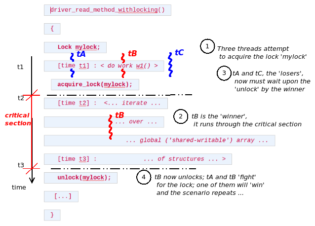

Hình 6.6 – Pseudocode – critical section trong read method driver (giả tưởng); đúng, có locking

Khi ba thread cố acquire lock đồng thời, hệ thống bảo đảm chỉ đúng một thread lấy được. Giả sử tB (thread B) lấy lock: giờ là “winner” hay “owner” thread. Nghĩa là tA và tC là “loser”; làm gì? Chờ unlock! Ngay khi “winner” (tB) hoàn tất critical section và unlock, cuộc chiến giữa loser trước tiếp diễn; một thread thành winner tiếp và lặp lại. Khác biệt chính giữa mutex và spinlock dựa vào cách loser chờ unlock. Với mutex lock, loser thread được đưa vào sleep; tức chờ bằng sleep. Ngay khi winner unlock, kernel wake up loser (tất cả), chúng chạy, lại cạnh tranh lock. (Thực tế mutex và semaphore đôi khi gọi sleeplock.)

Với spinlock, không có chuyện sleep; loser chờ bằng spinning trên lock đến khi unlock. Về khái niệm như sau:

```
while (locked) ;
```

Lưu ý chỉ là khái niệm. Nghĩ một chút — thực chất là polling. Tuy nhiên, là lập trình viên tốt, bạn hiểu polling thường được xem là ý tồi. Vậy vì sao spinlock hoạt động vậy? Thực ra không; chỉ trình bày như vậy để hiểu khái niệm. Như sắp hiểu, spinlock chỉ thực sự có nghĩa trên multicore (SMP) system. Trên đó, khi winner thread chạy code critical section, loser chờ bằng spinning trên CPU core khác! Thực tế ở mức triển khai, code spinlock hiện đại tối ưu cao (và phụ thuộc kiến trúc), không hoạt động bằng “spinning” đơn giản (ví dụ nhiều triển khai spinlock cho ARM dùng machine language instruction wait for event (WFE), cho CPU chờ tối ưu trong low power state; xem mục Đọc thêm để có tài nguyên về triển khai nội bộ spinlock).

### Xác định lock nên dùng – lý thuyết

Cách triển khai spinlock không thực sự là mối quan tâm ở đây; điều đáng quan tâm là overhead thấp hơn mutex lock. Vì sao? Đơn giản: để mutex lock hoạt động, loser thread phải sleep. Bên trong gọi hàm `schedule()`, nghĩa là loser thấy mutex lock API là blocking call! Gọi scheduler cuối cùng dẫn đến context switch khỏi bộ xử lý. Ngược lại, khi owner thread unlock, phải wake up loser thread; lại context switch trở vào bộ xử lý. Vì vậy “chi phí” tối thiểu của mutex lock/unlock là thời gian hai context switch trên máy đó. (Xem ô thông tin mục tiếp.) Xem lại ảnh trên, có thể xác định vài thứ, gồm thời gian trong critical section (code path “locked”), tức `t_locked = t3 - t2`. Giả sử `t_ctxsw` là thời gian context switch. Như đã học, chi phí tối thiểu của mutex lock/unlock là `2 * t_ctxsw`. Giờ giả sử biểu thức sau đúng:

```
t_locked < 2 * t_ctxsw
```

Nói cách khác, nếu thời gian trong critical section nhỏ hơn thời gian hai context switch? Dùng mutex lock đơn giản là sai vì overhead quá nhiều; dành nhiều thời gian cho metawork hơn công việc thực — hiện tượng gọi thrashing. Chính use case này — critical section rất ngắn — thường có trên OS hiện đại như Linux. Kết luận, với non-blocking critical section ngắn, dùng spinlock tốt hơn (rất nhiều) mutex lock.

### Xác định lock nên dùng – thực tế

Làm theo “quy tắc” `t_locked < 2 * t_ctxsw` có thể rất tốt về lý thuyết, nhưng khoan: thực sự phải đo chính xác context switch time và thời gian critical section ở mọi nơi tồn tại sao? Không, tất nhiên không — quá phi thực tế và câu nệ.

Thực tế, nghĩ như sau: mutex lock làm loser thread sleep chờ unlock; spinlock thì không (loser “spin”). Nhớ một quy tắc vàng của Linux kernel: kernel không thể sleep (gọi `schedule()`) trong bất kỳ atomic context nào. Vì vậy không bao giờ dùng mutex lock trong interrupt context, hay context nào không an toàn để sleep; dùng spinlock thì ổn. (Nhớ blocking API đưa calling context vào sleep bằng gọi `schedule()`.) Tóm tắt:

- Critical section chạy trong atomic (interrupt) context, hoặc process context không thể sleep? Dùng spinlock.

- Critical section chạy trong process context và cần sleep trong critical section? Dùng mutex lock.

Tất nhiên spinlock có overhead thấp hơn mutex; vì vậy có thể dùng spinlock ngay trong process context (như read method driver giả tưởng), miễn critical section không block (sleep).

\[1\] Thời gian context switch khác nhau; phần lớn phụ thuộc hardware và chất lượng OS. Đo gần đây (tháng 9 năm 2018) cho thấy context switching khoảng 1,2 đến 1,5 us (microsecond) trên CPU được pin, khoảng 2,2 us không pin (`https://eli.thegreenplace.net/2018/measuring-context-switching-and-memory-overheads-for-linux-threads/`).

Cả hardware lẫn Linux OS cải thiện rất nhiều, do đó thời gian context switching trung bình cũng vậy. Bài Linux Journal cũ (tháng 12 năm 1998) xác định trên hệ thống x86, context switch trung bình 19 us (microsecond), trường hợp xấu nhất 30 us.

Câu hỏi là làm sao biết code đang chạy trong process hay interrupt context? Dễ: macro `PRINT_CTX()` (trong header `convenient.h`) cho thấy:

```
if (in_task())
    /* we're in process context (usually safe to sleep / block) */
else
    /* we're in an atomic or interrupt context (cannot sleep / block) */
```

Giờ đã hiểu dùng mutex hay spinlock khi nào, hãy vào sử dụng thực tế. Bắt đầu với mutex lock!

## Dùng mutex lock

Mutex còn gọi sleepable hay blocking mutual exclusion lock. Như đã học, dùng trong process context nếu critical section có thể sleep (block). Không được dùng trong atomic/interrupt context nào (top half, bottom half như tasklet hay softirq, v.v.), kernel timer, hoặc ngay process context không được blocking.

### Khởi tạo mutex lock

“Object” mutex lock được biểu diễn trong kernel bằng cấu trúc dữ liệu `struct mutex`. Xét code sau:

```
#include <linux/mutex.h>
struct mutex mymtx;
```

Để dùng mutex lock, phải khởi tạo tường minh về unlocked state. Có thể khởi tạo tĩnh (khai báo và khởi tạo object) bằng macro `DEFINE_MUTEX()`, hoặc động qua hàm `mutex_init()` (thực chất macro wrapper trên hàm `__mutex_init()`).

Ví dụ, khai báo và khởi tạo mutex object tên `mymtx` bằng `DEFINE_MUTEX(mymtx);`.

Cũng có thể làm động. Vì sao? Thường mutex lock là member của cấu trúc dữ liệu (global) nó bảo vệ (khéo!). Ví dụ, giả sử có global context structure sau trong driver code (lưu ý code giả tưởng):

```
struct mydrv_priv {
    <member 1>
    <member 2>
    [...]
    struct mutex mymtx; /* protects access to mydrv_priv */
    [...]
};
```

Sau đó, trong method `init` của driver (hay LKM), làm như sau:

```
static int init_mydrv(struct mydrv_priv *drvctx)
{
    [...]
    mutex_init(drvctx-mymtx);
    [...]
}
```

Giữ biến lock làm member của cấu trúc dữ liệu (parent) nó bảo vệ là pattern phổ biến (và khéo) trong Linux; thêm lợi ích tránh namespace pollution, không mơ hồ mutex nào bảo vệ shared data nào (vấn đề lớn hơn vẻ ban đầu, đặc biệt trong project khổng lồ như Linux kernel!).

Giữ lock bảo vệ global hay shared data structure làm member bên trong cấu trúc đó.

### Dùng mutex lock đúng cách

Thường có comment rất sâu sắc trong kernel source tree. Đây là comment tuyệt vời tóm tắt gọn quy tắc phải theo để dùng mutex lock đúng; hãy đọc kỹ:

```
// include/linux/mutex.h
/*
 * Simple, straightforward mutexes with strict semantics:
 *
 * - only one task can hold the mutex at a time
 * - only the owner can unlock the mutex
 * - multiple unlocks are not permitted
 * - recursive locking is not permitted
 * - a mutex object must be initialized via the API
 * - a mutex object must not be initialized via memset or copying
 * - task may not exit with mutex held
 * - memory areas where held locks reside must not be freed
 * - held mutexes must not be reinitialized
 * - mutexes may not be used in hardware or software interrupt
 * contexts such as tasklets and timers
 *
 * These semantics are fully enforced when DEBUG_MUTEXES is
 * enabled. Furthermore, besides enforcing the above rules, the mutex
 * [ ... ]
```

Là nhà phát triển kernel, phải hiểu:

- Critical section khiến code path serialized, triệt tiêu parallelism. Vì vậy bắt buộc giữ ngắn nhất có thể. Hệ quả là lock dữ liệu, không lock code.

- Cố acquire lại mutex lock đã acquire (locked) — thực chất recursive locking — không được hỗ trợ, dẫn đến self-deadlock.

- Lock ordering: Quy tắc rất quan trọng để ngăn deadlock nguy hiểm. Khi nhiều thread và nhiều lock, phải ghi tài liệu thứ tự lấy lock và mọi nhà phát triển trong project tuân thủ nghiêm. Bản thân thứ tự cụ thể không bất di bất dịch, nhưng khi quyết định rồi phải tuân thủ. Khi duyệt kernel source tree, sẽ gặp nhiều nơi nhà phát triển bảo đảm điều này, (thường) viết comment cho người khác xem và theo. Đây là comment mẫu từ slab allocator code (`mm/slub.c`):

```
/*
 * Lock order:
 * 1. slab_mutex (Global Mutex)
 * 2. node-list_lock
 * 3. slab_lock(page) (Only on some arches and for debugging)
```

Giờ hiểu mutex về khái niệm (và khởi tạo), hãy học lock/unlock API.

### Mutex lock/unlock API và cách dùng

API lock và unlock mutex thực tế như sau. Code sau lần lượt thể hiện cách lock và unlock:

```
void __sched mutex_lock(struct mutex *lock);
void __sched mutex_unlock(struct mutex *lock);
```

(Bỏ qua `__sched` ở đây; chỉ là compiler attribute khiến hàm không xuất hiện trong output `WCHAN`, được hiển thị trong procfs và với vài option switch của `ps(1)` (như `-l`)).

Một lần nữa, comment trong source code `kernel/locking/mutex.c` rất chi tiết, giàu mô tả; khuyến khích bạn xem file kỹ hơn. Chúng ta chỉ trình bày một số code, lấy trực tiếp từ Linux kernel source tree 5.4:

```
// kernel/locking/mutex.c
[ ... ]
/**
 * mutex_lock - acquire the mutex
 * @lock: the mutex to be acquired
 *
 * Lock the mutex exclusively for this task. If the mutex is not
 * available right now, it will sleep until it can get it.
 *
 * The mutex must later on be released by the same task that
 * acquired it. Recursive locking is not allowed. The task
 * may not exit without first unlocking the mutex. Also, kernel
 * memory where the mutex resides must not be freed with
 * the mutex still locked. The mutex must first be initialized
 * (or statically defined) before it can be locked. memset()-ing
 * the mutex to 0 is not allowed.
 *
 * (The CONFIG_DEBUG_MUTEXES .config option turns on debugging
 * checks that will enforce the restrictions and will also do
 * deadlock debugging)
 *
 * This function is similar to (but not equivalent to) down().
 */
void __sched mutex_lock(struct mutex *lock)
{
    might_sleep();

    if (!__mutex_trylock_fast(lock))
        __mutex_lock_slowpath(lock);
}
EXPORT_SYMBOL(mutex_lock);
```

`might_sleep()` là macro có tính năng debug thú vị; bắt code lẽ ra thực thi trong atomic context nhưng không! Nghĩ xem: `might_sleep()`, dòng code đầu trong `mutex_lock()`, ngụ ý code path này không nên được bất cứ thứ gì trong atomic context thực thi vì có thể sleep. Nghĩa là chỉ nên dùng mutex trong process context an toàn để sleep!

Nhắc nhanh và quan trọng: Linux kernel có thể configure rất nhiều debug option; ở đây config option `CONFIG_DEBUG_MUTEXES` giúp bắt bug mutex có thể có, gồm deadlock. Tương tự dưới menu Kernel Hacking, có nhiều kernel config option liên quan debug. Đã thảo luận trong tài liệu đồng hành Linux Kernel Programming - Chương 5, Viết kernel module đầu tiên – LKM Phần 2. Có nhiều kernel config rất hữu ích về lock debugging; trình bày chương tiếp, mục Lock debugging trong kernel.

#### Mutex lock – qua \[un\]interruptible sleep?

Như thường lệ, mutex còn hơn những gì đã thấy. Bạn biết Linux process (hay thread) đi qua các state của state machine. Trên Linux, sleep có hai state riêng — interruptible sleep và uninterruptible sleep. Process (hay thread) ở interruptible sleep nhạy, nghĩa là đáp ứng user space signal, còn task ở uninterruptible sleep không nhạy với user signal.

Trong ứng dụng tương tác người dùng có driver bên dưới, theo quy tắc chung nên đưa process vào interruptible sleep (khi block chờ lock), để end user quyết định abort ứng dụng bằng Ctrl + C (hay cơ chế liên quan signal). Quy tắc thiết kế thường theo trên Unix-like system: cung cấp mechanism, không phải policy. Dù vậy, trên non-interactive code path, thường phải chờ lock vô hạn, với ngữ nghĩa signal được chuyển đến task không nên abort blocking wait. Trên Linux, trường hợp uninterruptible phổ biến nhất.

Vậy: API `mutex_lock()` luôn đưa calling task vào uninterruptible sleep. Nếu không muốn vậy, dùng API `mutex_lock_interruptible()` để đưa task vào interruptible sleep. Có một khác biệt cú pháp: API sau trả integer `0` khi thành công và `-EINTR` (nhớ return convention `0`/`-E`) khi thất bại (do signal interruption).

Nói chung, `mutex_lock()` nhanh hơn `mutex_lock_interruptible()`; dùng khi critical section ngắn (gần như bảo đảm lock được giữ ngắn, đặc điểm rất đáng mong muốn).

Kernel 5.4.0 có lần lượt hơn 18.500 và hơn 800 nơi gọi API `mutex_lock()` và `mutex_lock_interruptible()`; có thể kiểm tra bằng tiện ích `cscope(1)` mạnh mẽ trên kernel source tree.

Về lý thuyết kernel còn có API `mutex_destroy()`. Ngược với `mutex_init()`; đánh dấu mutex không dùng được. Chỉ được gọi khi mutex unlocked, và gọi rồi không thể dùng mutex. Hơi lý thuyết vì trên hệ thống thường chỉ thành hàm rỗng; chỉ trên kernel bật `CONFIG_DEBUG_MUTEXES` mới thành code (đơn giản) thực tế. Vì vậy nên theo pattern này khi làm việc với mutex, như pseudocode sau:

```
DEFINE_MUTEX(...);        // init: initialize the mutex object
/* or */ mutex_init();
[ ... ]
    /* critical section: perform the (mutex) locking, unlocking */
    mutex_lock[_interruptible]();
    << ... critical section ... >>
    mutex_unlock();
    mutex_destroy();      // cleanup: destroy the mutex object
```

Giờ đã học mutex lock API, hãy áp dụng. Mục tiếp xây trên một driver “misc” trước (viết kém — không bảo vệ!) bằng mutex object để lock critical section khi cần.

### Mutex locking – driver ví dụ

Chúng ta tạo ví dụ device driver code đơn giản trong Chương 1 - Viết một misc character device driver đơn giản, tức `ch1/miscdrv_rdwr`. Ở đó viết character device driver đơn giản thuộc class `misc`, dùng user space utility program (`ch12/miscdrv_rdwr/rdwr_drv_secret.c`) để đọc/ghi một bí mật (gọi là vậy) từ/vào memory của device driver.

Tuy nhiên, điều chúng ta rõ ràng (trắng trợn mới đúng!) không làm là bảo vệ shared (global) writeable data! Điều này trả giá đắt ngoài thực tế. Hãy dành thời gian nghĩ: không thể chấp nhận hai (ba hay nhiều) user mode process mở device file của driver rồi đồng thời gọi nhiều I/O read/write. Global shared writable data ở đây (cụ thể hai global integer và driver context data structure) dễ hỏng.

Vậy học và sửa lỗi bằng sao chép driver (giờ gọi `ch12/1_miscdrv_rdwr_mutexlock/1_miscdrv_rdwr_mutexlock.c`), viết lại một số phần. Điểm chính là dùng mutex lock bảo vệ mọi critical section. Thay vì trình bày code ở đây (có trong GitHub repository của sách tại `https://github.com/PacktPublishing/Linux-Kernel-Programming`, hãy `git clone`!), hãy làm điều thú vị: xem “diff” (khác biệt — delta do `diff(1)` tạo) giữa phiên bản cũ không bảo vệ và mới được bảo vệ. Output đã cắt bớt:

```
$ pwd
<.../ch12/1_miscdrv_rdwr_mutexlock
$ diff -u ../../ch12/miscdrv_rdwr/miscdrv_rdwr.c miscdrv_rdwr_mutexlock.c>>
miscdrv_rdwr.patch
$ cat miscdrv_rdwr.patch
[ ... ]
+#include <linux/mutex.h> // mutex lock, unlock, etc
 #include "../../convenient.h"
[ ... ]
-#define OURMODNAME "miscdrv_rdwr"
+#define OURMODNAME "miscdrv_rdwr_mutexlock"

+DEFINE_MUTEX(lock1); // this mutex lock is meant to protect the integers
ga and gb
[ ... ]
+     struct mutex lock; // this mutex protects this data structure
 };
[ ... ]
```

Có thể thấy trong driver phiên bản mới an toàn, khai báo và khởi tạo mutex variable `lock1`; dùng bảo vệ hai global integer `ga` và `gb` (chỉ để minh họa). Tiếp theo, quan trọng là khai báo mutex lock tên `lock` trong data structure “driver context”, tức `drv_ctx`. Dùng bảo vệ mọi truy cập member của data structure đó. Được khởi tạo trong code `init`:

```
+     mutex_init(&ctx->lock);
+
+     /* Initialize the "secret" value :-) */
      strscpy(ctx->oursecret, "initmsg", 8);
-     dev_dbg(ctx->dev, "A sample print via the dev_dbg(): driver
initialized\n");
+     /* Why don't we protect the above strscpy() with the mutex lock?
+      * It's working on shared writable data, yes?
+      * Yes, BUT this is the init code; it's guaranteed to run in exactly
+      * one context (typically the insmod(8) process), thus there is
+      * no concurrency possible here. The same goes for the cleanup
+      * code path.
+      */
```

Comment chi tiết giải thích rõ vì sao không cần lock/unlock quanh `strscpy()`. Một lần nữa, khá hiển nhiên, local variable vốn private với mỗi process context (nằm trong kernel mode stack của process hay thread) nên không cần bảo vệ (mỗi thread/process có instance riêng, không giẫm chân nhau!). Trước khi quên, cleanup code path (được gọi qua process context `rmmod(8)`) phải destroy mutex:

```
-static void __exit miscdrv_rdwr_exit(void)
+static void __exit miscdrv_exit_mutexlock(void)
 {
+     mutex_destroy(&lock1);
+     mutex_destroy(&ctx->lock);
      misc_deregister(&llkd_miscdev);
 }
```

Giờ xem diff open method của driver:

```
+
+     mutex_lock(&lock1);
+     ga++; gb--;
+     mutex_unlock(&lock1);
+
+     dev_info(dev, " filename: \"%s\"\n"
      [ ... ]
```

Đây là nơi thao tác global integer, nên là critical section; khác phiên bản trước, ở đây bảo vệ bằng mutex `lock1`. Vậy critical section là code `ga++; gb--;`: code giữa thao tác (mutex) lock và unlock.

Nhưng (luôn có nhưng, phải không?), chưa hoàn toàn ổn! Xem hàm `printk` (`dev_info()`) sau dòng code `mutex_unlock()`:

```
+ dev_info(dev, " filename: \"%s\"\n"
+         " wrt open file: f_flags = 0x%x\n"
+         " ga = %d, gb = %d\n",
+         filp->f_path.dentry->d_iname, filp->f_flags, ga, gb);
```

Có ổn không? Không, nhìn kỹ: đang đọc giá trị global integer `ga` và `gb`. Nhớ nền tảng: khi có concurrency (chắc chắn có khả năng trong open method driver này), ngay đọc shared writeable data không lock cũng có thể không an toàn. Nếu chưa hiểu, nghĩ: nếu một thread đọc integer, thread khác đồng thời cập nhật (ghi), thì sao? Gọi là dirty read (hay torn read); có thể đọc stale data, phải bảo vệ. (Thực tế không phải ví dụ dirty read thật tốt vì trên phần lớn bộ xử lý, đọc/ghi từng integer thường atomic. Tuy nhiên không được giả định — đơn giản phải làm việc và bảo vệ.)

Thực tế có bug tiềm ẩn tương tự: đọc dữ liệu từ open file structure (pointer `filp`) mà không bảo vệ (đúng, open file structure có lock; phải dùng! Sẽ làm sau).

Ngữ nghĩa chính xác cách/khi dirty read xảy ra thường rất phụ thuộc kiến trúc (máy); dù vậy nhiệm vụ người viết module/driver rõ: bảo vệ mọi critical section, gồm đọc shared writable data.

Hiện chỉ đánh dấu lỗi tiềm ẩn (bug). Chúng ta xử lý trong mục Dùng atomic integer operator theo cách thân thiện hiệu năng hơn. Xem diff read method driver cho điều thú vị (bỏ qua số dòng ở đây; có thể thay đổi):

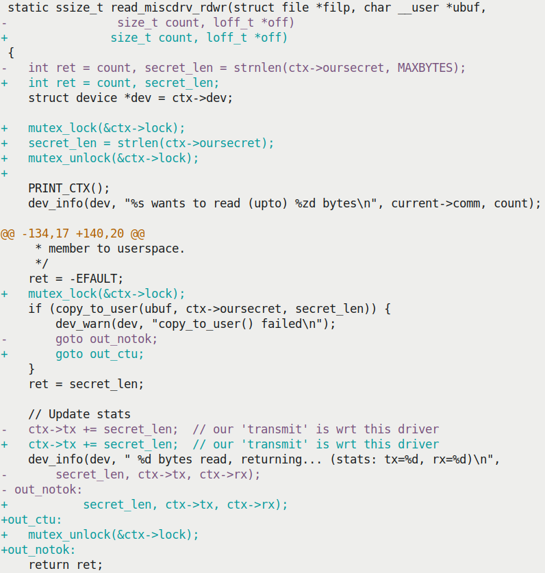

Hình 6.7 – Diff read() method driver; xem cách dùng mutex lock trong phiên bản mới

Giờ dùng mutex lock của driver context structure bảo vệ critical section. Tương tự cho write và close (release) method của device driver (tự tạo patch và xem). Lưu ý user mode app không đổi, nghĩa là để kiểm thử phiên bản mới an toàn hơn, tiếp tục dùng app tại `ch12/miscdrv_rdwr/rdwr_drv_secret.c`. Chạy và kiểm thử code như driver này trên debug kernel có khả năng phát hiện nhiều locking error và deadlock rất quan trọng (trở lại các khả năng “debug” này trong chương tiếp, mục Lock debugging trong kernel).

Trong code trên, lấy mutex lock ngay trước routine `copy_to_user()`; ổn. Tuy nhiên chỉ release sau `dev_info()`. Vì sao không release trước `printk`, rút ngắn critical section?

Nhìn kỹ `dev_info()` sẽ rõ. Đang in giá trị ba biến: số byte đọc bởi `secret_len`, số byte “truyền” và “nhận” lần lượt bởi `ctx->tx` và `ctx->rx`. `secret_len` là local variable, không cần bảo vệ, nhưng hai biến khác trong global driver context structure nên cần bảo vệ, ngay cả trước read (có thể dirty).

### Mutex lock – vài điểm còn lại

Trong mục này, trình bày vài điểm bổ sung về mutex.

#### Biến thể mutex lock API

Trước hết xem vài biến thể mutex lock API; ngoài interruptible variant (mô tả trong mục Mutex lock – qua \[un\]interruptible sleep?), có trylock, killable và io variant.

##### Mutex trylock variant

Nếu muốn triển khai busy-wait semantic, tức kiểm tra (mutex) lock sẵn có, nếu có (hiện unlocked), acquire/lock rồi tiếp tục code path critical section? Nếu không (hiện locked), không chờ lock; thay vào đó làm việc khác rồi thử lại. Thực chất là non-blocking mutex lock variant, gọi trylock; flowchart sau thể hiện cách hoạt động:

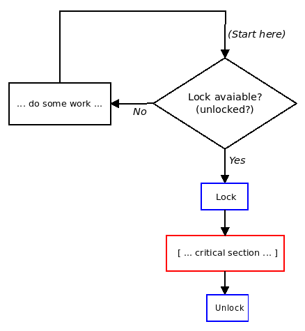

Hình 6.8 – Ngữ nghĩa “busy wait”, non-blocking trylock operation

API trylock variant của mutex lock như sau:

```
int mutex_trylock(struct mutex *lock);
```

Giá trị trả về API cho biết điều xảy ra lúc runtime:

- Giá trị trả về `1` cho biết acquire lock thành công.

- Giá trị trả về `0` cho biết lock hiện bị contend (locked).

Dù nghe hấp dẫn, đừng dùng API `mutex_trylock()` để xác định mutex locked hay unlocked; vốn “racy”. Tiếp theo, dùng trylock variant trong lock path contention cao có thể giảm cơ hội acquire lock. Trylock theo truyền thống dùng trong code ngăn deadlock có thể phải rút khỏi một lock order sequence rồi thử lại theo sequence (ordering) khác.

Với trylock variant, dù tài liệu nói thử acquire mutex atomically, nó không hoạt động trong atomic hay interrupt context — chỉ process context (như mọi mutex lock). Như thường lệ, owner context phải gọi `mutex_unlock()` để release.

Tôi đề nghị thực hành trylock mutex variant như bài tập. Xem mục Câu hỏi cuối chương!

##### Mutex interruptible và killable variant

Như đã học, API `mutex_lock_interruptible()` dùng khi driver (hay module) sẵn sàng thừa nhận bất kỳ signal (user space) interrupt nó (và trả `-ERESTARTSYS` để báo kernel VFS layer xử lý signal; user space system call thất bại với `errno` đặt thành `EINTR`). Ví dụ trong module handling code của kernel, trong system call `delete_module(2)` (được `rmmod(8)` gọi):

```
// kernel/module.c
[ ... ]
SYSCALL_DEFINE2(delete_module, const char __user *, name_user,
        unsigned int, flags)
{
    struct module *mod;
    [ ... ]
    if (!capable(CAP_SYS_MODULE) || modules_disabled)
        return -EPERM;
    [ ... ]
    if (mutex_lock_interruptible(&module_mutex) != 0)
        return -EINTR;
    mod = find_module(name);
    [ ... ]
out:
    mutex_unlock(&module_mutex);
    return ret;
}
```

Chú ý API trả `-EINTR` khi thất bại. (Macro `SYSCALL_DEFINEn()` trở thành system call signature; `n` là số tham số system call nhận. Cũng chú ý capability check — trừ khi chạy root hoặc có capability `CAP_SYS_MODULE` (hoặc module loading bị disable hoàn toàn), system call chỉ trả thất bại (`-EPERM`).) Tuy nhiên nếu driver chỉ sẵn sàng bị interrupt bởi fatal signal (sẽ kill user space context), dùng API `mutex_lock_killable()` (signature giống hệt interruptible variant).

##### Mutex io variant

API `mutex_lock_io()` có cú pháp giống `mutex_lock()`; khác duy nhất là kernel coi thời gian chờ của loser thread như chờ I/O (comment trong `kernel/locking/mutex.c:mutex_lock_io()` ghi rõ; hãy xem). Điều này có thể quan trọng về accounting.

Có thể thấy API khá đặc biệt như `mutex_lock[_interruptible]_nested()` trong kernel, nhấn mạnh hậu tố `nested`. Tuy nhiên Linux kernel không ưu tiên nhà phát triển dùng nested (hay recursive) locking (như nói trong mục Dùng mutex lock đúng cách). API chỉ được compile khi có config option `CONFIG_DEBUG_LOCK_ALLOC`; thực chất nested API được thêm để hỗ trợ kernel lock validator mechanism. Chỉ nên dùng trong hoàn cảnh đặc biệt (cần kết hợp nesting level giữa các instance cùng lock type).

Mục tiếp trả lời FAQ điển hình: mutex và semaphore object khác gì? Linux có semaphore object không? Đọc tiếp!

#### Semaphore và mutex

Linux kernel thực sự có semaphore object cùng các thao tác thông thường trên (binary) semaphore:

- Acquire semaphore lock qua API `down[_interruptible]()` (và biến thể)

- Unlock semaphore qua API `up()`.

Nhìn chung semaphore là triển khai cũ, nên khuyên dùng mutex lock thay thế.

FAQ đáng xem: mutex và semaphore khác gì? Có vẻ tương tự về khái niệm nhưng thực sự khá khác:

- Semaphore tổng quát hơn mutex; mutex lock chỉ acquire (và sau đó release/unlock) đúng một lần, còn semaphore có thể acquire (và sau đó release) nhiều lần.

- Mutex bảo vệ critical section khỏi truy cập đồng thời, còn semaphore nên làm cơ chế báo task đang chờ khác rằng đã đạt mốc nhất định (thường producer task post signal qua semaphore object mà consumer task đang chờ nhận để tiếp tục công việc).

- Mutex có khái niệm lock ownership, chỉ owner context được unlock; binary semaphore không có ownership.

#### Priority inversion và RT-mutex

Lưu ý khi dùng mọi locking là phải thiết kế và viết code cẩn thận ngăn deadlock đáng sợ có thể phát sinh (nói thêm chương tiếp trong mục Lock validator lockdep – bắt locking issue sớm).

Ngoài deadlock, còn tình huống rủi ro khi dùng mutex: priority inversion (cũng không đi sâu trong sách). Chỉ cần nói unbounded priority inversion có thể chết người; kết quả thread priority cao(nhất) của sản phẩm bị giữ ngoài CPU quá lâu.

Như trình bày khá chi tiết trong sách trước Hands-on System Programming with Linux, chính priority inversion đã xảy ra với robot Mars Pathfinder của NASA, ngay trên bề mặt sao Hỏa, tháng 7 năm 1997! Xem mục Đọc thêm để có tài nguyên thú vị, điều mọi nhà phát triển software nên biết!

Triển khai userspace Pthreads mutex chắc chắn có priority inheritance (PI) semantics. Nhưng trong Linux kernel? Ingo Molnar cung cấp RT-mutex dựa trên PI-futex (real-time mutex; thực chất mutex mở rộng có PI. `futex(2)` là system call tinh vi cung cấp fast userspace mutex). Có sẵn khi bật config option `CONFIG_RT_MUTEXES`. Khá giống mutex “thông thường”, RT-mutex API dùng khởi tạo, (un)lock và destroy RT-mutex object. (Code đã merge vào mainline kernel từ tree `-rt` của Ingo Molnar). Về sử dụng thực, RT-mutex dùng triển khai nội bộ PI futex (bản thân system call `futex(2)` triển khai nội bộ userspace Pthreads mutex). Ngoài ra kernel locking self-test code và I2C subsystem dùng trực tiếp RT-mutex.

Vì vậy với người viết module (hay driver) điển hình, API này không dùng thường xuyên. Kernel có tài liệu về thiết kế nội bộ RT-mutex tại `https://www.kernel.org/doc/Documentation/locking/rt-mutex-design.rst` (bao quát priority inversion, priority inheritance, v.v.).

#### Thiết kế nội bộ

Vài điều về thực tế triển khai nội bộ mutex lock sâu trong kernel: Linux cố dùng fast path khi có thể.

Fast path là loại code path hiệu năng cao tối ưu nhất; ví dụ không lock, không blocking. Mục tiêu cho code theo fast path nhiều nhất có thể. Chỉ khi thực sự không thể, kernel mới chuyển sang “mid path” (có thể có), rồi “slow path”; vẫn hoạt động nhưng chậm(hơn).

Fast path được dùng khi không có lock contention (ban đầu lock unlocked). Vì vậy lock được lấy không rắc rối, gần như ngay lập tức. Tuy nhiên nếu mutex đã locked, kernel thường dùng mid path optimistic spinning, thành dạng lock lai (mutex/spinlock). Nếu ngay cả điều này không thể, theo “slow path” — process context cố lấy lock có thể vào sleep state. Nếu quan tâm triển khai nội bộ, thêm chi tiết trong kernel documentation chính thức: `https://www.kernel.org/doc/Documentation/locking/mutex-design.rst`.

Dự án LDV (Linux Driver Verification): Trong tài liệu đồng hành Linux Kernel Programming - Chương 1, Thiết lập Kernel Workspace, mục Dự án LDV – Linux Driver Verification, đã đề cập các “quy tắc” hữu ích về nhiều khía cạnh lập trình Linux module (chủ yếu driver) và core kernel.

Với chủ đề hiện tại, một quy tắc là: Lock mutex hai lần hoặc unlock khi chưa lock (`http://linuxtesting.org/ldv/online?action=show_rulerule_id=0032`). Nói những thứ không được làm với mutex lock (đã trình bày mục Dùng mutex lock đúng cách). Điều thú vị: thấy ví dụ bug thực tế — cố acquire mutex lock hai lần, dẫn đến (self) deadlock — trong kernel driver (cùng bản sửa sau đó).

Giờ hiểu dùng mutex lock, hãy sang lock rất phổ biến khác trong kernel — spinlock.

## Dùng spinlock

Trong mục Mutex hay spinlock? Dùng loại nào khi nào, đã học khi nào dùng spinlock thay mutex và ngược lại. Để tiện, nhắc lại phát biểu chính:

- Critical section chạy trong atomic (interrupt) context hay process context không thể sleep? Dùng spinlock.

- Critical section chạy trong process context và cần sleep trong critical section? Dùng mutex lock.

Mục này giả định bạn đã quyết định dùng spinlock.

### Spinlock – cách dùng đơn giản

Với mọi spinlock API, phải include header liên quan, tức `include` `<linux/spinlock.h>`. Tương tự mutex, phải khai báo và khởi tạo spinlock unlocked trước dùng. Spinlock là “object” khai báo qua kiểu dữ liệu `typedef` tên `spinlock_t` (nội bộ là cấu trúc định nghĩa trong `include/linux/spinlock_types.h`). Có thể khởi tạo động qua macro `spin_lock_init()`:

```
spinlock_t lock;
spin_lock_init(&lock);
```

Hoặc khởi tạo tĩnh (khai báo và khởi tạo) bằng `DEFINE_SPINLOCK(lock);`.

Như mutex, khai báo spinlock trong data structure (global/static) cần bảo vệ khỏi concurrent access thường rất tốt. Như đã nói, ý tưởng thường dùng trong kernel; ví dụ data structure biểu diễn open file trong Linux kernel gọi `struct file`:

```
// include/linux/fs.h
struct file {
    [...]
    struct path f_path;
    struct inode *f_inode; /* cached value */
    const struct file_operations *f_op;
    /*
     * Protects f_ep_links, f_flags.
     * Must not be taken from IRQ context.
     */
    spinlock_t f_lock;
    [...]
    struct mutex f_pos_lock;
    loff_t f_pos;
    [...]
```

Xem: với cấu trúc `file`, spinlock variable `f_lock` bảo vệ member `f_ep_links` và `f_flags` của data structure `file` (còn có mutex lock bảo vệ member khác, current seek position của file — `f_pos`).

Thực sự lock/unlock spinlock thế nào? Có khá nhiều biến thể API kernel cung cấp cho người viết module/driver; dạng spin(un)lock API đơn giản nhất như sau:

```
void spin_lock(spinlock_t *lock);
<< ... critical section ... >>
void spin_unlock(spinlock_t *lock);
```

Lưu ý không có spinlock API tương đương `mutex_destroy()`.

Giờ xem spinlock API hoạt động!

### Spinlock – driver ví dụ

Tương tự mutex locking sample driver (mục Mutex locking – driver ví dụ), để minh họa spinlock đơn giản, sao chép driver `ch12/1_miscdrv_rdwr_mutexlock` trước làm template khởi đầu, đưa vào kernel driver mới, tức `ch12/2_miscdrv_rdwr_spinlock`. Ở đây chỉ trình bày phần nhỏ diff (khác biệt, delta do `diff(1)` tạo) giữa chương trình đó và chương trình này (không mọi dòng diff, chỉ phần liên quan):

```
// location: ch12/2_miscdrv_rdwr_spinlock/
+#include <linux/spinlock.h>
[ ... ]
-#define OURMODNAME "miscdrv_rdwr_mutexlock"
+#define OURMODNAME "miscdrv_rdwr_spinlock"
[ ... ]
static int ga, gb = 1;
-DEFINE_MUTEX(lock1); // this mutex lock is meant to protect the integers
ga and gb
+DEFINE_SPINLOCK(lock1); // this spinlock protects the global integers ga
and gb
[ ... ]
+/* The driver 'context' data structure;
+ * all relevant 'state info' reg the driver is here.
  */
 struct drv_ctx {
    struct device *dev;
@@ -63,10 +66,22 @@
    u64 config3;
 #define MAXBYTES 128
    char oursecret[MAXBYTES];
- struct mutex lock; // this mutex protects this data structure
+ struct mutex mutex; // this mutex protects this data structure
+ spinlock_t spinlock; // ...so does this spinlock
 };
 static struct drv_ctx *ctx;
```

Lần này để bảo vệ member của global data structure `drv_ctx`, có cả mutex lock gốc và spinlock mới. Khá phổ biến; mutex lock bảo vệ sử dụng member trong critical section có thể blocking, còn spinlock bảo vệ member trong critical section không thể blocking (sleeping — nhớ có thể sleep).

Tất nhiên phải bảo đảm khởi tạo mọi lock về unlocked. Có thể trong code `init` driver (tiếp output patch):

```
-   mutex_init(&ctx->lock);
+   mutex_init(&ctx->mutex);
+   spin_lock_init(&ctx->spinlock);
```

Trong method `open` driver, thay mutex lock bằng spinlock bảo vệ tăng/giảm global integer:

```
 * open_miscdrv_rdwr()
@@ -82,14 +97,15 @@

    PRINT_CTX(); // displays process (or intr) context info

-   mutex_lock(&lock1);
+   spin_lock(&lock1);
    ga++; gb--;
-   mutex_unlock(&lock1);
+   spin_unlock(&lock1);
```

Trong method `read` driver, dùng spinlock thay mutex bảo vệ vài critical section:

```
 static ssize_t read_miscdrv_rdwr(struct file *filp, char __user *ubuf,
size_t count, loff_t  *off)
 {
-   int ret = count, secret_len;
+   int ret = count, secret_len, err_path = 0;
    struct device *dev = ctx->dev;

-   mutex_lock(&ctx->lock);
+   spin_lock(&ctx->spinlock);
    secret_len = strlen(ctx->oursecret);
-   mutex_unlock(&ctx->lock);
+   spin_unlock(&ctx->spinlock);
```

Tuy nhiên chưa hết! Tiếp method `read`, xem kỹ code và comment sau:

```
[ ... ]
@@ -139,20 +157,28 @@
     * member to userspace.
     */
    ret = -EFAULT;
-   mutex_lock(&ctx->lock);
+   mutex_lock(&ctx->mutex);
+   /* Why don't we just use the spinlock??
+    * Because - VERY IMP! - remember that the spinlock can only be used
when
+    * the critical section will not sleep or block in any manner; here,
+    * the critical section invokes the copy_to_user(); it very much can
+    * cause a 'sleep' (a schedule()) to occur.
+    */
    if (copy_to_user(ubuf, ctx->oursecret, secret_len)) {
[ ... ]
```

Khi bảo vệ dữ liệu mà critical section có API có thể blocking — như `copy_to_user()` — chỉ được dùng mutex lock! (Thiếu chỗ nên không trình bày thêm code diff; kỳ vọng bạn đọc spinlock sample driver code và tự thử.)

### Kiểm thử – sleep trong atomic context

Đã học điều không nên làm là sleep (block) trong mọi atomic/interrupt context. Hãy kiểm thử. Như thường lệ, cách thực nghiệm — tự kiểm thử thay vì dựa vào trải nghiệm người khác — là then chốt!

Chính xác kiểm thử thế nào? Dễ: dùng integer module parameter `buggy`, khi đặt `1` (mặc định `0`), thực thi code path trong critical section spinlock vi phạm quy tắc. Gọi API `schedule_timeout()` (như học trong `Chapter 5`, Làm việc với Kernel Timer, Thread và Workqueue, mục Tìm hiểu dùng blocking API \*sleep()) nội bộ gọi `schedule()`; đó là cách sleep trong kernel space). Code liên quan:

```
// ch12/2_miscdrv_rdwr_spinlock/2_miscdrv_rdwr_spinlock.c
[ ... ]
static int buggy;
module_param(buggy, int, 0600);
MODULE_PARM_DESC(buggy,
"If 1, cause an error by issuing a blocking call within a spinlock critical
section");
[ ... ]
static ssize_t write_miscdrv_rdwr(struct file *filp, const char __user
*ubuf,
                size_t count, loff_t *off)
{
    int ret, err_path = 0;
    [ ... ]
    spin_lock(&ctx->spinlock);
    strscpy(ctx->oursecret, kbuf, (count > MAXBYTES ? MAXBYTES : count));
    [ ... ]
    if (1 == buggy) {
        /* We're still holding the spinlock! */
        set_current_state(TASK_INTERRUPTIBLE);
        schedule_timeout(1*HZ); /* ... and this is a blocking call!
                    * Congratulations! you've just engineered a bug */
    }
    spin_unlock(&ctx->spinlock);
    [ ... ]
}
```

Phần thú vị: kiểm thử code path (có bug) trên hai kernel: trước trên custom kernel “debug” 5.4 (bật nhiều kernel debug configuration option (chủ yếu từ menu `Kernel Hacking` trong `make` `menuconfig`), như tài liệu đồng hành Linux Kernel Programming - Chương 5, Viết kernel module đầu tiên – LKM Phần 2), sau trên generic distro (thường Ubuntu) kernel 5.4 không bật kernel debug option liên quan nào.

#### Kiểm thử trên debug kernel 5.4

Trước hết bảo đảm đã build custom kernel 5.4, bật mọi kernel debug config option cần (xem lại tài liệu đồng hành Linux Kernel Programming - Chương 5, Viết kernel module đầu tiên – LKM Phần 2, mục Configure debug kernel nếu cần). Boot debug kernel (ở đây tên `5.4.0-llkd-dbg`). Giờ build driver (trong `ch12/2_miscdrv_rdwr_spinlock/`) cho debug kernel (lệnh `make` thông thường trong directory driver làm được; có thể thấy build trên debug kernel chậm hơn rõ!):

```
$ lsb_release -a 2>/dev/null | grep "^Description" ; uname -r
Description: Ubuntu 20.04.1 LTS
5.4.0-llkd-dbg
$ make
[ ... ]
$ modinfo ./miscdrv_rdwr_spinlock.ko
filename:
/home/llkd/llkd_src/ch12/2_miscdrv_rdwr_spinlock/./miscdrv_rdwr_spinlock.ko
[ ... ]
description: LLKD book:ch12/2_miscdrv_rdwr_spinlock: simple misc char
driver rewritten with spinlocks
[ ... ]
parm: buggy:If 1, cause an error by issuing a blocking call within a
spinlock critical section (int)
$ sudo virt-what
virtualbox
kvm
$
```

Như thấy, đang chạy custom kernel “debug” 5.4.0 trên guest VM Ubuntu 20.04 x86\_64.

Làm sao biết chạy trên virtual machine (VM) hay hệ thống “bare metal” (native)? `virt-what(1)` là script nhỏ hữu ích cho thấy (có thể cài trên Ubuntu bằng `sudo apt install` `virt-what`).

Để chạy test case, chèn driver vào kernel, đặt module parameter `buggy` thành `1`. Gọi method `read` driver (qua user space app, tức `ch12/miscdrv_rdwr/rdwr_test_secret`) không vấn đề, như sau:

```
$ sudo dmesg -C
$ sudo insmod ./miscdrv_rdwr_spinlock.ko buggy=1
$ ../../ch12/miscdrv_rdwr/rdwr_test_secret
Usage: ../../ch12/miscdrv_rdwr/rdwr_test_secret opt=read/write device_file
["secret-msg"]
 opt = 'r' => we shall issue the read(2), retrieving the 'secret' form the
driver
 opt = 'w' => we shall issue the write(2), writing the secret message
<secret-msg>
  (max 128 bytes)
$
$ ../../ch12/miscdrv_rdwr/rdwr_test_secret r
/dev/llkd_miscdrv_rdwr_spinlock
Device file /dev/llkd_miscdrv_rdwr_spinlock opened (in read-only mode):
fd=3
../../ch12/miscdrv_rdwr/rdwr_test_secret: read 7 bytes from
/dev/llkd_miscdrv_rdwr_spinlock
The 'secret' is:
 "initmsg"
$
```

Tiếp theo gọi `write(2)` đến driver qua user mode app; lần này code path có bug chạy. Như đã thấy, gọi `schedule_timeout()` trong spinlock critical section (giữa lock và unlock). Debug kernel phát hiện bug, phát debug diagnostic (rất lớn) vào kernel log (lưu ý bug như vậy hoàn toàn có thể treo hệ thống, nên kiểm thử trên VM trước):

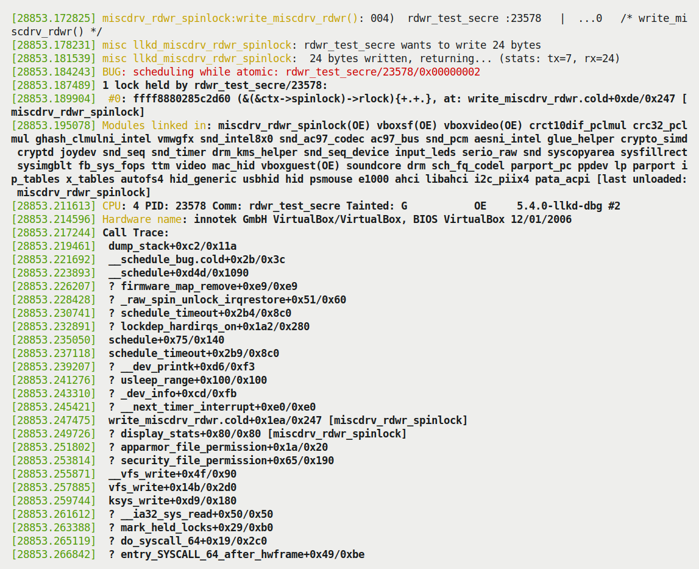

Hình 6.9 – Kernel diagnostic được kích hoạt bởi bug “scheduling in atomic context” cố tình gây ra

Ảnh trên thể hiện phần điều xảy ra (theo dõi cùng driver code tại `ch12/2_miscdrv_rdwr_spinlock/2_miscdrv_rdwr_spinlock.c`):

1\. Trước hết, process context user mode app (`rdwr_test_secre`; chú ý tên cắt còn 16 ký tự đầu, gồm byte `NULL`) vào write method driver, tức `write_miscdrv_rdwr()`. Thấy trong output macro `PRINT_CTX()` hữu ích (nhắc lại dòng ở đây):

```
miscdrv_rdwr_spinlock:write_miscdrv_rdwr(): 004) rdwr_test_secre
:23578 | ...0 /*  write_miscdrv_rdwr() */
```

2\. Sao chép bí mật mới từ user space writer process và ghi 24 byte.

3\. Sau đó “lấy” spinlock, vào critical section và sao chép dữ liệu đến member `oursecret` của context structure driver.

4\. Sau đó `if (1 == buggy) {` cho kết quả true.

5\. Gọi `schedule_timeout()`, một blocking API (vì nội bộ gọi `schedule()`), kích hoạt bug, được tô đỏ hữu ích:

```
BUG: scheduling while atomic: rdwr_test_secre/23578/0x00000002
```

6\. Kernel giờ dump khá nhiều diagnostic output. Một trong thứ đầu tiên là call stack.

Call stack hay stack backtrace (hoặc “call trace”) của kernel mode stack của process — ở đây là user space app `rdwr_drv_secret` đang chạy code driver (có bug) trong process context — thấy rõ trong Hình 6.9. Mỗi dòng sau header `Call` `Trace:` thực chất là call frame trên kernel stack.

Mẹo: bỏ qua stack frame bắt đầu bằng ký hiệu `?`; thực sự là call frame đáng ngờ, rất có thể là “phần sót” từ lần dùng stack trước trong cùng memory region. Nên tạm nói về memory: stack allocation thực sự hoạt động vậy; stack memory không được cấp phát/giải phóng theo từng call frame vì quá tốn. Chỉ khi hết một stack memory page, page mới tự động được fault vào! (Nhớ thảo luận trong tài liệu đồng hành Linux Kernel Programming - Chương 9, Cấp phát Kernel Memory cho người viết Module – Phần 2, mục Ghi chú ngắn về memory allocation và demand paging.) Thực tế khi code gọi và trở về từ hàm, cùng stack memory page thường được tái sử dụng. Không chỉ vậy, vì hiệu năng memory không bị xóa mỗi lần, nên phần sót của frame trước thường xuất hiện. (Có thể thực sự “làm hỏng” bức tranh. Tuy nhiên may mắn, thuật toán tracing stack call frame hiện đại thường rất giỏi xác định stack trace đúng.)

Theo stack trace từ dưới lên (luôn đọc từ dưới lên), thấy như dự kiến system call user space `write(2)` (thường hiển thị như `SyS_write` hoặc trên x86 là `__x64_sys_write`, dù không thấy trong Hình 6.9) gọi kernel VFS layer code (thấy `vfs_write()` gọi `__vfs_write()`), rồi gọi write method driver, tức `write_miscdrv_rdwr()`! Code như đã biết gọi code path có bug, nơi gọi `schedule_timeout()`, rồi gọi `schedule()` (và `__schedule()`), khiến toàn bộ bug `BUG: scheduling` `while atomic` kích hoạt.

Format của code path `scheduling while atomic` được lấy từ dòng code sau trong `kernel/sched/core.c`:

```
printk(KERN_ERR "BUG: scheduling while atomic: %s/%d/0x%08x\n", prev->comm,
prev->pid, preempt_count());
```

Thú vị! Có thể thấy đã in chuỗi sau:

```
      BUG: scheduling while atomic: rdwr_test_secre/23578/0x00000002
```

Sau `atomic:`, in process name — PID — rồi gọi inline function `preempt_count()` in preempt depth; đây là counter tăng mỗi khi lấy lock, giảm mỗi unlock. Vì vậy nếu dương, code nằm trong critical/atomic section; ở đây giá trị `2`.

Lưu ý bug được báo rõ trong test run chính vì debug kernel config option `CONFIG_DEBUG_ATOMIC_SLEEP` bật. Bật vì đang chạy custom “debug kernel” (kernel version 5.4.0)! Chi tiết config option (có thể tìm và đặt tương tác trong `make menuconfig`, dưới menu `Kernel Hacking`) như sau:

```
// lib/Kconfig.debug
[ ... ]
config DEBUG_ATOMIC_SLEEP
    bool "Sleep inside atomic section checking"
    select PREEMPT_COUNT
    depends on DEBUG_KERNEL
    depends on !ARCH_NO_PREEMPT
    help
      If you say Y here, various routines which may sleep will become very
 noisy if they are called inside atomic sections: when a spinlock is
 held, inside an rcu read side critical section, inside preempt disabled
 sections, inside an interrupt, etc...
```

#### Kiểm thử trên non-debug distro kernel 5.4

Để đối chiếu, giờ thực hiện cùng điều trên Ubuntu 20.04 LTS VM, boot bằng generic “distro” Linux kernel 5.4 mặc định, thường không configure là “debug” kernel (ở đây chưa đặt kernel config option `CONFIG_DEBUG_ATOMIC_SLEEP`).

Trước hết chèn driver (có bug). Khi chạy process `rdwr_drv_secret` để ghi bí mật mới vào driver, code path có bug thực thi. Tuy nhiên lần này kernel không crash, cũng không báo vấn đề gì (xem output `dmesg(1)` xác nhận):

```
$ uname -r
5.4.0-56-generic
$ sudo insmod ./miscdrv_rdwr_spinlock.ko buggy=1
$ ../../ch12/miscdrv_rdwr/rdwr_test_secret w
/dev/llkd_miscdrv_rdwr_spinlock "passwdcosts500bucksdude"
Device file /dev/llkd_miscdrv_rdwr_spinlock opened (in write-only mode):
fd=3
../../ch12/miscdrv_rdwr/rdwr_test_secret: wrote 24 bytes to
/dev/llkd_miscdrv_rdwr_spinlock
$ dmesg
[ ... ]
[ 65.420017] miscdrv_rdwr_spinlock:miscdrv_init_spinlock(): LLKD misc
driver (major # 10) registered, minor# = 56, dev node is
/dev/llkd_miscdrv_rdwr
[ 81.665077] miscdrv_rdwr_spinlock:miscdrv_exit_spinlock():
miscdrv_rdwr_spinlock: LLKD misc driver deregistered, bye
[ 86.798720] miscdrv_rdwr_spinlock:miscdrv_init_spinlock(): VERMAGIC_STRING
= 5.4.0-56-generic SMP mod_unload
[ 86.799890] miscdrv_rdwr_spinlock:miscdrv_init_spinlock(): LLKD misc
driver (major # 10) registered, minor# = 56, dev node is
/dev/llkd_miscdrv_rdwr
[ 130.214238] misc llkd_miscdrv_rdwr_spinlock: filename:
"llkd_miscdrv_rdwr_spinlock"
                wrt open file: f_flags = 0x8001
                ga = 1, gb = 0
[ 130.219233] misc llkd_miscdrv_rdwr_spinlock: stats: tx=0, rx=0
[ 130.219680] misc llkd_miscdrv_rdwr_spinlock: rdwr_test_secre wants to
write 24 bytes
[ 130.220329] misc llkd_miscdrv_rdwr_spinlock: 24 bytes written,
returning... (stats: tx=0, rx=24)
[ 131.249639] misc llkd_miscdrv_rdwr_spinlock: filename:
"llkd_miscdrv_rdwr_spinlock"
                ga = 0, gb = 1
[ 131.253511] misc llkd_miscdrv_rdwr_spinlock: stats: tx=0, rx=24
$
```

Biết write method có bug chết người, nhưng dường như không thất bại kiểu nào! Rất tệ; chính điều này có thể khiến kết luận sai code hoàn toàn ổn trong khi bug khó chịu âm thầm chờ một ngày tấn công!

Để điều tra chính xác bên dưới, chạy test app (process `rdwr_drv_secret`) lần nữa, lần này qua công cụ mạnh `trace-cmd(1)` (wrapper rất hữu ích trên Ftrace kernel infrastructure; sau đây output cắt bớt:

Ftrace infrastructure của Linux kernel là tracing infrastructure chính của kernel; cung cấp trace chi tiết gần như mọi hàm thực thi trong kernel space. Ở đây dùng Ftrace qua frontend tiện lợi: tiện ích `trace-cmd(1)`. Đây là debug tool rất mạnh, hữu ích; đã đề cập một số khác trong tài liệu đồng hành Linux Kernel Programming - Chương 1, Thiết lập Kernel Workspace, nhưng tiếc chi tiết ngoài phạm vi sách. Xem man page để học thêm.

```
$ sudo trace-cmd record -p function_graph -F
../../ch12/miscdrv_rdwr/rdwr_test_secret w /dev/llkd_miscdrv_rdwr_spinlock
"passwdcosts500bucks"
$ sudo trace-cmd report -I -S -l > report.txt
$ sudo less report.txt
[ ... ]
```

Có thể thấy output trong ảnh sau:

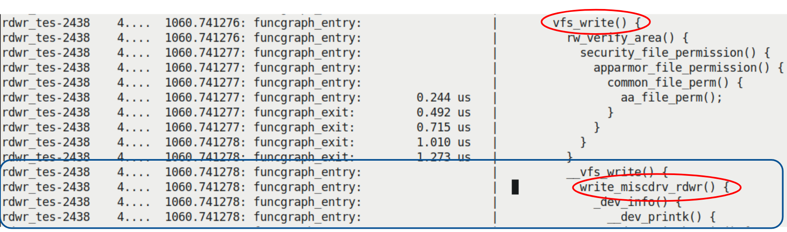

Hình 6.10 – Một phần ảnh chụp output báo cáo trace-cmd(1)

Như thấy, system call `write(2)` từ user mode app trở thành `vfs_write()` như dự kiến; hàm này (sau security check) gọi `__vfs_write()`, rồi gọi write method driver — hàm `write_miscdrv_rdwr()`!

Trong Ftrace output stream (lớn), thấy hàm `schedule_timeout()` thực sự được gọi:

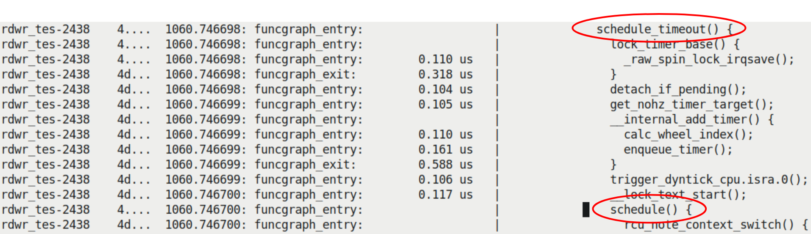

Hình 6.11 – Một phần ảnh chụp output báo cáo trace-cmd(1), thể hiện lời gọi (có bug!) schedule\_timeout() và schedule() trong atomic context

Vài dòng output sau `schedule_timeout()`, thấy rõ `schedule()` được gọi! Vậy driver đã (tất nhiên cố ý) làm điều có bug — gọi `schedule()` trong atomic context. Nhưng điểm chính là trên Ubuntu này không chạy “debug” kernel, nên có:

```
$ grep DEBUG_ATOMIC_SLEEP /boot/config-5.4.0-56-generic
# CONFIG_DEBUG_ATOMIC_SLEEP is not set
$
```

Vì vậy bug không được báo! Chứng minh hữu ích của chạy test case — và thực sự phát triển kernel — trên “debug” kernel, bật nhiều debug feature. (Bài tập: nếu chưa, chuẩn bị “debug” kernel và chạy test case này.)

Dự án Linux Driver Verification (LDV): Trong tài liệu đồng hành Linux Kernel Programming - Chương 1, Thiết lập Kernel Workspace, mục Dự án LDV – Linux Driver Verification, đã đề cập các “quy tắc” hữu ích về nhiều khía cạnh lập trình Linux module (chủ yếu driver) và core kernel.

Với chủ đề hiện tại, một quy tắc là: Sử dụng spin lock và unlock function (`http://linuxtesting.org/ldv/online?action=show_rulerule_id=0039`). Nói các điểm chính để dùng spinlock đúng; thú vị là cho ví dụ bug thực tế trong driver, cố release spinlock hai lần — vi phạm rõ quy tắc locking, dẫn đến hệ thống không ổn định.

## Locking và interrupt

Đến nay đã học mutex lock và với spinlock, API cơ bản `spin_[un]lock()`. Có vài biến thể API spinlock khác, xem những loại phổ biến hơn ở đây.

Để hiểu chính xác vì sao cần API spinlock khác, xét: người viết driver thấy device assert hardware interrupt; vì thế viết interrupt handler. Khi triển khai method `read`, thấy non-blocking critical section. Dễ: như đã học, dùng spinlock bảo vệ. Tốt! Nhưng nếu khi trong critical section của `read`, hardware interrupt của device phát? Như biết, hardware interrupt preempt mọi thứ; vì vậy control đến interrupt handler code, preempt method `read`. Câu hỏi chính: có vấn đề không? Phụ thuộc interrupt handler và method `read` làm gì, triển khai thế nào. Hình dung vài trường hợp:

- Interrupt handler (lý tưởng) chỉ dùng local variable, nên dù method `read` trong critical section, không quan trọng; interrupt handling xong nhanh và control trở về thứ bị interrupt (cũng còn hơn vậy; như biết, bottom-half hiện có như tasklet/softirq cũng có thể cần thực thi). Nói cách khác, thực sự không race trong trường hợp này.

- Interrupt handler làm việc trên (global) shared writeable data nhưng không phải dữ liệu read method dùng. Vậy cũng không xung đột hay race với read code. Tất nhiên nên hiểu interrupt code có critical section và phải bảo vệ (có thể bằng spinlock khác).

- Interrupt handler làm việc trên cùng global shared writeable data mà method `read` dùng. Trường hợp này rõ có tiềm năng race, nên cần locking!

Tập trung trường hợp thứ ba. Rõ ràng nên dùng spinlock bảo vệ critical section trong interrupt handling code (nhớ mutex không được phép trong mọi interrupt context). Ngoài ra, trừ khi dùng chính cùng spinlock trong method `read` và code path interrupt handler, hoàn toàn không được bảo vệ! (Cẩn thận với lock; dành thời gian suy nghĩ thiết kế và code chi tiết.)

Hãy thực hành hơn (hiện bằng pseudocode): giả sử có global (shared) data structure tên `gCtx`; thao tác trên nó trong cả method `read` và interrupt handler (hardirq handler) của driver. Vì shared, là critical section cần bảo vệ; vì chạy atomic (interrupt) context, không dùng mutex, phải dùng spinlock (biến tên `slock`). Pseudocode sau có timestamp (`t1,` `t2, ...`) cho tình huống:

```
// Driver read method ; WRONG !
driver_read(...)                  << time t0 >>
{
    [ ... ]
    spin_lock(&slock);
    <<--- time t1 : start of critical section >>
... << operating on global data object gCtx >> ...
    spin_unlock(&slock);
    <<--- time t2 : end of critical section >>
    [ ... ]
}                                << time t3 >>
```

Pseudocode sau cho interrupt handler của device driver:

```
handle_interrupt(...)           << time t4; hardware interrupt fires!
>>
{
    [ ... ]
    spin_lock(&slock);
    <<--- time t5: start of critical section >>
    ... << operating on global data object gCtx >> ...
    spin_unlock(&slock);
    <<--- time t6 : end of critical section >>
    [ ... ]
}                               << time t7 >>
```

Có thể tóm tắt qua sơ đồ:

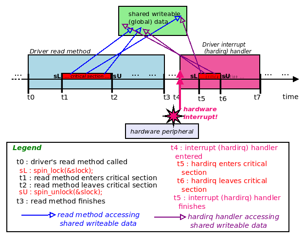

Hình 6.12 – Timeline – read method và hardirq handler của driver chạy tuần tự khi làm việc trên global data; không vấn đề

May mắn mọi thứ ổn — “may mắn” vì hardware interrupt phát sau khi critical section của hàm `read` hoàn tất. Chắc chắn không thể dựa may mắn làm bảo chứng an toàn duy nhất cho sản phẩm! Hardware interrupt asynchronous; nếu phát lúc kém thuận lợi (với chúng ta) — chẳng hạn khi critical section method `read` chạy giữa t1 và t2? Spinlock chẳng phải làm nhiệm vụ bảo vệ dữ liệu sao?

Lúc này code interrupt handler cố acquire cùng spinlock (`&slock`). Chờ đã — không “lấy” được vì hiện locked! Nó “spin”, thực chất chờ unlock. Nhưng unlock thế nào? Không thể, và có (self) deadlock.

Thú vị là spinlock trực quan, hợp lý hơn trên SMP (multicore) system. Giả sử method `read` chạy trên CPU core 1; interrupt có thể được chuyển đến CPU core khác, giả sử core 2. Interrupt code path “spin” trên lock ở core 2, còn method `read` trên core 1 hoàn tất critical section rồi unlock spinlock, unblock interrupt handler. Nhưng UP (uniprocessor, chỉ một CPU core)? Hoạt động thế nào? Giải pháp: khi “race” với interrupt, dù uniprocessor hay SMP, chỉ cần dùng variant `_irq` của spinlock API:

```
#include <linux/spinlock.h>
void spin_lock_irq(spinlock_t *lock);
```

API `spin_lock_irq()` disable interrupt nội bộ trên processor core đang chạy, tức local core. Vì vậy dùng API trong method `read`, interrupt bị disable trên local core, khiến “race” có thể có qua interrupt không thể xảy ra. (Nếu interrupt phát trên CPU core khác, spinlock hoạt động đúng như mô tả trước!)

Triển khai `spin_lock_irq()` khá lồng sâu (như phần lớn chức năng spinlock), nhưng nhanh; cuối cùng gọi macro `local_irq_disable()` và `preempt_disable()`, disable cả interrupt lẫn kernel preemption trên local processor core đang chạy. (Disable hardware interrupt còn có tác dụng phụ (mong muốn) disable kernel preemption.)

`spin_lock_irq()` đi cặp API `spin_unlock_irq()` tương ứng. Vì vậy cách dùng spinlock đúng cho trường hợp này (khác đã thấy) là:

```
// Driver read method ; CORRECT !
driver_read(...)                  << time t0 >>
{
    [ ... ]
    spin_lock_irq(&slock);
    <<--- time t1 : start of critical section >>
[now all interrupts + preemption on local CPU core are masked (disabled)]
... << operating on global data object gCtx >> ...
    spin_unlock_irq(&slock);
    <<--- time t2 : end of critical section >>
    [ ... ]
}                                << time t3 >>
```

Trước khi tự vỗ vai và nghỉ hết ngày, xét tình huống khác. Lần này sản phẩm (hay project) phức tạp hơn, rất có thể trong nhiều nhà phát triển code base, một người cố tình đặt interrupt mask thành giá trị nhất định, block một số interrupt, cho phép số khác. Ví dụ giả sử đã xảy ra trước tại `t0`. Giờ như nói, nhà phát triển khác (bạn!) đến, bảo vệ critical section trong read method bằng API `spin_lock_irq()`. Nghe đúng? Có, nhưng API có quyền tắt (mask) mọi hardware interrupt (và kernel preemption, tạm bỏ qua) trên local CPU core. Thực hiện bằng thao tác mức thấp lên hardware interrupt mask register (rất phụ thuộc kiến trúc). Giả sử đặt bit tương ứng interrupt thành `1` enable nó, xóa bit (thành `0`) disable/mask. Do đó có thể có:

- Thời điểm `t0`: Interrupt mask đặt thành giá trị nào đó, giả sử `0x8e (10001110b)`, enable một số, disable số khác. Quan trọng cho project (để đơn giản, giả định mask register 8-bit) \[... thời gian trôi qua ... \].

- Thời điểm `t1`: Ngay trước critical section method `read` driver, gọi `spin_lock_irq(&slock);`. API nội bộ xóa mọi bit trong interrupt mask register thành `0`, disable mọi interrupt (như nghĩ mong muốn).

- Thời điểm `t2`: Giờ hardware interrupt không phát trên CPU core này, nên hoàn tất critical section. Xong gọi `spin_unlock_irq(&slock);`. API nội bộ đặt mọi bit interrupt mask register thành `1`, enable lại mọi interrupt.

Tuy nhiên interrupt mask register bị “khôi phục” sai thành `0xff` `(11111111b)`, không phải `0x8e` như nhà phát triển gốc muốn, cần và giả định! Có thể (và có lẽ sẽ) làm hỏng thứ gì trong project.

Giải pháp đơn giản: không giả định, chỉ save và restore interrupt mask. Có thể bằng cặp API:

```
#include <linux/spinlock.h>>
 unsigned long spin_lock_irqsave(spinlock_t *lock, unsigned long flags);
 void spin_unlock_irqrestore(spinlock_t *lock, unsigned long flags);
```

Tham số đầu cả lock và unlock là spinlock variable cần dùng. Tham số thứ hai, `flags`, phải là local variable kiểu `unsigned long`. Dùng save và restore interrupt mask:

```
spinlock_t slock;
spin_lock_init(&slock);
[ ... ]
driver_read(...)
{
    [ ... ]
    spin_lock_irqsave(&slock, flags);
    << ... critical section ... >>
    spin_unlock_irqrestore(&slock, flags);
    [ ... ]
}
```

Nói chính xác, `spin_lock_irqsave()` không phải API mà macro; trình bày như API để dễ đọc. Dù giá trị trả về macro không void, đó là chi tiết nội bộ (biến tham số `flags` được cập nhật ở đây).

Nếu tasklet hay softirq (bottom-half interrupt mechanism) có critical section “race” với process-context code path thì sao? Thường cần routine `spin_lock_bh()` vì disable bottom half trên local processor rồi lấy spinlock, bảo vệ critical section (tương tự `spin_lock_irq[save]()` bảo vệ critical section process context bằng disable hardware interrupt trên local core):

```
void spin_lock_bh(spinlock_t *lock);
```

Tất nhiên overhead quan trọng trong code path nhạy hiệu năng (network stack là ví dụ tốt). Vì vậy dùng dạng spinlock đơn giản nhất sẽ có lợi so với biến thể phức tạp. Dù vậy chắc chắn có lúc cần dạng spinlock API mạnh hơn. Ví dụ trên Linux kernel 5.4.0, số lần dùng xấp xỉ các dạng đã thấy: `spin_lock()`: hơn 9.400; `spin_lock_irq()`: hơn 3.600; `spin_lock_irqsave()`: hơn 15.000; `spin_lock_bh()`: hơn 3.700. (Không suy luận lớn gì; chỉ muốn chỉ ra dùng dạng spinlock API mạnh hơn khá phổ biến trong Linux kernel).

Cuối cùng ghi chú rất ngắn về triển khai nội bộ spinlock: thường là code rất đặc thù kiến trúc, gồm atomic machine language instruction thực thi rất nhanh trên bộ vi xử lý. Ví dụ trên kiến trúc x86\[\_64\] phổ biến, spinlock cuối cùng quy về atomic test-and-set machine instruction trên member của spinlock structure (thường triển khai qua machine language instruction `cmpxchg`). Trên ARM, như đã nói, thường machine instruction `wfe` (Wait For Event, cùng SetEvent (SEV)) là trung tâm triển khai. (Có tài nguyên triển khai nội bộ trong mục Đọc thêm). Dù sao, với tư cách người viết kernel/driver, chỉ dùng API (và macro) được cung cấp khi dùng spinlock.

### Dùng spinlock – tóm tắt nhanh

Tóm tắt nhanh spinlock:

- Đơn giản nhất, overhead thấp nhất: Dùng non-irq spinlock primitive `spin_lock()`/`spin_unlock()` khi bảo vệ critical section process context (không có interrupt cần xử lý hoặc có nhưng hoàn toàn không race; thực chất dùng khi interrupt không tham gia hay không liên quan).

- Overhead trung bình: Dùng phiên bản disable IRQ (và disable kernel preemption) `spin_lock_irq() / spin_unlock_irq()` khi interrupt tham gia và có liên quan (process context và interrupt context có thể “race”, tức chia sẻ global data).

- Mạnh nhất (tương đối), overhead cao: Cách an toàn nhất dùng spinlock. Giống overhead trung bình nhưng save-and-restore interrupt mask qua cặp `spin_lock_irqsave()` / `spin_unlock_irqrestore()`, bảo đảm thiết lập interrupt mask trước không vô ý bị ghi đè như trường hợp trên.

Như đã thấy, spinlock — theo nghĩa “spinning” trên processor đang chạy khi chờ lock — không thể trên UP (làm sao spin trên CPU duy nhất trong khi thread khác chạy đồng thời chính CPU đó?). Thực tế trên UP, tác dụng thực duy nhất của spinlock API là có thể disable hardware interrupt và kernel preemption trên processor! Trên SMP (multicore), spinning logic thực sự tham gia, locking semantics hoạt động như dự kiến. Nhưng điều này không nên khiến nhà phát triển kernel/driver mới lo; thực tế toàn bộ ý nghĩa là cứ dùng spinlock API như mô tả, không bao giờ phải lo UP so với SMP; chi tiết làm gì/không làm gì đều được triển khai nội bộ che giấu.

Mặc dù sách dựa kernel 5.4 LTS, một tính năng mới được thêm vào kernel 5.8 từ dự án Real-Time Linux (RTL, trước gọi PREEMPT\_RT), đáng nhắc nhanh: “local lock”. Use case chính là (hard) real-time kernel, nhưng cũng giúp non-real-time kernel, chủ yếu lock debugging qua static analysis, cùng runtime debugging qua lockdep (trình bày chương tiếp). Đây là bài LWN về chủ đề: `https://lwn.net/Articles/828477/`.

Đến đây hoàn tất phần spinlock, lock cực kỳ phổ biến và quan trọng trong Linux kernel, gần như mọi subsystem đều dùng, gồm driver.

## Tổng kết

Chúc mừng hoàn tất chương!

Hiểu concurrency và vấn đề liên quan tuyệt đối quan trọng với mọi chuyên gia software. Trong chương, bạn học khái niệm chính về critical section, nhu cầu exclusive execution bên trong và ý nghĩa atomicity. Rồi học vì sao phải quan tâm concurrency khi viết code cho Linux OS. Sau đó đi sâu công nghệ locking thực tế — mutex lock và spinlock. Cũng học dùng lock nào khi nào. Cuối cùng trình bày cách xử lý vấn đề concurrency khi hardware interrupt (và bottom half có thể có) tham gia.

Nhưng chưa xong! Còn nhiều khái niệm, công nghệ cần học, chính là điều sẽ làm trong chương tiếp theo và cuối sách. Tôi đề nghị trước hết hiểu kỹ chương này bằng xem lại nội dung, các tài nguyên Đọc thêm và bài tập, rồi vào chương cuối!

## Câu hỏi

Để kết thúc, đây là danh sách câu hỏi kiểm tra kiến thức nội dung chương: `https://github.com/PacktPublishing/Linux-Kernel-Programming/tree/master/questions`. Có lời giải một số câu trong GitHub repo sách: `https://github.com/PacktPublishing/Linux-Kernel-Programming/tree/master/solutions_to_assgn`.

## Đọc thêm

Để giúp tìm hiểu sâu bằng tài liệu hữu ích, chúng tôi cung cấp danh sách khá chi tiết tham khảo, liên kết trực tuyến (đôi khi cả sách) trong tài liệu Further reading ở GitHub repository của sách. Tài liệu ở đây: `https://github.com/PacktPublishing/Linux-Kernel-Programming/blob/master/Further_Reading.md`.
