# Chương 7. Kernel synchronization - Phần 2

Chương này tiếp tục thảo luận từ chương trước về kernel synchronization và xử lý concurrency trong kernel nói chung. Nếu chưa đọc, tôi đề nghị bạn đọc chương trước rồi tiếp tục chương này.

Ở đây, chúng ta tiếp tục tìm hiểu chủ đề rộng lớn về kernel synchronization và xử lý concurrency khi ở kernel space. Như trước, nội dung hướng đến nhà phát triển kernel và/hoặc device driver. Trong chương này, chúng ta sẽ đề cập:

- Dùng các interface atomic\_t và refcount\_t

- Dùng các RMW atomic operator

- Dùng reader-writer spinlock

- Ảnh hưởng của cache và false sharing

- Lập trình Lock-free với per-CPU variable

- Lock debugging trong kernel

- Memory barrier – giới thiệu

## Dùng các interface atomic\_t và refcount\_t

Trong method `open` (và nơi khác) của chương trình demo misc character device driver đơn giản (`miscdrv_rdwr/miscdrv_rdwr.c`), chúng ta định nghĩa và thao tác hai số nguyên static toàn cục `ga` và `gb`:

```
static int ga, gb = 1;
[...]
ga++; gb--;
```

Đến đây, bạn hẳn đã thấy rõ rằng điều này — nơi chúng ta thao tác những số nguyên này — là bug tiềm ẩn nếu để nguyên: đó là shared writable data (ở shared state) và do đó là critical section, nên cần được bảo vệ khỏi truy cập đồng thời. Bạn hiểu rồi; vì vậy, chúng ta đã dần cải thiện. Trong chương trước, khi hiểu vấn đề, trong chương trình `ch12/1_miscdrv_rdwr_mutexlock/1_miscdrv_rdwr_mutexlock.c`, trước hết chúng ta dùng mutex lock để bảo vệ critical section. Sau đó, bạn học được rằng dùng spinlock để bảo vệ non-blocking critical section như thế này (tốt hơn nhiều) so với mutex về hiệu năng; vì vậy, trong driver tiếp theo, `ch12/2_miscdrv_rdwr_spinlock/2_miscdrv_rdwr_spinlock.c`, chúng ta dùng spinlock thay thế:

```
spin_lock(&lock1);
ga++; gb--;
spin_unlock(&lock1);
```

Điều đó tốt, nhưng vẫn có thể làm tốt hơn! Thao tác trên số nguyên toàn cục hóa ra rất phổ biến trong kernel (hãy nghĩ đến reference counter hoặc resource counter được tăng giảm, v.v.), đến mức kernel cung cấp một lớp operator gọi là refcount operator và atomic integer operator hay interface; chúng được thiết kế rất chuyên biệt để thao tác atomically (an toàn và không thể chia cắt) chỉ trên số nguyên.

### Interface refcount\_t mới hơn so với atomic\_t cũ hơn

Ngay khi bắt đầu chủ đề này, cần đề cập: từ kernel 4.11, có một tập interface mới và much-improved được đặt tên là API `refcount_t`, dành cho reference counter của object trong kernel space. Nó cải thiện đáng kể mức độ bảo mật của kernel (qua bảo vệ Integer OverFlow (IoF) và Use After Free (UAF) tốt hơn nhiều, cùng các bảo đảm memory ordering mà API `atomic_t` cũ không có). Interface `refcount_t`, giống một số công nghệ bảo mật khác dùng trên Linux, bắt nguồn từ công việc của The PaX Team – `https://pax.grsecurity.net/` (đã được gọi là `PAX_REFCOUNT`). Dù vậy, thực tế là (tại thời điểm viết) các interface `atomic_t` cũ vẫn được dùng rất nhiều trong kernel core và driver (đang dần được chuyển đổi, từ interface `atomic_t` cũ sang mô hình và tập API `refcount_t` mới). Vì vậy, trong chủ đề này, chúng ta trình bày cả hai, chỉ ra khác biệt và đề cập API `refcount_t` nào thay thế API `atomic_t` ở nơi áp dụng được. Hãy xem interface `refcount_t` như một biến thể của interface `atomic_t` (cũ), chuyên dành cho reference counting.

Khác biệt chính giữa operator `atomic_t` và `refcount_t` là nhóm trước hoạt động trên signed integer, còn nhóm sau về cơ bản được thiết kế chỉ hoạt động trên đại lượng `unsigned int`; cụ thể hơn, và điều này quan trọng, nó chỉ hoạt động trong một khoảng được chỉ định nghiêm ngặt: `1` đến `UINT_MAX-1` (hoặc `[1..INT_MAX]` khi `!CONFIG_REFCOUNT_FULL`). Kernel có config option tên `CONFIG_REFCOUNT_FULL`; nếu đặt, nó thực hiện xác thực reference count “đầy đủ” (chậm hơn và kỹ lưỡng hơn). Điều này có lợi cho bảo mật nhưng có thể làm giảm nhẹ hiệu năng (mặc định điển hình là tắt config này; guest Ubuntu x86\_64 của chúng ta cũng vậy).

Không thể đặt biến `refcount_t` thành `0` hoặc âm, hoặc thành `[U]INT_MAX` trở lên; điều này tốt cho việc ngăn integer underflow/overflow và do đó ngăn bug thuộc lớp use-after-free trong nhiều trường hợp! (Thực ra không phải không thể; nó khiến một warning (ồn ào) được phát qua macro `WARN()`.) Hãy nghĩ xem, biến `refcount_t` chỉ dành cho reference counting của kernel object, không làm gì khác.

Do đó, đây đúng là hành vi cần thiết; reference counter phải bắt đầu bằng giá trị dương (thường là `1` khi object vừa được tạo instance), được tăng (hoặc cộng thêm) mỗi khi code lấy một reference, và được giảm (hoặc trừ đi) mỗi khi code bỏ hay rời một reference đến object. Bạn được kỳ vọng thao tác reference counter cẩn thận (ghép tương ứng các lần get và put), luôn giữ giá trị trong khoảng hợp lệ.

Khá non-intuitively, ít nhất với triển khai refcount generic arch-independent, các API `refcount_t` được triển khai nội bộ trên tập API `atomic_t`. Ví dụ, API `refcount_set()` — đặt atomically giá trị refcount thành tham số được truyền — được triển khai như sau trong kernel:

```
// include/linux/refcount.h
/**
 * refcount_set - set a refcount's value
 * @r: the refcount
 * @n: value to which the refcount will be set
 */
static inline void refcount_set(refcount_t *r, unsigned int n)
{
    atomic_set(&r->refs, n);
}
```

Đây là một wrapper mỏng trên `atomic_set()` (sẽ trình bày ngay sau đây). Câu hỏi thường gặp hiển nhiên ở đây là: vậy vì sao còn dùng refcount API? Có một vài lý do:

- Counter bão hòa tại giá trị `REFCOUNT_SATURATED` (mặc định được đặt thành `UINT_MAX`) và sẽ không thay đổi khi đã đến đó. Điều này rất quan trọng: nó tránh counter wrap, vốn có thể gây những bug UAF kỳ lạ và không đáng có; điều này thậm chí được xem là một bản sửa bảo mật quan trọng (`https://kernsec.org/wiki/index.php/Kernel_Protections/refcount_t`).

- Một số refcount API mới thực sự cung cấp bảo đảm memory ordering; cụ thể, các API `refcount_t` — so với họ hàng `atomic_t` cũ — cùng các bảo đảm memory ordering mà chúng cung cấp được mô tả rõ tại `https://www.kernel.org/doc/html/latest/core-api/refcount-vs-atomic.html#refcount-t-api-compared-to-atomic-t` (hãy xem nếu bạn quan tâm chi tiết low-level).

- Ngoài ra, cần hiểu rằng các triển khai refcount arch-dependent (khi tồn tại; ví dụ x86 có, còn ARM không) có thể khác với triển khai generic previously-mentioned.

Chính xác memory ordering là gì và ảnh hưởng đến chúng ta thế nào? Thực tế đây là chủ đề phức tạp, và tiếc rằng chi tiết nội bộ nằm ngoài phạm vi cuốn sách. Bạn nên biết kiến thức cơ bản: tôi đề nghị đọc về Linux-Kernel Memory Model (LKMM), bao gồm processor memory ordering và nhiều nội dung khác. Chúng tôi giới thiệu tài liệu tốt tại đây: Explanation of the Linux-Kernel Memory Model (`https://github.com/torvalds/linux/blob/master/tools/memory-model/Documentation/explanation.txt`).

### Các interface atomic\_t và refcount\_t đơn giản hơn

Về interface `atomic_t`, cần đề cập rằng mọi cấu trúc `atomic_t` sau chỉ dành cho số nguyên 32-bit; tất nhiên, khi số nguyên 64-bit đã phổ biến, atomic integer operator 64-bit cũng có sẵn. Thường chúng giống hệt phiên bản 32-bit về ngữ nghĩa, chỉ khác tên (`atomic_foo()` trở thành `atomic64_foo()`). Vì vậy, kiểu dữ liệu chính cho atomic integer 64-bit gọi là `atomic64_t` (còn gọi là `atomic_long_t`). Mặt khác, interface `refcount_t` phục vụ cả số nguyên 32-bit và 64-bit. Bảng sau đặt cạnh nhau cách khai báo và khởi tạo biến `atomic_t` và `refcount_t` để bạn đối chiếu:

|  | atomic\_t (cũ hơn, chỉ 32-bit) | refcount\_t (mới hơn, cả 32-bit và 64-bit) |
|---|---|---|
| Header file cần include | `<linux/atomic.h>` | `<linux/refcount.h>` |
| Khai báo và khởi tạo biến | `static atomic_t gb =` `ATOMIC_INIT(1);` | `static refcount_t gb =` `REFCOUNT_INIT(1);` |

Bảng 17.1 – Interface atomic\_t cũ hơn so với refcount\_t mới hơn cho reference counting: header và init

Tập đầy đủ mọi API `atomic_t` và `refcount_t` có sẵn trong kernel khá lớn; để mục này đơn giản và rõ ràng, chúng ta chỉ liệt kê một số interface (atomic 32-bit) và `refcount_t` thường dùng hơn trong bảng sau (chúng thao tác trên biến generic `atomic_t` hoặc `refcount_t`, `v`):

| Thao tác | Interface atomic\_t (cũ hơn) | Interface refcount\_t (mới hơn) \[khoảng: 0 đến \[U\]INT\_MAX\] |
|---|---|---|
| Header file cần include | `<linux/atomic.h>` | `<linux/refcount.h>` |
| Khai báo và khởi tạo biến | `static atomic_t v` `= ATOMIC_INIT(1);` | `static refcount_t v` `= REFCOUNT_INIT(1);` |
| Đọc atomically giá trị hiện tại của `v` | `int` `atomic_read(atomic_t` `*v)` | `unsigned int` `refcount_read(const` `refcount_t *v)` |
| Đặt atomically `v` thành giá trị `i` | `void` `atomic_set(atomic_t` `*v, i)` | `void refcount_set(refcount_t` `*v, int i)` |
| Tăng atomically giá trị `v` thêm `1` | `void` `atomic_inc(atomic_t` `*v)` | `void refcount_inc(refcount_t` `*v)` |
| Giảm atomically giá trị `v` đi `1` | `void` `atomic_dec(atomic_t` `*v)` | `void refcount_dec(refcount_t` `*v)` |
| Cộng atomically giá trị `i` vào `v` | `void atomic_add(i,` `atomic_t *v)` | `void refcount_add(int i,` `refcount_t *v)` |
| Trừ atomically giá trị `i` khỏi `v` | `void atomic_sub(i,` `atomic_t *v)` | `void refcount_sub(int i,` `refcount_t *v)` |
| Cộng atomically giá trị `i` vào `v` và trả về kết quả | `int` `atomic_add_return(i,` `atomic_t *v)` | `bool` `refcount_add_not_zero(int i,` `refcount_t *v)` (không khớp hoàn toàn; cộng `i` vào `v` trừ khi nó bằng `0`.) |
| Trừ atomically giá trị `i` khỏi `v` và trả về kết quả | `int` `atomic_sub_return(i,` `atomic_t *v)` | `bool` `refcount_sub_and_test(int i,` `refcount_t *r)` (không khớp hoàn toàn; trừ `i` khỏi `v` rồi kiểm tra; trả về `true` nếu refcount kết quả bằng `0`, nếu không trả `false`.) |

Bảng 17.2 – Interface atomic\_t cũ hơn so với refcount\_t mới hơn cho reference counting: API

Giờ bạn đã thấy một số macro và API `atomic_t` và `refcount_t`; hãy xem nhanh vài ví dụ sử dụng trong kernel.

#### Ví dụ dùng refcount\_t trong kernel code base

Trong một demo kernel module về kernel thread (`ch15/kthread_simple/kthread_simple.c`), chúng ta tạo kernel thread rồi dùng inline function `get_task_struct()` để đánh dấu task structure của kernel thread đang được sử dụng. Như bạn có thể đoán, routine `get_task_struct()` tăng reference counter của task structure — một biến `refcount_t` tên `usage` — qua API `refcount_inc()`:

```
// include/linux/sched/task.h
static inline struct task_struct *get_task_struct(struct task_struct *t)
{
    refcount_inc(&t->usage);
    return t;
}
```

Routine ngược lại, `put_task_struct()`, thực hiện giảm reference counter sau đó. Routine thực tế được nó dùng nội bộ, `refcount_dec_and_test()`, kiểm tra giá trị refcount mới đã giảm về `0` chưa; nếu có, trả về `true`, và điều này có nghĩa không ai tham chiếu task structure. Lời gọi `__put_task_struct()` giải phóng nó:

```
static inline void put_task_struct(struct task_struct *t)
{
    if (refcount_dec_and_test(&t->usage))
        __put_task_struct(t);
}
```

Một ví dụ khác về refcounting API được dùng trong kernel nằm ở `kernel/user.c` (giúp theo dõi số process, file, v.v. mà người dùng đã yêu cầu qua một per-user structure):

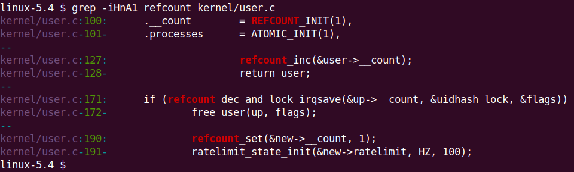

Hình 7.1 – Ảnh chụp việc dùng các interface refcount\_t trong kernel/user.c

Hãy tra tài liệu interface API `refcount_t` (`https://www.kernel.org/doc/html/latest/driver-api/basics.html#reference-counting`); `refcount_dec_and_lock_irqsave()` trả về `true` và giữ spinlock với interrupt bị vô hiệu hóa nếu có thể giảm reference counter về `0`, nếu không trả về `false`.

Bài tập cho bạn là chuyển driver code trước, `ch16/2_miscdrv_rdwr_spinlock/miscdrv_rdwr_spinlock.c`, sang dùng refcount; nó có các số nguyên `ga` và `gb`, được bảo vệ bằng spinlock khi đọc hoặc ghi. Bây giờ, hãy biến chúng thành refcount variable và dùng API `refcount_t` thích hợp khi thao tác. Cẩn thận! Đừng để giá trị ra ngoài khoảng cho phép `[0..[U]INT_MAX]`! (Nhớ rằng khoảng là `[1..UINT_MAX-1]` với full refcount validation (bật `CONFIG_REFCOUNT_FULL`) và `[1..INT_MAX]` khi không phải full validation (mặc định)). Làm vậy thường dẫn đến macro `WARN()` được gọi (code cho demo trong Hình 7.1 không có trong GitHub repository):

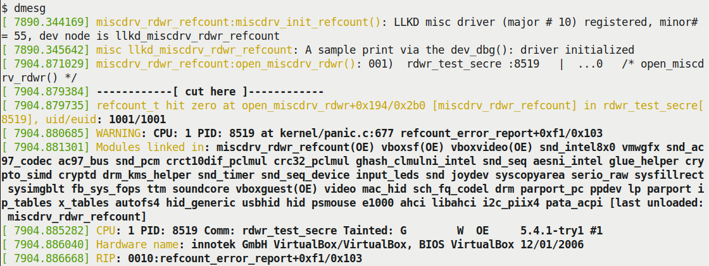

Hình 7.2 – (Một phần) ảnh chụp macro WARN() được kích hoạt khi cố đặt sai biến refcount\_t thành \<= 0

Kernel có hạ tầng kiểm thử thú vị và hữu ích gọi là Linux Kernel Dump Test Module (LKDTM); xem `drivers/misc/lkdtm/refcount.c` để biết nhiều test case chạy trên refcount interface mà bạn có thể học hỏi... Để bạn biết thêm, cũng có thể dùng LKDTM qua fault injection framework của kernel để kiểm thử và đánh giá phản ứng của kernel trước các tình huống lỗi (xem tài liệu tại đây: Provoking crashes with Linux Kernel Dump Test Module (LKDTM) – `https://www.kernel.org/doc/html/latest/fault-injection/provoke-crashes.html#provoking-crashes-with-linux-kernel-dump-test-module-lkdtm`).

Các atomic interface đã trình bày đều thao tác trên số nguyên 32-bit; còn 64-bit thì sao? Phần tiếp theo sẽ nói điều đó.

### Atomic integer operator 64-bit

Như đã đề cập lúc bắt đầu chủ đề, tập integer operator `atomic_t` đã trình bày đều thao tác trên số nguyên 32-bit truyền thống (thảo luận này không áp dụng cho interface `refcount_t` mới; chúng vốn hoạt động trên cả đại lượng 32-bit và 64-bit). Rõ ràng, khi hệ thống 64-bit hiện trở thành chuẩn thay vì ngoại lệ, cộng đồng kernel cung cấp tập atomic integer operator giống hệt cho số nguyên 64-bit. Khác biệt như sau:

- Khai báo atomic integer 64-bit dưới dạng biến kiểu `atomic64_t` (tức `atomic_long_t`).

- Với mọi operator, dùng tiền tố `atomic64_` thay cho `atomic_`.

Vậy hãy xét các ví dụ:

- Thay cho `ATOMIC_INIT()`, dùng `ATOMIC64_INIT()`.

- Thay cho `atomic_read()`, dùng `atomic64_read()`.

- Thay cho `atomic64_dec_if_positive()`, dùng `atomic64_dec_if_positive()`.

Các chuẩn ngôn ngữ C và C++ gần đây — C11 và C++11 — cung cấp atomic operations library giúp nhà phát triển triển khai atomicity dễ hơn nhờ hỗ trợ ngầm của ngôn ngữ; chúng ta không đi sâu khía cạnh này ở đây. Có thể tìm tài liệu tham khảo tại đây (C11 cũng có gần như các tương đương như vậy): `https://en.cppreference.com/w/c/atomic`.

Lưu ý rằng mọi routine này — cả atomic `_operators` 32-bit lẫn 64-bit — đều độc lập kiến trúc. Một điểm quan trọng cần nhắc lại là bất kỳ và mọi thao tác trên atomic integer đều phải được thực hiện bằng cách khai báo biến là `atomic_t` và dùng các method được cung cấp. Điều này bao gồm khởi tạo và cả thao tác đọc (số nguyên). Về triển khai nội bộ, một atomic integer operator `foo()` thường là macro trở thành inline function, rồi gọi hàm arch-specific `arch_foo()`. Như thường lệ, xem qua kernel documentation chính thức về atomic operator luôn là ý hay (trong kernel source tree, nằm ở đây: `Documentation/atomic_t.txt`; truy cập `https://www.kernel.org/doc/Documentation/atomic_t.txt`). Tài liệu phân loại gọn gàng nhiều atomic integer API thành những tập riêng. Để bạn biết thêm, vấn đề memory ordering arch-specific có ảnh hưởng đến triển khai nội bộ. Ở đây, chúng ta không đi sâu internals. Nếu quan tâm, hãy tham khảo trang trên kernel documentation chính thức tại `https://www.kernel.org/doc/html/v4.16/core-api/refcount-vs-atomic.html#refcount-t-api-compared-to-atomic-t` (ngoài ra, chi tiết memory ordering vượt phạm vi cuốn sách; xem kernel documentation tại `https://www.kernel.org/doc/Documentation/memory-barriers.txt` để biết thêm).

Ở đây chúng ta chưa cố trình bày mọi atomic API và refcount API (thực sự không cần thiết); kernel documentation chính thức đã bao quát:

- Interface `atomic_t`:

- Semantics and Behavior of Atomic and Bitmask Operations (`https://www.kernel.org/doc/html/v5.4/core-api/atomic_ops.html#semantics-and-behavior-of-atomic-and-bitmask-operations`)

- Tham khảo API: Atomics (`https://www.kernel.org/doc/html/latest/driver-api/basics.html#atomics`)

- Interface `refcount_t` (mới hơn) cho reference counting của kernel object:

- API `refcount_t` so với `atomic_t` (`https://www.kernel.org/doc/html/latest/core-api/refcount-vs-atomic.html#refcount-t-api-compared-to-atomic-t`)

- Tham khảo API: Reference counting (`https://www.kernel.org/doc/html/latest/driver-api/basics.html#reference-counting`)

Hãy chuyển sang cách dùng cấu trúc điển hình khi làm driver — Read Modify Write (RMW). Đọc tiếp!

## Dùng các RMW atomic operator

Cũng có tập atomic operator nâng cao hơn gọi là RMW API. Trong nhiều cách dùng (liệt kê ở mục tới) có thực hiện atomic RMW operation trên bit, nói cách khác thực hiện bitwise operation atomically (an toàn, không thể chia cắt). Với tư cách người viết device driver thao tác device register hay peripheral register, bạn thực sự sẽ dùng điều này.

Nội dung mục này giả định bạn có ít nhất kiến thức cơ bản về truy cập peripheral device (chip) memory và register; đã trình bày chi tiết trong `Chapter 3`, Làm việc với Hardware I/O Memory. Hãy bảo đảm hiểu trước khi đi tiếp.

Rất thường cần bit operation (phổ biến nhất là bitwise `AND &` và bitwise `OR` `|`) trên register; nhằm sửa giá trị, đặt và/hoặc xóa một số bit. Vấn đề là chỉ thao tác C để truy vấn hoặc đặt device register chưa đủ. Không, đừng quên concurrency! Đọc tiếp để biết đầy đủ.

### RMW atomic operation – thao tác device register

Trước hết nhắc nhanh kiến thức cơ bản: byte có 8 bit, đánh số từ bit `0`, Least Significant Bit (LSB), đến bit `7`, Most Significant Bit (MSB). (Thực ra được định nghĩa chính thức thành macro `BITS_PER_BYTE` trong `include/linux/bits.h`, cùng vài định nghĩa thú vị khác.)

Register cơ bản là phần memory nhỏ trong peripheral device; thường kích thước, register bit width, là 8, 16 hoặc 32 bit. Device register cung cấp thông tin control, status và khác, thường lập trình được. Thực tế phần lớn công việc người viết driver là lập trình device register thích hợp để device làm gì đó, và truy vấn. Để cụ thể, xét device giả tưởng có hai register: status register và control register, mỗi cái rộng 8 bit. (Thực tế mọi device hay chip có datasheet cung cấp đặc tả chi tiết chip và hardware register-level; đây là tài liệu thiết yếu cho người viết driver). Người thiết kế hardware thường gom nhiều register tuần tự trong phần memory lớn hơn; gọi register banking. Có base address của register đầu và offset đến mỗi register sau giúp định địa chỉ register bất kỳ dễ dàng (ở đây không đi sâu cách register được “map” vào virtual address space trên OS như Linux). Ví dụ register (hoàn toàn giả tưởng) có thể mô tả trong header file:

```
#define REG_BASE        0x5a00
#define STATUS_REG      (REG_BASE+0x0)
#define CTRL_REG        (REG_BASE+0x1)
```

Giả sử để bật device giả tưởng, datasheet nói đặt bit `7` (MSB) của control register thành `1`. Như người viết driver nhanh chóng học, có trình tự chuẩn để sửa register:

1\. Đọc giá trị register hiện tại vào temporary variable.

2\. Sửa variable thành giá trị mong muốn.

3\. Ghi variable trở lại register.

Thường gọi RMW sequence; tốt, viết (pseudo)code như sau:

```
turn_on_dev()
{
    u8 tmp;

    tmp = ioread8(CTRL_REG);  /* read: current register value into tmp */
    tmp |= 0x80;              /* modify: set bit 7 (MSB) */
    iowrite8(tmp, CTRL_REG);  /* write: new tmp value into register */
}
```

(Để bạn biết thêm, routine thực tế dùng trên Linux MMIO — memory-mapped I/O — là `ioread[8|16|32]()` và `iowrite[8|16|32]()`.)

Điểm chính: chưa đủ tốt; lý do là concurrency, data race! Nghĩ xem: register (cả CPU và device register) thực chất là global shared writable memory location; vì vậy truy cập là critical section, phải bảo vệ khỏi concurrent access! Cách làm dễ; có thể dùng spinlock (ít nhất hiện tại). Sửa pseudocode để chèn API `spin_[un]lock()` trong critical section — RMW sequence — rất đơn giản. Tuy nhiên có cách tốt hơn để an toàn dữ liệu với đại lượng nhỏ như integer; đã trình bày: atomic operator! Linux còn đi xa hơn, cung cấp tập atomic API cho cả:

- Atomic non-RMW operation (đã thấy trong mục Dùng các interface atomic\_t và refcount\_t)

- Atomic RMW operation; gồm nhiều loại operator phân thành các lớp: arithmetic, bitwise, swap (exchange), reference counting, miscellaneous và barrier

Đừng phát minh lại bánh xe; kernel documentation (`https://www.kernel.org/doc/Documentation/atomic_t.txt`) có đủ thông tin. Chỉ trình bày phần liên quan, trích trực tiếp từ `Documentation/atomic_t.txt` trong kernel code base:

```
// Documentation/atomic_t.txt
[ ... ]
Non-RMW ops:
  atomic_read(), atomic_set()
  atomic_read_acquire(), atomic_set_release()


RMW atomic operations:


Arithmetic:
  atomic_{add,sub,inc,dec}()
  atomic_{add,sub,inc,dec}_return{,_relaxed,_acquire,_release}()
  atomic_fetch_{add,sub,inc,dec}{,_relaxed,_acquire,_release}()


Bitwise:
  atomic_{and,or,xor,andnot}()
  atomic_fetch_{and,or,xor,andnot}{,_relaxed,_acquire,_release}()


Swap:
  atomic_xchg{,_relaxed,_acquire,_release}()
  atomic_cmpxchg{,_relaxed,_acquire,_release}()
  atomic_try_cmpxchg{,_relaxed,_acquire,_release}()


Reference count (but please see refcount_t):
  atomic_add_unless(), atomic_inc_not_zero()
  atomic_sub_and_test(), atomic_dec_and_test()
Misc:
  atomic_inc_and_test(), atomic_add_negative()
  atomic_dec_unless_positive(), atomic_inc_unless_negative()
[ ... ]
```

Tốt; giờ biết RMW (và non-RMW) operator, hãy thực hành — tiếp theo xem dùng RMW operator cho bit operation.

#### Dùng RMW bitwise operator

Ở đây tập trung RMW bitwise operator; để bạn khám phá loại khác (tham khảo kernel doc đã nói). Nghĩ lại cách viết pseudocode hiệu quả hơn. Có thể set (thành `1`) bit bất kỳ trong register hay memory item bằng API `set_bit()`:

```
void set_bit(unsigned int nr, volatile unsigned long *p);
```

Thao tác này atomically — an toàn, không thể chia cắt — đặt bit thứ `nr` của `p` thành `1`. (Thực tế device register (và có thể device memory) được map vào kernel virtual address space nên hiển thị như RAM location — như địa chỉ `p` ở đây. Gọi MMIO, cách phổ biến để người viết driver map và làm việc với device memory.)

Vì vậy, dùng RMW atomic operator, có thể an toàn đạt điều trước đã thử (sai) — bật device (giả tưởng) — bằng một dòng code:

```
set_bit(7, CTRL_REG);
```

Bảng sau tóm tắt RMW bitwise atomic API phổ biến:

| RMW bitwise atomic API | Chú thích |
|---|---|
| `void set_bit(unsigned int nr, volatile` `unsigned long *p);` | Atomically set (đặt thành `1`) bit thứ `nr` của `p`. |
| `void clear_bit(unsigned int nr, volatile` `unsigned long *p)` | Atomically clear (đặt thành `0`) bit thứ `nr` của `p`. |
| `void change_bit(unsigned int nr,` `volatile unsigned long *p)` | Atomically toggle bit thứ `nr` của `p`. |
| Các API sau trả về giá trị trước của bit được thao tác (nr) |  |
| `int test_and_set_bit(unsigned int nr,` `volatile unsigned long *p)` | Atomically set bit thứ `nr` của `p`, trả giá trị trước (kernel API doc tại `https://www.kernel.org/doc/htmldocs/kernel-api/API-test-and-set-bit.html`). |
| `int test_and_clear_bit(unsigned int nr,` `volatile unsigned long *p)` | Atomically clear bit thứ `nr` của `p`, trả giá trị trước. |
| `int test_and_change_bit(unsigned int nr,` `volatile unsigned long *p)` | Atomically toggle bit thứ `nr` của `p`, trả giá trị trước. |

Bảng 17.3 – RMW bitwise atomic API phổ biến

Cẩn thận: các atomic API không chỉ atomic đối với CPU core đang chạy, mà giờ đối với tất cả/core khác. Thực tế, ngụ ý nếu thực hiện atomic operation song song trên nhiều CPU, tức chúng (có thể) race, thì đó là critical section và phải bảo vệ bằng lock (thường spinlock)!

Thử vài RMW atomic API giúp tự tin dùng; làm trong mục sau.

#### Dùng bitwise atomic operator – ví dụ

Xem nhanh kernel module minh họa RMW atomic bit operator của Linux kernel (`ch13/1_rmw_atomic_bitops`). Cần hiểu operator có thể làm việc trên mọi memory, cả register (CPU hay device) hoặc RAM; ở đây thao tác static global variable đơn giản (tên `mem`) trong LKM ví dụ. Rất đơn giản; hãy xem:

```
// ch13/1_rmw_atomic_bitops/rmw_atomic_bitops.c
[ ... ]
#include <linux/spinlock.h>
#include <linux/atomic.h>
#include <linux/bitops.h>
#include "../../convenient.h"
[ ... ]
static unsigned long mem;
static u64 t1, t2;
static int MSB = BITS_PER_BYTE - 1;
DEFINE_SPINLOCK(slock);
```

Include header cần, khai báo và khởi tạo vài global variable (chú ý biến `MSB` dùng `BIT_PER_BYTE`). Dùng macro đơn giản `SHOW()` hiển thị formatted output bằng printk. Code path `init` làm việc thực tế:

```
[ ... ]
#define SHOW(n, p, msg) do {                                   \
    pr_info("%2d:%27s: mem : %3ld = 0x%02lx\n", n, msg, p, p); \
} while (0)
[ ... ]
static int __init atomic_rmw_bitops_init(void)
{
    int i = 1, ret;

    pr_info("%s: inserted\n", OURMODNAME);
    SHOW(i++, mem, "at init");

    setmsb_optimal(i++);
    setmsb_suboptimal(i++);

    clear_bit(MSB, &mem);
    SHOW(i++, mem, "clear_bit(7,&mem)");

    change_bit(MSB, &mem);
    SHOW(i++, mem, "change_bit(7,&mem)");

    ret = test_and_set_bit(0, &mem);
    SHOW(i++, mem, "test_and_set_bit(0,&mem)");
    pr_info(" ret = %d\n", ret);

    ret = test_and_clear_bit(0, &mem);
    SHOW(i++, mem, "test_and_clear_bit(0,&mem)");
    pr_info(" ret (prev value of bit 0) = %d\n", ret);

    ret = test_and_change_bit(1, &mem);
    SHOW(i++, mem, "test_and_change_bit(1,&mem)");
    pr_info(" ret (prev value of bit 1) = %d\n", ret);

    pr_info("%2d: test_bit(%d-0,&mem):\n", i, MSB);
    for (i = MSB; i >= 0; i--)
        pr_info(" bit %d (0x%02lx) : %s\n", i, BIT(i), test_bit(i,
&mem)?"set":"cleared");

    return 0; /* success */
}
```

RMW atomic operator dùng ở đây được in đậm. Phần chính demo là cho thấy RMW bitwise atomic operator không chỉ dễ hơn mà nhanh hơn nhiều cách truyền thống, tự thực hiện RMW operation trong spinlock. Đây là hai hàm cho hai cách:

```
/* Set the MSB; optimally, with the set_bit() RMW atomic API */
static inline void setmsb_optimal(int i)
{
    t1 = ktime_get_real_ns();
    set_bit(MSB, &mem);
    t2 = ktime_get_real_ns();
    SHOW(i, mem, "set_bit(7,&mem)");
    SHOW_DELTA(t2, t1);
}
/* Set the MSB; the traditional way, using a spinlock to protect the RMW
 * critical section  */
static inline void setmsb_suboptimal(int i)
{
    u8 tmp;

    t1 = ktime_get_real_ns();
    spin_lock(&slock);
    /* critical section: RMW : read, modify, write */
    tmp = mem;
    tmp |= 0x80; // 0x80 = 1000 0000 binary
    mem = tmp;
    spin_unlock(&slock);
    t2 = ktime_get_real_ns();

    SHOW(i, mem, "set msb suboptimal: 7,&mem");
    SHOW_DELTA(t2, t1);
}
```

Gọi các hàm sớm trong method `init`; chú ý lấy timestamp (qua routine `ktime_get_real_ns()`), hiển thị thời gian qua macro `SHOW_DELTA()` (định nghĩa trong header `convenient.h`). Đây là output:

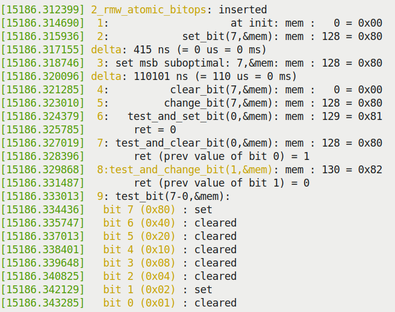

Hình 7.3 – Ảnh chụp output LKM ch13/1\_rmw\_atomic\_bitops, thể hiện một số atomic RMW operator hoạt động

(Tôi chạy demo LKM trên guest VM Ubuntu 20.04 x86\_64.) Cách hiện đại — qua RMW atomic bitwise API `set_bit()` — trong lần chạy mẫu chỉ mất 415 nanosecond; cách truyền thống chậm hơn khoảng 265 lần! Code (qua `set_bit()`) cũng đơn giản hơn nhiều...

Phần nào liên quan atomic bitwise operator, mục sau xem rất ngắn các API hiệu quả cao trong kernel để tìm bitmask — hóa ra khá phổ biến trong kernel.

### Tìm kiếm bitmask hiệu quả

Nhiều thuật toán phụ thuộc tìm bitmask thật nhanh; nhiều scheduling algorithm (như `SCHED_FIFO` và `SCHED_RR`, đã học trong tài liệu đồng hành Linux Kernel Programming - Chương 10, CPU Scheduler – Phần 1, và Chương 11, CPU Scheduler – Phần 2) thường cần nội bộ. Triển khai hiệu quả trở nên quan trọng (đặc biệt code path performance-sensitive OS-level). Vì vậy kernel có vài API scan bitmask cho trước (prototype trong `include/asm-generic/bitops/find.h`):

- `unsigned long find_first_bit(const unsigned long` `*addr, unsigned long size)`: Tìm bit được set đầu tiên trong memory region; trả bit number của bit được set đầu tiên, nếu không (không bit nào set) trả `@size`.

- `unsigned long find_first_zero_bit(const unsigned long` `*addr, unsigned long size)`: Tìm bit bị clear đầu tiên trong memory region; trả bit number của bit clear đầu tiên, nếu không (không bit nào clear) trả `@size`.

- Routine khác gồm `find_next_bit()`, `find_next_and_bit()`, `find_last_bit()`.

Xem header \<`linux/bitops.h>` còn thấy macro thú vị khác như `for_each_{clear,set}_bit{_from}()`.

## Dùng reader-writer spinlock

Hình dung kernel (hay driver) code tìm kiếm global doubly linked circular list lớn (vài nghìn node). Vì data structure global (shared, writable), truy cập là critical section cần bảo vệ.

Giả sử tìm list là non-blocking operation, thường dùng spinlock bảo vệ critical section. Cách ngây thơ có thể đề xuất không lock vì chỉ đọc, không cập nhật. Nhưng tất nhiên (như đã học), ngay read trên shared writable data cũng phải bảo vệ khỏi write vô tình xảy ra đồng thời, dẫn đến dirty/torn read. Kết luận cần spinlock; hình dung pseudocode như sau:

```
spin_lock(mylist_lock);
for (p = &listhead; (p = next_node(p)) != &listhead; ) {
    << ... search for something ...
         found? break out ... >>
}
spin_unlock(mylist_lock);
```

Vấn đề gì? Tất nhiên hiệu năng! Nhiều thread trên multicore system đến code gần cùng lúc; mỗi thread cố lấy spinlock, nhưng chỉ winner lấy được, duyệt toàn list rồi unlock, cho thread tiếp đi. Nói cách khác, như dự kiến, execution serialized, chậm đi rất nhiều. Nhưng không tránh được; hay có thể?

reader-writer spinlock xuất hiện. Locking construct này yêu cầu mọi thread đọc protected data xin read lock, còn thread cần write access list xin exclusive write lock. Read lock cấp ngay cho thread yêu cầu miễn hiện không có write lock. Thực chất cho mọi reader truy cập concurrent, nghĩa là không locking thực sự. Ổn khi chỉ reader. Khi writer thread đến, yêu cầu write lock. Giờ locking semantics thường áp dụng: writer chờ mọi reader unlock. Khi xong, writer lấy exclusive write lock và đi tiếp. Nếu reader/writer khác cố truy cập, bị buộc chờ spin cho đến writer unlock.

Vì vậy khi access pattern là read rất thường, write hiếm, và critical section khá dài, reader-writer spinlock performance-enhancing.

### Reader-writer spinlock interface

Đã dùng spinlock thì reader-writer variant đơn giản; lock data type được trừu tượng thành cấu trúc `rwlock_t` (thay `spinlock_t`), tên API chỉ thay `spin` bằng `read` hoặc `write`:

```
#include <linux/rwlock.h>
rwlock_t mylist_lock;
```

API cơ bản nhất của reader-writer spinlock:

```
void read_lock(rwlock_t *lock);
void write_lock(rwlock_t *lock);
```

Ví dụ layer `tty` của kernel có code xử lý Secure Attention Key (SAK); SAK là tính năng bảo mật, ngăn hack credential Trojan horse-type bằng kill mọi process gắn với TTY device. Xảy ra khi người dùng nhấn SAK (`https://www.kernel.org/doc/html/latest/security/sak.html`). Khi thực sự xảy ra (nhấn SAK, mặc định map vào chuỗi `Alt-SysRq-k`), trong code path phải duyệt mọi task, kill toàn session và mọi thread có TTY device đang mở. Để làm cần lấy reader-writer spinlock `tasklist_lock` ở read mode. Code liên quan (cắt bớt) sau, tô nổi bật `read_[un]lock()` trên `tasklist_lock`:

```
// drivers/tty/tty_io.c
void __do_SAK(struct tty_struct *tty)
{
    [...]
    read_lock(&tasklist_lock);
    /* Kill the entire session */
    do_each_pid_task(session, PIDTYPE_SID, p) {
        tty_notice(tty, "SAK: killed process %d (%s): by session\n",
task_pid_nr(p), p->comm);
        group_send_sig_info(SIGKILL, SEND_SIG_PRIV, p, PIDTYPE_SID);
    } while_each_pid_task(session, PIDTYPE_SID, p);
    [...]
    /* Now kill any processes that happen to have the tty open */
    do_each_thread(g, p) {
        [...]
    } while_each_thread(g, p);
    read_unlock(&tasklist_lock);
```

Ghi chú, trong tài liệu đồng hành Linux Kernel Programming - Chương 6, mục Kiến thức thiết yếu về Kernel Internals, Process và Thread, Duyệt task list, đã làm tương tự: viết kernel module (`https://github.com/PacktPublishing/Linux-Kernel-Programming/blob/master/ch6/foreach/thrd_showall/thrd_showall.c`) duyệt mọi thread trong task list, xuất vài chi tiết mỗi thread. Giờ hiểu concurrency, lẽ ra phải lấy chính lock này — `tasklist_lock` — reader-writer spinlock bảo vệ task list? Có, nhưng không hoạt động (`insmod(8)` thất bại với thông báo `thrd_showall: Unknown` `symbol tasklist_lock (err -2)`). Tất nhiên vì biến `tasklist_lock` không export nên kernel module không dùng được. Ví dụ khác về reader-writer spinlock trong kernel code base, filesystem `ext4` dùng khi làm việc với extent status tree. Không đi sâu ở đây; chỉ nói reader-writer spinlock (trong inode structure, `inode->i_es_lock`) được dùng khá nhiều bảo vệ extent status tree khỏi data race (`fs/ext4/extents_status.c`).

Có nhiều ví dụ trong kernel source tree; nhiều nơi ở network stack gồm ping code (`net/ipv4/ping.c`) dùng `rwlock_t`, routing table lookup, neighbor, PPP code, filesystem, v.v.

Giống spinlock thường, có biến thể reader-writer spinlock API: `{read,write}_lock_irq{save}()` ghép với `{read,write}_unlock_irq{restore}()` tương ứng, cùng interface `{read,write}_{un}lock_bh()`. Lưu ý ngay read IRQ lock cũng disable kernel preemption.

### Lưu ý thận trọng

reader-writer spinlock có vấn đề. Một vấn đề điển hình là writer có thể starve khi block trên nhiều reader. Nghĩ xem: ba reader thread đang giữ reader-writer lock. Giờ writer đến muốn lock. Phải chờ cả ba reader unlock. Nhưng nếu lúc đó thêm reader đến (hoàn toàn có thể)? Thảm họa với writer, phải chờ lâu hơn — thực chất starve. (Có thể cần instrument/profile kỹ code path để biết thực sự vậy không.)

Không chỉ vậy, cache effect — gọi cache ping-pong — có thể và thường xảy ra khi nhiều reader thread trên CPU core khác nhau đọc cùng shared state song song (khi giữ reader-writer lock); thực tế thảo luận trong mục Ảnh hưởng của cache và false sharing). Kernel documentation về spinlock (`https://www.kernel.org/doc/Documentation/locking/spinlocks.txt`) nói tương tự. Trích trực tiếp: “LƯU Ý! reader-writer lock cần nhiều atomic memory operation hơn spinlock đơn giản. Trừ khi reader critical section dài, tốt hơn chỉ dùng spinlock.” Thực tế cộng đồng kernel đang loại bỏ reader-writer spinlock nhiều nhất có thể, chuyển sang kỹ thuật lock-free tốt hơn (như RCU - Read Copy Update, công nghệ lock-free nâng cao). Vì vậy không nên dùng tùy tiện reader-writer spinlock.

Kernel documentation gọn và đơn giản về spinlock (chính Linus Torvalds viết), rất đáng đọc, tại: `https://www.kernel.org/doc/Documentation/locking/spinlocks.txt`.

### reader-writer semaphore

Trước đã đề cập semaphore object (`Chapter 6`, Kernel Synchronization – Phần 1, mục Semaphore và mutex), so sánh với mutex. Đã hiểu tốt hơn đơn giản dùng mutex. Ở đây chỉ ra trong kernel, cũng như reader-writer spinlock, có reader-writer semaphore. Use case và semantics tương tự reader-writer spinlock. Macro/API liên quan (trong `<linux/rwsem.h>`) là `{down,up}_{read,write}_{trylock,killable}()`. Ví dụ phổ biến trong cấu trúc `struct mm_struct` (nằm trong task structure), một member là reader-writer semaphore: `struct rw_semaphore mmap_sem;`.

Để hoàn tất, chỉ nhắc vài synchronization mechanism liên quan khác trong kernel. Cơ chế dùng nhiều khi phát triển user space application (đặc biệt Pthreads framework trong Linux user space) là Condition Variable (CV). Ngắn gọn, cho hai hay nhiều thread synchronize dựa trên giá trị dữ liệu hay state cụ thể. Tương đương trong Linux kernel gọi completion mechanism. Xem cách dùng trong kernel documentation tại `https://www.kernel.org/doc/html/latest/scheduler/completion.html#completions-wait-for-completion-barrier-apis`.

Sequence lock dùng trong tình huống chủ yếu write (ngược reader-write spinlock/semaphore lock phù hợp chủ yếu read), nơi write nhiều hơn read rất nhiều trên protected variable. Như tưởng tượng, không phổ biến lắm; ví dụ tốt là cập nhật global `jiffies_64`.

Ai tò mò, code cập nhật global `jiffies_64` bắt đầu tại `kernel/time/tick-sched.c:tick_do_update_jiffies64()`. Hàm xác định có cần cập nhật jiffies không, nếu có gọi `do_timer(++ticks);` để thực sự cập nhật. Suốt lúc đó API `write_seq[un]lock(&jiffies_lock);` bảo vệ critical section write-critical.

## Ảnh hưởng của cache và false sharing

Bộ xử lý hiện đại dùng nhiều cấp parallel cache memory bên trong để tăng tốc rất đáng kể khi làm việc với memory (đã nói ngắn trong tài liệu đồng hành Linux Kernel Programming - Chương 8, Cấp phát Kernel Memory cho người viết Module – Phần 1, mục Cấp phát slab memory). Ta hiểu CPU hiện đại không thực sự đọc/ghi RAM trực tiếp; khi software yêu cầu đọc byte RAM bắt đầu tại địa chỉ nào đó, CPU thực sự đọc nhiều byte — cả cacheline (thường 64 byte) từ địa chỉ đầu vào mọi CPU cache (giả sử L1, L2, L3: level 1, 2, 3). Nhờ vậy truy cập vài phần tử memory tuần tự tiếp theo nhanh hơn rất nhiều vì kiểm tra cache trước (L1 rồi L2 rồi L3, cache hit dễ xảy ra). Lý do nhanh hơn (nhiều) đơn giản: truy cập CPU cache memory thường từ một đến vài (single-digit) nanosecond, còn RAM từ 50 đến 100 nanosecond (tất nhiên tùy hardware và số tiền sẵn sàng bỏ ra!).

Nhà phát triển software tận dụng hiện tượng này bằng những việc như:

- Giữ member quan trọng của data structure cạnh nhau (hy vọng trong một cacheline) và ở đầu structure

- Padding structure member để không vượt khỏi cacheline (đã trình bày trong tài liệu đồng hành Linux Kernel Programming - Chương 8, Cấp phát Kernel Memory cho người viết Module – Phần 1, mục Data structure – vài mẹo thiết kế)

Tuy nhiên có rủi ro và mọi thứ có thể sai. Ví dụ hai biến khai báo: `u16 ax = 1, bx = 2;` (`u16` là unsigned integer 16-bit).

Vì khai báo liền nhau, rất có thể cùng CPU cacheline lúc runtime. Để hiểu vấn đề, xét multicore system hai CPU core, mỗi core có L1 và L2, cùng common/unified L3 cache. Thread T1 làm việc trên `ax`, thread T2 đồng thời (CPU core khác) trên `bx`. Khi T1 trên CPU `0` truy cập `ax` từ main memory (RAM), CPU cache chứa giá trị hiện tại `ax` và `bx` (vì cùng cacheline!). Tương tự T2 trên CPU `1` truy cập `bx` từ RAM, CPU cache cũng chứa giá trị hiện tại cả hai. Hình 7.4 mô tả khái niệm:

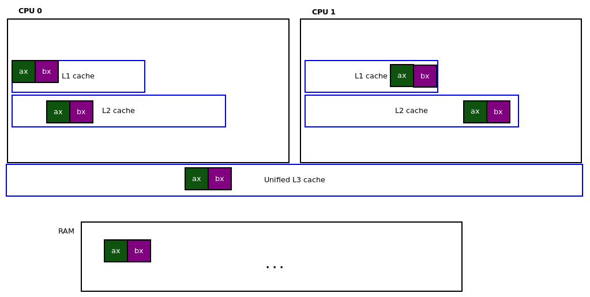

Hình 7.4 – Mô tả khái niệm CPU cache memory khi T1 và T2 làm việc song song trên hai biến liền nhau, mỗi thread trên một biến riêng

Đến đây ổn; nhưng nếu T1 thực hiện `ax ++`, còn T2 đồng thời `bx ++`? Thì sao? (Nhân tiện, có thể thắc mắc vì sao không lock? Thú vị là không liên quan thảo luận; không data race vì mỗi thread truy cập biến khác. Vấn đề là cùng CPU cacheline.)

Vấn đề: cache coherency. Bộ xử lý và/hoặc OS cùng bộ xử lý (rất arch-dependent) phải giữ cache và RAM synchronized/coherent. Vì vậy ngay khi T1 sửa `ax`, cacheline đó của CPU `0` phải invalidated, tức xảy ra flush cacheline từ CPU `0` cache đến RAM để cập nhật RAM giá trị mới, rồi ngay lập tức cập nhật RAM-to-CPU `1` cache để giữ coherent!

Nhưng cacheline còn chứa `bx`, và như đã nói, `bx` cũng đã được T2 sửa trên CPU `1`. Vì vậy gần cùng lúc, cacheline CPU `1` flush xuống RAM với giá trị mới `bx`, rồi cập nhật đến cache CPU `0` (suốt đó unified L3 cache cũng được đọc/cập nhật). Như hình dung, mọi cập nhật biến gây rất nhiều traffic giữa cache và RAM; chúng nảy qua lại. Thực tế thường gọi cache ping-pong! Rất có hại, làm xử lý chậm đáng kể. Hiện tượng gọi false sharing. Nhận ra false sharing mới khó; phải tìm biến trên shared cacheline được context khác nhau (thread hay thứ khác) cập nhật đồng thời.

Thú vị là triển khai trước của data structure then chốt ở memory management layer, `include/linux/mmzone.h:struct zone`, gặp chính false sharing: hai spinlock khai báo liền nhau! Đã sửa từ lâu (nói ngắn về memory zone trong tài liệu đồng hành Linux Kernel Programming - Chương 7, Kiến thức thiết yếu về Memory Management Internals, mục Tổ chức physical RAM/zone).

Sửa false sharing thế nào? Dễ: bảo đảm biến cách đủ xa để không cùng cacheline (thường chèn dummy padding byte giữa biến). Cũng xem tham khảo false sharing trong mục Đọc thêm.

## Lập trình Lock-free với per-CPU variable

Như đã học, khi thao tác shared writable data, critical section phải được bảo vệ bằng cách nào đó. Locking có lẽ phổ biến nhất. Tuy nhiên không hoàn toàn tốt vì hiệu năng có thể giảm. Để hiểu, xét ví dụ lock: phễu có cuống chỉ đủ một thread đi mỗi lần. Khác là một trạm thu phí trên cao tốc đông, hay đèn giao thông ở giao lộ đông. Giúp hình dung vì sao locking gây bottleneck, một số trường hợp nghiêm trọng làm hiệu năng chậm như bò. Tệ hơn, tác hại nhân lên trên multicore system high-end vài trăm core; thực chất locking không scale tốt.

Vấn đề khác là lock contention; lock cụ thể được acquire thường thế nào? Tăng số lock có lợi giảm contention cho lock giữa hai hay nhiều process (hay thread). Gọi lock proficiency. Tuy nhiên không scale vô hạn: sau một lúc hàng nghìn lock trên hệ thống (Linux kernel thực tế vậy) không phải tin tốt — cơ hội deadlock tinh vi tăng đáng kể. Có nhiều thách thức — hiệu năng, deadlock, priority inversion, convoying (do lock ordering, code path nhanh chờ code chậm đầu đã lấy lock mà code nhanh cũng cần), v.v. Phát triển kernel scalable lên cấp nữa đòi hỏi lock-free algorithm và triển khai trong kernel. Dẫn đến kỹ thuật đổi mới như per-CPU (PCP) data, lock-free data structure (theo thiết kế), RCU.

Tuy nhiên sách chỉ chọn trình bày khá chi tiết per-CPU như kỹ thuật lock-free programming. Chi tiết RCU (cùng data structure lock-free theo thiết kế) ngoài phạm vi. Xem mục Đọc thêm để có tài nguyên hữu ích về RCU, ý nghĩa và cách dùng trong Linux kernel.

### Per-CPU variable

Như tên, per-CPU variable giữ bản sao biến, dữ liệu đang xét, cho mỗi CPU (live) trên hệ thống. Thực chất loại bỏ vùng vấn đề concurrency, critical section, bằng tránh chia sẻ dữ liệu giữa thread. Với per-CPU data, mỗi CPU tham chiếu bản sao riêng nên thread chạy trên processor đó thao tác không lo race. (Gần tương tự local variable; nằm trên private stack mỗi thread, không shared nên không critical section, không cần locking.) Ở đây cũng loại bỏ nhu cầu locking — thành công nghệ lock-free!

Nếu chạy hệ thống bốn CPU core live, per-CPU variable thực chất là array bốn phần tử: `0` biểu diễn giá trị trên CPU đầu, `1` trên CPU core thứ hai, v.v. Hiểu vậy sẽ thấy per-CPU variable gần tương tự triển khai user space Pthreads Thread Local Storage (TLS), mỗi thread tự động nhận bản sao biến (TLS) đánh dấu keyword `__thread`. Ở đó và ở đây với per-CPU variable, rõ ràng: chỉ dùng per-CPU variable cho dữ liệu nhỏ. Vì dữ liệu được tạo lại (copy) một instance mỗi CPU core (trên hệ thống high-end vài trăm core overhead tăng). Đề cập ví dụ dùng per-CPU trong kernel code base (mục Dùng Per-CPU trong kernel). Khi làm per-CPU variable, phải dùng helper method (macro/API) kernel cung cấp, không cố truy cập trực tiếp (như refcount/atomic operator).

#### Làm việc với per-CPU

Tiếp cận helper API và macro (method) cho per-CPU data bằng hai phần. Trước học cấp phát, khởi tạo, sau đó giải phóng per-CPU data. Rồi học làm việc (đọc/ghi).

##### Cấp phát, khởi tạo và giải phóng per-CPU variable

Có hai loại per-CPU variable tổng quát: cấp phát tĩnh và động. per-CPU variable tĩnh được cấp phát ngay compile time, thường qua macro `DEFINE_PER_CPU` hoặc `DECLARE_PER_CPU`. Dùng `DEFINE` cho cấp phát và khởi tạo. Ví dụ cấp phát một integer làm per-CPU variable:

```
#include <linux/percpu.h>
DEFINE_PER_CPU(int, pcpa);      // signature: DEFINE_PER_CPU(type, name)
```

Trên hệ thống bốn CPU core chẳng hạn, về khái niệm khi khởi tạo như sau:

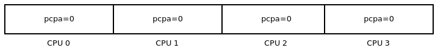

Hình 7.5 – Biểu diễn khái niệm per-CPU data trên hệ thống bốn CPU live

(Triển khai thực tế phức tạp hơn nhiều; xem mục Đọc thêm về nội bộ.) Ngắn gọn dùng per-CPU variable tăng hiệu năng code path time-sensitive vì:

- Tránh lock tốn kém làm performance-busting.

- Truy cập và thao tác per-CPU variable bảo đảm ở trên một CPU core cụ thể; loại bỏ cache effect đắt như cache ping-pong, false sharing (mục Ảnh hưởng của cache và false sharing).

Cấp phát động per-CPU data qua wrapper macro `alloc_percpu()` hoặc `alloc_percpu_gfp()`, chỉ truyền kiểu dữ liệu object cần cấp phát per-CPU, với macro sau truyền thêm allocation flag `gfp`:

```
alloc_percpu[_gfp](type [,gfp]);
```

Routine bên dưới `__alloc_per_cpu[_gfp]()` export qua `EXPORT_SYMBOL_GPL()` (nên chỉ dùng khi LKM phát hành GPL-compatible license).

Như đã học, resource-managed API variant `devm_*()` cho phép (thường khi viết driver) dùng thuận tiện routine cấp phát memory; kernel lo giải phóng, giúp ngăn leakage. Macro `devm_alloc_percpu(dev, type)` là resource-managed version của `__alloc_percpu()`.

Memory cấp phát qua routine trên phải giải phóng sau bằng API `void free_percpu(void __percpu *__pdata)`.

##### Thực hiện I/O (đọc và ghi) trên per-CPU variable

Câu hỏi chính: chính xác truy cập (đọc) và cập nhật (ghi) per-CPU variable thế nào? Kernel cung cấp nhiều helper routine; xem ví dụ đơn giản. Định nghĩa integer per-CPU variable, sau muốn truy cập và in giá trị hiện tại. Vì per-CPU, giá trị lấy auto-calculated theo CPU core code đang chạy; nếu code sau chạy trên core `1`, thực chất lấy `pcpa[1]` (không thực hiện chính xác vậy; chỉ khái niệm):

```
DEFINE_PER_CPU(int, pcpa);
int val;
[ ... ]
val = get_cpu_var(pcpa);
pr_info("cpu0: pcpa = %+d\n", val);
put_cpu_var(pcpa);
```

Cặp macro `{get,put}_cpu_var()` cho lấy/sửa per-CPU value an toàn của per-CPU variable cho trước (tham số). Quan trọng hiểu code giữa `get_cpu_var()` và `put_cpu_var()` (hay tương đương) thực chất là critical section — atomic context — nơi disable kernel preemption, cấm mọi blocking (hay sleeping). Nếu làm bất cứ gì block (sleep) ở đây là kernel bug. Ví dụ xem khi cố cấp phát memory bằng `vmalloc()` trong cặp macro `get_cpu_var()`/`put_cpu_var()`:

```
void *p;
val = get_cpu_var(pcpa);
p = vmalloc(20000);
pr_info("cpu1: pcpa = %+d\n", val);
put_cpu_var(pcpa);
vfree(p);
[ ... ]

$ sudo insmod <whatever>.ko
$ dmesg
[ ... ]
BUG: sleeping function called from invalid context at mm/slab.h:421
[67641.443225] in_atomic(): 1, irqs_disabled(): 0, pid: 12085, name:
thrd_1/1
[ ... ]
$
```

(Nhân tiện gọi wrapper `printk()` (hay `pr_<foo>()`) trong critical section như đang làm là ổn vì non-blocking.) Vấn đề là API `vmalloc()` có thể blocking; có thể sleep (thảo luận chi tiết trong tài liệu đồng hành Linux Kernel Programming - Chương 9, Cấp phát Kernel Memory cho người viết Module – Phần 2, mục Tìm hiểu và dùng kernel API vmalloc()), trong khi code giữa cặp `get_cpu_var()`/`put_cpu_var()` phải atomic, non-blocking.

Nội bộ macro `get_cpu_var()` gọi `preempt_disable()`, disable kernel preemption, `put_cpu_var()` đảo ngược bằng `preempt_enable()`. Như đã thấy (các chương CPU scheduling trong tài liệu đồng hành Linux Kernel Programming), có thể nested và kernel giữ biến `preempt_count` xác định kernel preemption thực sự enable hay disable. Kết quả là phải ghép đúng macro `{get,put}_cpu_var()` (ví dụ gọi `get` hai lần thì cũng phải gọi `put` hai lần).

`get_cpu_var()` là lvalue nên có thể thao tác; ví dụ tăng per-CPU variable `pcpa`, chỉ cần:

```
get_cpu_var(pcpa) ++;
put_cpu_var(pcpa);
```

Cũng có thể lấy per-CPU value hiện tại (an toàn) qua macro:

```
per_cpu(var, cpu);
```

Vậy để lấy per-CPU variable `pcpa` cho mỗi CPU core hệ thống, dùng:

```
for_each_online_cpu(i) {
    val = per_cpu(pcpa, i);
    pr_info(" cpu %2d: pcpa = %+d\n", i, val);
}
```

Để biết thêm, luôn có thể dùng macro `smp_processor_id()` xác định đang chạy CPU core nào; thực tế chính cách macro `convenient.h:PRINT_CTX()` làm.

Tương tự, kernel cung cấp routine làm việc với pointer đến biến cần per-CPU, các macro `{get,put}_cpu_ptr()` và `per_cpu_ptr()`. Được dùng nhiều khi làm per-CPU data structure (khác chỉ integer đơn giản); lấy an toàn pointer đến structure của CPU đang chạy và dùng (`per_cpu_ptr()`).

#### Per-CPU – kernel module ví dụ

hands-on sample per-CPU demo kernel module chắc chắn giúp dùng tính năng mạnh này (code: `ch13/2_percpu`). Ở đây định nghĩa và dùng hai per-CPU variable:

- per-CPU integer cấp phát và khởi tạo tĩnh

- per-CPU data structure cấp phát động

Để demo per-CPU variable thú vị, làm như sau: cho demo kernel module spawn vài kernel thread, gọi `thrd_0` và `thrd_1`. Hơn nữa, khi tạo, dùng CPU mask (và API) gắn affinity kernel thread `thrd_0` với CPU `0`, `thrd_1` với CPU `1` (nên chỉ schedule chạy trên các core này; tất nhiên kiểm thử trên VM ít nhất hai CPU core).

Code snippet sau minh họa định nghĩa và dùng per-CPU variable (bỏ code tạo kernel thread và CPU affinity mask vì không liên quan nội dung chương; dù vậy quan trọng phải duyệt toàn code và thử!):

```
// ch13/2_percpu/percpu_var.c
[ ... ]
/*--- The per-cpu variables, an integer 'pcpa' and a data structure --- */
/* This per-cpu integer 'pcpa' is statically allocated and initialized to 0
*/
DEFINE_PER_CPU(int, pcpa);

/* This per-cpu structure will be dynamically allocated via alloc_percpu()
*/
static struct drv_ctx {
    int tx, rx; /* here, as a demo, we just use these two members,
                   ignoring the rest */
    [ ... ]
} *pcp_ctx;
[ ... ]

static int __init init_percpu_var(void)
{
    [ ... ]
    /* Dynamically allocate the per-cpu structures */
    ret = -ENOMEM;
    pcp_ctx = (struct drv_ctx __percpu *) alloc_percpu(struct drv_ctx);
    if (!pcp_ctx) {
        [ ... ]
}
```

Vì sao không dùng resource-managed `devm_alloc_percpu()`? Có, nên dùng khi phù hợp; nhưng ở đây không viết driver đúng nghĩa, không có pointer `struct device *dev` sẵn, là tham số đầu bắt buộc của `devm_alloc_percpu()`.

Nhân tiện, gặp vấn đề khi viết kernel module: để đặt CPU mask (đổi CPU affinity mỗi kernel thread), kernel API là hàm `sched_setaffinity()`, tiếc không export nên không dùng được. Vì vậy làm điều chắc chắn là hack: lấy địa chỉ hàm không hợp tác qua `kallsyms_lookup_name()` (hoạt động khi định nghĩa `CONFIG_KALLSYMS`), rồi gọi qua function pointer. Hoạt động nhưng chắc chắn không đúng cách viết code.

Ý tưởng thiết kế tạo hai kernel thread, mỗi thread thao tác per-CPU data variable khác nhau. Nếu global variable thường, chắc chắn là critical section cần lock; nhưng chính vì per-CPU và bảo đảm thread chạy core riêng, có thể cập nhật concurrent bằng dữ liệu khác! Kernel thread worker routine sau, argument là thread number (`0` hay `1`). Theo đó rẽ nhánh, thao tác per-CPU data (kernel thread đầu tăng integer ba lần, kernel thread thứ hai giảm ba lần):

```
/* Our kernel thread worker routine */
static int thrd_work(void *arg)
{
    int i, val;
    long thrd = (long)arg;
    struct drv_ctx *ctx;
    [ ... ]

    /* Set CPU affinity mask to 'thrd', which is either 0 or 1 */
    if (set_cpuaffinity(thrd) < 0) {
        [ ... ]
    SHOW_CPU_CTX();

    if (thrd == 0) { /* our kthread #0 runs on CPU 0 */
        for (i=0; i<THRD0_ITERS; i++) {
            /* Operate on our perpcu integer */
            val = ++ get_cpu_var(pcpa);
            pr_info(" thrd_0/cpu0: pcpa = %+d\n", val);
            put_cpu_var(pcpa);

            /* Operate on our perpcu structure */
            ctx = get_cpu_ptr(pcp_ctx);
            ctx->tx += 100;
            pr_info(" thrd_0/cpu0: pcp ctx: tx = %5d, rx = %5d\n",
                ctx->tx, ctx->rx);
            put_cpu_ptr(pcp_ctx);
        }
    } else if (thrd == 1) { /* our kthread #1 runs on CPU 1 */
        for (i=0; i<THRD1_ITERS; i++) {
            /* Operate on our perpcu integer */
            val = -- get_cpu_var(pcpa);
            pr_info(" thrd_1/cpu1: pcpa = %+d\n", val);
            put_cpu_var(pcpa);
            /* Operate on our perpcu structure */
            ctx = get_cpu_ptr(pcp_ctx);
            ctx->rx += 200;
            pr_info(" thrd_1/cpu1: pcp ctx: tx = %5d, rx = %5d\n",
                ctx->tx, ctx->rx);
            put_cpu_ptr(pcp_ctx);
        }
    }
    disp_vars();
    pr_info("Our kernel thread #%ld exiting now...\n", thrd);
    return 0;
}
```

Tác động runtime thú vị; xem kernel log:

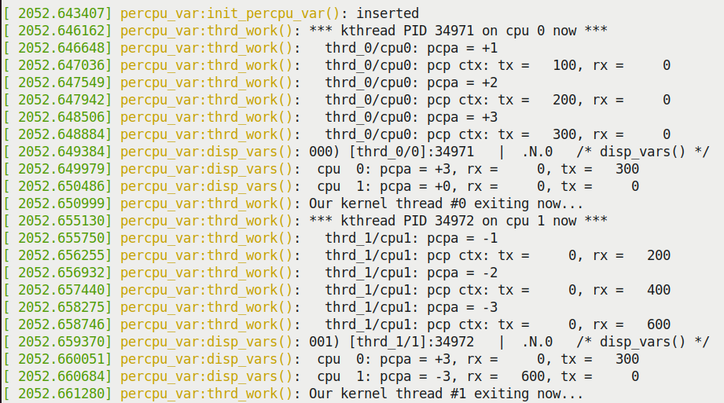

Hình 7.6 – Ảnh chụp kernel log khi LKM ch13/2\_percpu/percpu\_var chạy

Trong ba dòng output cuối Hình 7.6, thấy tóm tắt giá trị per-CPU data variable trên CPU `0` và CPU `1` (hiển thị qua hàm `disp_vars()`). Rõ ràng per-CPU integer `pcpa` (và data structure `pcp_ctx`) có giá trị khác như dự kiến, không locking tường minh.

Kernel module vừa demo dùng macro `for_each_online_cpu(i)` hiển thị giá trị per-CPU variable trên mỗi online CPU. Nếu VM có sáu CPU nhưng chỉ muốn hai CPU “live” lúc runtime? Có nhiều cách; một là truyền tham số `maxcpus=n` cho kernel VM lúc boot — xem có bằng tra `/proc/cmdline`:

```
$ cat /proc/cmdline
BOOT_IMAGE=/boot/vmlinuz-5.4.0-llkd-dbg
root=UUID=1c4<...> ro console=ttyS0,115200n8
console=tty0  quiet splash 3 maxcpus=2
```

Chú ý đang chạy custom debug kernel `5.4.0-llkd-dbg`.

#### Dùng Per-CPU trong kernel

Per-CPU variable được dùng khá nhiều trong Linux kernel; trường hợp thú vị là triển khai macro `current` trên x86 (đã trình bày dùng macro `current` trong tài liệu đồng hành Linux Kernel Programming - Chương 6, Kiến thức thiết yếu về Kernel Internals – Process và Thread, mục Truy cập task structure với current). Thực tế `current` được tra (và đặt) thường xuyên; giữ per-CPU bảo đảm truy cập lock-free! Code triển khai:

```
// arch/x86/include/asm/current.h
[ ... ]
DECLARE_PER_CPU(struct task_struct *, current_task);
static __always_inline struct task_struct *get_current(void)
{
    return this_cpu_read_stable(current_task);
}
#define current get_current()
```

Macro `DECLARE_PER_CPU()` khai báo biến `current_task` làm per-CPU variable kiểu `struct task_struct *`. Inline function `get_current()` gọi helper `this_cpu_read_stable()` trên per-CPU variable này, đọc giá trị `current` trên CPU core đang chạy (đọc comment tại `https://elixir.bootlin.com/linux/v5.4/source/arch/x86/include/asm/percpu.h#L383` để biết routine). Tốt, nhưng FAQ: per-CPU variable `current_task` được cập nhật ở đâu? Nghĩ xem: kernel phải đổi (cập nhật) `current` mỗi khi context switch sang task khác. Đúng vậy; thực sự cập nhật trong context-switching code (`arch/x86/kernel/process_64.c:__switch_to()`; tại `https://elixir.bootlin.com/linux/v5.4/source/arch/x86/kernel/process_64.c#L504`):

```
__visible __notrace_funcgraph struct task_struct *
__switch_to(struct task_struct *prev_p, struct task_struct *next_p)
{
    [ ... ]
    this_cpu_write(current_task, next_p);
    [ ... ]
}
```

Tiếp theo thử nhanh cho thấy dùng per-CPU trong kernel code base qua `__alloc_percpu()`: chạy `cscope -d` ở root kernel source tree (giả định đã build index `cscope` qua `make cscope`). Trong menu `cscope`, dưới prompt `Find functions calling this function:`, gõ `__alloc_percpu`. Kết quả:

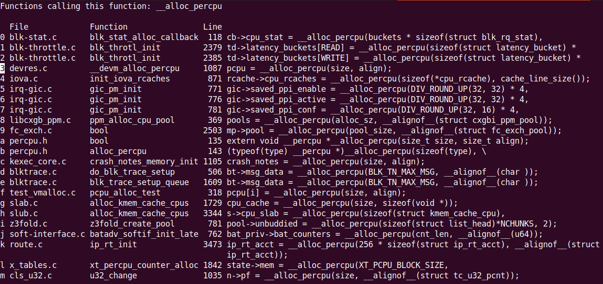

Hình 7.7 – (Một phần) ảnh chụp output cscope -d thể hiện kernel code gọi API \_\_alloc\_percpu()

Tất nhiên chỉ danh sách một phần dùng per-CPU trong kernel code base, chỉ theo dõi qua underlying API `__alloc_percpu()`. Tìm hàm gọi `alloc_percpu[_gfp]()` (wrapper trên `__alloc_percpu[_gfp]()`) cho nhiều kết quả hơn.

Đến đây hoàn tất thảo luận kỹ thuật và API kernel synchronization, hãy kết thúc chương bằng lĩnh vực then chốt: công cụ và mẹo debug locking issue trong kernel code!

## Lock debugging trong kernel

Kernel có nhiều cách giúp debug tình huống khó về kernel-level locking issue, deadlock là một loại chính.

Nếu chưa, hãy bảo đảm đọc trước nền tảng synchronization, locking và hướng dẫn deadlock ở chương trước (`Chapter 6`, Kernel Synchronization – Phần 1, đặc biệt các mục Exclusive execution và atomicity, Các vấn đề concurrency trong Linux kernel).

Với mọi tình huống debug, có những thời điểm debugging khác nhau nên có thể dùng công cụ/kỹ thuật khác nhau. Nói rất tổng quát, bug có thể được nhận thấy và debug tại vài thời điểm khác nhau (thực sự trong Software Development Life Cycle (SDLC)):

- Trong phát triển

- Sau phát triển nhưng trước phát hành (kiểm thử, Quality Assurance (QA), v.v.)

- Sau phát hành nội bộ

- Sau phát hành, ngoài thực địa

Lời răn well-known tiếc thay đúng: bug lộ càng “xa” lúc phát triển, sửa càng tốn! Vì vậy thực sự muốn tìm và sửa sớm nhất có thể!

Sách tập trung phát triển kernel, nên ở đây tập trung vài công cụ/kỹ thuật debug locking issue lúc phát triển.

Quan trọng: Kỳ vọng giờ bạn chạy debug kernel, tức kernel cố tình configure cho phát triển/debug. Hiệu năng giảm, nhưng ổn — đang săn bug! Đã trình bày configure debug kernel điển hình trong tài liệu đồng hành Linux Kernel Programming - Chương 5, Viết kernel module đầu tiên – LKM Phần 2, mục Configure debug kernel, và cung cấp sample kernel configuration file tại `https://github.com/PacktPublishing/Linux-Kernel-Programming/blob/master/ch5/kconfigs/sample_kconfig_llkd_dbg.config`. Chi tiết configure debug kernel cho lock debugging ngay phần tiếp.

### Configure debug kernel cho lock debugging

Vì liên quan và quan trọng với lock debugging, xem nhanh điểm chính từ tài liệu Linux Kernel patch submission checklist (`https://www.kernel.org/doc/html/v5.4/process/submit-checklist.html`) liên quan nhất thảo luận enable debug kernel (đặc biệt lock debugging):

```
// https://www.kernel.org/doc/html/v5.4/process/submit-checklist.html
[...]
12. Has been tested with CONFIG_PREEMPT, CONFIG_DEBUG_PREEMPT,
CONFIG_DEBUG_SLAB, CONFIG_DEBUG_PAGEALLOC, CONFIG_DEBUG_MUTEXES,
CONFIG_DEBUG_SPINLOCK, CONFIG_DEBUG_ATOMIC_SLEEP, CONFIG_PROVE_RCU and
CONFIG_DEBUG_OBJECTS_RCU_HEAD all simultaneously enabled.
13. Has been build- and runtime tested with and without CONFIG_SMP and
CONFIG_PREEMPT.

16. All codepaths have been exercised with all lockdep features enabled.
[ ... ]
```

Dù không trình bày trong sách, phải nhắc dynamic memory error detector rất mạnh Kernel Address SANitizer (KASAN). Ngắn gọn, dùng compile-time instrumentation-based dynamic analysis để bắt memory-related bug phổ biến (cả GCC và Clang). ASan (Address Sanitizer), kỹ sư Google đóng góp, giám sát/phát hiện memory issue trong user space app (trình bày khá chi tiết, so sánh valgrind trong sách Hands-On System Programming for Linux). Tương đương kernel, KASAN, có từ kernel 4.0 cho x86\_64 và AArch64 (ARM64, từ Linux 4.4). Chi tiết (enable, dùng) trong kernel documentation (`https://www.kernel.org/doc/html/v5.4/dev-tools/kasan.html#the-kernel-address-sanitizer-kasan`); rất khuyến nghị bật trong debug kernel.

Như tài liệu đồng hành Linux Kernel Programming - Chương 2, Build Linux kernel 5.x từ Source – Phần 1, có thể configure Linux kernel theo nhu cầu. Ở đây (root kernel source tree 5.4.0), thực hiện `make` `menuconfig`, đến menu `Kernel hacking / Lock Debugging (spinlocks,` `mutexes, etc...)` (Hình 7.8, chụp guest VM Ubuntu 20.04 LTS x86\_64):

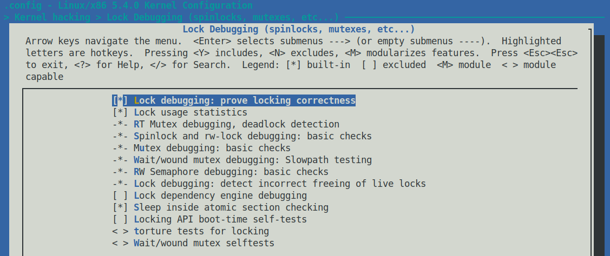

Hình 7.8 – Ảnh chụp (cắt bớt) menu kernel hacking / Lock Debugging (spinlocks, mutexes, etc...) với các mục cần cho debug kernel được bật

Hình 7.8 là ảnh chụp (cắt bớt) menu `<Kernel hacking > Lock Debugging` `(spinlocks, mutexes, etc...)` với các mục cần cho debug kernel được bật.

Thay vì tương tác từng menu item, chọn `<Help>` để biết ý nghĩa, cách đơn giản hơn lấy cùng thông tin là xem Kconfig file liên quan (mô tả menu). Ở đây `lib/Kconfig.debug`, mọi menu debug-related ở đó. Trường hợp này tìm chuỗi `menu "Lock Debugging (spinlocks, mutexes,` `etc...)"`, nơi mục `Lock Debugging` bắt đầu (xem bảng sau).

Bảng sau tóm tắt mỗi kernel lock debugging configuration option giúp debug gì (không trình bày tất cả, một số trích trực tiếp file `lib/Kconfig.debug`):

| Tiêu đề menu lock debugging | Chức năng |
|---|---|
| Lock debugging: chứng minh locking đúng (`CONFIG_PROVE_LOCKING`) | Kernel option `lockdep` – bật để có chứng minh liên tục tính đúng lock mọi lúc. Mọi khả năng deadlock locking-related được báo trước khi thực sự xảy ra; rất hữu ích! (Giải thích chi tiết ngay sau.) |
| Thống kê dùng lock (`CONFIG_LOCK_STAT`) | Theo dõi lock contention point (giải thích chi tiết ngay sau). |
| RT mutex debugging, phát hiện deadlock (`CONFIG_DEBUG_RT_MUTEXES`) | “Cho phép tự động phát hiện và báo vi phạm rt mutex semantics, deadlock (lockup) liên quan rt mutex.” |
| Spinlock và `rw-lock` debugging: kiểm tra cơ bản (`CONFIG_DEBUG_SPINLOCK`) | Bật (cùng `CONFIG_SMP`) giúp bắt thiếu khởi tạo spinlock và lỗi spinlock phổ biến khác. |
| Mutex debugging: kiểm tra cơ bản (`CONFIG_DEBUG_MUTEXES`) | “Cho phép phát hiện và báo vi phạm mutex semantics.” |
| RW semaphore debugging: kiểm tra cơ bản (`CONFIG_DEBUG_RWSEMS`) | Cho phép phát hiện/báo RW semaphore lock và unlock không khớp. |
| Lock debugging: phát hiện giải phóng live lock sai (`CONFIG_DEBUG_LOCK_ALLOC`) | “Kiểm tra held lock (spinlock, rwlock, mutex hay rwsem) có bị kernel giải phóng sai qua memory-freeing routine (`kfree(), kmem_cache_free(),` `free_pages(), vfree()`, v.v.), live lock bị khởi tạo lại sai qua `spin_lock_init()/mutex_init()`/v.v., hoặc còn lock được giữ khi task exit không.” |
| Kiểm tra sleep trong atomic section (`CONFIG_DEBUG_ATOMIC_SLEEP`) | “Nếu chọn Y, các routine có thể sleep sẽ báo rất ồn nếu gọi trong atomic section: khi giữ spinlock, trong rcu read side critical section, trong preempt disabled section, trong interrupt, v.v...” |
| Locking API self-tests boot-time (`CONFIG_DEBUG_LOCKING_API_SELFTESTS`) | “Chọn Y nếu muốn kernel chạy self-test ngắn lúc boot. self-test kiểm tra các loại locking bug phổ biến có được debugging mechanism phát hiện không. (Nếu disable lock debugging tất nhiên không phát hiện.) Bao quát locking API: spinlock, rwlock, mutex và rwsem.” |
| Torture test cho locking (`CONFIG_LOCK_TORTURE_TEST`) | “Cung cấp kernel module chạy torture test trên kernel locking primitive. Có thể build module sau trên running kernel cần kiểm thử nếu muốn.” (Có thể build inline với '`Y`' hoặc ngoài dạng module với '`M`')." |

Bảng 17.4 – Kernel lock debugging configuration option điển hình và ý nghĩa

Như gợi ý, bật tất cả/phần lớn lock debug option trong debug kernel dùng phát triển, kiểm thử là ý hay. Tất nhiên có thể chậm thực thi đáng kể (và dùng nhiều memory); như cuộc sống, trade-off phải quyết định: phát hiện locking issue, error, deadlock phổ biến đổi lấy tốc độ. Nên sẵn sàng hơn mức thông thường để chấp nhận trade-off này, đặc biệt phát triển (hay refactor) code.

### Lock validator lockdep – bắt locking issue sớm

Linux kernel có tính năng cực kỳ hữu ích đang chờ nhà phát triển tận dụng: runtime locking correctness hay locking dependency validator; ngắn là lockdep. Ý tưởng: runtime `lockdep` tham gia mỗi khi có locking activity trong kernel — lấy/release bất kỳ kernel-level lock hay locking sequence nhiều lock. Được theo dõi/map (đoạn sau nói hiệu năng và giảm tác động). Áp dụng quy tắc locking đúng well-known (gợi ý chương trước mục Hướng dẫn locking và deadlock), `lockdep` kết luận tính đúng của việc đã làm.

Điều hay là `lockdep` đạt chứng minh toán học (hay closure) 100% lock sequence đúng hay không. Trích trực tiếp kernel documentation (`https://www.kernel.org/doc/html/v5.4/locking/lockdep-design.html`):

“Validator đạt ‘closure’ toán học hoàn hảo (chứng minh tính đúng locking): với mỗi locking sequence đơn giản, độc lập, single-task xảy ra ít nhất một lần trong vòng đời kernel, chứng minh chắc chắn 100% rằng không tổ hợp và timing nào của các sequence này gây bất kỳ lớp deadlock liên quan lock nào.”

Hơn nữa `lockdep` cảnh báo (qua macro `WARN*()`) mọi vi phạm các lớp locking bug: deadlock/lock inversion, circular lock dependency, hard IRQ/soft IRQ safe/unsafe locking bug. Thông tin quý; validate code bằng `lockdep` tiết kiệm hàng trăm giờ năng suất bằng bắt sớm. (Để biết thêm, `lockdep` theo dõi mọi lock và locking sequence hay “lock chain”; xem qua `/proc/lockdep_chains`).

Về giảm tác động hiệu năng: có hàng nghìn hay nhiều hơn lock instance, validate mọi lock sequence sẽ cực chậm (thực tế nhiệm vụ có algorithmic time complexity `O(N^2)`!). Không hoạt động được; vì vậy `lockdep` chỉ verify tình huống locking (chẳng hạn code path lấy lock A rồi B — lock sequence hay lock chain) một lần đầu xảy ra. (Biết nhờ giữ 64-bit hash cho mỗi lock chain gặp.)

Cách user space sơ khai: rất sơ khai — không bảo đảm — để thử phát hiện deadlock là dùng GNU `ps(1)`; `ps -LA -o state,pid,cmd | grep "^D"` in mọi thread ở state `D` — uninterruptible sleep (`TASK_UNINTERRUPTIBLE`). Có thể do deadlock, cũng có thể không; kéo dài lâu thì khả năng cao hơn. Thử xem! Tất nhiên `lockdep` tốt hơn nhiều. (Chỉ hoạt động với GNU `ps`, không loại nhẹ như `busybox ps`.)

Công cụ user space hữu ích khác `strace(1)` và `ltrace(1)` — lần lượt trace chi tiết mọi system call và library call của process (hay thread); có thể bắt process/thread treo, xem kẹt đâu (`strace -p` `PID` đặc biệt hữu ích trên process treo).

Điểm cần rõ khác: `lockdep` cảnh báo locking sai (toán học) ngay cả khi không deadlock thực tế lúc runtime! `lockdep` cung cấp chứng minh có vấn đề có thể gây bug (deadlock, unsafe locking, v.v.) tương lai nếu không sửa; thường hoàn toàn đúng; nghiêm túc sửa. (Tuy nhiên thường không gì trong software đúng 100% mọi lúc: nếu chính code `lockdep` có bug? Thậm chí có config option `CONFIG_DEBUG_LOCKDEP`. Điều chính là con người chúng ta phải đánh giá kỹ, kiểm tra false positive.)

Tiếp, `lockdep` làm trên lock class; đơn giản lock “logic” khác instance “physical”. Ví dụ open file data structure kernel, `struct` `file`, có hai lock — mutex và spinlock — mỗi cái được `lockdep` xem là lock class. Dù vài nghìn instance `struct file` trong memory lúc runtime, `lockdep` chỉ theo class. Thêm chi tiết thiết kế nội bộ `lockdep`, tham khảo kernel documentation chính thức (`https://www.kernel.org/doc/html/v5.4/locking/lockdep-design.html`).

### Ví dụ – bắt deadlock bug với lockdep

Ở đây giả định đã build, chạy debug kernel bật `lockdep` (chi tiết trong mục Configure debug kernel cho lock debugging). Xác minh thực sự enable:

```
$ uname -r
5.4.0-llkd-dbg
$ grep PROVE_LOCKING /boot/config-5.4.0-llkd-dbg
CONFIG_PROVE_LOCKING=y
$
```

Tốt! Giờ hands-on deadlock, xem `lockdep` giúp bắt. Đọc tiếp!

#### Ví dụ 1 – bắt self deadlock bug với lockdep

Ví dụ đầu, quay lại kernel module trong tài liệu đồng hành Linux Kernel Programming - Chương 6, Kiến thức thiết yếu về Kernel Internals – Process và Thread, mục Duyệt task list, tại `https://github.com/PacktPublishing/Linux-Kernel-Programming/blob/master/ch6/foreach/thrd_showall/thrd_showall.c`. Ở đó lặp từng thread, in chi tiết từ task structure; code snippet lấy tên thread (nhớ member task structure `comm`):

```
// ch6/foreach/thrd_showall/thrd_showall.c
static int showthrds(void)
{
    struct task_struct *g = NULL, *t = NULL; /* 'g' : process ptr; 't':
thread ptr */
    [ ... ]
    do_each_thread(g, t) { /* 'g' : process ptr; 't': thread ptr */
        task_lock(t);
        [ ... ]
        if (!g->mm) {    // kernel thread
            snprintf(tmp, TMPMAX-1, " [%16s]", t->comm);
        } else {
            snprintf(tmp, TMPMAX-1, " %16s ", t->comm);
        }
        snprintf(buf, BUFMAX-1, "%s%s", buf, tmp);
        [ ... ]
```

Hoạt động nhưng có vẻ cách tốt hơn: thay tra trực tiếp tên bằng `t->comm` (như ở đây), kernel cung cấp helper routine `{get,set}_task_comm()` để lấy/đặt tên task. Vì vậy viết lại dùng helper macro `get_task_comm()`; tham số đầu buffer chứa tên (kỳ vọng đã cấp phát memory), tham số thứ hai pointer đến task structure thread cần tên (code snippet từ `ch13/3_lockdep/buggy_thrdshow_eg/thrd_showall_buggy.c`):

```
// ch13/3_lockdep/buggy_lockdep/thrd_showall_buggy.c
static int showthrds_buggy(void)
{
    struct task_struct *g, *t; /* 'g' : process ptr; 't': thread ptr */
    [ ... ]
    char buf[BUFMAX], tmp[TMPMAX], tasknm[TASK_COMM_LEN];
    [ ... ]
    do_each_thread(g, t) { /* 'g' : process ptr; 't': thread ptr */
        task_lock(t);
        [ ... ]
        get_task_comm(tasknm, t);
        if (!g->mm) // kernel thread
            snprintf(tmp, sizeof(tasknm)+3, " [%16s]", tasknm);
        else
            snprintf(tmp, sizeof(tasknm)+3, " %16s ", tasknm);
        [ ... ]
```

Khi compile và chèn vào kernel trên hệ thống kiểm thử (VM, may quá), có thể kỳ lạ, thậm chí treo! (Tôi lấy được kernel log qua `dmesg(1)` trước khi hệ thống mất phản hồi hoàn toàn.).

Nếu hệ thống treo ngay chèn LKM? Đó là hương vị khó khăn kernel debugging! Thử (đã hiệu quả khi tôi thử ví dụ trên VM Fedora 29 x86\_64) reboot VM treo, tra kernel log qua tiện ích systemd mạnh `journalctl(1)` với lệnh `journalctl --since="1 hour ago"`; giờ có thể thấy printk `lockdep`. Tiếc không bảo đảm phần log chính đã lưu disk (lúc treo) để `journalctl` lấy. Vì vậy kdump của kernel — rồi postmortem analysis kernel dump image file bằng `crash(8)` — có thể cứu nguy (xem tài nguyên `kdump` và crash trong mục Đọc thêm).

Xem kernel log rõ: `lockdep` bắt (self) deadlock (thể hiện phần output liên quan trong ảnh):

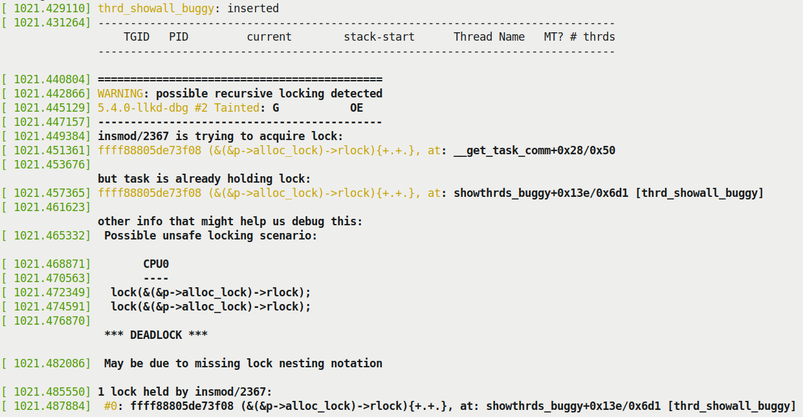

Hình 7.9 – (Một phần) ảnh chụp kernel log sau khi nạp module có bug; lockdep bắt self deadlock!

Dù còn nhiều chi tiết (gồm kernel stack backtrace của `insmod(8)` — process context ở đây, register value, v.v.), ảnh trên đủ suy ra. `lockdep` nói `insmod/2367 is trying to acquire lock:`, rồi `but task is` `already holding lock:`. Tiếp (nhìn kỹ Hình 7.9), lock `insmod` giữ là `(p->alloc_lock)` (tạm bỏ phần sau; giải thích ngay), routine cố acquire (sau `at:`) là `__get_task_comm+0x28/0x50`. Giờ rõ hơn: tìm chính xác khi gọi `get_task_comm()`; đó là macro wrapper quanh worker routine thực `__get_task_comm()`. Code:

```
// fs/exec.c
char *__get_task_comm(char *buf, size_t buf_size, struct task_struct *tsk)
{
    task_lock(tsk);
    strncpy(buf, tsk->comm, buf_size);
    task_unlock(tsk);
    return buf;
}
EXPORT_SYMBOL_GPL(__get_task_comm);
```

À vấn đề: hàm `__get_task_comm()` cố acquire lại chính lock đang giữ, gây (self) deadlock! Lấy ở đâu? Nhớ dòng code đầu trong kernel module (có bug) sau vào loop gọi `task_lock(t)`, vài dòng sau gọi `get_task_comm()`, nội bộ cố acquire cùng lock: kết quả self deadlock:

```
do_each_thread(g, t) {   /* 'g' : process ptr; 't': thread ptr */
    task_lock(t);
    [ ... ]
    get_task_comm(tasknm, t);
```

Hơn nữa tìm lock cụ thể dễ; tra code routine `task_lock()`:

```
// include/linux/sched/task.h */
static inline void task_lock(struct task_struct *p)
{
    spin_lock(&p->alloc_lock);
}
```

Giờ hợp lý: spinlock trong task structure tên `alloc_lock`, như `lockdep` báo. Báo cáo `lockdep` có vài ký hiệu khó hiểu. Xét các dòng:

```
[ 1021.449384] insmod/2367 is trying to acquire lock:
[ 1021.451361] ffff88805de73f08 (&(&p->alloc_lock)->rlock){+.+.}, at:
__get_task_comm+0x28/0x50
[ 1021.453676]
               but task is already holding lock:
[ 1021.457365] ffff88805de73f08 (&(&p->alloc_lock)->rlock){+.+.}, at:
showthrds_buggy+0x13e/0x6d1 [thrd_showall_buggy]
```

Bỏ timestamp, số cột ngoài trái dòng thứ hai trong code block trên là lightweight hash 64-bit nhận diện lock sequence cụ thể. Chú ý giống hệt hash dòng sau; biết cùng lock được thao tác! `{+.+.}` là ký hiệu lockdep cho state lúc acquire (nghĩa: `+` acquire với IRQ enable, `.` acquire với IRQ disable và không trong IRQ context, v.v.). Giải thích trong kernel documentation (`https://www.kernel.org/doc/Documentation/locking/lockdep-design.txt`); chỉ nói vậy.

Steve Rostedt có bài trình bày chi tiết diễn giải output `lockdep` tại Linux Plumber's Conference (2011); slide hữu ích, khám phá deadlock đơn giản/phức tạp và cách `lockdep` phát hiện: Lockdep: How to read its cryptic output (`https://blog.linuxplumbersconf.org/2011/ocw/sessions/153`).

##### Sửa lỗi

Giờ hiểu vấn đề, sửa thế nào? Xem và diễn giải báo cáo lockdep (Hình 7.9), khá đơn giản: (như nói) vì task structure spinlock `alloc_lock` đã lấy đầu loop `do-while` (qua `task_lock(t)`), bảo đảm unlock trước gọi routine `get_task_comm()` (nội bộ lấy/release chính lock đó), rồi gọi `get_task_comm()`, sau lock lại.

Ảnh sau (Hình 7.10) cho thấy khác biệt (qua tiện ích `diff(1)`) giữa phiên bản cũ có bug (`ch13/3_lockdep/buggy_thrdshow_eg/thrd_showall_buggy.c`) và mới sửa (`ch13/3_lockdep/fixed_lockdep/thrd_showall_fixed.c`):

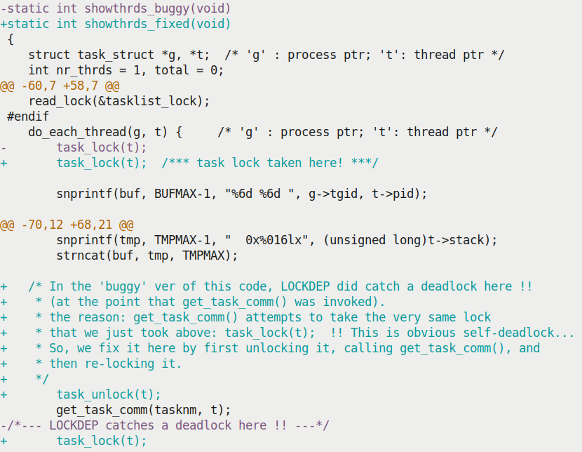

Hình 7.10 – (Một phần) ảnh chụp phần khác biệt chính giữa phiên bản có bug và đã sửa của demo LKM thrdshow

Tốt; tiếp ví dụ bắt AB-BA deadlock!

#### Ví dụ 2 – bắt AB-BA deadlock với lockdep

Thêm ví dụ, xem (demo) kernel module cố tình tạo circular dependency cuối cùng deadlock. Code: `ch13/3_lockdep/deadlock_eg_AB-BA`. Dựa module trước (`ch13/2_percpu`); như nhớ, tạo hai kernel thread, bảo đảm (dùng `sched_setaffinity()` hack) mỗi thread chạy CPU core riêng (đầu core `0`, sau core `1`).

Như vậy có concurrency. Trong thread dùng hai spinlock `lockA` và `lockB`. Hiểu process context có từ hai lock, ghi tài liệu và theo lock ordering: lấy lockA trước, rồi lockB. Tốt; vậy cách không nên làm:

```
kthread 0 on CPU #0                kthread 1 on CPU #1
  Take lockA                           Take lockB
     <perform work>                       <perform work>
                                          (Try and) take lockA
                                          < ... spins forever :
                                                DEADLOCK ... >
(Try and) take lockB
< ... spins forever :
      DEADLOCK ... >
```

Tất nhiên AB-BA deadlock kinh điển! Vì chương trình (thực ra kernel thread 1) bỏ qua lock ordering (khi module parameter `lock_ooo` là `1`), deadlock. Code liên quan (không trình bày toàn chương trình; clone GitHub repository sách tại `https://github.com/PacktPublishing/Linux-Kernel-Programming` và tự thử):

```
// ch13/3_lockdep/deadlock_eg_AB-BA/deadlock_eg_AB-BA.c
[ ... ]
/* Our kernel thread worker routine */
static int thrd_work(void *arg)
{
    [ ... ]
   if (thrd == 0) { /* our kthread #0 runs on CPU 0 */
        pr_info(" Thread #%ld: locking: we do:"
            " lockA --> lockB\n", thrd);
        for (i = 0; i < THRD0_ITERS; i ++) {
            /* In this thread, perform the locking per the lock ordering
'rule';
             * first take lockA, then lockB */
            pr_info(" iteration #%d on cpu #%ld\n", i, thrd);
            spin_lock(&lockA);
            DELAY_LOOP('A', 3);
            spin_lock(&lockB);
            DELAY_LOOP('B', 2);
            spin_unlock(&lockB);
            spin_unlock(&lockA);
        }
```

Kernel thread `0` làm đúng, theo lock ordering; code liên quan kernel thread `1` (tiếp code trên):

```
   [ ... ]
   } else if (thrd == 1) { /* our kthread #1 runs on CPU 1 */
        for (i = 0; i < THRD1_ITERS; i ++) {
            /* In this thread, if the parameter lock_ooo is 1, *violate*
the
             * lock ordering 'rule'; first (attempt to) take lockB, then
lockA */
            pr_info(" iteration #%d on cpu #%ld\n", i, thrd);
            if (lock_ooo == 1) {        // violate the rule, naughty boy!
                pr_info(" Thread #%ld: locking: we do: lockB -->
lockA\n",thrd);
                spin_lock(&lockB);
                DELAY_LOOP('B', 2);
                spin_lock(&lockA);
                DELAY_LOOP('A', 3);
                spin_unlock(&lockA);
                spin_unlock(&lockB);
            } else if (lock_ooo == 0) { // follow the rule, good boy!
                pr_info(" Thread #%ld: locking: we do: lockA -->
lockB\n",thrd);
                spin_lock(&lockA);
                DELAY_LOOP('B', 2);
                spin_lock(&lockB);
                DELAY_LOOP('A', 3);
                spin_unlock(&lockB);
                spin_unlock(&lockA);
            }
    [ ... ]
```

Build/chạy với kernel module parameter `lock_ooo` bằng `0` (mặc định); theo lock ordering, mọi thứ ổn:

```
$ sudo insmod ./deadlock_eg_AB-BA.ko
$ dmesg
[10234.023746] deadlock_eg_AB-BA: inserted (param: lock_ooo=0)
[10234.026753] thrd_work():115: *** thread PID 6666 on cpu 0 now ***
[10234.028299] Thread #0: locking: we do: lockA --> lockB
[10234.029606] iteration #0 on cpu #0
[10234.030765] A
[10234.030766] A
[10234.030847] thrd_work():115: *** thread PID 6667 on cpu 1 now ***
[10234.031861] A
[10234.031916] B
[10234.032850] iteration #0 on cpu #1
[10234.032853] Thread #1: locking: we do: lockA --> lockB
[10234.038831] B
[10234.038836] Our kernel thread #0 exiting now...
[10234.038869] B
[10234.038870] B
[10234.042347] A
[10234.043363] A
[10234.044490] A
[10234.045551] Our kernel thread #1 exiting now...
$
```

Giờ chạy `lock_ooo` bằng `1`, như dự kiến hệ thống lock up! Không theo lock ordering, trả giá bằng system deadlock! Lần này reboot VM rồi `journalctl --since="10 min ago"` lấy được báo cáo lockdep:

```
======================================================
WARNING: possible circular locking dependency detected
5.4.0-llkd-dbg #2 Tainted: G OE
------------------------------------------------------
thrd_0/0/6734 is trying to acquire lock:
ffffffffc0fb2518 (lockB){+.+.}, at: thrd_work.cold+0x188/0x24c
[deadlock_eg_AB_BA]

but task is already holding lock:
ffffffffc0fb2598 (lockA){+.+.}, at: thrd_work.cold+0x149/0x24c
[deadlock_eg_AB_BA]

which lock already depends on the new lock.
[ ... ]
other info that might help us debug this:

 Possible unsafe locking scenario:

       CPU0                    CPU1
       ----                    ----
  lock(lockA);
                               lock(lockB);
                               lock(lockA);
  lock(lockB);

 *** DEADLOCK ***

[ ... lots more output follows ... ]
```

Báo cáo `lockdep` tuyệt vời. Xem dòng sau `Possible` `unsafe locking scenario:`; thể hiện gần chính xác điều xảy ra runtime — out-of-order (ooo) locking sequence trên `CPU1 : lock(lockB); -->` `lock(lockA);`! Vì `lockA` đã được kernel thread trên CPU `0` lấy, kernel thread trên CPU `1` spin mãi — nguyên nhân gốc AB-BA deadlock.

Hơn nữa, thú vị là ngay sau chèn module (`lock_ooo` đặt `1`), kernel còn phát hiện soft lockup bug. Printk đến console ở log level `KERN_EMERG`, cho thấy dù hệ thống có vẻ treo. Thậm chí cho biết kernel thread liên quan nơi phát sinh (output cũng trên VM Ubuntu 20.04 LTS x86\_64 chạy custom debug kernel 5.4.0):

```
Message from syslogd@seawolf-VirtualBox at Dec 24 11:01:51 ...
kernel:[10939.279524] watchdog: BUG: soft lockup - CPU#0 stuck for 22s!
[thrd_0/0:6734]
Message from syslogd@seawolf-VirtualBox at Dec 24 11:01:51 ...
kernel:[10939.287525] watchdog: BUG: soft lockup - CPU#1 stuck for 23s!
[thrd_1/1:6735]
```

(Để biết thêm, code phát hiện và xuất thông báo trên tại `kernel/watchdog.c:watchdog_timer_fn()`).

Ghi chú thêm: output `/proc/lockdep_chains` cũng “chứng minh” đã lấy (hay tồn tại) locking sequence sai:

```
$ sudo cat /proc/lockdep_chains
[ ... ]
irq_context: 0
[000000005c6094ba] lockA
[000000009746aa1e] lockB
[ ... ]
irq_context: 0
[000000009746aa1e] lockB
[000000005c6094ba] lockA
```

Nhớ `lockdep` chỉ báo một lần — lần đầu quy tắc lock trên kernel lock bất kỳ bị vi phạm.

### lockdep – annotation và vấn đề

Kết thúc bằng vài điểm nữa về infrastructure `lockdep` mạnh mẽ.

#### lockdep annotation

Trong user space, bạn quen macro rất hữu ích `assert()`. Assert Boolean expression, điều kiện (ví dụ `assert(p == 5);`). Nếu assertion true runtime, không gì xảy ra, tiếp tục; nếu false, process aborted, `printf()` ồn đến `stderr` chỉ assertion nào, đâu thất bại. Cho nhà phát triển kiểm tra runtime condition mong đợi. Assertion quý — giúp bắt bug!

Tương tự `lockdep` cho nhà phát triển kernel assert lock được giữ ở điểm cụ thể qua macro `lockdep_assert_held()`. Gọi lockdep annotation. Định nghĩa macro:

```
// include/linux/lockdep.h
#define lockdep_assert_held(l) do { \
        WARN_ON(debug_locks && !lockdep_is_held(l)); \
    } while (0)
```

Assertion thất bại gây warning (qua `WARN_ON()`). Quý vì ngụ ý lock `l` lẽ ra đang giữ nhưng thực sự không. Chú ý assertion chỉ tham gia khi enable lock debugging (mặc định khi bật trong kernel; chỉ tắt khi lỗi trong `lockdep` hay kernel locking infrastructure khác). Kernel code base thực tế dùng annotation `lockdep` khắp nơi, core lẫn driver. (Có vài biến thể assertion `lockdep` dạng `lockdep_assert_held*()` cùng macro hiếm dùng `lockdep_*pin_lock()`.)

#### Vấn đề lockdep

Có thể phát sinh vài vấn đề khi dùng `lockdep`:

- Nạp/gỡ module lặp có thể vượt internal lock class limit của `lockdep` (lý do theo kernel documentation: nạp kernel module `x.ko` tạo tập lock class mới cho mọi lock, gỡ `x.ko` không xóa; thực tế tái sử dụng). Vì vậy không nạp/gỡ module lặp, hoặc reset hệ thống.

- Đặc biệt data structure có số lock khổng lồ (như array structure), không khởi tạo đúng từng lock có thể gây `lockdep` lock-class overflow.

Integer `debug_locks` đặt `0` mỗi khi disable lock debugging (ngay debug kernel); có thể thông báo `*WARNING* lock debugging` `disabled!! - possibly due to a lockdep warning`. Có thể do `lockdep` đã warning trước. Reboot hệ thống rồi thử lại.

Dù sách dựa kernel 5.4 LTS, tính năng mạnh (rất gần thời điểm viết) đã merge vào kernel 5.8: Kernel Concurrency Sanitizer (KCSAN). Data race detector cho Linux kernel qua compile-time instrumentation. Thêm chi tiết trong bài LWN: Finding race conditions with KCSAN, LWN, tháng 10 năm 2019 (`https://lwn.net/Articles/802128/`) và Concurrency bugs should fear the big bad data-race detector (part 1), LWN, tháng 4 năm 2020 (`https://lwn.net/Articles/816850/`).

Để biết thêm, có nhiều công cụ bắt locking bug/deadlock trong user space app. Gồm `helgrind` well-known (Valgrind suite), TSan (Thread Sanitizer) cung cấp compile-time instrumentation kiểm tra data race trong multithreaded application, và chính lockdep; có thể cho lockdep hoạt động user space (dạng library)! Hơn nữa framework \[e\]BPF hiện đại có frontend `deadlock-bpfcc(8)`. Thiết kế riêng tìm potential deadlock (lock order inversion) trong running process (hay thread).

### Lock statistics

Lock có thể contended, khi context muốn acquire nhưng đã bị lấy nên chờ unlock. Contention nặng có thể gây bottleneck hiệu năng nghiêm trọng; kernel cung cấp lock statistics để dễ xác định lock contention cao. Enable bằng bật kernel configuration option `CONFIG_LOCK_STAT` (không có, entry `/proc/lock_stat` không hiện diện, thường trên phần lớn distribution kernel).

Lock stats code tận dụng `lockdep` chèn hook vào locking code path (hook `__contended`, `__acquired`, `__released`) thu thống kê tại điểm quan trọng. Kernel documentation gọn về lock statistics (`https://www.kernel.org/doc/html/latest/locking/lockstat.html#lock-statistics`) truyền đạt điều này (và hơn nữa) bằng state diagram hữu ích; hãy tra.

#### Xem lock stats

Mẹo nhanh và lệnh thiết yếu xem lock statistics (tất nhiên giả định bật `CONFIG_LOCK_STAT`):

| Làm gì? | Lệnh |
|---|---|
| Xóa lock stats | `sudo sh -c "echo 0 > /proc/lock_stat"` |
| Enable lock stats | `sudo sh -c "echo 1 >` `/proc/sys/kernel/lock_stat"` |
| Disable lock stats | `sudo sh -c "echo 0 >` `/proc/sys/kernel/lock_stat"` |

Tiếp demo đơn giản xem locking statistics: viết Bash script rất đơn giản `ch13/3_lockdep/lock_stats_demo.sh` (xem code trong GitHub repo). Xóa và enable locking statistics, rồi chỉ chạy lệnh `cat` `/proc/self/cmdline`. Thực sự kích hoạt chuỗi code sâu trong kernel (chủ yếu `fs/proc`); cần tra nhiều global — shared writable — data structure. Là critical section nên acquire lock. Script disable lock stats rồi grep locking statistics để thấy vài lock, lọc phần còn lại:

```
egrep "alloc_lock|task|mm" /proc/lock_stat
```

Khi chạy, nhận output (cũng trên VM Ubuntu 20.04 LTS x86\_64 chạy custom debug kernel 5.4.0):

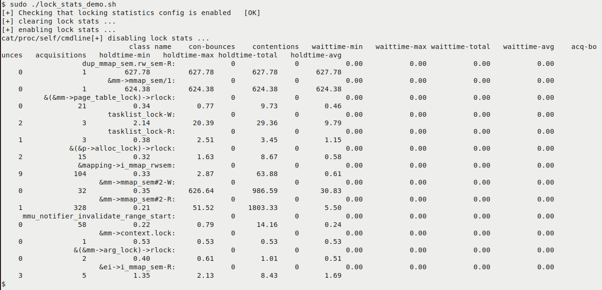

Hình 7.11 – Ảnh chụp script lock\_stats\_demo.sh chạy, hiển thị một số lock statistics

(Output Hình 7.11 khá dài ngang nên xuống dòng.) Thời gian hiển thị microsecond. Field `class name` là lock class; thấy nhiều lock gắn với task/memory structure (`task_struct` và `mm_struct`)! Thay lặp tài liệu, tham khảo kernel documentation lock statistics giải thích từng field (`con-bounces`, `waittime*`, v.v.; gợi ý `con` viết tắt contended), cách diễn giải. Như dự kiến, xem Hình 7.11, trường hợp đơn giản:

- Field đầu `class_name` là lock class; thấy tên (symbolic) lock.

- Thực sự không lock contention (field 2, 3).

- Wait time (`waittime*`, field 3 đến 6) bằng 0.

- Field `acquisitions` (#9) là tổng lần acquire (lấy) lock; dương (thậm chí hơn 300 với mm\_struct semaphore `&mm->mmap_sem*`).

- Bốn field cuối, 10 đến 13, là thống kê lock hold time tích lũy (`holdtime-{min|max|total|avg}`). Ở đây thấy lock mm\_struct `mmap_sem*` có average hold time dài nhất.

- (Chú ý task structure spinlock `alloc_lock` cũng được lấy; đã gặp mục Ví dụ 1 – bắt self deadlock bug với lockdep).

Tra lock contention nhiều nhất hệ thống bằng `sudo grep` `":" /proc/lock_stat | head`. Tất nhiên đây là từ lần locking statistics reset (xóa) gần nhất.

Lưu ý lock statistics có thể disable vì lock debugging disable; ví dụ gặp:

```
$ sudo cat /proc/lock_stat
lock_stat version 0.4
*WARNING* lock debugging disabled!! - possibly due to a lockdep warning
```

Warning này có thể khiến phải reboot hệ thống.

Tốt, gần xong! Kết thúc chương bằng trình bày ngắn memory barrier.

## Memory barrier – giới thiệu

Cuối cùng nhưng không kém quan trọng, nói ngắn về memory barrier. Nghĩa gì? Đôi khi program flow trở nên không biết trước với lập trình viên vì bộ vi xử lý, memory controller và compiler reorder memory read/write. Phần lớn “thủ thuật” lành tính, tối ưu. Nhưng có trường hợp — thường qua hardware boundary, như CPU core trên multicore system, CPU đến peripheral device và ngược lại trên UniProcessor (UP) — không nên reorder; phải tuân memory load/store sequence gốc và dự định. Memory barrier (thường machine-level instruction nhúng trong macro `*mb*()`) ngăn reordering; buộc cả CPU/memory controller và compiler sắp instruction/data theo sequence mong muốn. Chèn vào code path qua macro sau: `#include <asm/barrier.h>`:

- `rmb()`: Chèn read (hay load) memory barrier vào instruction stream

- `wmb()`: Chèn write (hay store) memory barrier vào instruction stream

- `mb()`: General memory barrier; trích trực tiếp kernel documentation (`https://www.kernel.org/doc/Documentation/memory-barriers.txt`): “General memory barrier bảo đảm mọi LOAD/STORE operation chỉ định trước barrier sẽ có vẻ xảy ra trước mọi LOAD/STORE operation chỉ định sau barrier, xét đối với thành phần khác của hệ thống.”

Memory barrier bảo đảm nếu instruction hay data access trước chưa thực thi, các thao tác sau không thực thi, giữ ordering. Trong một số dịp (hiếm), DMA có thể là trường hợp, người viết driver dùng memory barrier. Khi dùng DMA, quan trọng đọc kernel documentation (`https://www.kernel.org/doc/Documentation/DMA-API-HOWTO.txt`). Chỉ nơi dùng và nguy hiểm khi không dùng; xem ví dụ sau để biết thêm.

Đặt memory barrier đúng thường khá khó hiểu với nhiều người, nên tham khảo technical reference manual liên quan của processor/peripheral đang viết driver để biết chi tiết. Ví dụ Raspberry Pi có SoC dòng Broadcom BCM2835; xem peripheral manual — BCM2835 ARM Peripherals (`https://www.raspberrypi.org/app/uploads/2012/02/BCM2835-ARM-Peripherals.pdf`), mục 1.3, Peripheral access precautions for correct memory ordering — giúp biết khi nào nên/không nên dùng memory barrier.

### Ví dụ dùng memory barrier trong device driver

Ví dụ network driver Realtek 8139 “fast Ethernet”. Để truyền network packet qua DMA, trước phải thiết lập DMA (transmit) descriptor object. Với hardware cụ thể (NIC chip), DMA descriptor object định nghĩa:

```
// drivers/net/ethernet/realtek/8139cp.c
struct cp_desc {
    __le32 opts1;
    __le32 opts2;
    __le64 addr;
};
```

DMA descriptor object tên `struct cp_desc` có ba “word”. Mỗi word phải khởi tạo. Để DMA controller diễn giải descriptor đúng, thường quan trọng các write đến DMA descriptor được thấy theo thứ tự người viết driver dự định. Để bảo đảm, dùng memory barrier. Thực tế kernel documentation — Dynamic DMA mapping Guide (`https://www.kernel.org/doc/Documentation/DMA-API-HOWTO.txt`) — bảo đảm phải vậy. Ví dụ thiết lập DMA descriptor, phải code như sau để đúng trên mọi platform:

```
desc->word0 = address;
wmb();
desc->word1 = DESC_VALID;
```

Vậy xem DMA transmit descriptor được thiết lập thực tế (bởi driver code Realtek 8139):

```
// drivers/net/ethernet/realtek/8139cp.c
[ ... ]
static netdev_tx_t cp_start_xmit([...])
{
    [ ... ]
    len = skb->len;
    mapping = dma_map_single(&cp->pdev->dev, skb->data, len,
PCI_DMA_TODEVICE);
    [ ... ]
    struct cp_desc *txd;
    [ ... ]
    txd->opts2 = opts2;
    txd->addr = cpu_to_le64(mapping);
    wmb();
    opts1 |= eor | len | FirstFrag | LastFrag;
    txd->opts1 = cpu_to_le32(opts1);
    wmb();
    [...]
```

Driver theo yêu cầu datasheet chip, đòi word `txd->opts2` và `txd->addr` được lưu memory, rồi lưu word `txd->opts1`. Vì thứ tự write quan trọng, dùng write memory barrier `wmb()`. (Để biết thêm, RCU chắc chắn dùng memory barrier thích hợp để enforce memory ordering.) Hơn nữa macro `READ_ONCE()` và `WRITE_ONCE()` trên từng biến tuyệt đối bảo đảm compiler/CPU làm điều bạn muốn. Ngăn compiler optimization khi cần, dùng memory barrier khi cần, bảo đảm cache coherency khi nhiều thread ở core khác truy cập biến đồng thời.

Chi tiết tham khảo kernel documentation về memory barrier (`https://www.kernel.org/doc/Documentation/DMA-API-HOWTO.txt`). Có mục chi tiết WHERE ARE MEMORY BARRIERS NEEDED?. Tin tốt là phần lớn được xử lý bên dưới; với người viết driver, chỉ khi làm như thiết lập DMA descriptor hay bắt đầu/kết thúc giao tiếp CPU-to-peripheral (và ngược lại) mới có thể cần barrier.

Điều cuối — FAQ (đáng tiếc): dùng keyword `volatile` làm concurrency concern biến mất kỳ diệu không? Tất nhiên không. `volatile` chỉ bảo compiler disable optimization phổ biến quanh biến đó (thứ ngoài code path có thể sửa biến đánh dấu `volatile`), chỉ vậy. Thường cần và hữu ích với MMIO. Về memory barrier, thú vị compiler không reorder read/write biến `volatile` so với biến volatile khác. Tuy nhiên atomicity riêng biệt, không được bảo đảm bằng `volatile`.

## Tổng kết

Bạn thấy đấy!? Chúc mừng, bạn đã làm được, hoàn tất cuốn sách!

Trong chương này tiếp từ chương trước tìm hiểu kernel synchronization. Học locking trên integer hiệu quả/an toàn hơn qua cả `atomic_t` và interface `refcount_t` mới. Trong đó học RMW sequence điển hình dùng atomically/an toàn trong hoạt động phổ biến của người viết driver — cập nhật device register. Sau đó trình bày reader-writer spinlock thú vị, hữu ích nhưng nhiều lưu ý. Thấy dễ vô tình gây vấn đề hiệu năng do caching side effect, gồm false sharing và cách tránh. Tiếp trình bày khá chi tiết lợi ích cho nhà phát triển — lock-free algorithm và programming technique — tập trung per-CPU variable trong Linux kernel. Quan trọng học dùng cẩn thận (đặc biệt dạng nâng cao như RCU). Cuối cùng học memory barrier là gì, thường dùng đâu.

Hành trình dài làm việc trong Linux kernel (và lĩnh vực liên quan như device driver) giờ thực sự bắt đầu. Tuy nhiên không hands-on liên tục, thực sự làm với tài liệu, thành quả nhanh phai... Tôi khuyến khích luôn gắn bó chủ đề này và khác. Khi kiến thức/kinh nghiệm tăng, đóng góp Linux kernel (hay open source project bất kỳ) là nỗ lực cao đẹp, đáng thực hiện.

## Câu hỏi

Kết thúc, đây danh sách câu hỏi kiểm tra kiến thức nội dung chương: `https://github.com/PacktPublishing/Linux-Kernel-Programming/tree/master/questions`. Có lời giải một số câu trong GitHub repo sách: `https://github.com/PacktPublishing/Linux-Kernel-Programming/tree/master/solutions_to_assgn`.

## Đọc thêm

Để giúp tìm hiểu sâu bằng tài liệu hữu ích, cung cấp danh sách khá chi tiết tham khảo/link trực tuyến (đôi khi cả sách) trong tài liệu Further reading của GitHub repository sách. Tài liệu tại: `https://github.com/PacktPublishing/Linux-Kernel-Programming/blob/master/Further_Reading.md`.
