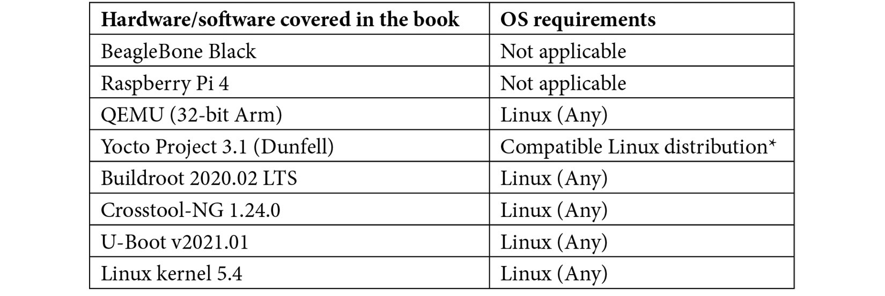

# Lời nói đầu

Linux đã là trụ cột của embedded computing trong nhiều năm. Ấy vậy mà có rất ít sách bao quát chủ đề này một cách tổng thể: cuốn sách này được viết ra để lấp khoảng trống đó. Thuật ngữ "embedded Linux" không được định nghĩa rõ ràng và có thể được áp dụng cho hệ điều hành bên trong rất nhiều loại thiết bị, từ máy điều nhiệt, router Wi-Fi đến các bộ điều khiển công nghiệp. Tuy nhiên, tất cả chúng đều được xây dựng trên cùng một nền phần mềm open source cơ bản. Đó là những công nghệ mà tôi mô tả trong cuốn sách này, dựa trên kinh nghiệm của tôi với tư cách một kỹ sư và các tài liệu tôi đã soạn cho các khóa đào tạo của mình.

Công nghệ không đứng yên. Ngành công nghiệp xoay quanh embedded computing cũng chịu tác động của định luật Moore giống như mảng máy tính phổ thông. Sự tăng trưởng theo hàm mũ mà điều này hàm ý đã khiến một số lượng thay đổi lớn đáng ngạc nhiên xảy ra kể từ khi ấn bản đầu tiên của cuốn sách này được xuất bản. Ấn bản thứ ba này được sửa đổi toàn diện để dùng các phiên bản mới nhất của các thành phần open source chính, bao gồm Linux 5.4, Yocto Project 3.1 Dunfell và Buildroot 2020.02 LTS. Ngoài Autotools, cuốn sách giờ đây còn đề cập CMake, một build system hiện đại được dùng ngày càng nhiều trong những năm gần đây.

*Mastering Embedded Linux Programming* đề cập các chủ đề theo thứ tự đại khái giống như khi bạn gặp chúng trong một project real-life. Tám chương đầu liên quan đến các giai đoạn đầu của project, đề cập những điều cơ bản như chọn toolchain, bootloader và kernel. Tôi giới thiệu ý tưởng về embedded build system, dùng Buildroot và Yocto Project làm ví dụ. Phần này kết thúc bằng nội dung in-depth mới về Yocto Project.

*Phần 2*, *Chương 9* đến *15*, xem xét các quyết định thiết kế khác nhau cần được đưa ra trước khi việc phát triển có thể bắt đầu một cách nghiêm túc. Nó đề cập các chủ đề filesystem, cập nhật phần mềm, device driver, chương trình `init` và quản lý điện năng. [*Chương 12*](ch12_prototyping_with_breakout_boards.vi.md) minh họa nhiều kỹ thuật làm prototype nhanh với một breakout board, bao gồm cách đọc schematic, hàn header và khắc phục sự cố tín hiệu bằng logic analyzer. [*Chương 14*](ch14_starting_with_busybox_runit.vi.md) đi sâu vào Buildroot, nơi bạn sẽ học cách chia phần mềm hệ thống thành các service riêng biệt bằng BusyBox `runit`.

*Phần 3*, *Chương 16*, *17* và *18*, sẽ giúp bạn trong giai đoạn hiện thực của project. Chúng ta bắt đầu với việc đóng gói Python và quản lý dependency, một chủ đề ngày càng quan trọng khi các ứng dụng machine learning tiếp tục làm mưa làm gió khắp thế giới. Tiếp theo, chúng ta chuyển sang các dạng giao tiếp inter-process khác nhau và lập trình đa luồng (multithreaded). Phần này kết thúc bằng việc xem xét kỹ lưỡng cách Linux quản lý bộ nhớ và minh họa cách đo mức sử dụng bộ nhớ và phát hiện memory leak bằng các công cụ hiện có.

Phần thứ tư, gồm *Chương 19* và *20*, chỉ cho bạn cách dùng hiệu quả rất nhiều công cụ debug và profiling mà Linux cung cấp để phát hiện vấn đề và xác định điểm nghẽn. [*Chương 19*](ch19_debugging_with_gdb.vi.md) giờ đây mô tả cách cấu hình Visual Studio Code để debug từ xa bằng GDB. [*Chương 20*](ch20_profiling_and_tracing.vi.md) giờ đây đề cập BPF, một công nghệ mới cho phép tracing nâng cao bằng lập trình bên trong Linux kernel. Chương cuối cùng kết nối nhiều mạch nội dung lại với nhau để giải thích cách Linux có thể được dùng trong các ứng dụng real-time.

Mỗi chương giới thiệu một mảng chính của embedded Linux. Nó mô tả nền tảng để bạn có thể học các nguyên lý chung, nhưng cũng bao gồm các ví dụ hoạt động chi tiết minh họa cho từng mảng. Bạn có thể coi đây là một cuốn sách lý thuyết, hoặc một cuốn sách ví dụ. Nó hiệu quả nhất nếu bạn làm cả hai: hiểu lý thuyết và thử áp dụng vào thực tế.

## Cuốn sách này dành cho ai

Cuốn sách này được viết cho các lập trình viên quan tâm đến embedded computing và Linux, muốn mở rộng kiến thức sang các nhánh khác nhau của chủ đề này. Khi viết sách, tôi giả định bạn có hiểu biết cơ bản về command line Linux, và với các ví dụ lập trình, có kiến thức thực hành về ngôn ngữ C và Python. Một số chương tập trung vào phần cứng nằm trong một target board nhúng, và vì vậy, sự quen thuộc với phần cứng và các giao diện phần cứng chắc chắn sẽ là một lợi thế trong những trường hợp này.

## Cuốn sách này đề cập những gì

[*Chương 1*](ch01_starting_out.vi.md), *Bắt đầu*, dựng bối cảnh bằng cách mô tả hệ sinh thái embedded Linux và các lựa chọn có sẵn cho bạn khi bắt đầu project.

[*Chương 2*](ch02_learning_about_toolchains.vi.md), *Tìm hiểu về toolchain*, mô tả các thành phần của một toolchain và chỉ cho bạn cách tạo một toolchain cho việc cross-compiling code cho target board. Nó mô tả nơi lấy toolchain và cung cấp chi tiết về cách build một toolchain từ source code.

[*Chương 3*](ch03_all_about_bootloaders.vi.md), *Tất cả về bootloader*, giải thích vai trò của bootloader trong việc nạp Linux kernel vào bộ nhớ, và dùng U-Boot làm ví dụ. Nó cũng giới thiệu device tree như cơ chế được dùng để mã hóa chi tiết phần cứng trong gần như tất cả các hệ thống embedded Linux.

[*Chương 4*](ch04_configuring_and_building_the_kernel.vi.md), *Cấu hình và build kernel*, cung cấp thông tin về cách chọn một Linux kernel cho hệ thống nhúng và cấu hình nó cho phần cứng bên trong thiết bị. Nó cũng đề cập cách port Linux sang phần cứng mới.

[*Chương 5*](ch05_building_a_root_filesystem.vi.md), *Xây dựng root filesystem*, giới thiệu các ý tưởng đằng sau phần user space của một bản hiện thực embedded Linux thông qua một hướng dẫn step-by-step về cách cấu hình một root filesystem.

[*Chương 6*](ch06_selecting_a_build_system.vi.md), *Chọn build system*, đề cập hai build system embedded Linux thường dùng là Buildroot và Yocto Project, những công cụ tự động hóa các bước được mô tả trong bốn chương trước.

[*Chương 7*](ch07_developing_with_yocto.vi.md), *Phát triển với Yocto*, minh họa cách build system image trên một BSP layer có sẵn, phát triển các software package trên board bằng extensible SDK của Yocto, và tự tạo bản phân phối embedded Linux của riêng bạn hoàn chỉnh với khả năng quản lý package lúc runtime.

[*Chương 8*](ch08_yocto_under_the_hood.vi.md), *Yocto bên trong*, là một chuyến tham quan workflow build và kiến trúc của Yocto, bao gồm phần giải thích cách tiếp cận multi-layer độc đáo của Yocto. Nó cũng phân tích những điều cơ bản về cú pháp và ngữ nghĩa BitBake với các ví dụ từ các file recipe thực tế.

[*Chương 9*](ch09_creating_a_storage_strategy.vi.md), *Xây dựng chiến lược lưu trữ*, bàn về những thách thức tạo ra bởi việc quản lý bộ nhớ flash, bao gồm các chip raw flash và các package **embedded MMC** (**eMMC**). Nó mô tả các filesystem áp dụng được cho từng loại công nghệ.

[*Chương 10*](ch10_updating_software_in_the_field.vi.md), *Cập nhật phần mềm ngoài thực địa*, xem xét nhiều cách khác nhau để cập nhật phần mềm sau khi thiết bị đã được triển khai, bao gồm các bản cập nhật **Over-the-Air** (**OTA**) được quản lý hoàn toàn. Các chủ đề chính được bàn là độ tin cậy và bảo mật.

[*Chương 11*](ch11_interfacing_with_device_drivers.vi.md), *Giao tiếp với device driver*, mô tả cách kernel device driver tương tác với phần cứng thông qua việc hiện thực một driver đơn giản. Nó cũng mô tả các cách khác nhau để gọi device driver từ user space.

[*Chương 12*](ch12_prototyping_with_breakout_boards.vi.md), *Làm prototype với breakout board*, minh họa cách làm prototype phần cứng và phần mềm nhanh chóng bằng một image Debian pre-built cho BeagleBone Black cùng với một breakout board ngoại vi. Bạn sẽ học cách đọc datasheet, đi dây cho board, mux các binding device tree và phân tích tín hiệu SPI.

[*Chương 13*](ch13_starting_up_the_init_program.vi.md), *Khởi động – Chương trình init*, giải thích cách chương trình user space đầu tiên–`init`–khởi động phần còn lại của hệ thống. Nó mô tả ba phiên bản của chương trình `init`, mỗi phiên bản phù hợp với một nhóm hệ thống nhúng khác nhau, từ sự đơn giản của BusyBox `init`, qua System V `init`, đến cách tiếp cận state-of-the-art hiện nay, `systemd`.

[*Chương 14*](ch14_starting_with_busybox_runit.vi.md), *Bắt đầu với BusyBox runit*, chỉ cho bạn cách dùng Buildroot để chia hệ thống thành các service BusyBox `runit` riêng biệt, mỗi service có cơ chế giám sát process và logging riêng giống như những gì `systemd` cung cấp.

[*Chương 15*](ch15_managing_power.vi.md), *Quản lý điện năng*, xem xét các cách khác nhau mà Linux có thể được tinh chỉnh để giảm tiêu thụ điện năng, bao gồm dynamic frequency and voltage scaling, chọn các idle state sâu hơn, và system suspend. Mục tiêu là tạo ra các thiết bị chạy lâu hơn với một lần sạc pin và cũng chạy mát hơn.

[*Chương 16*](ch16_packaging_python.vi.md), *Đóng gói Python*, giải thích những lựa chọn có sẵn để gói các module Python lại với nhau cho việc triển khai và khi nào nên dùng phương pháp này thay vì phương pháp kia. Nó đề cập `pip`, virtual environment, `conda` và Docker.

[*Chương 17*](ch17_learning_about_processes_and_threads.vi.md), *Tìm hiểu về process và thread*, mô tả hệ thống nhúng từ góc nhìn của lập trình viên application. Chương này xem xét process và thread, giao tiếp inter-process và các scheduling policy.

[*Chương 18*](ch18_managing_memory.vi.md), *Quản lý bộ nhớ*, giới thiệu các ý tưởng đằng sau virtual memory và cách không gian địa chỉ được chia thành các memory mapping. Nó cũng mô tả cách đo chính xác mức sử dụng bộ nhớ và cách phát hiện memory leak.

[*Chương 19*](ch19_debugging_with_gdb.vi.md), *Debug với GDB*, chỉ cho bạn cách dùng GNU debugger, GDB, cùng với debug agent `gdbserver` để debug các application chạy từ xa trên thiết bị đích. Nó tiếp tục chỉ ra cách bạn có thể mở rộng mô hình này để debug code kernel, tận dụng các kernel debug stub với KGDB.

[*Chương 20*](ch20_profiling_and_tracing.vi.md), *Profiling và tracing*, đề cập các kỹ thuật có sẵn để đo hiệu năng hệ thống, bắt đầu từ profile toàn hệ thống rồi khoanh vùng vào các khu vực cụ thể nơi điểm nghẽn gây ra hiệu năng kém. Nó cũng mô tả cách dùng Valgrind để kiểm tra tính đúng đắn trong việc dùng đồng bộ hóa thread và cấp phát bộ nhớ của một application.

[*Chương 21*](ch21_real_time_programming.vi.md), *Lập trình Real-Time*, cung cấp hướng dẫn chi tiết về lập trình real-time trên Linux, bao gồm việc cấu hình kernel và patch kernel real-time `PREEMPT_RT`. Công cụ trace kernel, Ftrace, được dùng để đo độ trễ kernel và cho thấy tác động của các cấu hình kernel khác nhau.

## Để tận dụng tối đa cuốn sách này

Phần mềm dùng trong cuốn sách này hoàn toàn là open source. Trong gần như mọi trường hợp, tôi đã dùng các phiên bản ổn định mới nhất có sẵn tại thời điểm viết. Dù tôi đã cố mô tả các tính năng chính theo cách không version-specific, không thể tránh khỏi việc một số ví dụ sẽ cần điều chỉnh để hoạt động với phần mềm mới hơn.



* Xem mục *Compatible Linux Distribution* của hướng dẫn *Yocto Project Quick Build* tại [https://www.yoctoproject.org/docs/current/brief-yoctoprojectqs/brief-yoctoprojectqs.html](https://www.yoctoproject.org/docs/current/brief-yoctoprojectqs/brief-yoctoprojectqs.html) để biết thêm chi tiết.

Phát triển nhúng liên quan đến hai hệ thống: host, được dùng để phát triển chương trình, và target, nơi chạy chúng. Với hệ thống host, tôi đã dùng Ubuntu 20.04 LTS, nhưng hầu hết các bản phân phối Linux sẽ hoạt động chỉ với một chút sửa đổi. Bạn có thể quyết định chạy Linux như một guest trong máy ảo, nhưng bạn nên biết rằng một số tác vụ, chẳng hạn build một bản phân phối bằng Yocto Project, khá nặng và tốt hơn nên chạy trên một bản cài đặt Linux native.

Tôi chọn ba target mẫu: trình giả lập QEMU, BeagleBone Black và Raspberry Pi 4. Dùng QEMU có nghĩa là bạn có thể thử hầu hết các ví dụ mà không phải đầu tư thêm phần cứng nào. Mặt khác, một số thứ hoạt động tốt hơn nếu bạn có phần cứng thật, và vì thế tôi chọn BeagleBone Black vì nó không đắt, dễ mua và có sự hỗ trợ cộng đồng rất tốt. Raspberry Pi 4 được bổ sung trong ấn bản thứ ba nhờ có Wi-Fi và Bluetooth built-in. Tất nhiên, bạn không bị giới hạn chỉ ở ba target này. Ý tưởng đằng sau cuốn sách là cung cấp cho bạn các giải pháp tổng quát cho các vấn đề để bạn có thể áp dụng chúng cho rất nhiều loại target board.

## Tải các file code ví dụ

Bạn có thể tải các file code ví dụ cho cuốn sách này từ GitHub tại [https://github.com/PacktPublishing/Mastering-Embedded-Linux-Programming-Third-Edition](https://github.com/PacktPublishing/Mastering-Embedded-Linux-Programming-Third-Edition).

Nếu có bản cập nhật cho code, nó sẽ được cập nhật trên repository GitHub hiện có. Chúng tôi cũng có các gói code khác từ danh mục phong phú gồm sách và video của chúng tôi tại [https://github.com/PacktPublishing/](https://github.com/PacktPublishing/). Hãy xem thử!

## Tải các hình màu

Chúng tôi cũng cung cấp một file PDF có các hình màu của ảnh chụp màn hình/sơ đồ dùng trong cuốn sách này. Bạn có thể tải nó tại đây: [http://www.packtpub.com/sites/default/files/downloads/9781789530384_ColorImages.pdf](http://www.packtpub.com/sites/default/files/downloads/9781801071000_ColorImages.pdf).

## Các quy ước được dùng

Có một số quy ước văn bản được dùng xuyên suốt cuốn sách này.

`Code in text`: Chỉ các từ code trong văn bản, tên bảng cơ sở dữ liệu, tên thư mục, tên file, phần mở rộng file, đường dẫn, URL giả, input người dùng và Twitter handle. Đây là một ví dụ: "Để cấu hình phía host của mạng, bạn cần lệnh `tunctl` từ project User Mode Linux (UML)."

Một khối code được trình bày như sau:

```
#include <stdio.h>
#include <stdlib.h>
int main (int argc, char *argv[])
{
    printf ("Hello, world!\n");
    return 0;
}
```

Bất kỳ input hay output command-line nào được viết như sau:

```
$ sudo tunctl -u $(whoami) -t tap0
```

**Bold**: Chỉ một thuật ngữ mới, một từ quan trọng, hoặc các từ bạn thấy trên màn hình. Ví dụ, các từ trong menu hoặc hộp thoại xuất hiện trong văn bản như thế này. Đây là một ví dụ: "Click **Flash** từ Etcher để ghi image."

> **Mẹo hoặc lưu ý quan trọng**
>
> Xuất hiện như thế này.

## Liên hệ

Phản hồi từ độc giả luôn được hoan nghênh.

**Phản hồi chung**: Nếu bạn có câu hỏi về bất kỳ khía cạnh nào của cuốn sách này, hãy ghi tên sách trong tiêu đề message và email cho chúng tôi tại [customercare@packtpub.com](mailto:customercare@packtpub.com).

**Errata**: Dù chúng tôi đã hết sức cẩn thận để bảo đảm tính chính xác của nội dung, sai sót vẫn có thể xảy ra. Nếu bạn tìm thấy một lỗi trong cuốn sách này, chúng tôi sẽ rất biết ơn nếu bạn báo cho chúng tôi. Vui lòng truy cập [www.packtpub.com/support/errata](http://www.packtpub.com/support/errata), chọn cuốn sách của bạn, click vào link Errata Submission Form và nhập các chi tiết.

**Vi phạm bản quyền**: Nếu bạn bắt gặp bất kỳ bản sao bất hợp pháp nào của các tác phẩm của chúng tôi dưới bất kỳ hình thức nào trên Internet, chúng tôi sẽ rất biết ơn nếu bạn cung cấp cho chúng tôi địa chỉ hoặc tên website. Vui lòng liên hệ với chúng tôi tại [copyright@packt.com](mailto:copyright@packt.com) kèm link tới tài liệu đó.

**Nếu bạn muốn trở thành tác giả**: Nếu có một chủ đề mà bạn có chuyên môn và bạn quan tâm đến việc viết hoặc đóng góp cho một cuốn sách, vui lòng truy cập [authors.packtpub.com](http://authors.packtpub.com).

## Đánh giá

Hãy để lại một đánh giá. Khi đã đọc và dùng cuốn sách này, sao bạn không để lại một đánh giá trên trang web nơi bạn đã mua nó? Những độc giả tiềm năng khi đó có thể thấy và dùng ý kiến khách quan của bạn để đưa ra quyết định mua hàng, chúng tôi ở Packt có thể hiểu bạn nghĩ gì về sản phẩm của chúng tôi, và các tác giả của chúng tôi có thể thấy phản hồi của bạn về cuốn sách của họ. Cảm ơn bạn!

Để biết thêm thông tin về Packt, vui lòng truy cập [packt.com](http://packt.com).
