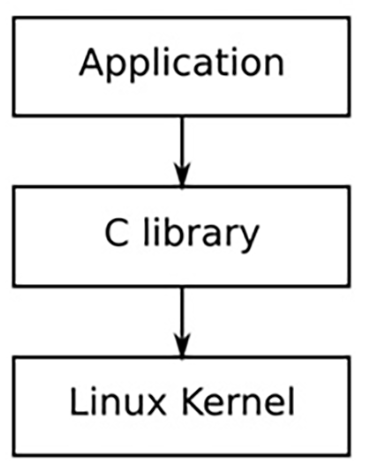
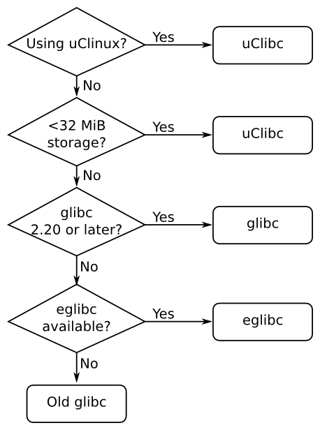

# Chương 2. Tìm hiểu toolchain

Toolchain là thành phần đầu tiên của embedded Linux và là điểm khởi đầu cho dự án của bạn. Những lựa chọn ở giai đoạn đầu này sẽ ảnh hưởng sâu sắc đến kết quả cuối cùng. Toolchain phải có khả năng tận dụng hardware hiệu quả bằng cách dùng instruction set tối ưu cho processor, sử dụng floating point unit nếu có, v.v. Nó phải hỗ trợ các ngôn ngữ bạn cần và có phần triển khai vững chắc cho POSIX cùng các system interface khác. Không chỉ vậy, toolchain cần được cập nhật khi phát hiện lỗ hổng bảo mật hoặc bug. Cuối cùng, nó nên được giữ cố định trong suốt dự án. Nói cách khác, khi đã chọn toolchain, điều quan trọng là tiếp tục dùng nó. Thay đổi compiler và development library thiếu nhất quán trong quá trình làm dự án sẽ dẫn đến các bug khó nhận biết.

Lấy toolchain đơn giản như download và cài package. Nhưng chính toolchain là thứ phức tạp, như tôi sẽ trình bày trong chương.

## Toolchain là gì?

Toolchain là tập công cụ compile source code thành executable chạy trên target device, gồm compiler, linker và run-time library. Ban đầu bạn cần nó để build ba thành phần embedded Linux system còn lại: bootloader, kernel, root filesystem. Nó phải compile code assembly, C, C++ vì đây là ngôn ngữ dùng trong base open source package. Thông thường Linux toolchain dựa trên component GNU project (`http://www.gnu.org`), vẫn đúng với đa số trường hợp khi viết sách. Tuy nhiên vài năm qua, Clang compiler và LLVM project liên quan (`http://llvm.org`) tiến tới mức trở thành lựa chọn khả thi thay GNU toolchain. Khác biệt lớn giữa LLVM và toolchain GNU-based là license: LLVM dùng BSD, GNU dùng GPL. Clang cũng có ưu điểm kỹ thuật như compile nhanh, diagnostic tốt hơn, nhưng GNU GCC có lợi thế tương thích code base hiện có, hỗ trợ nhiều architecture và operating system. Thực tế vẫn có vùng Clang chưa thay GNU C compiler được, đặc biệt compile mainline Linux kernel. Có thể trong khoảng năm tới Clang compile được mọi component embedded Linux cần, trở thành lựa chọn thay GNU. Có mô tả tốt cách cross compilation với Clang tại `http://clang.llvm.org/docs/CrossCompilation.html`. Nếu muốn dùng trong embedded Linux build system, EmbToolkit (`https://www.embtoolkit.org`) hỗ trợ đầy đủ cả GNU và LLVM/Clang toolchain, nhiều người đang làm Clang với Buildroot, Yocto Project. Tôi trình bày embedded build system ở Chương 6, Lựa chọn build system. Trong khi đó chương này tập trung GNU toolchain vì hiện là lựa chọn hoàn chỉnh duy nhất.

GNU toolchain chuẩn gồm ba thành phần chính:

- Binutils: Tập binary utility gồm assembler và linker, ld. Có tại `http://www.gnu.org/software/binutils/`.

- GNU Compiler Collection (GCC): Compiler cho C và ngôn ngữ khác tùy phiên bản, gồm C++, Objective-C, Objective-C++, Java, Fortran, Ada, Go. Tất cả dùng back-end chung sinh assembler code đưa cho GNU assembler. Có tại `http://gcc.gnu.org/`.

- C library: API chuẩn hóa dựa POSIX specification, là interface chính từ ứng dụng đến operating system kernel. Có nhiều C library để cân nhắc, xem phần sau.

Ngoài ra, bạn cần một bản sao các Linux kernel header, chứa các định nghĩa và hằng số cần thiết khi truy cập kernel trực tiếp. Trước mắt, bạn cần chúng để compile C library, nhưng về sau cũng sẽ cần khi viết chương trình hoặc compile library tương tác với các Linux device cụ thể, chẳng hạn hiển thị đồ họa qua Linux frame buffer driver. Đây không đơn thuần là việc copy các header file trong include directory của kernel source code. Những header đó chỉ dành cho kernel và chứa các định nghĩa sẽ gây xung đột nếu được dùng nguyên trạng để compile ứng dụng Linux thông thường. Thay vào đó, bạn cần tạo một tập hợp sanitized kernel header, như tôi minh họa trong Chương 5, Tạo root filesystem.

Thông thường, việc kernel header có được tạo từ chính xác Linux version mà bạn sẽ dùng hay không không phải yếu tố quyết định. Vì kernel interface luôn backwards-compatible, bạn chỉ cần dùng header từ một kernel có phiên bản bằng hoặc cũ hơn kernel đang dùng trên target.

Phần lớn cũng coi GNU debugger, GDB, là phần toolchain và thường build tại thời điểm này. Tôi nói GDB ở Chương 12, Debug bằng GDB.

## Các loại toolchain - native và cross toolchain

Cho mục đích của chúng ta, có hai loại:

- Native: Toolchain chạy trên cùng loại hệ thống, đôi khi chính hệ thống đó, với chương trình nó sinh. Đây thường là trường hợp desktop/server, đang phổ biến trên một số embedded device. Ví dụ Raspberry Pi chạy Debian cho ARM có native compiler self-hosted.

- Cross: Toolchain chạy trên hệ thống khác loại target, cho phát triển trên desktop PC nhanh rồi load lên embedded target để test.

Gần như toàn bộ hoạt động phát triển embedded Linux đều dùng cross development toolchain. Một phần lý do là phần lớn embedded device không phù hợp để phát triển chương trình vì thiếu năng lực tính toán, memory và storage; lý do khác là cách này giữ host environment và target environment tách biệt. Điểm thứ hai đặc biệt quan trọng khi host và target dùng cùng architecture, chẳng hạn X86\_64. Khi đó, bạn dễ muốn compile native trên host rồi chỉ copy binary sang target. Cách này hoạt động ở một mức độ nhất định, nhưng host distribution có thể được cập nhật thường xuyên hơn target, và các kỹ sư build code cho target có thể dùng các phiên bản host development library hơi khác nhau. Như vậy, bạn vi phạm nguyên tắc giữ toolchain cố định trong suốt vòng đời dự án. Bạn có thể dùng cách này nếu bảo đảm host build environment và target build environment luôn đồng bộ hoàn toàn, nhưng cách tốt hơn nhiều là giữ host và target tách biệt, và cross toolchain giúp thực hiện điều đó. Tuy nhiên, cũng có lập luận ngược lại ủng hộ native development. Cross development tạo ra gánh nặng cross-compiling mọi library và công cụ cần cho target. Ở phần sau của chương, chúng ta sẽ thấy cross-compiling không phải lúc nào cũng đơn giản vì phần lớn package open source không được thiết kế để build theo cách này. Các công cụ build tích hợp, bao gồm Buildroot và Yocto Project, hỗ trợ bằng cách đóng gói các rule để cross compile một loạt package cần trong embedded system điển hình; nhưng nếu muốn compile nhiều package bổ sung, tốt hơn bạn nên compile native. Chẳng hạn, không thể cung cấp một Debian distribution cho Raspberry Pi hoặc BeagleBone bằng cross compiler; chúng phải được compile native. Tạo native build environment từ đầu không dễ: bạn phải tạo cross compiler trước để bootstrap native build environment trên target, rồi dùng môi trường đó để build package. Bạn sẽ cần một build farm gồm các target board well-provisioned, hoặc có thể dùng QEMU để mô phỏng target. Nếu muốn tìm hiểu thêm, hãy xem Scratchbox project, hiện ở phiên bản phát triển thứ hai có tên Scratchbox2 (`https://maemo.gitorious.org/scratchbox2`). Nokia phát triển nó để build Maemo Linux operating system, và hiện nó được Mer project, Tizen project cùng những dự án khác sử dụng.

Trong chương này tôi tập trung cross compiler environment phổ biến hơn, tương đối dễ setup, quản trị.

### CPU architecture

Toolchain phải build theo khả năng target CPU, gồm:

- CPU architecture: arm, mips, x86\_64, v.v.

- Hoạt động Big- hoặc little-endian: Một số CPU có cả hai mode nhưng machine code khác nhau

- Floating point support: Không phải mọi embedded processor version có hardware floating point unit; khi không có, toolchain có thể cấu hình gọi software floating point library

- Application Binary Interface (ABI): Calling convention dùng truyền parameter giữa function call

Với nhiều architecture, ABI không đổi giữa họ processor. Ngoại lệ đáng chú ý là ARM. ARM chuyển sang Extended Application Binary Interface (EABI) cuối thập niên 2000, khiến ABI trước được đặt tên Old Application Binary Interface (OABI). Dù OABI nay obsolete, vẫn thấy tham chiếu EABI. Từ đó EABI chia hai theo cách truyền floating point parameter. EABI gốc dùng general purpose (integer) register, EABIHF mới dùng floating point register. EABIHF nhanh hơn đáng kể cho floating point operation vì bỏ copy giữa integer/floating point register, nhưng không tương thích CPU thiếu floating point unit. Vì vậy phải chọn giữa hai ABI không tương thích: không trộn dùng được, nên quyết định ở giai đoạn này.

GNU dùng prefix tool để nhận diện các tổ hợp có thể sinh, gồm tuple ba/bốn component cách bằng dash, như sau:

- CPU: Architecture như arm, mips, x86\_64. Nếu CPU có hai endian mode, phân biệt bằng thêm el cho little-endian, eb cho big-endian. Ví dụ tốt là MIPS little-endian, mipsel và ARM big-endian, armeb.

- Vendor: Nhận diện provider toolchain, ví dụ buildroot, poky, hoặc unknown. Đôi khi bỏ hẳn.

- Kernel: Với mục đích này luôn 'linux'.

- Operating system: Tên user space component có thể `gnu`, `uclibcgnu`. ABI có thể thêm đây, nên ARM toolchain có `gnueabi`, `gnueabihf`, `uclibcgnueabi`, `uclibcgnueabihf`.

Tìm tuple dùng build toolchain bằng option `-dumpmachine` của `gcc`. Ví dụ thấy sau trên host:

```
$ gcc -dumpmachine
x86_64-linux-gnu
```

Khi native compiler được cài trên một máy, thông thường các link đến từng công cụ trong toolchain được tạo mà không có prefix, để bạn có thể gọi compiler bằng lệnh `gcc`.

Sau đây là một ví dụ sử dụng cross compiler:

```
$ mipsel-unknown-linux-gnu-gcc -dumpmachine
mipsel-unknown-linux-gnu
```

## Chọn C library

Programming interface đến Unix operating system được định nghĩa bằng ngôn ngữ C và hiện được quy định bởi các tiêu chuẩn POSIX. C library là phần triển khai interface đó; nó là cửa ngõ đến kernel cho các chương trình Linux, như sơ đồ dưới đây. Ngay cả khi bạn viết chương trình bằng ngôn ngữ khác, chẳng hạn Java hoặc Python, các run-time support library tương ứng cuối cùng vẫn phải gọi C library:



C library là cửa ngõ kernel cho ứng dụng

Mỗi khi C library cần kernel service, dùng interface `system call` của kernel chuyển user space/kernel space. Có thể bỏ qua C library bằng gọi trực tiếp kernel system call nhưng rất phiền, gần không bao giờ cần.

Có nhiều C library để chọn. Các lựa chọn chính:

- glibc: Có tại `http://www.gnu.org/software/libc`. GNU C library chuẩn, lớn và tới gần đây chưa cấu hình được nhiều, nhưng triển khai POSIX API đầy đủ nhất.

- eglibc: Có tại `http://www.eglibc.org/home`. Đây là embedded GLIBC. Nó từng là một loạt patch cho glibc, bổ sung configuration option và hỗ trợ những architecture mà glibc chưa hỗ trợ, cụ thể là PowerPC e500. Việc tách eglibc khỏi glibc vốn khá gượng ép; may mắn là code base của eglibc đã được hợp nhất trở lại glibc từ phiên bản 2.20, để lại một library được cải tiến duy nhất. eglibc không còn được bảo trì.

- uClibc: Có tại `http://www.uclibc.org`. Chữ “u” thực ra là ký tự Hy Lạp “mu”, biểu thị đây là micro controller C library. Ban đầu, nó được phát triển để hoạt động với uClinux (Linux dành cho CPU không có memory management unit), nhưng sau đó đã được điều chỉnh để dùng với Linux đầy đủ. Nó có một configuration utility cho phép bạn fine-tune các tính năng theo nhu cầu. Ngay cả cấu hình đầy đủ cũng nhỏ hơn glibc, nhưng phần triển khai các tiêu chuẩn POSIX không đầy đủ bằng.

- musl libc: Có tại `http://www.musl-libc.org`. Đây là một C library mới được thiết kế cho embedded system.

Vậy nên chọn loại nào? Tôi khuyên chỉ dùng uClibc nếu bạn dùng uClinux hoặc có dung lượng storage hay RAM rất hạn chế, khiến kích thước nhỏ trở thành một lợi thế. Trong các trường hợp khác, tôi thích dùng glibc up-to-date hoặc eglibc. Tôi chưa có kinh nghiệm với musl libc, nhưng nếu thấy glibc/eglibc không phù hợp thì bạn cứ thử nó. Quá trình này được tóm tắt trong hình sau:



Chọn C library

## Tìm toolchain

Bạn có ba lựa chọn cho cross development toolchain: tìm một toolchain được build sẵn phù hợp với nhu cầu, dùng toolchain do một embedded build tool tạo ra như được trình bày trong Chương 6, Lựa chọn build system, hoặc tự tạo toolchain theo mô tả ở phần sau của chương này.

Cross toolchain pre-built là lựa chọn hấp dẫn vì bạn chỉ cần download và cài đặt. Tuy nhiên, bạn bị giới hạn bởi cấu hình của toolchain cụ thể đó và phụ thuộc vào người hoặc tổ chức cung cấp nó. Nhiều khả năng nhà cung cấp sẽ thuộc một trong các nhóm sau:

- SoC hoặc board vendor. Phần lớn cung cấp Linux toolchain.

- Consortium chuyên hỗ trợ system-level cho architecture. Ví dụ Linaro (`https://www.linaro.org`) có toolchain pre-built cho ARM.

- Vendor Linux tool Third-party như Mentor Graphics, TimeSys, MontaVista.

- Cross tool package của desktop distribution, ví dụ Debian-based có package cross compiling ARM, MIPS, PowerPC.

- Binary SDK do integrated embedded build tool sinh; Yocto Project có ví dụ `http://autobuilder.yoctoproject.org/pub/releases/CURRENT/toolchain`, cùng Denx Embedded Linux Development Kit tại `ftp://ftp.denx.de/pub/eldk/`.

- Link từ forum bạn không tìm lại được.

Trong tất cả các trường hợp này, bạn phải quyết định toolchain pre-built được cung cấp có đáp ứng yêu cầu hay không. Nó có dùng C library mà bạn muốn không? Nhà cung cấp có cung cấp các bản cập nhật sửa lỗ hổng bảo mật và bug không? Hãy nhớ những nhận xét của tôi về hỗ trợ và cập nhật trong Chương 1, Bắt đầu. Nếu câu trả lời cho bất kỳ câu hỏi nào là không, bạn nên cân nhắc tự tạo toolchain.

Đáng tiếc là build toolchain không phải nhiệm vụ dễ dàng. Nếu thực sự muốn tự làm toàn bộ, hãy xem Cross Linux From Scratch (`http://trac.clfs.org`). Ở đó, bạn sẽ tìm thấy hướng dẫn step-by-step để tạo từng thành phần.

Một lựa chọn đơn giản hơn là dùng crosstool-NG, đóng gói quá trình thành một tập hợp script và có front-end menu-driven. Tuy vậy, bạn vẫn cần một lượng kiến thức tương đối để đưa ra các lựa chọn đúng. Đơn giản hơn nữa là dùng build system như Buildroot hoặc Yocto Project, vì chúng tạo toolchain như một phần của quá trình build. Đây là giải pháp tôi ưa dùng, như đã trình bày trong Chương 6, Lựa chọn build system.

### Build toolchain bằng crosstool-NG

Tôi sẽ bắt đầu với crosstool-NG vì nó cho phép bạn xem quá trình tạo toolchain và tạo một số loại toolchain khác nhau.

Vài năm trước Dan Kegel viết script/makefile sinh cross development toolchain tên crosstool (`kegel.com/crosstool`). Năm 2007 Yann E. Morin dùng nền này tạo thế hệ tiếp crosstool-NG (`crosstool-ng.org`). Ngày nay là cách thuận tiện nhất tạo cross toolchain stand-alone từ source.

### Cài crosstool-NG

Trước khi bắt đầu, bạn cần có native toolchain và các build tool hoạt động được trên host PC. Để dùng crosstool-NG trên Ubuntu host, bạn cần cài các package bằng lệnh sau:

```
$ sudo apt-get install automake bison chrpath flex g++ git gperf
gawk libexpat1-dev libncurses5-dev libsdl1.2-dev libtool
python2.7-dev texinfo
```

Tiếp lấy release hiện tại từ mục download croostool-NG, `http://crosstool-ng.org/download/crosstool-ng`. Ví dụ dùng 1.20.0. Extract, tạo front-end menu system ct-ng theo lệnh:

```
$ tar xf crosstool-ng-1.20.0.tar.bz2
$ cd crosstool-ng-1.20.0
$ ./configure --enable-local
$ make
$ make install
```

Option `--enable-local` có nghĩa là chương trình sẽ được cài vào current directory. Cách này tránh phải có root permission như khi cài vào vị trí mặc định `/usr/local/bin`. Gõ `./ct-ng` từ current directory để mở crosstool menu.

### Chọn toolchain

Crosstool-NG có thể build nhiều tổ hợp toolchain khác nhau. Để cấu hình ban đầu dễ hơn, nó cung cấp một tập hợp sample bao quát nhiều use-cases phổ biến. Dùng `./ct-ng list-samples` để tạo danh sách.

Chẳng hạn, giả sử target của bạn là BeagleBone Black, có ARM Cortex A8 core và VFPv3 floating point unit, và bạn muốn dùng một phiên bản glibc hiện tại. Sample gần nhất là `arm-cortex_a8-linux-gnueabi`. Bạn có thể xem cấu hình mặc định bằng cách thêm prefix `show-` vào trước tên:

```
$ ./ct-ng show-arm-cortex_a8-linux-gnueabi
[L..] arm-cortex_a8-linux-gnueabi
OS             : linux-3.15.4
Companion libs : gmp-5.1.3 mpfr-3.1.2 cloog-ppl-0.18.1 mpc-1.0.2
libelf-0.8.13
binutils       : binutils-2.22
C compiler     : gcc-4.9.1 (C,C++)
C library      : glibc-2.19 (threads: nptl)
Tools          : dmalloc-5.5.2 duma-2_5_15 gdb-7.8 ltrace-
0.7.3 strace-4.8
```

Để chọn làm target configuration, gõ:

```
$ ./ct-ng  arm-cortex_a8-linux-gnueabi
```

Ở thời điểm này, bạn có thể xem lại cấu hình và thực hiện thay đổi bằng configuration menu command `menuconfig`:

```
$ ./ct-ng menuconfig
```

Menu system dựa trên `menuconfig` của Linux kernel, vì vậy việc điều hướng user interface sẽ quen thuộc với bất kỳ ai từng cấu hình kernel. Nếu bạn chưa từng làm, hãy tham khảo Chương 4, Port và cấu hình kernel, để biết mô tả về `menuconfig`.

Tôi khuyên vài thay đổi cấu hình ở đây:

- Trong Paths and misc options, tắt Render the toolchain read-only (`CT_INSTALL_DIR_RO`)

- Trong Target options \| Floating point, chọn hardware (FPU) (`CT_ARCH_FLOAT_HW`)

- Trong C-library \| extra config, thêm --enable-obsolete-rpc (`CT_LIBC_GLIBC_EXTRA_CONFIG_ARRAY`)

Lựa chọn đầu tiên cần thiết nếu bạn muốn thêm library vào toolchain sau khi cài đặt, như tôi sẽ mô tả ở phần sau của chương. Lựa chọn tiếp theo chọn floating point implementation tối ưu cho processor có hardware floating point unit. Lựa chọn cuối buộc toolchain được tạo cùng một header file đã lỗi thời, `rpc.h`, vẫn được một số package sử dụng (lưu ý rằng đây chỉ là vấn đề nếu bạn chọn glibc). Các tên trong ngoặc là configuration label được lưu trong configuration file. Sau khi thực hiện các thay đổi, hãy thoát `menuconfig` và lưu cấu hình khi thoát.

Dữ liệu cấu hình được lưu trong file có tên `.config`. Khi xem file, bạn sẽ thấy dòng đầu ghi Automatically generated make config: don't edit. Đây thường là lời khuyên tốt, nhưng trong trường hợp này tôi khuyên bạn bỏ qua nó. Bạn còn nhớ từ phần thảo luận về toolchain ABI rằng ARM có hai biến thể: một truyền floating point parameter trong integer register và một dùng VFP register không? Float configuration bạn vừa chọn thuộc loại thứ hai, nên phần ABI trong tuple phải là `eabihf`. Có một configuration parameter thực hiện chính xác điều bạn cần, nhưng nó không được bật mặc định và cũng không xuất hiện trong menu, ít nhất là ở phiên bản crosstool này. Vì vậy, bạn phải sửa `.config` và thêm dòng được in đậm như sau:

```
[…]
#
# arm other options
#
CT_ARCH_ARM_MODE="arm"
CT_ARCH_ARM_MODE_ARM=y
# CT_ARCH_ARM_MODE_THUMB is not set
# CT_ARCH_ARM_INTERWORKING is not set
CT_ARCH_ARM_EABI_FORCE=y
CT_ARCH_ARM_EABI=y
CT_ARCH_ARM_TUPLE_USE_EABIHF=y
[...]
```

Bây giờ, bạn có thể dùng crosstool-NG để lấy, cấu hình và build các thành phần theo đặc tả của mình bằng lệnh sau:

```
$ ./ct-ng build
```

Quá trình build mất khoảng nửa giờ, sau đó bạn sẽ thấy toolchain nằm tại `~/x-tools/arm-cortex_a8-linux-gnueabihf/`.

## Cấu tạo toolchain

Để hình dung một toolchain điển hình chứa những gì, tôi muốn xem xét toolchain crosstool-NG mà bạn vừa tạo.

Toolchain nằm trong directory `~/x-tools/arm-cortex_a8-linux-gnueabihf/bin`. Trong đó, bạn sẽ tìm thấy cross compiler `arm-cortex_a8-linux-gnueabihf-gcc`. Để sử dụng nó, bạn cần thêm directory này vào path bằng lệnh sau:

```
$ PATH=~/x-tools/arm-cortex_a8-linux-gnueabihf/bin:$PATH
```

Bây giờ, bạn có thể lấy một chương trình `hello world` đơn giản có dạng như sau:

```
#include <stdio.h>
#include <stdlib.h>
int main (int argc, char *argv[])
{
  printf ("Hello, world!\n");
  return 0;
}
```

Compile như sau:

```
$ arm-cortex_a8-linux-gnueabihf-gcc helloworld.c -o helloworld
```

Bạn có thể xác nhận chương trình đã được cross compile bằng cách dùng lệnh `file` để in loại file:

```
$ file helloworld
helloworld: ELF 32-bit LSB executable, ARM, version 1 (SYSV),
dynamically linked (uses shared libs), for GNU/Linux 3.15.4, not
stripped
```

### Tìm hiểu cross compiler

Hãy tưởng tượng bạn vừa nhận được một toolchain và muốn biết thêm về cách nó được cấu hình. Bạn có thể tìm hiểu nhiều thông tin bằng cách truy vấn gcc. Chẳng hạn, để biết phiên bản, bạn dùng `--version`:

```
$ arm-cortex_a8-linux-gnueabi-gcc --version
arm-cortex_a8-linux-gnueabi-gcc (crosstool-NG 1.20.0) 4.9.1
Copyright (C) 2014 Free Software Foundation, Inc.
This is free software; see the source for copying conditions. There
is NO warranty; not even for MERCHANTABILITY or FITNESS FOR A PARTICULAR
PURPOSE.
```

Tìm cách cấu hình bằng `-v`:

```
$ arm-cortex_a8-linux-gnueabi-gcc -v
Using built-in specs.
COLLECT_GCC=arm-cortex_a8-linux-gnueabihf-gcc
COLLECT_LTO_WRAPPER=/home/chris/x-tools/arm-cortex_a8-linux-
gnueabihf/libexec/gcc/arm-cortex_a8-linux-gnueabihf/4.9.1/lto-wrapper
Target: arm-cortex_a8-linux-gnueabihf
Configured with:
/home/chris/hd/home/chris/build/MELP/build/crosstool-ng-
1.20.0/.build/src/gcc-4.9.1/configure --build=x86_64-build_unknown-
linux-gnu --host=x86_64-build_unknown-linux-gnu --target=arm-
cortex_a8-linux-gnueabihf --prefix=/home/chris/x-tools/arm-cortex_a8-
linux-gnueabihf --with-sysroot=/home/chris/x-tools/arm-cortex_a8-
linux-gnueabihf/arm-cortex_a8-linux-gnueabihf/sysroot --enable-
languages=c,c++ --with-arch=armv7-a --with-cpu=cortex-a8 --with-
tune=cortex-a8 --with-float=hard --with-pkgversion='crosstool-NG
1.20.0' --enable-__cxa_atexit --disable-libmudflap --disable-libgomp
--disable-libssp --disable-libquadmath --disable-libquadmath-support
--disable-libsanitizer --with-
gmp=/home/chris/hd/home/chris/build/MELP/build/crosstool-ng-
1.20.0/.build/arm-cortex_a8-linux-gnueabihf/buildtools --with-
mpfr=/home/chris/hd/home/chris/build/MELP/build/crosstool-ng-
1.20.0/.build/arm-cortex_a8-linux-gnueabihf/buildtools --with-
mpc=/home/chris/hd/home/chris/build/MELP/build/crosstool-ng-
1.20.0/.build/arm-cortex_a8-linux-gnueabihf/buildtools --with-
isl=/home/chris/hd/home/chris/build/MELP/build/crosstool-ng-
1.20.0/.build/arm-cortex_a8-linux-gnueabihf/buildtools --with-
cloog=/home/chris/hd/home/chris/build/MELP/build/crosstool-ng-
1.20.0/.build/arm-cortex_a8-linux-gnueabihf/buildtools --with-
libelf=/home/chris/hd/home/chris/build/MELP/build/crosstool-ng-
1.20.0/.build/arm-cortex_a8-linux-gnueabihf/buildtools --with-host-
libstdcxx='-static-libgcc -Wl,-Bstatic,-lstdc++,-Bdynamic -lm' --
enable-threads=posix --enable-target-optspace --enable-plugin --
enable-gold --disable-nls --disable-multilib --with-local-
prefix=/home/chris/x-tools/arm-cortex_a8-linux-gnueabihf/arm-
cortex_a8-linux-gnueabihf/sysroot --enable-c99 --enable-long-long
Thread model: posix
gcc version 4.9.1 (crosstool-NG 1.20.0)
```

Nhiều output nhưng điểm đáng chú ý:

- `--with-sysroot=/home/chris/x-tools/arm-cortex_a8-linux-gnueabihf/arm-cortex_a8-linux-gnueabihf/sysroot`: Default sysroot directory, giải thích phần sau

- `--enable-languages=c,c++`: Bật cả C, C++

- `--with-arch=armv7-a`: Code sinh theo ARM v7a instruction set

- `--with-cpu=cortex-a8 and --with-tune=cortex-a8`: Code tinh chỉnh thêm cho Cortex A8 core

- `--with-float=hard`: Sinh opcode floating point unit, dùng VFP register truyền parameter

- `--enable-threads=posix`: Bật POSIX thread

Đây là các thiết lập mặc định cho compiler. Bạn có thể ghi đè phần lớn chúng trên gcc command line. Ví dụ, nếu muốn compile cho một CPU khác, bạn có thể ghi đè thiết lập đã cấu hình `–-with-cpu` bằng cách thêm `-mcpu` vào command line, như sau:

```
$ arm-cortex_a8-linux-gnueabihf-gcc -mcpu=cortex-a5 helloworld.c -o
helloworld
```

Bạn có thể in danh sách các option architecture-specific có sẵn bằng `--target-help,` như sau:

```
$ arm-cortex_a8-linux-gnueabihf-gcc --target-help
```

Bạn có thể thắc mắc liệu có cần cấu hình chính xác ngay khi tạo toolchain không, nếu về sau vẫn thay đổi được. Câu trả lời phụ thuộc vào cách bạn dự định sử dụng nó. Nếu dự định tạo một toolchain mới cho mỗi target, việc thiết lập mọi thứ ngay từ đầu là hợp lý vì sẽ giảm nguy cơ cấu hình sai về sau. Nói trước một chút về Chương 6, Lựa chọn build system, tôi gọi đây là triết lý Buildroot. Ngược lại, nếu muốn build một toolchain tổng quát và sẵn sàng cung cấp thiết lập đúng khi build cho một target cụ thể, bạn nên giữ base toolchain tổng quát, như cách Yocto Project thực hiện. Các ví dụ trước tuân theo triết lý Buildroot.

### Sysroot, library và header file

Toolchain sysroot là một directory chứa các subdirectory dành cho library, header file và các configuration file khác. Nó có thể được đặt khi cấu hình toolchain thông qua `--with-sysroot=`, hoặc được đặt trên command line bằng `--sysroot=`. Bạn có thể xem vị trí sysroot mặc định bằng `-print-sysroot`:

```
$ arm-cortex_a8-linux-gnueabi-gcc -print-sysroot
/home/chris/x-tools/arm-cortex_a8-linux-gnueabihf/arm-cortex_a8-
linux-gnueabihf/sysroot
```

Trong sysroot có:

- `lib`: Shared object của C library, dynamic linker/loader `ld-linux`

- `usr/lib`: Các static library archive dành cho C library và mọi library khác có thể được cài về sau

- `usr/include`: Header mọi library

- `usr/bin`: Utility program chạy target như lệnh `ldd`

- `/usr/share`: Dùng localization, internationalization

- `sbin`: Utility ldconfig tối ưu library loading path

Rõ ràng một số cần trên development host compile chương trình, số khác—shared library, `ld-linux`—cần trên target runtime.

## Tool khác trong toolchain

Bảng sau cho command khác cùng mô tả ngắn:

| Lệnh | Mô tả |
|---|---|
| `addr2line` | Chuyển program address thành filename và số dòng bằng cách đọc các debug symbol table trong executable file. Công cụ này rất hữu ích khi giải mã address được in trong báo cáo system crash. |
| `ar` | Archive utility tạo static library. |
| `as` | GNU assembler. |
| `c++filt` | Demangle C++/Java symbol. |
| `cpp` | Đây là C preprocessor, được dùng để mở rộng `#define`, `#include` và các directive tương tự. Bạn hiếm khi cần sử dụng riêng công cụ này. |
| `elfedit` | Cập nhật ELF header của ELF file. |
| `g++` | GNU C++ front-end, giả định source file chứa code C++. |
| `gcc` | GNU C front-end, giả định source file chứa code C. |

| Lệnh | Mô tả |
|---|---|
| `gcov` | Code coverage tool. |
| `gdb` | GNU debugger. |
| `gprof` | Program profiling tool. |
| `ld` | GNU linker. |
| `nm` | Liệt kê symbol từ object file. |
| `objcopy` | Copy, chuyển đổi object file. |
| `objdump` | Hiển thị thông tin object file. |
| `ranlib` | Tạo hoặc sửa một index trong static library, giúp giai đoạn link nhanh hơn. |
| `readelf` | Hiện thông tin file theo ELF object format. |
| `size` | Liệt kê section size, total size. |
| `strings` | Hiện printable character string trong file. |
| `strip` | Được dùng để loại bỏ các debug symbol table khỏi object file, qua đó giảm kích thước file. Thông thường, bạn sẽ strip toàn bộ executable code được đưa lên target. |

## Xem các thành phần C library

C library không chỉ một library file. Gồm bốn phần chính cùng triển khai POSIX function API:

- `libc`: C library chính chứa function POSIX well-known như `printf`, `open`, `close`, `read`, `write`, v.v.

- `libm`: Math function như `cos`, `exp`, `log`

- `libpthread`: Mọi POSIX thread function tên bắt đầu `pthread_`

- `librt`: Phần mở rộng real-time POSIX gồm shared memory, asynchronous I/O

Library đầu tiên, `libc`, luôn được link vào, nhưng các library còn lại phải được link một cách tường minh bằng option `-l`. Parameter của `-l` là tên library đã bỏ phần `lib`. Chẳng hạn, một chương trình tính hàm sine bằng lời gọi `sin()` sẽ được link với `libm` bằng `-lm`:

```
arm-cortex_a8-linux-gnueabihf-gcc myprog.c -o myprog -lm
```

Bạn có thể xác minh những library nào đã được link vào chương trình này hoặc bất kỳ chương trình nào khác bằng lệnh `readelf`:

```
$ arm-cortex_a8-linux-gnueabihf-readelf -a myprog | grep "Shared
library"
0x00000001 (NEEDED)         Shared library: [libm.so.6]
0x00000001 (NEEDED)         Shared library: [libc.so.6]
```

Shared library cần run-time linker, tìm bằng:

```
$ arm-cortex_a8-linux-gnueabihf-readelf -a myprog | grep "program
interpreter"
    [Requesting program interpreter: /lib/ld-linux-armhf.so.3]
```

Hữu ích đến mức tôi có script file chứa lệnh này trong shell script:

```
#!/bin/sh
${CROSS_COMPILE}readelf -a $1 | grep "program interpreter"
${CROSS_COMPILE}readelf -a $1 | grep "Shared library"
```

## Link với library: static và dynamic linking

Mọi ứng dụng bạn viết cho Linux, dù bằng C hay C++, đều được link với C library, libc. Điều này cơ bản đến mức bạn không cần yêu cầu `gcc` hoặc `g++` thực hiện, vì chúng luôn link libc. Những library khác mà bạn muốn link phải được nêu tên tường minh qua option `-l`.

Library code có thể được link theo hai cách: static linking, nghĩa là mọi library function mà ứng dụng gọi cùng các dependency của chúng được lấy từ library archive và gắn vào executable; hoặc dynamic linking, nghĩa là code chứa các tham chiếu đến library file và các function trong đó, nhưng việc link thực sự được thực hiện động tại runtime.

### Static library

Static linking hữu ích trong một số trường hợp. Chẳng hạn, nếu bạn build một hệ thống nhỏ chỉ gồm BusyBox và vài script file, việc link BusyBox tĩnh sẽ đơn giản hơn và tránh phải copy các runtime library file cùng linker. Kích thước cũng nhỏ hơn vì bạn chỉ link code mà ứng dụng sử dụng thay vì cung cấp toàn bộ C library. Static linking còn hữu ích nếu bạn cần chạy chương trình trước khi filesystem chứa các runtime library sẵn sàng.

Bảo gcc link tĩnh mọi library bằng thêm `-static` command line:

```
$ arm-cortex_a8-linux-gnueabihf-gcc -static helloworld.c -o
helloworld-static
```

Bạn thấy binary size tăng mạnh:

```
$ ls -l
-rwxrwxr-x 1 chris chris   5323 Oct  9 09:01 helloworld
-rwxrwxr-x 1 chris chris 625704 Oct  9 09:01 helloworld-static
```

Static linking lấy code từ archive thường tên `lib[name].a`. Trên là `libc.a` trong `[sysroot]/usr/lib`:

```
$ ls -l $(arm-cortex_a8-linux-gnueabihf-gcc -print-
sysroot)/usr/lib/libc.a
-r--r--r-- 1 chris chris 3434778 Oct  8 14:00 /home/chris/x-
tools/arm-cortex_a8-linux-gnueabihf/arm-cortex_a8-linux-
gnueabihf/sysroot/usr/lib/libc.a
```

Chú ý cú pháp `$(arm-cortex_a8-linux-gnueabihf-gcc -print-sysroot)` đặt output chương trình trên command line. Tôi dùng như cách chung tham chiếu file trong sysroot.

Tạo static library đơn giản như tạo một archive các object file bằng lệnh `ar`. Nếu tôi có hai source file tên `test1.c` và `test2.c` và muốn tạo một static library tên `libtest.a,` thì tôi sẽ làm như sau:

```
$ arm-cortex_a8-linux-gnueabihf-gcc -c test1.c
$ arm-cortex_a8-linux-gnueabihf-gcc -c test2.c
$ arm-cortex_a8-linux-gnueabihf-ar rc libtest.a test1.o test2.o
$ ls -l
total 24
-rw-rw-r-- 1 chris chris 2392 Oct  9 09:28 libtest.a
-rw-rw-r-- 1 chris chris  116 Oct  9 09:26 test1.c
-rw-rw-r-- 1 chris chris 1080 Oct  9 09:27 test1.o
-rw-rw-r-- 1 chris chris  121 Oct  9 09:26 test2.c
-rw-rw-r-- 1 chris chris 1088 Oct  9 09:27 test2.o
```

Rồi link `libtest` vào chương trình `helloworld` bằng:

```
$ arm-cortex_a8-linux-gnueabihf-gcc helloworld.c -ltest -L../libs -
I../libs -o helloworld
```

### Shared library

Cách triển khai library phổ biến hơn là dưới dạng shared object được link tại runtime. Cách này sử dụng storage và system memory hiệu quả hơn, vì chỉ cần load một bản sao code. Nó cũng giúp cập nhật library file dễ dàng mà không phải re-link mọi chương trình sử dụng chúng.

Object code của shared library phải position-independent để runtime linker có thể tự do đặt nó vào memory tại address trống tiếp theo. Để thực hiện, hãy thêm parameter `-fPIC` cho gcc rồi link bằng option `-shared`:

```
$ arm-cortex_a8-linux-gnueabihf-gcc -fPIC -c test1.c
$ arm-cortex_a8-linux-gnueabihf-gcc -fPIC -c test2.c
$ arm-cortex_a8-linux-gnueabihf-gcc -shared -o libtest.so test1.o
test2.o
```

Để link ứng dụng với library này, bạn thêm `-ltest`, giống hệt trường hợp static ở đoạn trước. Tuy nhiên, lần này code không được đưa vào executable; thay vào đó, executable có một tham chiếu đến library mà runtime linker phải resolve:

```
$ arm-cortex_a8-linux-gnueabihf-gcc helloworld.c -ltest -L../libs -
I../libs -o helloworld
$ list-libs helloworld
[Requesting program interpreter: /lib/ld-
linux-armhf.so.3]
0x00000001 (NEEDED)                     Shared library: [libtest.so]
0x00000001 (NEEDED)                     Shared library: [libc.so.6]
```

Runtime linker cho chương trình này là `/lib/ld-linux-armhf.so.3`, phải hiện diện trong filesystem của target. Linker sẽ tìm `libtest.so` trong search path mặc định: `/lib` và `/usr/lib`. Nếu muốn nó tìm library trong các directory khác nữa, bạn có thể đặt danh sách path colon-separated trong shell variable `LD_LIBRARY_PATH`:

```
# export LD_LIBRARY_PATH=/opt/lib:/opt/usr/lib
```

#### Hiểu shared library version number

Một lợi ích của shared library là có thể cập nhật chúng độc lập với các chương trình sử dụng chúng. Có hai loại cập nhật library: loại sửa bug hoặc thêm function mới theo cách backwards-compatible, và loại phá vỡ tính tương thích với ứng dụng hiện có. GNU/Linux có một cơ chế đánh phiên bản để xử lý cả hai trường hợp.

Mỗi library có một release version và một interface number. Release version chỉ là một string được thêm vào tên library. Chẳng hạn, JPEG image library, libjpeg, hiện ở release 8.0.2 nên library có tên `libjpeg.so.8.0.2`. Có một symbolic link tên `libjpeg.so` trỏ đến `libjpeg.so.8.0.2`, để khi compile chương trình bằng `–ljpeg,` bạn link với phiên bản hiện tại. Nếu cài phiên bản 8.0.3, link được cập nhật và bạn sẽ link với phiên bản đó.

Bây giờ, giả sử phiên bản 9.0.0 xuất hiện và phá vỡ backwards compatibility. Link từ `libjpeg.so` lúc này trỏ đến `libjpeg.so.9.0.0`, nên mọi chương trình mới được link với phiên bản mới, có thể gây compile error khi interface đến libjpeg thay đổi; developer có thể sửa các lỗi đó. Những chương trình trên target chưa được compile lại sẽ gặp lỗi theo một cách nào đó vì vẫn dùng interface cũ. Đây là lúc `soname` phát huy tác dụng. `soname` mã hóa interface number tại thời điểm library được build và được runtime linker sử dụng khi load library. Nó có định dạng `<library name>.so.<interface number>`. Với `libjpeg.so.8.0.2,` giá trị `soname` là `libjpeg.so.8`:

```
$ readelf -a /usr/lib/libjpeg.so.8.0.2 | grep SONAME
0x000000000000000e (SONAME)             Library soname:
[libjpeg.so.8]
```

Mọi chương trình được compile với library này sẽ yêu cầu `libjpeg.so.8` tại runtime; trên target, đó là symbolic link trỏ đến `libjpeg.so.8.0.2`. Khi libjpeg phiên bản 9.0.0 được cài, nó sẽ có `soname` là `libjpeg.so.9`, vì vậy có thể cài hai phiên bản không tương thích của cùng một library trên cùng hệ thống. Các chương trình được link với `libjpeg.so.8.*.*` sẽ load `libjpeg.so.8,`, còn những chương trình được link với `libjpeg.so.9.*.*` sẽ load `libjpeg.so.9`.

Đây là lý do khi xem danh sách nội dung directory `<sysroot>/usr/lib/libjpeg*`, bạn thấy bốn file sau:

- `libjpeg.a`: Library archive dùng static linking

- `libjpeg.so -> libjpeg.so.8.0.2` : Symbolic link dùng dynamic linking

- `libjpeg.so.8 -> libjpeg.so.8.0.2`: Đây là symbolic link được dùng khi load library tại runtime

- `libjpeg.so.8.0.2`: Shared library thực dùng compile time, runtime

Hai file đầu chỉ cần trên host computer để build, còn hai file cuối cần trên target tại runtime.

## Nghệ thuật cross compiling

Có một cross toolchain hoạt động được là điểm bắt đầu của hành trình, chưa phải điểm kết thúc. Đến một lúc nào đó, bạn sẽ muốn bắt đầu cross compile các công cụ, ứng dụng và library cần trên target. Nhiều thành phần trong số đó là package open source, mỗi package có phương pháp compile và đặc điểm riêng. Có một số build system phổ biến, bao gồm:

- Makefile thuần điều khiển toolchain qua variable `make` `CROSS_COMPILE`

- GNU build system tên Autotools

- CMake (`https://cmake.org`)

Ở đây, tôi chỉ trình bày hai loại đầu tiên vì chúng cần thiết ngay cả cho một embedded Linux system cơ bản. Với CMake, có một số tài liệu rất tốt trên website CMake được dẫn ở mục trước.

### Makefile đơn giản

Một số package quan trọng dễ cross compile, gồm Linux kernel, bootloader U-Boot, Busybox. Mỗi loại chỉ đặt toolchain prefix trong variable `make` `CROSS_COMPILE`, ví dụ `arm-cortex_a8-linux-gnueabi-`. Chú ý dash cuối `-`.

Vậy compile Busybox bằng:

```
$ make CROSS_COMPILE=arm-cortex_a8-linux-gnueabi-
```

Hoặc đặt shell variable:

```
$ export CROSS_COMPILE=arm-cortex_a8-linux-gnueabi-
$ make
```

Trong trường hợp U-Boot và Linux, bạn còn phải đặt variable `make` có tên `ARCH` thành một trong các machine architecture mà chúng hỗ trợ. Tôi sẽ trình bày việc này trong Chương 3, Tất cả về bootloader, và Chương 4, Port và cấu hình kernel.

### Autotools

Autotools chỉ nhóm tool làm build system nhiều open source project. Component cùng project page:

- GNU Autoconf (`http://www.gnu.org/software/autoconf/autoconf.html`)

- GNU Automake (`http://www.gnu.org/savannah-checkouts/gnu/automake`)

- GNU Libtool (`http://www.gnu.org/software/libtool/libtool.html`)

- Gnulib (`https://www.gnu.org/software/gnulib`)

Vai trò của Autotools là xử lý những khác biệt giữa nhiều loại hệ thống mà package có thể được compile cho, có tính đến các phiên bản compiler, phiên bản library, vị trí header file khác nhau và dependency với các package khác. Các package dùng Autotools đi kèm một script tên `configure`, có nhiệm vụ kiểm tra dependency và tạo makefile dựa trên những gì nó tìm thấy. Configure script cũng có thể cho phép bạn bật hoặc tắt một số tính năng. Bạn có thể xem các option được cung cấp bằng cách chạy `./configure --help`.

Để cấu hình, build và cài một package cho native operating system, thông thường bạn chạy ba lệnh sau:

```
$ ./configure
$ make
$ sudo make install
```

Autotools cũng có thể xử lý cross development. Bạn có thể tác động đến hành vi của configure script bằng cách đặt các shell variable sau:

- `CC`: C compiler command

- `CFLAGS`: C compiler flag bổ sung

- `LDFLAGS`: Linker flag bổ sung, ví dụ library ở directory non-standard `<lib dir>` thì thêm library search path bằng `-L<lib dir>`

- `LIBS`: Chứa danh sách library bổ sung để truyền cho linker, chẳng hạn `-lm` cho math library

- `CPPFLAGS`: C/C++ preprocessor flag, ví dụ thêm `-I<include dir>` tìm header trong directory non-standard `<include dir>`

- `CPP`: C preprocessor dùng

Đôi khi chỉ cần đặt variable `CC`:

```
$ CC=arm-cortex_a8-linux-gnueabihf-gcc ./configure
```

Lúc khác dẫn lỗi:

```
[...]
checking whether we are cross compiling... configure: error: in '/home/
chris/MELP/build/sqlite-autoconf-3081101':
configure: error: cannot run C compiled programs.
If you meant to cross compile, use '--host'.
See 'config.log' for more details
```

Nguyên nhân thất bại là `configure` thường cố xác định các khả năng của toolchain bằng cách compile những đoạn code nhỏ rồi chạy chúng để xem kết quả. Cách này không hoạt động nếu chương trình được cross compile. Tuy nhiên, thông báo lỗi có một gợi ý về cách giải quyết. Autotools phân biệt ba loại máy có thể tham gia quá trình compile package:

- Build: Máy build package, mặc định current machine.

- Host: Đây là máy tính mà chương trình sẽ chạy trên đó. Với native compile, giá trị này được để trống và mặc định là cùng máy với build. Với cross compile, bạn đặt nó thành tuple của toolchain.

- Target: Đây là máy tính mà chương trình sẽ tạo code cho; chẳng hạn, bạn sẽ đặt giá trị này khi build cross compiler.

Vậy cross compile chỉ cần override host:

```
$ CC=arm-cortex_a8-linux-gnueabihf-gcc \
./configure --host=arm-cortex_a8-linux-gnueabihf
```

Một điểm cuối cần lưu ý là install directory mặc định là `<sysroot>/usr/local/*`. Thông thường, bạn sẽ cài vào `<sysroot>/usr/*` để header file và library được tìm thấy ở các vị trí mặc định. Lệnh đầy đủ để cấu hình một package Autotools điển hình là:

```
$ CC=arm-cortex_a8-linux-gnueabihf-gcc \
./configure --host=arm-cortex_a8-linux-gnueabihf --prefix=/usr
```

#### Ví dụ: SQLite

SQLite library triển khai relational database đơn giản, khá phổ biến embedded. Bắt đầu lấy bản sao:

```
$ wget http://www.sqlite.org/2015/sqlite-autoconf-3081101.tar.gz
$ tar xf sqlite-autoconf-3081101.tar.gz
$ cd sqlite-autoconf-3081101
```

Tiếp chạy configure script:

```
$ CC=arm-cortex_a8-linux-gnueabihf-gcc \
./configure --host=arm-cortex_a8-linux-gnueabihf --prefix=/usr
```

Có vẻ lệnh đã hoạt động! Nếu thất bại, thông báo lỗi sẽ được in trên terminal và ghi vào `config.log`. Lưu ý rằng một số makefile đã được tạo, vì vậy bây giờ bạn có thể build:

```
$ make
```

Cuối cùng, bạn cài nó vào toolchain directory bằng cách đặt variable `make` có tên `DESTDIR`. Nếu không, nó sẽ cố cài vào directory `/usr` của host computer, và đó không phải điều bạn muốn.

```
$ make DESTDIR=$(arm-cortex_a8-linux-gnueabihf-gcc -print-sysroot)
install
```

Bạn có thể thấy lệnh cuối thất bại với lỗi file permission. Toolchain crosstool-NG mặc định là read-only, đó là lý do việc đặt `CT_INSTALL_DIR_RO` thành `y` khi build nó lại hữu ích. Một vấn đề phổ biến khác là toolchain được cài trong system directory như `/opt` hoặc `/usr/local`; khi đó, bạn cần root permission khi chạy lệnh cài đặt.

Sau khi cài đặt, bạn sẽ thấy nhiều file khác nhau đã được thêm vào toolchain:

- `<sysroot>/usr/bin`: sqlite3. Đây là command-line interface cho SQLite mà bạn có thể cài và chạy trên target.

- \<`sysroot>/usr/lib`: libsqlite3.so.0.8.6, libsqlite3.so.0, libsqlite3.so libsqlite3. la libsqlite3.a. Đây là các shared library và static library.

- `<sysroot>/usr/lib/pkgconfig`: `sqlite3.pc`: Package configuration file, mô tả phần sau.

- `<sysroot>/usr/lib/include`: `sqlite3.h`, `sqlite3ext.h`: Header file.

- \<`sysroot>/usr/share/man/man1`: sqlite3.1. Manual page.

Bây giờ, bạn có thể compile các chương trình sử dụng sqlite3 bằng cách thêm `-lsqlite3` vào giai đoạn link:

```
$ arm-cortex_a8-linux-gnueabihf-gcc -lsqlite3 sqlite-test.c -o
sqlite-test
```

Trong đó, `sqlite-test.c` là một chương trình giả định gọi các SQLite function. Vì sqlite3 đã được cài vào sysroot, compiler sẽ tìm thấy header file và library file mà không gặp vấn đề gì. Nếu chúng được cài ở nơi khác, bạn phải thêm `-L<lib dir>` và `-I<include dir>`.

Tất nhiên cũng có runtime dependency, cần cài file đúng vào target directory như Chương 5, Tạo root filesystem.

### Package configuration

Theo dõi package dependency khá phức tạp. Utility `pkg-config` (`http://www.freedesktop.org/wiki/Software/pkg-config`) giúp theo dõi package đã cài, compile flag từng loại bằng database Autotools package trong `[sysroot]/usr/lib/pkgconfig`. Ví dụ SQLite3 tên `sqlite3.pc`, chứa thông tin thiết yếu package khác cần để dùng:

```
$ cat $(arm-cortex_a8-linux-gnueabihf-gcc -print-
sysroot)/usr/lib/pkgconfig/sqlite3.pc
# Package Information for pkg-config
prefix=/usr
exec_prefix=${prefix}
libdir=${exec_prefix}/lib
includedir=${prefix}/include
Name: SQLite
Description: SQL database engine
Version: 3.8.11.1
Libs: -L${libdir} -lsqlite3
Libs.private: -ldl -lpthread
Cflags: -I${includedir}
```

Bạn có thể dùng tiện ích `pkg-config` để trích xuất thông tin dưới dạng có thể truyền thẳng cho gcc. Với một library như libsqlite3, bạn muốn biết tên library (`--libs`) và mọi C flag đặc biệt (`--cflags`):

```
$ pkg-config sqlite3 --libs --cflags
Package sqlite3 was not found in the pkg-config search path.
Perhaps you should add the directory containing `sqlite3.pc'
to the PKG_CONFIG_PATH environment variable
No package 'sqlite3' found
```

Ối! Lệnh thất bại vì nó tìm trong sysroot của host, trong khi development package cho libsqlite3 chưa được cài trên host. Bạn cần trỏ nó đến sysroot của target toolchain bằng cách đặt shell variable `PKG_CONFIG_LIBDIR`:

```
$ PKG_CONFIG_LIBDIR=$(arm-cortex_a8-linux-gnueabihf-gcc -print-
sysroot)/usr/lib/pkgconfig \
pkg-config sqlite3 --libs --cflags
 -lsqlite3
```

Bây giờ, output là `-lsqlite3`. Trong trường hợp này, bạn đã biết điều đó, nhưng thông thường thì không, nên đây là một kỹ thuật có giá trị. Lệnh compile cuối cùng sẽ là:

```
$ PKG_CONFIG_LIBDIR=$(arm-cortex_a8-linux-gnueabihf-gcc -print-
sysroot)/usr/lib/pkgconfig \
arm-cortex_a8-linux-gnueabihf-gcc $(pkg-config sqlite3 --cflags --
libs) sqlite-test.c -o sqlite-
```

## Vấn đề cross compiling

Sqlite3 là package well-behaved, cross compile tốt nhưng không phải mọi package dễ vậy. Điểm khó điển hình:

- Build system Home-grown, ví dụ zlib có configure script nhưng không giống Autotools configure phần trước

- Configure script đọc `pkg-config` information, header, file khác từ host, bỏ qua override `--host`

- Script cứ thử chạy cross compiled code

Mỗi trường hợp đòi hỏi phân tích lỗi cẩn thận và bổ sung parameter cho configure script để cung cấp thông tin đúng, hoặc patch code để tránh hẳn vấn đề. Hãy nhớ rằng một package có thể có nhiều dependency, đặc biệt với các chương trình có graphical interface dùng GTK hoặc QT, hoặc xử lý nội dung multimedia. Chẳng hạn, mplayer, một công cụ phát nội dung multimedia phổ biến, phụ thuộc vào hơn 100 library. Build tất cả chúng có thể mất nhiều tuần công sức.

Vì vậy, tôi không khuyến nghị cross compile thủ công các thành phần cho target theo cách này, trừ khi không có lựa chọn khác hoặc số package cần build ít. Cách tốt hơn nhiều là dùng build tool như Buildroot hoặc Yocto Project, hoặc tránh hẳn vấn đề bằng cách thiết lập native build environment cho target architecture. Giờ bạn có thể thấy vì sao các distribution như Debian luôn được compile native.

## Tổng kết

Toolchain luôn là điểm khởi đầu: mọi thứ tiếp theo đều phụ thuộc vào việc có một toolchain hoạt động tốt và đáng tin cậy.

Phần lớn embedded build environment dựa trên một cross development toolchain, tạo ra sự tách biệt rõ ràng giữa host computer mạnh dùng để build code và target computer dùng để chạy code đó. Bản thân toolchain gồm GNU binutils, một C compiler từ GNU compiler collection, và rất có thể cả C++ compiler, cộng với một trong các C library mà tôi đã mô tả. Thông thường, GNU debugger, gdb, cũng được tạo ở giai đoạn này; tôi trình bày nó trong Chương 12, Debug bằng GDB. Ngoài ra, hãy theo dõi Clang compiler vì nó sẽ tiếp tục phát triển trong vài năm tới.

Bạn có thể bắt đầu chỉ với một toolchain, có thể được build bằng crosstool-NG hoặc download từ Linaro, rồi dùng nó để compile mọi package cần trên target, chấp nhận lượng công việc vất vả đi kèm. Hoặc bạn có thể lấy toolchain như một phần của distribution có nhiều package. Distribution có thể được tạo từ source code bằng build system như Buildroot hoặc Yocto Project, hoặc là binary distribution từ bên thứ ba, có thể là doanh nghiệp thương mại như Mentor Graphics hay dự án open source như Denx ELDK. Hãy thận trọng với toolchain hoặc distribution được cung cấp miễn phí như một phần của hardware package: chúng thường được cấu hình kém và không được bảo trì. Trong mọi trường hợp, bạn nên lựa chọn theo hoàn cảnh của mình, rồi sử dụng nhất quán trong suốt dự án.

Khi đã có toolchain, bạn có thể dùng nó để build các thành phần còn lại của embedded Linux system. Trong chương tiếp theo, bạn sẽ tìm hiểu bootloader, thành phần đưa device vào hoạt động và bắt đầu quá trình boot.
