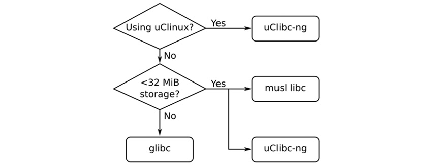

# *Chương 2*: Tìm hiểu về toolchain (Learning about Toolchains)

Toolchain là thành phần đầu tiên của embedded Linux và là điểm khởi đầu của project. Bạn sẽ dùng nó để biên dịch toàn bộ code sẽ chạy trên thiết bị. Những lựa chọn bạn đưa ra ở giai đoạn đầu này sẽ có tác động sâu sắc đến kết quả cuối cùng. Toolchain của bạn phải có khả năng tận dụng hiệu quả phần cứng bằng cách dùng instruction set tối ưu cho processor. Nó phải hỗ trợ các ngôn ngữ bạn cần và có một bản hiện thực vững chắc của **Portable Operating System Interface** (**POSIX**) và các giao diện hệ thống khác.

Toolchain của bạn nên giữ cố định suốt project. Nói cách khác, một khi đã chọn toolchain, điều quan trọng là gắn bó với nó. Thay đổi compiler và thư viện phát triển một cách không nhất quán trong quá trình project sẽ dẫn đến những bug khó thấy. Dù vậy, vẫn tốt nhất là cập nhật toolchain khi phát hiện lỗ hổng bảo mật hoặc bug.

Có được một toolchain có thể đơn giản như tải và cài một file TAR, hoặc có thể phức tạp như build toàn bộ từ source code. Trong chương này, tôi chọn cách thứ hai, với sự trợ giúp của một công cụ tên **crosstool-NG**, để có thể chỉ cho bạn chi tiết việc tạo một toolchain. Sau này, trong [*Chương 6*](ch06_selecting_a_build_system.vi.md), *Chọn build system*, tôi sẽ chuyển sang dùng toolchain do build system tạo ra, đây là cách thông dụng hơn để có toolchain. Khi tới [*Chương 14*](ch14_starting_with_busybox_runit.vi.md), *Bắt đầu với BusyBox runit*, chúng ta sẽ tiết kiệm thời gian bằng cách tải một toolchain Linaro dựng sẵn (prebuilt) để dùng với Buildroot.

Trong chương này, chúng ta sẽ đề cập các chủ đề sau:

- Giới thiệu về toolchain
- Tìm một toolchain
- Build toolchain bằng công cụ crosstool-NG
- Cấu tạo của một toolchain
- Link với thư viện – static linking và dynamic linking
- Nghệ thuật cross-compiling

## Yêu cầu kỹ thuật

Để làm theo các ví dụ, hãy bảo đảm bạn có những thứ sau:

- Một hệ thống host Linux-based đã cài `autoconf`, `automake`, `bison`, `bzip2`, `cmake`, `flex`, `g++`, `gawk`, `gcc`, `gettext`, `git`, `gperf`, `help2man`, `libncurses5-dev`, `libstdc++6`, `libtool`, `libtool-bin`, `make`, `patch`, `python3-dev`, `rsync`, `texinfo`, `unzip`, `wget` và `xz-utils` hoặc các gói tương đương.

Tôi khuyên dùng Ubuntu 20.04 LTS hoặc mới hơn vì các bài tập trong chương này đều đã được test trên bản phân phối Linux đó tại thời điểm viết. Đây là lệnh để cài tất cả các package cần thiết trên Ubuntu 20.04 LTS:

```
$ sudo apt-get install autoconf automake bison bzip2 cmake \ flex g++ gawk gcc
gettext git gperf help2man libncurses5-dev libstdc++6 libtool \ libtool-bin make
patch python3-dev rsync texinfo unzip wget xz-utils
```

Toàn bộ code cho chương này có thể được tìm thấy trong thư mục `Chapter02` của repository GitHub của cuốn sách: [https://github.com/PacktPublishing/Mastering-Embedded-Linux-Programming-Third-Edition](https://github.com/PacktPublishing/Mastering-Embedded-Linux-Programming-Third-Edition)

## Giới thiệu về toolchain

Toolchain là một tập công cụ biên dịch source code thành các file thực thi có thể chạy trên thiết bị đích, và bao gồm compiler, linker và các runtime library. Ban đầu, bạn cần một toolchain để build ba thành phần còn lại của hệ thống embedded Linux: bootloader, kernel và root filesystem. Nó phải có khả năng biên dịch code viết bằng assembly, C và C++ vì đây là các ngôn ngữ được dùng trong các package open source nền tảng.

Thông thường, toolchain cho Linux dựa trên các thành phần từ project GNU ([http://www.gnu.org](http://www.gnu.org)), và điều đó vẫn đúng trong phần lớn trường hợp tại thời điểm viết. Tuy nhiên, trong vài năm qua, compiler **Clang** và project **Low Level Virtual Machine** (**LLVM**) đi kèm ([http://llvm.org](http://llvm.org)) đã tiến bộ tới mức giờ đây là một lựa chọn thay thế khả thi cho toolchain GNU. Một khác biệt lớn giữa toolchain LLVM và GNU-based là license; LLVM có license BSD còn GNU có GPL.

Clang cũng có một số lợi thế kỹ thuật, chẳng hạn biên dịch nhanh hơn và chẩn đoán lỗi tốt hơn, nhưng GNU GCC có lợi thế về tương thích với code base hiện có và hỗ trợ rất nhiều kiến trúc và hệ điều hành. Dù mất vài năm để đạt được, Clang giờ đây có thể biên dịch tất cả các thành phần cần cho embedded Linux và là một lựa chọn thay thế khả thi cho GNU. Để tìm hiểu thêm, xem [https://www.kernel.org/doc/html/latest/kbuild/llvm.html](https://www.kernel.org/doc/html/latest/kbuild/llvm.html).

Có một mô tả tốt về cách dùng Clang cho cross-compilation tại [https://clang.llvm.org/docs/CrossCompilation.html](https://clang.llvm.org/docs/CrossCompilation.html). Nếu bạn muốn dùng nó như một phần của build system embedded Linux, EmbToolkit ([https://embtoolkit.org](https://embtoolkit.org)) hỗ trợ đầy đủ cả toolchain GNU lẫn LLVM/Clang, và nhiều người đang làm việc để dùng Clang với Buildroot và Yocto Project. Tôi sẽ đề cập các build system nhúng trong [*Chương 6*](ch06_selecting_a_build_system.vi.md), *Chọn build system*. Trong khi đó, chương này tập trung vào toolchain GNU vì nó vẫn là toolchain phổ biến và trưởng thành nhất cho Linux.

Một toolchain GNU tiêu chuẩn gồm ba thành phần chính:

- **Binutils**: Một tập các tiện ích binary bao gồm assembler và linker. Nó có tại [http://gnu.org/software/binutils](http://gnu.org/software/binutils).
- **GNU Compiler Collection** (**GCC**): Đây là các compiler cho C và các ngôn ngữ khác, tùy theo phiên bản GCC, bao gồm C++, Objective-C, Objective-C++, Java, Fortran, Ada và Go. Tất cả đều dùng một backend chung tạo ra code assembler, code này được đưa vào GNU assembler. Nó có tại [http://gcc.gnu.org/](http://gcc.gnu.org/).
- **C library**: Một **application program interface** (**API**) được chuẩn hóa dựa trên đặc tả POSIX, là giao diện chính tới kernel hệ điều hành cho các application. Có nhiều C library để cân nhắc, như chúng ta sẽ thấy ở phần sau của chương này.

Cùng với những thứ này, bạn sẽ cần một bản sao của các Linux kernel header, chứa các định nghĩa và hằng số cần thiết khi truy cập trực tiếp kernel. Ngay bây giờ, bạn cần chúng để có thể biên dịch C library, nhưng bạn cũng sẽ cần chúng sau này khi viết chương trình hoặc biên dịch thư viện tương tác với các thiết bị Linux cụ thể, chẳng hạn để hiển thị đồ họa qua Linux frame buffer driver. Đây không đơn giản là việc sao chép các header file trong thư mục `include` của kernel source code. Các header đó được dự định chỉ dùng trong kernel và chứa các định nghĩa sẽ gây xung đột nếu được dùng ở trạng thái thô để biên dịch các application Linux thông thường.

Thay vào đó, bạn sẽ cần tạo một tập kernel header đã được làm sạch (sanitized), như tôi đã minh họa trong [*Chương 5*](ch05_building_a_root_filesystem.vi.md), *Xây dựng root filesystem*.

Thường thì việc kernel header được tạo từ đúng phiên bản Linux bạn sẽ dùng hay không không quá quan trọng. Vì các giao diện kernel luôn backward compatible, chỉ cần các header đến từ một kernel cùng phiên bản hoặc cũ hơn kernel bạn đang dùng trên target.

Hầu hết mọi người cũng coi **GNU Debugger** (**GDB**) là một phần của toolchain, và thường nó được build ở bước này. Tôi sẽ nói về GDB trong [*Chương 19*](ch19_debugging_with_gdb.vi.md), *Debug với GDB*.

Giờ chúng ta đã nói về kernel header và thấy các thành phần của một toolchain là gì, hãy xem các loại toolchain khác nhau.

### Các loại toolchain

Với mục đích của chúng ta, có hai loại toolchain:

- **Native**: Toolchain này chạy trên cùng loại hệ thống (đôi khi chính hệ thống đó) với các chương trình mà nó tạo ra. Đây là trường hợp thông thường với máy tính để bàn và server, và nó đang trở nên phổ biến trên một số lớp thiết bị nhúng. Ví dụ, Raspberry Pi chạy Debian cho ARM có các native compiler self-hosted.
- **Cross**: Toolchain này chạy trên một loại hệ thống khác với target, cho phép việc phát triển được làm trên một PC để bàn nhanh rồi nạp lên target nhúng để test.

Gần như mọi hoạt động phát triển embedded Linux đều được làm bằng toolchain cross-development, một phần vì hầu hết thiết bị nhúng không phù hợp cho việc phát triển chương trình do thiếu năng lực tính toán, bộ nhớ và lưu trữ, nhưng cũng vì nó giữ môi trường host và target tách biệt. Điểm sau đặc biệt quan trọng khi host và target dùng cùng kiến trúc, chẳng hạn `x86_64`. Trong trường hợp này, rất dễ bị cám dỗ biên dịch native trên host rồi chỉ việc sao chép binary sang target.

Cách này hoạt động đến một mức nào đó, nhưng nhiều khả năng bản phân phối trên host sẽ nhận bản cập nhật thường xuyên hơn target, hoặc các kỹ sư khác nhau build code cho target sẽ có các phiên bản thư viện phát triển host hơi khác nhau. Theo thời gian, hệ thống phát triển và hệ thống target sẽ phân kỳ, và bạn sẽ vi phạm nguyên tắc rằng toolchain phải giữ cố định suốt vòng đời project. Bạn có thể làm cách này hoạt động nếu bảo đảm môi trường build host và target luôn đồng bộ với nhau. Tuy nhiên, một cách tiếp cận tốt hơn nhiều là giữ host và target tách biệt, và cross toolchain là cách để làm điều đó.

Tuy nhiên, cũng có một lập luận ngược lại ủng hộ phát triển native. Cross development tạo ra gánh nặng phải cross compile tất cả thư viện và công cụ bạn cần cho target. Chúng ta sẽ thấy ở phần sau trong mục có tên *The art of cross compiling* rằng cross development không phải lúc nào cũng đơn giản vì nhiều package open source không được thiết kế để build theo cách này. Các công cụ build tích hợp, bao gồm Buildroot và Yocto Project, giúp ích bằng cách đóng gói các quy tắc để cross-compile một loạt package mà bạn cần trong các hệ thống nhúng điển hình, nhưng nếu bạn muốn biên dịch một số lượng lớn package bổ sung, thì tốt hơn là biên dịch native. Ví dụ, build một bản phân phối Debian cho Raspberry Pi hay BeagleBone bằng cross compiler sẽ rất khó. Thay vào đó, chúng được biên dịch native.

Tạo một môi trường build native từ đầu không dễ. Ban đầu bạn vẫn cần một cross compiler để tạo môi trường build native trên target, môi trường mà sau đó bạn dùng để build các package. Sau đó, để thực hiện native build trong một khoảng thời gian hợp lý, bạn sẽ cần một build farm gồm các target board well-provisioned, hoặc bạn có thể dùng **Quick EMUlator** (**QEMU**) để giả lập target.

Trong khi đó, ở chương này, tôi sẽ tập trung vào một môi trường cross compiler mainstream hơn, tương đối dễ thiết lập và quản trị. Chúng ta sẽ bắt đầu bằng việc xem điều gì phân biệt kiến trúc CPU target này với kiến trúc khác.

### Kiến trúc CPU

Toolchain phải được build theo khả năng của CPU target, bao gồm:

- **Kiến trúc CPU**: **ARM**, **Microprocessor without Interlocked Pipelined Stages** (**MIPS**), x86_64, v.v.
- **Hoạt động big- hoặc little-endian**: Một số CPU có thể hoạt động ở cả hai chế độ, nhưng machine code khác nhau cho mỗi chế độ.
- **Hỗ trợ floating point**: Không phải phiên bản processor nhúng nào cũng hiện thực một floating-point unit phần cứng, khi đó toolchain phải được cấu hình để gọi một thư viện floating-point phần mềm thay thế.
- **Application Binary Interface** (**ABI**): Quy ước gọi hàm dùng để truyền tham số giữa các lời gọi function.

Với nhiều kiến trúc, ABI là cố định trong cả họ processor. Một ngoại lệ đáng chú ý là ARM. Kiến trúc ARM đã chuyển sang **Extended Application Binary Interface** (**EABI**) vào cuối những năm 2000, khiến ABI trước đó được gọi là **Old Application Binary Interface** (**OABI**). Dù OABI giờ đã lỗi thời, bạn sẽ tiếp tục thấy các tham chiếu tới EABI. Kể từ đó, EABI tách thành hai, dựa trên cách truyền các tham số floating-point.

EABI gốc dùng các register general-purpose (integer), trong khi **Extended Application Binary Interface Hard-Float** (**EABIHF**) mới hơn dùng các register floating point. EABIHF nhanh hơn đáng kể ở các phép toán floating-point, vì nó loại bỏ nhu cầu sao chép giữa register integer và register floating-point, nhưng nó không tương thích với các CPU không có floating-point unit. Vậy, lựa chọn là giữa hai ABI không tương thích; bạn không thể trộn lẫn hai cái, và vì vậy bạn phải quyết định ở giai đoạn này.

GNU dùng một prefix cho tên của mỗi công cụ trong toolchain, prefix này xác định các tổ hợp khác nhau có thể được tạo ra. Nó gồm một tuple ba hoặc bốn thành phần được phân cách bằng dấu gạch ngang, như mô tả ở đây:

- **CPU**: Đây là kiến trúc CPU, chẳng hạn ARM, MIPS hay x86_64. Nếu CPU có cả hai chế độ endian, chúng có thể được phân biệt bằng cách thêm `el` cho little-endian hoặc `eb` cho big-endian. Các ví dụ điển hình là MIPS little-endian, `mipsel`, và ARM big-endian, `armeb`.
- **Vendor**: Phần này xác định nhà cung cấp toolchain. Ví dụ gồm `buildroot`, `poky`, hoặc chỉ `unknown`. Đôi khi nó bị bỏ đi hoàn toàn.
- **Kernel**: Với mục đích của chúng ta, nó luôn là `linux`.
- **Hệ điều hành**: Tên cho thành phần user space, có thể là `gnu` hoặc `musl`. ABI cũng có thể được thêm vào đây, vì vậy với toolchain ARM, bạn có thể thấy `gnueabi`, `gnueabihf`, `musleabi` hoặc `musleabihf`.

Bạn có thể tìm tuple được dùng khi build toolchain bằng tùy chọn `-dumpmachine` của `gcc`. Ví dụ, bạn có thể thấy kết quả sau trên máy host:

```
$ gcc -dumpmachine
x86_64-linux-gnu
```

Tuple này chỉ ra CPU là `x86_64`, kernel là `linux`, và user space là `gnu`.

> **Lưu ý quan trọng**
>
> Khi một native compiler được cài trên một máy, thông thường người ta tạo link tới từng công cụ trong toolchain mà không có prefix, để bạn có thể gọi C compiler bằng lệnh `gcc`.

Đây là một ví dụ dùng cross compiler:

```
$ mipsel-unknown-linux-gnu-gcc -dumpmachine
mipsel-unknown-linux-gnu
```

Tuple này chỉ ra CPU là MIPS little-endian, vendor `unknown`, kernel `linux`, và user space `gnu`.

### Chọn C library

Giao diện lập trình tới hệ điều hành Unix được định nghĩa bằng ngôn ngữ C, ngày nay được định nghĩa bởi các tiêu chuẩn POSIX. **C library** là bản hiện thực của giao diện đó; nó là cổng vào kernel cho các chương trình Linux, như được thể hiện trong sơ đồ sau. Ngay cả khi bạn viết chương trình bằng một ngôn ngữ khác, có thể là Java hay Python, các thư viện hỗ trợ runtime tương ứng rốt cuộc vẫn sẽ phải gọi C library, như được thể hiện ở đây:


*Hình 2.1 – C library*

Bất cứ khi nào C library cần dịch vụ của kernel, nó sẽ dùng giao diện system call của kernel để chuyển giữa user space và kernel space. Có thể bỏ qua C library bằng cách gọi trực tiếp các system call của kernel, nhưng việc đó rất phiền phức và gần như không bao giờ cần thiết.

Có nhiều C library để chọn. Các lựa chọn chính như sau:

- **glibc**: Đây là GNU C library tiêu chuẩn, có tại [https://gnu.org/software/libc](https://gnu.org/software/libc). Nó lớn và, cho đến gần đây, không dễ cấu hình lắm, nhưng nó là bản hiện thực đầy đủ nhất của POSIX API. License là LGPL 2.1.
- **musl libc**: Có tại [https://musl.libc.org](https://musl.libc.org). Thư viện `musl libc` tương đối mới nhưng đã thu hút nhiều sự chú ý như một lựa chọn thay thế nhỏ gọn và standards-compliant cho GNU `libc`. Nó là lựa chọn tốt cho các hệ thống có lượng RAM và lưu trữ hạn chế. Nó có license MIT.
- **uClibc-ng**: Có tại [https://uclibc-ng.org](https://uclibc-ng.org). `u` thực ra là ký tự Hy Lạp `mu`, chỉ ra rằng đây là C library cho microcontroller. Ban đầu nó được phát triển để làm việc với uClinux (Linux cho các CPU không có memory management unit) nhưng sau đó đã được điều chỉnh để dùng với Linux đầy đủ. Thư viện `uClibc-ng` là một fork của project `uClibc` gốc ([https://uclibc.org](https://uclibc.org)), project không may đã rơi vào tình trạng bỏ bê. Cả hai đều có license LGPL 2.1.
- **eglibc**: Có tại [http://www.eglibc.org/home](http://www.eglibc.org/home). Giờ đã lỗi thời, `eglibc` là một fork của `glibc` với các thay đổi để phù hợp hơn cho việc dùng trong hệ thống nhúng. Trong số những thứ khác, `eglibc` đã thêm các tùy chọn cấu hình và hỗ trợ các kiến trúc không được `glibc` đề cập, đặc biệt là CPU core PowerPC e500. Code base từ `eglibc` đã được merge ngược vào `glibc` ở phiên bản 2.20. Thư viện `eglibc` không còn được bảo trì.

Vậy, nên chọn cái nào? Lời khuyên của tôi là chỉ dùng `uClibc-ng` nếu bạn dùng uClinux. Nếu bạn có lượng lưu trữ hoặc RAM rất hạn chế, thì `musl libc` là một lựa chọn tốt; nếu không, hãy dùng `glibc`, như được thể hiện trong flow chart này:



*Hình 2.2 – Chọn một C library*

Lựa chọn C library của bạn có thể giới hạn lựa chọn toolchain vì không phải toolchain pre-built nào cũng hỗ trợ mọi C library.

## Tìm một toolchain

Bạn có ba lựa chọn cho toolchain cross-development: bạn có thể tìm một toolchain ready-built phù hợp với nhu cầu; bạn có thể dùng một toolchain do một công cụ build nhúng tạo ra, điều được đề cập trong [*Chương 6*](ch06_selecting_a_build_system.vi.md), *Chọn build system*; hoặc bạn có thể tự tạo một toolchain như được mô tả ở phần sau của chương này.

Một cross toolchain pre-built là một lựa chọn hấp dẫn, ở chỗ bạn chỉ cần tải và cài đặt nó, nhưng bạn bị giới hạn bởi cấu hình của toolchain cụ thể đó và bạn phụ thuộc vào người hay tổ chức mà bạn lấy nó từ đó.

Nhiều khả năng, nó sẽ đến từ một trong những nguồn sau:

- Một SoC vendor hay board vendor. Hầu hết các vendor đều cung cấp một toolchain Linux.
- Một liên minh chuyên cung cấp hỗ trợ system-level cho một kiến trúc nhất định. Ví dụ, Linaro, ([https://www.linaro.org](https://www.linaro.org)) có các toolchain pre-built cho kiến trúc ARM.
- Một vendor công cụ Linux third-party, chẳng hạn Mentor Graphics, TimeSys hoặc MontaVista.
- Các package cross-tool cho bản phân phối Linux trên máy để bàn của bạn. Ví dụ, các bản phân phối Debian-based có các package để cross compile cho target ARM, MIPS và PowerPC.
- Một SDK dạng binary do một trong các công cụ build nhúng tích hợp tạo ra. Yocto Project có một số ví dụ tại http://downloads.yoctoproject.org/releases/yocto/yocto-[version]/toolchain.
- Một link từ một diễn đàn mà bạn không còn tìm lại được nữa.

Trong tất cả các trường hợp này, bạn phải quyết định xem toolchain pre-built được cung cấp có đáp ứng yêu cầu của bạn hay không. Nó có dùng C library bạn ưu tiên không? Nhà cung cấp có đưa cho bạn bản cập nhật cho các bản sửa lỗi bảo mật và bug không, hãy nhớ những nhận xét của tôi về hỗ trợ và cập nhật từ [*Chương 1*](ch01_starting_out.vi.md), *Bắt đầu*. Nếu câu trả lời của bạn là không cho bất kỳ câu nào trong số này, thì bạn nên cân nhắc tự tạo toolchain của mình.

Không may, build một toolchain không phải việc dễ. Nếu bạn thực sự muốn tự làm toàn bộ, hãy xem *Cross Linux From Scratch* ([https://trac.clfs.org](https://trac.clfs.org)). Ở đó bạn sẽ tìm thấy hướng dẫn step-by-step về cách tạo từng thành phần.

Một lựa chọn đơn giản hơn là dùng crosstool-NG, công cụ đóng gói quá trình thành một tập script và có một frontend menu-driven. Tuy vậy, bạn vẫn cần một lượng kiến thức kha khá, chỉ để đưa ra lựa chọn đúng.

Đơn giản hơn nữa là dùng một build system như Buildroot hay Yocto Project, vì chúng tạo ra toolchain như một phần của quá trình build. Đây là giải pháp tôi ưa dùng, như tôi đã trình bày trong [*Chương 6*](ch06_selecting_a_build_system.vi.md), *Chọn build system*.

Với sự phát triển mạnh của crosstool-NG, tự build toolchain chắc chắn là một lựa chọn hợp lệ và khả thi. Hãy xem cách làm điều đó tiếp theo.

## Build toolchain bằng crosstool-NG

Vài năm trước, Dan Kegel đã viết một tập script và makefile để tạo các toolchain cross-development và gọi nó là crosstool ([http://kegel.com/crosstool/](http://kegel.com/crosstool/)). Năm 2007, Yann E. Morin đã dùng nền tảng đó để tạo thế hệ tiếp theo của crosstool, crosstool-NG ([https://crosstool-ng.github.io](https://crosstool-ng.github.io)). Ngày nay nó là cách thuận tiện nhất, với khoảng cách rất xa, để tạo một cross toolchain độc lập từ source.

Trong mục này, chúng ta sẽ dùng crosstool-NG để build toolchain cho BeagleBone Black và QEMU.

### Cài đặt crosstool-NG

Trước khi có thể build crosstool-NG từ source, trước tiên bạn cần cài một native toolchain và một số công cụ build trên máy host. Xem mục *Yêu cầu kỹ thuật* ở đầu chương này để có danh sách đầy đủ các phụ thuộc build và runtime của crosstool-NG.

Tiếp theo, lấy bản phát hành hiện tại từ repository Git của crosstool-NG. Trong các ví dụ của tôi, tôi đã dùng phiên bản `1.24.0`. Giải nén nó và tạo hệ thống menu frontend, `ct-ng`, như được thể hiện trong các lệnh sau:

```
$ git clone https://github.com/crosstool-ng/crosstool-ng.git
$ cd crosstool-ng
$ git checkout crosstool-ng-1.24.0
$ ./bootstrap
$ ./configure --prefix=${PWD}
$ make
$ make install
```

Tùy chọn `--prefix=${PWD}` có nghĩa là chương trình sẽ được cài vào thư mục hiện tại, điều này tránh việc cần quyền root, như sẽ phải có nếu bạn cài nó vào vị trí mặc định `/usr/local/share`.

Giờ chúng ta đã có một bản cài đặt crosstool-NG hoạt động được để build cross toolchain. Gõ `bin/ct-ng` để khởi chạy menu crosstool.

### Build toolchain cho BeagleBone Black

Crosstool-NG có thể build nhiều tổ hợp toolchain khác nhau. Để việc cấu hình ban đầu dễ hơn, nó đi kèm một tập mẫu bao quát nhiều trường hợp sử dụng phổ biến. Dùng `bin/ct-ng list-samples` để tạo danh sách.

BeagleBone Black có SoC TI AM335x, chứa một core ARM Cortex A8 và một floating-point unit VFPv3. Vì BeagleBone Black có nhiều RAM và lưu trữ, chúng ta có thể dùng `glibc` làm C library. Mẫu gần nhất là `arm-cortex_a8-linux-gnueabi`.

Bạn có thể xem cấu hình mặc định bằng cách thêm prefix `show-` vào tên, như được minh họa ở đây:

```
$ bin/ct-ng show-arm-cortex_a8-linux-gnueabi
[G...]   arm-cortex_a8-linux-gnueabi
    Languages       : C,C++
    OS              : linux-4.20.8
    Binutils        : binutils-2.32
    Compiler        : gcc-8.3.0
    C library       : glibc-2.29
    Debug tools     : duma-2_5_15 gdb-8.2.1 ltrace-0.7.3 strace-4.26
    Companion libs  : expat-2.2.6 gettext-0.19.8.1 gmp-6.1.2 isl-0.20 libelf-0.8.13 libiconv-1.15 mpc-1.1.0 mpfr-4.0.2 ncurses-6.1 zlib-1.2.11
    Companion tools :
```

Cấu hình này khá khớp với yêu cầu của chúng ta, ngoại trừ việc nó dùng binary interface `eabi`, vốn truyền các đối số floating-point trong register integer. Chúng ta muốn dùng các register floating point phần cứng cho mục đích đó hơn vì nó sẽ tăng tốc các lời gọi function có tham số kiểu `float` và `double`. Bạn có thể thay đổi cấu hình sau, vì vậy giờ bạn nên chọn cấu hình target này:

```
$ bin/ct-ng arm-cortex_a8-linux-gnueabi
```

Tại thời điểm này, bạn có thể xem lại cấu hình và thay đổi bằng lệnh menu cấu hình `menuconfig`:

```
$ bin/ct-ng menuconfig
```

Hệ thống menu dựa trên `menuconfig` của Linux kernel, vì vậy việc điều hướng giao diện người dùng sẽ quen thuộc với bất kỳ ai đã từng cấu hình kernel. Nếu chưa, hãy tham khảo [*Chương 4*](ch04_configuring_and_building_the_kernel.vi.md), *Cấu hình và build kernel*, để có mô tả về `menuconfig`.

Có ba thay đổi cấu hình mà tôi khuyên bạn nên thực hiện lúc này:

- Trong **Paths and misc** **options**, tắt **Render the toolchain read-only** (`CT_PREFIX_DIR_RO`).
- Trong **Target options** | **Floating point**, chọn **hardware** (**FPU**) (`CT_ARCH_FLOAT_HW`).
- Trong **Target options**, nhập `neon` cho **Use specific FPU**.

Thay đổi thứ nhất là cần thiết nếu bạn muốn thêm thư viện vào toolchain sau khi nó đã được cài đặt, điều tôi sẽ mô tả ở phần sau, trong mục *Link với thư viện*. Thay đổi thứ hai chọn binary interface `eabihf` vì những lý do đã bàn ở trên. Thay đổi thứ ba là cần để build Linux kernel thành công. Các tên trong ngoặc đơn là các label cấu hình được lưu trong file cấu hình. Khi đã thực hiện các thay đổi, thoát menu `menuconfig` và lưu cấu hình như thường lệ.

Bây giờ bạn có thể dùng crosstool-NG để lấy, cấu hình và build các thành phần theo đặc tả của bạn, bằng cách gõ lệnh sau:

```
$ bin/ct-ng build
```

Quá trình build sẽ mất khoảng nửa giờ, sau đó bạn sẽ thấy toolchain có mặt trong `~/x-tools/arm-cortex_a8-linux-gnueabihf`.

Tiếp theo, hãy build một toolchain nhắm tới QEMU.

### Build toolchain cho QEMU

Trên target QEMU, bạn sẽ giả lập một evaluation board ARM-versatile PB có processor core ARM926EJ-S, hiện thực instruction set ARMv5TE. Bạn cần tạo một toolchain crosstool-NG khớp với đặc tả này. Quy trình rất giống với quy trình cho BeagleBone Black.

Bạn bắt đầu bằng cách chạy `bin/ct-ng list-samples` để tìm một cấu hình nền tốt để làm việc. Không có cái nào khớp hoàn toàn, vì vậy hãy dùng một target generic, `arm-unknown-linux-gnueabi`. Bạn chọn nó như được thể hiện, chạy `distclean` trước để bảo đảm không còn sót artifact nào từ lần build trước:

```
$ bin/ct-ng distclean
$ bin/ct-ng arm-unknown-linux-gnueabi
```

Như với BeagleBone Black, bạn có thể xem lại cấu hình và thay đổi bằng lệnh menu cấu hình `bin/ct-ng menuconfig`. Chỉ có một thay đổi cần thiết:

- Trong **Paths and misc options**, tắt **Render the toolchain read-only** (`CT_PREFIX_DIR_RO`).

Bây giờ, build toolchain bằng lệnh được thể hiện ở đây:

```
$ bin/ct-ng build
```

Như trước, quá trình build sẽ mất khoảng nửa giờ. Toolchain sẽ được cài trong `~/x-tools/arm-unknown-linux-gnueabi`.

Bạn sẽ cần một cross toolchain hoạt động được để hoàn thành các bài tập trong mục tiếp theo.

## Cấu tạo của một toolchain

Để có ý niệm về những gì có trong một toolchain điển hình, tôi muốn xem xét toolchain crosstool-NG bạn vừa tạo. Các ví dụ dùng toolchain ARM Cortex A8 được tạo cho BeagleBone Black, có prefix `arm-cortex_a8-linux-gnueabihf-`. Nếu bạn đã build toolchain ARM926EJ-S cho target QEMU, thì prefix sẽ là `arm-unknown-linux-gnueabi`.

Toolchain ARM Cortex A8 nằm trong thư mục `~/x-tools/arm-cortex_a8-linux-gnueabihf/bin`. Trong đó, bạn sẽ thấy cross compiler `arm-cortex_a8-linux-gnueabihf-gcc`. Để dùng nó, bạn cần thêm thư mục vào path bằng lệnh sau:

```
$ PATH=~/x-tools/arm-cortex_a8-linux-gnueabihf/bin:$PATH
```

Bây giờ bạn có thể lấy một chương trình `helloworld` đơn giản, mà trong ngôn ngữ C trông như sau:

```
#include <stdio.h>
#include <stdlib.h>
int main (int argc, char *argv[])
{
    printf ("Hello, world!\n");
    return 0;
}
```

Bạn biên dịch nó như sau:

```
$ arm-cortex_a8-linux-gnueabihf-gcc helloworld.c -o helloworld
```

Bạn có thể xác nhận rằng nó đã được cross-compiled bằng cách dùng lệnh `file` để in ra loại của file:

```
$ file helloworld
helloworld: ELF 32-bit LSB executable, ARM, EABI5 version 1 (SYSV), dynamically linked, interpreter /lib/ld-linux-armhf.so.3, for GNU/Linux 4.20.8, with debug_info, not stripped
```

Giờ bạn đã kiểm chứng cross compiler hoạt động, hãy xem xét nó kỹ hơn.

### Tìm hiểu về cross compiler của bạn

Hãy tưởng tượng bạn vừa nhận được một toolchain và muốn biết thêm về cách nó được cấu hình. Bạn có thể tìm ra rất nhiều thông tin bằng cách truy vấn `gcc`. Ví dụ, để tìm phiên bản, bạn dùng `--version`:

```
$ arm-cortex_a8-linux-gnueabihf-gcc --version
arm-cortex_a8-linux-gnueabihf-gcc (crosstool-NG 1.24.0) 8.3.0
Copyright (C) 2018 Free Software Foundation, Inc.
This is free software; see the source for copying conditions.  There is NO warranty; not even for MERCHANTABILITY or FITNESS FOR A PARTICULAR PURPOSE.
```

Để tìm cách nó được cấu hình, dùng `-v`:

```
$ arm-cortex_a8-linux-gnueabihf-gcc -v
Using built-in specs.
COLLECT_GCC=arm-cortex_a8-linux-gnueabihf-gcc
COLLECT_LTO_WRAPPER=/home/frank/x-tools/arm-cortex_a8-linux-gnueabihf/libexec/gcc/arm-cortex_a8-linux-gnueabihf/8.3.0/lto-wrapper
Target: arm-cortex_a8-linux-gnueabihf
Configured with: /home/frank/crosstool-ng/.build/arm-cortex_a8-linux-gnueabihf/src/gcc/configure --build=x86_64-build_pc-linux-gnu --host=x86_64-build_pc-linux-gnu --target=arm-cortex_a8-linux-gnueabihf --prefix=/home/frank/x-tools/arm-cortex_a8-linux-gnueabihf --with-sysroot=/home/frank/x-tools/arm-cortex_a8-linux-gnueabihf/arm-cortex_a8-linux-gnueabihf/sysroot --enable-languages=c,c++ --with-cpu=cortex-a8 --with-float=hard --with-pkgversion='crosstool-NG 1.24.0' --enable-__cxa_atexit --disable-libmudflap --disable-libgomp --disable-libssp --disable-libquadmath --disable-libquadmath-support --disable-libsanitizer --disable-libmpx --with-gmp=/home/frank/crosstool-ng/.build/arm-cortex_a8-linux-gnueabihf/buildtools --with-mpfr=/home/frank/crosstool-ng/.build/arm-cortex_a8-linux-gnueabihf/buildtools --with-mpc=/home/frank/crosstool-ng/.build/arm-cortex_a8-linux-gnueabihf/buildtools --with-isl=/home/frank/crosstool-ng/.build/arm-cortex_a8-linux-gnueabihf/buildtools --enable-lto --with-host-libstdcxx='-static-libgcc -Wl,-Bstatic,-lstdc++,-Bdynamic -lm' --enable-threads=posix --enable-target-optspace --enable-plugin --enable-gold --disable-nls --disable-multilib --with-local-prefix=/home/frank/x-tools/arm-cortex_a8-linux-gnueabihf/arm-cortex_a8-linux-gnueabihf/sysroot --enable-long-long
Thread model: posix
gcc version 8.3.0 (crosstool-NG 1.24.0)
```

Có rất nhiều output ở đó, nhưng những điểm thú vị cần lưu ý là:

- `--with-sysroot=/home/frank/x-tools/arm-cortex_a8-linux-gnueabihf/arm-cortex_a8-linux-gnueabihf/sysroot`: Đây là thư mục `sysroot` mặc định; xem mục tiếp theo để có giải thích.
- `--enable-languages=c,c++`: Với tùy chọn này, chúng ta có cả ngôn ngữ C và C++ được enable.
- `--with-cpu=cortex-a8`: Code được tạo cho core ARM Cortex A8.
- `--with-float=hard`: Tạo opcode cho floating-point unit và dùng các register VFP cho tham số.
- `--enable-threads=posix`: Tùy chọn này enable POSIX thread.

Đây là các thiết lập mặc định cho compiler. Bạn có thể ghi đè hầu hết chúng trên command line của `gcc`. Ví dụ, nếu muốn biên dịch cho một CPU khác, bạn có thể ghi đè thiết lập đã cấu hình, `--with-cpu`, bằng cách thêm `-mcpu` vào command line, như sau:

```
$ arm-cortex_a8-linux-gnueabihf-gcc -mcpu=cortex-a5 \ helloworld.c \
-o helloworld
```

Bạn có thể in ra danh sách các tùy chọn architecture-specific có sẵn bằng `--target-help`, như sau:

```
$ arm-cortex_a8-linux-gnueabihf-gcc --target-help
```

Có thể bạn đang tự hỏi liệu việc lấy đúng chính xác cấu hình ở thời điểm này có quan trọng không, vì bạn luôn có thể thay đổi nó như được thể hiện ở đây. Câu trả lời phụ thuộc vào cách bạn dự định dùng nó. Nếu bạn định tạo một toolchain mới cho mỗi target, thì hợp lý khi thiết lập mọi thứ ngay từ đầu, vì nó sẽ giảm rủi ro làm sai về sau. Nhảy trước một chút tới [*Chương 6*](ch06_selecting_a_build_system.vi.md), *Chọn build system*, tôi gọi đây là triết lý Buildroot. Mặt khác, nếu bạn muốn build một toolchain generic và sẵn sàng cung cấp các thiết lập đúng khi build cho một target cụ thể, thì bạn nên làm toolchain nền ở dạng generic, đó là cách Yocto Project xử lý mọi thứ. Các ví dụ ở trên theo triết lý Buildroot.

### Sysroot, thư viện và header file

`sysroot` của toolchain là một thư mục chứa các thư mục con cho thư viện, header file và các file cấu hình khác. Nó có thể được đặt khi cấu hình toolchain thông qua `--with-sysroot=`, hoặc có thể được đặt trên command line bằng `--sysroot=`. Bạn có thể xem vị trí của `sysroot` mặc định bằng `-print-sysroot`:

```
$ arm-cortex_a8-linux-gnueabihf-gcc -print-sysroot
/home/frank/x-tools/arm-cortex_a8-linux-gnueabihf/arm-cortex_a8-linux-gnueabihf/sysroot
```

Bạn sẽ thấy các thư mục con sau trong `sysroot`:

- `lib`: Chứa các shared object của C library và dynamic linker/loader, `ld-linux`
- `usr/lib`: Các file archive static library của C library, và bất kỳ thư viện nào khác có thể được cài sau đó
- `usr/include`: Chứa header của tất cả các thư viện
- `usr/bin`: Chứa các chương trình tiện ích chạy trên target, chẳng hạn lệnh `ldd`
- `usr/share`: Dùng cho localization và internationalization
- `sbin`: Cung cấp tiện ích `ldconfig`, dùng để tối ưu các đường dẫn nạp thư viện

Rõ ràng, một số thứ trong này cần có trên host phát triển để biên dịch chương trình, còn những thứ khác, chẳng hạn các shared library và `ld-linux`, cần có trên target lúc runtime.

### Các công cụ khác trong toolchain

Dưới đây là danh sách các lệnh để gọi các thành phần khác của một toolchain GNU, kèm mô tả ngắn:

- `addr2line`: Chuyển địa chỉ chương trình thành tên file và số dòng bằng cách đọc các bảng debug symbol trong một file thực thi. Nó rất hữu ích khi giải mã các địa chỉ được in ra trong một báo cáo crash hệ thống.
- `ar`: Tiện ích archive được dùng để tạo static library.
- `as`: Đây là GNU assembler.
- `c++filt`: Được dùng để demangle các symbol C++ và Java.
- `cpp`: Đây là C preprocessor và được dùng để mở rộng `#define`, `#include` và các directive tương tự khác. Bạn hiếm khi cần dùng nó riêng lẻ.
- `elfedit`: Được dùng để cập nhật ELF header của các file ELF.
- `g++`: Đây là GNU C++ frontend, giả định rằng các source file chứa code C++.
- `gcc`: Đây là GNU C frontend, giả định rằng các source file chứa code C.
- `gcov`: Đây là một công cụ code coverage.
- `gdb`: Đây là GNU debugger.
- `gprof`: Đây là một công cụ profiling chương trình.
- `ld`: Đây là GNU linker.
- `nm`: Liệt kê các symbol từ object file.
- `objcopy`: Được dùng để sao chép và chuyển đổi object file.
- `objdump`: Được dùng để hiển thị thông tin từ object file.
- `ranlib`: Tạo hoặc sửa index trong một static library, giúp bước link nhanh hơn.
- `readelf`: Hiển thị thông tin về các file ở định dạng object ELF.
- `size`: Liệt kê kích thước các section và tổng kích thước.
- `strings`: Hiển thị các chuỗi ký tự in được trong file.
- `strip`: Được dùng để loại bỏ các bảng debug symbol khỏi object file, nhờ đó làm nó nhỏ hơn. Thông thường, bạn sẽ strip toàn bộ code thực thi được đưa lên target.

Giờ chúng ta sẽ chuyển từ các công cụ command-line và quay lại chủ đề C library.

### Xem xét các thành phần của C library

C library không phải là một file thư viện duy nhất. Nó gồm bốn phần chính cùng nhau hiện thực POSIX API:

- `libc`: C library chính chứa các function POSIX well-known như `printf`, `open`, `close`, `read`, `write`, v.v.
- `libm`: Chứa các function toán học như `cos`, `exp` và `log`
- `libpthread`: Chứa tất cả các function POSIX thread có tên bắt đầu bằng `pthread_`
- `librt`: Có các phần mở rộng real-time cho POSIX, bao gồm shared memory và I/O bất đồng bộ

Cái đầu tiên, `libc`, luôn được link vào nhưng các cái khác phải được link tường minh bằng tùy chọn `-l`. Tham số cho `-l` là tên thư viện đã bỏ phần `lib`. Ví dụ, một chương trình tính hàm sine bằng cách gọi `sin()` sẽ được link với `libm` bằng `-lm`:

```
$ arm-cortex_a8-linux-gnueabihf-gcc myprog.c -o myprog -lm
```

Bạn có thể kiểm chứng những thư viện nào đã được link vào chương trình này hay bất kỳ chương trình nào khác bằng lệnh `readelf`:

```
$ arm-cortex_a8-linux-gnueabihf-readelf -a myprog | grep "Shared library"
 0x00000001 (NEEDED)               Shared library: [libm.so.6]
 0x00000001 (NEEDED)               Shared library: [libc.so.6]
```

Shared library cần một runtime linker, mà bạn có thể làm hiện ra bằng lệnh này:

```
$ arm-cortex_a8-linux-gnueabihf-readelf -a myprog | grep "program interpreter"
    [Requesting program interpreter: /lib/ld-linux-armhf.so.3]
```

Việc này hữu ích đến mức tôi có một file script tên `list-libs`, mà bạn sẽ tìm thấy trong kho code của sách ở `MELP/list-libs`. Nó chứa các lệnh sau:

```
#!/bin/sh
${CROSS_COMPILE}readelf -a $1 | grep "program interpreter"
${CROSS_COMPILE}readelf -a $1 | grep "Shared library"
```

Có những file thư viện khác chúng ta có thể link tới ngoài bốn thành phần của C library. Chúng ta sẽ xem cách làm điều đó trong mục tiếp theo.

## Link với thư viện – static linking và dynamic linking

Bất kỳ application nào bạn viết cho Linux, dù bằng C hay C++, đều sẽ được link với C library `libc`. Điều này cơ bản đến mức bạn thậm chí không cần bảo `gcc` hay `g++` làm vậy vì nó luôn link `libc`. Các thư viện khác mà bạn có thể muốn link phải được nêu tên tường minh qua tùy chọn `-l`.

Code thư viện có thể được link theo hai cách khác nhau: statically, nghĩa là tất cả các function thư viện mà application gọi cùng các phụ thuộc của chúng được lấy từ library archive và gắn vào file thực thi; và dynamically, nghĩa là các tham chiếu tới file thư viện và các function trong các file đó được tạo ra trong code nhưng việc link thực tế được làm động lúc runtime. Bạn sẽ tìm thấy code cho các ví dụ sau trong kho code của sách ở `MELP/Chapter02/library`.

Chúng ta sẽ bắt đầu với static linking.

### Static library

Static linking hữu ích trong một vài trường hợp. Ví dụ, nếu bạn build một hệ thống nhỏ chỉ gồm BusyBox và một số file script, thì link BusyBox statically sẽ đơn giản hơn và tránh phải sao chép các file runtime library và linker. Nó cũng sẽ nhỏ hơn vì bạn chỉ link vào code mà application dùng thay vì cung cấp toàn bộ C library. Static linking cũng hữu ích nếu bạn cần chạy một chương trình trước khi filesystem chứa các runtime library sẵn sàng.

Bạn có thể link tất cả thư viện statically bằng cách thêm `-static` vào command line:

```
$ arm-cortex_a8-linux-gnueabihf-gcc -static helloworld.c -o helloworld-static
```

Bạn sẽ để ý thấy kích thước của binary tăng đột biến:

```
$ ls -l
total 4060
-rwxrwxr-x 1 frank frank   11816 Oct 23 15:45 helloworld
-rw-rw-r-- 1 frank frank     123 Oct 23 15:35 helloworld.c
-rwxrwxr-x 1 frank frank 4140860 Oct 23 16:00 helloworld-static
```

Static linking lấy code từ một library archive, thường có tên `lib[name].a`. Trong trường hợp trên, đó là `libc.a`, nằm trong `[sysroot]/usr/lib`:

```
$ export SYSROOT=$(arm-cortex_a8-linux-gnueabihf-gcc -print-sysroot)
$ cd $SYSROOT
$ ls -l usr/lib/libc.a
-rw-r--r-- 1 frank frank 31871066 Oct 23 15:16 usr/lib/libc.a
```

Lưu ý rằng cú pháp export `SYSROOT=$(arm-cortex_a8-linux-gnueabihf-gcc -print-sysroot)` đặt đường dẫn tới `sysroot` vào biến shell `SYSROOT`, giúp ví dụ rõ ràng hơn một chút.

Tạo một static library đơn giản như tạo một archive gồm các object file bằng lệnh `ar`. Nếu tôi có hai source file tên `test1.c` và `test2.c`, và muốn tạo một static library tên `libtest.a`, thì tôi sẽ làm như sau:

```
$ arm-cortex_a8-linux-gnueabihf-gcc -c test1.c
$ arm-cortex_a8-linux-gnueabihf-gcc -c test2.c
$ arm-cortex_a8-linux-gnueabihf-ar rc libtest.a test1.o test2.o
$ ls -l
total 24
-rw-rw-r-- 1 frank frank 2392 Oct 9 09:28 libtest.a
-rw-rw-r-- 1 frank frank 116 Oct 9 09:26 test1.c
-rw-rw-r-- 1 frank frank 1080 Oct 9 09:27 test1.o
-rw-rw-r-- 1 frank frank 121 Oct 9 09:26 test2.c
-rw-rw-r-- 1 frank frank 1088 Oct 9 09:27 test2.o
```

Sau đó tôi có thể link `libtest` vào chương trình `helloworld` của mình bằng lệnh này:

```
$ arm-cortex_a8-linux-gnueabihf-gcc helloworld.c -ltest \
-L../libs -I../libs -o helloworld
```

Giờ hãy build lại cùng chương trình đó bằng dynamic linking.

### Shared library

Một cách phổ biến hơn để triển khai thư viện là dưới dạng shared object được link lúc runtime, cách này dùng bộ lưu trữ và bộ nhớ hệ thống hiệu quả hơn, vì chỉ cần nạp một bản sao của code. Nó cũng giúp dễ dàng cập nhật các file thư viện mà không phải relink tất cả các chương trình dùng chúng.

Object code của một shared library phải là position-independent, để runtime linker được tự do đặt nó vào bộ nhớ ở địa chỉ trống tiếp theo. Để làm điều này, thêm tham số `-fPIC` cho `gcc`, rồi link nó bằng tùy chọn `-shared`:

```
$ arm-cortex_a8-linux-gnueabihf-gcc -fPIC -c test1.c
$ arm-cortex_a8-linux-gnueabihf-gcc -fPIC -c test2.c
$ arm-cortex_a8-linux-gnueabihf-gcc -shared -o libtest.so test1.o test2.o
```

Lệnh này tạo shared library `libtest.so`. Để link một application với thư viện này, bạn thêm `-ltest`, đúng như trong trường hợp static được nhắc ở mục trước, nhưng lần này code không được đưa vào file thực thi. Thay vào đó, có một tham chiếu tới thư viện mà runtime linker sẽ phải resolve:

```
$ arm-cortex_a8-linux-gnueabihf-gcc helloworld.c -ltest \
-L../libs -I../libs -o helloworld
$ MELP/list-libs helloworld
    [Requesting program interpreter: /lib/ld-linux-armhf.so.3]
 0x00000001 (NEEDED)            Shared library: [libtest.so.6]
 0x00000001 (NEEDED)            Shared library: [libc.so.6]
```

Runtime linker cho chương trình này là `/lib/ld-linux-armhf.so.3`, file này phải có mặt trong filesystem của target. Linker sẽ tìm `libtest.so` trong đường dẫn tìm kiếm mặc định: `/lib` và `/usr/lib`. Nếu bạn muốn nó cũng tìm thư viện trong các thư mục khác, bạn có thể đặt một danh sách đường dẫn colon-separated vào biến shell `LD_LIBRARY_PATH`:

```
$ export LD_LIBRARY_PATH=/opt/lib:/opt/usr/lib
```

Vì shared library tách biệt với các file thực thi link tới chúng, chúng ta cần lưu ý phiên bản của chúng khi triển khai.

#### Hiểu số phiên bản của shared library

Một trong những lợi ích của shared library là chúng có thể được cập nhật độc lập với các chương trình dùng chúng.

Các bản cập nhật thư viện có hai loại:

- Loại sửa bug hoặc thêm function mới theo cách backward-compatible
- Loại phá vỡ tương thích với các application hiện có

GNU/Linux có một sơ đồ đánh phiên bản để xử lý cả hai trường hợp này.

Mỗi thư viện có một release version và một interface number. Release version đơn giản là một chuỗi được nối vào tên thư viện; ví dụ, thư viện ảnh JPEG `libjpeg` hiện ở release `8.2.2` và vì vậy thư viện có tên `libjpeg.so.8.2.2`. Có một symbolic link tên `libjpeg.so` trỏ tới `libjpeg.so.8.2.2`, để khi bạn biên dịch một chương trình với `-ljpeg`, bạn link với phiên bản hiện tại. Nếu bạn cài phiên bản `8.2.3`, link được cập nhật, và bạn sẽ link với phiên bản đó thay thế.

Giờ giả sử phiên bản `9.0.0` xuất hiện và nó phá vỡ backward compatibility. Link từ `libjpeg.so` giờ trỏ tới `libjpeg.so.9.0.0`, để mọi chương trình mới được link với phiên bản mới, có thể gây ra lỗi biên dịch khi giao diện của `libjpeg` thay đổi, những lỗi mà lập trình viên có thể sửa.

Bất kỳ chương trình nào trên target không được biên dịch lại sẽ thất bại theo cách nào đó, vì chúng vẫn dùng giao diện cũ. Đây là lúc một thứ được gọi là **soname** giúp ích. Soname mã hóa interface number khi thư viện được build và được runtime linker dùng khi nạp thư viện. Nó có định dạng `<library name>.so.<interface number>`. Với `libjpeg.so.8.2.2`, soname là `libjpeg.so.8` vì interface number khi shared library `libjpeg` đó được build là `8`:

```
$ readelf -a /usr/lib/x86_64-linux-gnu/libjpeg.so.8.2.2 \
| grep SONAME
 0x000000000000000e (SONAME)    Library soname: [libjpeg.so.8]
```

Bất kỳ chương trình nào được biên dịch với nó sẽ yêu cầu `libjpeg.so.8` lúc runtime, đây sẽ là một symbolic link trên target trỏ tới `libjpeg.so.8.2.2`. Khi phiên bản `9.0.0` của `libjpeg` được cài, nó sẽ có soname là `libjpeg.so.9`, và vì vậy có thể có hai phiên bản không tương thích của cùng một thư viện được cài trên cùng một hệ thống. Các chương trình được link với `libjpeg.so.8.*.*` sẽ nạp `libjpeg.so.8`, và các chương trình được link với `libjpeg.so.9.*.*` sẽ nạp `libjpeg.so.9`.

Đó là lý do, khi bạn xem danh sách thư mục của `/usr/lib/x86_64-linux-gnu/libjpeg*`, bạn thấy bốn file này:

- `libjpeg.a`: Đây là library archive dùng cho static linking.
- `libjpeg.so -> libjpeg.so.8.2.2`: Đây là một symbolic link, dùng cho dynamic linking.
- `libjpeg.so.8 -> libjpeg.so.8.2.2`: Đây là một symbolic link, dùng khi nạp thư viện lúc runtime.
- `libjpeg.so.8.2.2`: Đây là shared library thực tế, dùng cả lúc biên dịch lẫn lúc runtime.

Hai file đầu chỉ cần trên máy host để build, còn hai file cuối cần trên target lúc runtime.

Dù bạn có thể gọi trực tiếp các công cụ cross-compilation GNU khác nhau từ command line, kỹ thuật này không mở rộng được quá các ví dụ đồ chơi như `helloworld`. Để thực sự hiệu quả trong việc cross-compiling, chúng ta cần kết hợp một cross toolchain với một build system.

## Nghệ thuật cross-compiling

Có một cross toolchain hoạt động được là điểm khởi đầu của một hành trình, không phải điểm kết thúc. Đến một lúc nào đó, bạn sẽ muốn bắt đầu cross-compiling các công cụ, application và thư viện khác nhau mà bạn cần trên target. Nhiều trong số chúng sẽ là các package open source, mỗi package có cách biên dịch và những điểm đặc thù riêng.

Có một số build system phổ biến, bao gồm:

- Makefile thuần, trong đó toolchain thường được điều khiển bởi biến `make` `CROSS_COMPILE`
- GNU build system được gọi là **Autotools**
- **CMake** ([https://cmake.org](https://cmake.org))

Cả Autotools và makefile đều cần để build ngay cả một hệ thống embedded Linux cơ bản. CMake là cross-platform và được dùng ngày càng nhiều qua các năm, đặc biệt trong cộng đồng C++. Trong mục này, chúng ta sẽ đề cập cả ba công cụ build.

### Makefile đơn giản

Một số package quan trọng rất đơn giản để cross-compile, bao gồm Linux kernel, bootloader U-Boot và BusyBox. Với mỗi package này, bạn chỉ cần đặt prefix của toolchain vào biến `make` `CROSS_COMPILE`, chẳng hạn `arm-cortex_a8-linux-gnueabi-`. Lưu ý dấu gạch ngang `-` ở cuối.

Vậy, để biên dịch BusyBox, bạn sẽ gõ lệnh này:

```
$ make CROSS_COMPILE=arm-cortex_a8-linux-gnueabihf-
```

Hoặc, bạn có thể đặt nó thành biến shell:

```
$ export CROSS_COMPILE=arm-cortex_a8-linux-gnueabihf-
$ make
```

Với U-Boot và Linux, bạn cũng phải đặt biến `make` `ARCH` thành một trong các kiến trúc máy mà chúng hỗ trợ, điều tôi sẽ đề cập trong [*Chương 3*](ch03_all_about_bootloaders.vi.md), *Tất cả về bootloader*, và [*Chương 4*](ch04_configuring_and_building_the_kernel.vi.md), *Cấu hình và build kernel*.

Cả Autotools và CMake đều có thể tạo makefile. Autotools chỉ tạo makefile trong khi CMake hỗ trợ các cách build project khác tùy theo nền tảng mà chúng ta nhắm tới (trong trường hợp của chúng ta thì chỉ Linux). Hãy xem việc cross-compiling với Autotools trước.

### Autotools

Cái tên Autotools chỉ một nhóm công cụ được dùng làm build system trong nhiều project open source. Các thành phần, cùng với trang project tương ứng, như sau:

- GNU Autoconf ([https://www.gnu.org/software/autoconf/autoconf.html](https://www.gnu.org/software/autoconf/autoconf.html))
- GNU Automake ([https://www.gnu.org/savannah-checkouts/gnu/automake/](https://www.gnu.org/savannah-checkouts/gnu/automake/))
- GNU Libtool ([https://www.gnu.org/software/libtool/libtool.html](https://www.gnu.org/software/libtool/libtool.html))
- Gnulib ([https://www.gnu.org/software/gnulib/](https://www.gnu.org/software/gnulib/))

Vai trò của Autotools là san bằng những khác biệt giữa các loại hệ thống khác nhau mà package có thể được biên dịch cho, tính đến các phiên bản compiler khác nhau, các phiên bản thư viện khác nhau, các vị trí header file khác nhau, và các phụ thuộc với package khác.

Các package dùng Autotools đi kèm một script tên `configure` kiểm tra các phụ thuộc và tạo makefile theo những gì nó tìm thấy. Script `configure` cũng có thể cho bạn cơ hội enable hoặc disable một số tính năng. Bạn có thể tìm các tùy chọn có sẵn bằng cách chạy `./configure --help`.

Để configure, build và install một package cho hệ điều hành native, bạn thường chạy ba lệnh sau:

```
$ ./configure
$ make
$ sudo make install
```

Autotools cũng có thể xử lý cross-development. Bạn có thể tác động đến hành vi của script configure bằng cách đặt các biến shell sau:

- `CC`: Lệnh C compiler.
- `CFLAGS`: Các flag bổ sung cho C compiler.
- `CXX`: Lệnh C++ compiler.
- `CXXFLAGS`: Các flag bổ sung cho C++ compiler.
- `LDFLAGS`: Các flag bổ sung cho linker; ví dụ, nếu bạn có thư viện trong một thư mục non-standard `<lib dir>`, bạn sẽ thêm nó vào đường dẫn tìm kiếm thư viện bằng cách thêm `-L<lib dir>.`
- `LIBS`: Chứa danh sách các thư viện bổ sung để truyền cho linker; chẳng hạn `-lm` cho thư viện toán học.
- `CPPFLAGS`: Chứa các flag C/C++ preprocessor; ví dụ, bạn sẽ thêm `-I<include dir>` để tìm header trong một thư mục non-standard `<include dir>.`
- `CPP`: C preprocessor được dùng.

Đôi khi chỉ cần đặt biến `CC` là đủ, như sau:

```
$ CC=arm-cortex_a8-linux-gnueabihf-gcc ./configure
```

Những lúc khác, điều đó sẽ dẫn đến lỗi như thế này:

```
[…]
checking for suffix of executables...
checking whether we are cross compiling... configure: error: in '/home/frank/sqlite-autoconf-3330000':
configure: error: cannot run C compiled programs.
If you meant to cross compile, use '--host'.
See 'config.log' for more details
```

Lý do thất bại là `configure` thường cố khám phá khả năng của toolchain bằng cách biên dịch các đoạn code nhỏ rồi chạy chúng để xem điều gì xảy ra, điều không thể hoạt động nếu chương trình đã được cross-compiled.

> **Lưu ý quan trọng**
>
> Truyền `--host=<host>` cho `configure` khi bạn cross-compiling để `configure` tìm trên hệ thống toolchain cross-compiling nhắm tới nền tảng `<host>` đã chỉ định. Bằng cách đó, `configure` không cố chạy các đoạn code non-native như một phần của bước cấu hình.

Autotools hiểu ba loại máy khác nhau có thể liên quan khi biên dịch một package:

- **Build**: Máy tính build package, mặc định là máy hiện tại.
- **Host**: Máy tính mà chương trình sẽ chạy trên đó. Với biên dịch native, mục này để trống và mặc định là cùng máy với Build. Khi bạn cross-compiling, đặt nó thành tuple của toolchain.
- **Target**: Máy tính mà chương trình sẽ tạo code cho. Bạn sẽ đặt mục này khi build một cross compiler.

Vậy, để cross-compile, bạn chỉ cần ghi đè host, như sau:

```
$ CC=arm-cortex_a8-linux-gnueabihf-gcc \
./configure --host=arm-cortex_a8-linux-gnueabihf
```

Một điều cuối cần lưu ý là thư mục cài đặt mặc định là `<sysroot>/usr/local/*`. Bạn thường sẽ cài nó vào `<sysroot>/usr/*` để các header file và thư viện được lấy từ vị trí mặc định của chúng.

Lệnh đầy đủ để configure một package Autotools điển hình như sau:

```
$ CC=arm-cortex_a8-linux-gnueabihf-gcc \
./configure --host=arm-cortex_a8-linux-gnueabihf --prefix=/usr
```

Hãy đi sâu hơn vào Autotools và dùng nó để cross-compile một thư viện phổ biến.

#### Một ví dụ – SQLite

Thư viện SQLite hiện thực một cơ sở dữ liệu quan hệ đơn giản và khá phổ biến trên thiết bị nhúng. Bạn bắt đầu bằng cách lấy một bản sao SQLite:

```
$ wget http://www.sqlite.org/2020/sqlite-autoconf-3330000.tar.gz
$ tar xf sqlite-autoconf-3330000.tar.gz
$ cd sqlite-autoconf-3330000
```

Tiếp theo, chạy script `configure`:

```
$ CC=arm-cortex_a8-linux-gnueabihf-gcc \
./configure --host=arm-cortex_a8-linux-gnueabihf --prefix=/usr
```

Có vẻ đã chạy được! Nếu nó thất bại, sẽ có thông báo lỗi được in ra Terminal và ghi lại trong `config.log`. Lưu ý rằng một số makefile đã được tạo, vì vậy giờ bạn có thể build nó:

```
$ make
```

Cuối cùng, bạn cài nó vào thư mục toolchain bằng cách đặt biến `make` `DESTDIR`. Nếu không, nó sẽ cố cài vào thư mục `/usr` của máy host, điều mà bạn không muốn:

```
$ make DESTDIR=$(arm-cortex_a8-linux-gnueabihf-gcc -print-sysroot) install
```

Bạn có thể thấy lệnh cuối thất bại với lỗi quyền truy cập file. Một toolchain crosstool-NG mặc định là read-only, đó là lý do hữu ích khi đặt `CT_PREFIX_DIR_RO` thành `y` lúc build nó. Một vấn đề phổ biến khác là toolchain được cài trong một thư mục hệ thống, chẳng hạn `/opt` hay `/usr/local`. Trong trường hợp đó, bạn sẽ cần quyền `root` khi chạy bước cài đặt.

Sau khi cài đặt, bạn sẽ thấy nhiều file đã được thêm vào toolchain:

- `<sysroot>/usr/bin: sqlite3`: Đây là giao diện command-line cho SQLite mà bạn có thể cài và chạy trên target.
- `<sysroot>/usr/lib`: `libsqlite3.so.0.8.6`, `libsqlite3.so.0`, `libsqlite3.so`, `libsqlite3.la`, `libsqlite3.a`: Đây là các shared library và static library.
- `<sysroot>/usr/lib/pkgconfig: sqlite3.pc`: Đây là file cấu hình package, như được mô tả trong mục sau.
- `<sysroot>/usr/lib/include: sqlite3.h`, `sqlite3ext.h`: Đây là các header file.
- `<sysroot>/usr/share/man/man1: sqlite3.1`: Đây là trang manual.

Bây giờ bạn có thể biên dịch các chương trình dùng `sqlite3` bằng cách thêm `-lsqlite3` ở bước link:

```
$ arm-cortex_a8-linux-gnueabihf-gcc -lsqlite3 sqlite-test.c -o sqlite-test
```

Ở đây, `sqlite-test.c` là một chương trình giả định gọi các function SQLite. Vì `sqlite3` đã được cài vào `sysroot`, compiler sẽ tìm thấy header và file thư viện mà không gặp vấn đề gì. Nếu chúng được cài ở nơi khác, bạn sẽ phải thêm `-L<lib dir>` và `-I<include dir>`.

Tất nhiên, cũng sẽ có các phụ thuộc lúc runtime, và bạn sẽ phải cài các file tương ứng vào thư mục target như được mô tả trong [*Chương 5*](ch05_building_a_root_filesystem.vi.md), *Xây dựng root filesystem*.

Để cross-compile một thư viện hay package, các phụ thuộc của nó trước hết cần được cross-compiled. Autotools dựa vào một tiện ích tên `pkg-config` để thu thập thông tin thiết yếu về các package được Autotools cross-compiled.

### Cấu hình package

Theo dõi các phụ thuộc của package khá phức tạp. Tiện ích cấu hình package `pkg-config` ([https://www.freedesktop.org/wiki/Software/pkg-config/](https://www.freedesktop.org/wiki/Software/pkg-config/)) giúp theo dõi những package nào đã được cài và mỗi package cần compile flag nào bằng cách giữ một cơ sở dữ liệu các package Autotools trong `[sysroot]/usr/lib/pkgconfig`. Chẳng hạn, file cho SQLite3 có tên `sqlite3.pc` và chứa thông tin thiết yếu mà các package khác cần khi muốn dùng nó:

```
$ cat $(arm-cortex_a8-linux-gnueabihf-gcc -print-sysroot)/usr/lib/pkgconfig/sqlite3.pc
# Package Information for pkg-config
prefix=/usr
exec_prefix=${prefix}
libdir=${exec_prefix}/lib
includedir=${prefix}/include
Name: SQLite
Description: SQL database engine
Version: 3.33.0
Libs: -L${libdir} -lsqlite3
Libs.private: -lm -ldl -lpthread
Cflags: -I${includedir}
```

Bạn có thể dùng `pkg-config` để trích xuất thông tin ở dạng có thể đưa thẳng cho `gcc`. Với một thư viện như `libsqlite3`, bạn muốn biết tên thư viện (`--libs`) và các C flag đặc biệt (`--cflags`):

```
$ pkg-config sqlite3 --libs --cflags
Package sqlite3 was not found in the pkg-config search path.
Perhaps you should add the directory containing 'sqlite3.pc'
to the PKG_CONFIG_PATH environment variable
No package 'sqlite3' found
```

Ối! Lệnh đó thất bại vì nó tìm trong `sysroot` của host và development package cho `libsqlite3` chưa được cài trên host. Bạn cần trỏ nó tới `sysroot` của toolchain target bằng cách đặt biến shell `PKG_CONFIG_LIBDIR`:

```
$ export PKG_CONFIG_LIBDIR=$(arm-cortex_a8-linux-gnueabihf-gcc \
-print-sysroot)/usr/lib/pkgconfig
$ pkg-config sqlite3 --libs --cflags
-lsqlite3
```

Giờ output là `-lsqlite3`. Trong trường hợp này, bạn đã biết điều đó, nhưng nói chung thì bạn sẽ không biết, vì vậy đây là một kỹ thuật giá trị. Các lệnh cuối cùng để biên dịch sẽ như sau:

```
$ export PKG_CONFIG_LIBDIR=$(arm-cortex_a8-linux-gnueabihf-gcc \
-print-sysroot)/usr/lib/pkgconfig
$ arm-cortex_a8-linux-gnueabihf-gcc $(pkg-config sqlite3 --cflags --libs) \
sqlite-test.c -o sqlite-test
```

Nhiều script configure đọc thông tin do `pkg-config` tạo ra. Điều này có thể dẫn đến lỗi khi cross-compiling như chúng ta sẽ thấy tiếp theo.

### Các vấn đề với cross-compiling

`sqlite3` là một package well-behaved và cross-compiles suôn sẻ, nhưng không phải package nào cũng vậy. Các điểm đau điển hình bao gồm:

- Các build system Home-grown cho các thư viện như `zlib` có script `configure` không hoạt động giống `configure` của Autotools được mô tả ở mục trước
- Các script configure đọc thông tin `pkg-config`, header và các file khác từ host, bỏ qua việc ghi đè `--host`
- Các script khăng khăng cố chạy code đã được cross-compiled

Mỗi trường hợp đòi hỏi phân tích kỹ lỗi và thêm tham số cho script `configure` để cung cấp thông tin đúng, hoặc patch code để tránh hoàn toàn vấn đề. Hãy nhớ rằng một package có thể có nhiều phụ thuộc, đặc biệt với các chương trình có giao diện đồ họa dùng GTK hay Qt, hoặc xử lý nội dung đa phương tiện. Ví dụ, `mplayer`, một công cụ phổ biến để phát nội dung đa phương tiện, có phụ thuộc vào hơn 100 thư viện. Sẽ mất hàng tuần công sức để build tất cả chúng.

Do đó, tôi không khuyên tự cross-compiling các thành phần cho target theo cách này, trừ khi không có lựa chọn nào khác hoặc số package cần build ít. Một cách tiếp cận tốt hơn nhiều là dùng một công cụ build như Buildroot hay Yocto Project, hoặc tránh hoàn toàn vấn đề bằng cách thiết lập một môi trường build native cho kiến trúc target. Giờ bạn có thể thấy vì sao các bản phân phối như Debian luôn được biên dịch native.

### CMake

CMake giống một meta build system hơn theo nghĩa nó dựa vào các công cụ native của nền tảng bên dưới để build phần mềm. Trên Windows, CMake có thể tạo file project cho Microsoft Visual Studio và trên macOS, nó có thể tạo file project cho Xcode. Tích hợp với các IDE chính của từng nền tảng lớn không phải việc đơn giản, và điều đó giải thích thành công của CMake như giải pháp build system cross-platform hàng đầu. CMake cũng chạy trên Linux, nơi nó có thể được dùng cùng với một toolchain cross-compiling do bạn chọn.

Để configure, build và install một package cho hệ điều hành Linux native, chạy các lệnh sau:

```
$ cmake .
$ make
$ sudo make install
```

Trên Linux, công cụ build native là GNU `make` nên CMake mặc định tạo makefile để chúng ta build. Thường thì chúng ta muốn thực hiện out-of-source build để các object file và các build artifact khác tách biệt khỏi source file.

Để configure một out-of-source build trong thư mục con tên `_build`, chạy các lệnh sau:

```
$ mkdir _build
$ cd _build
$ cmake ..
```

Lệnh này sẽ tạo makefile bên trong thư mục con `_build` trong thư mục project, nơi đặt `CMakeLists.txt`. File `CMakeLists.txt` là thứ tương đương trong CMake của script `configure` cho các project Autotools-based.

Sau đó chúng ta có thể build project out-of-source từ bên trong thư mục `_build` và cài package như trước:

```
$ make
$ sudo make install
```

CMake dùng đường dẫn tuyệt đối nên thư mục con `_build` không thể được sao chép hay di chuyển một khi makefile đã được tạo, nếu không bất kỳ bước `make` nào sau đó nhiều khả năng sẽ thất bại. Lưu ý rằng CMake mặc định cài package vào các thư mục hệ thống như `/usr/bin` ngay cả với out-of-source build.

Để tạo makefile sao cho `make` cài package vào thư mục con `_build`, thay lệnh `cmake` trước đó bằng lệnh sau:

```
$ cmake .. -D CMAKE_INSTALL_PREFIX=../_build
```

Chúng ta không còn cần thêm `sudo` trước `make install` vì không cần quyền nâng cao để sao chép các file package vào thư mục `_build`.

Tương tự, chúng ta có thể dùng một tùy chọn command-line khác của CMake để tạo makefile cho cross-compilation:

```
$ cmake .. -D CMAKE_C_COMPILER="/usr/local/share/x-tools/arm-cortex_a8-linux-gnueabihf-gcc"
```

Nhưng best practice cho việc cross-compiling với CMake là tạo một toolchain file đặt `CMAKE_C_COMPILER` và `CMAKE_CXX_COMPILER` cùng với các biến liên quan khác để nhắm tới embedded Linux.

CMake hoạt động tốt nhất khi chúng ta thiết kế phần mềm theo cách module hóa bằng cách áp đặt các ranh giới API well-defined giữa các thư viện và component.

Đây là một số thuật ngữ then chốt xuất hiện đi xuất hiện lại trong CMake:

- `target`: Một component phần mềm như thư viện hay file thực thi.
- `properties`: Bao gồm các source file, tùy chọn compiler và các thư viện được link cần để build một target.
- `package`: Một file CMake cấu hình một target bên ngoài để build giống như thể nó được định nghĩa trong chính `CMakeLists.txt` của bạn.

Ví dụ, nếu chúng ta có một file thực thi CMake-based tên `dummy` cần phụ thuộc vào SQLite, chúng ta có thể định nghĩa `CMakeLists.txt` như sau:

```
cmake_minimum_required (VERSION 3.0)
project (Dummy)
add_executable(dummy dummy.c)
find_package (SQLite3)
target_include_directories(dummy PRIVATE ${SQLITE3_INCLUDE_DIRS})
target_link_libraries (dummy PRIVATE ${SQLITE3_LIBRARIES})
```

Lệnh `find_package` tìm một package (`SQLite3` trong trường hợp này) và import nó để target bên ngoài có thể được thêm làm phụ thuộc vào danh sách `target_link_libraries` của file thực thi `dummy` để link.

CMake đi kèm nhiều finder cho các package C và C++ phổ biến bao gồm OpenSSL, Boost và protobuf, giúp việc phát triển native năng suất hơn nhiều so với chỉ dùng makefile thuần.

Qualifier `PRIVATE` ngăn các chi tiết như header và flag rò rỉ ra ngoài target `dummy`. Dùng `PRIVATE` hợp lý hơn khi target được build là một thư viện thay vì một file thực thi. Hãy coi các target như các module và cố giảm thiểu bề mặt lộ ra của chúng khi dùng CMake để định nghĩa target của riêng bạn. Chỉ dùng qualifier `PUBLIC` khi thực sự cần thiết và dùng qualifier `INTERFACE` cho các thư viện header-only.

Hãy mô hình hóa application của bạn như một đồ thị phụ thuộc với các cạnh giữa các target. Đồ thị này không chỉ nên bao gồm các thư viện mà application link trực tiếp mà cả các phụ thuộc bắc cầu (transitive). Để có kết quả tốt nhất, hãy loại bỏ mọi chu trình hay các independencies không cần thiết thấy trong đồ thị. Thường tốt nhất là làm bài tập này trước khi bắt đầu viết code. Một chút lập kế hoạch có thể tạo ra khác biệt giữa một `CMakeLists.txt` gọn gàng, dễ bảo trì và một mớ hỗn độn khó hiểu mà không ai muốn đụng vào.

## Tóm tắt

Toolchain luôn là điểm khởi đầu của bạn; mọi thứ theo sau đều phụ thuộc vào việc có một toolchain hoạt động được và đáng tin cậy.

Bạn có thể bắt đầu chỉ với một toolchain—có thể được build bằng crosstool-NG hoặc tải từ Linaro—và dùng nó để biên dịch tất cả các package bạn cần trên target. Hoặc bạn có thể có toolchain như một phần của một bản phân phối được tạo từ source code bằng một build system như Buildroot hay Yocto Project. Hãy cảnh giác với các toolchain hay bản phân phối được tặng miễn phí cho bạn như một phần của gói phần cứng; chúng thường được cấu hình kém và không được bảo trì.

Khi đã có toolchain, bạn có thể dùng nó để build các thành phần khác của hệ thống embedded Linux. Trong chương tiếp theo, bạn sẽ tìm hiểu về bootloader, thứ đưa thiết bị vào hoạt động và bắt đầu quá trình boot. Chúng ta sẽ dùng toolchain đã build trong chương này để build một bootloader hoạt động được cho BeagleBone Black.

## Đọc thêm

Đây là một vài video ghi lại state of the art về cross toolchain và build system tại thời điểm viết:

- *A Fresh Look at Toolchains and Crosscompilers in 2020*, của Bernhard "Bero" Rosenkränzer: [https://www.youtube.com/watch?v=BHaXqXzAs0Y](https://www.youtube.com/watch?v=BHaXqXzAs0Y)
- *Modern CMake for modular design*, của Mathieu Ropert: [https://www.youtube.com/watch?v=eC9-iRN2b04](https://www.youtube.com/watch?v=eC9-iRN2b04)
