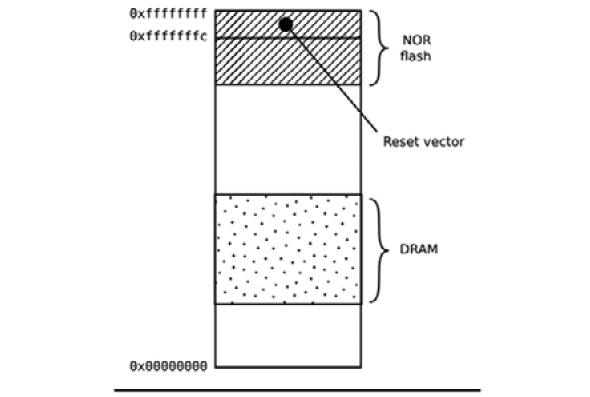
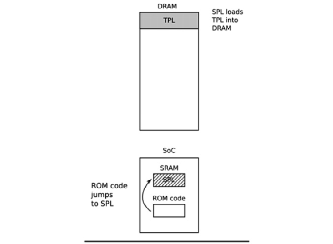
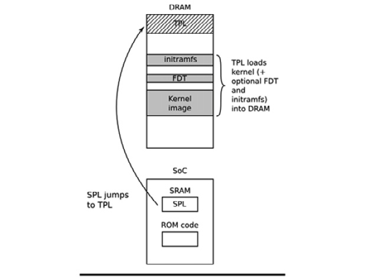

# *Chương 3*: Tất cả về bootloader (All about Bootloaders)

Bootloader là thành phần thứ hai của embedded Linux. Nó là phần khởi động hệ thống và nạp kernel hệ điều hành. Trong chương này, chúng ta sẽ xem xét vai trò của bootloader và, đặc biệt, cách nó chuyển quyền điều khiển từ bản thân nó sang kernel bằng một cấu trúc dữ liệu gọi là **device tree**, còn được gọi là **flattened device tree** hay **FDT**. Tôi sẽ đề cập những điều cơ bản về device tree, vì điều này sẽ giúp bạn theo dõi các kết nối được mô tả trong một device tree và liên hệ nó với phần cứng thực.

Tôi sẽ xem xét bootloader open source phổ biến có tên U-Boot và chỉ cho bạn cách dùng nó để boot một thiết bị đích, cũng như cách tùy biến nó để có thể chạy trên một thiết bị mới, lấy BeagleBone Black làm ví dụ.

Trong chương này, chúng ta sẽ đề cập các chủ đề sau:

- Bootloader làm gì?
- Trình tự boot
- Chuyển từ bootloader sang kernel
- Giới thiệu device tree
- U-Boot

Hãy bắt đầu!

## Yêu cầu kỹ thuật

Để làm theo các ví dụ trong chương này, hãy bảo đảm bạn có những thứ sau:

- Một hệ thống host Linux-based đã cài `device-tree-compiler`, `git`, `make`, `patch` và `u-boot-tools` hoặc các gói tương đương.
- Toolchain Crosstool-NG cho BeagleBone Black từ [*Chương 2*](ch02_learning_about_toolchains.vi.md), *Tìm hiểu về toolchain*.
- Một đầu đọc thẻ microSD và thẻ.
- Một cáp serial USB to TTL 3.3V
- BeagleBone Black
- Một bộ nguồn DC 5V 1A

Toàn bộ code dùng trong chương này có thể được tìm thấy trong thư mục `Chapter03` của repository GitHub của cuốn sách: [https://github.com/PacktPublishing/Mastering-Embedded-Linux-Programming-Third-Edition](https://github.com/PacktPublishing/Mastering-Embedded-Linux-Programming-Third-Edition).

## Bootloader làm gì?

Trong một hệ thống embedded Linux, bootloader có hai nhiệm vụ chính: khởi tạo hệ thống tới một mức cơ bản và nạp kernel. Thực tế, nhiệm vụ đầu tiên phần nào phụ thuộc vào nhiệm vụ thứ hai, ở chỗ chỉ cần làm cho hệ thống hoạt động ở mức cần thiết để nạp kernel.

Khi những dòng code đầu tiên của bootloader được thực thi, sau một lần power-on hoặc reset, hệ thống ở trạng thái rất tối thiểu. DRAM controller chưa được thiết lập, vì vậy bộ nhớ chính không truy cập được. Tương tự, các giao diện khác chưa được cấu hình, vì vậy bộ lưu trữ được truy cập qua NAND flash controller, MMC controller, v.v. không sẵn sàng. Thông thường, các tài nguyên duy nhất hoạt động lúc đầu là một CPU core, một ít static memory on-chip, và boot ROM.

Bootstrap hệ thống gồm nhiều giai đoạn code, mỗi giai đoạn đưa thêm nhiều phần của hệ thống vào hoạt động. Hành động cuối cùng của bootloader là nạp kernel vào RAM và tạo một môi trường thực thi cho nó. Chi tiết giao diện giữa bootloader và kernel là architecture-specific, nhưng trong mọi trường hợp, nó phải làm hai việc. Thứ nhất, bootloader phải truyền một pointer tới một cấu trúc chứa thông tin về cấu hình phần cứng. Thứ hai, nó phải truyền một pointer tới kernel command line.

Kernel command line là một chuỗi văn bản điều khiển hành vi của Linux. Khi kernel đã bắt đầu thực thi, bootloader không còn cần thiết và toàn bộ bộ nhớ nó đang dùng có thể được thu hồi.

Một nhiệm vụ phụ của bootloader là cung cấp một chế độ bảo trì để cập nhật cấu hình boot, nạp các boot image mới vào bộ nhớ, và có thể chạy chẩn đoán. Việc này thường được điều khiển bằng một giao diện người dùng command-line đơn giản, thường qua serial console.

## Trình tự boot

Vào thời đơn giản hơn, vài năm trước, chỉ cần đặt bootloader vào bộ nhớ non-volatile tại reset vector của processor. Bộ nhớ **NOR flash** phổ biến vào thời đó và, vì nó có thể được ánh xạ trực tiếp vào không gian địa chỉ, nó là phương thức lưu trữ lý tưởng. Sơ đồ sau thể hiện một cấu hình như vậy, với **Reset vector** ở `0xfffffffc` tại đầu trên của một vùng bộ nhớ flash. Bootloader được link sao cho có một lệnh jump tại vị trí đó trỏ tới điểm bắt đầu của code bootloader:



*Hình 3.1 – NOR flash*

Từ thời điểm đó trở đi, code bootloader chạy trong bộ nhớ NOR flash có thể khởi tạo DRAM controller để bộ nhớ chính – **DRAM** – trở nên sẵn sàng rồi tự sao chép vào DRAM. Khi đã hoạt động đầy đủ, bootloader có thể nạp kernel từ bộ nhớ flash vào DRAM và chuyển quyền điều khiển cho nó.

Tuy nhiên, khi bạn rời khỏi một phương tiện lưu trữ đơn giản có thể đánh địa chỉ tuyến tính như NOR flash, trình tự boot trở thành một thủ tục phức tạp, multi-stage. Các chi tiết rất đặc thù cho từng SoC, nhưng nhìn chung chúng đi theo các giai đoạn sau.

### Giai đoạn 1 – ROM code

Khi không có bộ nhớ ngoài đáng tin cậy, code chạy ngay sau reset hoặc power-on phải được lưu on-chip trong SoC; nó được gọi là **ROM code**. Nó được nạp vào chip khi chip được sản xuất, do đó ROM code là độc quyền và không thể thay bằng một bản tương đương open source. Thông thường, nó không chứa code để khởi tạo memory controller, vì cấu hình DRAM rất device-specific, và vì vậy nó chỉ có thể dùng **Static Random Access Memory** (**SRAM**), loại không cần memory controller.

Hầu hết các thiết kế SoC nhúng có một lượng nhỏ SRAM on-chip, kích thước từ chỉ 4 KB đến vài trăm KB:


*Hình 3.2 – Giai đoạn 1 – ROM code*

ROM code có khả năng nạp một đoạn code nhỏ từ một trong nhiều vị trí pre-programmed vào SRAM. Ví dụ, các chip TI OMAP và Sitara cố nạp code từ vài trang đầu của bộ nhớ NAND flash, hoặc từ bộ nhớ flash nối qua **Serial Peripheral Interface** (**SPI**), hoặc từ các sector đầu của một thiết bị MMC (có thể là chip eMMC hoặc thẻ SD), hoặc từ một file tên `MLO` trên phân vùng đầu tiên của một thiết bị MMC. Nếu việc đọc từ tất cả các thiết bị nhớ này thất bại, nó sẽ thử đọc một byte stream từ Ethernet, USB hoặc UART; cách cuối chủ yếu được cung cấp như một phương tiện để nạp code vào bộ nhớ flash trong quá trình sản xuất, thay vì để dùng trong hoạt động bình thường. Hầu hết các SoC nhúng có ROM code hoạt động theo cách tương tự. Trong các SoC mà SRAM không đủ lớn để nạp một bootloader đầy đủ như U-Boot, phải có một loader trung gian gọi là **secondary program loader** (**SPL**).

Ở cuối giai đoạn ROM code, SPL có mặt trong SRAM và ROM code nhảy tới điểm bắt đầu của code đó.

### Giai đoạn 2 – secondary program loader

SPL phải thiết lập memory controller và các phần thiết yếu khác của hệ thống để chuẩn bị nạp **Tertiary Program Loader** (**TPL**) vào DRAM. Chức năng của SPL bị giới hạn bởi kích thước SRAM. Nó có thể đọc một chương trình từ một danh sách thiết bị lưu trữ, giống ROM code, một lần nữa dùng các offset pre-programmed tính từ đầu thiết bị flash. Nếu SPL có các driver filesystem được tích hợp sẵn, nó có thể đọc các tên file well-known, như `u-boot.img`, từ một phân vùng đĩa. SPL thường không cho phép tương tác người dùng, nhưng nó có thể in thông tin phiên bản và các message tiến trình, mà bạn có thể thấy trên console. Sơ đồ sau giải thích kiến trúc giai đoạn 2:



*Hình 3.3 – Giai đoạn 2 – SPL*

Sơ đồ trên thể hiện bước nhảy từ ROM code sang SPL. Khi SPL thực thi trong SRAM, nó nạp TPL vào DRAM. Ở cuối giai đoạn thứ hai, TPL có mặt trong DRAM, và SPL có thể nhảy tới vùng đó.

SPL có thể là open source, như trường hợp của TI x-loader và Atmel AT91Bootstrap, nhưng khá phổ biến là nó chứa code độc quyền được nhà sản xuất cung cấp dưới dạng binary blob.

### Giai đoạn 3 – TPL

Tại thời điểm này, chúng ta đang chạy một bootloader đầy đủ, chẳng hạn U-Boot, thứ chúng ta sẽ tìm hiểu ở phần sau của chương này. Thông thường, có một giao diện người dùng command-line đơn giản cho phép bạn thực hiện các tác vụ bảo trì, như nạp boot image và kernel image mới vào bộ lưu trữ flash, nạp và boot một kernel, và có một cách để nạp kernel tự động mà không cần người dùng can thiệp.

Sơ đồ sau giải thích kiến trúc giai đoạn 3:



*Hình 3.4 – Giai đoạn 3 – TPL*

Sơ đồ trên thể hiện bước nhảy từ SPL trong SRAM sang TPL trong DRAM. Khi TPL thực thi, nó nạp kernel vào DRAM. Chúng ta cũng có lựa chọn nối thêm một FDT và/hoặc initial RAM disk vào image trong DRAM nếu muốn. Dù thế nào, ở cuối giai đoạn thứ ba, có một kernel trong bộ nhớ, chờ được khởi động.

Các bootloader nhúng thường biến mất khỏi bộ nhớ khi kernel đang chạy và không còn tham gia vào hoạt động của hệ thống. Trước khi điều đó xảy ra, TPL cần chuyển quyền điều khiển quá trình boot cho kernel.

## Chuyển từ bootloader sang kernel

Khi bootloader chuyển quyền điều khiển cho kernel, nó phải truyền một số thông tin cơ bản, bao gồm:

- *Machine number*, được dùng trên các nền tảng PowerPC và Arm không hỗ trợ device tree, để xác định loại SoC.
- Các chi tiết cơ bản về phần cứng đã được phát hiện đến lúc đó, bao gồm (ít nhất là) kích thước và vị trí của RAM vật lý và tốc độ clock của CPU.
- Kernel command line.
- Tùy chọn, vị trí và kích thước của một device tree binary.
- Tùy chọn, vị trí và kích thước của một initial RAM disk, gọi là **initial RAM file system** (**initramfs**).

Kernel command line là một chuỗi ASCII thuần điều khiển hành vi của Linux bằng cách đưa ra, chẳng hạn, tên của thiết bị chứa root filesystem. Chúng ta sẽ xem chi tiết điều này trong chương tiếp theo. Việc cung cấp root filesystem dưới dạng RAM disk là phổ biến, khi đó bootloader có trách nhiệm nạp RAM disk image vào bộ nhớ. Chúng ta sẽ đề cập cách tạo initial RAM disk trong [*Chương 5*](ch05_building_a_root_filesystem.vi.md), *Xây dựng root filesystem*.

Cách thông tin này được truyền phụ thuộc vào kiến trúc và đã thay đổi trong những năm gần đây. Chẳng hạn, với PowerPC, bootloader từng chỉ truyền một pointer tới một cấu trúc thông tin board, trong khi với Arm, nó truyền một pointer tới một danh sách *A tags*. Có một mô tả tốt về định dạng A tags trong kernel source ở `Documentation/arm/Booting`.

Trong cả hai trường hợp, lượng thông tin được truyền rất hạn chế, để phần lớn thông tin phải được phát hiện lúc runtime hoặc hard-coded vào kernel dưới dạng **platform data**. Việc dùng rộng rãi platform data có nghĩa là mỗi board phải có một kernel được cấu hình và sửa đổi cho nền tảng đó. Cần có một cách tốt hơn, và cách đó là device tree. Trong thế giới Arm, việc rời bỏ A tags bắt đầu một cách nghiêm túc vào tháng Hai năm 2013 với việc phát hành Linux 3.8. Ngày nay, gần như mọi hệ thống Arm đều dùng device tree để thu thập thông tin về đặc thù của nền tảng phần cứng, cho phép một kernel binary duy nhất chạy trên rất nhiều nền tảng như vậy.

Giờ chúng ta đã biết bootloader làm gì, các giai đoạn của trình tự boot là gì, và nó chuyển quyền điều khiển cho kernel như thế nào, hãy tìm hiểu cách cấu hình một bootloader để nó chạy trên các SoC nhúng phổ biến.

## Giới thiệu device tree

Nếu bạn làm việc với SoC Arm hoặc PowerPC, gần như chắc chắn bạn sẽ gặp device tree vào lúc nào đó. Mục này nhằm cho bạn một tổng quan nhanh về chúng là gì và chúng hoạt động thế nào. Chúng ta sẽ quay lại chủ đề device tree nhiều lần xuyên suốt cuốn sách này.

Device tree là một cách linh hoạt để định nghĩa các thành phần phần cứng của một hệ thống máy tính. Hãy nhớ rằng device tree chỉ là dữ liệu tĩnh, không phải code thực thi. Thông thường, device tree được bootloader nạp và truyền cho kernel, dù có thể đóng gói device tree cùng kernel image để phục vụ các bootloader không có khả năng nạp chúng riêng.

Định dạng này bắt nguồn từ một bootloader của Sun Microsystems có tên **OpenBoot**, được chuẩn hóa thành đặc tả Open Firmware, là tiêu chuẩn IEEE IEEE1275-1994. Nó được dùng trong các máy tính Macintosh PowerPC-based và vì vậy là lựa chọn logic cho bản port Linux PowerPC. Kể từ đó, nó đã được áp dụng trên quy mô lớn bởi nhiều bản hiện thực Linux Arm và, ở mức độ thấp hơn, bởi MIPS, MicroBlaze, ARC và các kiến trúc khác.

Tôi khuyên bạn truy cập [https://www.devicetree.org](https://www.devicetree.org) để biết thêm thông tin.

### Cơ bản về device tree

Linux kernel chứa một số lượng lớn các file device tree source trong `arch/$ARCH/boot/dts`, và đây là điểm khởi đầu tốt để tìm hiểu về device tree. Cũng có một số ít source hơn trong source code U-boot ở `arch/$ARCH/dts`. Nếu bạn mua phần cứng từ một bên thứ ba, file `dts` là một phần của board support package, vì vậy bạn nên mong đợi nhận được nó cùng với các source file khác.

Device tree biểu diễn một hệ thống máy tính như một tập hợp các thành phần được kết nối với nhau theo một phân cấp, giống một cây. Device tree bắt đầu với một root node, được biểu diễn bằng dấu gạch chéo `/`, chứa các node tiếp theo biểu diễn phần cứng của hệ thống. Mỗi node có một tên và chứa một số property ở dạng `name = "value"`. Đây là một ví dụ đơn giản:

```
/dts-v1/;
/{
    model = "TI AM335x BeagleBone";
    compatible = "ti,am33xx";
    #address-cells = <1>;
    #size-cells = <1>;
    cpus {
        #address-cells = <1>;
        #size-cells = <0>;
        cpu@0 {
            compatible = "arm,cortex-a8";
            device_type = "cpu";
            reg = <0>;
        };
    };
    memory@0x80000000 {
        device_type = "memory";
        reg = <0x80000000 0x20000000>; /* 512 MB */
    };
};
```

Ở đây, chúng ta có một root node chứa một node `cpus` và một node `memory`. Node `cpus` chứa một CPU node duy nhất tên `cpu@0`. Tên của các node này thường bao gồm một `@`, theo sau là một địa chỉ phân biệt node đó với các node khác cùng loại. `@` là bắt buộc nếu node có property `reg`.

Cả root node và CPU node đều có property `compatible`. Linux kernel dùng property này để tìm một device driver khớp bằng cách so sánh nó với các chuỗi được mỗi device driver export trong một cấu trúc `of_device_id` (thêm về điều này trong [*Chương 11*](ch11_interfacing_with_device_drivers.vi.md), *Giao tiếp với device driver*).

> **Lưu ý quan trọng**
>
> Theo quy ước, giá trị của property `compatible` gồm tên nhà sản xuất và tên component, để giảm nhầm lẫn giữa các thiết bị tương tự do các nhà sản xuất khác nhau làm ra; do đó có `ti,am33xx` và `arm,cortex-a8`. Cũng khá phổ biến khi property `compatible` có nhiều hơn một giá trị nếu có nhiều hơn một driver có thể xử lý thiết bị này. Chúng được liệt kê với giá trị phù hợp nhất đứng đầu.

CPU node và memory node có property `device_type`, mô tả lớp thiết bị. Tên node thường được suy ra từ `device_type`.

### Property reg

Các node `memory` và `cpu` được thể hiện ở trên có property `reg`, tham chiếu tới một phạm vi đơn vị trong một không gian register. Một property `reg` gồm hai giá trị biểu diễn địa chỉ vật lý thực và kích thước (độ dài) của phạm vi. Cả hai được viết dưới dạng không hoặc nhiều số nguyên 32-bit, gọi là cell. Do đó, node `memory` ở trên tham chiếu tới một bank bộ nhớ duy nhất bắt đầu ở `0x80000000` và dài `0x20000000` byte.

Hiểu property `reg` trở nên phức tạp hơn khi giá trị địa chỉ hoặc kích thước không thể biểu diễn trong 32 bit. Ví dụ, trên một thiết bị có địa chỉ 64-bit, bạn cần hai cell cho mỗi giá trị:

```
/{
    #address-cells = <2>;
    #size-cells = <2>;
    memory@80000000 {
        device_type = "memory";
        reg = <0x00000000 0x80000000 0 0x80000000>;
    };
};
```

Thông tin về số cell cần thiết được giữ trong các property `#address-cells` và `#size_cells` ở một node tổ tiên. Nói cách khác, để hiểu một property `reg`, bạn phải nhìn ngược lên phân cấp node cho đến khi tìm thấy `#address-cells` và `#size_cells`. Nếu không có, giá trị mặc định là `1` cho mỗi cái – nhưng việc người viết device tree dựa vào giá trị mặc định là thói quen xấu.

Bây giờ, hãy quay lại các node `cpu` và `cpus`. CPU cũng có địa chỉ; trong một thiết bị quad core, chúng có thể được đánh địa chỉ là 0, 1, 2 và 3. Điều đó có thể được coi như một mảng one-dimensional không có độ sâu, vì vậy kích thước là không. Do đó, bạn có thể thấy chúng ta có `#address-cells = <1>` và `#size-cells = <0>` trong node `cpus`, và trong node con `cpu@0`, chúng ta gán một giá trị duy nhất cho property `reg`, `reg = <0>`.

### Label và interrupt

Cấu trúc device tree chúng ta đã mô tả đến giờ giả định có một phân cấp component duy nhất, trong khi thực tế có nhiều phân cấp. Ngoài kết nối dữ liệu hiển nhiên giữa một component và các phần khác của hệ thống, nó cũng có thể được nối với một interrupt controller, một nguồn clock và một bộ ổn áp. Để biểu diễn các kết nối này, chúng ta có thể thêm một label vào một node và tham chiếu label đó từ các node khác. Các label này đôi khi được gọi là **phandle**, vì khi device tree được biên dịch, các node có tham chiếu từ node khác được gán một giá trị số duy nhất trong một property gọi là `phandle`. Bạn có thể thấy chúng nếu decompile device tree binary.

Lấy ví dụ một hệ thống chứa một LCD controller có thể tạo `interrupts` và một `interrupt-controller`:

```
/dts-v1/;
{
    intc: interrupt-controller@48200000 {
        compatible = "ti,am33xx-intc";
        interrupt-controller;
        #interrupt-cells = <1>;
        reg = <0x48200000 0x1000>;
    };
    lcdc: lcdc@4830e000 {
        compatible = "ti,am33xx-tilcdc";
        reg = <0x4830e000 0x1000>;
        interrupt-parent = <&intc>;
        interrupts = <36>;
        ti,hwmods = "lcdc";
        status = "disabled";
    };
};
```

Ở đây, chúng ta có node `interrupt-controller@48200000` với label `intc`. Property `interrupt-controller` xác định nó là một interrupt controller. Giống như mọi interrupt controller, nó có property `#interrupt-cells`, cho chúng ta biết cần bao nhiêu cell để biểu diễn một nguồn interrupt. Trong trường hợp này, chỉ có một cell biểu diễn số **interrupt request** (**IRQ**). Các interrupt controller khác có thể dùng thêm cell để mô tả đặc tính interrupt; chẳng hạn, để chỉ ra nó là edge triggered hay level triggered. Số interrupt cell và ý nghĩa của chúng được mô tả trong binding của từng interrupt controller. Các binding device tree có thể được tìm thấy trong Linux kernel source, trong thư mục `Documentation/devicetree/bindings/`.

Nhìn vào node `lcdc@4830e000`, nó có property `interrupt-parent`, tham chiếu tới interrupt controller mà nó được nối, bằng label. Nó cũng có property `interrupts`, trong trường hợp này là `36`. Lưu ý rằng node này có label riêng, `lcdc`, được dùng ở nơi khác: bất kỳ node nào cũng có thể có label.

### Include file của device tree

Rất nhiều phần cứng là chung giữa các SoC cùng họ và giữa các board dùng cùng SoC. Điều này được phản ánh trong device tree bằng cách tách các phần chung ra thành include file, thường có phần mở rộng `.dtsi`. Tiêu chuẩn Open Firmware định nghĩa `/include/` là cơ chế được dùng, như trong đoạn trích này từ `vexpress-v2p-ca9.dts`:

```
/include/ "vexpress-v2m.dtsi"
```

Tuy vậy, hãy xem qua các file `.dts` trong kernel, và bạn sẽ thấy một statement `include` thay thế được mượn từ C; chẳng hạn, trong `am335x-boneblack.dts`:

```
#include "am33xx.dtsi"
#include "am335x-bone-common.dtsi"
```

Đây là một ví dụ khác từ `am33xx.dtsi`:

```
#include <dt-bindings/gpio/gpio.h>
#include <dt-bindings/pinctrl/am33xx.h>
#include <dt-bindings/clock/am3.h>
```

Cuối cùng, `include/dt-bindings/pinctrl/am33xx.h` chứa các macro C bình thường:

```
#define PULL_DISABLE       (1 << 3)
#define INPUT_EN           (1 << 5)
#define SLEWCTRL_SLOW      (1 << 6)
#define SLEWCTRL_FAST       0
```

Tất cả những điều này được resolve nếu các device tree source được build bằng hệ thống Kbuild, hệ thống này chạy chúng qua C preprocessor, CPP, nơi các statement `#include` và `#define` được xử lý thành văn bản phù hợp cho device tree compiler. Động cơ này được minh họa trong ví dụ trước; nó có nghĩa là các device tree source có thể dùng cùng định nghĩa hằng số như code kernel.

Khi chúng ta include file, dùng cú pháp nào cũng vậy, các node được phủ chồng lên nhau để tạo một cây hợp thành, trong đó các lớp ngoài mở rộng hoặc sửa đổi các lớp trong. Ví dụ, `am33xx.dtsi`, file chung cho mọi SoC `am33xx`, định nghĩa giao diện MMC controller đầu tiên như thế này:

```
mmc1: mmc@48060000 {
    compatible = "ti,omap4-hsmmc";
    ti,hwmods = "mmc1";
    ti,dual-volt;
    ti,needs-special-reset;
    ti,needs-special-hs-handling;
    dmas = <&edma_xbar 24 0 0
        &edma_xbar 25 0 0>;
    dma-names = "tx", "rx";
    interrupts = <64>;
    reg = <0x48060000 0x1000>;
    status = "disabled";
};
```

Lưu ý rằng `status` là `disabled`, nghĩa là không device driver nào được bind với nó, và nó cũng có label là `mmc1`.

Cả BeagleBone và BeagleBone Black đều có một giao diện thẻ microSD gắn với `mmc1`. Đó là lý do, trong `am335x-bone-common.dtsi`, cùng node đó được tham chiếu qua label của nó; tức là `&mmc1`:

```
&mmc1 {
    status = "okay";
    bus-width = <0x4>;
    pinctrl-names = "default";
    pinctrl-0 = <&mmc1_pins>;
    cd-gpios = <&gpio0 6 GPIO_ACTIVE_LOW>;
};
```

Property `status` được đặt là `okay`, khiến MMC device driver bind với giao diện này lúc runtime trên cả hai biến thể BeagleBone. Ngoài ra, một tham chiếu tới label được thêm vào cấu hình pin control, `mmc1_pins`. Tiếc là ở đây không đủ chỗ để mô tả pin control và pin multiplexing. Bạn sẽ tìm thấy một số thông tin trong Linux kernel source ở thư mục `Documentation/devicetree/bindings/pinctrl`.

Tuy nhiên, giao diện `mmc1` được nối với một bộ ổn áp khác trên BeagleBone Black. Điều này được biểu diễn trong `am335x-boneblack.dts`, nơi bạn sẽ thấy một tham chiếu khác tới `mmc1`, gắn nó với bộ ổn áp qua label `vmmcsd_fixed`:

```
&mmc1 {
    vmmc-supply = <&vmmcsd_fixed>;
};
```

Vậy, phân lớp các file device tree source như thế này cho chúng ta sự linh hoạt và giảm nhu cầu trùng lặp code.

### Biên dịch một device tree

Bootloader và kernel cần một biểu diễn binary của device tree, vì vậy nó phải được biên dịch bằng device tree compiler; tức là `dtc`. Kết quả là một file có đuôi `.dtb`, được gọi là device tree binary hay device tree blob.

Có một bản sao của `dtc` trong Linux source, ở `scripts/dtc/dtc`, và nó cũng có sẵn dưới dạng package trên nhiều bản phân phối Linux. Bạn có thể dùng nó để biên dịch một device tree đơn giản (không dùng `#include`) như thế này:

```
$ dtc simpledts-1.dts -o simpledts-1.dtb
DTC: dts->dts on file "simpledts-1.dts"
```

Hãy cảnh giác với thực tế là `dtc` không đưa ra thông báo lỗi hữu ích và không kiểm tra gì ngoài cú pháp cơ bản của ngôn ngữ, nghĩa là debug một lỗi gõ trong source file có thể là một quá trình dài.

Để build các ví dụ phức tạp hơn, bạn sẽ phải dùng Kbuild của kernel, như được trình bày trong [*Chương 4*](ch04_configuring_and_building_the_kernel.vi.md), *Cấu hình và build kernel*.

Giống như kernel, bootloader có thể dùng device tree để khởi tạo một SoC nhúng và các ngoại vi của nó. Device tree này rất quan trọng khi bạn nạp kernel từ một thiết bị lưu trữ dung lượng lớn như QSPI flash. Dù embedded Linux cung cấp nhiều lựa chọn bootloader, chúng ta sẽ chỉ đề cập một cái. Chúng ta sẽ đi sâu vào bootloader đó tiếp theo.

## U-Boot

Chúng ta sẽ tập trung riêng vào U-Boot vì nó hỗ trợ một số lượng kiến trúc processor đáng kể và một số lượng lớn các board và thiết bị riêng lẻ. Nó đã tồn tại từ lâu và có một cộng đồng hỗ trợ tốt.

U-Boot, hay tên đầy đủ là **Das U-Boot**, bắt đầu như một bootloader open source cho các board PowerPC nhúng. Sau đó, nó được port sang các board Arm-based và sau nữa sang các kiến trúc khác, bao gồm MIPS và SH. Nó được Denx Software Engineering host và bảo trì. Có rất nhiều thông tin về nó, và một nơi tốt để bắt đầu là [https://www.denx.de/wiki/U-Boot](https://www.denx.de/wiki/U-Boot). Cũng có một mailing list tại [u-boot@lists.denx.de](mailto:u-boot@lists.denx.de) mà bạn có thể đăng ký bằng cách điền và gửi form được cung cấp tại [https://lists.denx.de/listinfo/u-boot](https://lists.denx.de/listinfo/u-boot).

### Build U-Boot

Bắt đầu bằng việc lấy source code. Như với hầu hết các project, cách được khuyến nghị là clone archive `.git` và check out tag bạn định dùng – trong trường hợp này là phiên bản hiện hành tại thời điểm viết:

```
$ git clone git://git.denx.de/u-boot.git
$ cd u-boot
$ git checkout v2021.01
```

Ngoài ra, bạn có thể lấy một tarball từ ftp://ftp.denx.de/pub/u-boot.

Có hơn 1,000 file cấu hình cho các development board và thiết bị phổ biến trong thư mục `configs/`. Trong hầu hết trường hợp, bạn có thể đoán khá đúng nên dùng file nào dựa trên tên file, nhưng bạn có thể có thông tin chi tiết hơn bằng cách xem qua các file `README` per-board trong thư mục `board/`, hoặc tìm thông tin trong một hướng dẫn web hay diễn đàn phù hợp.

Lấy BeagleBone Black làm ví dụ, chúng ta sẽ thấy có một file cấu hình nhiều khả năng phù hợp tên `configs/am335x_evm_defconfig` và đoạn văn bản **The binary produced by this board supports ... Beaglebone Black** trong file `README` của board cho chip `am335x`, `board/ti/am335x/README`. Với hiểu biết này, build U-Boot cho BeagleBone Black rất đơn giản. Bạn cần cho U-Boot biết prefix của cross compiler bằng cách đặt biến make `CROSS_COMPILE`, rồi chọn file cấu hình bằng một lệnh kiểu `make [board]_defconfig`. Do đó, để build U-Boot bằng compiler Crosstool-NG mà chúng ta đã tạo trong [*Chương 2*](ch02_learning_about_toolchains.vi.md), *Tìm hiểu về toolchain*, bạn sẽ gõ như sau:

```
$ source ../MELP/Chapter02/set-path-arm-cortex_a8-linux-gnueabihf
$ make am335x_evm_defconfig
$ make
```

Kết quả biên dịch như sau:

- `u-boot`: U-Boot ở định dạng object ELF, phù hợp để dùng với debugger
- `u-boot.map`: Bảng symbol
- `u-boot.bin`: U-Boot ở định dạng raw binary, phù hợp để chạy trên thiết bị của bạn
- `u-boot.img`: Đây là `u-boot.bin` có thêm U-Boot header, phù hợp để upload lên một bản U-Boot đang chạy
- `u-boot.srec`: U-Boot ở định dạng Motorola S-record (**SRECORD** hay **SRE**), phù hợp để truyền qua kết nối serial

BeagleBone Black cũng cần một **secondary program loader** (**SPL**), như đã mô tả ở trên. Nó được build cùng lúc và có tên MLO:

```
$ ls -l MLO u-boot*
-rw-rw-r-- 1 frank frank  108260 Feb  8 15:24 MLO
-rwxrwxr-x 1 frank frank 6028304 Feb  8 15:24 u-boot
-rw-rw-r-- 1 frank frank  594076 Feb  8 15:24 u-boot.bin
-rw-rw-r-- 1 frank frank   20189 Feb  8 15:23 u-boot.cfg
-rw-rw-r-- 1 frank frank   10949 Feb  8 15:24 u-boot.cfg.configs
-rw-rw-r-- 1 frank frank   54860 Feb  8 15:24 u-boot.dtb
-rw-rw-r-- 1 frank frank  594076 Feb  8 15:24 u-boot-dtb.bin
-rw-rw-r-- 1 frank frank  892064 Feb  8 15:24 u-boot-dtb.img
-rw-rw-r-- 1 frank frank  892064 Feb  8 15:24 u-boot.img
-rw-rw-r-- 1 frank frank    1722 Feb  8 15:24 u-boot.lds
-rw-rw-r-- 1 frank frank  802250 Feb  8 15:24 u-boot.map
-rwxrwxr-x 1 frank frank  539216 Feb  8 15:24 u-boot-nodtb.bin
-rwxrwxr-x 1 frank frank 1617810 Feb  8 15:24 u-boot.srec
-rw-rw-r-- 1 frank frank  211574 Feb  8 15:24 u-boot.sym
```

Thủ tục tương tự cho các target khác.

### Cài đặt U-Boot

Cài bootloader lên một board lần đầu đòi hỏi một số trợ giúp từ bên ngoài. Nếu board có giao diện debug phần cứng, chẳng hạn **JTAG** (**Joint Test Action Group**), thường có thể nạp trực tiếp một bản U-Boot vào RAM và cho nó chạy. Từ đó, bạn có thể dùng các lệnh U-Boot để nó tự sao chép vào bộ nhớ flash. Chi tiết của việc này rất board-specific và nằm ngoài phạm vi cuốn sách này.

Nhiều thiết kế SoC có một boot ROM tích hợp sẵn có thể được dùng để đọc boot code từ nhiều nguồn bên ngoài, chẳng hạn thẻ SD, giao diện serial hoặc USB mass storage. Đây là trường hợp của chip `am335x` trong BeagleBone Black, điều giúp dễ dàng thử phần mềm mới.

Bạn sẽ cần một đầu đọc thẻ SD để ghi image vào thẻ. Có hai loại: đầu đọc ngoài cắm vào cổng USB, và đầu đọc SD bên trong có trên nhiều laptop. Linux gán một tên thiết bị khi thẻ được cắm vào đầu đọc. Lệnh `lsblk` là một công cụ hữu ích để tìm xem thiết bị nào đã được cấp phát. Ví dụ, đây là những gì tôi thấy khi cắm một thẻ microSD danh nghĩa 8 GB vào đầu đọc thẻ:

```
$ lsblk
NAME        MAJ:MIN RM   SIZE RO TYPE MOUNTPOINT
sda           8:0    1   7.4G  0 disk
└─sda1        8:1    1   7.4G  0 part /media/frank/6662-6262
nvme0n1     259:0    0 465.8G  0 disk
├─nvme0n1p1 259:1    0   512M  0 part /boot/efi
├─nvme0n1p2 259:2    0    16M  0 part
├─nvme0n1p3 259:3    0 232.9G  0 part
└─nvme0n1p4 259:4    0 232.4G  0 part /
```

Trong trường hợp này, `nvme0n1` là ổ cứng 512 GB của tôi và `sda` là thẻ microSD. Nó có một phân vùng duy nhất, `sda1`, được mount thành thư mục `/media/frank/6662-6262`.

> **Lưu ý quan trọng**
>
> Dù thẻ microSD có in 8 GB ở bên ngoài, bên trong nó chỉ có 7.4 GB. Một phần là do các đơn vị khác nhau được dùng. Dung lượng quảng cáo được đo bằng gigabyte, 10⁹, nhưng kích thước do phần mềm báo cáo là gibibyte, 2³⁰. Gigabyte được viết tắt là GB, còn gibibyte được viết tắt là GiB. Điều tương tự áp dụng cho KB và KiB, MB và MiB. Trong cuốn sách này, tôi đã cố dùng đúng đơn vị. Trong trường hợp thẻ SD, tình cờ 8 GB xấp xỉ 7.4 GiB.

Nếu dùng khe thẻ SD built-in, tôi thấy như sau:

```
$ lsblk
NAME        MAJ:MIN RM   SIZE RO TYPE MOUNTPOINT
mmcblk0     179:0    1   7.4G  0 disk
└─mmcblk0p1 179:1    1   7.4G  0 part /media/frank/6662-6262
nvme0n1     259:0    0 465.8G  0 disk
├─nvme0n1p1 259:1    0   512M  0 part /boot/efi
├─nvme0n1p2 259:2    0    16M  0 part
├─nvme0n1p3 259:3    0 232.9G  0 part
└─nvme0n1p4 259:4    0 232.4G  0 part /
```

Trong trường hợp này, thẻ microSD xuất hiện dưới tên `mmcblk0` và phân vùng là `mmcblk0p1`. Lưu ý rằng thẻ microSD bạn dùng có thể được format khác với thẻ này, vì vậy bạn có thể thấy số phân vùng khác với các mount point khác. Khi format một thẻ SD, rất quan trọng là phải chắc chắn về tên thiết bị của nó. Bạn thực sự không muốn nhầm ổ cứng của mình với thẻ SD và format nó thay vào đó. Điều này đã xảy ra với tôi hơn một lần. Vì vậy, tôi đã cung cấp một shell script trong kho code của cuốn sách tên `MELP/format-sdcard.sh`, có một số lượng kiểm tra hợp lý để ngăn bạn (và tôi) dùng sai tên thiết bị. Tham số là tên thiết bị của thẻ microSD, sẽ là `sdb` trong ví dụ đầu và `mmcblk0` trong ví dụ thứ hai. Đây là một ví dụ về cách dùng nó:

```
$ MELP/format-sdcard.sh mmcblk0
```

Script tạo hai phân vùng: phân vùng thứ nhất là 64 MiB, được format thành `FAT32`, và sẽ chứa bootloader, còn phân vùng thứ hai là 1 GiB, được format thành `ext4`, mà bạn sẽ dùng trong [*Chương 5*](ch05_building_a_root_filesystem.vi.md), *Xây dựng root filesystem*. Script dừng lại khi được áp dụng cho bất kỳ ổ nào lớn hơn 32 GiB, vì vậy hãy chuẩn bị sửa nó nếu bạn dùng thẻ microSD lớn hơn.

Khi đã format thẻ microSD, rút nó ra khỏi đầu đọc thẻ rồi cắm lại (re-insert) để các phân vùng được tự động mount. Trên các phiên bản Ubuntu hiện tại, hai phân vùng sẽ được mount thành `/media/[user]/boot` và `/media/[user]/rootfs`. Bây giờ, bạn có thể sao chép SPL và U-Boot vào đó, như thế này:

```
$ cp MLO u-boot.img /media/frank/boot
```

Cuối cùng, unmount nó:

```
$ sudo umount /media/frank/boot
```

Bây giờ, với board BeagleBone không được cấp nguồn, cắm thẻ microSD vào đầu đọc. Cắm cáp serial. Một cổng serial sẽ xuất hiện trên PC của bạn dưới tên `/dev/ttyUSB0`. Khởi chạy một chương trình terminal phù hợp, chẳng hạn `gtkterm`, `minicom` hoặc `picocom`, và kết nối tới cổng ở tốc độ `115200` bit mỗi giây (bps) không có flow control. `gtkterm` có lẽ dễ thiết lập và dùng nhất:

```
$ gtkterm -p /dev/ttyUSB0 -s 115200
```

Nếu bạn gặp lỗi quyền truy cập, thì có thể bạn cần thêm bản thân vào group `dialout` và reboot để dùng cổng này.

Nhấn và giữ nút Boot Switch (gần khe microSD nhất) trên BeagleBone Black, cấp nguồn cho board bằng đầu nối nguồn 5V bên ngoài, và thả nút sau khoảng 5 giây. Bạn sẽ thấy một số output, theo sau là dấu nhắc U-Boot, trên serial console:

```
U-Boot SPL 2021.01 (Feb 08 2021 - 15:23:22 -0800)
Trying to boot from MMC1
U-Boot 2021.01 (Feb 08 2021 - 15:23:22 -0800)
CPU  : AM335X-GP rev 2.1
Model: TI AM335x BeagleBone Black
DRAM:  512 MiB
WDT:   Started with servicing (60s timeout)
NAND:  0 MiB
MMC:   OMAP SD/MMC: 0, OMAP SD/MMC: 1
Loading Environment from FAT... *** Warning - bad CRC, using default environment
<ethaddr> not set. Validating first E-fuse MAC
Net:   eth2: ethernet@4a100000, eth3: usb_ether
Hit any key to stop autoboot:  0
=>
```

Nhấn bất kỳ phím nào trên bàn phím để ngăn U-Boot tự boot với môi trường mặc định. Giờ chúng ta đã có dấu nhắc U-Boot trước mặt, hãy cho U-Boot thể hiện khả năng của nó.

### Dùng U-Boot

Trong mục này, tôi sẽ mô tả một số tác vụ phổ biến mà bạn có thể dùng U-Boot để thực hiện.

Thông thường, U-Boot cung cấp một giao diện command-line qua cổng serial. Nó cung cấp một dấu nhắc lệnh được tùy biến cho mỗi board. Trong các ví dụ này, tôi sẽ dùng `=>`. Gõ `help` sẽ in ra tất cả các lệnh đã được cấu hình trong phiên bản U-Boot này; gõ `help <command>` sẽ in thêm thông tin về một lệnh cụ thể.

Command interpreter mặc định cho BeagleBone Black khá đơn giản. Bạn không thể chỉnh sửa command-line bằng cách nhấn phím trái hoặc phải; không có tự hoàn thành lệnh khi nhấn phím *Tab*; và không có lịch sử lệnh khi nhấn phím lên. Nhấn bất kỳ phím nào trong số này sẽ làm hỏng lệnh bạn đang gõ, và bạn sẽ phải gõ *Ctrl + C* rồi bắt đầu lại từ đầu. Phím chỉnh sửa dòng duy nhất bạn có thể dùng an toàn là backspace. Như một tùy chọn, bạn có thể cấu hình một command shell khác gọi là **Hush**, có hỗ trợ tương tác tinh vi hơn, bao gồm chỉnh sửa command-line.

Định dạng số mặc định là hexadecimal. Hãy xem lệnh sau làm ví dụ:

```
=> nand read 82000000 400000 200000
```

Lệnh này sẽ đọc `0x200000` byte từ offset `0x400000` tính từ đầu bộ nhớ NAND flash vào địa chỉ RAM `0x82000000`.

#### Biến môi trường

U-Boot dùng biến môi trường rộng rãi để lưu và truyền thông tin giữa các function, và thậm chí để tạo script. Biến môi trường là các cặp `name=value` đơn giản được lưu trong một vùng bộ nhớ. Tập biến ban đầu có thể được viết sẵn trong header file cấu hình board, như thế này:

```
#define CONFIG_EXTRA_ENV_SETTINGS
"myvar1=value1"
"myvar2=value2"
[…]
```

Bạn có thể tạo và sửa biến từ command line của U-Boot bằng `setenv`. Ví dụ, `setenv foo bar` tạo biến `foo` với giá trị `bar`. Lưu ý rằng không có dấu `=` giữa tên biến và giá trị. Bạn có thể xóa một biến bằng cách đặt nó thành chuỗi `null`, `setenv foo`. Bạn có thể in tất cả các biến ra console bằng `printenv`, hoặc một biến duy nhất bằng `printenv foo`.

Nếu U-Boot đã được cấu hình với không gian để lưu môi trường, bạn có thể dùng lệnh `saveenv` để lưu nó. Nếu có raw NAND hoặc NOR flash, thì một block `erase` có thể được dành riêng cho mục đích này, thường với một block khác được dùng làm bản sao dự phòng để chống hỏng dữ liệu. Nếu có bộ lưu trữ eMMC hoặc thẻ SD, nó có thể được lưu trong một mảng sector được dành riêng, hoặc trong một file tên `uboot.env` trong một phân vùng của đĩa. Các lựa chọn khác bao gồm lưu nó trong một serial EEPROM nối qua giao diện I2C hoặc SPI, hoặc RAM non-volatile.

#### Định dạng boot image

U-Boot không có filesystem. Thay vào đó, nó gắn thẻ các khối thông tin bằng một header 64-byte để có thể theo dõi nội dung. Chúng ta chuẩn bị file cho U-Boot bằng công cụ command-line `mkimage`, đi kèm package `u-boot-tools` trên Ubuntu. Bạn cũng có thể có `mkimage` bằng cách chạy `make tools` từ bên trong cây source U-Boot, rồi gọi nó dưới dạng `tools/mkimage`.

Đây là tóm tắt ngắn về cách dùng lệnh:

```
$ mkimage
Error: Missing output filename
Usage: mkimage -l image
          -l ==> list image header information
       mkimage [-x] -A arch -O os -T type -C comp -a addr -e ep -n name -d data_file[:data_file...] image
          -A ==> set architecture to 'arch'
          -O ==> set operating system to 'os'
          -T ==> set image type to 'type'
          -C ==> set compression type 'comp'
          -a ==> set load address to 'addr' (hex)
          -e ==> set entry point to 'ep' (hex)
          -n ==> set image name to 'name'
          -d ==> use image data from 'datafile'
          -x ==> set XIP (execute in place)
       mkimage [-D dtc_options] [-f fit-image.its|-f auto|-F] [-b <dtb> [-b <dtb>]] [-i <ramdisk.cpio.gz>] fit-image
           <dtb> file is used with -f auto, it may occur multiple times.
          -D => set all options for device tree compiler
          -f => input filename for FIT source
          -i => input filename for ramdisk file
Signing / verified boot options: [-E] [-B size] [-k keydir] [-K dtb] [ -c <comment>] [-p addr] [-r] [-N engine]
          -E => place data outside of the FIT structure
          -B => align size in hex for FIT structure and header
          -k => set directory containing private keys
          -K => write public keys to this .dtb file
          -c => add comment in signature node
          -F => re-sign existing FIT image
          -p => place external data at a static position
          -r => mark keys used as 'required' in dtb
          -N => openssl engine to use for signing
       mkimage -V ==> print version information and exit
Use '-T list' to see a list of available image types
```

Ví dụ, để chuẩn bị một kernel image cho processor Arm, bạn có thể dùng lệnh sau:

```
$ mkimage -A arm -O linux -T kernel -C gzip -a 0x80008000 \
-e 0x80008000
-n 'Linux' -d zImage uImage
```

Trong trường hợp này, kiến trúc là `arm`, hệ điều hành là `linux`, và loại image là `kernel`. Ngoài ra, phương thức nén là `gzip`, load address là `0x80008000`, và entry point giống load address. Cuối cùng, tên image là `Linux`, datafile của image có tên `zImage`, và image được tạo ra có tên `uImage`.

#### Nạp image

Thông thường, bạn sẽ nạp image từ bộ lưu trữ tháo rời được, chẳng hạn thẻ SD, hoặc từ mạng. Thẻ SD được xử lý trong U-Boot bởi MMC driver. Một trình tự điển hình dùng để nạp một image vào bộ nhớ như sau:

```
=> mmc rescan
=> fatload mmc 0:1 82000000 uimage
reading uimage
4605000 bytes read in 254 ms (17.3 MiB/s)
=> iminfo 82000000
## Checking Image at 82000000 ...
Legacy image found
Image Name: Linux-3.18.0
Created: 2014-12-23 21:08:07 UTC
Image Type: ARM Linux Kernel Image (uncompressed)
Data Size: 4604936 Bytes = 4.4 MiB
Load Address: 80008000
Entry Point: 80008000
Verifying Checksum ... OK
```

Lệnh `mmc rescan` re-initializes MMC driver, có thể để phát hiện rằng một thẻ SD vừa được cắm vào. Tiếp theo, `fatload` được dùng để đọc một file từ một phân vùng FAT-formatted trên thẻ SD. Định dạng như sau:

```
fatload <interface> [<dev[:part]> [<addr> [<filename> [bytes [pos]]]]]
```

Nếu `<interface>` là `mmc`, như trong trường hợp của chúng ta, `<dev:part>` là số thiết bị của giao diện MMC tính từ không, và số phân vùng tính từ một. Do đó, `<0:1>` là phân vùng đầu tiên trên thiết bị đầu tiên, tức `mmc 0` cho thẻ microSD (eMMC trên board là `mmc 1`). Vị trí bộ nhớ, `0x82000000`, được chọn nằm trong một vùng RAM không được dùng vào lúc này. Nếu chúng ta định boot kernel này, chúng ta phải bảo đảm vùng RAM này sẽ không bị ghi đè khi kernel image được giải nén và đặt tại vị trí runtime, `0x80008000`.

Để nạp các file image qua mạng, bạn phải dùng **Trivial File Transfer Protocol (TFTP)**. Điều này đòi hỏi bạn cài một TFTP daemon, `tftpd`, trên hệ thống phát triển và chạy nó. Bạn cũng phải cấu hình mọi firewall giữa PC và target board để cho phép protocol TFTP trên cổng UDP `69` đi qua. Cấu hình mặc định của TFTP chỉ cho phép truy cập thư mục `/var/lib/tftpboot`. Bước tiếp theo là sao chép các file bạn muốn truyền sang target vào thư mục đó. Sau đó, giả sử bạn đang dùng một cặp địa chỉ IP tĩnh, điều giúp loại bỏ nhu cầu quản trị mạng thêm, trình tự lệnh để nạp một tập file kernel image sẽ trông như thế này:

```
=> setenv ipaddr 192.168.159.42
=> setenv serverip 192.168.159.99
=> tftp 82000000 uImage
link up on port 0, speed 100, full duplex
Using cpsw device
TFTP from server 192.168.159.99; our IP address is 192.168.159.42
Filename 'uImage'.
Load address: 0x82000000
Loading:
########################################################################################################################################################################################################################################################################################################################
3 MiB/s
done
Bytes transferred = 4605000 (464448 hex)
```

Cuối cùng, hãy xem cách ghi image vào bộ nhớ NAND flash và đọc chúng lại, việc được xử lý bởi lệnh `nand`. Ví dụ này nạp một kernel image qua TFTP và ghi nó vào flash:

```
=> tftpboot 82000000 uimage
=> nandecc hw
=> nand erase 280000 400000
NAND erase: device 0 offset 0x280000, size 0x400000
Erasing at 0x660000 -- 100% complete.
OK
=> nand write 82000000 280000 400000
NAND write: device 0 offset 0x280000, size 0x400000
4194304 bytes written: OK
```

Bây giờ, bạn có thể nạp kernel từ bộ nhớ flash bằng lệnh `nand read`:

```
=> nand read 82000000 280000 400000
```

Khi kernel đã được nạp vào RAM, chúng ta có thể boot nó.

### Boot Linux

Lệnh `bootm` khởi chạy một kernel image. Cú pháp như sau:

```
bootm [address of kernel] [address of ramdisk] [address of dtb].
```

Địa chỉ của kernel image là bắt buộc, nhưng địa chỉ của `ramdisk` và `dtb` có thể bỏ qua nếu cấu hình kernel không cần chúng. Nếu có `dtb` nhưng không có `initramfs`, địa chỉ thứ hai có thể được thay bằng một dấu gạch ngang (`-`). Nó sẽ trông như thế này:

```
=> bootm 82000000 – 83000000
```

Rõ ràng, gõ một loạt lệnh dài để boot board mỗi lần cấp nguồn là không chấp nhận được. Hãy xem cách tự động hóa quá trình boot.

#### Tự động hóa boot bằng script U-Boot

U-Boot lưu một chuỗi lệnh trong biến môi trường. Nếu biến đặc biệt tên `bootcmd` chứa một script, nó được chạy lúc power-up sau một độ trễ `bootdelay` giây. Nếu theo dõi điều này trên serial console, bạn sẽ thấy độ trễ đếm ngược về không. Bạn có thể nhấn bất kỳ phím nào trong khoảng thời gian này để dừng việc đếm ngược và vào một phiên tương tác với U-Boot.

Cách tạo script đơn giản, dù không dễ đọc. Bạn chỉ cần nối các lệnh được phân cách bằng dấu chấm phẩy, và dấu chấm phẩy phải được đặt sau ký tự escape *\*. Vậy, ví dụ, để nạp một kernel image từ một offset trong bộ nhớ flash và boot nó, bạn có thể dùng lệnh sau:

```
setenv bootcmd nand read 82000000 400000 200000\;bootm 82000000
```

Giờ chúng ta đã biết cách boot một kernel trên BeagleBone Black bằng U-Boot. Nhưng làm sao để port U-Boot sang một board mới chưa có BSP? Chúng ta sẽ đề cập điều đó trong phần còn lại của chương này.

### Port U-Boot sang một board mới

Giả sử bộ phận phần cứng của bạn đã tạo một board mới tên **Nova** dựa trên BeagleBone Black và bạn cần port U-Boot sang nó. Bạn sẽ cần hiểu cách bố trí code của U-Boot và cách cơ chế cấu hình board hoạt động. Trong mục này, tôi sẽ chỉ cho bạn cách tạo một biến thể của một board có sẵn – BeagleBone Black – mà bạn có thể tiếp tục dùng làm nền cho các tùy biến sau này. Có khá nhiều file cần được thay đổi. Tôi đã gom chúng lại thành một file patch trong kho code ở `MELP/Chapter03/0001-BSP-for-Nova.patch`. Bạn có thể chỉ cần áp patch đó vào một bản U-Boot phiên bản 2021.01 sạch như thế này:

```
$ cd u-boot
$ patch -p1 < MELP/Chapter03/0001-BSP-for-Nova.patch
```

Nếu bạn muốn dùng một phiên bản U-Boot khác, bạn sẽ phải thay đổi một số chỗ trong patch để nó áp dụng sạch sẽ.

Phần còn lại của mục này sẽ mô tả cách patch được tạo. Nếu bạn muốn làm theo từng bước, bạn sẽ cần một bản U-Boot 2021.01 sạch chưa có patch Nova BSP. Các thư mục chính mà chúng ta sẽ làm việc như sau:

- `arch`: Chứa code đặc thù cho từng kiến trúc được hỗ trợ trong các thư mục `arm`, `mips` và `powerpc`. Bên trong mỗi kiến trúc, có một thư mục con cho từng thành viên của họ; ví dụ, trong `arch/arm/cpu/`, có các thư mục cho các biến thể kiến trúc, bao gồm `amt926ejs`, `armv7` và `armv8`.
- `board`: Chứa code đặc thù cho một board. Khi có nhiều board từ cùng một vendor, chúng có thể được gom vào một thư mục con. Do đó, phần hỗ trợ cho board EVM `am335x`, mà BeagleBone dựa trên, nằm trong `board/ti/am335x`.
- `common`: Chứa các function cốt lõi, bao gồm các command shell và các lệnh có thể được gọi từ chúng, mỗi lệnh trong một file tên `cmd_[command name].c`.
- `doc`: Chứa một số file `README` mô tả các khía cạnh khác nhau của U-Boot. Nếu bạn đang băn khoăn cách tiến hành port U-Boot, đây là nơi tốt để bắt đầu.
- `include`: Ngoài nhiều header file dùng chung, thư mục này chứa thư mục con rất quan trọng `include/configs/`, nơi bạn sẽ tìm thấy phần lớn các thiết lập cấu hình board.

Cách `Kconfig` trích xuất thông tin cấu hình từ các file `Kconfig` và lưu toàn bộ cấu hình hệ thống vào một file tên `.config` sẽ được mô tả khá chi tiết trong [*Chương 4*](ch04_configuring_and_building_the_kernel.vi.md), *Cấu hình và build kernel*. Mỗi board có một cấu hình mặc định được lưu trong `configs/[board name]_defconfig`. Với board Nova, chúng ta có thể bắt đầu bằng cách sao chép cấu hình của EVM:

```
$ cp configs/am335x_evm_defconfig configs/nova_defconfig
```

Bây giờ, sửa `configs/nova_defconfig` và chèn `CONFIG_TARGET_NOVA=y` sau `CONFIG_AM33XX=y`, như được thể hiện ở đây:

```
CONFIG_ARM=y
CONFIG_ARCH_CPU_INIT=y
CONFIG_ARCH_OMAP2PLUS=y
CONFIG_TI_COMMON_CMD_OPTIONS=y
CONFIG_AM33XX=y
CONFIG_TARGET_NOVA=y
CONFIG_SPL=y
[…]
```

Lưu ý rằng `CONFIG_ARM=y` khiến nội dung của `arch/arm/Kconfig` được đưa vào, và `CONFIG_AM33XX=y` khiến `arch/arm/mach-omap2/am33xx/Kconfig` được đưa vào.

Tiếp theo, chèn `CONFIG_SYS_CUSTOM_LDSCRIPT=y` và `CONFIG_SYS_LDSCRIPT=="board/ti/nova/u-boot.lds"` vào cùng file sau `CONFIG_DISTRO_DEFAULTS=y`, như được thể hiện ở đây:

```
[…]
CONFIG_SPL=y
CONFIG_DEFAULT_DEVICE_TREE="am335x-evm"
CONFIG_DISTRO_DEFAULTS=y
CONFIG_SYS_CUSTOM_LDSCRIPT=y
CONFIG_SYS_LDSCRIPT="board/ti/nova/u-boot.lds"
CONFIG_SPL_LOAD_FIT=y
[…]
```

Giờ chúng ta đã xong việc sửa `configs/nova_defconfig`.

#### Các file Board-specific

Mỗi board có một thư mục con tên `board/[board name]` hoặc `board/[vendor]/[board name]`, thư mục này nên chứa:

- `Kconfig`: Chứa các tùy chọn cấu hình cho board.
- `MAINTAINERS`: Chứa ghi chép về việc board hiện có được bảo trì không và, nếu có, bởi ai.
- `Makefile`: Dùng để build code board-specific.
- `README`: Chứa bất kỳ thông tin hữu ích nào về bản port U-Boot này; chẳng hạn, những biến thể phần cứng nào được hỗ trợ.

Ngoài ra, có thể có các source file cho các function board-specific.

Board Nova của chúng ta dựa trên BeagleBone, và đến lượt nó, BeagleBone dựa trên TI `am335x` EVM. Vì vậy, chúng ta nên sao chép các file board `am335x`:

```
$ mkdir board/ti/nova
$ cp -a board/ti/am335x/* board/ti/nova
```

Tiếp theo, sửa `board/ti/nova/Kconfig` và đặt `SYS_BOARD` thành `"nova"` để nó build các file trong `board/ti/nova`. Sau đó, cũng đặt `SYS_CONFIG_NAME` thành `"nova"` để nó dùng `include/configs/nova.h` làm file cấu hình:

```
if TARGET_NOVA
config SYS_BOARD
        default "nova"
config SYS_VENDOR
        default "ti"
config SYS_SOC
        default "am33xx"
config SYS_CONFIG_NAME
        default "nova"
[…]
```

Còn một file khác ở đây mà chúng ta cần thay đổi. Linker script, đã được đặt ở `board/ti/nova/u-boot.lds`, chứa một tham chiếu hard-coded tới `board/ti/am335x/built-in.o`. Đổi nó như được thể hiện ở đây:

```
{
    *(.__image_copy_start)
    *(.vectors)
    CPUDIR/start.o (.text*)
    board/ti/nova/built-in.o (.text*)
}
```

Bây giờ, chúng ta cần liên kết file `Kconfig` cho Nova vào chuỗi các file `Kconfig`. Đầu tiên, sửa `arch/arm/Kconfig` và chèn `source "board/ti/nova/Kconfig"` sau `source "board/tcl/sl50/Kconfig"`, như được thể hiện ở đây:

```
[…]
source "board/st/stv0991/Kconfig"
source "board/tcl/sl50/Kconfig"
source "board/ti/nova/Kconfig"
source "board/toradex/colibri_pxa270/Kconfig"
source "board/variscite/dart_6ul/Kconfig"
[…]
```

Sau đó, sửa `arch/arm/mach-omap2/am33xx/Kconfig` và thêm một tùy chọn cấu hình cho `TARGET_NOVA` ngay sau `TARGET_AM335X_EVM`, như được thể hiện ở đây:

```
[…]
config TARGET_NOVA
        bool "Support the Nova! board"
        select DM
        select DM_GPIO
        select DM_SERIAL
        select TI_I2C_BOARD_DETECT
        imply CMD_DM
        imply SPL_DM
        imply SPL_DM_SEQ_ALIAS
        imply SPL_ENV_SUPPORT
        imply SPL_FS_EXT4
        imply SPL_FS_FAT
        imply SPL_GPIO_SUPPORT
        imply SPL_I2C_SUPPORT
        imply SPL_LIBCOMMON_SUPPORT
        imply SPL_LIBDISK_SUPPORT
        imply SPL_LIBGENERIC_SUPPORT
        imply SPL_MMC_SUPPORT
        imply SPL_NAND_SUPPORT
        imply SPL_OF_LIBFDT
        imply SPL_POWER_SUPPORT
        imply SPL_SEPARATE_BSS
        imply SPL_SERIAL_SUPPORT
        imply SPL_SYS_MALLOC_SIMPLE
        imply SPL_WATCHDOG_SUPPORT
        imply SPL_YMODEM_SUPPORT
        help
          The Nova target board
[…]
```

Tất cả các dòng `imply SPL_` là cần thiết để U-Boot build sạch sẽ không lỗi.

Giờ chúng ta đã sao chép và sửa các file board-specific cho board Nova, hãy chuyển sang các header file.

#### Cấu hình header file

Mỗi board có một header file trong `include/configs/` chứa phần lớn thông tin cấu hình. File được đặt tên theo identifier `SYS_CONFIG_NAME` trong file `Kconfig` của board. Định dạng của file này được mô tả chi tiết trong file `README`, ở cấp cao nhất của cây source U-Boot. Với mục đích của board Nova, chỉ cần sao chép `include/configs/am335x_evm.h` thành `include/configs/nova.h` và thực hiện vài thay đổi, như được thể hiện ở đây:

```
[…]
#ifndef __CONFIG_NOVA_H
#define __CONFIG_NOVA_H
include <configs/ti_am335x_common.h>
#include <linux/sizes.h>
#undef CONFIG_SYS_PROMPT
#define CONFIG_SYS_PROMPT "nova!> "
#ifndef CONFIG_SPL_BUILD
# define CONFIG_TIMESTAMP
#endif
[…]
#endif  /* ! __CONFIG_NOVA_H */
```

Ngoài việc thay `__CONFIG_AM335X_EVM_H` bằng `__CONFIG_NOVA_H`, thay đổi duy nhất cần làm là đặt một dấu nhắc lệnh mới để chúng ta có thể nhận diện bootloader này lúc runtime.

Với cây source đã được sửa đổi hoàn toàn, giờ chúng ta đã sẵn sàng build U-Boot cho board tùy biến của mình.

### Build và test

Để build U-Boot cho board Nova, chọn cấu hình bạn vừa tạo:

```
$ source ../MELP/Chapter02/set-path-arm-cortex_a8-linux-gnueabihf
$ make distclean
$ make nova_defconfig
$ make
```

Sao chép `MLO` và `u-boot.img` vào phân vùng boot của thẻ microSD bạn đã tạo trước đó và boot board. Bạn sẽ thấy một output như thế này (lưu ý dấu nhắc lệnh):

```
U-Boot SPL 2021.01-dirty (Feb 08 2021 - 21:30:41 -0800)
Trying to boot from MMC1
U-Boot 2021.01-dirty (Feb 08 2021 - 21:30:41 -0800)
CPU  : AM335X-GP rev 2.1
Model: TI AM335x BeagleBone Black
DRAM:  512 MiB
WDT:   Started with servicing (60s timeout)
NAND:  0 MiB
MMC:   OMAP SD/MMC: 0, OMAP SD/MMC: 1
Loading Environment from FAT... *** Warning - bad CRC, using default environment
<ethaddr> not set. Validating first E-fuse MAC
Net:   eth2: ethernet@4a100000, eth3: usb_ether
Hit any key to stop autoboot:  0
nova!>
```

Bạn có thể tạo một patch cho tất cả các thay đổi này bằng cách check in chúng vào Git và dùng lệnh `git format-patch`:

```
$ git add .
$ git commit -m "BSP for Nova"
[detached HEAD 093ec472f6] BSP for Nova
12 files changed, 2379 insertions(+)
 create mode 100644 board/ti/nova/Kconfig
 create mode 100644 board/ti/nova/MAINTAINERS
 create mode 100644 board/ti/nova/Makefile
 create mode 100644 board/ti/nova/README
 create mode 100644 board/ti/nova/board.c
 create mode 100644 board/ti/nova/board.h
 create mode 100644 board/ti/nova/mux.c
 create mode 100644 board/ti/nova/u-boot.lds
 create mode 100644 configs/nova_defconfig
 create mode 100644 include/configs/nova.h
$ git format-patch -1
0001-BSP-for-Nova.patch
```

Việc tạo patch này kết thúc phần đề cập của chúng ta về U-Boot với vai trò TPL. U-Boot cũng có thể được cấu hình để bỏ qua hoàn toàn giai đoạn TPL của quá trình boot. Tiếp theo, hãy xem xét cách tiếp cận thay thế này để boot Linux.

### Falcon mode

Chúng ta đã quen với ý tưởng rằng việc boot một processor nhúng hiện đại liên quan đến việc boot ROM của CPU nạp một SPL, SPL nạp `u-boot.bin`, và file này sau đó nạp một Linux kernel. Có thể bạn đang tự hỏi liệu có cách nào giảm số bước, nhờ đó đơn giản hóa và tăng tốc quá trình boot hay không. Câu trả lời là U-Boot **Falcon mode**. Ý tưởng rất đơn giản: cho SPL nạp trực tiếp một kernel image, bỏ qua `u-boot.bin`. Không có tương tác người dùng và không có script. Nó chỉ nạp một kernel từ một vị trí đã biết trong flash hoặc eMMC vào bộ nhớ, truyền cho nó một khối tham số pre-prepared, và khởi chạy nó. Chi tiết cấu hình Falcon mode nằm ngoài phạm vi cuốn sách này. Nếu bạn muốn tìm thêm thông tin, hãy xem `doc/README.falcon`.

> **Lưu ý quan trọng**
>
> Falcon mode được đặt theo tên chim cắt lớn (peregrine falcon), loài chim nhanh nhất, có khả năng đạt tốc độ hơn 200 dặm mỗi giờ khi lao xuống.

## Tóm tắt

Mọi hệ thống đều cần một bootloader để đưa phần cứng vào hoạt động và nạp kernel. U-Boot đã được nhiều lập trình viên ưa chuộng vì nó hỗ trợ một dải phần cứng hữu ích và khá dễ port sang thiết bị mới. Trong chương này, chúng ta đã học cách kiểm tra và điều khiển U-Boot một cách tương tác từ command line qua serial console. Các bài tập command-line này bao gồm việc nạp kernel qua mạng bằng TFTP để lặp nhanh. Cuối cùng, chúng ta đã học cách port U-Boot sang một thiết bị mới bằng cách tạo một patch cho board Nova.

Trong vài năm qua, sự phức tạp và sự đa dạng ever-increasing của phần cứng nhúng đã dẫn đến việc đưa device tree vào như một cách mô tả phần cứng. Device tree đơn giản là một biểu diễn dạng văn bản của một hệ thống được biên dịch thành **device tree binary** (**DTB**), và được truyền cho kernel khi nó nạp. Việc diễn giải device tree và nạp, khởi tạo driver cho các thiết bị nó tìm thấy ở đó là việc của kernel.

Khi sử dụng, U-Boot rất linh hoạt, cho phép image được nạp từ bộ lưu trữ dung lượng lớn, bộ nhớ flash hoặc mạng, rồi boot. Sau khi đã đề cập một số chi tiết phức tạp của việc boot Linux, trong chương tiếp theo, chúng ta sẽ đề cập giai đoạn tiếp theo của quá trình khi thành phần thứ ba của project nhúng – kernel – bắt đầu đóng vai trò.
