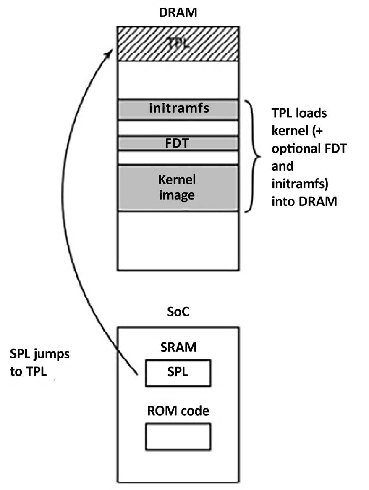
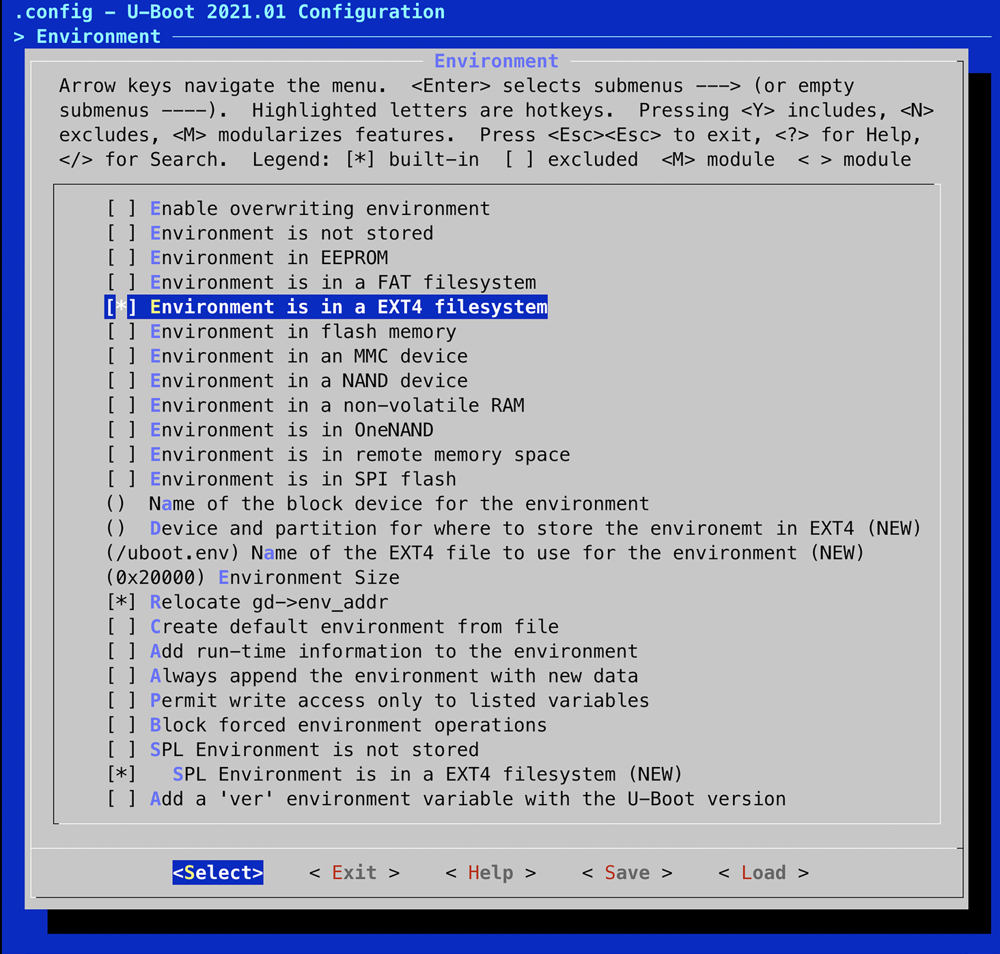
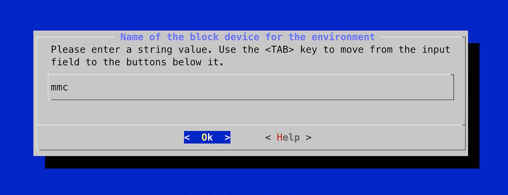
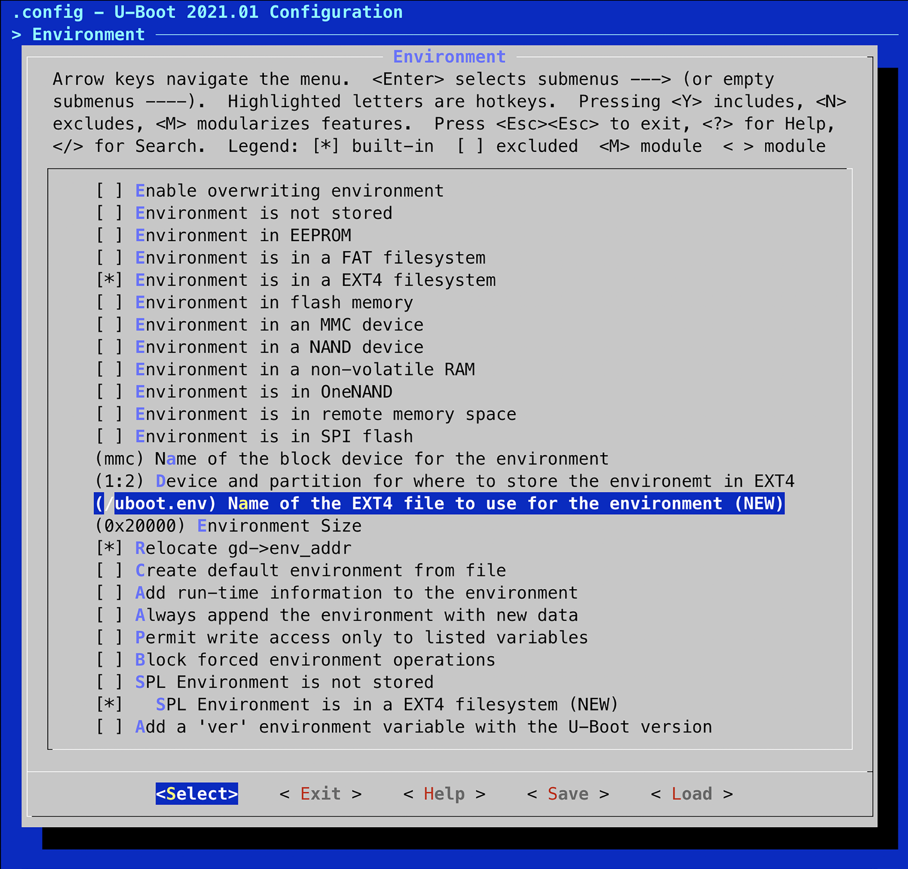
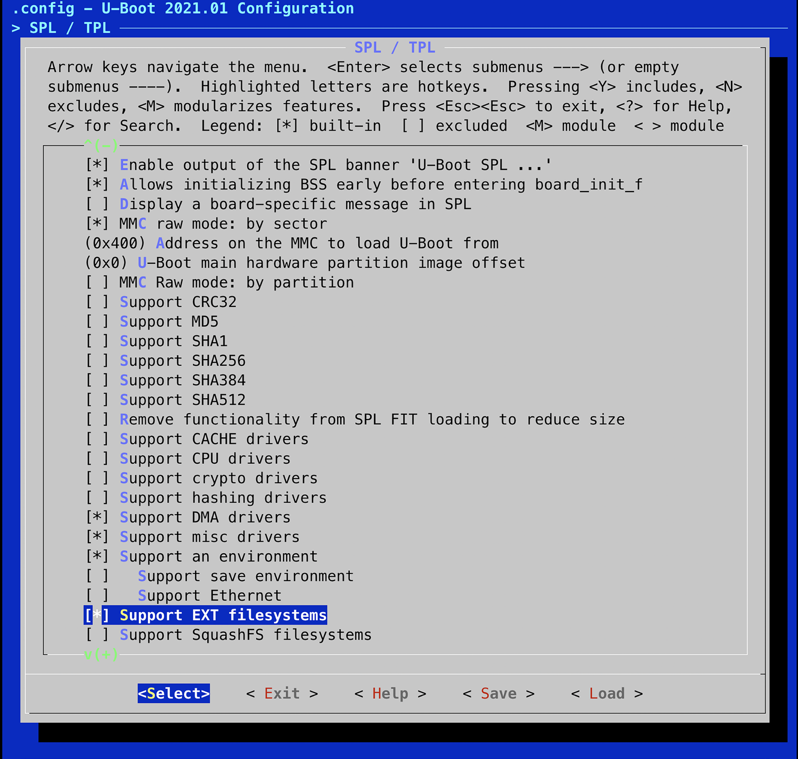
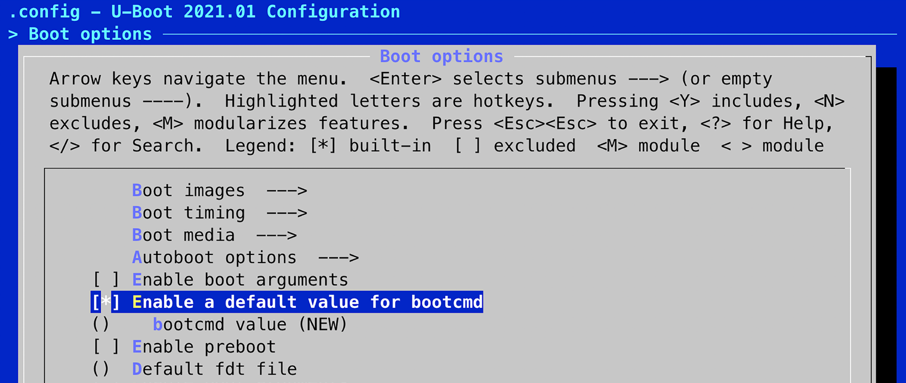
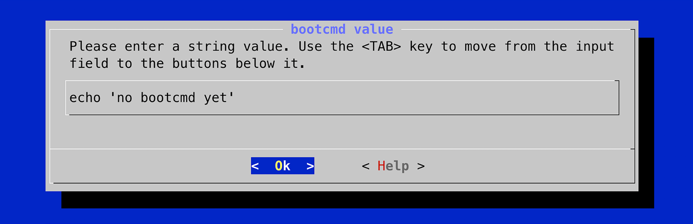
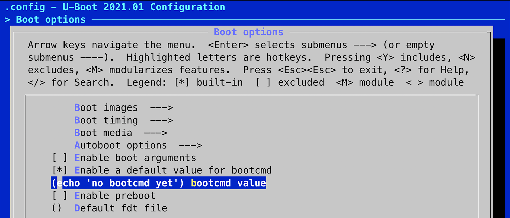

# Chương 3: Tất cả về bootloader (All about Bootloaders)

Bootloader là thành phần thứ hai của embedded Linux. Nó là phần khởi động hệ thống và nạp kernel của hệ điều hành. Trong chương này, chúng ta sẽ xem vai trò của bootloader và cách nó chuyển quyền điều khiển từ chính nó sang kernel bằng một cấu trúc dữ liệu gọi là device tree, còn được gọi là flattened device tree hay FDT.

Tôi sẽ đề cập những điều cơ bản về device tree để bạn có thể theo dõi các kết nối được mô tả trong một device tree và liên hệ chúng với phần cứng thật. Tôi sẽ tập trung vào một bootloader open source phổ biến tên là U-Boot và cho bạn thấy cách dùng nó để boot một thiết bị target. Tôi cũng sẽ cho bạn thấy cách tùy chỉnh U-Boot để chạy trên một thiết bị mới, dùng BeaglePlay làm ví dụ.

Trong chương này, chúng ta sẽ đề cập các chủ đề sau:

- Bootloader làm gì?

- Trình tự boot

- Chuyển từ bootloader sang kernel

- Giới thiệu device tree

- U-Boot

## Yêu cầu kỹ thuật

Để làm theo các ví dụ, hãy bảo đảm bạn có những thứ sau:

- Một hệ thống host Ubuntu 24.04 hoặc bản LTS mới hơn đã cài đặt `device-tree-compiler`, `git`, `make`, `patch` và `u-boot-tools`

- Một toolchain Bootlin cho BeaglePlay từ Chương 2

- Một đầu đọc thẻ microSD và thẻ

- Một cáp serial USB-to-TTL với mức logic 3.3 V

- BeaglePlay

- Một bộ nguồn USB-C 5 V có khả năng cấp 3 A

Toàn bộ code của chương này có trong thư mục `Chapter03` trong GitHub repository của cuốn sách: `https://github.com/PacktPublishing/Mastering-Embedded-Linux-Development/tree/main/Chapter03`.

## Bootloader làm gì?

Trong một hệ thống embedded Linux, bootloader có hai nhiệm vụ chính: khởi tạo hệ thống ở mức cơ bản và nạp kernel. Thực ra, nhiệm vụ đầu tiên phần nào phụ thuộc vào nhiệm vụ thứ hai, theo nghĩa chỉ cần đưa phần hệ thống vào hoạt động ở mức đủ để nạp kernel.

Khi những dòng code đầu tiên của bootloader được thực thi, sau một lần power-on hoặc reset, hệ thống ở trạng thái rất tối thiểu. Bộ điều khiển Dynamic Random Access Memory (DRAM) chưa được thiết lập, vì vậy bộ nhớ chính không truy cập được. Tương tự, các giao tiếp khác chưa được cấu hình, vì vậy bộ lưu trữ được truy cập qua các bộ điều khiển flash NAND (NOT AND), bộ điều khiển MultiMediaCard (MMC), v.v. đều không dùng được. Thông thường, tài nguyên duy nhất hoạt động lúc đầu là một lõi CPU, một ít Static Random Access Memory (SRAM) on-chip và boot Read-Only Memory (ROM).

Quá trình bootstrap hệ thống gồm nhiều giai đoạn code, mỗi giai đoạn đưa thêm một phần hệ thống vào hoạt động. Hành động cuối cùng của bootloader là nạp kernel vào RAM và tạo một môi trường thực thi cho nó. Chi tiết về giao diện giữa bootloader và kernel là architecture-specific, nhưng trong mọi trường hợp, nó phải làm hai việc. Thứ nhất, bootloader phải truyền một con trỏ tới một cấu trúc chứa thông tin về cấu hình phần cứng. Thứ hai, nó phải truyền một con trỏ tới kernel command line.

Kernel command line là một chuỗi văn bản điều khiển hành vi của Linux. Khi kernel đã bắt đầu thực thi, bootloader không còn cần thiết nữa và toàn bộ bộ nhớ mà nó đang dùng có thể được thu hồi.

Một nhiệm vụ phụ của bootloader là cung cấp một chế độ bảo trì để cập nhật cấu hình boot, nạp boot image mới vào bộ nhớ và có thể chạy chẩn đoán. Việc này thường được điều khiển bằng một giao diện người dùng command-line đơn giản, thường qua serial console.

## Trình tự boot

Vài năm trước, chúng ta chỉ cần đặt bootloader trong bộ nhớ non-volatile tại reset vector của bộ xử lý. Bộ nhớ flash NOR (NOT OR) phổ biến vào thời điểm đó, và vì nó có thể được map trực tiếp vào không gian địa chỉ, nó là phương pháp lưu trữ lý tưởng. Sơ đồ sau cho thấy một cấu hình như vậy, với reset vector tại `0xfffffffc` ở đầu trên của một vùng bộ nhớ flash:


Hình 3.1 – Flash NOR

Bootloader được link sao cho tại vị trí đó có một lệnh nhảy trỏ tới điểm bắt đầu của code bootloader. Từ thời điểm đó, code bootloader chạy trong bộ nhớ flash NOR có thể khởi tạo bộ điều khiển DRAM để bộ nhớ chính – DRAM – sẵn sàng, rồi nó copy chính nó vào DRAM. Khi đã hoạt động đầy đủ, bootloader có thể nạp kernel từ bộ nhớ flash vào DRAM và chuyển quyền điều khiển cho nó.

Tuy nhiên, khi bạn rời xa một phương tiện lưu trữ đánh địa chỉ tuyến tính đơn giản như flash NOR, trình tự boot trở thành một thủ tục multi-stage phức tạp. Chi tiết rất đặc thù cho từng SoC, nhưng nhìn chung chúng trải qua các giai đoạn sau.

### Giai đoạn 1 – ROM code

Khi chưa có bộ nhớ ngoài đáng tin cậy, code chạy ngay sau một lần reset hoặc power-on được lưu on-chip trong SoC. Code này được gọi là ROM code. Nó được nạp vào chip khi sản xuất, vì vậy ROM code là độc quyền và không thể được thay thế bằng một thứ tương đương open source.

ROM code không bao gồm code để khởi tạo bộ điều khiển bộ nhớ vì cấu hình DRAM rất device-specific, vì vậy nó chỉ có thể dùng SRAM, loại không cần bộ điều khiển bộ nhớ. Hầu hết các thiết kế SoC nhúng có một lượng nhỏ SRAM trên chip, kích thước dao động từ chỉ 4 KB đến vài trăm KB.


Hình 3.2 – Giai đoạn 1 – ROM code

ROM code có thể nạp một đoạn code nhỏ từ một trong nhiều vị trí pre-programmed vào SRAM. Ví dụ, các chip TI Sitara cố nạp code từ vài trang đầu tiên của bộ nhớ flash NAND, hoặc từ bộ nhớ flash được nối qua Serial Peripheral Interface (SPI). Chúng cũng cố nạp code từ các sector đầu tiên của một thiết bị MMC như chip eMMC hoặc thẻ SD, hoặc từ một file tên là MLO (Memory Loader) trên phân vùng đầu tiên của một thiết bị MMC. Nếu đọc từ tất cả các thiết bị nhớ này đều thất bại, nó thử đọc một luồng byte từ Ethernet, USB hoặc UART. Cách sau cùng chủ yếu được cung cấp như một cách nạp code vào bộ nhớ flash trong quá trình sản xuất hơn là để dùng trong vận hành bình thường.

Hầu hết các SoC nhúng có ROM code hoạt động theo cách tương tự. Trong các SoC mà SRAM không đủ lớn để nạp một bootloader đầy đủ như U-Boot, cần có một loader trung gian gọi là Secondary Program Loader (SPL). Ở cuối giai đoạn ROM code, SPL có mặt trong SRAM và ROM code nhảy tới điểm bắt đầu của code đó.

### Giai đoạn 2 – Secondary Program Loader

SPL phải thiết lập bộ điều khiển bộ nhớ và các phần thiết yếu khác của hệ thống để chuẩn bị nạp Tertiary Program Loader (TPL) vào DRAM. Chức năng của SPL bị giới hạn bởi kích thước của SRAM. Nó có thể đọc một chương trình từ một danh sách các thiết bị lưu trữ, giống như ROM code, một lần nữa dùng các offset pre-programmed tính từ đầu thiết bị flash.

Nếu SPL có các driver filesystem được build sẵn trong nó, nó có thể đọc các tên file well-known như `u-boot.img` từ một phân vùng đĩa. SPL thường không cho phép người dùng tương tác, nhưng nó có thể in thông tin phiên bản và các thông báo tiến trình mà bạn có thể thấy trên console. Sơ đồ sau thể hiện kiến trúc giai đoạn 2:


Hình 3.3 – Giai đoạn 2 – SPL

Sơ đồ trên cho thấy bước nhảy từ ROM code sang SPL. Khi SPL thực thi trong SRAM, nó nạp TPL vào DRAM. Ở cuối giai đoạn thứ hai, TPL có mặt trong DRAM và SPL có thể nhảy tới vùng đó.

SPL có thể là open source, như trường hợp Atmel AT91Bootstrap, nhưng khá phổ biến là nó chứa code độc quyền do nhà sản xuất cung cấp dưới dạng một binary blob.

### Giai đoạn 3 – Tertiary Program Loader

Tại thời điểm này, chúng ta đang chạy một bootloader đầy đủ, như U-Boot, mà chúng ta sẽ tìm hiểu ở phần sau của chương này. Thông thường, có một giao diện người dùng command-line đơn giản cho phép bạn thực hiện các task bảo trì như nạp boot image và kernel image mới vào bộ lưu trữ flash, cũng như một cách để nạp kernel tự động mà không cần người dùng can thiệp. Sơ đồ sau giải thích kiến trúc giai đoạn 3:



Hình 3.4 – Giai đoạn 3 – TPL

Sơ đồ trên cho thấy bước nhảy từ SPL trong SRAM sang TPL trong DRAM. Khi TPL thực thi, nó nạp kernel vào DRAM. Chúng ta cũng có lựa chọn nối thêm một FDT và/hoặc initial RAM disk vào image trong DRAM nếu muốn. Dù thế nào, ở cuối giai đoạn thứ ba, có một kernel trong bộ nhớ đang chờ được khởi động.

Các bootloader nhúng thường biến mất khỏi bộ nhớ khi kernel đang chạy và không còn tham gia vào hoạt động của hệ thống. Trước khi điều đó xảy ra, TPL cần trao quyền điều khiển quá trình boot cho kernel.

## Chuyển từ bootloader sang kernel

Khi bootloader chuyển quyền điều khiển cho kernel, nó phải truyền một số thông tin cơ bản, bao gồm:

- Machine number, được dùng trên các nền tảng PowerPC và Arm không hỗ trợ device tree, để nhận diện loại SoC

- Các chi tiết cơ bản về phần cứng đã được phát hiện cho đến lúc đó, bao gồm (ít nhất là) kích thước và vị trí của RAM vật lý và tốc độ xung nhịp của CPU

- Kernel command line

- Tùy chọn: vị trí và kích thước của một device tree binary

- Tùy chọn: vị trí và kích thước của một initial RAM disk, được gọi là initial RAM file system (initramfs)

Kernel command line là một chuỗi ASCII thuần điều khiển hành vi của Linux, ví dụ bằng cách cho nó biết tên của thiết bị chứa root filesystem. Chúng ta sẽ xem chi tiết kernel command line trong chương tiếp theo. Việc cung cấp root filesystem dưới dạng một RAM disk là phổ biến, khi đó bootloader có trách nhiệm nạp RAM disk image vào bộ nhớ. Chúng ta sẽ đề cập cách tạo initial RAM disk trong Chương 5.

Cách truyền thông tin này phụ thuộc vào kiến trúc và đã thay đổi trong những năm gần đây. Ví dụ, với PowerPC, bootloader trước đây chỉ đơn giản truyền một con trỏ tới một cấu trúc board information, trong khi với Arm, nó truyền một con trỏ tới một danh sách A tag. Có một mô tả tốt về định dạng của A tag trong cây source kernel tại `Documentation/arch/arm/booting.rst`. Hãy duyệt cây source kernel tại `https://github.com/torvalds/linux`.

Trong cả hai trường hợp, lượng thông tin được truyền rất hạn chế, phần lớn còn lại phải được phát hiện lúc runtime hoặc được hard-coded vào kernel dưới dạng platform data. Việc dùng platform data rộng rãi có nghĩa là mỗi board phải có một kernel được cấu hình và sửa đổi cho nền tảng đó. Cần một cách tốt hơn, và cách đó là device tree.

Trong thế giới Arm, việc rời bỏ A tag bắt đầu một cách nghiêm túc vào tháng Hai năm 2013 với bản phát hành Linux 3.8. Ngày nay, hầu hết mọi hệ thống Arm đều dùng device tree để thu thập thông tin về các đặc thù của nền tảng phần cứng. Điều này cho phép một kernel binary duy nhất chạy trên rất nhiều nền tảng Arm.

Giờ chúng ta đã biết bootloader làm gì, các giai đoạn của trình tự boot là gì và cách nó chuyển quyền điều khiển cho kernel, hãy học cách cấu hình một bootloader để nó chạy trên các SoC nhúng phổ biến.

## Giới thiệu device tree

Nếu bạn làm việc với các SoC Arm hoặc PowerPC, gần như chắc chắn đến một lúc nào đó bạn sẽ gặp device tree. Phần này nhằm cho bạn một cái nhìn tổng quan nhanh về chúng là gì và hoạt động như thế nào. Chúng ta sẽ nhiều lần quay lại chủ đề device tree trong suốt cuốn sách này.

Device tree là một cách linh hoạt để định nghĩa các thành phần phần cứng của một hệ thống máy tính. Hãy nhớ rằng device tree chỉ là dữ liệu tĩnh, không phải code thực thi. Thông thường, device tree được bootloader nạp và truyền cho kernel, mặc dù có thể đóng gói device tree cùng với chính kernel image để phục vụ các bootloader không có khả năng nạp chúng riêng.

Định dạng này bắt nguồn từ một bootloader của Sun Microsystems tên là OpenBoot, được chuẩn hóa thành đặc tả Open Firmware (chuẩn IEEE IEEE1275-1994). Nó được dùng trong các máy tính Macintosh PowerPC-based và vì vậy là một lựa chọn hợp lý cho bản port Linux sang PowerPC. Kể từ đó, nó đã được áp dụng ở quy mô lớn bởi nhiều bản hiện thực Linux cho Arm và, ở mức độ ít hơn, bởi MIPS, MicroBlaze, ARC và các kiến trúc khác.

Tôi khuyên bạn truy cập `https://www.devicetree.org` để biết thêm thông tin.

### Cơ bản về device tree

Linux kernel chứa một lượng lớn file source device tree trong `arch/$ARCH/boot/dts`, và đây là một điểm khởi đầu tốt để tìm hiểu về device tree. Ngoài ra, source code của U-Boot chứa một số ít source hơn trong `arch/$ARCH/dts`. Nếu bạn mua phần cứng từ một bên thứ ba, file `dts` là một phần của board support package, vì vậy bạn nên mong đợi nhận được nó cùng với các file source khác.

Device tree biểu diễn một hệ thống máy tính như một tập hợp các thành phần nối với nhau theo một cấu trúc phân cấp. Mọi device tree đều bắt đầu bằng một root node được biểu diễn bằng dấu gạch chéo, `/`, chứa các child node tiếp theo mô tả phần cứng của hệ thống. Mỗi node có một tên và chứa một số property ở dạng `name = "value"`. Sau đây là một ví dụ đơn giản:

```
/dts-v1/;
/{
    model = "TI AM335x BeagleBone";
    compatible = "ti,am33xx";
    #address-cells = <1>;
    #size-cells = <1>;
    cpus {
        #address-cells = <1>;
        #size-cells = <0>;
        cpu@0 {
            compatible = "arm,cortex-a8";
            device_type = "cpu";
            reg = <0>;
        };
    };
    memory@80000000 {
        device_type = "memory";
        reg = <0x80000000 0x20000000>; /* 512 MB */
    };
};
```

Ở đây, chúng ta có một root node chứa một node `cpus` và một node `memory`. Node `cpus` chứa một CPU node duy nhất tên là `cpu@0`. Tên của các node này thường gồm một `@` theo sau là một địa chỉ, giúp phân biệt node với các node khác cùng loại. `@` là bắt buộc nếu node có property `reg`.

Cả root node và CPU node đều có property `compatible`. Linux kernel dùng property này để tìm một device driver phù hợp bằng cách so sánh nó với các chuỗi mà mỗi device driver export trong một cấu trúc `of_device_id` (sẽ nói thêm về điều này trong Chương 11).

LƯU Ý QUAN TRỌNG

Theo quy ước, giá trị của property `compatible` gồm tên nhà sản xuất và tên thành phần, để giảm nhầm lẫn giữa các thiết bị tương tự do các nhà sản xuất khác nhau làm ra, vì vậy mới có `ti,am33xx` và `arm,cortex-a8`. Cũng khá phổ biến là có nhiều hơn một giá trị cho property `compatible` khi có nhiều hơn một driver có thể xử lý thiết bị này. Chúng được liệt kê với giá trị phù hợp nhất được nêu đầu tiên.

CPU node và memory node có property `device_type` mô tả lớp của thiết bị. Tên node thường được suy ra từ `device_type`.

### Property reg

Các node `memory` và `cpu` được trình bày ở trên có property `reg`, tham chiếu tới một dải đơn vị trong một không gian thanh ghi. Một property `reg` gồm hai giá trị biểu diễn địa chỉ vật lý thực và kích thước (độ dài) của dải đó. Cả hai đều được viết dưới dạng không hoặc nhiều số nguyên 32-bit gọi là cell. Vì vậy, node `memory` ở trên tham chiếu tới một bank bộ nhớ duy nhất bắt đầu tại `0x80000000` và dài `0x20000000` byte.

Việc hiểu các property `reg` trở nên phức tạp hơn khi giá trị địa chỉ hoặc kích thước không thể biểu diễn bằng 32 bit. Ví dụ, trên một thiết bị có địa chỉ 64-bit, bạn cần hai cell cho mỗi giá trị:

```
/{
    #address-cells = <2>;
    #size-cells = <2>;
    memory@80000000 {
        device_type = "memory";
        reg = <0x00000000 0x80000000 0 0x80000000>;
    };
};
```

Thông tin về số cell cần thiết được giữ trong các property `#address-cells` và `#size_cells` ở một node tổ tiên. Nói cách khác, để hiểu một property `reg`, bạn phải nhìn ngược lên phân cấp node cho đến khi tìm thấy `#address-cells` và `#size_cells`. Nếu không có, giá trị mặc định là `1` cho mỗi property – nhưng việc người viết device tree phụ thuộc vào giá trị mặc định là một thực hành không tốt. Giá trị mặc định có thể hiển nhiên hoặc không, vì vậy việc viết tường minh giúp tránh mọi hiểu lầm.

Giờ, hãy quay lại các node `cpu` và `cpus`. CPU cũng có địa chỉ. Trong một thiết bị quadcore, chúng có thể được đánh địa chỉ là `0`, `1`, `2` và `3`. Điều đó có thể được coi như một mảng one-dimensional không có chiều sâu, vì vậy kích thước là không. Do đó, bạn có thể thấy chúng ta có `#address-cells =` `<1>` và `#size-cells = <0>` trong node `cpus`. Và trong child node `cpu@0`, chúng ta gán một giá trị duy nhất cho property `reg` bằng `reg = <0>`.

### Label và interrupt

Cấu trúc device tree được mô tả cho đến giờ giả định rằng có một phân cấp thành phần duy nhất, trong khi thực tế có nhiều phân cấp. Ngoài kết nối dữ liệu hiển nhiên giữa một thành phần và các phần khác của hệ thống, một node cũng có thể được nối với một interrupt controller, một nguồn xung nhịp và một bộ điều áp.

Để biểu diễn các kết nối này, chúng ta có thể thêm một label vào một node và tham chiếu label đó từ các node khác. Các label này đôi khi được gọi là phandle, vì khi device tree được compile, các node có tham chiếu từ node khác được gán một giá trị số duy nhất trong một property gọi là `phandle`.

Bạn có thể thấy phandle nếu decompile device tree binary. Lấy ví dụ một hệ thống chứa một bộ điều khiển LCD có thể tạo ra `interrupts` và một `interrupt-controller`:

```
/dts-v1/;
{
    intc: interrupt-controller@48200000 {
        compatible = "ti,am33xx-intc";
        interrupt-controller;
        #interrupt-cells = <1>;
        reg = <0x48200000 0x1000>;
    };
    lcdc: lcdc@4830e000 {
        compatible = "ti,am33xx-tilcdc";
        reg = <0x4830e000 0x1000>;
        interrupt-parent = <&intc>;
        interrupts = <36>;
        ti,hwmods = "lcdc";
        status = "disabled";
    };
};
```

Ở đây, chúng ta có node `interrupt-controller@48200000` với label `intc`. Property `interrupt-controller` nhận diện nó là một interrupt controller. Giống như mọi interrupt controller, nó có property `#interrupt-cells`, cho chúng ta biết cần bao nhiêu cell để biểu diễn một nguồn ngắt. Trong trường hợp này, chỉ có một cell biểu diễn số Interrupt Request (IRQ).

Các interrupt controller khác có thể dùng thêm cell để mô tả đặc điểm của ngắt, ví dụ, để cho biết nó là kích hoạt theo cạnh hay theo mức. Số lượng interrupt cell và ý nghĩa của chúng được mô tả trong binding của từng interrupt controller. Các device tree binding có thể được tìm thấy trong source của Linux kernel, thư mục `Documentation/devicetree/bindings`.

Nhìn vào node `lcdc@4830e000`, nó có property `interrupt-parent`, tham chiếu tới interrupt controller mà nó được nối vào bằng label. Nó cũng có property `interrupts`, trong trường hợp này là `36`. Lưu ý rằng node này có label riêng, `lcdc`, được dùng ở nơi khác. Bất kỳ node nào cũng có thể có label.

### File include của device tree

Rất nhiều phần cứng là chung giữa các SoC cùng họ và giữa các board dùng cùng SoC. Điều này được phản ánh trong device tree bằng cách tách các phần chung thành các file `include`, thường có phần mở rộng `.dtsi`. Chuẩn Open Firmware định nghĩa `/include/` là cơ chế cần dùng, như trong đoạn trích này từ `vexpress-v2p-ca9.dts`:

```
/include/ "vexpress-v2m.dtsi"
```

Hãy xem qua các file `.dts` trong kernel và bạn sẽ thấy một câu lệnh `include` thay thế được mượn từ C; ví dụ, đây là trong `am335x-boneblack.dts`:

```
#include "am33xx.dtsi"
#include "am335x-bone-common.dtsi"
```

Sau đây là một ví dụ khác từ `am33xx.dtsi`:

```
#include <dt-bindings/gpio/gpio.h>
#include <dt-bindings/pinctrl/am33xx.h>
#include <dt-bindings/clock/am3.h>
```

Cuối cùng, `include/dt-bindings/pinctrl/am33xx.h` chứa các macro C thông thường:

```
#define PULL_DISABLE       (1 << 3)
#define INPUT_EN           (1 << 5)
#define SLEWCTRL_SLOW      (1 << 6)
#define SLEWCTRL_FAST             0
```

Tất cả những thứ này đều được phân giải nếu các source device tree được build bằng hệ thống Kbuild, hệ thống này cho chúng đi qua C preprocessor, CPP. CPP xử lý các câu lệnh `#include` và `#define` thành văn bản phù hợp cho device tree compiler. Động cơ của việc này được minh họa bằng ví dụ trước. Nó có nghĩa là các source device tree có thể dùng cùng định nghĩa hằng số như code kernel.

Khi chúng ta include file bằng một trong hai cú pháp, các node được xếp chồng lên nhau để tạo ra một cây hợp thành, trong đó các lớp bên ngoài mở rộng hoặc sửa đổi các lớp bên trong. Ví dụ, `am33xx.dtsi`, file chung cho mọi SoC `am33xx`, định nghĩa giao tiếp bộ điều khiển MMC đầu tiên như sau:

```
mmc1: mmc@48060000 {
    compatible = "ti,omap4-hsmmc";
    ti,hwmods = "mmc1";
    ti,dual-volt;
    ti,needs-special-reset;
    ti,needs-special-hs-handling;
    dmas = <&edma_xbar 24 0 0
            &edma_xbar 25 0 0>;
    dma-names = "tx", "rx";
    interrupts = <64>;
    reg = <0x48060000 0x1000>;
    status = "disabled";
};
```

Lưu ý rằng `status` là `disabled`, nghĩa là không device driver nào được gắn với nó, và nó có label là `mmc1`.

Cả BeagleBone và BeagleBone Black đều có giao tiếp thẻ microSD gắn với `mmc1`. Đây là lý do trong `am335x-bone-common.dtsi`, cùng node đó được tham chiếu bằng dấu ampersand và label của nó, `&mmc1`:

```
&mmc1 {
    status = "okay";
    bus-width = <0x4>;
    pinctrl-names = "default";
    pinctrl-0 = <&mmc1_pins>;
    cd-gpios = <&gpio0 6 GPIO_ACTIVE_LOW>;
};
```

Tham chiếu một node bằng dấu ampersand và label của nó cho phép chúng ta ghi đè các property từ các mục `mmc1` trước đó. Ở đây, property `status` được đặt thành `okay`, khiến MMC device driver gắn với giao tiếp này lúc runtime trên cả hai biến thể của BeagleBone. Ngoài ra, một tham chiếu tới label được thêm vào cấu hình pin control, `mmc1_pins`. Tiếc là không đủ chỗ ở đây để mô tả pin control và pin multiplexing. Source của Linux kernel có một số thông tin trong thư mục `Documentation/devicetree/bindings/pinctrl`.

Tuy nhiên, giao tiếp `mmc1` được nối với một bộ điều áp khác trên BeagleBone Black. Điều này được biểu diễn trong `am335x-boneblack.dts`, nơi bạn sẽ thấy một tham chiếu khác tới `mmc1`, gắn nó với bộ điều áp qua label `vmmcsd_fixed`:

```
&mmc1 {
    vmmc-supply = <&vmmcsd_fixed>;
};
```

Vì vậy, phân lớp các file source device tree như thế này mang lại sự linh hoạt và giảm nhu cầu trùng lặp code.

### Compile một device tree

Bootloader và kernel cần một biểu diễn binary của device tree, vì vậy nó phải được compile bằng device tree compiler, tức là `dtc`. Kết quả là một file có đuôi `.dtb`, được gọi là device tree binary hay device tree blob.

Có một bản sao của `dtc` trong source Linux tại `scripts/dtc/dtc`, và nó cũng có sẵn dưới dạng package trên nhiều bản phân phối Linux. Bạn có thể dùng nó để compile một device tree đơn giản (không dùng `#include`) như sau:

```
$ dtc simpledts-1.dts -o simpledts-1.dtb
DTC: dts->dts on file "simpledts-1.dts"
```

Hãy cẩn thận với thực tế là `dtc` không đưa ra thông báo lỗi hữu ích và không kiểm tra gì ngoài cú pháp cơ bản của ngôn ngữ. Điều này có nghĩa là debug một lỗi gõ phím trong file source device tree có thể là một quá trình dài.

Để build các ví dụ phức tạp hơn, bạn sẽ phải dùng Kbuild của kernel như được trình bày trong Chương 4.

Giống như kernel, bootloader có thể dùng một device tree để khởi tạo một SoC nhúng và các thiết bị ngoại vi của nó. Device tree này rất quan trọng khi bạn nạp kernel từ một thiết bị lưu trữ dung lượng lớn như flash QSPI. Mặc dù embedded Linux cho phép lựa chọn nhiều bootloader, chúng ta sẽ chỉ đề cập một. Hãy đi sâu vào bootloader đó tiếp theo.

## U-Boot

Chúng ta sẽ tập trung hoàn toàn vào U-Boot vì nó hỗ trợ khá nhiều kiến trúc bộ xử lý và hầu hết các board và thiết bị riêng lẻ. U-Boot, hay tên đầy đủ là Das U-Boot, ra đời như một bootloader open source cho các board PowerPC nhúng. Sau đó, nó được port sang các board Arm-based và về sau sang các kiến trúc khác, bao gồm Microprocessor without Interlocked Pipeline Stages (MIPS) và SuperH (SH).

U-Boot đã tồn tại lâu và có một cộng đồng tốt. Project được DENX Software Engineering lưu trữ và bảo trì. Có rất nhiều thông tin về nó, và một nơi tốt để bắt đầu là `https://u-boot.readthedocs.io`. Cũng có một mailing list tại `u-boot@` `lists.denx.de` mà bạn có thể đăng ký bằng cách điền và gửi biểu mẫu tại `https://lists.denx.de/listinfo/u-boot`.

### Build U-Boot

Hãy bắt đầu bằng việc lấy source code. Như với hầu hết các project, cách được khuyên dùng là clone Git repository và checkout tag mà bạn định dùng:

```
$ git clone git://git.denx.de/u-boot.git u-boot-mainline
$ cd u-boot-mainline
$ git checkout v2024.04
```

Ngoài ra, bạn có thể tải một tarball từ `https://ftp.denx.de/pub/u-boot/`.

Có hơn 1,000 file cấu hình cho các development board và thiết bị phổ biến trong thư mục `configs`. Trong hầu hết các trường hợp, bạn có thể đoán khá đúng nên dùng file nào dựa vào tên file. Nhưng bạn có thể có thông tin chi tiết hơn bằng cách xem qua các file `.rst` trong thư mục `doc/board`. Hoặc bạn có thể tìm thông tin trong một hướng dẫn web hoặc diễn đàn thích hợp.

Lấy BeaglePlay làm ví dụ, chúng ta sẽ thấy có một file cấu hình tên là `am62x_evm_a53_defconfig` trong thư mục `configs`. Trong cùng thư mục đó, có một file cấu hình khác tên là `am62x_evm_r5_defconfig` dành cho vi điều khiển Arm Cortex-R5F của BeaglePlay. ROM code chạy trên vi điều khiển Arm Cortex-R5F và TPL chạy trên CPU Arm Cortex-A53 chính. Có hai U-Boot SPL: một chạy trên R5 và một chạy trên CPU chính. Có một sơ đồ tuần tự giải thích chi tiết luồng boot độc đáo của BeaglePlay bên trong `doc/board/beagle/am62x_beagleplay.rst`. Hãy xem kỹ sơ đồ tuần tự này và bảo đảm bạn hiểu nó. Khi đi qua phần còn lại của chương này, hãy tham khảo sơ đồ này để làm rõ.

Build U-Boot cho BeaglePlay là một quá trình multi-stage. Arm Cortex-M4F và Cortex-R5F trong SoC `am62x` của BeaglePlay là các bộ xử lý 32-bit, vì vậy chúng cần một toolchain 32-bit. Một thành phần phần mềm gọi là TI Foundational Security (TIFS) chạy trên M4. TIFS khởi động R5 và yêu cầu nó nạp một firmware image vào lõi TIFS. Điều đó có nghĩa là chúng ta cần đóng gói một TIFS binary firmware image cho M4 cùng với một U-Boot SPL khi tạo bootloader image cho R5. Tiếp theo, chúng ta cần build Trusted Firmware-A (TF-A) cho CPU A53 chính bằng một toolchain 64-bit. Cuối cùng, chúng ta cấu hình và build một U-Boot SPL và TPL cho CPU chính.

#### Lấy một toolchain 32-bit

Hãy mở trình duyệt web tới `https://developer.arm.com/downloads/-/arm-gnu-toolchain-downloads`. Tìm Downloads: 13.2.Rel1 và nhấn vào dấu cộng phía trước để mở rộng mục đó. Sau đó nhấn vào file `arm-gnu-toolchain-13.2.rel1-x86_64-arm-none-eabi.tar.xz` dưới x86\_64 Linux hosted cross toolchains AArch32 bare-metal target (arm-none-eabi) để tải toolchain về.

Các bài tập R5 sau đây đã được thực hiện thành công với phiên bản đó của Arm GNU toolchain. Tôi khuyên bạn tải cùng phiên bản đó từ trang web này (nếu còn) để tránh mọi vấn đề.

Cài đặt toolchain 32-bit vào thư mục home của bạn:

```
$ cd ~
$ tar -xvf ~/Downloads/arm-gnu-toolchain-13.2.rel1-x86_64-arm-none-eabi.
tar.xz
```

Thêm toolchain 32-bit vào biến môi trường `PATH`:

```
$ export PATH=${HOME}/arm-gnu-toolchain-13.2.Rel1-x86_64-arm-none-eabi/
bin/:$PATH
```

Giờ bạn đã sẵn sàng build U-Boot cho R5. Hãy bảo đảm thay `13.2.rel1` và `13.2.Rel1` trong các lệnh trên bằng phiên bản thực tế của toolchain 32-bit mà bạn đã tải về.

#### Build U-Boot SPL cho R5

Hỗ trợ BeaglePlay trong U-Boot mainline còn rất mới vào tháng Mười Một năm 2023 khi tôi viết phần này. Vì lý do đó, tôi đã chọn dùng fork U-Boot của BeagleBoard.org cho BeaglePlay. Tôi khuyên bạn build source U-Boot từ cùng Git repo đó (nếu còn) để tránh mọi vấn đề.

Clone fork U-Boot vào thư mục home và checkout một commit ổn định:

```
$ git clone https://github.com/beagleboard/u-boot u-boot-beagleplay
$ cd u-boot-beagleplay
$ git checkout f036fb
```

Cài đặt các package cần để build U-Boot cho BeaglePlay:

```
$ sudo apt install bison device-tree-compiler flex libncurses-dev libssl-
dev python3-dev python3-setuptools swig
```

Cấu hình và build U-Boot cho R5:

1\. Đầu tiên, tạo một thư mục build cho R5 ở cấp trên một bậc để chia sẻ build artifact giữa các lần build:

```
$ mkdir -p ../build_uboot/r5
```

2\. Tiếp theo, đặt các biến môi trường `ARCH` và `CROSS_COMPILE` cho Arm 32-bit:

```
$ export ARCH=arm
$ export CROSS_COMPILE=arm-none-eabi-
```

3\. Chọn `am62x_evm_r5_defconfig` để build:

```
$ make am62x_evm_r5_defconfig O=../build_uboot/r5
```

4\. Chạy `make menuconfig` để cấu hình thêm U-Boot cho việc build:

```
$ make menuconfig O=../build_uboot/r5
```

  - Đi vào submenu Environment.

  - Chọn Environment is in a EXT4 filesystem.



Hình 3.5 – Chọn Environment is in a EXT4 fileystem

5\. Bỏ chọn mọi tùy chọn khác (ví dụ, MMC, NAND và SPI) cho việc lưu environment trên trang menu đó.

6\. Nhập `mmc` vào trường văn bản Name of the block device for the environment.



Hình 3.6 – Name of the block device for the environment

7\. Nhập `1:2` vào trường văn bản Device and partition for where to store the environment in EXT4.


Hình 3.7 – Device and partition for where to store the environment in EXT4

8\. Bảo đảm `/uboot.env` là giá trị của trường văn bản Name of the EXT4 file to use for the environment.



Hình 3.8 – Environment

9\. Thoát khỏi submenu Environment.

10\. Đi vào submenu SPL/TPL.

11\. Chọn Support EXT filesystems.



Hình 3.9 – Chọn Support EXT4 filesystems

12\. Thoát khỏi submenu SPL/TPL.

13\. Đi vào submenu Boot Options.

14\. Chọn Enable a default value for bootcmd.



Hình 3.10 – Chọn Enable a default value for bootcmd

15\. Nhập `echo 'no bootcmd yet'` vào trường văn bản bootcmd value.



Hình 3.11 – bootcmd value



Hình 3.12 – Boot options

16\. Thoát khỏi `menuconfig` và chọn Yes khi được hỏi có lưu cấu hình mới không.

17\. Cuối cùng, build U-Boot cho R5:

```
$ make O=../build_uboot/r5
```

Khi U-Boot build xong, sẽ có một SPL binary cho R5 trong `../build_uboot/r5/spl`.

Hãy tham khảo sơ đồ tuần tự luồng boot trong `doc/board/beagle/am62x_beagleplay.rst`.

#### Tạo image cho R5

Hãy nhớ lại rằng TIFS firmware image được nạp vào M4 cần được đóng gói cùng với U-Boot SPL cho R5. Chúng ta lấy TIFS binary firmware image trực tiếp từ TI.

Clone repo firmware của TI vào thư mục home:

```
$ cd ~
$ git clone https://github.com/TexasInstruments-Sandbox/ti-linux-firmware.
git
$ cd ti-linux-firmware
$ git checkout c126d386
```

Việc đóng gói TIFS firmware image cho M4 cùng với U-Boot SPL cho R5 cần một công cụ tên là `k3-image-gen`.

Clone repo `k3-image-gen` vào thư mục home:

```
$ cd ~
$ git clone git://git.ti.com/k3-image-gen/k3-image-gen.git
$ cd k3-image-gen
$ git checkout 150f195
```

Tạo image kết hợp cho R5 bằng cách chạy `make` trong thư mục `k3-image-gen` với đường dẫn tới U-Boot SPL và TIFS firmware image được truyền làm đối số:

```
$ make SOC=am62x SBL=../build_uboot/r5/spl/u-boot-spl.bin SYSFW_PATH=../
ti-linux-firmware/ti-sysfw/ti-fs-firmware-am62x-gp.bin
```

Giờ sẽ có một file `tiboot3.bin` trong thư mục `k3-image-gen`.

Hãy tham khảo sơ đồ tuần tự luồng boot trong `doc/board/beagle/am62x_beagleplay.rst`.

#### Build TF-A cho CPU A53 chính

A53 trong SoC `am62x` của BeaglePlay là một CPU 64-bit, vì vậy chúng ta phải chuyển sang một toolchain 64-bit để cross-compile source code cho nó. Chúng ta sẽ dùng cùng toolchain Bootlin 64-bit từ Chương 2 mà bạn đã cài vào thư mục home.

Thêm toolchain Bootlin 64-bit đó vào biến môi trường `PATH`:

```
$ export PATH=${HOME}/aarch64--glibc--stable-2024.02-1/bin/:$PATH
```

Hãy bảo đảm thay `2024.02-1` trong các lệnh trên bằng phiên bản thực tế của toolchain 64-bit mà bạn đã tải về.

Clone source code TF-A vào thư mục home và checkout một release tag ổn định:

```
$ cd ~
$ git clone https://github.com/ARM-software/arm-trusted-firmware.git
$ cd arm-trusted-firmware
$ git checkout v2.9
```

Cấu hình và build TF-A cho A53:

1\. Đặt các biến môi trường `ARCH` và `CROSS_COMPILE` cho Arm 64-bit:

```
$ export ARCH=aarch64
$ export CROSS_COMPILE=aarch64-buildroot-linux-gnu-
```

2\. Build TF-A cho A53, chỉ định `k3` là platform và `lite` là target board:

```
$ make PLAT=k3 TARGET_BOARD=lite
```

Khi TF-A build xong, sẽ có một `bl31.bin` cho A53 trong `./build/k3/lite/release`.

Hãy tham khảo sơ đồ tuần tự luồng boot trong `doc/board/beagle/am62x_beagleplay.rst`.

#### Build U-Boot cho CPU A53 chính

Tất cả các bước build đã thực hiện cho đến giờ là riêng cho SoC `am62x` trong BeaglePlay. Build U-Boot cho hầu hết các target chỉ cần compile một SPL và TPL cho CPU chính. Chúng ta sẽ dùng cùng toolchain Bootlin 64-bit từ Chương 2 mà bạn đã cài vào thư mục home.

Thêm toolchain Bootlin 64-bit đó vào biến môi trường `PATH`:

```
$ export PATH=${HOME}/aarch64--glibc--stable-2024.02-1/bin/:$PATH
```

Hãy bảo đảm thay `2024.02-1` trong các lệnh trên bằng phiên bản thực tế của toolchain 64-bit mà bạn đã tải về.

Cấu hình và build U-Boot cho A53:

1\. Đầu tiên, quay lại cây source `u-boot` cho BeaglePlay:

```
$ cd ~
$ cd u-boot-beagleplay
```

2\. Tiếp theo, tạo một thư mục build cho A53 ở cấp trên một bậc:

```
$ mkdir -p ../build_uboot/a53
```

3\. Đặt các biến môi trường `ARCH` và `CROSS_COMPILE` cho Arm 64-bit:

```
$ export ARCH=aarch64
$ export CROSS_COMPILE=aarch64-buildroot-linux-gnu-
```

4\. Chọn `am62x_evm_a53_defconfig` để build:

```
$ make am62x_evm_a53_defconfig O=../build_uboot/a53
```

5\. Chạy `make menuconfig` để cấu hình thêm U-Boot cho việc build:

```
$ make menuconfig O=../build_uboot/a53
```

6\. Đi vào submenu Environment.

7\. Chọn Environment is in a EXT4 filesystem.

8\. Bỏ chọn mọi tùy chọn khác (ví dụ, MMC, NAND và SPI) cho việc lưu environment trên trang menu đó.

9\. Nhập `mmc` vào trường văn bản Name of the block device for the environment.

10\. Nhập `1:2` vào trường văn bản Device and partition for where to store the environment in EXT4.

11\. Bảo đảm `/uboot.env` được nhập vào trường văn bản Name of the EXT4 file to use for the environment.

12\. Thoát khỏi submenu Environment.

13\. Đi vào submenu SPL/TPL.

14\. Chọn Support EXT filesystems.

15\. Thoát khỏi submenu SPL/TPL.

16\. Đi vào submenu Boot Options.

17\. Chọn Enable a default value for bootcmd.

18\. Nhập `echo 'no bootcmd yet'` vào trường văn bản bootcmd value.

19\. Thoát khỏi `menuconfig` và chọn Yes khi được hỏi có lưu cấu hình mới không.

20\. Cuối cùng, build U-Boot cho A53, truyền đường dẫn tới TF-A và firmware DM của TI làm đối số cho `make`:

```
$ make ATF=$HOME/arm-trusted-firmware/build/k3/lite/release/bl31.
bin DM=$HOME/ti-linux-firmware/ti-dm/am62xx/ipc_echo_testb_mcu1_0_
release_strip.xer5f O=../build_uboot/a53
```

LƯU Ý QUAN TRỌNG

Luôn dùng đường dẫn tuyệt đối thay vì đường dẫn tương đối `./` để trỏ tới firmware `ATF` và `DM` trong lệnh `make`. Nếu không, các binary SPL và U-Boot tạo ra sẽ sai về kích thước và nội dung.

Kết quả của việc compile như sau:

- `u-boot`: U-Boot ở định dạng ELF, phù hợp để dùng với debugger

- `u-boot.map`: Bảng symbol

- `u-boot.bin`: U-Boot ở định dạng binary thô, phù hợp để chạy trên thiết bị của bạn

- `u-boot.img`: `u-boot.bin` có thêm U-Boot header, phù hợp để upload lên một bản U-Boot đang chạy

- `u-boot.srec`: U-Boot ở định dạng Motorola S-record (SRECORD hoặc SRE), phù hợp để truyền qua kết nối serial

BeaglePlay cũng cần một SPL, như đã mô tả trước đó. SPL này được build cùng lúc và có tên là `tispl.bin` (sơ đồ tuần tự luồng boot trong `doc/board/beagle/am62x_beagleplay.rst`):

```
$ cd ~
$ cd build_uboot/a53
$ ls -l tispl.bin
-rw-rw-r-- 1 frank frank 549508 Jun 29 20:31 tispl.bin
$ ls -l u-boot*
-rwxrwxr-x 1 frank frank 6779128 Jun 29 20:31 u-boot
-rw-rw-r-- 1 frank frank 1098236 Jun 29 20:31 u-boot.bin
-rw-rw-r-- 1 frank frank   18246 Jun 29 20:30 u-boot.cfg
-rw-rw-r-- 1 frank frank   11563 Jun 29 20:31 u-boot.cfg.configs
-rw-rw-r-- 1 frank frank   37485 Jun 29 20:31 u-boot.dtb
-rw-rw-r-- 1 frank frank 1060788 Jun 29 20:31 u-boot-dtb.img
-rw-rw-r-- 1 frank frank 1098236 Jun 29 20:31 u-boot-fit-dtb.bin
-rw-rw-r-- 1 frank frank 1060788 Jun 29 20:31 u-boot.img
-rw-rw-r-- 1 frank frank 1060788 Jun 29 20:31 u-boot.img_HS
-rw-rw-r-- 1 frank frank    1348 Jun 29 20:31 u-boot.lds
-rw-rw-r-- 1 frank frank  765615 Jun 29 20:31 u-boot.map
-rwxrwxr-x 1 frank frank  993104 Jun 29 20:31 u-boot-nodtb.bin
-rwxrwxr-x 1 frank frank  993104 Jun 29 20:31 u-boot-nodtb.bin_HS
-rw-rw-r-- 1 frank frank    1836 Jun 29 20:31 u-boot-spl-k3_HS.its
-rwxrwxr-x 1 frank frank 2979442 Jun 29 20:31 u-boot.srec
-rw-rw-r-- 1 frank frank  342412 Jun 29 20:31 u-boot.sym
```

Quy trình tương tự cho các target khác.

### Cài đặt U-Boot

Cài đặt bootloader lên một board lần đầu tiên cần một số thao tác thủ công. Nếu board có giao tiếp debug phần cứng, như Joint Test Action Group (JTAG), thường có thể nạp trực tiếp một bản sao U-Boot vào RAM và cho nó chạy. Từ thời điểm đó, bạn có thể dùng các lệnh U-Boot để nó copy chính nó vào bộ nhớ flash. Các chi tiết rất board-specific và nằm ngoài phạm vi của cuốn sách này.

Nhiều thiết kế SoC có boot ROM tích hợp sẵn có thể được dùng để đọc boot code từ nhiều nguồn bên ngoài khác nhau, như thẻ SD, giao tiếp serial hoặc USB mass storage. Đây là trường hợp của chip `am62x` trong Beagle, điều này giúp dễ dàng thử phần mềm mới.

Bạn sẽ cần một đầu đọc thẻ microSD để ghi các image vào thẻ. Có hai loại: đầu đọc bên ngoài cắm vào cổng USB và đầu đọc SD bên trong có trên nhiều laptop. Linux gán một tên thiết bị khi một thẻ được cắm vào đầu đọc. Lệnh `lsblk` là một công cụ hữu ích để tìm ra thiết bị nào đã được cấp phát. Ví dụ, đây là những gì tôi thấy khi cắm một thẻ microSD danh định 32 GB vào đầu đọc thẻ của mình:

```
$ lsblk
NAME        MAJ:MIN RM   SIZE RO TYPE MOUNTPOINT
sda           8:0    1  29.8G  0 disk
└─sda1        8:1    1  29.8G  0 part /media/frank/6662-6262
nvme0n1     259:0    0 465.8G  0 disk
├─nvme0n1p1 259:1    0   512M  0 part /boot/efi
├─nvme0n1p2 259:2    0    16M  0 part
├─nvme0n1p3 259:3    0 232.9G  0 part
└─nvme0n1p4 259:4    0 232.4G  0 part /
```

Trong trường hợp này, `nvme0n1` là ổ cứng 512 GB của tôi và `sda` là thẻ microSD. Nó có một phân vùng duy nhất, `sda1`, được mount tại thư mục `/media/frank/6662-6262`.

Nếu tôi dùng khe thẻ SD built-in, tôi thấy như sau:

```
$ lsblk
NAME        MAJ:MIN RM   SIZE RO TYPE MOUNTPOINT
mmcblk0     179:0    1  29.8G  0 disk
└─mmcblk0p1 179:1    1  29.8G  0 part /media/frank/6662-6262
nvme0n1     259:0    0 465.8G  0 disk
├─nvme0n1p1 259:1    0   512M  0 part /boot/efi
├─nvme0n1p2 259:2    0    16M  0 part
├─nvme0n1p3 259:3    0 232.9G  0 part
└─nvme0n1p4 259:4    0 232.4G  0 part /
```

Trong trường hợp này, thẻ microSD xuất hiện dưới dạng `mmcblk0`, và phân vùng là `mmcblk0p1`. Lưu ý rằng thẻ microSD bạn dùng có thể đã được format khác với thẻ này, vì vậy bạn có thể thấy số lượng phân vùng khác với các mount point khác. Khi format một thẻ SD, điều rất quan trọng là phải chắc chắn về tên thiết bị của nó. Bạn thực sự không muốn nhầm ổ cứng của mình với thẻ SD và format nó.

Điều này đã xảy ra với tôi hơn một lần. Vì vậy, tôi đã cung cấp một shell script trong code repo của cuốn sách tên là `MELD/format-sdcard.sh`, có một số lượng kiểm tra hợp lý để ngăn bạn (và tôi) dùng sai tên thiết bị. Tham số là tên thiết bị của thẻ microSD, sẽ là `sda` trong ví dụ đầu và `mmcblk0` trong ví dụ thứ hai. Sau đây là một ví dụ về cách dùng nó:

```
$ MELD/format-sdcard.sh mmcblk0
```

Script tạo hai phân vùng. Phân vùng thứ nhất dung lượng 128 MB, được format FAT32 và sẽ chứa bootloader, còn phân vùng thứ hai dung lượng 1 GB, được format ext4, mà bạn sẽ dùng trong Chương 5. Script sẽ dừng khi được áp dụng cho bất kỳ ổ nào lớn hơn 128 GB, vì vậy hãy chuẩn bị sửa nó nếu bạn dùng thẻ microSD lớn hơn.

Khi đã format thẻ microSD, hãy rút nó ra khỏi đầu đọc thẻ rồi cắm lại. Di chuột qua và nhấn vào một trong các biểu tượng USB stick xuất hiện ở bên trái desktop Ubuntu để mở một cửa sổ cho phân vùng `boot`. Trên các phiên bản Ubuntu hiện tại, hai phân vùng được mount tại `/media/<user>/boot` và `/media/<user>/rootfs`.

Copy `tiboot3.bin`, `tispl.bin` và `u-boot.img` vào phân vùng `boot` như sau:

```
$ cd ~
$ cd k3-image-gen
$ cp tiboot3.bin /media/$USER/boot/.
$ cd ~
$ cd build_uboot/a53
$ cp tispl.bin u-boot.img /media/$USER/boot/.
```

Right-click vào một trong hai biểu tượng USB stick và chọn Eject để unmount thẻ microSD. Cuối cùng, rút thẻ microSD ra khỏi đầu đọc thẻ của máy host.

Để boot BeaglePlay từ thẻ microSD vừa chuẩn bị:

1\. Khi BeaglePlay chưa cấp nguồn, cắm thẻ microSD vào đầu đọc của BeaglePlay.

2\. Cắm đầu USB của cáp serial USB-to-TTL vào máy host. Hãy bảo đảm cáp có mức logic 3.3 V.

3\. Đầu nối UART three-pin nằm ngay cạnh đầu nối USB-C trên BeaglePlay. Đừng nối dây đỏ thứ tư từ cáp. Dây đỏ thường là dây nguồn, không cần thiết trong trường hợp này và có thể làm hỏng board.

4\. Nối dây TX từ cáp vào chân RX trên BeaglePlay.

5\. Nối dây RX từ cáp vào chân TX trên BeaglePlay.

6\. Nối dây GND (đen) từ cáp vào chân GND trên BeaglePlay.

7\. Một cổng serial sẽ xuất hiện trên PC của bạn dưới dạng `/dev/ttyUSB0`.

8\. Khởi động một chương trình terminal phù hợp, như `gtkterm`, `minicom` hoặc `picocom`, và gắn nó vào cổng ở tốc độ 115,200 bit mỗi giây (bps), không có flow control. `gtkterm` có lẽ là dễ thiết lập và sử dụng nhất:

```
$ gtkterm -p /dev/ttyUSB0 -s 115200
```

9\. Nếu gặp lỗi quyền truy cập, có thể bạn cần thêm mình vào nhóm `dialout` để dùng cổng này, hoặc khởi chạy `gtkterm` bằng `sudo`. Nếu output trên serial console bị rối hoặc không có output, hãy đổi chỗ các dây nối vào chân RX và TX trên BeaglePlay.

10\. Nhấn và giữ nút USR trên BeaglePlay.

11\. Cấp nguồn cho board qua USB-C.

12\. Thả nút ra sau khoảng 5 giây.

Bạn sẽ thấy một số output, theo sau là dấu nhắc U-Boot trên serial console:

```
U-Boot SPL 2021.01-gf036fbdc25 (Jun 29 2024 - 18:54:55 -0700)
SYSFW ABI: 3.1 (firmware rev 0x0009 '9.0.4--v09.00.04 (Kool Koala)')
SPL initial stack usage: 13384 bytes
Trying to boot from MMC2
spl_load_fit_image: Skip load 'tee': image size is 0!
Loading Environment from EXT4... ** File not found /uboot.env **

** Unable to read "/uboot.env" from mmc1:2 **
Starting ATF on ARM64 core...

NOTICE:  BL31: v2.9(release):v2.9.0
NOTICE:  BL31: Built : 19:01:43, Jun 29 2024

U-Boot SPL 2021.01-gf036fbdc25 (Jun 29 2024 - 20:30:20 -0700)
SYSFW ABI: 3.1 (firmware rev 0x0009 '9.0.4--v09.00.04 (Kool Koala)')
Trying to boot from MMC2

U-Boot 2021.01-gf036fbdc25 (Jun 29 2024 - 20:30:20 -0700)

SoC:   AM62X SR1.0 GP
Model: BeagleBoard.org BeaglePlay
Board: BEAGLEPLAY-A0- rev 02
DRAM:  2 GiB
MMC:   mmc@fa10000: 0, mmc@fa00000: 1, mmc@fa20000: 2
Loading Environment from EXT4... ** File not found /uboot.env **

** Unable to read "/uboot.env" from mmc1:2 **
In:    serial@2800000
Out:   serial@2800000
Err:   serial@2800000
Error: Can't set serial# to SSSS
Net:   Could not get PHY for ethernet@8000000port@1: addr 0
am65_cpsw_nuss_port ethernet@8000000port@1: phy_connect() failed
No ethernet found.

Press SPACE to abort autoboot in 2 seconds
no bootcmd yet
=>
```

Nhấn phím bất kỳ trên bàn phím để ngăn U-Boot tự động boot với environment mặc định. Giờ chúng ta đã có dấu nhắc U-Boot trước mặt, hãy thử các khả năng của U-Boot.

### Dùng U-Boot

Trong phần này, tôi mô tả một số task phổ biến có thể thực hiện với U-Boot.

U-Boot cung cấp một giao diện command-line qua cổng serial. Nó cung cấp một dấu nhắc lệnh được tùy chỉnh cho từng board. Trong các ví dụ này, tôi dùng `=>` làm dấu nhắc lệnh. Gõ `help` sẽ in ra tất cả các lệnh đã được cấu hình trong phiên bản U-Boot này. Gõ `help` `<command>` sẽ in ra thêm thông tin về một lệnh cụ thể.

Bộ thông dịch lệnh mặc định của BeaglePlay khá đơn giản. Bạn không thể chỉnh sửa command-line bằng cách nhấn phím trái hoặc phải. Không có tính năng tự hoàn thành lệnh bằng phím Tab, và không có lịch sử lệnh bằng phím mũi tên lên. Nhấn bất kỳ phím nào trong số này sẽ làm hỏng lệnh mà bạn đang cố gõ, và bạn sẽ phải nhấn Ctrl + C và bắt đầu lại từ đầu. Phím chỉnh sửa dòng duy nhất bạn có thể dùng an toàn là backspace.

Tùy chọn, bạn có thể cấu hình một command shell khác gọi là Hush, có hỗ trợ tương tác tinh vi hơn, bao gồm chỉnh sửa command-line.

Định dạng số mặc định là hệ thập lục phân. Hãy xem lệnh sau:

```
=> nand read 82000000 400000 200000
```

Lệnh này sẽ đọc `0x200000` byte từ offset `0x400000` tính từ đầu bộ nhớ flash NAND vào địa chỉ RAM `0x82000000`.

#### Biến môi trường

U-Boot dùng biến môi trường rất nhiều để lưu và truyền thông tin giữa các hàm và thậm chí để tạo script. Biến môi trường là các cặp `name=value` đơn giản được lưu trong một vùng bộ nhớ. Tập biến ban đầu có thể được viết trong file header cấu hình board như sau:

```
#define CONFIG_EXTRA_ENV_SETTINGS
"myvar1=value1"
"myvar2=value2"
```

Bạn có thể tạo và sửa đổi biến từ command line của U-Boot bằng `setenv`. Ví dụ, `setenv foo bar` tạo biến `foo` với giá trị `bar`. Lưu ý rằng không có dấu `=` giữa tên biến và giá trị. Bạn có thể xóa một biến bằng cách đặt nó thành chuỗi rỗng bằng `setenv foo`. Bạn có thể in tất cả các biến ra console bằng `printenv`, hoặc in một biến duy nhất bằng `printenv foo`.

Nếu U-Boot đã được cấu hình với chỗ để lưu environment, bạn có thể dùng lệnh `saveenv` để lưu nó. Nếu có flash NAND hoặc NOR thô, một erase block có thể được dành riêng cho mục đích này, thường kèm một erase block khác được dùng làm bản sao dự phòng để phòng hư hỏng. Nếu có bộ lưu trữ eMMC hoặc thẻ SD, nó có thể được lưu trong một dãy sector dành riêng, hoặc trong một file tên là `uboot.env` trong một phân vùng của đĩa. Các lựa chọn khác bao gồm lưu nó trong Electrical Erasable Programmable Read Only Memory (EEPROM) serial nối qua giao tiếp I2C hoặc SPI, hoặc trong RAM non-volatile.

#### Định dạng boot image

U-Boot không có filesystem. Thay vào đó, nó gắn cho các khối thông tin một header 64 byte để có thể theo dõi nội dung. Chúng ta chuẩn bị file cho U-Boot bằng công cụ command-line `mkimage`, đi kèm package `u-boot-tools` trên Ubuntu. Bạn cũng có thể có `mkimage` bằng cách chạy `make tools` từ bên trong cây source U-Boot rồi gọi nó dưới dạng `tools/mkimage`. Sau đây là tóm tắt cách dùng lệnh:

```
$ mkimage
Error: Missing output filename
Usage: mkimage -l image
          -l ==> list image header information
       mkimage [-x] -A arch -O os -T type -C comp -a addr -e ep -n name -d
data_file[:data_file...] image
          -A ==> set architecture to 'arch'
          -O ==> set operating system to 'os'
          -T ==> set image type to 'type'
          -C ==> set compression type 'comp'
          -a ==> set load address to 'addr' (hex)
          -e ==> set entry point to 'ep' (hex)
          -n ==> set image name to 'name'
          -d ==> use image data from 'datafile'
          -x ==> set XIP (execute in place)
       mkimage [-D dtc_options] [-f fit-image.its|-f auto|-F] [-b <dtb>
[-b <dtb>]] [-E] [-B size] [-i <ramdisk.cpio.gz>] fit-image
           <dtb> file is used with -f auto, it may occur multiple times.
          -D => set all options for device tree compiler
          -f => input filename for FIT source
          -i => input filename for ramdisk file
          -E => place data outside of the FIT structure
          -B => align size in hex for FIT structure and header
Signing / verified boot options: [-k keydir] [-K dtb] [ -c <comment>] [-p
addr] [-r] [-N engine]
          -k => set directory containing private keys
          -K => write public keys to this .dtb file
          -G => use this signing key (in lieu of -k)
          -c => add comment in signature node
          -F => re-sign existing FIT image
          -p => place external data at a static position
          -r => mark keys used as 'required' in dtb
          -N => openssl engine to use for signing
       mkimage -V ==> print version information and exit
Use '-T list' to see a list of available image types
```

Ví dụ, để chuẩn bị một kernel image cho bộ xử lý Arm 32-bit, bạn có thể dùng lệnh sau:

```
$ mkimage -A arm -O linux -T kernel -C gzip -a 0x80008000 -e 0x80008000 -n
'Linux' -d zImage uImage
```

Trong trường hợp này, kiến trúc là `arm`, hệ điều hành là `linux` và loại image là `kernel`. Ngoài ra, phương thức nén là `gzip`, địa chỉ nạp là `0x80008000`, và entry point giống địa chỉ nạp. Cuối cùng, tên image là `Linux`, file dữ liệu image có tên `zImage`, và image được tạo ra có tên `uImage`.

#### Nạp image

Thông thường, bạn nạp image từ bộ lưu trữ tháo rời như thẻ SD hoặc qua mạng. Thẻ SD được xử lý trong U-Boot bởi driver MMC. Sau đây là một ví dụ nạp một file từ thẻ microSD vào bộ nhớ:

```
=> mmc rescan
=> mmc list
mmc@fa10000: 0 (eMMC)
mmc@fa00000: 1 (SD)
mmc@fa20000: 2
=> fatload mmc 1:1 80000000 tiboot3.bin
329021 bytes read in 19 ms (16.5 MiB/s)
```

Lệnh `mmc rescan` re-initializes driver MMC, có thể để phát hiện một thẻ SD vừa được cắm vào. Tiếp theo, `fatload` được dùng để đọc một file từ một phân vùng FAT-formatted trên thẻ SD. Lưu ý rằng `tiboot3.bin` là firmware image cho R5, không phải Linux kernel image, vì vậy nó không thể được thực thi ở thời điểm này của trình tự boot. Định dạng của lệnh `fatload` như sau:

```
fatload <interface> [<dev[:part]> [<addr> [<filename> [bytes [pos]]]]]
```

Nếu `<interface>` là `mmc`, như trong trường hợp của chúng ta, thì `<dev:part>` là số thiết bị của giao tiếp MMC đếm từ không và số phân vùng đếm từ một. Vì vậy, `<1:1>` là phân vùng đầu tiên trên thiết bị thứ hai, tức là `mmc 1` cho thẻ microSD trên BeaglePlay (eMMC onboard là `mmc 0`). Vị trí bộ nhớ được chọn `0x80000000` nằm trong một vùng RAM không được dùng vào lúc này.

Để nạp các file kernel image qua mạng, bạn phải dùng Trivial File Transfer Protocol (TFTP). Việc này đòi hỏi bạn cài đặt `tftpd` (một TFTP daemon) trên hệ thống phát triển và khởi chạy nó. Bạn cũng phải cấu hình mọi firewall giữa PC và target board để cho phép giao thức TFTP trên cổng UDP `69` đi qua.

Cấu hình mặc định của TFTP chỉ cho phép truy cập thư mục `/var/lib/tftpboot`. Bước tiếp theo là copy các file bạn muốn truyền tới target vào thư mục đó. Sau đó, giả sử bạn dùng một cặp địa chỉ IP tĩnh, điều giúp không cần quản trị mạng thêm, chuỗi lệnh để nạp một file kernel image trông như sau:

```
=> setenv ipaddr 192.168.159.42
=> setenv serverip 192.168.159.99
=> tftp 82000000 uImage
link up on port 0, speed 100, full duplex
Using cpsw device
TFTP from server 192.168.159.99; our IP address is 192.168.159.42
Filename 'uImage'.
Load address: 0x82000000
Loading:
##########################################################################
##########################################################################
##########################################################################
##########################################################################
##############
3 MiB/s
done
Bytes transferred = 4605000 (464448 hex)
```

Cuối cùng, hãy xem cách ghi image vào bộ nhớ flash NAND và đọc lại chúng. Việc này được xử lý bởi lệnh `nand`. Ví dụ này nạp một kernel image qua TFTP và ghi nó vào flash:

```
=> tftpboot 82000000 uImage
=> nandecc hw
=> nand erase 280000 400000
NAND erase: device 0 offset 0x280000, size 0x400000
Erasing at 0x660000 -- 100% complete.
OK
=> nand write 82000000 280000 400000

NAND write: device 0 offset 0x280000, size 0x400000
4194304 bytes written: OK
```

Giờ, bạn có thể nạp kernel từ bộ nhớ flash bằng lệnh `nand read`:

```
=> nand read 82000000 280000 400000
```

Khi kernel đã được nạp vào RAM, chúng ta có thể boot nó.

### Boot Linux

Lệnh `bootm` khởi chạy một kernel image. Cú pháp như sau:

```
bootm <address of kernel> <address of ramdisk> <address of dtb>
```

Địa chỉ của kernel image là bắt buộc, nhưng địa chỉ của `ramdisk` và `dtb` có thể bỏ qua nếu cấu hình kernel không cần chúng. Nếu có `dtb` nhưng không có `initramfs`, thì địa chỉ thứ hai có thể được thay bằng một dấu gạch ngang. Khi đó sẽ trông như sau:

```
=> bootm 82000000 – 83000000
```

Gõ một loạt lệnh dài để boot board mỗi lần cấp nguồn rõ ràng là không thể chấp nhận được. Hãy xem cách tự động hóa quá trình boot.

#### Tự động hóa việc boot bằng script U-Boot

U-Boot lưu một chuỗi lệnh trong các biến môi trường. Nếu một biến đặc biệt tên là `bootcmd` chứa một script, thì nó được chạy lúc power-up sau một khoảng trễ `bootdelay` giây. Nếu theo dõi trên serial console, bạn sẽ thấy khoảng trễ đếm ngược về không. Bạn có thể nhấn phím bất kỳ trong khoảng thời gian này để dừng việc đếm ngược và vào một phiên tương tác với U-Boot.

Cách tạo script rất đơn giản, dù không dễ đọc. Bạn chỉ cần nối các lệnh phân cách bằng dấu chấm phẩy, và dấu chấm phẩy phải có ký tự escape \\ đứng trước. Ví dụ, để nạp một kernel image từ một offset trong bộ nhớ flash và boot nó, bạn có thể dùng lệnh sau:

```
setenv bootcmd nand read 82000000 400000 200000\;bootm 82000000
```

Giờ chúng ta đã biết cách boot một kernel trên BeaglePlay bằng U-Boot. Nhưng làm sao để port U-Boot sang một board mới chưa có BSP? Chúng ta sẽ đề cập điều đó trong phần còn lại của chương này.

### Port U-Boot sang một board mới

Giả sử bộ phận phần cứng của bạn đã tạo ra một board mới tên là Nova dựa trên BeaglePlay và bạn cần port U-Boot sang nó. Bạn sẽ cần hiểu bố cục code của U-Boot và cách cơ chế cấu hình board hoạt động. Trong phần này, tôi sẽ cho bạn thấy cách tạo một biến thể của một board có sẵn – BeaglePlay – mà bạn có thể tiếp tục dùng làm cơ sở cho các tùy chỉnh tiếp theo.

Có khá nhiều file cần được thay đổi. Tôi đã gom chúng vào một file patch tại `MELD/Chapter03/0001-BSP-for-Nova.patch` trong code repo của cuốn sách. Bạn có thể đơn giản áp patch đó vào một bản sao sạch của fork U-Boot cho BeaglePlay và build lại như sau:

```
$ cd ~
$ cd u-boot-beagleplay
$ patch -p1 < ~/MELD/Chapter03/0001-BSP-for-Nova.patch
$ rm -rf ../build_uboot/a53
$ mkdir ../build_uboot/a53
$ export PATH=${HOME}/aarch64--glibc--stable-2024.02-1/bin/:$PATH
$ export ARCH=aarch64
$ export CROSS_COMPILE=aarch64-buildroot-linux-gnu-
$ make nova_defconfig O=../build_uboot/a53
$ make ATF=$HOME/arm-trusted-firmware/build/k3/lite/release/bl31.bin
DM=$HOME/ti-linux-firmware/ti-dm/am62xx/ipc_echo_testb_mcu1_0_release_
strip.xer5f O=../build_uboot/a53
```

Nếu muốn dùng một phiên bản U-Boot khác, bạn sẽ phải tự tạo lại patch để nó áp dụng được sạch sẽ. Phần còn lại của mục này mô tả cách patch được tạo ra. Để bỏ qua các chi tiết này, hãy chạy các lệnh trên và nhảy tới cuối phần Build và kiểm thử của mục này. Để làm theo từng bước, bạn sẽ cần một bản sao sạch của fork U-Boot cho BeaglePlay chưa áp patch Nova BSP. Các thư mục chính mà chúng ta sẽ làm việc như sau:

- `arch`: Chứa code dành riêng cho mỗi kiến trúc được hỗ trợ trong các thư mục `arm`, `mips` và `powerpc`. Trong mỗi kiến trúc, có một thư mục con cho mỗi thành viên của họ. Ví dụ, trong `arch/arm/cpu` có các thư mục cho các biến thể kiến trúc khác nhau, bao gồm `arm926ejs`, `armv7` và `armv8`.

- `board`: Chứa code dành riêng cho một board. Khi có nhiều board từ cùng một nhà cung cấp, chúng được gom vào một thư mục con. Vì vậy, code cho board EVM `am62x`, nền tảng của BeaglePlay, nằm trong `board/ti/am62x`.

- `common`: Chứa các hàm lõi, bao gồm các command shell và các lệnh có thể được gọi từ chúng, mỗi lệnh nằm trong một file tên là `cmd_<command name>.c`.

- `doc`: Chứa nhiều file `.rst` mô tả các khía cạnh khác nhau của U-Boot. Nếu bạn đang băn khoăn tiến hành port U-Boot như thế nào, đây là một nơi tốt để bắt đầu.

- `include`: Ngoài nhiều file header dùng chung, thư mục này còn chứa thư mục con quan trọng `include/configs`, nơi bạn sẽ tìm thấy phần lớn các thiết lập cấu hình board.

Cách `Kconfig` trích xuất thông tin cấu hình từ các file `Kconfig` và lưu toàn bộ cấu hình hệ thống trong một file tên là `.config` sẽ được mô tả khá chi tiết trong Chương 4. Mỗi board có một cấu hình mặc định được lưu trong `configs/<board name>_defconfig`. Với board Nova, chúng ta có thể bắt đầu bằng việc tạo một bản sao cấu hình cho EVM:

```
$ cp configs/am62x_evm_a53_defconfig configs/nova_defconfig
```

Giờ, hãy sửa `configs/nova_defconfig` và thay `CONFIG_TARGET_AM625_A53_EVM=y` bằng `CONFIG_TARGET_NOVA=y` như sau:

```
CONFIG_ARM=y
CONFIG_ARCH_K3=y
CONFIG_TI_SECURE_DEVICE=y
CONFIG_TI_COMMON_CMD_OPTIONS=y
CONFIG_SPL_GPIO_SUPPORT=y
CONFIG_SPL_LIBCOMMON_SUPPORT=y
CONFIG_SPL_LIBGENERIC_SUPPORT=y
CONFIG_SYS_MALLOC_F_LEN=0x8000
CONFIG_NR_DRAM_BANKS=2
CONFIG_SOC_K3_AM625=y
CONFIG_K3_ATF_LOAD_ADDR=0x9e780000
CONFIG_TARGET_NOVA=y
CONFIG_ENV_SIZE=0x20000
<…>
```

Lưu ý rằng `CONFIG_ARM=y` khiến nội dung của `arch/arm/Kconfig` được đưa vào.

Giờ chúng ta đã sửa xong `configs/nova_defconfig`.

#### Các file Board-specific

Mỗi board có một thư mục con tên là `board/<board name>` hoặc `board/<vendor>/<board name>` nên chứa những thứ sau:

- `Kconfig`: Chứa các tùy chọn cấu hình cho board.

- `MAINTAINERS`: Chứa thông tin về việc board hiện có được bảo trì hay không và, nếu có, bởi ai.

- `Makefile`: Dùng để build code board-specific.

Ngoài ra, có thể có các file source cho các hàm board-specific.

Board Nova của chúng ta dựa trên BeaglePlay, mà BeaglePlay lại dựa trên một EVM `am62x` của TI. Vì vậy, chúng ta nên tạo bản sao các file board `am62x`:

```
$ mkdir board/ti/nova
$ cp -a board/ti/am62x/* board/ti/nova
$ cd board/ti/nova
$ mv evm.c nova.c
```

Đầu tiên, sửa `board/ti/nova/Makefile` để `nova.c` được compile thay vì `evm.c`:

```
<…>
obj-y   += nova.o
```

Nhân bản `evm.c` thành `nova.c` cho phép bạn thay đổi cách U-Boot tương tác với board tùy chỉnh của mình.

Tiếp theo, sửa `board/ti/nova/Kconfig`:

- Đổi chuỗi `"TI K3 AM62x based boards"` dưới `prompt` thành `"TI K3 AM62x` `based Nova! board"`.

- Đổi tên `TARGET_AM625_A53_EVM` thành `TARGET_NOVA`.

- Xóa `TARGET_AM625_R5_EVM` cùng tất cả các mục của nó.

- Đặt `SYS_BOARD` thành `"nova"` để nó build các file trong `board/ti/nova`.

- Đặt `SYS_CONFIG_NAME` thành `"nova"` để nó dùng `include/configs/nova.h` làm file cấu hình.

File `board/ti/nova/Konfig` đã sửa sẽ trông như sau:

```
<…>
if TARGET_NOVA

config SYS_BOARD
       default "nova"

config SYS_VENDOR
       default "ti"

config SYS_CONFIG_NAME
       default "nova"

source "board/ti/common/Kconfig"
endif
<…>
```

Giờ chúng ta cần nối file `Kconfig` của Nova vào chuỗi các file `Kconfig`. Đầu tiên, sửa `arch/arm/Kconfig` và chèn `source "board/ti/nova/Kconfig"` sau `source "board/tcl/sl50/Kconfig"`, như sau:

```
<…>
source "board/st/stv0991/Kconfig"
source "board/tcl/sl50/Kconfig"
source "board/ti/nova/Kconfig"
source "board/toradex/colibri_pxa270/Kconfig"
source "board/variscite/dart_6ul/Kconfig"
<…>
```

Giờ chúng ta đã copy và sửa các file board-specific cho board Nova, hãy chuyển sang các file header.

#### Cấu hình các file header

Mỗi board có một file header trong `include/configs` chứa phần lớn thông tin cấu hình. File được đặt tên theo định danh `SYS_CONFIG_NAME` trong file `Kconfig` của board. Định dạng của file này được mô tả chi tiết trong file `README` ở cấp cao nhất của cây source U-Boot. Với mục đích của board Nova, chỉ cần copy `include/configs/am62x_evm.h` thành `include/configs/nova.h` và thực hiện một vài thay đổi, như sau:

```
<…>
#ifndef __CONFIG_NOVA_H
#define __CONFIG_NOVA_H

#include <linux/sizes.h>
#include <config_distro_bootcmd.h>
#include <environment/ti/mmc.h>
#include <environment/ti/k3_dfu.h>

#undef CONFIG_SYS_PROMPT
#define CONFIG_SYS_PROMPT        "nova!> "

/* DDR Configuration */
#define CONFIG_SYS_SDRAM_BASE1          0x880000000
#define CONFIG_SYS_BOOTM_LEN            SZ_64M

#ifdef CONFIG_SYS_K3_SPL_ATF
#define CONFIG_SPL_FS_LOAD_PAYLOAD_NAME "tispl.bin"
#endif

#if defined(CONFIG_TARGET_NOVA)
#define CONFIG_SPL_MAX_SIZE             SZ_1M
#define CONFIG_SYS_INIT_SP_ADDR         (CONFIG_SPL_TEXT_BASE + SZ_4M)
#else
<…>
#endif /* __CONFIG_NOVA_H */
```

Đầu tiên, thay `__CONFIG_AM625_EVM_H` bằng `__CONFIG_NOVA_H`. Tiếp theo, định nghĩa lại `CONFIG_SYS_PROMPT` để chúng ta có thể nhận ra bootloader này lúc runtime. Cuối cùng, thay `CONFIG_TARGET_AM625_A53_EVM` bằng `CONFIG_TARGET_NOVA` để `CONFIG_SPL_MAX_SIZE` và `CONFIG_SYS_INIT_SP_ADDR` được định nghĩa đúng.

Với cây source đã được sửa đầy đủ, giờ chúng ta đã sẵn sàng build U-Boot cho board tùy chỉnh.

#### Build và kiểm thử

Để build U-Boot cho board Nova:

1\. Đầu tiên, quay lại cây source U-Boot cho BeaglePlay:

```
$ cd ~
$ cd u-boot-beagleplay
```

2\. Tiếp theo, đặt các biến môi trường `ARCH` và `CROSS_COMPILE` cho Arm 64-bit:

```
$ export ARCH=aarch64
$ export CROSS_COMPILE=aarch64-buildroot-linux-gnu-
```

3\. Dọn sạch mọi build artifact trước đó:

```
$ rm -rf ../build_uboot/a53
$ mkdir ../build_uboot/a53
```

4\. Chọn `nova_defconfig` để build:

```
$ make nova_defconfig O=../build_uboot/a53
```

5\. Chạy `make menuconfig` để cấu hình thêm U-Boot cho việc build:

```
$ make menuconfig O=../build_uboot/a53
```

6\. Đi vào submenu Environment.

7\. Chọn Environment is in a EXT4 filesystem.

8\. Bỏ chọn mọi tùy chọn khác (ví dụ, MMC, NAND và SPI) cho việc lưu environment trên trang menu đó.

9\. Nhập `mmc` vào trường văn bản Name of the block device for the environment.

10\. Nhập `1:2` vào trường văn bản Device and partition for where to store the environment in EXT4.

11\. Bảo đảm `/uboot.env` được nhập vào trường văn bản Name of the EXT4 file to use for the environment.

12\. Thoát khỏi submenu Environment.

13\. Đi vào submenu SPL/TPL.

14\. Chọn Support EXT filesystems.

15\. Thoát khỏi submenu SPL/TPL.

16\. Đi vào submenu Boot Options.

17\. Chọn Enable a default value for bootcmd.

18\. Nhập `echo 'no bootcmd yet'` vào trường văn bản bootcmd value.

19\. Thoát khỏi `menuconfig` và chọn Yes khi được hỏi có lưu cấu hình mới không.

20\. Lưu `defconfig` đã sửa đổi:

```
$ make savedefconfig O=../build_uboot/a53
```

21\. Cập nhật `nova_defconfig` với các thay đổi của bạn:

```
$ cp ../build_uboot/a53/defconfig configs/nova_defconfig
```

22\. Cuối cùng, build U-Boot cho A53, truyền đường dẫn tới TF-A và firmware DM của TI làm đối số cho `make`:

```
$ make ATF=$HOME/arm-trusted-firmware/build/k3/lite/release/bl31.
bin DM=$HOME/ti-linux-firmware/ti-dm/am62xx/ipc_echo_testb_mcu1_0_
release_strip.xer5f O=../build_uboot/a53
```

23\. Copy `tispl.bin` và `u-boot.img` vào phân vùng `boot` của thẻ microSD bạn đã tạo trước đó:

```
$ cd ~
$ cd build_uboot/a53
$ cp tispl.bin u-boot.img /media/$USER/boot/.
```

Cắm lại thẻ microSD vào BeaglePlay và cấp nguồn lại trong khi giữ nút USR. Bạn sẽ thấy output như thế này (lưu ý dấu nhắc lệnh tùy chỉnh) trên serial console:

```
<…>
U-Boot SPL 2021.01-gf036fbdc25-dirty (Jun 30 2024 - 18:37:39 -0700)
SYSFW ABI: 3.1 (firmware rev 0x0009 '9.0.4--v09.00.04 (Kool Koala)')
Trying to boot from MMC2

U-Boot 2021.01-gf036fbdc25-dirty (Jun 30 2024 - 18:37:39 -0700)

SoC:   AM62X SR1.0 GP
Model: BeagleBoard.org BeaglePlay
Board: BEAGLEPLAY-A0- rev 02
DRAM:  2 GiB
MMC:   mmc@fa10000: 0, mmc@fa00000: 1, mmc@fa20000: 2
Loading Environment from EXT4... ** File not found /uboot.env **

** Unable to read "/uboot.env" from mmc1:2 **
In:    serial@2800000
Out:   serial@2800000
Err:   serial@2800000
Error: Can't set serial# to SSSS
Net:   Could not get PHY for ethernet@8000000port@1: addr 0
am65_cpsw_nuss_port ethernet@8000000port@1: phy_connect() failed
No ethernet found.

Press SPACE to abort autoboot in 2 seconds
no bootcmd yet
nova!>
```

Bạn có thể tạo một patch cho tất cả các thay đổi này bằng cách commit chúng vào Git và dùng lệnh `git format-patch`:

```
$ git add .
$ git commit -m "BSP for Nova"
<…>
$ git format-patch -1
0001-BSP-for-Nova.patch
```

Việc tạo patch này kết thúc phần trình bày của chúng ta về U-Boot với vai trò TPL. U-Boot cũng có thể được cấu hình để bỏ qua hoàn toàn giai đoạn TPL của quá trình boot. Tiếp theo, hãy xem xét cách tiếp cận thay thế này để boot Linux.

### Chế độ Falcon

Chúng ta đã quen với ý tưởng rằng việc boot một bộ xử lý nhúng hiện đại gồm boot ROM nạp một SPL, SPL nạp `u-boot.bin`, rồi chương trình này nạp một Linux kernel. Có thể bạn đang tự hỏi liệu có cách nào để giảm số bước, qua đó đơn giản hóa và tăng tốc quá trình boot không. Câu trả lời là chế độ Falcon của U-Boot.

Ý tưởng rất đơn giản: để SPL nạp một kernel image trực tiếp, bỏ qua `u-boot.bin`. Không có tương tác người dùng và không có script. Nó chỉ nạp một kernel từ một vị trí đã biết trong bộ nhớ flash hoặc eMMC vào bộ nhớ, truyền cho nó một khối tham số pre-prepared và khởi chạy nó. Chi tiết cấu hình chế độ Falcon nằm ngoài phạm vi của cuốn sách này.

LƯU Ý QUAN TRỌNG

Chế độ Falcon được đặt theo tên loài chim cắt lớn (peregrine falcon), loài chim nhanh nhất, có thể đạt tốc độ hơn 200 dặm một giờ khi bổ nhào.

## Tóm tắt

Mọi hệ thống đều cần một bootloader để đưa phần cứng vào hoạt động và nạp kernel. U-Boot được nhiều developer ưa chuộng vì nó hỗ trợ nhiều loại phần cứng hữu ích và khá dễ port sang một thiết bị mới.

Trong chương này, chúng ta đã học cách kiểm tra và điều khiển U-Boot một cách tương tác từ command line qua serial console. Các bài tập command-line này bao gồm việc nạp kernel qua mạng bằng TFTP để lặp nhanh. Cuối cùng, chúng ta đã học cách port U-Boot sang một thiết bị mới bằng cách tạo một patch cho board Nova.

Trong vài năm qua, độ phức tạp và sự đa dạng ever-increasing của phần cứng nhúng đã dẫn đến việc ra đời device tree như một cách mô tả phần cứng. Device tree đơn giản là một biểu diễn dạng văn bản của một hệ thống, được compile thành một device tree binary, được truyền cho kernel khi nó nạp. Kernel chịu trách nhiệm diễn giải device tree và nạp, khởi tạo driver cho các thiết bị mà nó tìm thấy ở đó.

U-Boot rất linh hoạt, cho phép nạp image từ bộ lưu trữ dung lượng lớn, bộ nhớ flash hoặc mạng rồi boot chúng. Sau khi đã đề cập một số điểm phức tạp của việc boot Linux, trong chương tiếp theo chúng ta sẽ đề cập giai đoạn tiếp theo của quá trình. Đó là thành phần thứ ba trong project nhúng của bạn – kernel.
