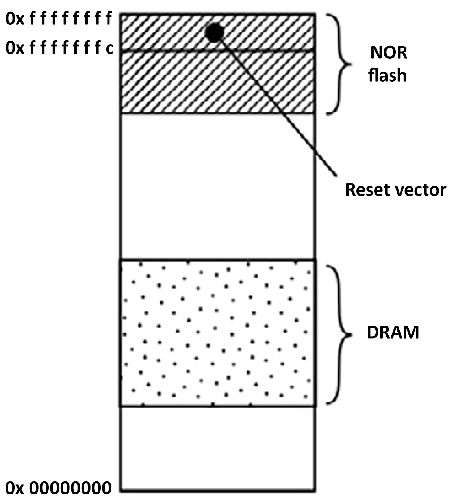
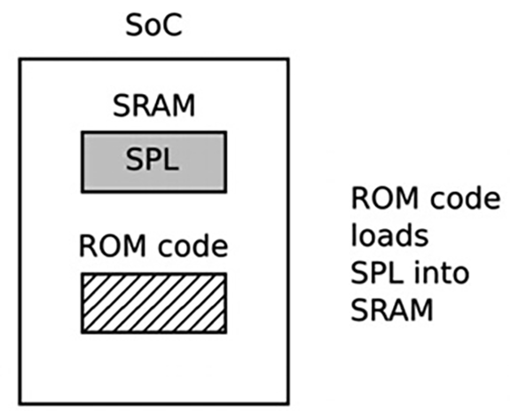
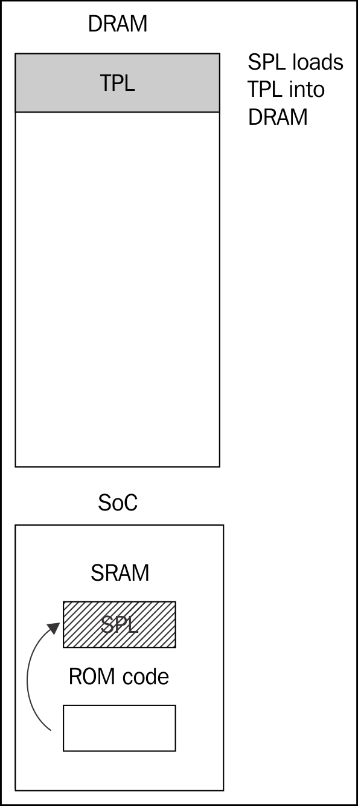
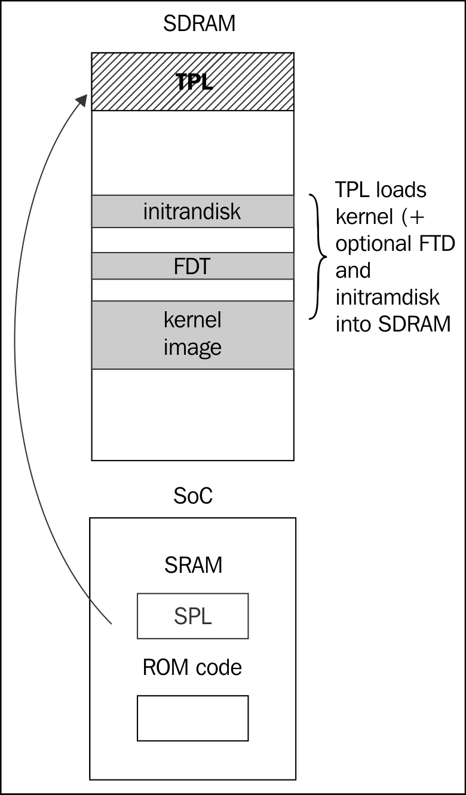

# Chương 3. Tất cả về bootloader

Bootloader là thành phần thứ hai của embedded Linux. Đây là phần khởi động hệ thống và nạp operating system kernel. Trong chương này, tôi sẽ tìm hiểu vai trò bootloader, đặc biệt cách nó chuyển quyền điều khiển cho kernel bằng data structure gọi là device tree, còn gọi flattened device tree hay FDT. Tôi trình bày cơ bản về device tree để bạn lần theo các kết nối được mô tả trong đó và liên hệ với hardware thực.

Tôi sẽ tìm hiểu open source bootloader phổ biến U-Boot, xem cách dùng để boot target device cũng như tùy biến cho thiết bị mới. Cuối cùng, tôi xem nhanh Barebox, bootloader có chung nguồn gốc với U-Boot nhưng có thể nói là thiết kế gọn gàng hơn.

## Bootloader làm gì?

Trong hệ thống embedded Linux, bootloader có hai việc chính: khởi tạo hệ thống cơ bản và nạp kernel. Thực tế, việc đầu phần nào phục vụ việc sau: chỉ cần đưa đủ thành phần hệ thống vào hoạt động để nạp được kernel.

Khi các dòng bootloader code đầu tiên thực thi sau power-on hoặc reset, hệ thống ở trạng thái rất tối thiểu. DRAM controller chưa được thiết lập nên không thể truy cập main memory; tương tự, các interface khác chưa được cấu hình nên storage truy cập qua NAND flash controller, MMC controller, v.v. cũng chưa dùng được. Thông thường, tài nguyên hoạt động ban đầu chỉ gồm một CPU core và một ít static memory on-chip. Vì vậy, system bootstrap gồm nhiều pha code, mỗi pha đưa thêm thành phần hệ thống vào hoạt động. Early boot kết thúc khi các interface cần để nạp kernel đã hoạt động. Chúng bao gồm main memory và peripheral truy cập kernel cùng image khác, qua mass storage hoặc network. Hành động cuối của bootloader là nạp kernel vào RAM và tạo execution environment cho nó. Chi tiết interface giữa bootloader và kernel là architecture-specific, nhưng trong mọi trường hợp đều truyền pointer tới thông tin hardware mà bootloader biết và truyền kernel command line, là ASCII string chứa thông tin thiết yếu cho Linux. Khi kernel bắt đầu thực thi, bootloader không còn cần thiết và toàn bộ memory nó dùng có thể được thu hồi.

Nhiệm vụ phụ của bootloader là cung cấp maintenance mode để cập nhật boot configuration, nạp boot image mới vào memory và có thể chạy diagnostic. Việc này thường được điều khiển qua command-line user interface đơn giản, phổ biến là trên serial interface.

## Boot sequence

Vài năm trước, khi mọi thứ đơn giản hơn, chỉ cần đặt bootloader trong memory non-volatile tại reset vector của processor. NOR flash memory phổ biến lúc đó; vì map trực tiếp vào address space được nên là phương thức lưu trữ lý tưởng. Sơ đồ sau cho cấu hình như vậy, với reset vector 0xfffffffc ở đầu cao của vùng flash memory. Bootloader được link để có jump instruction tại vị trí đó, trỏ tới đầu bootloader code:



Boot thời trước

Từ đó, nó có thể khởi tạo memory controller để main memory, tức DRAM, dùng được, rồi tự sao chép vào DRAM. Khi hoạt động đầy đủ, bootloader nạp kernel từ flash memory vào DRAM và chuyển quyền điều khiển cho kernel.

Tuy nhiên, khi rời khỏi phương tiện lưu trữ định địa chỉ tuyến tính đơn giản như NOR flash, boot sequence trở thành quy trình multi-stage phức tạp. Chi tiết rất riêng từng SoC nhưng nhìn chung tuân theo các pha sau.

### Pha 1: ROM code

Khi không có external memory đáng tin cậy, code chạy ngay sau reset hoặc power-on phải lưu on-chip trong SoC; đó là ROM code. Nó được lập trình vào chip khi sản xuất, vì vậy là code độc quyền, không thể thay bằng bản open source tương đương. ROM code có thể giả định rất ít về hardware ngoài chip vì mỗi thiết kế khác nhau. Điều này đúng ngay cả với DRAM chip dùng cho main system memory. Vì vậy, RAM duy nhất ROM code truy cập được là lượng nhỏ static RAM (SRAM) có trong phần lớn thiết kế SoC. SRAM có kích thước từ chỉ 4 KiB đến vài trăm KiB:



Bootloader pha 1

ROM code có thể nạp đoạn code nhỏ từ một trong nhiều vị trí định sẵn vào SRAM. Ví dụ, chip TI OMAP và Sitara thử nạp code từ vài page đầu NAND flash memory, hoặc flash memory nối qua SPI (Serial Peripheral Interface), hoặc các sector đầu của thiết bị MMC (có thể là chip eMMC hay SD card), hoặc file tên `MLO` trên partition đầu của thiết bị MMC. Nếu đọc mọi thiết bị memory đó đều thất bại, nó thử đọc byte stream từ Ethernet, USB hoặc UART; cách sau chủ yếu để nạp code vào flash memory khi sản xuất thay vì trong hoạt động thông thường. Phần lớn embedded SoC có ROM code hoạt động tương tự. Với SoC có SRAM không đủ chứa bootloader hoàn chỉnh như U-Boot, cần intermediate loader gọi là secondary program loader, hay SPL. Cuối pha này, next stage bootloader đã nằm trong memory on-chip và ROM code nhảy tới đầu đoạn code đó.

### Pha 2: SPL

SPL phải thiết lập memory controller và các phần thiết yếu khác để chuẩn bị nạp third stage program loader (TPL) vào main memory, tức DRAM. Chức năng SPL bị giới hạn bởi kích thước. Giống ROM code, nó đọc chương trình từ danh sách storage device, cũng bằng offset định sẵn tính từ đầu flash device, hoặc filename quen thuộc như `u-boot.bin`. SPL thường không cho người dùng tương tác, nhưng có thể in thông tin phiên bản và tiến trình trên console. Sơ đồ sau giải thích kiến trúc pha 2:



Boot giai đoạn hai

SPL có thể là open source như TI x-loader và Atmel AT91Bootstrap, nhưng cũng khá phổ biến là nó chứa code độc quyền do nhà sản xuất cung cấp dạng binary blob.

Cuối pha thứ hai, third stage loader đã nằm trong DRAM, và SPL có thể nhảy tới vùng đó.

### Pha 3: TPL

Cuối cùng, giờ chúng ta chạy bootloader đầy đủ như U-Boot hoặc Barebox. Thường có command-line user interface đơn giản cho các nhiệm vụ bảo trì, như nạp boot image và kernel image mới vào flash storage, nạp và boot kernel, cùng cách nạp kernel tự động không cần người dùng can thiệp. Sơ đồ sau giải thích kiến trúc pha 3:



Boot giai đoạn ba

Cuối pha thứ ba, kernel nằm trong memory chờ khởi chạy. Embedded bootloader thường biến mất khỏi memory khi kernel chạy và không tham gia thêm vào hoạt động hệ thống.

## Boot với UEFI firmware

Phần lớn thiết kế embedded PC và một số thiết kế ARM có firmware dựa trên chuẩn Universal Extensible Firmware Interface (UEFI); xem website chính thức `http://www.uefi.org` để biết thêm. Boot sequence về cơ bản giống mô tả phần trước:

Pha 1: Processor nạp UEFI boot manager firmware từ flash memory. Một số thiết kế nạp trực tiếp từ NOR flash memory; số khác có ROM code on-chip nạp boot manager từ SPI flash memory. Boot manager gần tương đương SPL, nhưng có thể cho người dùng tương tác qua giao diện text-based hoặc đồ họa.

Pha 2: Boot manager nạp boot firmware từ EFI System Partition (ESP), hard disk hoặc SSD, hoặc từ network server qua PXE boot. Nếu nạp từ local disk drive, EXP được nhận diện bằng giá trị GUID well-known C12A7328-F81F-11D2-BA4B-00A0C93EC93B. Partition nên được format FAT32. Third stage bootloader nên nằm trong file tên `<efi_system_partition>/boot/boot<machine_type_short_name>.efi`.

Ví dụ, file path tới loader trên hệ thống x86\_64 là: `/efi/boot/bootx64.efi`

Pha 3: TPL ở đây phải là bootloader nạp được Linux kernel và RAM disk tùy chọn vào memory. Các lựa chọn phổ biến gồm:

- GRUB 2: Đây là GNU Grand Unified Bootloader, phiên bản 2, Linux loader phổ biến nhất trên nền tảng PC. Tuy nhiên, có tranh luận vì giấy phép GPL v3 có thể khiến nó không tương thích secure booting, do giấy phép yêu cầu cung cấp boot key cùng code. Website là `https://www.gnu.org/software/grub/`.

- gummiboot: Bootloader UEFI-compatible đơn giản, sau đó được tích hợp vào systemd, cấp phép theo LGPL v2.1. Website là `https://wiki.archlinux.org/index.php/Systemd-boot`.

## Chuyển từ bootloader sang kernel

Khi bootloader chuyển quyền điều khiển cho kernel, nó phải truyền thông tin cơ bản, có thể gồm một số mục sau:

- Trên kiến trúc PowerPC và ARM: Một số duy nhất cho loại SoC

- Chi tiết hardware cơ bản đã phát hiện, ít nhất gồm kích thước, vị trí physical RAM và CPU clock speed

- Kernel command line

- Tùy chọn, vị trí và kích thước device tree binary

- Tùy chọn, vị trí và kích thước initial RAM disk

Kernel command line là plain ASCII string điều khiển hành vi Linux, ví dụ đặt thiết bị chứa root filesystem. Tôi sẽ xét chi tiết trong chương tiếp. Cung cấp root filesystem dạng RAM disk rất phổ biến; khi đó bootloader chịu trách nhiệm nạp RAM disk image vào memory. Tôi sẽ trình bày cách tạo initial RAM disk trong Chương 5, Xây dựng root filesystem.

Cách truyền thông tin phụ thuộc kiến trúc và đã thay đổi trong những năm gần đây. Ví dụ, với PowerPC, bootloader trước đây chỉ truyền pointer tới board information structure; với ARM, nó truyền pointer tới danh sách "A tags". Source kernel có mô tả tốt về định dạng trong `Documentation/arm/Booting`.

Trong cả hai trường hợp, lượng thông tin truyền rất hạn chế, phần lớn phải được phát hiện tại runtime hoặc hard-coded vào kernel dưới dạng "platform data". Việc dùng rộng rãi platform data khiến mỗi thiết bị cần kernel cấu hình và sửa riêng cho platform đó. Cần cách tốt hơn, và đó là device tree. Trong thế giới ARM, quá trình rời A tags bắt đầu mạnh vào tháng 2 năm 2013 với Linux 3.8, nhưng vẫn còn khá nhiều thiết bị đã triển khai, thậm chí đang phát triển, dùng A tags.

## Giới thiệu device tree

Gần như chắc chắn bạn sẽ gặp device tree vào lúc nào đó. Phần này nhằm tổng quan nhanh chúng là gì và hoạt động thế nào, nhưng còn nhiều chi tiết không được bàn.

Device tree là cách linh hoạt để định nghĩa hardware component của computer system. Thường bootloader nạp device tree rồi truyền cho kernel, dù có thể gộp device tree vào chính kernel image để phục vụ bootloader không xử lý riêng được.

Định dạng bắt nguồn từ bootloader của Sun Microsystems tên OpenBoot, được chính thức hóa thành đặc tả Open Firmware, chuẩn IEEE IEEE1275-1994. Nó được dùng trên máy Macintosh PowerPC-based, nên là lựa chọn hợp lý cho bản port PowerPC Linux. Sau đó, nó được nhiều triển khai ARM Linux áp dụng rộng rãi, và ở mức thấp hơn là MIPS, MicroBlaze, ARC cùng kiến trúc khác.

Tôi khuyên truy cập `http://devicetree.org` để biết thêm.

### Device tree cơ bản

Linux kernel chứa nhiều file device tree source trong `arch/$ARCH/boot/dts`, điểm bắt đầu tốt để học device tree. Source code U-boot cũng có số lượng ít hơn trong `arch/$ARCH/dts`. Nếu mua hardware từ bên thứ ba, file `dts` thuộc board support package, và bạn nên nhận được nó cùng các source file khác.

Device tree biểu diễn computer system thành tập component nối với nhau trong hệ thống phân cấp như cây. Nó bắt đầu với root node, ký hiệu dấu gạch chéo `/`, chứa node tiếp theo biểu diễn hardware hệ thống. Mỗi node có tên và một số property dạng `name = "value"`. Đây là ví dụ đơn giản:

```
/dts-v1/;
/{
  model = "TI AM335x BeagleBone";
  compatible = "ti,am33xx";
  #address-cells = <1>;
  #size-cells = <1>;
  cpus {
    #address-cells = <1>;
    #size-cells = <0>;
    cpu@0 {
      compatible = "arm,cortex-a8";
      device_type = "cpu";
      reg = <0>;
    };
  };
  memory@0x80000000 {
    device_type = "memory";
    reg = <0x80000000 0x20000000>; /* 512 MB */
  };
};
```

Ở đây có root node chứa node `cpus` và memory node. Node `cpus` chứa một CPU node tên `cpu@0`. Quy ước phổ biến là tên node có `@` theo sau bởi địa chỉ phân biệt với node khác. Cả root và CPU node có compatible property. Linux kernel dùng tên này để đối chiếu với chuỗi device driver xuất trong `struct of_device_id` (thêm chi tiết trong Chương 8, Giới thiệu device driver). Theo quy ước, giá trị gồm tên nhà sản xuất và tên component để giảm nhầm giữa thiết bị giống nhau của các nhà sản xuất khác, nên có `ti,am33xx` và `arm,cortex-a8`. Cũng khá phổ biến là có nhiều giá trị `compatible` khi nhiều driver xử lý được thiết bị. Chúng được liệt kê với lựa chọn phù hợp nhất trước.

CPU node và memory node có property `device_type` mô tả class thiết bị. Tên node thường bắt nguồn từ `device_type`.

### Property reg

Memory và CPU node có property `reg`, tham chiếu dải đơn vị trong register space. Property `reg` gồm hai giá trị biểu diễn start address và size (length) của dải. Cả hai viết bằng zero hoặc nhiều số nguyên 32-bit, gọi là cell. Vì vậy, memory node tham chiếu một memory bank bắt đầu 0x80000000 và dài 0x20000000 byte.

Hiểu property `reg` phức tạp hơn khi address hoặc size không biểu diễn được trong 32 bit. Ví dụ, thiết bị định địa chỉ 64-bit cần hai cell cho mỗi giá trị:

```
/ {
  #address-cells = <2>;
  #size-cells = <2>;
  memory@80000000 {
    device_type = "memory";
    reg = <0x00000000 0x80000000 0 0x80000000>;
  };
}
```

Thông tin số cell cần có nằm trong khai báo `#address-cells` và `#size_cells` ở ancestor node. Nói cách khác, để hiểu property `reg`, phải lần ngược hệ thống phân cấp node đến khi thấy `#address-cells` và `#size_cells`. Nếu không có, mặc định mỗi giá trị là `1` – nhưng người viết device tree dựa vào fall-backs là thực hành không tốt.

Giờ quay lại node cpu và cpus. CPU cũng có địa chỉ: trên thiết bị quad core, chúng có thể là 0, 1, 2 và 3. Có thể xem như mảng one-dimensional không có chiều sâu, nên size bằng zero. Vì vậy, bạn thấy `#address-cells = <1>` và `#size-cells = <0>` trong node cpus; ở child node `cpu@0`, chúng ta gán một giá trị cho property `reg`: node `reg = <0>`.

### Phandle và interrupt

Cấu trúc device tree mô tả đến đây giả định một hệ thống phân cấp component, nhưng thực tế có nhiều hệ thống. Ngoài data connection hiển nhiên giữa component với phần khác, nó còn có thể nối với interrupt controller, clock source và voltage regulator. Để biểu diễn các kết nối này, chúng ta có phandle.

Hãy lấy ví dụ về một hệ thống có serial port có thể phát sinh interrupt, cùng interrupt controller:

```
/dts-v1/;
{
  intc: interrupt-controller@48200000 {
    compatible = "ti,am33xx-intc";
    interrupt-controller;
    #interrupt-cells = <1>;
    reg = <0x48200000 0x1000>;
  };
  serial@44e09000 {
    compatible = "ti,omap3-uart";
    ti,hwmods = "uart1";
    clock-frequency = <48000000>;
    reg = <0x44e09000 0x2000>;
    interrupt-parent = <&intc>;
    interrupts = <72>;
  };
};
```

Có node interrupt-controller với property đặc biệt `#interrupt-cells`, cho biết cần bao nhiêu giá trị 4-byte để biểu diễn interrupt line. Ở đây chỉ một giá trị cho IRQ number, nhưng khá phổ biến là dùng thêm giá trị mô tả interrupt, ví dụ `1 = low-to-high edge triggered`, `2 = high-to-low edge triggered`, v.v.

Nhìn serial node, property `interrupt-parent` tham chiếu interrupt-controller mà nó kết nối bằng label của controller. Đó là phandle. IRQ line thực tế do property `interrupts` cung cấp, ở đây là `72`.

Node `serial` có property chưa gặp: `clock-frequency` và `ti,hwmods`. Chúng thuộc binding cho loại thiết bị cụ thể này; nghĩa là kernel device driver đọc property để quản lý thiết bị. Tìm binding trong source Linux kernel, thư mục `Documentation/devicetree/bindings/`.

### Device tree include file

Nhiều hardware dùng chung giữa SoC cùng họ và board cùng SoC. Device tree phản ánh điều đó bằng tách phần chung thành file `include`, thường có extension `.dtsi`. Chuẩn Open Firmware định nghĩa `/include/` là cơ chế cần dùng, như đoạn từ `vexpress-v2p-ca9.dts`:

```
/include/ "vexpress-v2m.dtsi"
```

Tuy nhiên, xem các file `.dts` trong kernel, bạn thấy câu lệnh `include` khác mượn từ C, ví dụ trong `am335x-boneblack.dts`:

```
#include "am33xx.dtsi"
#include "am335x-bone-common.dtsi"
```

Đây là ví dụ khác từ `am33xx.dtsi`:

```
#include <dt-bindings/gpio/gpio.h>
#include <dt-bindings/pinctrl/am33xx.h>
```

Cuối cùng, `include/dt-bindings/pinctrl/am33xx.h` chứa C macro thông thường:

```
#define PULL_DISABLE (1 << 3)
#define INPUT_EN (1 << 5)
#define SLEWCTRL_SLOW (1 << 6)
#define SLEWCTRL_FAST 0
```

Tất cả được giải quyết nếu device tree source được build bằng kernel kbuild: trước tiên chạy qua C pre-processor `cpp`, nơi câu lệnh `#include` và `#define` được xử lý thành plain text phù hợp với device tree compiler. Động cơ thể hiện ở ví dụ trước: device tree source dùng được cùng constant definition như kernel code.

Khi include file theo cách này, các node được chồng lên nhau để tạo cây tổng hợp, trong đó layer ngoài mở rộng hoặc sửa layer trong. Ví dụ, `am33xx.dtsi,` dùng chung mọi SoC am33xx, định nghĩa MMC controller interface đầu như sau:

```
mmc1: mmc@48060000 {
  compatible = "ti,omap4-hsmmc";
  ti,hwmods = "mmc1";
  ti,dual-volt;
  ti,needs-special-reset;
  ti,needs-special-hs-handling;
  dmas = <&edma 24  &edma 25>;
  dma-names = "tx", "rx";
  interrupts = <64>;
  interrupt-parent = <&intc>;
  reg = <0x48060000 0x1000>;
  status = "disabled";
};
```

Lưu ý status là `disabled`, nghĩa là không device driver nào được bind vào, và node có label `mmc1`.

Trong `am335x-bone-common.dtsi`, được include cho cả BeagleBone và BeagleBone Black, cùng node được tham chiếu bằng phandle:

```
&mmc1 {
  status = "okay";
  bus-width = <0x4>;
  pinctrl-names = "default";
  pinctrl-0 = <&mmc1_pins>;
  cd-gpios = <&gpio0 6 GPIO_ACTIVE_HIGH>;
  cd-inverted;
};
```

Ở đây, `mmc1` được bật (`status="okay"`) vì cả hai biến thể đều có thiết bị MMC1 vật lý, và `pinctrl` được thiết lập. Sau đó, trong `am335x-boneblack.dts,` bạn thấy tham chiếu khác tới `mmc1`, liên kết với voltage regulator:

```
&mmc1 {
  vmmc-supply = <&vmmcsd_fixed>;
};
```

Vì vậy, xếp source file thành layer như vậy đem lại tính linh hoạt và giảm nhu cầu code trùng lặp.

### Compile device tree

Bootloader và kernel cần biểu diễn binary của device tree, nên phải biên dịch bằng device tree compiler `dtc`. Kết quả là file kết thúc `.dtb`, gọi là device tree binary hoặc device tree blob.

Có bản `dtc` trong source Linux tại `scripts/dtc/dtc`, và có package trong nhiều Linux distribution. Có thể dùng để biên dịch device tree đơn giản (không dùng `#include`) như sau:

```
$ dtc simpledts-1.dts -o simpledts-1.dtb
DTC: dts->dts on file "simpledts-1.dts"
```

Hãy lưu ý rằng `dtc` không cung cấp thông báo lỗi hữu ích và không kiểm tra gì ngoài cú pháp cơ bản của ngôn ngữ. Điều này có nghĩa là debug một lỗi gõ trong source file có thể mất nhiều thời gian.

Để build những ví dụ phức tạp hơn, bạn phải dùng `kbuild` của kernel, như trình bày trong chương tiếp theo.

## Chọn bootloader

Bootloader có đủ hình thức và kích thước. Các đặc điểm mong muốn là đơn giản, tùy biến được, có nhiều cấu hình mẫu cho development board và thiết bị phổ biến. Bảng sau liệt kê một số bootloader được dùng rộng rãi:

| Tên | Architecture |
|---|---|
| Das U-Boot | ARM, Blackfin, MIPS, PowerPC, SH |
| Barebox | ARM, Blackfin, MIPS, PowerPC |
| GRUB 2 | X86, X86\_64 |
| RedBoot | ARM, MIPS, PowerPC, SH |
| CFE | Broadcom MIPS |
| YAMON | MIPS |

Chúng ta sẽ tập trung vào U-Boot vì nó hỗ trợ khá nhiều processor architecture cùng một số lượng lớn board và device cụ thể. Nó đã tồn tại từ lâu và có một cộng đồng hỗ trợ tốt.

Có thể bạn đã nhận được bootloader đi kèm SoC hoặc board. Như thường lệ, hãy xem xét kỹ những gì mình có và đặt câu hỏi: có thể lấy source code ở đâu, chính sách cập nhật là gì, họ sẽ hỗ trợ ra sao nếu bạn muốn sửa đổi, v.v. Bạn có thể cân nhắc bỏ loader vendor-supplied và thay bằng phiên bản hiện tại của một bootloader open source.

## U-Boot

U-Boot, tên đầy đủ Das U-Boot, ra đời như open source bootloader cho embedded board PowerPC. Sau đó được port sang board ARM-based rồi kiến trúc khác gồm MIPS, SH, x86. Denx Software Engineering lưu trữ và bảo trì dự án. Có nhiều thông tin; điểm bắt đầu tốt là `www.denx.de/wiki/U-Boot`. Còn có mailing list `u-boot@lists.denx.de`.

### Build U-Boot

Bắt đầu lấy source code. Như phần lớn dự án, cách khuyến nghị là clone git archive và checkout tag định dùng; ở đây là phiên bản hiện hành tại thời điểm viết sách:

```
$ git clone git://git.denx.de/u-boot.git
$ cd u-boot
$ git checkout v2015.07
```

Hoặc lấy tarball từ `ftp://ftp.denx.de/pub/u-boot/`.

Có hơn 1.000 file cấu hình cho development board và thiết bị phổ biến trong thư mục `configs/`. Phần lớn trường hợp có thể đoán khá đúng file cần dùng theo tên, nhưng lấy chi tiết hơn bằng xem file `README` per-board trong `board/`, hoặc tìm tutorial, forum phù hợp trên web. Tuy nhiên, cách cấu hình U-Boot đã thay đổi nhiều từ bản 2014.10. Hãy Double-check rằng hướng dẫn đang theo phù hợp.

Lấy BeagleBone Black làm ví dụ, có file cấu hình phù hợp tên `am335x_boneblack_defconfig` trong `configs/`, và dòng The binary produced by this board supports … Beaglebone Black trong file board `README` cho chip am335x, `board/ti/am335x/README`. Với thông tin đó, build U-Boot cho BeagleBone Black rất đơn giản. Cần cho U-Boot biết prefix cross compiler bằng đặt variable `make` là `CROSS_COMPILE`, rồi chọn file cấu hình bằng lệnh dạng `make [board]_defconfig`, như sau:

```
$ make CROSS_COMPILE=arm-cortex_a8-linux-gnueabihf-
am335x_boneblack_defconfig
$ make CROSS_COMPILE=arm-cortex_a8-linux-gnueabihf-
```

Kết quả biên dịch gồm:

- `u-boot`: U-Boot dạng ELF object, phù hợp dùng với debugger

- `u-boot.map`: Symbol table

- `u-boot.bin`: U-Boot dạng raw binary, phù hợp chạy trên thiết bị

- `u-boot.img`: `u-boot.bin` được thêm U-Boot header, phù hợp upload tới bản U-Boot đang chạy

- `u-boot.srec`: Đây là U-Boot ở định dạng Motorola `srec`, phù hợp để truyền qua serial connection

BeagleBone Black còn cần Secondary Program Loader (SPL), như mô tả trước. Nó được build cùng lúc, tên `MLO`:

```
$ ls -l MLO u-boot*
-rw-rw-r-- 1 chris chris 76100 Dec 20 11:22 MLO
-rwxrwxr-x 1 chris chris 2548778 Dec 20 11:22 u-boot
-rw-rw-r-- 1 chris chris 449104 Dec 20 11:22 u-boot.bin
-rw-rw-r-- 1 chris chris 449168 Dec 20 11:22 u-boot.img
-rw-rw-r-- 1 chris chris 434276 Dec 20 11:22 u-boot.map
-rw-rw-r-- 1 chris chris 1347442 Dec 20 11:22 u-boot.srec
```

Quy trình tương tự cho target khác.

### Cài U-Boot

Cài bootloader lên board lần đầu đòi hỏi một số hỗ trợ từ bên ngoài. Nếu board có hardware debug interface, chẳng hạn JTAG, thường có thể load một bản sao U-Boot trực tiếp vào RAM và cho nó chạy. Từ đó, bạn có thể dùng các lệnh U-Boot để copy nó vào flash memory. Chi tiết thực hiện rất board-specific và nằm ngoài phạm vi cuốn sách này.

Một số thiết kế SoC có boot ROM tích hợp dùng để đọc boot code từ nguồn ngoài như SD card, serial interface hay USB; chip AM335x của BeagleBone Black là trường hợp như vậy. Đây là cách nạp U-Boot qua micro-SD card.

Trước tiên, format micro-SD card để partition đầu có định dạng FAT32, đánh dấu bootable. Nếu có khe SD trực tiếp, card xuất hiện là `/dev/mmcblk0`; nếu dùng memory card reader, nó là `/dev/sdb`, `/dev/sdc`, v.v. Giờ nhập lệnh sau để chia partition micro-SD, giả sử card là `/dev/mmcblk0`:

```
$ sudo sfdisk -D -H 255 -S 63 /dev/mmcblk0 << EOF
,9,0x0C,*
,,,-
EOF
```

Format partition đầu thành `FAT16`:

```
$ sudo mkfs.vfat -F 16 -n boot /dev/mmcblk0p1
```

Bây giờ, hãy mount partition vừa format: trên một số hệ thống, chỉ cần tháo micro-SD card rồi cắm lại; trên hệ thống khác, bạn có thể phải nhấn một biểu tượng. Trên các phiên bản Ubuntu hiện tại, nó sẽ được mount tại `/media/[user]/boot`, nên tôi sẽ copy U-Boot và SPL vào đó như sau:

```
cp MLO u-boot.img /media/chris/boot
```

Cuối cùng, unmount card.

Khi board BeagleBone chưa có điện, cắm micro-SD card.

Cắm serial cable. Serial port nên xuất hiện trên PC là `/dev/ttyUSB0` hoặc tương tự.

Khởi chạy terminal program phù hợp như `gtkterm`, `minicom`, `picocom`, kết nối port ở 115.200 bps không flow control:

```
$ gtkterm -p /dev/ttyUSB0 -s 115200
```

Nhấn giữ nút Boot Switch trên Beaglebone, cấp điện board bằng đầu nối 5V ngoài, thả nút sau khoảng 5 giây. Bạn sẽ thấy U-Boot prompt trên serial console:

```
U-Boot#
```

### Dùng U-Boot

Trong phần này, tôi mô tả một số nhiệm vụ phổ biến có thể thực hiện bằng U-Boot.

Thường U-Boot cung cấp command-line interface qua serial port. Command prompt được tùy biến cho từng board. Trong ví dụ, tôi dùng `U-Boot#`. Gõ `help` in mọi lệnh đã cấu hình trong phiên bản U-Boot này; gõ `help <command>` in thêm thông tin về lệnh cụ thể.

Command interpreter mặc định khá đơn giản. Nó không hỗ trợ chỉnh sửa command-line bằng các phím con trỏ trái hoặc phải, không hỗ trợ hoàn thành lệnh bằng phím Tab, và không có command history qua phím con trỏ lên. Nhấn bất kỳ phím nào trong số này sẽ làm hỏng lệnh bạn đang nhập, và bạn phải nhấn `Ctrl`+`C` rồi nhập lại từ đầu. Phím chỉnh sửa dòng duy nhất bạn có thể dùng an toàn là back space. Bạn có thể chọn cấu hình một command shell khác có tên Hush, cung cấp hỗ trợ tương tác tinh vi hơn. Định dạng số mặc định là hexadecimal. Ví dụ, như trong lệnh sau:

```
nand read 82000000 400000 200000
```

Lệnh này đọc 0x200000 byte từ offset 0x400000 tính từ đầu NAND flash memory vào địa chỉ RAM 0x82000000.

#### Environment variable

U-Boot dùng environment variable rộng rãi để lưu và truyền thông tin giữa hàm, thậm chí tạo script. Environment variable là cặp `name=value` đơn giản lưu trong vùng memory. Tập variable ban đầu có thể được viết trong board configuration header file như sau:

```
#define CONFIG_EXTRA_ENV_SETTINGS \
"myvar1=value1\0" \
"myvar2=value2\0"
```

Có thể tạo, sửa variable từ command line U-Boot bằng `setenv`. Ví dụ `setenv foo bar` tạo variable `foo` giá trị `bar`. Lưu ý không có dấu `=` giữa tên và giá trị. Xóa variable bằng đặt chuỗi null, `setenv foo`. In mọi variable ra console bằng `printenv`, hoặc một variable bằng `printenv foo`.

Thường có thể dùng lệnh `saveenv` lưu toàn environment xuống một dạng permanent storage. Nếu có raw NAND hoặc NOR flash, một erase block được dành cho việc này, thường thêm block nữa cho bản dự phòng chống corruption. Nếu có storage eMMC hoặc SD card, có thể lưu thành file trong disk partition. Lựa chọn khác gồm serial EEPROM nối qua I2C, SPI interface hoặc RAM non-volatile.

#### Định dạng boot image

U-Boot không có filesystem. Thay vào đó, nó gắn header 64-byte cho các block thông tin để theo dõi nội dung. Chuẩn bị file cho U-Boot bằng lệnh `mkimage`. Đây là tóm tắt ngắn cách dùng:

```
$ mkimage
Usage: mkimage -l image
-l ==> list image header information
mkimage [-x] -A arch -O os -T type -C comp -a addr -e ep -n name -d
data_file[:data_file...] image
-A ==> set architecture to 'arch'
-O ==> set operating system to 'os'
-T ==> set image type to 'type'
-C ==> set compression type 'comp'
-a ==> set load address to 'addr' (hex)
-e ==> set entry point to 'ep' (hex)
-n ==> set image name to 'name'
-d ==> use image data from 'datafile'
-x ==> set XIP (execute in place)
mkimage [-D dtc_options] -f fit-image.its fit-image
mkimage -V ==> print version information and exit
```

Ví dụ, để chuẩn bị kernel image cho processor ARM, lệnh là:

```
$ mkimage -A arm -O linux -T kernel -C gzip -a 0x80008000 \
-e 0x80008000 -n 'Linux' -d zImage uImage
```

#### Nạp image

Thường nạp image từ removable storage như SD card hoặc network. SD card được driver `mmc` xử lý trong U-Boot. Chuỗi lệnh điển hình nạp image vào memory như sau:

```
U-Boot# mmc rescan
U-Boot# fatload mmc 0:1 82000000 uimage
reading uimage
4605000 bytes read in 254 ms (17.3 MiB/s)
U-Boot# iminfo 82000000

## Checking Image at 82000000 ...
Legacy image found
Image Name: Linux-3.18.0
Created: 2014-12-23 21:08:07 UTC
Image Type: ARM Linux Kernel Image (uncompressed)
Data Size: 4604936 Bytes = 4.4 MiB
Load Address: 80008000
Entry Point: 80008000
Verifying Checksum ... OK
```

Lệnh `mmc rescan` re-initializes driver `mmc`, có thể để phát hiện một SD card vừa được cắm vào. Tiếp theo, `fatload` được dùng để đọc một file từ partition FAT-formatted trên SD card. Định dạng như sau:

`fatload <interface> [<dev[:part]> [<addr> [<filename> [bytes [pos]]]]]`

Nếu `<interface>` là `mmc` như ở đây, `<dev:part>` là device number của interface `mmc` tính từ zero, và partition number tính từ một. Vì vậy `<0:1>` là partition đầu trên thiết bị đầu. Memory location `0x82000000` được chọn trong vùng RAM chưa dùng lúc đó. Nếu định boot kernel, phải bảo đảm vùng RAM không bị ghi đè khi kernel image được giải nén và đặt ở runtime location `0x80008000`.

Để load image file qua mạng, bạn dùng Trivial File Transfer Protocol (TFTP). Điều này yêu cầu cài TFTP daemon, tftpd, trên development system và khởi chạy nó. Bạn cũng phải cấu hình mọi firewall giữa PC và target board để cho phép TFTP protocol qua UDP port 69. Cấu hình mặc định của tftpd chỉ cho phép truy cập directory `/var/lib/tftpboot`. Bước tiếp theo là copy các file muốn truyền đến target vào directory đó. Sau đó, giả sử bạn dùng một cặp static IP address để không cần quản trị mạng thêm, chuỗi lệnh load một tập hợp kernel image file sẽ có dạng như sau:

```
U-Boot# setenv ipaddr 192.168.159.42
U-Boot# setenv serverip 192.168.159.99
U-Boot# tftp 82000000 uImage
link up on port 0, speed 100, full duplex
Using cpsw device
TFTP from server 192.168.159.99; our IP address is 192.168.159.42
Filename 'uImage'.
Load address: 0x82000000
Loading:
#################################################################
#################################################################
#################################################################
######################################################
3 MiB/s
done
Bytes transferred = 4605000 (464448 hex)
```

Cuối cùng, hãy xem cách program image vào NAND flash memory và đọc lại bằng lệnh `nand`. Ví dụ này nạp kernel image qua TFTP rồi program vào flash:

```
U-Boot# fatload mmc 0:1 82000000 uimage
reading uimage
4605000 bytes read in 254 ms (17.3 MiB/s)

U-Boot# nandecc hw
U-Boot# nand erase 280000 400000

NAND erase: device 0 offset 0x280000, size 0x400000
Erasing at 0x660000 -- 100% complete.
OK
U-Boot# nand write 82000000 280000 400000

NAND write: device 0 offset 0x280000, size 0x400000
4194304 bytes written: OK
```

Giờ có thể nạp kernel từ flash memory bằng `nand read`:

```
U-Boot# nand read 82000000 280000 400000
```

### Boot Linux

Lệnh `bootm` khởi chạy kernel image. Cú pháp là:

`bootm [address of kernel] [address of ramdisk] [address of dtb]`.

Địa chỉ kernel image bắt buộc, nhưng có thể bỏ địa chỉ ramdisk và dtb nếu cấu hình kernel không cần. Nếu có dtb nhưng không ramdisk, có thể thay địa chỉ thứ hai bằng dấu gạch ngang (`-`). Khi đó như sau:

```
U-Boot# bootm 82000000 - 83000000
```

#### Tự động boot bằng U-Boot script

Rõ ràng không thể chấp nhận nhập chuỗi lệnh dài để boot board mỗi lần bật điện. Để tự động hóa, U-Boot lưu chuỗi lệnh trong environment variable. Nếu variable đặc biệt tên `bootcmd` chứa script, nó được chạy lúc power-up sau độ trễ `bootdelay` giây. Nếu quan sát serial console, bạn thấy đếm ngược đến zero. Trong khoảng đó có thể nhấn phím bất kỳ dừng đếm và vào interactive session với U-Boot.

Cách tạo script đơn giản, dù không dễ đọc. Chỉ cần nối các lệnh phân cách bằng dấu chấm phẩy, mỗi dấu phải có backslash escape character ở trước. Ví dụ, để nạp kernel image từ offset trong flash memory rồi boot, có thể dùng lệnh:

```
setenv bootcmd nand read 82000000 400000 200000\;bootm 82000000
```

### Port U-Boot sang board mới

Giả sử bộ phận hardware của bạn đã tạo một board mới có tên “Nova” dựa trên BeagleBone Black, và bạn cần port U-Boot sang board đó. Bạn cần hiểu cách bố trí code U-Boot và cách cơ chế board configuration hoạt động. Trong release 2014.10, U-Boot áp dụng cùng cơ chế cấu hình với Linux kernel, `Kconfig`. Trong vài release tiếp theo, các thiết lập cấu hình hiện có sẽ được chuyển từ vị trí hiện tại trong các header file thuộc `include/configs` sang các file `Kconfig`. Tính đến release 2014.10, mỗi board có một file `Kconfig` chứa thông tin tối thiểu lấy từ file `boards.cfg` cũ.

Các thư mục chính bạn sẽ làm việc gồm:

- `arch`: Chứa code riêng từng kiến trúc được hỗ trợ trong thư mục arm, mips, powerpc, v.v. Trong mỗi kiến trúc có thư mục con cho từng thành viên, ví dụ `arch/arm/cpu` có thư mục cho biến thể kiến trúc gồm amt926ejs, armv7, armv8.

- `board`: Chứa code dành riêng cho một board. Khi có nhiều board từ cùng một vendor, chúng có thể được gom vào một subdirectory; vì vậy, hỗ trợ cho board am335x evm, cơ sở của BeagelBone, nằm trong `board/ti/am335x`.

- `common`: Chứa core function gồm command shell và lệnh gọi từ đó, mỗi lệnh trong file tên `cmd_[command name].c`.

- `doc`: Chứa một số file `README` mô tả các khía cạnh U-Boot. Nếu thắc mắc tiếp tục port U-Boot thế nào, đây là điểm bắt đầu tốt.

- `include`: Ngoài nhiều shared header file, còn chứa thư mục con quan trọng `include/configs` có phần lớn board configuration setting. Khi quá trình chuyển sang `Kconfig` tiến triển, thông tin chuyển ra file `Kconfig`, nhưng tại thời điểm viết sách mới chỉ bắt đầu.

### Kconfig và U-Boot

Cách `Kconfig` trích thông tin cấu hình từ file `Kconfig`, lưu cấu hình toàn hệ thống vào file `.config`, được mô tả khá chi tiết trong Chương 4, Port và cấu hình kernel. U-Boot dùng kconfig và kbuild với một thay đổi. Bản build U-Boot tạo được tối đa ba binary: `normal u-boot.bin`, Secondary Program Loader (SPL), Tertiary Program Loader (TPL), mỗi loại có thể có tùy chọn cấu hình khác. Vì vậy, dòng trong `.config` và file cấu hình mặc định có thể thêm prefix như bảng sau để chỉ target áp dụng:

| Không | Chỉ normal image |
|---|---|
| `S:` | Chỉ SPL image |
| `T:` | Chỉ TPL image |
| `ST:` | SPL và TPL image |
| `+S:` | Normal và SPL image |
| `+T:` | Normal và TPL image |
| `+ST:` | Normal, SPL, TPL image |

Mỗi board có một cấu hình mặc định được lưu trong `configs/[board name}_defconfig`. Với Nova board, bạn cần tạo một file, chẳng hạn có tên `nova_defonfig.`, và thêm các dòng sau vào đó:

```
CONFIG_SPL=y
CONFIG_SYS_EXTRA_OPTIONS="SERIAL1,CONS_INDEX=1,EMMC_BOOT"
+S:CONFIG_ARM=y
+S:CONFIG_TARGET_NOVA=y
```

Ở dòng đầu, `CONFIG_SPL=y` làm binary SPL, MLO, được tạo; `CONFIG_ARM=y` khiến nội dung `arch/arm/Kconfig` được include ở dòng ba. Dòng bốn, `CONFIG_TARGET_NOVA=y` chọn board. Lưu ý dòng ba và bốn có prefix `+S:` để áp dụng cho cả SPL và normal binary. Cũng nên thêm menu option vào `Kconfig` kiến trúc ARM để người dùng chọn Nova làm target:

```
CONFIG_SPL=y
config TARGET_NOVA
bool "Support Nova!"
```

#### File Board-specific

Mỗi board có một subdirectory tên `board/[board name]` hoặc `board/[vendor]/[board name]`, cần chứa những thành phần sau:

- `Kconfig`: Chứa tùy chọn cấu hình board

- `MAINTAINERS`: Ghi board hiện được bảo trì không, và nếu có thì bởi ai

- `Makefile`: Dùng build code board-specific

- `README`: Chứa thông tin hữu ích về bản port U-Boot này, ví dụ các biến thể hardware được hỗ trợ

Ngoài ra, có thể có source file cho các hàm riêng board.

Board Nova dựa trên BeagleBone, bản thân BeagleBone dựa trên TI AM335x EVM, nên có thể bắt đầu bằng sao chép board file am335x:

```
$ mkdir board/nova
$ cp -a board/ti/am335x board/nova
```

Tiếp theo, sửa file `Kconfig` để phản ánh board Nova:

```
if TARGET_NOVA

config SYS_CPU
default "armv7"

config SYS_BOARD
default "nova"

config SYS_SOC
default "am33xx"

config SYS_CONFIG_NAME
default "nova"
endif
```

Đặt `SYS_CPU` thành `armv7` khiến code trong `arch/arm/cpu/armv7` được compile, link. Đặt `SYS_SOC` thành `am33xx` đưa code trong `arch/arm/cpu/armv7/am33xx` vào; đặt `SYS_BOARD` thành `nova` đưa `board/nova` vào; đặt `SYS_CONFIG_NAME` thành `nova` nghĩa là header file `include/configs/nova.h` dùng cho các tùy chọn cấu hình bổ sung.

Còn file khác trong `board/nova` cần đổi: linker script tại `board/nova/u-boot.lds`, có tham chiếu hard-coded tới `board/ti/am335x/built-in.o`. Đổi để dùng bản sao cục bộ trong `nova`:

```
diff --git a/board/nova/u-boot.lds b/board/nova/u-boot.lds
index 78f294a..6689b3d 100644
--- a/board/nova/u-boot.lds
+++ b/board/nova/u-boot.lds
@@ -36,7 +36,7 @@ SECTIONS
*(.__image_copy_start)
*(.vectors)
CPUDIR/start.o (.text*)
- board/ti/am335x/built-in.o (.text*)
+ board/nova/built-in.o (.text*)
*(.text*)
}
```

#### Configuration header file

Mỗi board có header file trong `include/configs` chứa phần lớn cấu hình. File được đặt tên theo định danh `SYS_CONFIG_NAME` trong `Kconfig` của board. Định dạng mô tả chi tiết trong file `README` cấp cao nhất của source tree U-Boot.

Với mục đích board Nova, chỉ cần sao chép `am335x_evm.h to nova.h` sang `nova.h` rồi thực hiện một số thay đổi nhỏ:

```
diff --git a/include/configs/nova.h b/include/configs/nova.h
index a3d8a25..8ea1410 100644
--- a/include/configs/nova.h
+++ b/include/configs/nova.h
@@ -1,5 +1,5 @@
/*
- * am335x_evm.h
+ * nova.h, based on am335x_evm.h
*
* Copyright (C) 2011 Texas Instruments Incorporated -
http://www.ti.com/
*
@@ -13,8 +13,8 @@
* GNU General Public License for more details.
*/
-#ifndef __CONFIG_AM335X_EVM_H
-#define __CONFIG_AM335X_EVM_H
+#ifndef __CONFIG_NOVA
+#define __CONFIG_NOVA
#include <configs/ti_am335x_common.h>
@@ -39,7 +39,7 @@
#define V_SCLK (V_OSCK)
/* Custom script for NOR */
-#define CONFIG_SYS_LDSCRIPT "board/ti/am335x/u-boot.lds"
+#define CONFIG_SYS_LDSCRIPT "board/nova/u-boot.lds"
/* Always 128 KiB env size */
#define CONFIG_ENV_SIZE (128 << 10)
@@ -50,6 +50,9 @@
#define CONFIG_PARTITION_UUIDS
#define CONFIG_CMD_PART
+#undef CONFIG_SYS_PROMPT
+#define CONFIG_SYS_PROMPT "nova!> "
+
#ifdef CONFIG_NAND
#define NANDARGS \
"mtdids=" MTDIDS_DEFAULT "\0" \
```

### Build và test

Để build cho board Nova, chọn cấu hình vừa tạo:

```
$ make CROSS_COMPILE=arm-cortex_a8-linux-gnueabi- nova_defconfig
$ make CROSS_COMPILE=arm-cortex_a8-linux-gnueabi-
```

Sao chép `MLO` và `u-boot.img` vào FAT partition của micro-SD card đã tạo trước, rồi boot board.

### Falcon mode

Chúng ta quen với ý tưởng boot embedded processor hiện đại gồm CPU boot ROM nạp SPL, SPL nạp `u-boot.bin`, rồi nó nạp Linux kernel. Có thể bạn tự hỏi có cách giảm số bước, đơn giản hóa và tăng tốc boot không. Câu trả lời là U-Boot "Falcon mode", đặt theo Peregrine falcon, được cho là loài chim nhanh nhất. Ý tưởng đơn giản: cho SPL nạp kernel image trực tiếp, bỏ qua `u-boot.bin`. Không có tương tác người dùng hay script. Nó chỉ nạp kernel từ vị trí đã biết trong flash hoặc eMMC vào memory, truyền parameter block pre-prepared và khởi chạy. Chi tiết cấu hình Falcon mode ngoài phạm vi sách. Muốn biết thêm, xem `doc/README.falcon`.

## Barebox

Tôi kết thúc chương bằng bootloader khác cùng nguồn gốc U-Boot nhưng tiếp cận bootloader theo cách mới. Nó bắt nguồn từ U-Boot và thực tế ban đầu gọi là U-Boot v2. Developer Barebox hướng tới kết hợp phần tốt nhất U-Boot và Linux, gồm API POSIX-like và filesystem có thể mount.

Website dự án Barebox là `www.barebox.org`, developer mailing list là `barebox@lists.infradead.org`.

### Lấy Barebox

Để lấy Barebox, clone git repository rồi checkout phiên bản muốn dùng:

```
$ git clone git://git.pengutronix.de/git/barebox.git
$ cd barebox
$ git checkout v2014.12.0
```

Bố cục code tương tự U-Boot:

- `arch`: Chứa code riêng từng kiến trúc hỗ trợ, gồm mọi kiến trúc embedded chính. Hỗ trợ SoC trong `arch/[architecture]/mach-[SoC]`. Hỗ trợ từng board trong `arch/[architecture]/boards`.

- `common`: Chứa core function, gồm shell.

- `commands`: Chứa lệnh có thể gọi từ shell.

- `Documentation`: Chứa template cho file tài liệu. Để build, gõ "`make docs`". Kết quả nằm trong `Documentation/html`.

- `drivers`: Chứa code device driver.

- `include`: Chứa header file.

### Build Barebox

Barebox đã dùng `kconfig/kbuild` từ lâu. Có file cấu hình mặc định trong `arch/[architecture]/configs`. Ví dụ, giả sử muốn build Barebox cho BeagleBoard C4. Cần hai cấu hình, một cho SPL và một cho main binary. Đầu tiên, build MLO:

```
$ make ARCH=arm CROSS_COMPILE=arm-cortex_a8-linux-gnueabi-
omap3530_beagle_xload_defconfig
$ make ARCH=arm CROSS_COMPILE=arm-cortex_a8-linux-gnueabi-
```

Kết quả là secondary program loader, MLO.

Tiếp theo, build Barebox:

```
$ make ARCH=arm CROSS_COMPILE=arm-cortex_a8-linux-gnueabi-
omap3530_beagle_defconfig
$ make ARCH=arm CROSS_COMPILE=arm-cortex_a8-linux-gnueabi-
```

Sao chép cả hai vào SD card:

```
$ cp MLO /media/boot/
$ cp barebox-flash-image /media/boot/barebox.bin
```

Sau đó boot board, bạn sẽ thấy thông báo như sau trên console:

```
barebox 2014.12.0 #1 Wed Dec 31 11:04:39 GMT 2014

Board: Texas Instruments beagle
nand: Trying ONFI probe in 16 bits mode, aborting !
nand: NAND device: Manufacturer ID: 0x2c, Chip ID: 0xba (Micron ),
256MiB, page
size: 2048, OOB size: 64
omap-hsmmc omap3-hsmmc0: registered as omap3-hsmmc0
mci0: detected SD card version 2.0
mci0: registered disk0
malloc space: 0x87bff400 -> 0x87fff3ff (size 4 MiB)
booting from MMC

barebox 2014.12.0 #2 Wed Dec 31 11:08:59 GMT 2014

Board: Texas Instruments beagle
netconsole: registered as netconsole-1
i2c-omap i2c-omap30: bus 0 rev3.3 at 100 kHz
ehci ehci0: USB EHCI 1.00
nand: Trying ONFI probe in 16 bits mode, aborting !
nand: NAND device: Manufacturer ID: 0x2c, Chip ID: 0xba (Micron NAND
256MiB 1,8V
16-bit), 256MiB, page size: 2048, OOB size: 64
omap-hsmmc omap3-hsmmc0: registered as omap3-hsmmc0
mci0: detected SD card version 2.0
mci0: registered disk0
malloc space: 0x85e00000 -> 0x87dfffff (size 32 MiB)
environment load /boot/barebox.env: No such file or directory
Maybe you have to create the partition.
no valid environment found on /boot/barebox.env. Using default
environment
running /env/bin/init...

Hit any key to stop autoboot: 0
```

Barebox tiếp tục phát triển. Tại thời điểm viết sách, hỗ trợ hardware chưa rộng bằng U-Boot, nhưng đáng cân nhắc cho dự án mới.

## Tổng kết

Mọi hệ thống cần bootloader để đưa hardware vào hoạt động và nạp kernel. U-Boot được nhiều developer ưa chuộng vì hỗ trợ tập hardware hữu ích, tương đối dễ port sang thiết bị mới. Vài năm qua, độ phức tạp và sự đa dạng ngày càng tăng của hardware embedded dẫn tới device tree như cách mô tả hardware. Device tree đơn giản là biểu diễn hệ thống dạng text, biên dịch thành device tree binary (dtb), được truyền cho kernel khi nạp. Kernel chịu trách nhiệm diễn giải device tree, nạp và khởi tạo driver cho thiết bị tìm thấy.

Khi sử dụng, U-Boot rất linh hoạt, cho nạp image từ mass storage, flash memory hoặc network rồi boot. Barebox cũng làm được tương tự nhưng nền tảng hỗ trợ hardware nhỏ hơn. Dù thiết kế sạch hơn và internal API POSIX-inspired, tại thời điểm viết sách, có vẻ nó chưa được chấp nhận ngoài cộng đồng nhỏ nhưng tận tâm của mình.

Sau khi tìm hiểu một số điểm phức tạp của quá trình boot Linux, trong chương tiếp theo bạn sẽ thấy giai đoạn kế tiếp khi thành phần thứ ba của dự án embedded, kernel, bắt đầu tham gia.
