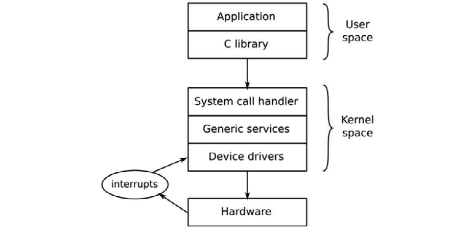
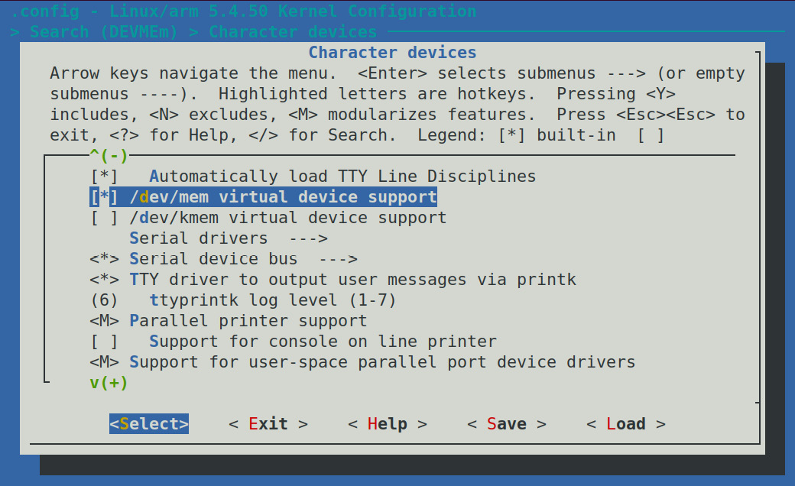
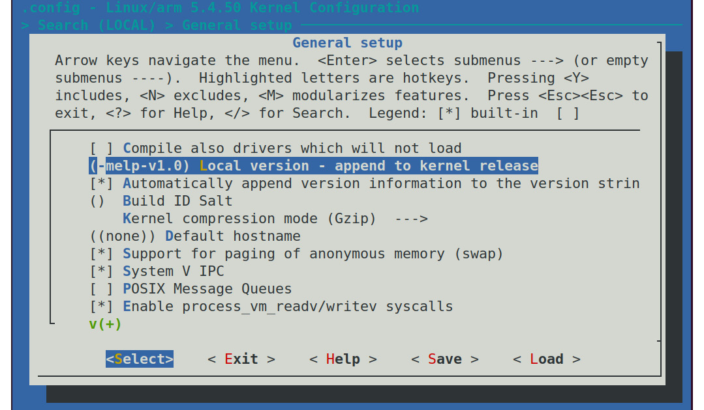
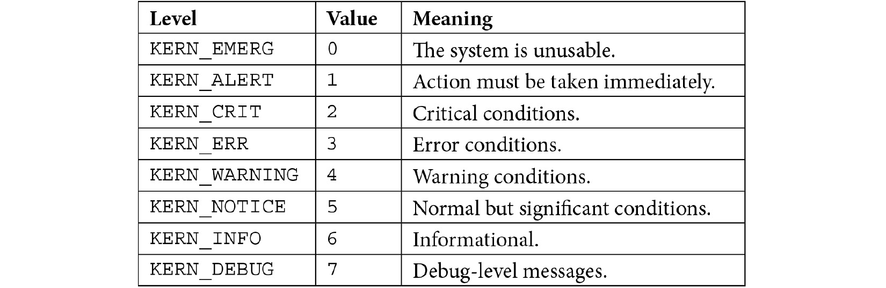

# *Chương 4*: Cấu hình và build kernel (Configuring and Building the Kernel)

Kernel là thành phần thứ ba của embedded Linux. Nó là thành phần chịu trách nhiệm quản lý tài nguyên và giao tiếp với phần cứng, và vì vậy ảnh hưởng đến gần như mọi khía cạnh của bản build phần mềm cuối cùng. Nó thường được may đo cho cấu hình phần cứng cụ thể của bạn, dù, như chúng ta đã thấy trong [*Chương 3*](ch03_all_about_bootloaders.vi.md), *Tất cả về bootloader*, device tree cho phép bạn tạo một kernel generic được may đo cho phần cứng cụ thể bằng nội dung của device tree.

Trong chương này, chúng ta sẽ xem cách lấy một kernel cho một board, và cách cấu hình và biên dịch nó. Chúng ta sẽ xem lại bootstrap, lần này tập trung vào vai trò của kernel. Chúng ta cũng sẽ xem xét device driver và cách chúng lấy thông tin từ device tree.

Chúng ta sẽ đề cập các chủ đề chính sau:

- Kernel làm gì?
- Chọn một kernel
- Build kernel
- Boot kernel
- Port Linux sang một board mới

## Yêu cầu kỹ thuật

Để làm theo các ví dụ, hãy bảo đảm bạn có những thứ sau:

- Một hệ thống host Linux-based
- Các toolchain crosstool-NG từ [*Chương 2*](ch02_learning_about_toolchains.vi.md), *Tìm hiểu về toolchain*
- Một đầu đọc thẻ microSD và thẻ
- Thẻ microSD đã cài U-Boot từ [*Chương 3*](ch03_all_about_bootloaders.vi.md), *Tất cả về bootloader*
- Một cáp serial USB to TTL 3.3V
- Raspberry Pi 4
- Một bộ nguồn USB-C 5V 3A
- BeagleBone Black
- Một bộ nguồn DC 5V 1A

Toàn bộ code cho chương này có thể được tìm thấy trong thư mục `Chapter04` của repository GitHub của cuốn sách: [https://github.com/PacktPublishing/Mastering-Embedded-Linux-Programming-Third-Edition](https://github.com/PacktPublishing/Mastering-Embedded-Linux-Programming-Third-Edition).

## Kernel làm gì?

Linux bắt đầu vào năm 1991 khi Linus Torvalds bắt đầu viết một hệ điều hành cho các máy tính cá nhân Intel 386- và 486-based. Ông lấy cảm hứng từ hệ điều hành Minix do Andrew S. Tanenbaum viết 4 năm trước đó. Linux khác Minix ở nhiều điểm; khác biệt chính là nó là một kernel virtual memory 32-bit và code là open source, sau này được phát hành theo license GPL v2. Ông công bố nó vào ngày 25 tháng Tám năm 1991, trên newsgroup `comp.os.minix` trong một bài đăng nổi tiếng bắt đầu như sau:

> Xin chào mọi người đang dùng minix—Tôi đang làm một hệ điều hành (miễn phí) (chỉ là sở thích, sẽ không lớn và chuyên nghiệp như GNU) cho các máy AT clone 386(486). Việc này đã được ấp ủ từ tháng Tư, và đang bắt đầu sẵn sàng. Tôi muốn có bất kỳ phản hồi nào về những gì mọi người thích/không thích trong minix, vì OS của tôi có phần giống nó (cùng bố cục vật lý của filesystem (vì lý do thực tế) cùng những thứ khác).

Nói một cách chính xác, Linus không viết một hệ điều hành, mà ông viết một kernel, vốn chỉ là một thành phần của hệ điều hành. Để tạo một hệ điều hành hoàn chỉnh với các lệnh user space và một shell command interpreter, ông dùng các thành phần từ project GNU, đặc biệt là toolchain, C library và các công cụ command-line cơ bản. Sự phân biệt đó vẫn còn đến ngày nay và mang lại cho Linux rất nhiều sự linh hoạt trong cách nó được dùng.

Linux kernel có thể được kết hợp với một user space GNU để tạo một bản phân phối Linux đầy đủ chạy trên máy để bàn và server, đôi khi được gọi là GNU/Linux; nó có thể được kết hợp với một user space Android để tạo hệ điều hành di động well-known, hoặc nó có thể được kết hợp với một user space BusyBox-based nhỏ để tạo một hệ thống nhúng gọn nhẹ.

Hãy so sánh điều này với các hệ điều hành BSD, FreeBSD, OpenBSD và NetBSD, trong đó kernel, toolchain và user space được kết hợp trong một code base duy nhất. Bằng cách loại bỏ toolchain, bạn có thể triển khai các runtime image gọn hơn không có compiler hay header file. Bằng cách tách user space khỏi kernel, bạn có thêm lựa chọn về init system (`runit` so với `systemd`), C library (`musl` so với `glibc`) và định dạng package (`.apk` so với `.deb`).

Kernel có ba nhiệm vụ chính: quản lý tài nguyên, giao tiếp với phần cứng, và cung cấp một API mang lại một mức trừu tượng hữu ích cho các chương trình user space, như được tóm tắt trong sơ đồ sau:



*Hình 4.1 − User space, kernel space và phần cứng*

Các application chạy trong **user space** chạy ở mức đặc quyền CPU thấp. Chúng có thể làm rất ít ngoài việc gọi thư viện. Giao diện chính giữa **user space** và **kernel space** là **C library**, thứ chuyển các function user-level, chẳng hạn các function được định nghĩa bởi POSIX, thành các system call của kernel. Giao diện system call dùng một phương pháp architecture-specific, chẳng hạn trap hay software interrupt, để chuyển CPU từ user mode low-privilege sang kernel mode high-privilege, cho phép truy cập mọi địa chỉ bộ nhớ và register CPU.

**System call handler** điều phối lời gọi tới subsystem kernel phù hợp: các lời gọi cấp phát bộ nhớ đi tới memory manager, các lời gọi filesystem tới code filesystem, v.v. Một số lời gọi đó cần input từ phần cứng bên dưới và sẽ được chuyển xuống một device driver. Trong một số trường hợp, chính phần cứng gọi một function kernel bằng cách phát ra một interrupt.

> **Lưu ý quan trọng**
>
> Sơ đồ trên cho thấy có một điểm vào thứ hai vào code kernel: hardware interrupt. Interrupt chỉ có thể được xử lý trong device driver, không bao giờ bởi một application user space.

Nói cách khác, mọi việc hữu ích mà application của bạn làm, nó đều làm thông qua kernel. Vậy, kernel là một trong những thành phần quan trọng nhất trong hệ thống. Vì vậy, điều quan trọng là hiểu cách chọn một kernel – hãy làm điều đó tiếp theo.

## Chọn một kernel

Bước tiếp theo là chọn kernel cho project, cân bằng giữa mong muốn luôn dùng phiên bản phần mềm mới nhất với nhu cầu về các phần bổ sung vendor-specific và mối quan tâm tới long-term support của code base.

### Chu kỳ phát triển kernel

Linux được phát triển với tốc độ nhanh, với một phiên bản mới được phát hành mỗi 8 đến 12 tuần. Cách đánh số phiên bản đã thay đổi một chút trong những năm gần đây. Trước tháng Bảy năm 2011, có một sơ đồ phiên bản three-number với số phiên bản trông như 2.6.39. Số ở giữa chỉ ra đó là bản phát hành dành cho lập trình viên hay bản ổn định; số lẻ (2.1.x, 2.3.x, 2.5.x) dành cho lập trình viên và số chẵn dành cho người dùng cuối.

Từ phiên bản 2.6 trở đi, ý tưởng về một nhánh phát triển long-lived (các số lẻ) bị bỏ, vì nó làm chậm tốc độ đưa các tính năng mới đến tay người dùng. Việc đổi số từ 2.6.39 sang 3.0 vào tháng Bảy năm 2011 hoàn toàn là vì Linus cảm thấy các con số đang trở nên quá lớn; không có bước nhảy lớn nào về tính năng hay kiến trúc của Linux giữa hai phiên bản đó. Ông cũng nhân cơ hội đó bỏ số ở giữa. Kể từ đó, vào tháng Tư năm 2015 và tháng Ba năm 2019, ông lần lượt tăng số major từ 3 lên 4 và từ 4 lên 5, một lần nữa hoàn toàn vì sự gọn gàng, không phải vì bất kỳ thay đổi kiến trúc lớn nào.

Linus quản lý cây kernel phát triển. Bạn có thể theo dõi ông bằng cách clone cây Git như sau:

```
$ git clone git://git.kernel.org/pub/scm/linux/kernel/git/torvalds/linux.git
```

Lệnh này sẽ check out vào thư mục con `linux`. Bạn có thể giữ cập nhật bằng cách thỉnh thoảng chạy lệnh `git pull` trong thư mục đó.

Hiện tại, một chu kỳ phát triển kernel đầy đủ bắt đầu với một merge window 2 tuần, trong đó Linus chấp nhận các patch cho tính năng mới. Ở cuối merge window, một giai đoạn ổn định hóa bắt đầu, trong đó Linus tạo ra các release candidate hằng tuần với số phiên bản kết thúc bằng `-rc1`, `-rc2`, v.v., thường đến `-rc7` hoặc `-rc8`. Trong thời gian này, mọi người test các candidate và gửi báo cáo bug cùng bản sửa. Khi tất cả các bug quan trọng đã được sửa, kernel được phát hành.

Code được đưa vào trong merge window phải khá trưởng thành rồi. Thông thường, nó được pull từ repository của nhiều maintainer subsystem và kiến trúc của kernel. Bằng cách giữ chu kỳ phát triển ngắn, các tính năng có thể được merge khi chúng sẵn sàng. Nếu một tính năng bị các maintainer kernel đánh giá là chưa đủ ổn định hoặc chưa phát triển tốt, nó có thể đơn giản được hoãn đến bản phát hành tiếp theo.

Theo dõi những gì đã thay đổi từ bản phát hành này sang bản khác không dễ. Bạn có thể đọc commit log trong repository Git của Linus nhưng, với khoảng 10,000 entry trở lên, không dễ có được cái nhìn tổng quan. May mắn là có website Linux **KernelNewbies**, [https://kernelnewbies.org](https://kernelnewbies.org), nơi bạn sẽ tìm thấy tổng quan ngắn gọn về từng phiên bản tại [https://kernelnewbies.org/LinuxVersions](https://kernelnewbies.org/LinuxVersions).

### Bản phát hành stable và long-term support

Tốc độ thay đổi nhanh của Linux là điều tốt ở chỗ nó đưa các tính năng mới vào code base mainline, nhưng nó không phù hợp lắm với vòng đời dài hơn của các project nhúng. Các lập trình viên kernel giải quyết điều này theo hai cách, với các bản phát hành **stable** và các bản phát hành **long-term**. Sau khi phát hành một kernel mainline (do Linus Torvalds bảo trì), nó được chuyển sang cây **stable** (do Greg Kroah-Hartman bảo trì). Các bản sửa bug được áp dụng cho stable kernel, trong khi mainline kernel bắt đầu chu kỳ phát triển tiếp theo. Các point release của stable kernel được đánh dấu bằng số thứ ba, 3.18.1, 3.18.2, v.v. Trước phiên bản 3, có bốn số phát hành, 2.6.29.1, 2.6.39.2, v.v.

Bạn có thể lấy cây stable bằng lệnh sau:

```
$ git clone git://git.kernel.org/pub/scm/linux/kernel/git/stable/linux-stable.git
```

Bạn có thể dùng `git checkout` để lấy một phiên bản cụ thể, chẳng hạn phiên bản 5.4.50:

```
$ cd linux-stable
$ git checkout v5.4.50
```

Thông thường, chỉ stable kernel được cập nhật cho đến bản phát hành mainline tiếp theo (8 đến 12 tuần sau), vì vậy bạn sẽ thấy chỉ có một hoặc đôi khi hai stable kernel tại [https://www.kernel.org/](https://www.kernel.org/). Để phục vụ những người dùng muốn có bản cập nhật trong thời gian dài hơn và được bảo đảm rằng mọi bug sẽ được tìm và sửa, một số kernel được gắn nhãn **long-term** và được bảo trì trong 2 năm trở lên. Có ít nhất một bản phát hành long-term kernel mỗi năm.

Nhìn vào [https://www.kernel.org/](https://www.kernel.org/) tại thời điểm viết, có tổng cộng năm long-term kernel: 5.4, 4.19, 4.14, 4.9 và 4.4. Kernel cũ nhất đã được bảo trì gần 5 năm và đang ở phiên bản 4.4.256. Nếu bạn đang xây dựng một sản phẩm mà bạn sẽ phải bảo trì trong khoảng thời gian dài như vậy, thì long-term kernel mới nhất (5.4 trong trường hợp này) có thể là một lựa chọn tốt.

#### Hỗ trợ từ vendor

Trong một thế giới lý tưởng, bạn sẽ có thể tải một kernel từ [https://www.kernel.org/](https://www.kernel.org/) và cấu hình nó cho bất kỳ thiết bị nào tuyên bố hỗ trợ Linux. Tuy nhiên, điều đó không phải lúc nào cũng khả thi; thực tế, Linux mainline chỉ hỗ trợ vững chắc một tập con nhỏ trong số rất nhiều thiết bị có thể chạy Linux. Bạn có thể tìm thấy hỗ trợ cho board hay **System on Chip** (**SoC**) của mình từ các project open source độc lập như Linaro hay Yocto Project, hoặc từ các công ty cung cấp hỗ trợ third-party cho embedded Linux, nhưng trong nhiều trường hợp, bạn sẽ buộc phải tìm đến vendor của SoC hay board để có một kernel hoạt động được.

Như chúng ta biết, một số vendor hỗ trợ Linux tốt hơn những vendor khác. Lời khuyên của tôi lúc này là chọn các vendor hỗ trợ tốt hoặc, tốt hơn nữa, chịu khó đưa các thay đổi kernel của họ vào mainline. Hãy tìm trong mailing list hoặc commit history của Linux kernel các hoạt động gần đây quanh một SoC hay board ứng viên. Khi các thay đổi upstream vắng mặt trong mainline kernel, kết luận về việc một vendor có hỗ trợ tốt hay không phần lớn dựa vào truyền miệng. Một số vendor nổi tiếng là chỉ phát hành một lần code kernel rồi dồn hết sức lực vào các SoC mới hơn của họ.

#### License

Source code Linux được cấp license theo GPL v2, nghĩa là bạn phải công khai source code kernel của mình theo một trong các cách được quy định trong license.

Văn bản thực tế của license cho kernel nằm trong file `COPYING`. Nó bắt đầu bằng một phụ lục do Linus viết nói rằng code gọi kernel từ user space qua giao diện system call không được coi là sản phẩm phái sinh của kernel và vì vậy không thuộc phạm vi của license. Do đó, không có vấn đề gì với các application độc quyền chạy trên Linux.

Tuy nhiên, có một lĩnh vực trong license Linux gây ra nhầm lẫn và tranh cãi không dứt: kernel module. Một **kernel module** đơn giản là một đoạn code được link động với kernel lúc runtime, nhờ đó mở rộng chức năng của kernel. GPL không phân biệt giữa static linking và dynamic linking, vì vậy có vẻ như source của kernel module thuộc phạm vi GPL. Nhưng, trong những ngày đầu của Linux, đã có những tranh luận về ngoại lệ cho quy tắc này, chẳng hạn liên quan đến Andrew filesystem. Code này có trước Linux và do đó (theo lập luận) không phải là sản phẩm phái sinh, và vì vậy license không áp dụng.

Các cuộc thảo luận tương tự đã diễn ra qua nhiều năm đối với các đoạn code khác, với kết quả là giờ đây thông lệ được chấp nhận là GPL không nhất thiết áp dụng cho kernel module. Điều này được hệ thống hóa bởi macro kernel `MODULE_LICENSE`, macro này có thể nhận giá trị `Proprietary` để chỉ ra rằng nó không được phát hành theo GPL. Nếu bạn định tự dùng những lập luận tương tự, bạn có thể muốn đọc qua một chuỗi email oft-quoted có tiêu đề *Linux GPL and binary module exception clause?*, được lưu trữ tại [https://yarchive.net/comp/linux/gpl_modules.html](https://yarchive.net/comp/linux/gpl_modules.html).

GPL nên được coi là một điều tốt vì nó bảo đảm rằng khi làm việc với các project nhúng, chúng ta luôn có thể lấy được source code của kernel. Không có nó, embedded Linux sẽ khó dùng hơn nhiều và phân mảnh hơn.

## Build kernel

Sau khi đã quyết định dựa bản build vào kernel nào, bước tiếp theo là build nó.

### Lấy source

Cả ba target dùng trong cuốn sách này, Raspberry Pi 4, BeagleBone Black và ARM Versatile PB, đều được mainline kernel hỗ trợ tốt. Do đó, hợp lý khi dùng long-term kernel mới nhất có tại [https://www.kernel.org/](https://www.kernel.org/), tại thời điểm viết là 5.4.50. Khi bạn tự làm việc này, bạn nên kiểm tra xem có phiên bản mới hơn của kernel 5.4 không và dùng phiên bản đó thay thế, vì nó sẽ có các bản sửa cho những bug được tìm thấy sau khi 5.4.50 được phát hành.

> **Lưu ý quan trọng**
>
> Nếu có một bản phát hành long-term mới hơn, bạn có thể muốn cân nhắc dùng nó, nhưng hãy lưu ý rằng có thể đã có những thay đổi khiến chuỗi lệnh sau không hoạt động đúng chính xác như đã đưa ra.

Để tải và giải nén một release tarball của Linux kernel 5.4.50, dùng lệnh sau:

```
$ wget https://cdn.kernel.org/pub/linux/kernel/v5.x/linux-5.4.50.tar.xz
$ tar xf linux-5.4.50.tar.xz
$ mv linux-5.4.50 linux-stable
```

Để tải một phiên bản mới hơn, thay `5.4.50` sau `linux-` bằng bản phát hành long-term mong muốn.

Có rất nhiều code ở đây. Có hơn 57,000 file trong kernel 5.4 chứa source code C, header file và code assembly, tổng cộng hơn 14 triệu dòng code, theo đo đạc bằng tiện ích SLOCCount. Dù vậy, vẫn đáng biết bố cục cơ bản của code và biết đại khái nơi tìm một component cụ thể. Các thư mục chính đáng chú ý là:

- `arch`: Chứa các file architecture-specific. Có một thư mục con cho mỗi kiến trúc.
- `Documentation`: Chứa tài liệu kernel. Luôn xem ở đây trước nếu bạn muốn tìm thêm thông tin về một khía cạnh nào đó của Linux.
- `drivers`: Chứa các device driver – hàng nghìn driver. Có một thư mục con cho mỗi loại driver.
- `fs`: Chứa code filesystem.
- `include`: Chứa các header file của kernel, bao gồm cả những header cần khi build toolchain.
- `init`: Chứa code khởi động kernel.
- `kernel`: Chứa các function cốt lõi, bao gồm scheduling, locking, timer, quản lý điện năng và code debug/trace.
- `mm`: Chứa phần quản lý bộ nhớ.
- `net`: Chứa các protocol mạng.
- `scripts`: Chứa nhiều script hữu ích, bao gồm **device tree compiler** (**DTC**) mà tôi đã mô tả trong [*Chương 3*](ch03_all_about_bootloaders.vi.md), *Tất cả về bootloader*.
- `tools`: Chứa nhiều công cụ hữu ích, bao gồm công cụ performance counter của Linux, `perf`, mà tôi sẽ mô tả trong [*Chương 20*](ch20_profiling_and_tracing.vi.md), *Profiling và tracing*.

Theo thời gian, bạn sẽ quen với cấu trúc này, và nhận ra rằng nếu bạn tìm code cổng serial của một SoC cụ thể, bạn sẽ tìm thấy nó trong `drivers/tty/serial` chứ không phải trong `arch/$ARCH/mach-foo`, vì đó là một device driver chứ không phải thứ gì đó architecture-specific của CPU.

### Hiểu cấu hình kernel – Kconfig

Một trong những thế mạnh của Linux là mức độ bạn có thể cấu hình kernel cho phù hợp với các công việc khác nhau, từ một thiết bị nhỏ chuyên dụng như máy điều nhiệt thông minh đến một thiết bị cầm tay di động phức tạp. Trong các phiên bản hiện tại, có hàng nghìn tùy chọn cấu hình. Cấu hình đúng bản thân nó đã là một nhiệm vụ, nhưng trước khi đi vào đó, tôi muốn chỉ cho bạn cách nó hoạt động để bạn hiểu rõ hơn chuyện gì đang diễn ra.

Cơ chế cấu hình được gọi là `Kconfig`, và build system mà nó tích hợp được gọi là `Kbuild`. Cả hai đều được tài liệu hóa trong `Documentation/kbuild`. `Kconfig/Kbuild` được dùng trong một số project khác ngoài kernel, bao gồm crosstool-NG, U-Boot, Barebox và BusyBox.

Các tùy chọn cấu hình được khai báo trong một phân cấp các file tên `Kconfig`, dùng cú pháp được mô tả trong `Documentation/kbuild/kconfig-language.rst`.

Trong Linux, `Kconfig` top-level trông như thế này:

```
mainmenu "Linux/$(ARCH) $(KERNELVERSION) Kernel Configuration"
comment "Compiler: $(CC_VERSION_TEXT)"
source "scripts/Kconfig.include"
[…]
```

Và dòng đầu tiên của `arch/Kconfig` là:

```
source "arch/$(SRCARCH)/Kconfig"
```

Dòng đó include file cấu hình architecture-dependent, file này source các file `Kconfig` khác, tùy theo những tùy chọn nào được enable.

Việc kiến trúc đóng vai trò nổi bật như vậy có ba hàm ý:

- Thứ nhất, bạn phải chỉ định một kiến trúc khi cấu hình Linux bằng cách đặt `ARCH=[architecture]`, nếu không, nó sẽ mặc định là kiến trúc của máy cục bộ.
- Thứ hai, giá trị bạn đặt cho `ARCH` thường xác định giá trị của `SRCARCH` nên bạn hiếm khi cần đặt `SRCARCH` một cách tường minh.
- Thứ ba, bố cục của menu top-level khác nhau cho mỗi kiến trúc.

Giá trị bạn đặt vào `ARCH` là một trong các thư mục con bạn tìm thấy trong thư mục `arch`, với điểm kỳ lạ là cả `ARCH=i386` và `ARCH=x86_64` đều source `arch/x86/Kconfig`.

Các file `Kconfig` phần lớn gồm các menu, được phân định bởi các keyword `menu` và `endmenu`. Các mục menu được đánh dấu bằng keyword `config`.

Đây là một ví dụ, lấy từ `drivers/char/Kconfig`:

```
menu "Character devices"
[…]
config DEVMEM
    bool "/dev/mem virtual device support"
    default y
    help
      Say Y here if you want to support the /dev/mem device.
      The /dev/mem device is used to access areas of physical
      memory.
      When in doubt, say "Y".
[…]
endmenu
```

Tham số theo sau `config` đặt tên cho một biến, trong trường hợp này là `DEVMEM`. Vì tùy chọn này là `bool` (Boolean), nó chỉ có thể có hai giá trị: nếu được enable, nó được gán `y`, nếu không được enable, biến hoàn toàn không được định nghĩa. Tên của mục menu được hiển thị trên màn hình là chuỗi theo sau keyword `bool`.

Mục cấu hình này, cùng với tất cả các mục khác, được lưu trong một file tên `.config`.

> **Mẹo**
>
> Dấu chấm (`.`) ở đầu `.config` có nghĩa là nó là một file ẩn sẽ không được lệnh `ls` hiển thị trừ khi bạn gõ `ls -a` để hiển thị tất cả các file.

Dòng tương ứng với mục cấu hình này như sau:

```
CONFIG_DEVMEM=y
```

Có một số data type khác ngoài `bool`. Đây là danh sách đầy đủ:

- `bool`: Hoặc `y` hoặc không được định nghĩa.
- `tristate`: Dùng khi một tính năng có thể được build thành kernel module hoặc build vào kernel image chính. Các giá trị là `m` cho module, `y` để build vào, và không được định nghĩa nếu tính năng không được enable.
- `int`: Một giá trị số nguyên dùng ký hiệu thập phân.
- `hex`: Một giá trị số nguyên không dấu dùng ký hiệu hexadecimal.
- `string`: Một giá trị chuỗi.

Có thể có các phụ thuộc giữa các mục, được biểu diễn bằng construct `depends on`, như được thể hiện ở đây:

```
config MTD_CMDLINE_PARTS
    tristate "Command line partition table parsing"
    depends on MTD
```

Nếu `CONFIG_MTD` chưa được enable ở nơi khác, tùy chọn menu này không được hiển thị và vì vậy không thể được chọn.

Cũng có các phụ thuộc ngược; keyword `select` enable các tùy chọn khác nếu tùy chọn này được enable. File `Kconfig` trong `arch/$ARCH` có rất nhiều statement `select` enable các tính năng đặc thù cho kiến trúc, như có thể thấy ở đây với `ARM`:

```
config ARM
    bool
    default y
    select ARCH_CLOCKSOURCE_DATA
    select ARCH_HAS_DEVMEM_IS_ALLOWED
[…]
```

Bằng cách select `ARCH_CLOCKSOURCE_DATA` và `ARCH_HAS_DEVMEM_IS_ALLOWED`, chúng ta gán giá trị `y` cho các biến này để các tính năng này được build tĩnh vào kernel.

Có một số tiện ích cấu hình có thể đọc các file `Kconfig` và tạo ra một file `.config`. Một số trong đó hiển thị các menu trên màn hình và cho phép bạn đưa ra lựa chọn một cách tương tác. `menuconfig` có lẽ là cái mà hầu hết mọi người quen thuộc, nhưng cũng có `xconfig` và `gconfig`.

Để dùng `menuconfig`, trước hết bạn cần cài `ncurses`, `flex` và `bison`. Lệnh sau cài tất cả các điều kiện tiên quyết này trên Ubuntu:

```
$ sudo apt install libncurses5-dev flex bison
```

Bạn khởi chạy `menuconfig` qua lệnh `make`, nhớ rằng, trong trường hợp kernel, bạn phải cung cấp một kiến trúc, như được minh họa ở đây:

```
$ make ARCH=arm menuconfig
```

Ở đây, bạn có thể thấy `menuconfig` với tùy chọn cấu hình `DEVMEM` đã nói ở trên được highlight:



*Hình 4.2 − Chọn DEVMEM*

Dấu sao (`*`) ở bên trái một mục có nghĩa là driver đã được chọn để build tĩnh vào kernel hoặc, nếu là `M`, nó đã được chọn để build thành một kernel module để chèn vào kernel lúc runtime.

> **Mẹo**
>
> Bạn thường thấy các hướng dẫn như `enable CONFIG_BLK_DEV_INITRD`, nhưng với quá nhiều menu để duyệt qua, có thể mất một lúc mới tìm được chỗ cấu hình đó được đặt. Tất cả các trình sửa cấu hình đều có chức năng tìm kiếm. Bạn có thể truy cập nó trong `menuconfig` bằng cách nhấn phím gạch chéo, */*. Trong `xconfig`, nó nằm trong menu **Edit**, nhưng hãy bảo đảm bạn bỏ phần `CONFIG_` của mục cấu hình bạn đang tìm.

Với quá nhiều thứ cần cấu hình, thật không hợp lý khi bắt đầu từ một trang trắng mỗi lần bạn muốn build một kernel, vì vậy có một tập các file cấu hình đã biết là hoạt động được trong `arch/$ARCH/configs`, mỗi file chứa các giá trị cấu hình phù hợp cho một SoC hoặc một nhóm SoC.

Bạn có thể chọn một file bằng lệnh `make [configuration file name]`. Ví dụ, để cấu hình Linux chạy trên rất nhiều SoC dùng kiến trúc `ARMv7-A`, bạn sẽ gõ như sau:

```
$ make ARCH=arm multi_v7_defconfig
```

Đây là một kernel generic chạy trên nhiều board khác nhau. Với một ứng dụng chuyên biệt hơn, chẳng hạn khi dùng một kernel vendor-supplied, file cấu hình mặc định là một phần của board support package; bạn sẽ cần tìm ra nên dùng file nào trước khi có thể build kernel.

Có một target cấu hình hữu ích khác tên `oldconfig`. Bạn dùng nó khi chuyển một cấu hình sang phiên bản kernel mới hơn. Target này lấy một file `.config` có sẵn và hỏi bạn các câu hỏi về các tùy chọn cấu hình mới. Sao chép `.config` từ kernel cũ sang thư mục source mới và chạy lệnh `make ARCH=arm oldconfig` để cập nhật nó.

Target `oldconfig` cũng có thể được dùng để kiểm tra tính hợp lệ của một file `.config` mà bạn đã sửa thủ công (bỏ qua dòng chữ `Automatically generated file; DO NOT EDIT` ở đầu file; đôi khi bỏ qua cảnh báo cũng không sao).

Nếu bạn có thay đổi cấu hình, file `.config` đã sửa trở thành một phần của board support package và cần được đặt dưới quản lý source code.

Khi bạn bắt đầu build kernel, một header file, `include/generated/autoconf.h`, được tạo ra, chứa một `#define` cho mỗi giá trị cấu hình để nó có thể được include trong kernel source.

Giờ chúng ta đã chọn được kernel và học cách cấu hình nó, tiếp theo chúng ta sẽ xác định danh tính cho kernel của mình.

### Dùng LOCALVERSION để định danh kernel

Bạn có thể tìm ra phiên bản và release kernel bạn đã build bằng các target `make kernelversion` và `make` `kernelrelease`:

```
$ make ARCH=arm kernelversion
5.4.50
$ make ARCH=arm kernelrelease
5.4.50
```

Thông tin này được báo cáo lúc runtime qua lệnh `uname` và cũng được dùng để đặt tên thư mục lưu các kernel module.

Nếu bạn thay đổi cấu hình so với mặc định, nên nối thêm thông tin phiên bản của riêng bạn, mà bạn có thể cấu hình bằng cách đặt `CONFIG_LOCALVERSION`. Ví dụ, nếu tôi muốn đánh dấu kernel đang build bằng identifier `melp` và phiên bản `1.0`, tôi sẽ định nghĩa local version trong `menuconfig` như thế này:



*Hình 4.3 – Nối thêm vào phiên bản release kernel*

Chạy `make kernelversion` cho cùng output như trước, nhưng giờ nếu tôi chạy `make kernelrelease`, tôi thấy như sau:

```
$ make ARCH=arm kernelrelease
5.4.50-melp-v1.0
```

Đó là một đoạn rẽ thú vị vào việc đánh phiên bản kernel, nhưng giờ hãy quay lại việc cấu hình kernel để biên dịch.

### Khi nào nên dùng kernel module

Tôi đã nhắc đến kernel module vài lần. Các bản phân phối Linux trên máy để bàn dùng chúng rộng rãi để các function thiết bị và kernel đúng có thể được nạp lúc runtime, tùy theo phần cứng được phát hiện và các tính năng cần thiết. Không có chúng, mọi driver và tính năng đều sẽ phải được link tĩnh vào kernel, khiến nó lớn đến mức không khả thi.

Mặt khác, với thiết bị nhúng, phần cứng và cấu hình kernel thường được biết tại thời điểm build kernel, và do đó module không hữu ích lắm. Thực tế, chúng gây ra vấn đề vì tạo ra sự phụ thuộc phiên bản giữa kernel và root filesystem, điều có thể gây lỗi boot nếu một cái được cập nhật mà cái kia thì không. Do đó, khá phổ biến khi các kernel nhúng được build hoàn toàn không có module nào.

Đây là một vài trường hợp mà kernel module là ý hay trong hệ thống nhúng:

- Khi bạn có module độc quyền, vì các lý do license đã nêu ở mục trước.
- Để giảm thời gian boot bằng cách hoãn việc nạp các driver non-essential.
- Khi có nhiều driver có thể được nạp, và việc biên dịch chúng tĩnh sẽ chiếm quá nhiều bộ nhớ. Ví dụ, bạn có một giao diện USB hỗ trợ nhiều loại thiết bị. Về cơ bản đây là cùng lập luận được dùng trong các bản phân phối cho máy để bàn.

Tiếp theo, hãy học cách biên dịch một kernel image có hoặc không có kernel module bằng `Kbuild`.

## Biên dịch – Kbuild

Build system của kernel, `Kbuild`, là một tập script `make` lấy thông tin cấu hình từ file `.config`, xác định các phụ thuộc, và biên dịch mọi thứ cần thiết để tạo ra một kernel image. Kernel image này chứa tất cả các component được link tĩnh, có thể một device tree binary, và có thể một hoặc nhiều kernel module. Các phụ thuộc được biểu diễn trong các makefile nằm trong mỗi thư mục có component build được. Chẳng hạn, hai dòng sau được lấy từ `drivers/char/Makefile`:

```
obj-y += mem.o random.o
obj-$(CONFIG_TTY_PRINTK) += ttyprintk.o
```

Rule `obj-y` biên dịch vô điều kiện một file để tạo ra target, vì vậy `mem.c` và `random.c` luôn là một phần của kernel. Ở dòng thứ hai, `ttyprintk.c` phụ thuộc vào một tham số cấu hình. Nếu `CONFIG_TTY_PRINTK` là `y`, nó được biên dịch thành built-in; nếu là `m`, nó được build thành module; và nếu tham số không được định nghĩa, nó hoàn toàn không được biên dịch.

Với hầu hết các target, chỉ cần gõ `make` (với `ARCH` và `CROSS_COMPILE` phù hợp) là xong việc, nhưng sẽ dễ hiểu hơn nếu làm từng bước một. Xem mục cuối của [*Chương 2*](ch02_learning_about_toolchains.vi.md), *Tìm hiểu về toolchain*, để biết ý nghĩa của biến `make` `CROSS_COMPILE`.

### Tìm ra target kernel cần build

Để build một kernel image, bạn cần biết bootloader của bạn mong đợi gì. Đây là một hướng dẫn sơ bộ:

- **U-Boot**: Theo truyền thống, U-Boot cần `uImage`, nhưng các phiên bản mới hơn có thể nạp một file `zImage` bằng lệnh `bootz`.
- **Các target x86**: Cần một file `bzImage`.
- **Hầu hết các bootloader khác**: Cần một file `zImage`.

Đây là một ví dụ build một file `zImage`:

```
$ make -j 4 ARCH=arm CROSS_COMPILE=arm-cortex_a8-linux-gnueabihf- zImage
```

> **Mẹo**
>
> Tùy chọn `-j 4` cho `make` biết cần chạy song song bao nhiêu job, điều giảm thời gian build. Một hướng dẫn sơ bộ là chạy số job bằng số CPU core bạn có.

Có một vấn đề nhỏ khi build một file `uImage` cho ARM có hỗ trợ multi-platform, vốn là chuẩn mực cho thế hệ kernel SoC ARM hiện tại. Multi-platform support cho ARM được giới thiệu trong Linux 3.7. Nó cho phép một kernel binary duy nhất chạy trên nhiều nền tảng và là một bước trên con đường hướng tới việc có một số ít kernel cho mọi thiết bị ARM. Kernel chọn nền tảng đúng bằng cách đọc machine number hoặc device tree được bootloader truyền cho nó. Vấn đề xảy ra vì vị trí bộ nhớ vật lý có thể khác nhau cho mỗi nền tảng, và vì vậy relocation address của kernel (thường là `0x8000` byte tính từ đầu RAM vật lý) cũng có thể khác nhau.

Relocation address được lệnh `mkimage` ghi vào header của `uImage` khi kernel được build, nhưng nó sẽ thất bại nếu có nhiều hơn một relocation address để chọn. Nói cách khác, định dạng `uImage` không tương thích với các image multi-platform. Bạn vẫn có thể tạo một binary `uImage` từ một bản build multi-platform, miễn là bạn đưa ra `LOADADDR` của SoC cụ thể mà bạn hy vọng boot kernel này. Bạn có thể tìm load address bằng cách xem trong `arch/$ARCH/mach-[your SoC]/Makefile.boot` và ghi lại giá trị của `zreladdr-y`:

```
$ make -j 4 ARCH=arm CROSS_COMPILE=arm-cortex_a8-linux-gnueabihf- LOADADDR=0x80008000 uImage
```

Bất kể chúng ta nhắm tới định dạng kernel image nào, cùng hai build artifact được tạo ra trước khi image bootable được tạo.

### Build artifact

Một lần build kernel tạo ra hai file trong thư mục top-level: `vmlinux` và `System.map`. File đầu tiên, `vmlinux`, là kernel dưới dạng một ELF binary. Nếu bạn đã biên dịch kernel với `debug` được enable (`CONFIG_DEBUG_INFO=y`), nó sẽ chứa các debug symbol có thể được dùng với các debugger như `kgdb`. Bạn cũng có thể dùng các công cụ ELF binary khác, chẳng hạn `size` để đo độ dài từng section (`text`, `data` và `bss`) tạo nên file thực thi `vmlinux`:

```
$ arm-cortex_a8-linux-gnueabihf-size vmlinux
   text    data      bss      dec      hex      filename
14005643   7154342   403160   21563145  1490709  vmlinux
```

Các giá trị `dec` và `hex` lần lượt là tổng kích thước file ở dạng thập phân và hexadecimal.

`System.map` chứa bảng symbol ở dạng human-readable.

Hầu hết bootloader không thể xử lý trực tiếp code ELF. Có thêm một bước xử lý lấy `vmlinux` và đặt các binary phù hợp cho các bootloader khác nhau vào `arch/$ARCH/boot`:

- `Image`: `vmlinux` được chuyển sang định dạng raw binary.
- `zImage`: Với kiến trúc PowerPC, đây chỉ là một phiên bản nén của `Image`, điều hàm ý bootloader phải tự giải nén. Với tất cả các kiến trúc khác, `Image` đã nén được gắn kèm vào một stub code để giải nén và relocate nó.
- `uImage`: `zImage` cộng với một header U-Boot 64-byte.

Trong khi build đang chạy, bạn sẽ thấy bản tóm tắt các lệnh đang được thực thi:

```
$ make -j 4 ARCH=arm CROSS_COMPILE=arm-cortex_a8-linux-gnueabihf- \
zImage
  CC      scripts/mod/empty.o
  CC      scripts/mod/devicetable-offsets.s
  MKELF   scripts/mod/elfconfig.h
  HOSTCC  scripts/mod/modpost.o
  HOSTCC  scripts/mod/sumversion.o
[…]
```

Đôi khi, khi build kernel thất bại, sẽ hữu ích nếu thấy các lệnh thực tế đang được thực thi. Để làm điều đó, thêm `V=1` vào command line:

```
$ make -j 4 ARCH=arm CROSS_COMPILE=arm-cortex_a8-linux-gnueabihf- \
V=1 zImage
[…]
arm-cortex_a8-linux-gnueabihf-gcc -Wp,-MD,drivers/tty/.tty_baudrate.o.d  -nostdinc -isystem /home/frank/x-tools/arm-cortex_a8-linux-gnueabihf/lib/gcc/arm-cortex_a8-linux-gnueabihf/8.3.0/include -I./arch/arm/include -I./arch/arm/include/generated  -I./include -I./arch/arm/include/uapi -I./arch/arm/include/generated/uapi -I./include/uapi -I./include/generated/uapi -include ./include/linux/kconfig.h -include ./include/linux/compiler_types.h -D__KERNEL__ -mlittle-endian -Wall -Wundef -Werror=strict-prototypes -Wno-trigraphs -fno-strict-aliasing -fno-common -fshort-wchar -fno-PIE -Werror=implicit-function-declaration -Werror=implicit-int -Wno-format-security -std=gnu89 -fno-dwarf2-cfi-asm -fno-ipa-sra -mabi=aapcs-linux -mfpu=vfp -funwind-tables -marm -Wa,-mno-warn-deprecated -D__LINUX_ARM_ARCH__=7 -march=armv7-a -msoft-float -Uarm -fno-delete-null-pointer-checks -Wno-frame-address -Wno-format-truncation -Wno-format-overflow -O2 --param=allow-store-data-races=0 -Wframe-larger-than=1024 -fstack-protector-strong -Wno-unused-but-set-variable -Wimplicit-fallthrough -Wno-unused-const-variable -fomit-frame-pointer -fno-var-tracking-assignments -Wdeclaration-after-statement -Wvla -Wno-pointer-sign -Wno-stringop-truncation -Wno-array-bounds -Wno-stringop-overflow -Wno-restrict -Wno-maybe-uninitialized -fno-strict-overflow -fno-merge-all-constants -fmerge-constants -fno-stack-check -fconserve-stack -Werror=date-time -Werror=incompatible-pointer-types -Werror=designated-init -fmacro-prefix-map=./= -Wno-packed-not-aligned    -DKBUILD_BASENAME='"tty_baudrate"' -DKBUILD_MODNAME='"tty_baudrate"' -c -o drivers/tty/tty_baudrate.o drivers/tty/tty_baudrate.c
[…]
```

Trong mục này, chúng ta đã học cách `Kbuild` lấy một ELF binary `vmlinux` đã biên dịch trước và chuyển nó thành một kernel image bootable. Tiếp theo, chúng ta sẽ xem cách biên dịch device tree.

### Biên dịch device tree

Bước tiếp theo là build device tree, hoặc nhiều device tree nếu bạn có một bản build multi-platform. Target `dtbs` build các device tree theo các rule trong `arch/$ARCH/boot/dts/Makefile`, dùng các file device tree source trong thư mục đó. Sau đây là một đoạn trích từ việc build target `dtbs` cho `multi_v7_defconfig`:

```
$ make ARCH=arm dtbs
[…]
  DTC     arch/arm/boot/dts/alpine-db.dtb
  DTC     arch/arm/boot/dts/artpec6-devboard.dtb
  DTC     arch/arm/boot/dts/at91-kizbox2.dtb
  DTC     arch/arm/boot/dts/at91-nattis-2-natte-2.dtb
  DTC     arch/arm/boot/dts/at91-sama5d27_som1_ek.dtb
[…]
```

Các file `.dtb` đã biên dịch được tạo trong cùng thư mục với source.

### Biên dịch module

Nếu bạn đã cấu hình một số tính năng để build thành module, bạn có thể build chúng riêng bằng target `modules`:

```
$ make -j 4 ARCH=arm CROSS_COMPILE=arm-cortex_a8-linux-gnueabihf- \
modules
```

Các `modules` đã biên dịch có hậu tố `.ko` và được tạo trong cùng thư mục với source code, nghĩa là chúng nằm rải rác khắp cây kernel source. Tìm chúng hơi khó, nhưng bạn có thể dùng target `modules_install make` để cài chúng vào đúng chỗ. Vị trí mặc định là `/lib/modules` trên hệ thống phát triển của bạn, gần như chắc chắn không phải điều bạn muốn. Để cài chúng vào staging area của root filesystem (chúng ta sẽ nói về root filesystem trong chương tiếp theo), hãy cung cấp đường dẫn bằng `INSTALL_MOD_PATH`:

```
$ make -j4 ARCH=arm CROSS_COMPILE=arm-cortex_a8-linux-gnueabihf- \
INSTALL_MOD_PATH=$HOME/rootfs modules_install
```

Các kernel module được đặt vào thư mục `/lib/modules/[kernel version]`, tương đối so với gốc của filesystem.

### Dọn dẹp kernel source

Có ba target `make` để dọn dẹp cây kernel source:

- `clean`: Xóa các object file và phần lớn các file trung gian.
- `mrproper`: Xóa tất cả các file trung gian, bao gồm file `.config`. Dùng target này để đưa cây source về trạng thái ngay sau khi clone hoặc giải nén source code. Nếu bạn tò mò về cái tên, Mr. Proper là một sản phẩm tẩy rửa phổ biến ở một số nơi trên thế giới. Ý nghĩa của `make mrproper` là cọ rửa kernel source thật sạch.
- `distclean`: Giống `mrproper`, nhưng còn xóa các file backup của trình soạn thảo, file patch, và các artifact khác của quá trình phát triển phần mềm.

Chúng ta đã thấy các bước biên dịch kernel và output của chúng. Giờ hãy build một số kernel cho các board chúng ta có trong tay.

### Build kernel 64-bit cho Raspberry Pi 4

Dù mainline kernel đã hỗ trợ Raspberry Pi 4, tôi thấy fork Linux của Raspberry Pi Foundation ([https://github.com/raspberrypi/linux](https://github.com/raspberrypi/linux)) ổn định hơn tại thời điểm viết. Nhánh `4.19.y` của fork đó cũng được bảo trì tích cực hơn nhánh `rpi-5.4.y` của cùng fork. Tình hình này có thể thay đổi trong tương lai gần, nhưng hiện tại, hãy gắn với nhánh `4.19.y`.

Vì Raspberry Pi 4 có CPU ARM Cortex-A72 quad core 64-bit, chúng ta sẽ dùng một toolchain GNU của Arm nhắm tới AArch64 GNU/Linux để cross-compile một kernel 64-bit cho nó. Toolchain prebuilt này có thể được tải từ https://developer.arm.com/tools-and-software/open-source-software/developer-tools/gnu-toolchain/gnu-a/downloads:

```
$ cd ~
$ wget https://developer.arm.com/-/media/Files/downloads/gnu-a/10.2-2020.11/binrel/gcc-arm-10.2-2020.11-x86_64-aarch64-none-linux-gnu.tar.xz
$ tar xf gcc-arm-10.2-2020.11-x86_64-aarch64-none-linux-gnu.tar.xz
$ mv gcc-arm-10.2-2020.11-x86_64-aarch64-none-linux-gnu \
gcc-arm-aarch64-none-linux-gnu
```

`gcc-arm-10.2-2020.11-x86_64-aarch64-none-linux-gnu` là cross compiler `x86_64` Linux-hosted hiện hành nhắm tới AArch64 GNU/Linux tại thời điểm viết. Nếu việc tải thất bại, hãy thay `10.2-2020.11` trong các lệnh trên bằng phiên bản phát hành hiện tại.

Tiếp theo, cài vài package chúng ta cần để lấy và build kernel:

```
$ sudo apt install subversion libssl-dev
```

Giờ bạn đã cài toolchain và các package cần thiết, hãy clone repo kernel `4.19.y` với độ sâu một cấp vào một thư mục tên `linux` và export một số binary prebuilt sang thư mục con `boot`:

```
$ git clone --depth=1 -b rpi-4.19.y https://github.com/raspberrypi/linux.git
$ svn export https://github.com/raspberrypi/firmware/trunk/boot
$ rm boot/kernel*
$ rm boot/*.dtb
$ rm boot/overlays/*.dtbo
```

Điều hướng tới thư mục `linux` vừa clone và build kernel:

```
$ PATH=~/gcc-arm-aarch64-none-linux-gnu/bin/:$PATH
$ cd linux
$ make ARCH=arm64 CROSS_COMPILE=aarch64-none-linux-gnu- \ bcm2711_defconfig
$ make -j4 ARCH=arm64 CROSS_COMPILE=aarch64-none-linux-gnu-
```

Khi build xong, sao chép kernel image, các device tree blob và tham số boot sang thư mục con `boot`:

```
$ cp arch/arm64/boot/Image ../boot/kernel8.img
$ cp arch/arm64/boot/dts/overlays/*.dtbo ../boot/overlays/
$ cp arch/arm64/boot/dts/broadcom/*.dtb ../boot/
$ cat << EOF > ../boot/config.txt
enable_uart=1
arm_64bit=1
EOF
$ cat << EOF > ../boot/cmdline.txt
console=serial0,115200 console=tty1 root=/dev/mmcblk0p2 rootwait
EOF
```

Các lệnh ở trên đều nằm trong script `MELP/Chapter04/build-linux-rpi4-64.sh`. Lưu ý rằng kernel command line được ghi vào `cmdline.txt` phải nằm hoàn toàn trên một dòng. Hãy chia các bước này thành từng giai đoạn:

1. Clone nhánh `rpi-4.19.y` của fork kernel của Raspberry Pi Foundation vào thư mục `linux`.
2. Export nội dung của thư mục con `boot` từ repo `firmware` của Raspberry Pi Foundation sang thư mục `boot`.
3. Xóa (các) kernel image, device tree blob và device tree overlay có sẵn khỏi thư mục `boot`.
4. Từ thư mục `linux`, build kernel 64-bit, các module và device tree cho Raspberry Pi 4.
5. Sao chép kernel image, các device tree blob và device tree overlay vừa build từ `arch/arm64/boot/` sang thư mục `boot`.
6. Ghi các file `config.txt` và `cmdline.txt` ra thư mục boot để bootloader của Raspberry Pi 4 đọc và truyền cho kernel.

Hãy xem các thiết lập trong `config.txt`. Dòng `enable_uart=1` enable serial console trong lúc boot, vốn bị disable theo mặc định. Dòng `arm_64bit=1` yêu cầu bootloader của Raspberry Pi 4 khởi động CPU ở chế độ 64-bit và nạp kernel image từ một file tên `kernel8.img` thay vì file `kernel.img` mặc định cho ARM 32-bit.

Giờ hãy xem `cmdline.txt`. Các tham số kernel command-line `console=serial0,115200` và `console=tty1` yêu cầu kernel xuất các log message ra serial console khi kernel boot.

### Build kernel cho BeagleBone Black

Dựa trên thông tin đã đưa ra, đây là chuỗi lệnh đầy đủ để build một kernel, các module và một device tree cho BeagleBone Black, dùng cross compiler ARM Cortex A8 của crosstool-NG:

```
$ cd linux-stable
$ make ARCH=arm CROSS_COMPILE=arm-cortex_a8-linux-gnueabihf- mrproper
$ make ARCH=arm multi_v7_defconfig
$ make -j4 ARCH=arm CROSS_COMPILE=arm-cortex_a8-linux-gnueabihf- zImage
$ make -j4 ARCH=arm CROSS_COMPILE=arm-cortex_a8-linux-gnueabihf- modules
$ make ARCH=arm CROSS_COMPILE=arm-cortex_a8-linux-gnueabihf- dtbs
```

Các lệnh này nằm trong script `MELP/Chapter04/build-linux-bbb.sh`.

### Build kernel cho QEMU

Đây là chuỗi lệnh để build Linux cho ARM Versatile PB được QEMU giả lập, dùng compiler v5TE của crosstool-NG:

```
$ cd linux-stable
$ make ARCH=arm CROSS_COMPILE=arm-unknown-linux-gnueabi- mrproper
$ make -j4 ARCH=arm CROSS_COMPILE=arm-unknown-linux-gnueabi- zImage
$ make -j4 ARCH=arm CROSS_COMPILE=arm-unknown-linux-gnueabi- modules
$ make ARCH=arm CROSS_COMPILE=arm-unknown-linux-gnueabi- dtbs
```

Các lệnh này nằm trong script `MELP/Chapter04/build-linux-versatilepb.sh`. Trong mục này, chúng ta đã thấy cách biên dịch kernel cho các target bằng Kbuild. Bây giờ, chúng ta sẽ tìm hiểu về việc boot kernel.

## Boot kernel

Boot Linux là việc rất device-dependent. Trong mục này, tôi sẽ chỉ cho bạn cách nó hoạt động với Raspberry Pi 4, BeagleBone Black và QEMU. Với các target board khác, bạn phải tham khảo thông tin từ vendor hoặc từ project cộng đồng, nếu có.

Tại thời điểm này, bạn sẽ có các file kernel image và device tree blob cho Raspberry Pi 4, BeagleBone Black và QEMU.

### Boot Raspberry Pi 4

Raspberry Pi dùng một bootloader độc quyền do Broadcom cung cấp thay vì U-Boot. Không giống các model Raspberry Pi trước, bootloader của Raspberry Pi 4 nằm trên một SPI EEPROM trên board thay vì trên thẻ microSD. Chúng ta vẫn cần đặt kernel image và device tree blob cho Raspberry Pi 4 lên thẻ microSD để boot kernel 64-bit.

Để bắt đầu, bạn cần một thẻ microSD có phân vùng `boot` FAT32 đủ lớn để chứa các build artifact kernel cần thiết. Phân vùng `boot` cần là phân vùng đầu tiên trên thẻ microSD. Kích thước phân vùng 1 GB là đủ. Cắm thẻ microSD vào đầu đọc thẻ và sao chép toàn bộ nội dung của thư mục `boot` sang phân vùng `boot`. Unmount thẻ và cắm nó vào Raspberry Pi 4. Nối cáp serial USB-to-TTL với các chân GND, TXD và RXD trên header GPIO 40-pin ([https://learn.adafruit.com/adafruits-raspberry-pi-lesson-5-using-a-console-cable/connect-the-lead](https://learn.adafruit.com/adafruits-raspberry-pi-lesson-5-using-a-console-cable/connect-the-lead)). Tiếp theo, khởi chạy một terminal emulator như `gtkterm`. Cuối cùng, cấp nguồn cho Raspberry Pi 4 và bạn sẽ thấy output sau trên serial console:

```
[    0.000000] Booting Linux on physical CPU 0x0000000000 [0x410fd083]
[    0.000000] Linux version 4.19.127-v8+ (frank@franktop) (gcc version 10.2.1 20201103 (GNU Toolchain for the A-profile Architecture 10.2-2020.11 (arm-10.16))) #1 SMP PREEMPT Sat Feb 6 16:19:37 PST 2021
[    0.000000] Machine model: Raspberry Pi 4 Model B Rev 1.1
[    0.000000] efi: Getting EFI parameters from FDT:
[    0.000000] efi: UEFI not found.
[    0.000000] cma: Reserved 64 MiB at 0x0000000037400000
[    0.000000] random: get_random_bytes called from start_kernel+0xb0/0x480 with crng_init=0
[    0.000000] percpu: Embedded 24 pages/cpu s58840 r8192 d31272 u98304
[    0.000000] Detected PIPT I-cache on CPU0
[…]
```

Trình tự sẽ kết thúc bằng kernel panic vì kernel không thể tìm thấy root filesystem trên thẻ microSD. Kernel panic được giải thích ở phần sau của chương này.

### Boot BeagleBone Black

Để bắt đầu, bạn cần một thẻ microSD đã cài U-Boot, như được mô tả trong mục *Cài đặt U-Boot* của [*Chương 3*](ch03_all_about_bootloaders.vi.md), *Tất cả về bootloader*. Cắm thẻ microSD vào đầu đọc thẻ và từ thư mục `linux-stable`, sao chép các file `arch/arm/boot/zImage` và `arch/arm/boot/dts/am335x-boneblack.dtb` sang phân vùng `boot`. Unmount thẻ và cắm nó vào BeagleBone Black. Khởi chạy một terminal emulator, như `gtkterm`, và chuẩn bị nhấn phím cách ngay khi thấy các message U-Boot xuất hiện. Tiếp theo, cấp nguồn cho BeagleBone Black và nhấn phím cách. Bạn sẽ có dấu nhắc U-Boot. Bây giờ nhập các lệnh sau được thể hiện sau dấu nhắc U-Boot# để nạp Linux và device tree binary:

```
U-Boot# fatload mmc 0:1 0x80200000 zImage
reading zImage
7062472 bytes read in 447 ms (15.1 MiB/s)
U-Boot# fatload mmc 0:1 0x80f00000 am335x-boneblack.dtb
reading am335x-boneblack.dtb
34184 bytes read in 10 ms (3.3 MiB/s)
U-Boot# setenv bootargs console=ttyO0
U-Boot# bootz 0x80200000 - 0x80f00000
## Flattened Device Tree blob at 80f00000
Booting using the fdt blob at 0x80f00000
Loading Device Tree to 8fff4000, end 8ffff587 ... OK
Starting kernel ...
[ 0.000000] Booting Linux on physical CPU 0x0
[…]
```

Lưu ý rằng chúng ta đặt kernel command line là `console=ttyO0`. Điều đó cho Linux biết thiết bị nào dùng cho output console, trong trường hợp này là UART đầu tiên trên board, thiết bị `ttyO0`. Không có nó, chúng ta sẽ không thấy message nào sau `Starting the kernel...`, và do đó sẽ không biết nó có hoạt động hay không. Trình tự sẽ kết thúc bằng một kernel panic, vì những lý do tôi sẽ giải thích ở phần sau.

### Boot QEMU

Giả sử bạn đã cài `qemu-system-arm`, bạn có thể khởi chạy nó với kernel và file `.dtb` cho ARM Versatile PB như sau:

```
$ QEMU_AUDIO_DRV=none \
qemu-system-arm -m 256M -nographic -M versatilepb -kernel \ zImage
-append "console=ttyAMA0,115200" -dtb versatile-pb.dtb
```

Lưu ý rằng việc đặt `QEMU_AUDIO_DRV` thành `none` chỉ để chặn các thông báo lỗi từ QEMU về việc thiếu cấu hình cho các audio driver, thứ chúng ta không dùng. Như với Raspberry Pi 4 và BeagleBone Black, việc này sẽ kết thúc bằng kernel panic và hệ thống sẽ dừng. Để thoát khỏi QEMU, nhấn *Ctrl* + *A* rồi *x* (hai lần nhấn phím riêng biệt). Giờ hãy bàn về kernel panic là gì.

### Kernel panic

Dù mọi thứ bắt đầu tốt đẹp, chúng kết thúc tệ hại:

```
[ 1.886379] Kernel panic - not syncing: VFS: Unable to mount root fs on unknown-block(0,0)
[ 1.895105] ---[ end Kernel panic - not syncing: VFS: Unable to mount root fs on unknown-block(0, 0)
```

Đây là một ví dụ tốt về kernel panic. Kernel panic xảy ra khi kernel gặp một lỗi không thể khôi phục. Theo mặc định, nó sẽ in một message ra console rồi dừng. Bạn có thể đặt tham số command-line `panic` để cho phép vài giây trước khi reboot sau một panic. Trong trường hợp này, lỗi không thể khôi phục là không có root filesystem, minh họa rằng một kernel là vô dụng nếu không có user space để điều khiển nó. Bạn có thể cung cấp user space bằng cách cung cấp một root filesystem, dưới dạng ramdisk hoặc trên một thiết bị lưu trữ dung lượng lớn có thể mount được. Chúng ta sẽ nói về cách tạo root filesystem trong chương tiếp theo, nhưng trước hết tôi muốn mô tả chuỗi sự kiện dẫn tới `panic`.

### Early user space

Để chuyển từ khởi tạo kernel sang user space, kernel phải mount một root filesystem và thực thi một chương trình trong root filesystem đó. Việc này có thể đạt được qua một ramdisk hoặc bằng cách mount một filesystem thực trên một block device. Code cho tất cả những điều này nằm trong `init/main.c`, bắt đầu với function `rest_init()`, function này tạo thread đầu tiên với PID `1` và chạy code trong `kernel_init()`. Nếu có ramdisk, nó sẽ cố thực thi chương trình `/init`, chương trình này sẽ đảm nhận nhiệm vụ thiết lập user space.

Nếu kernel không tìm thấy và chạy được `/init`, nó cố mount một filesystem bằng cách gọi function `prepare_namespace()` trong `init/do_mounts.c`. Việc này cần một command line `root=` để đưa ra tên của block device dùng để mount, thường ở dạng này:

```
root=/dev/<disk name><partition number>
```

Hoặc, ở dạng này cho thẻ SD và eMMC:

```
root=/dev/<disk name>p<partition number>
```

Ví dụ, với phân vùng đầu tiên trên thẻ SD, đó sẽ là `root=/dev/mmcblk0p1`. Nếu mount thành công, nó sẽ cố thực thi `/sbin/init`, tiếp theo là `/etc/init`, `/bin/init`, rồi `/bin/sh`, dừng lại ở cái đầu tiên hoạt động. Chương trình có thể được ghi đè trên command line. Với ramdisk, dùng `rdinit=`, và với filesystem, dùng `init=`.

### Kernel message

Các lập trình viên kernel thích in ra thông tin hữu ích bằng cách dùng thoải mái `printk()` và các function tương tự. Các message được phân loại theo mức độ quan trọng, với `0` là cao nhất:



Chúng trước tiên được ghi vào một buffer, `__log_buf`, có kích thước bằng hai mũ `CONFIG_LOG_BUF_SHIFT`. Ví dụ, nếu `CONFIG_LOG_BUF_SHIFT` là `16`, thì `__log_buf` là 64 KiB. Bạn có thể dump toàn bộ buffer bằng lệnh `dmesg`.

Nếu mức của một message nhỏ hơn console log level, nó được hiển thị trên console đồng thời được đặt vào `__log_buf`. Console log level mặc định là `7`, nghĩa là các message mức `6` trở xuống được hiển thị, lọc bỏ `KERN_DEBUG`, vốn là mức `7`. Bạn có thể thay đổi console log level theo nhiều cách, bao gồm dùng tham số kernel `loglevel=<level>`, hoặc lệnh `dmesg -n <level>`.

### Kernel command line

Kernel command line là một chuỗi được bootloader truyền cho kernel, qua biến `bootargs` trong trường hợp U-Boot; nó cũng có thể được định nghĩa trong device tree hoặc được đặt như một phần của cấu hình kernel trong `CONFIG_CMDLINE`.

Chúng ta đã thấy một số ví dụ về kernel command line, nhưng còn nhiều hơn nữa. Có một danh sách đầy đủ trong `Documentation/kernel-parameters.txt`. Đây là danh sách ngắn hơn gồm những tham số hữu ích nhất:

- `debug`: Đặt console log level ở mức cao nhất, `8`, để bảo đảm bạn thấy tất cả kernel message trên console.
- `init=`: Chương trình `init` để chạy từ một root filesystem đã mount, mặc định là `/sbin/init`.
- `lpj=`: Đặt `loops_per_jiffy` thành một hằng số cho trước. Có mô tả về ý nghĩa của điều này trong đoạn văn sau danh sách này.
- `panic=`: Hành vi khi kernel panic: nếu lớn hơn không, nó cho số giây trước khi reboot; nếu bằng không, nó chờ mãi mãi (đây là mặc định); hoặc nếu nhỏ hơn không, nó reboot không có độ trễ nào.
- `quiet`: Đặt console log level ở chế độ im lặng, chặn tất cả trừ các message khẩn cấp. Vì hầu hết thiết bị có serial console, việc xuất tất cả các chuỗi đó tốn thời gian. Do đó, giảm số message bằng tùy chọn này giúp giảm thời gian boot.
- `rdinit=`: Chương trình `init` để chạy từ một ramdisk. Mặc định là `/init`.
- `ro`: Mount root device ở chế độ read-only. Không có tác dụng với ramdisk, vốn luôn là read/write.
- `root=`: Thiết bị để mount root filesystem.
- `rootdelay=`: Số giây chờ trước khi cố mount root device; mặc định là không. Hữu ích nếu thiết bị cần thời gian để dò phần cứng, nhưng cũng xem `rootwait`.
- `rootfstype=`: Loại filesystem cho root device. Trong nhiều trường hợp, nó được auto-detected trong lúc mount, nhưng nó là bắt buộc với filesystem `jffs2`.
- `rootwait`: Chờ vô thời hạn để root device được phát hiện. Thường cần thiết với các thiết bị MMC.
- `rw`: Mount root device ở chế độ read-write (mặc định).

Tham số `lpj` thường được nhắc đến liên quan đến việc giảm thời gian boot kernel. Trong lúc khởi tạo, kernel lặp khoảng 250 ms để hiệu chỉnh một vòng lặp delay. Giá trị được lưu trong biến `loops_per_jiffy` và được báo cáo như thế này:

```
Calibrating delay loop... 996.14 BogoMIPS (lpj=4980736)
```

Nếu kernel luôn chạy trên cùng phần cứng, nó sẽ luôn tính ra cùng một giá trị. Bạn có thể bớt được 250 ms khỏi thời gian boot bằng cách thêm `lpj=4980736` vào command line.

Trong mục tiếp theo, chúng ta sẽ học cách port Linux sang một board mới dựa trên BeagleBone Black, board Nova giả định của chúng ta.

## Port Linux sang một board mới

Port Linux sang một board mới có thể dễ hoặc khó, tùy theo board của bạn giống một development board có sẵn đến đâu. Trong [*Chương 3*](ch03_all_about_bootloaders.vi.md), *Tất cả về bootloader*, chúng ta đã port U-Boot sang một board mới tên Nova, dựa trên BeagleBone Black. Rất ít thay đổi cần làm với code kernel, vì vậy việc này rất dễ. Nếu bạn port sang phần cứng hoàn toàn mới và đột phá, sẽ có nhiều việc phải làm hơn. Chúng ta sẽ đi sâu hơn vào chủ đề ngoại vi phần cứng bổ sung trong [*Chương 12*](ch12_prototyping_with_breakout_boards.vi.md), *Làm prototype với breakout board*.

Cách tổ chức code architecture-specific trong `arch/$ARCH` khác nhau giữa các hệ thống. Kiến trúc x86 khá gọn gàng vì hầu hết chi tiết phần cứng được phát hiện lúc runtime. Kiến trúc PowerPC đặt các file SoC và board-specific vào thư mục con platforms. Mặt khác, kiến trúc ARM khá lộn xộn, một phần vì có rất nhiều khác biệt giữa vô số SoC ARM-based. Platform-dependent code được đặt trong các thư mục tên `mach-*`, đại khái mỗi SoC một thư mục. Có các thư mục khác tên `plat-*`, chứa code chung cho nhiều phiên bản của một SoC. Trong trường hợp BeagleBone Black, thư mục liên quan là `arch/arm/mach-omap2`. Tuy vậy, đừng để cái tên đánh lừa; nó chứa hỗ trợ cho các chip OMAP2, 3 và 4 cũng như họ chip AM33xx mà BeagleBone dùng.

Trong các mục sau, tôi sẽ giải thích cách tạo một device tree cho board mới và cách gắn nó vào code khởi tạo của Linux.

### Một device tree mới

Việc đầu tiên cần làm là tạo một device tree cho board và sửa nó để mô tả phần cứng bổ sung hoặc đã thay đổi của board Nova. Trong trường hợp đơn giản này, chúng ta sẽ chỉ sao chép `am335x-boneblack.dts` thành `nova.dts` và đổi tên model thành `Nova` như được thể hiện ở đây:

```
/dts-v1/;
#include "am33xx.dtsi"
#include "am335x-bone-common.dtsi"
#include "am335x-boneblack-common.dtsi"
/ {
        model = "Nova";
        compatible = "ti,am335x-bone-black", "ti,am335x-bone", "ti,am33xx";
};
[…]
```

Chúng ta có thể build device tree binary cho Nova một cách tường minh như thế này:

```
$ make ARCH=arm nova.dtb
```

Nếu muốn device tree cho Nova được biên dịch bởi `make ARCH=arm dtbs` bất cứ khi nào một target AM33xx được chọn, chúng ta có thể thêm một phụ thuộc trong `arch/arm/boot/dts/Makefile` như sau:

```
[…]
dtb-$(CONFIG_SOC_AM33XX) +=
    nova.dtb
[…]
```

Chúng ta có thể thấy tác dụng của việc dùng device tree Nova bằng cách boot BeagleBone Black, theo cùng thủ tục như trong mục *Boot BeagleBone Black*, với cùng file `zImage` như trước, nhưng nạp `nova.dtb` thay cho `am335x-boneblack.dtb`. Output được highlight sau đây là điểm mà machine model được in ra:

```
Starting kernel ...
[ 0.000000] Booting Linux on physical CPU 0x0
[ 0.000000] Linux version 5.4.50-melp-v1.0-dirty (frank@franktop) (gcc version 8.3.0 (crosstool-NG crosstool-ng-1.24.0) ) #2 SMP Sat Feb 6 17:19:36 PST 2021
[ 0.000000] CPU: ARMv7 Processor [413fc082] revision 2 (ARMv7), cr=10c5387d
[ 0.000000] CPU: PIPT / VIPT nonaliasing data cache, VIPT aliasing instruction cache
[ 0.000000] OF: fdt:Machine model: Nova
[…]
```

Giờ chúng ta đã có một device tree dành riêng cho board Nova, chúng ta có thể sửa nó để mô tả những khác biệt phần cứng giữa Nova và BeagleBone Black. Rất có thể cũng sẽ có thay đổi đối với cấu hình kernel, khi đó bạn sẽ tạo một file cấu hình tùy biến dựa trên một bản sao của `arch/arm/configs/multi_v7_defconfig`.

### Đặt property compatible của board

Tạo một device tree mới có nghĩa là chúng ta có thể mô tả phần cứng trên board Nova, chọn device driver và đặt các property cho khớp. Nhưng giả sử board Nova cần code khởi tạo sớm khác với BeagleBone Black, làm sao chúng ta liên kết nó vào?

Việc thiết lập board được điều khiển bởi property `compatible` trong root node. Đây là những gì chúng ta có cho board Nova lúc này:

```
/ {
    model = "Nova";
    compatible = "ti,am335x-bone-black", "ti,am335x-bone", "ti,am33xx";
};
```

Khi kernel phân tích node này, nó sẽ tìm một machine khớp cho từng giá trị của property compatible, bắt đầu từ bên trái và dừng ở kết quả khớp đầu tiên tìm được. Mỗi machine được định nghĩa trong một cấu trúc được phân định bởi các macro `DT_MACHINE_START` và `MACHINE_END`. Trong `arch/arm/mach-omap2/board-generic.c`, chúng ta tìm thấy:

```
#ifdef CONFIG_SOC_AM33XX
static const char *const am33xx_boards_compat[] __initconst = {
    "ti,am33xx",
    NULL,
};
 DT_MACHINE_START(AM33XX_DT, "Generic AM33XX (Flattened Device Tree)")
    .reserve = omap_reserve,
    .map_io = am33xx_map_io,
    .init_early = am33xx_init_early,
    .init_machine = omap_generic_init,
    .init_late = am33xx_init_late,
    .init_time = omap3_gptimer_timer_init,
    .dt_compat = am33xx_boards_compat,
    .restart = am33xx_restart,
MACHINE_END
#endif
```

Lưu ý rằng mảng chuỗi `am33xx_boards_compat` chứa `"ti,am33xx"`, khớp với một trong các machine được liệt kê trong property `compatible`. Thực tế, đó là kết quả khớp duy nhất có thể, vì không có machine nào cho `ti,am335x-bone-black` hay `ti,am335x-bone`. Cấu trúc giữa `DT_MACHINE_START` và `MACHINE_END` chứa một pointer tới mảng chuỗi, và các function pointer cho các function thiết lập board.

Bạn có thể thắc mắc tại sao phải bận tâm với `ti,am335x-bone-black` và `ti, am335x-bone` nếu chúng không bao giờ khớp với gì? Câu trả lời một phần là chúng là placeholder cho tương lai, nhưng cũng vì có những chỗ trong kernel chứa các kiểm tra lúc runtime cho machine bằng function `of_machine_is_compatible()`; chẳng hạn, trong `drivers/net/ethernet/ti/cpsw-common.c`:

```
int ti_cm_get_macid(struct device *dev, int slave, u8 *mac_addr)
{
[…]
    if (of_machine_is_compatible("ti,am33xx"))
        return cpsw_am33xx_cm_get_macid(dev, 0x630, slave, mac_addr);
[…]
```

Vì vậy, chúng ta phải xem qua không chỉ các thư mục `mach-*` mà toàn bộ kernel source code để có danh sách tất cả những chỗ phụ thuộc vào property `machine compatible`. Trong kernel 5.4, bạn sẽ thấy vẫn chưa có kiểm tra nào cho `ti, am335x-bone-black` và `ti,am335x-bone`, nhưng có thể sẽ có trong tương lai.

Quay lại board Nova, nếu muốn thêm phần thiết lập machine-specific, chúng ta có thể thêm một machine trong `arch/arm/mach-omap2/board-generic.c`, như thế này:

```
#ifdef CONFIG_SOC_AM33XX
[…]
static const char *const nova_compat[] __initconst = {
    "ti,nova",
    NULL,
};
 DT_MACHINE_START(NOVA_DT, "Nova board (Flattened Device Tree)")
    .reserve = omap_reserve,
    .map_io = am33xx_map_io,
    .init_early = am33xx_init_early,
    .init_machine = omap_generic_init,
    .init_late = am33xx_init_late,
    .init_time = omap3_gptimer_timer_init,
    .dt_compat = nova_compat,
    .restart = am33xx_restart,
MACHINE_END
#endif
```

Sau đó chúng ta có thể đổi root node của device tree như thế này:

```
/ {
    model = "Nova";
    compatible = "ti,nova", "ti,am33xx";
};
```

Giờ machine sẽ khớp với `ti,nova` trong `board-generic.c`. Chúng ta giữ `ti,am33xx` vì muốn các kiểm tra runtime, chẳng hạn cái trong `drivers/net/ethernet/ti/cpsw-common.c`, tiếp tục hoạt động.

## Tóm tắt

Điều làm Linux mạnh mẽ đến vậy là khả năng cấu hình kernel theo bất cứ cách nào chúng ta cần. Nơi chính thức để lấy kernel source code là [https://www.kernel.org/](https://www.kernel.org/), nhưng có lẽ bạn sẽ cần lấy source cho một SoC hay board cụ thể từ vendor của thiết bị đó hoặc một bên thứ ba hỗ trợ thiết bị đó. Việc tùy biến kernel cho một target cụ thể có thể bao gồm thay đổi code kernel lõi, thêm driver cho các thiết bị không có trong Linux mainline, một file cấu hình kernel mặc định, và một file device tree source.

Thông thường, bạn bắt đầu với cấu hình mặc định cho target board rồi tinh chỉnh nó bằng cách chạy một trong các công cụ cấu hình, chẳng hạn `menuconfig`. Một trong những điều bạn nên cân nhắc lúc này là các tính năng và driver của kernel nên được biên dịch thành module hay build vào. Kernel module thường không có lợi thế lớn cho hệ thống nhúng, nơi tập tính năng và phần cứng thường được xác định rõ. Tuy nhiên, module thường được dùng như một cách đưa code độc quyền vào kernel, và cũng để giảm thời gian boot bằng cách nạp các driver non-essential sau khi boot.

Build kernel tạo ra một file kernel image nén tên `zImage` , `bzImage` hoặc `uImage`, tùy theo bootloader bạn sẽ dùng và kiến trúc target. Một lần build kernel cũng sẽ tạo ra mọi kernel module (dưới dạng file `.ko`) mà bạn đã cấu hình, và các device tree binary (dưới dạng file `.dtb`) nếu target của bạn cần chúng.

Port Linux sang một target board mới có thể khá đơn giản hoặc rất khó, tùy theo phần cứng khác bao nhiêu so với phần cứng trong mainline kernel hay kernel vendor-supplied. Nếu phần cứng của bạn dựa trên một thiết kế tham chiếu well-known, thì có thể chỉ là việc thay đổi device tree hoặc platform data. Bạn cũng có thể cần thêm device driver, điều chúng ta sẽ bàn trong [*Chương 11*](ch11_interfacing_with_device_drivers.vi.md), *Giao tiếp với device driver*. Tuy nhiên, nếu phần cứng khác căn bản so với thiết kế tham chiếu, bạn có thể cần hỗ trợ lõi bổ sung, điều nằm ngoài phạm vi cuốn sách này.

Kernel là lõi của một hệ thống Linux-based, nhưng nó không thể tự hoạt động. Nó cần một root filesystem chứa các thành phần user space. Root filesystem có thể là một ramdisk hoặc một filesystem được truy cập qua block device, đó sẽ là chủ đề của chương tiếp theo. Như chúng ta đã thấy, boot một kernel mà không có root filesystem sẽ dẫn đến kernel panic.

## Đọc thêm

Các tài liệu sau có thêm thông tin về các chủ đề được giới thiệu trong chương này:

- *So You Want to Build an Embedded Linux System?* của Jay Carlson: [https://jaycarlson.net/embedded-linux/](https://jaycarlson.net/embedded-linux/)
- *Linux Kernel Development*, *Third Edition*, của Robert Love
- *Linux Weekly News*: [https://lwn.net](https://lwn.net)
- *BeagleBone Forum*: [https://beagleboard.org/discuss#bone_forum_embed](https://beagleboard.org/discuss#bone_forum_embed)
- *Raspberry Pi Forums*: [https://www.raspberrypi.org/forums/](https://www.raspberrypi.org/forums/)
