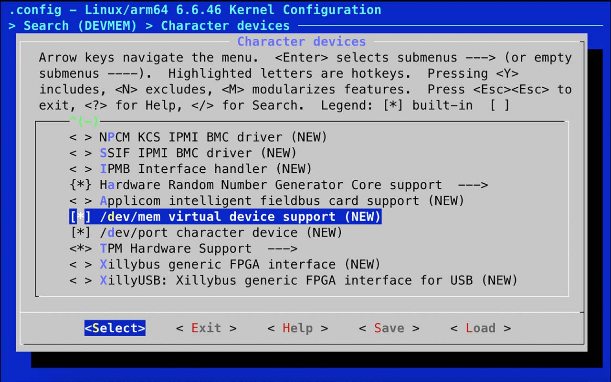
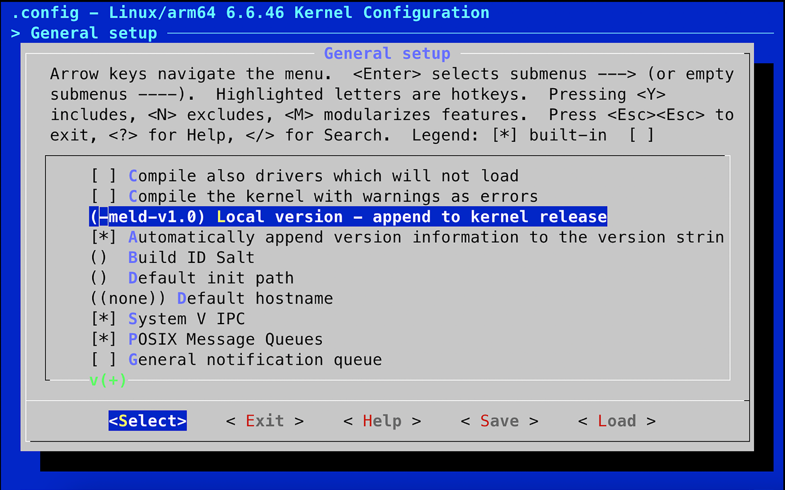

# Chương 4: Cấu hình và build kernel (Configuring and Building the Kernel)

Kernel là thành phần thứ ba của embedded Linux. Nó là thành phần chịu trách nhiệm quản lý tài nguyên và giao tiếp với phần cứng. Vì vậy, nó ảnh hưởng đến hầu hết mọi khía cạnh của bản build phần mềm cuối cùng. Mỗi kernel hoàn chỉnh thường được cấu hình cho một phần cứng cụ thể nào đó. Tuy nhiên, device tree cho phép chúng ta dùng một kernel tổng quát và điều chỉnh nó cho phần cứng tùy chỉnh bằng nội dung của DTB, như đã thấy trong Chương 3.

Trong chương này, chúng ta sẽ xem cách lấy một kernel cho một board và cách cấu hình, compile nó. Chúng ta sẽ xem lại quá trình bootstrap, lần này tập trung vào vai trò của kernel. Chúng ta cũng sẽ xem các device driver và cách chúng lấy thông tin từ device tree.

Trong chương này, chúng ta sẽ đề cập các chủ đề sau:

- Kernel làm gì?

- Chọn một kernel

- Cấu hình kernel

- Compile bằng `Kbuild`

- Build và boot kernel

- Quan sát quá trình boot của kernel

- Port Linux sang một board mới

## Yêu cầu kỹ thuật

Để làm theo các ví dụ, hãy bảo đảm bạn có những thứ sau:

- Một hệ thống host LTS-based Ubuntu 24.04 hoặc mới hơn

- Một toolchain Bootlin `aarch64` từ Chương 2

- Một đầu đọc thẻ microSD và thẻ

- Một thẻ microSD đã cài U-Boot từ Chương 3

- Một cáp serial USB to TTL với mức logic 3.3V

- The Raspberry Pi 4

- The BeaglePlay

- Một bộ nguồn USB-C 5V có khả năng cấp 3A

Code dùng trong chương này có trong thư mục của chương trong GitHub repository của cuốn sách: `https://github.com/PacktPublishing/Mastering-Embedded-Linux-Development/tree/main/Chapter04`.

## Kernel làm gì?

Linux bắt đầu vào năm 1991 khi Linus Torvalds bắt đầu viết một hệ điều hành cho các máy tính cá nhân Intel 386- và 486-based. Ông được truyền cảm hứng từ hệ điều hành MINIX do Andrew S. Tanenbaum viết bốn năm trước đó. Linux khác MINIX ở nhiều điểm; khác biệt chính là nó là một kernel virtual memory 32-bit, và code là open source, về sau được phát hành theo license GPL v2. Ông công bố nó vào ngày 25 tháng Tám năm 1991 trên newsgroup `comp.os.minix` trong một bài đăng nổi tiếng mở đầu bằng:

> Xin chào mọi người đang dùng minix—tôi đang làm một hệ điều hành (miễn phí) (chỉ là sở thích, sẽ không lớn và chuyên nghiệp như GNU) cho các máy AT clone 386(486). Việc này đã được ấp ủ từ tháng Tư, và đang bắt đầu sẵn sàng. Tôi muốn nhận mọi phản hồi về những điều mọi người thích/không thích ở minix, vì OS của tôi phần nào giống nó (cùng bố cục vật lý của filesystem (vì lý do thực tế) cùng những thứ khác).

Nói cho thật chính xác, Linus không viết một hệ điều hành. Ông viết một kernel, vốn chỉ là một thành phần của hệ điều hành. Để tạo ra một hệ điều hành hoàn chỉnh với các lệnh user space và một bộ thông dịch lệnh shell, ông dùng các thành phần từ project GNU, đặc biệt là toolchain, thư viện C và các công cụ command-line cơ bản. Sự phân biệt đó vẫn còn đến ngày nay và mang lại cho Linux rất nhiều sự linh hoạt trong cách nó được sử dụng.

Berkeley Software Distribution (BSD) ra đời trước Linux nhiều năm. BSD bắt đầu như một project nghiên cứu tại Computer Systems Research Group nổi tiếng của University of California, Berkeley vào khoảng cuối những năm 1970. Ban đầu được gọi là Berkeley Unix, BSD dựa trên source code Unix gốc được phát triển tại Bell Labs. Giờ là một hệ điều hành đã không còn tồn tại, BSD sống tiếp dưới hình thức các hậu duệ open source của nó, bao gồm FreeBSD, OpenBSD và NetBSD. Đáng chú ý nhất, hệ điều hành open source Darwin được dùng trong macOS và iOS của Apple là một dẫn xuất của BSD.

Linux kernel có thể được kết hợp với một user space GNU để tạo ra một bản phân phối Linux đầy đủ chạy trên desktop và server, đôi khi được gọi là GNU/Linux. Nó có thể được kết hợp với một user space Android để tạo ra hệ điều hành di động well-known, hoặc có thể được kết hợp với một user space BusyBox-based nhỏ để tạo ra một hệ thống nhúng gọn nhẹ.

Hãy so sánh điều này với các hệ điều hành BSD (FreeBSD, OpenBSD và NetBSD), trong đó kernel, toolchain và user space được kết hợp thành một code base duy nhất. Bằng cách bỏ toolchain, bạn có thể triển khai các runtime image gọn hơn không có compiler hay file header. Bằng cách tách user space khỏi kernel, bạn có thêm các lựa chọn về hệ thống init (`runit` hay `systemd`), thư viện C (`musl` hay `glibc`) và định dạng package (`.apk` hay `.deb`).

Kernel có ba nhiệm vụ chính – quản lý tài nguyên, giao tiếp với phần cứng và cung cấp một API mang lại mức trừu tượng hữu ích cho các chương trình user space, như được tóm tắt trong sơ đồ sau:


Hình 4.1 − User space, kernel space và phần cứng

Các ứng dụng chạy trong user space chạy ở mức đặc quyền CPU thấp. Chúng hầu như không làm được gì ngoài việc gọi thư viện. Giao diện chính giữa user space và kernel space là thư viện C, thư viện này chuyển các hàm user-level, như các hàm được POSIX định nghĩa, thành các system call của kernel. Giao diện system call dùng một phương pháp architecture-specific, như trap hoặc software interrupt, để chuyển CPU từ user mode low-privilege sang kernel mode high-privilege. Một CPU chạy ở kernel mode có quyền truy cập mọi địa chỉ bộ nhớ và mọi thanh ghi CPU.

Bộ xử lý system call phân phối lời gọi tới subsystem kernel thích hợp. Các lời gọi cấp phát bộ nhớ đi tới memory manager, các lời gọi filesystem đi tới code filesystem, v.v. Một số lời gọi đó cần input từ phần cứng bên dưới và sẽ được chuyển xuống một device driver. Trong một số trường hợp, chính phần cứng gọi một hàm kernel bằng cách phát ra một ngắt.

LƯU Ý QUAN TRỌNG

Sơ đồ trong Hình 4.1 cho thấy có một điểm vào thứ hai vào code kernel: ngắt phần cứng. Ngắt chỉ có thể được xử lý trong một device driver, không bao giờ bởi một ứng dụng user space.

Nói cách khác, mọi việc hữu ích mà ứng dụng của bạn làm đều được thực hiện thông qua kernel. Vì vậy, kernel là một trong những thành phần quan trọng nhất của hệ thống. Do đó, điều quan trọng là hiểu cách chọn một kernel.

## Chọn một kernel

Bước tiếp theo là chọn kernel cho project của bạn. Điều quan trọng là cân bằng giữa mong muốn luôn dùng phiên bản phần mềm mới nhất với nhu cầu về các bổ sung vendor-specific và mối quan tâm đến việc hỗ trợ long-term cho code base.

### Chu kỳ phát triển kernel

Linux được phát triển với tốc độ nhanh, một phiên bản mới được phát hành mỗi 8 đến 12 tuần. Cách đánh số phiên bản đã thay đổi qua các năm. Trước tháng Bảy năm 2011, có một lược đồ phiên bản three-number với các số phiên bản trông như 2.6.39. Số ở giữa cho biết đó là bản phát hành cho developer hay bản ổn định. Số lẻ (2.1.x, 2.3.x, 2.5.x) dành cho developer. Số chẵn dành cho người dùng cuối.

Từ phiên bản 2.6 trở đi, ý tưởng về một nhánh phát triển long-lived (các số lẻ) bị bỏ, vì nó làm chậm tốc độ đưa các tính năng mới đến người dùng. Việc đổi số từ 2.6.39 sang 3.0 vào tháng Bảy năm 2011 hoàn toàn là vì Linus cảm thấy các con số đang trở nên quá lớn.

Không có bước nhảy lớn nào về tính năng hay kiến trúc của Linux giữa hai phiên bản đó. Ông cũng nhân cơ hội đó để bỏ số ở giữa. Kể từ đó, Linus đã tăng số phiên bản chính thêm ba lần nữa: lần tiếp theo vào tháng Tư năm 2015 (3 lên 4), lần nữa vào tháng Ba năm 2019 (4 lên 5), và gần đây nhất vào tháng Mười năm 2022 (5 lên 6). Mỗi lần, ông làm vậy hoàn toàn để cho gọn gàng, không phải vì bất kỳ thay đổi kiến trúc lớn nào.

Linus quản lý cây kernel phát triển. Bạn có thể theo dõi ông bằng cách clone cây Git như sau:

```
$ git clone git://git.kernel.org/pub/scm/linux/kernel/git/torvalds/linux.
git
```

Lệnh này sẽ checkout source vào một thư mục con tên là `linux`. Bạn có thể cập nhật bằng cách thỉnh thoảng chạy lệnh `git pull` trong thư mục đó.

Một chu kỳ phát triển kernel đầy đủ bắt đầu bằng một merge window kéo dài hai tuần, trong đó Linus sẽ chấp nhận các patch cho tính năng mới. Ở cuối merge window, một giai đoạn ổn định hóa bắt đầu. Khi merge window đóng lại, Linus sẽ tạo ra các release candidate hằng tuần với số phiên bản kết thúc bằng `-rc1`, `-rc2`, v.v., thường đến `-rc7` hoặc `-rc8`. Trong thời gian này, mọi người kiểm thử các candidate và gửi báo cáo bug cùng bản sửa. Khi tất cả các bug đáng kể đã được sửa, kernel được phát hành.

Code được đưa vào trong merge window cần phải khá trưởng thành rồi. Thông thường, nó được pull từ repository của nhiều maintainer subsystem và kiến trúc của kernel. Bằng cách giữ một chu kỳ phát triển ngắn, các tính năng có thể được merge khi chúng sẵn sàng. Nếu một tính năng bị các maintainer kernel đánh giá là chưa đủ ổn định hoặc chưa phát triển tốt, nó có thể đơn giản được hoãn đến bản phát hành tiếp theo.

Theo dõi những gì đã thay đổi giữa các bản phát hành không dễ. Bạn có thể đọc commit log trong Git repository của Linus, nhưng với quá nhiều mục, khó có được cái nhìn tổng quan. May mắn thay, có website Linux Kernel Newbies (`https://kernelnewbies.org`), nơi bạn có thể tìm thấy tổng quan ngắn gọn về từng phiên bản tại `https://kernelnewbies.org/LinuxVersions`.

### Các bản phát hành stable và long-term support

Tốc độ thay đổi nhanh của Linux là điều tốt ở chỗ nó đưa các tính năng mới vào code base mainline, nhưng nó không phù hợp lắm với vòng đời dài hơn của các project nhúng. Các developer kernel giải quyết điều này theo hai cách: bản phát hành stable và bản phát hành long-term. Sau khi một kernel mainline được phát hành (do Linus Torvalds bảo trì), nó được chuyển sang cây stable (do Greg Kroah-Hartman bảo trì). Các bản sửa bug được áp dụng cho kernel stable trong khi kernel mainline bắt đầu chu kỳ phát triển tiếp theo.

Các point release của kernel stable được đánh dấu bằng số thứ ba (3.18.1, 3.18.2, v.v.). Trước phiên bản 3, có bốn số phát hành (2.6.29.1, 2.6.39.2, v.v.).

Bạn có thể lấy cây stable bằng lệnh sau:

```
$ cd ~
$ git clone git://git.kernel.org/pub/scm/linux/kernel/git/stable/linux-
stable.git
```

Bạn có thể dùng `git` `checkout` để lấy một phiên bản cụ thể như 6.6.46:

```
$ cd linux-stable
$ git checkout v6.6.46
```

Kernel stable thường chỉ được cập nhật đến bản phát hành mainline tiếp theo (8 đến 12 tuần sau), vì vậy bạn sẽ thấy chỉ có một hoặc đôi khi hai kernel stable tại `https://www.kernel.org/`. Để phục vụ những người dùng muốn được cập nhật lâu hơn, một số kernel được gắn nhãn long-term và được bảo trì từ hai năm trở lên. Long-term kernel đi kèm bảo đảm rằng mọi bug sẽ được tìm ra và sửa. Mỗi năm có ít nhất một bản phát hành kernel long-term.

Xem `https://www.kernel.org/` vào tháng Tám năm 2024, có tổng cộng sáu kernel long-term: 6.6, 6.1, 5.15, 5.10, 5.4 và 4.19. Kernel cũ nhất đã được bảo trì gần sáu năm và đang ở phiên bản 4.19.319. Nếu bạn đang xây dựng một sản phẩm mà bạn sẽ phải bảo trì trong khoảng thời gian dài như vậy, thì kernel long-term mới nhất rất có thể là một lựa chọn tốt.

### Hỗ trợ từ nhà cung cấp

Trong một thế giới lý tưởng, bạn có thể tải một kernel từ `https://www.kernel.org/` và cấu hình nó cho bất kỳ thiết bị nào tuyên bố hỗ trợ Linux. Tuy nhiên, điều đó không phải lúc nào cũng khả thi. Thực tế, Linux mainline chỉ hỗ trợ vững chắc cho một tập con nhỏ trong số rất nhiều thiết bị có thể chạy Linux. Bạn có thể tìm thấy hỗ trợ cho board hoặc SoC của mình từ các project open source độc lập như Linaro (`https://www.linaro.org/`) hoặc The Yocto Project (`https://www.yoctoproject.org/`). Có một số công ty cung cấp hỗ trợ third-party có trả phí cho embedded Linux. Nhưng trong nhiều trường hợp, bạn sẽ buộc phải tìm đến nhà cung cấp SoC hoặc board để có một kernel hoạt động được.

Như chúng ta đã biết, một số nhà cung cấp hỗ trợ Linux tốt hơn những nhà cung cấp khác. Lời khuyên của tôi lúc này là chọn những nhà cung cấp hỗ trợ tốt hoặc, tốt hơn nữa, những nhà cung cấp chịu khó đưa các thay đổi kernel của họ vào mainline. Hãy tìm trong mailing list hoặc lịch sử commit của Linux kernel các hoạt động gần đây liên quan đến một SoC hoặc board ứng viên. Khi các thay đổi upstream vắng mặt trong kernel mainline, việc đánh giá một nhà cung cấp có hỗ trợ tốt hay không phần lớn dựa vào truyền miệng. Một số nhà cung cấp nổi tiếng là chỉ phát hành một lần code kernel rồi dồn toàn bộ sức lực sang các SoC mới hơn của họ.

### Cấp phép

Source code Linux được cấp phép theo GPL v2. Điều đó có nghĩa là bạn phải cung cấp source code kernel của mình theo một trong các cách được quy định trong license.

Văn bản thực tế của license kernel nằm trong file `COPYING`. Nó bắt đầu bằng một phụ lục do Linus viết, nói rằng code gọi kernel từ user space thông qua giao diện system call không được coi là tác phẩm phái sinh của kernel và vì vậy không thuộc phạm vi license. Do đó, không có vấn đề gì với các ứng dụng độc quyền chạy trên Linux.

Tuy nhiên, có một khía cạnh của việc cấp phép Linux gây ra nhầm lẫn và tranh cãi không dứt: kernel module. Một kernel module đơn giản là một đoạn code được link động với kernel lúc runtime, qua đó mở rộng chức năng của kernel. General Public License (GPL) không phân biệt giữa static linking và dynamic linking, vì vậy có vẻ như source của kernel module thuộc phạm vi GPL. Trong những ngày đầu của Linux, đã có những tranh luận về các ngoại lệ cho quy tắc này, ví dụ, liên quan đến Andrew File System (AFS). Code này ra đời trước Linux và vì vậy (theo lập luận) không phải là tác phẩm phái sinh, nên license không áp dụng.

Các cuộc thảo luận tương tự đã diễn ra qua nhiều năm đối với các đoạn code khác, với kết quả là giờ đây thực tế được chấp nhận là GPL không nhất thiết áp dụng cho kernel module. Điều này được mã hóa bằng macro `MODULE_LICENSE` của kernel, macro này có thể nhận giá trị `Proprietary` để cho biết module không được phát hành theo GPL. Nếu bạn định tự dùng các lập luận tương tự, có thể bạn muốn đọc qua một luồng email oft-quoted có tiêu đề Linux GPL and binary module exception clause?, được lưu trữ tại `https://yarchive.net/comp/linux/gpl_modules.html`.

GPL nên được coi là điều tốt vì nó bảo đảm rằng khi làm việc với các project nhúng, chúng ta luôn có thể lấy được source code của kernel. Không có nó, embedded Linux sẽ khó dùng hơn nhiều và phân mảnh hơn.

### Các thực hành tốt nhất

Dù vậy, để chọn một kernel, bạn cần cân nhắc lợi ích của việc dùng phiên bản mới nhất so với nhu cầu về các cải tiến vendor-specific và sự ổn định của driver. Ngoài ra, chu kỳ phát triển nhanh của Linux cho phép các tính năng được tích hợp nhanh chóng, với các bản phát hành stable và long-term support dành cho việc bảo trì kéo dài. Các kernel long-term, nhận cập nhật trong hơn hai năm, là lý tưởng cho các project long-term. Hỗ trợ từ nhà cung cấp cũng rất quan trọng, vì vậy hãy bảo đảm chọn những nhà cung cấp tích cực hỗ trợ Linux và đóng góp vào kernel mainline. Cuối cùng, việc cấp phép theo GPL v2 bảo đảm quyền truy cập source code kernel, giúp việc dùng và bảo trì cho các project nhúng dễ dàng hơn.

## Cấu hình kernel

Sau khi đã quyết định dựa image trên kernel nào, bước tiếp theo là cấu hình kernel.

### Lấy source

Cả ba target được dùng trong cuốn sách này (Raspberry Pi 4, BeaglePlay và QEMU) đều được kernel mainline hỗ trợ tốt. Vì vậy, việc dùng kernel long-term mới nhất có tại `https://www.kernel.org/` là hợp lý, mà tại thời điểm viết là 6.6.46. Khi tự làm, bạn nên kiểm tra xem có phiên bản mới hơn của kernel 6.6 không và dùng nó thay thế, vì nó sẽ có các bản sửa cho những bug được phát hiện sau khi 6.6.46 được phát hành.

LƯU Ý QUAN TRỌNG

Nếu có một bản phát hành long-term mới hơn, bạn có thể muốn cân nhắc dùng nó. Tuy nhiên, hãy lưu ý rằng có thể đã có những thay đổi khiến chuỗi lệnh sau đây không hoạt động chính xác như đã viết.

Để tải và giải nén một release tarball của Linux kernel 6.6.46, hãy dùng như sau:

```
$ cd ~
$ wget https://cdn.kernel.org/pub/linux/kernel/v6.x/linux-6.6.46.tar.xz
$ tar xf linux-6.6.46.tar.xz
$ mv linux-6.6.46 linux-stable
```

Để tải một phiên bản mới hơn, hãy thay `6.6.46` sau `linux-` bằng bản phát hành long-term mong muốn.

Có rất nhiều code ở đây. Có hơn 81,000 file trong kernel 6.6 chứa source code C, file header và code assembly, tổng cộng hơn 24 triệu dòng code theo đo đạc của tiện ích SLOCCount. Tuy vậy, đáng để biết bố cục cơ bản của code và đại khái nên tìm một thành phần cụ thể ở đâu. Các thư mục chính đáng quan tâm là:

- `arch`: Chứa các file architecture-specific. Mỗi kiến trúc có một thư mục con.

- `Documentation`: Chứa tài liệu kernel. Luôn xem ở đây trước tiên nếu bạn muốn tìm thêm thông tin về một khía cạnh của Linux.

- `drivers`: Chứa các device driver, hàng nghìn driver. Mỗi loại driver có một thư mục con.

- `fs`: Chứa code filesystem.

- `include`: Chứa các file header của kernel, bao gồm những file cần khi build toolchain.

- `init`: Chứa code start-up của kernel.

- `kernel`: Chứa các hàm lõi, bao gồm lập lịch, locking, timer, quản lý điện năng và code debug/trace.

- `mm`: Chứa phần quản lý bộ nhớ.

- `net`: Chứa các giao thức mạng.

- `scripts`: Chứa nhiều script hữu ích, bao gồm device tree compiler mà tôi đã mô tả trong Chương 3.

- `tools`: Chứa nhiều công cụ hữu ích, bao gồm công cụ Linux performance counters (`perf`) mà tôi sẽ mô tả trong Chương 20.

Theo thời gian, bạn sẽ quen với cấu trúc này và nhận ra rằng nếu bạn đang tìm code cổng serial của một SoC cụ thể, bạn sẽ tìm thấy nó trong `drivers/tty/serial` chứ không phải trong `arch/$ARCH/mach-foo`, vì nó là một device driver chứ không phải thứ gì đó architecture-specific của CPU.

### Tìm hiểu cấu hình kernel– Kconfig

Một trong những điểm mạnh của Linux là mức độ bạn có thể cấu hình kernel cho phù hợp với các công việc khác nhau, từ một thiết bị chuyên dụng nhỏ như smart thermostat đến một chiếc điện thoại di động phức tạp. Trong các phiên bản hiện tại, có hàng nghìn tùy chọn cấu hình. Cấu hình đúng tự nó đã là một nhiệm vụ, nhưng trước khi đi vào đó, tôi muốn cho bạn thấy nó hoạt động như thế nào để bạn hiểu rõ hơn những gì đang diễn ra.

Cơ chế cấu hình được gọi là `Kconfig`, và build system tích hợp với nó được gọi là `Kbuild`. Cả hai đều được ghi tài liệu trong `Documentation/kbuild`. `Kconfig`/`Kbuild` được dùng trong nhiều project khác ngoài kernel, bao gồm Crosstool-NG, U-Boot, Barebox và BusyBox.

Các tùy chọn cấu hình được khai báo trong một phân cấp các file tên là `Kconfig`, dùng cú pháp được mô tả trong `Documentation/kbuild/kconfig-language.rst`.

Trong Linux, `Kconfig` top-level trông như sau:

```
mainmenu "Linux/$(ARCH) $(KERNELVERSION) Kernel Configuration"

comment "Compiler: $(CC_VERSION_TEXT)"

source "scripts/Kconfig.include"
<…>
```

Và dòng đầu tiên của `arch/Kconfig` là:

```
source "arch/$(SRCARCH)/Kconfig"
```

Dòng đó include file cấu hình architecture-dependent, file này source các file `Kconfig` khác tùy theo những tùy chọn nào được bật.

Việc để kiến trúc đóng vai trò nổi bật như vậy có ba hệ quả:

- Thứ nhất, bạn phải chỉ định một kiến trúc khi cấu hình Linux bằng cách đặt `ARCH=<architecture>`; nếu không, nó sẽ mặc định là kiến trúc của máy cục bộ.

- Thứ hai, giá trị bạn đặt cho `ARCH` thường quyết định giá trị của `SRCARCH`, vì vậy bạn hiếm khi cần đặt `SRCARCH` một cách tường minh.

- Thứ ba, bố cục của menu top-level khác nhau cho mỗi kiến trúc.

Giá trị bạn đặt vào `ARCH` là một trong các thư mục con trong thư mục `arch`, với một điểm kỳ lạ là `ARCH=i386` và `ARCH=x86_64` đều source `arch/x86/Kconfig`.

Các file `Kconfig` phần lớn gồm các menu được giới hạn bởi các từ khóa `menu` và `endmenu`. Các mục menu được đánh dấu bằng từ khóa `config`.

Sau đây là một ví dụ lấy từ `drivers/char/Kconfig`:

```
menu "Character devices"
<…>
config DEVMEM
    bool "/dev/mem virtual device support"
    default y
    help
      Say Y here if you want to support the /dev/mem device.
      The /dev/mem device is used to access areas of physical memory.
      When in doubt, say "Y".
<…>
endmenu
```

Tham số theo sau `config` đặt tên một biến, trong trường hợp này là `DEVMEM`. Vì tùy chọn này là `bool` (Boolean), nó chỉ có thể có hai giá trị: nếu được bật, nó được gán `y`, và nếu không được bật, biến hoàn toàn không được định nghĩa. Tên của mục menu được hiển thị trên màn hình là chuỗi theo sau từ khóa `bool`.

Mục cấu hình này, cùng với tất cả các mục khác, được lưu trong một file tên là `.config`.

MẸO

Dấu chấm ở đầu (`.`) trong `.config` có nghĩa là đó là một file ẩn, sẽ không được hiển thị bởi lệnh `ls` trừ khi bạn gõ `ls -a` để hiển thị tất cả các file.

Dòng tương ứng với mục cấu hình này là:

```
CONFIG_DEVMEM=y
```

Có nhiều kiểu dữ liệu khác ngoài `bool`. Đây là danh sách đầy đủ:

- `bool`: `y` hoặc không được định nghĩa.

- `tristate`: Dùng khi một tính năng có thể được build thành kernel module hoặc build vào kernel image chính. Các giá trị là `m` cho module, `y` để build vào, và không được định nghĩa nếu tính năng không được bật.

- `int`: Một giá trị số nguyên dùng ký hiệu thập phân.

- `hex`: Một giá trị số nguyên không dấu dùng ký hiệu thập lục phân.

- `string`: Một giá trị chuỗi.

Có thể có các dependency giữa các mục được biểu diễn bằng cấu trúc `depends on`, như sau:

```
config MTD_CMDLINE_PARTS
    tristate "Command line partition table parsing"
    depends on MTD
```

Nếu `CONFIG_MTD` chưa được bật ở nơi khác, tùy chọn menu này không được hiển thị và vì vậy không thể được chọn.

Cũng có các dependency ngược. Từ khóa `select` bật các tùy chọn khác nếu tùy chọn này được bật. File `Kconfig` trong `arch/$ARCH` có rất nhiều câu lệnh `select` bật các tính năng đặc thù của kiến trúc, như thấy ở đây cho Arm:

```
config ARM
    bool
    default y
    select ARCH_CLOCKSOURCE_DATA
    select ARCH_HAS_DEVMEM_IS_ALLOWED
<…>
```

Bằng cách chọn `ARCH_CLOCKSOURCE_DATA` và `ARCH_HAS_DEVMEM_IS_ALLOWED`, chúng ta gán giá trị `y` cho các biến này để các tính năng này được build tĩnh vào kernel.

Có nhiều tiện ích cấu hình có thể đọc các file `Kconfig` và tạo ra một file `.config`. Một số tiện ích hiển thị menu trên màn hình và cho phép bạn lựa chọn một cách tương tác. `menuconfig` có lẽ là tiện ích mà hầu hết mọi người quen thuộc, nhưng cũng có `xconfig` và `gconfig`.

Để dùng `menuconfig`, trước tiên bạn cần cài đặt `ncurses`, `flex` và `bison`. Lệnh sau cài đặt tất cả các điều kiện tiên quyết này trên Ubuntu:

```
$ sudo apt install libncurses5-dev flex bison
```

Bạn khởi chạy `menuconfig` qua lệnh `make`, nhớ rằng với kernel, bạn cần cung cấp một kiến trúc, như minh họa ở đây:

```
$ cd ~
$ export PATH=${HOME}/aarch64--glibc--stable-2024.02-1/bin/:$PATH
$ export CROSS_COMPILE=aarch64-buildroot-linux-gnu-
$ cd linux-stable
$ mkdir ../build_arm64
$ make ARCH=arm64 menuconfig O=../build_arm64
```

Hãy bảo đảm biến `PATH` của bạn trỏ tới toolchain 64-bit mà bạn đã tải về ở Chương 2.

Ở đây bạn có thể thấy `menuconfig` với tùy chọn cấu hình `DEVMEM` được nói đến trước đó đang được tô sáng:



Hình 4.2 − Chọn DEVMEM

Dấu sao (`*`) bên trái một mục có nghĩa là driver đã được chọn để build tĩnh vào kernel. Nếu là `M`, thì nó đã được chọn để build thành một kernel module để nạp vào kernel lúc runtime.

MẸO

Bạn thường thấy các hướng dẫn như bật `CONFIG_BLK_DEV_INITRD`, nhưng với quá nhiều menu cần duyệt qua, có thể mất một lúc để tìm nơi cấu hình đó được đặt. Mọi trình chỉnh sửa cấu hình đều có chức năng tìm kiếm. Bạn có thể truy cập nó trong `menuconfig` bằng cách nhấn phím gạch chéo /. Trong `xconfig`, nó nằm trong menu Edit, nhưng hãy bảo đảm bạn bỏ phần `CONFIG_` của mục cấu hình mà bạn đang tìm.

Với quá nhiều thứ cần cấu hình, việc bắt đầu từ con số không mỗi lần muốn build kernel là không hợp lý, vì vậy có một tập các file cấu hình đã biết là hoạt động được trong `arch/$ARCH/configs`, mỗi file chứa các giá trị cấu hình phù hợp cho một SoC hoặc một nhóm SoC.

Bạn có thể chọn một file bằng lệnh `make <configuration file name>`. Ví dụ, để cấu hình Linux chạy trên nhiều loại SoC Arm 64-bit, bạn sẽ gõ:

```
$ make ARCH=arm64 defconfig O=../build_arm64
```

Đây là một kernel tổng quát chạy trên nhiều board khác nhau. Với một ứng dụng chuyên biệt hơn, như khi dùng một kernel vendor-supplied, file cấu hình mặc định là một phần của board support package. Bạn sẽ cần tìm ra file nào cần dùng trước khi có thể build kernel.

Có một target cấu hình hữu ích khác tên là `oldconfig`. Bạn dùng nó khi chuyển một cấu hình sang phiên bản kernel mới. Target này lấy một file `.config` có sẵn và hỏi bạn các câu hỏi về các tùy chọn cấu hình mới. Hãy copy `.config` từ kernel cũ sang thư mục source mới và chạy lệnh `make ARCH=arm64 oldconfig` để cập nhật nó.

Target `oldconfig` cũng có thể được dùng để kiểm tra một file `.config` mà bạn đã sửa thủ công (bỏ qua dòng chữ Automatically generated file; DO NOT EDIT ở đầu file).

Nếu bạn có thay đổi cấu hình, thì file `.config` đã sửa đổi trở thành một phần của board support package và cần được đặt dưới quản lý source code.

Khi bạn bắt đầu build kernel, một file header tên là `include/generated/autoconf.h` được tạo ra. File header này chứa một `#define` cho mỗi giá trị cấu hình để nó có thể được include trong source kernel.

Giờ chúng ta đã chọn được một kernel và học cách cấu hình nó, chúng ta sẽ đặt định danh cho nó.

### Dùng LOCALVERSION để định danh kernel của bạn

Bạn có thể tìm ra phiên bản và release của kernel mà bạn đã build bằng các target `make kernelversion` và `make kernelrelease`:

```
$ make ARCH=arm64 kernelversion
6.6.46
$ make ARCH=arm64 kernelrelease O=../build_arm64
6.6.46
```

Thông tin này được báo cáo lúc runtime qua lệnh `uname` và cũng được dùng để đặt tên thư mục lưu các kernel module.

Nếu bạn thay đổi cấu hình so với mặc định, nên nối thêm thông tin phiên bản của bạn, điều mà bạn có thể cấu hình bằng cách đặt `CONFIG_LOCALVERSION` bằng `menuconfig`:

```
$ make ARCH=arm64 menuconfig O=../build_arm64
```

Ví dụ, nếu tôi muốn đánh dấu kernel tôi đang build bằng định danh `meld` và phiên bản `1.0`, tôi sẽ định nghĩa local version trong `menuconfig` như sau:



Hình 4.3 – Nối thêm vào phiên bản kernel release

Thoát khỏi `menuconfig` và chọn Yes khi được hỏi có lưu cấu hình mới không.

Chạy `make prepare` để làm mới `Makefile` với phiên bản `kernelrelease` mới:

```
$ make ARCH=arm64 prepare O=../build_arm64
```

Chạy `make kernelversion` cho cùng output như trước, nhưng nếu giờ tôi chạy `make kernelrelease`, tôi thấy:

```
$ make ARCH=arm64 kernelrelease O=../build_arm64
6.6.46-meld-v1.0
```

Đó là một chuyến đi vòng thú vị qua việc đánh phiên bản kernel, nhưng giờ hãy quay lại việc cấu hình kernel để compile.

### Khi nào nên dùng kernel module

Tôi đã nhắc đến kernel module vài lần rồi. Các bản phân phối Linux desktop dùng chúng rất nhiều để các hàm thiết bị và kernel đúng có thể được nạp lúc runtime tùy theo phần cứng được phát hiện và các tính năng cần thiết. Không có chúng, từng driver và tính năng sẽ phải được link tĩnh vào kernel, khiến nó lớn đến mức không khả thi.

Mặt khác, với các thiết bị nhúng, phần cứng và cấu hình kernel thường đã được biết vào thời điểm build kernel; vì vậy, module không hữu ích lắm. Thực tế, chúng gây ra vấn đề vì tạo ra một dependency về phiên bản giữa kernel và root filesystem, điều có thể gây lỗi boot nếu một bên được cập nhật mà bên kia thì không. Do đó, khá phổ biến là các kernel nhúng được build mà không có module nào cả.

Sau đây là một vài trường hợp mà kernel module là một ý hay trong hệ thống nhúng:

- Khi bạn có các module độc quyền, vì những lý do license đã nêu ở phần trước.

- Để giảm thời gian boot bằng cách hoãn việc nạp các driver non-essential.

- Khi có nhiều driver có thể cần nạp và việc compile tĩnh chúng sẽ chiếm quá nhiều bộ nhớ. Ví dụ, bạn có một giao tiếp USB hỗ trợ nhiều loại thiết bị. Về bản chất, đây là cùng lập luận được dùng trong các bản phân phối desktop.

- Tiếp theo, hãy học cách compile một kernel image có hoặc không có kernel module bằng `Kbuild`.

## Compile bằng Kbuild

Kernel build system (`Kbuild`) là một tập các script `make` lấy thông tin cấu hình từ file `.config`, tính toán các dependency và compile mọi thứ cần thiết để tạo ra một kernel image. Kernel image này chứa tất cả các thành phần được link tĩnh, một device tree binary tùy chọn và mọi kernel module. Các dependency được biểu diễn trong các Makefile bên trong mỗi thư mục có thành phần build được. Ví dụ, hai dòng sau được lấy từ `drivers/char/Makefile`:

```
obj-y += mem.o random.o
obj-$(CONFIG_TTY_PRINTK) += ttyprintk.o
```

Quy tắc `obj-y` compile một file vô điều kiện để tạo ra target, vì vậy `mem.c` và `random.c` luôn là một phần của kernel. Ở dòng thứ hai, `ttyprintk.c` phụ thuộc vào một tham số cấu hình. Nếu `CONFIG_TTY_PRINTK` là `y`, thì nó được compile dưới dạng built-in. Nếu là `m`, thì nó được build thành module. Nếu tham số không được định nghĩa, thì nó hoàn toàn không được compile.

Với hầu hết các target, chỉ cần gõ `make` (với `ARCH` và `CROSS_COMPILE` thích hợp) là được, nhưng làm từng bước một sẽ mang tính hướng dẫn hơn. Xem phần cuối của Chương 2 để biết ý nghĩa của biến `make` `CROSS_COMPILE`.

### Tìm ra target kernel cần build

Để build một kernel image, bạn cần biết bootloader của mình mong đợi gì. Đây là một hướng dẫn sơ bộ:

- U-Boot: Có thể nạp một file `Image.gz` đã nén cho Arm 64-bit. Cũng có thể nạp một file `zImage` self-extracting cho Arm 32-bit bằng lệnh `bootz`.

- Các target x86: Cần một file `bzImage`.

- Hầu hết các bootloader khác: Cần một file `zImage`.

Sau đây là một ví dụ build một file `Image.gz` cho Arm 64-bit:

```
$ sudo apt install libssl-dev
$ PATH=~/aarch64--glibc--stable-2024.02-1/bin/:$PATH
$ cd ~
$ cd linux-stable
$ make -j<n> ARCH=arm64 CROSS_COMPILE=aarch64-buildroot-linux-gnu- Image.
gz O=../build_arm64
```

Hãy bảo đảm biến `PATH` của bạn trỏ tới toolchain 64-bit mà bạn đã tải về ở Chương 2.

LƯU Ý QUAN TRỌNG

Lần đầu tiên chạy `make` trên cây source kernel, bạn có thể được hỏi có đưa vào hay bỏ qua các tính năng, tùy chọn và plugin khác nhau. Hầu hết các tính năng và tùy chọn này tăng cường bảo mật, vì vậy thêm chúng vào cũng không hại gì. Có một ngoại lệ đáng chú ý. Khi được hỏi về GCC plugin, hãy bảo đảm nhập `n` cho no như sau:

```
*
* GCC plugins
*
GCC plugins (GCC_PLUGINS) [Y/n/?] (NEW) n
```

Nếu không, quá trình build sẽ thất bại vì `make` không tìm thấy `g++`.

Hãy nhớ thay `<n>` sau `make -j` bằng số lõi CPU có trên máy host để tăng tốc việc build.

MẸO

Tùy chọn `-j<n>` cho `make` biết cần chạy bao nhiêu job song song, giúp giảm thời gian build. `make -j4` chạy bốn job. Một hướng dẫn sơ bộ là chạy số job bằng số lõi CPU bạn có.

Kernel AArch64 hiện không cung cấp bộ giải nén, vì vậy cần bootloader thực hiện việc giải nén (`gzip`, v.v.) nếu dùng một target `Image` đã nén (ví dụ, `Image.gz`).

Bất kể chúng ta nhắm tới định dạng kernel image nào, hai build artifact giống nhau (`vmlinux` và `System.map`) đều được tạo ra trước khi image boot được được tạo.

### Các build artifact

Một lần build kernel tạo ra hai file trong thư mục top-level: `vmlinux` và `System.map`. File đầu tiên, `vmlinux`, là kernel dưới dạng một ELF binary. Nếu bạn đã compile kernel với debug được bật (`CONFIG_DEBUG_INFO=y`), nó sẽ chứa các debug symbol có thể được dùng với các debugger như `kgdb`. Bạn cũng có thể dùng các công cụ ELF binary khác, như `size` để đo độ dài của mỗi segment (`text`, `data` và `bss`) tạo nên file thực thi `vmlinux`:

```
$ cd ~
$ cd build_arm64
$ aarch64-buildroot-linux-gnu-size vmlinux
   text    data     bss     dec     hex filename
25923719        15631632         620032 42175383        2838b97 vmlinux
```

Một chương trình như kernel được chia thành các segment trong bộ nhớ. Segment `text` chứa các lệnh thực thi (code). Segment `data` chứa các biến toàn cục và biến static đã được khởi tạo. Segment `bss` chứa các biến toàn cục và biến static chưa được khởi tạo. Các giá trị `dec` và `hex` lần lượt là tổng kích thước file ở hệ thập phân và thập lục phân.

`System.map` chứa bảng symbol ở dạng human-readable.

Hầu hết các bootloader không thể xử lý trực tiếp code ELF. Có thêm một giai đoạn xử lý lấy `vmlinux` và đặt các binary phù hợp cho các bootloader khác nhau vào `arch/$ARCH/boot`:

- `Image`: `vmlinux` được chuyển sang định dạng binary thô.

- `zImage`: Với kiến trúc PowerPC, đây chỉ là một phiên bản nén của `Image`, ngụ ý rằng bootloader phải thực hiện việc giải nén. Với tất cả các kiến trúc khác, `Image` đã nén được gắn kèm vào một đoạn code stub có nhiệm vụ giải nén và di chuyển nó.

- `uImage`: `zImage` cộng thêm một U-Boot header 64 byte.

Trong khi build đang chạy, bạn sẽ thấy bản tóm tắt các lệnh đang được thực thi:

```
$ make -j<n> ARCH=arm64 CROSS_COMPILE=aarch64-buildroot-linux-gnu- Image.
gz O=../build_arm64
<…>
  CC      scripts/mod/empty.o
  HOSTCC  scripts/mod/mk_elfconfig
  CC      scripts/mod/devicetable-offsets.s
  UPD     scripts/mod/devicetable-offsets.h
  MKELF   scripts/mod/elfconfig.h
  HOSTCC  scripts/mod/modpost.o
  HOSTCC  scripts/mod/file2alias.o
  HOSTCC  scripts/mod/sumversion.o
<…>
```

Khi build kernel thất bại, đôi khi việc xem các lệnh thực sự đang được thực thi là hữu ích. Để làm điều đó, hãy thêm `V=1` vào command line:

```
$ make -j<n> ARCH=arm64 CROSS_COMPILE=aarch64-buildroot-linux-gnu- V=1
Image.gz O=../build_arm64
```

Trong phần này, chúng ta đã học cách `Kbuild` lấy một ELF binary `vmlinux` đã compile sẵn và chuyển nó thành một kernel image có thể boot. Tiếp theo, chúng ta sẽ xem cách compile device tree.

### Compile device tree

Bước tiếp theo là build device tree, hoặc các device tree nếu bạn có một bản build multi-platform. Target `dtbs` build các device tree theo các quy tắc trong `arch/$ARCH/boot/dts/Makefile`, dùng các file source device tree trong thư mục đó. Sau đây là một đoạn trích từ việc build target `dtbs` cho `arch/arm64/configs/defconfig`:

```
$ make ARCH=arm64 dtbs CROSS_COMPILE=aarch64-buildroot-linux-gnu-  O=../
build_arm64
  <…>
  DTC     arch/arm64/boot/dts/ti/k3-am625-beagleplay.dtb
  DTC     arch/arm64/boot/dts/ti/k3-am625-phyboard-lyra-rdk.dtb
  DTC     arch/arm64/boot/dts/ti/k3-am625-sk.dtb
  DTC     arch/arm64/boot/dts/ti/k3-am625-verdin-nonwifi-dahlia.dtb
  DTC     arch/arm64/boot/dts/ti/k3-am625-verdin-nonwifi-dev.dtb
  DTC     arch/arm64/boot/dts/ti/k3-am625-verdin-nonwifi-yavia.dtb
  DTC     arch/arm64/boot/dts/ti/k3-am625-verdin-wifi-dahlia.dtb
  DTC     arch/arm64/boot/dts/ti/k3-am625-verdin-wifi-dev.dtb
  DTC     arch/arm64/boot/dts/ti/k3-am625-verdin-wifi-yavia.dtb
  <…>
```

Các file `.dtb` đã compile được tạo trong thư mục output `../build_arm64`.

### Compile module

Nếu bạn đã cấu hình một số tính năng để build thành module, thì bạn có thể build chúng riêng bằng target `modules`:

```
$ make -j<n> ARCH=arm64 CROSS_COMPILE=aarch64-buildroot-linux-gnu- modules
O=../build_arm64
```

Hãy thay `<n>` sau `make -j` bằng số lõi CPU có trên máy host để tăng tốc việc build.

Các module đã compile có hậu tố `.ko` và được tạo trong cùng thư mục với source code, nghĩa là chúng nằm rải rác khắp cây source kernel. Việc tìm chúng hơi khó, nhưng bạn có thể dùng target `modules_install` để cài đặt chúng vào đúng chỗ.

Vị trí mặc định là `/lib/modules` trên hệ thống phát triển của bạn, gần như chắc chắn không phải là điều bạn muốn. Để cài đặt chúng vào vùng staging của root filesystem, hãy cung cấp đường dẫn bằng `INSTALL_MOD_PATH`:

```
$ mkdir ~/rootfs
$ make -j<n> ARCH=arm64 CROSS_COMPILE=aarch64-buildroot-linux-gnu-
INSTALL_MOD_PATH=$HOME/rootfs modules_install O=../build_arm64
```

Các kernel module được đặt vào thư mục `/lib/modules/<kernel version>` tính tương đối từ gốc của filesystem.

### Dọn dẹp source kernel

Có ba make target để dọn dẹp cây source kernel:

- clean: Xóa các object file và hầu hết các file trung gian.

- mrproper: Xóa tất cả các file trung gian, bao gồm file `.config`. Dùng target này để đưa cây source về trạng thái ngay sau khi clone hoặc giải nén source code. Mr. Proper là một sản phẩm tẩy rửa phổ biến ở một số nơi trên thế giới. Mục đích của `make mrproper` là cọ rửa thật sạch source kernel.

- distclean: Giống `mrproper` nhưng cũng xóa các file backup của trình soạn thảo, file patch và các artifact khác của quá trình phát triển phần mềm.

## Build và boot kernel

Việc build và boot Linux rất device-dependent. Trong phần này, tôi sẽ cho bạn thấy cách làm với Raspberry Pi 4, BeaglePlay và QEMU. Với các target board khác, bạn phải tham khảo thông tin từ nhà cung cấp hoặc từ project cộng đồng nếu có.

### Build kernel cho Raspberry Pi 4

Mặc dù có hỗ trợ cho Raspberry Pi 4 trong kernel mainline, tôi thích dùng fork Linux của Raspberry Pi Foundation (`https://github.com/raspberrypi/linux`) hơn vì tính ổn định. 6.6 là kernel long-term mới nhất được fork đó hỗ trợ vào tháng Tám năm 2024, vì vậy đó là phiên bản chúng ta sẽ build.

Vì Raspberry Pi 4 có CPU 64-bit quad-core Arm Cortex-A72, chúng ta sẽ dùng toolchain Bootlin từ Chương 2 để cross-compile một kernel 64-bit cho nó.

Cài đặt một package mà chúng ta cần để build kernel:

```
$ sudo apt install libssl-dev
```

Giờ bạn đã cài đặt toolchain và các package cần thiết, hãy clone nhánh `6.6.y` của kernel repo với độ sâu one-level vào một thư mục tên là `linux-rpi` và export một số binary dựng sẵn vào một thư mục con `boot`:

```
$ cd ~
$ git clone --depth=1 -b rpi-6.6.y https://github.com/raspberrypi/linux.
git linux-rpi
$ git clone --depth=1 -b 1.20240529 https://github.com/raspberrypi/
firmware.git firmware-rpi
$ mv firmware-rpi/boot .
$ rm -rf firmware-rpi
$ rm boot/kernel*
$ rm boot/*.dtb
$ rm boot/overlays/*.dtbo
```

Đối số `--depth=n` chỉ thị Git chỉ fetch `n` commit cuối cùng khi clone.

Đi tới thư mục `linux-rpi` vừa clone và build kernel:

```
$ PATH=~/aarch64--glibc--stable-2024.02-1/bin/:$PATH
$ cd ~
$ cd linux-rpi
$ make ARCH=arm64 CROSS_COMPILE=aarch64-buildroot-linux-gnu- bcm2711_
defconfig O=../build_rpi
$ make -j<n> ARCH=arm64 CROSS_COMPILE=aarch64-buildroot-linux-gnu- O=../
build_rpi
```

Hãy thay `<n>` sau `make -j` bằng số lõi CPU có trên máy host để tăng tốc việc build.

Khi build xong, copy kernel image, các device tree blob và các tham số boot vào thư mục con boot:

```
$ cp ../build_rpi/arch/arm64/boot/Image ../boot/kernel8.img
$ cp ../build_rpi/arch/arm64/boot/dts/overlays/*.dtbo ../boot/overlays/
$ cp ../build_rpi/arch/arm64/boot/dts/broadcom/*.dtb ../boot/
$ cat << EOF > ../boot/config.txt
enable_uart=1
arm_64bit=1
EOF
$ cat << EOF > ../boot/cmdline.txt
console=serial0,115200 console=tty1 root=/dev/mmcblk0p2 rootwait
EOF
```

Các lệnh trên đều có trong script `MELD/Chapter04/build-linux-rpi4.sh`. Lưu ý rằng kernel command line được ghi vào `cmdline.txt` phải nằm hoàn toàn trên một dòng. Hãy chia các bước này thành các giai đoạn:

1\. Clone nhánh `rpi-6.6.y` của fork kernel của Raspberry Pi Foundation vào một thư mục `linux-rpi`.

2\. Clone tag `1.20240529` của firmware rep của Raspberry Pi Foundation vào một thư mục `firmware-rpi`.

3\. Chuyển thư mục con `boot` từ repo `firmware` của Raspberry Pi Foundation sang một thư mục `boot`.

4\. Xóa các kernel image\[s\], device tree blob và device tree overlay có sẵn khỏi thư mục `boot`.

5\. Từ thư mục `linux-rpi`, build kernel 64-bit, các module và device tree cho Raspberry Pi 4.

6\. Copy kernel image, các device tree blob và device tree overlay newly-built từ ./ build\_rpi/`arch/arm64/boot` sang thư mục `boot`.

7\. Ghi các file `config.txt` và `cmdline.txt` vào thư mục `boot` để bootloader của Raspberry Pi 4 đọc và truyền cho kernel.

Hãy xem các thiết lập trong `config.txt`. Dòng `enable_uart=1` bật serial console trong lúc boot, vốn bị tắt theo mặc định. Dòng `arm_64bit=1` chỉ thị bootloader của Raspberry Pi 4 khởi động CPU ở chế độ 64-bit và nạp kernel image từ một file tên là `kernel8.img`.

Giờ hãy xem `cmdline.txt`. Các tham số kernel command-line `console=serial0,115200` và `console=tty1` chỉ thị kernel xuất các thông điệp log ra serial console khi kernel boot.

### Boot Raspberry Pi 4

Các thiết bị Raspberry Pi dùng một bootloader độc quyền do Broadcom cung cấp thay vì U-Boot. Không giống các model Raspberry Pi trước, bootloader của Raspberry Pi 4 nằm trên một SPI EEPROM onboard chứ không phải trên thẻ microSD. Chúng ta vẫn cần đặt kernel image và các device tree blob cho Raspberry Pi 4 lên một thẻ microSD để boot kernel 64-bit.

Trước khi tiếp tục, bạn cần một thẻ microSD có phân vùng `boot` FAT32 đủ lớn để chứa các build artifact kernel cần thiết. Phân vùng `boot` cần là phân vùng đầu tiên trên thẻ microSD. Kích thước phân vùng 1 GB là đủ.

Để được hướng dẫn nối cáp serial USB-to-TTL với Raspberry Pi 4, hãy xem `https://learn.adafruit.com/adafruits-raspberry-pi-lesson-5-using-a-console-cable/connect-the-lead`.

Để chuẩn bị một thẻ microSD với kernel image vừa build và boot nó trên Raspberry Pi 4:

1\. Đầu tiên, đi tới thư mục ở cấp trên thư mục `boot` một bậc:

```
$ cd ~
```

2\. Tiếp theo, cắm thẻ microSD vào đầu đọc thẻ và copy toàn bộ nội dung của thư mục `boot` vào phân vùng `boot`.

3\. Unmount thẻ và cắm nó vào Raspberry Pi 4.

4\. Nối cáp serial USB-to-TTL vào các chân GND, TXD và RXD trên header GPIO 40-pin.

5\. Khởi động một terminal emulator như `gtkterm`.

6\. Cuối cùng, cấp nguồn cho Raspberry Pi 4.

Bạn sẽ thấy output sau trên serial console:

```
[    0.000000] Booting Linux on physical CPU 0x0000000000 [0x410fd083]
[    0.000000] Linux version 6.6.45-v8+ (frank@frank-nuc) (aarch64-
buildroot-linux-gnu-gcc.br_real (Buildroot 2021.11-11272-ge2962af) 12.3.0,
GNU ld (GNU Binutils) 2.41) #1 SMP PREEMPT Mon Aug 19 08:51:43 PDT 2024
[    0.000000] KASLR enabled
[    0.000000] random: crng init done
[    0.000000] Machine model: Raspberry Pi 4 Model B Rev 1.1
[    0.000000] efi: UEFI not found.
[    0.000000] Reserved memory: created CMA memory pool at
0x000000002ac00000, size 64 MiB
<…>
```

Trình tự sẽ kết thúc bằng một kernel panic vì kernel không tìm thấy root filesystem trên thẻ microSD. Tôi sẽ giải thích kernel panic là gì ở phần sau của chương này.

### Build kernel cho BeaglePlay

Sau đây là chuỗi lệnh để build kernel, các module và device tree cho BeaglePlay:

1\. Đầu tiên, thêm toolchain Arm 64-bit vào `PATH` nếu bạn chưa làm:

```
$ PATH=~/aarch64--glibc--stable-2024.02-1/bin/:$PATH
```

2\. Tiếp theo, quay lại cây source Linux mainline:

```
$ cd ~
$ cd linux-stable
$ mkdir ../build_beagleplay
```

3\. Đặt các biến môi trường `ARCH` và `CROSS_COMPILE` cho Arm 64-bit:

```
$ export ARCH=arm64
$ export CROSS_COMPILE=aarch64-buildroot-linux-gnu-
```

4\. Chạy `make defconfig` để cấu hình một kernel phù hợp cho hầu hết các SoC Arm 64-bit:

```
$ make defconfig O=../build_beagleplay
```

5\. Chạy `make menuconfig` để tiếp tục cấu hình kernel:

```
$ make menuconfig O=../build_beagleplay
```

6\. Đi vào submenu General architecture-dependent options.

7\. Bỏ chọn GCC plugins nếu nó đang được đặt.

8\. Thoát khỏi submenu General architecture-dependent options.

9\. Đi vào submenu Platform selection.

10\. Bỏ chọn hỗ trợ cho tất cả các SoC trừ Texas Instruments Inc. K3 multicore SoC architecture.

11\. Thoát khỏi submenu Platform selection.

12\. Đi vào submenu Device drivers \| Graphics support

13\. Bỏ chọn Direct Rendering Manager.

14\. Thoát khỏi các submenu Graphics support và Device drivers.

15\. Thoát khỏi `menuconfig` và chọn Yes khi được hỏi có lưu cấu hình mới không.

16\. Cuối cùng, build kernel, các module và device tree cho BeaglePlay:

```
$ make -j<n> O=../build_beagleplay
```

Hãy thay `<n>` sau `make -j` bằng số lõi CPU có trên máy host để tăng tốc việc build.

### Boot BeaglePlay

Trước khi tiếp tục, bạn cần một thẻ microSD đã cài U-Boot, như được mô tả trong phần có tiêu đề Cài đặt U-Boot ở Chương 3:

1\. Đầu tiên, đi tới thư mục ở cấp trên thư mục `build_beagleplay` một bậc:

```
$ cd ~
```

2\. Tiếp theo, cắm thẻ microSD vào đầu đọc thẻ và copy các file `build_beagleplay/arch/arm64/boot/Image.gz` và `build_beagleplay/arch/arm64/boot/dts/ti/k3-am625-beagleplay.dtb` vào phân vùng `boot` FAT32.

3\. Unmount thẻ và cắm nó vào BeaglePlay.

4\. Khởi động một terminal emulator như `gtkterm` và chuẩn bị nhấn phím cách ngay khi thấy các thông điệp U-Boot xuất hiện.

5\. Cấp nguồn cho BeaglePlay trong khi giữ nút USR và nhấn phím cách.

6\. Cuối cùng, nhập các lệnh sau tại dấu nhắc U-Boot:

```
nova!> setenv bootargs console=ttyS2,115200n8
nova!> fatload mmc 1 0x80000000 Image.gz
nova!> fatload mmc 1 0x82000000 k3-am625-beagleplay.dtb
nova!> setenv kernel_comp_addr_r 0x85000000
nova!> setenv kernel_comp_size 0x2000000
nova!> booti 0x80000000 - 0x82000000
```

Bạn sẽ thấy output sau trên serial console:

```
Starting kernel ...

[    0.000000] Booting Linux on physical CPU 0x0000000000 [0x410fd034]
[    0.000000] Linux version 6.6.46 (frank@frank-nuc) (aarch64-buildroot-
linux-gnu-gcc.br_real (Buildroot 2021.11-11272-ge2962af)
 12.3.0, GNU ld (GNU Binutils) 2.41) #1 SMP PREEMPT Mon Aug 19 11:24:56
PDT 2024
[    0.000000] KASLR disabled due to lack of seed
[    0.000000] Machine model: BeagleBoard.org BeaglePlay
[    0.000000] efi: UEFI not found.
<…>
```

Lưu ý rằng chúng ta đặt kernel command line thành `console=ttyS2`. Điều đó cho Linux biết dùng thiết bị UART nào cho output console. Không có nó, chúng ta sẽ không thấy thông điệp nào sau `Starting the` `kernel...` và vì vậy sẽ không thể biết nó có hoạt động hay không. Trình tự kết thúc bằng một kernel panic, giống như với Raspberry Pi 4.

### Build kernel cho QEMU

Sau đây là chuỗi lệnh để build Linux cho nền tảng ảo tổng quát `virt` được QEMU emulate:

1\. Đầu tiên, thêm toolchain Arm 64-bit vào `PATH` nếu bạn chưa làm:

```
$ PATH=~/aarch64--glibc--stable-2024.02-1/bin/:$PATH
```

2\. Tiếp theo, quay lại cây source Linux mainline:

```
$ cd ~
$ cd linux-stable
$ mkdir ../build_qemu
```

3\. Đặt các biến môi trường `ARCH` và `CROSS_COMPILE` cho Arm 64-bit:

```
$ export ARCH=arm64
$ export CROSS_COMPILE=aarch64-buildroot-linux-gnu-
```

4\. Chạy `make defconfig` để cấu hình một kernel phù hợp cho hầu hết các SoC Arm 64-bit:

```
$ make defconfig O=../build_qemu
```

5\. Chạy `make menuconfig` để tiếp tục cấu hình kernel:

```
$ make menuconfig O=../build_qemu
```

6\. Đi vào submenu Platform selection.

7\. Bỏ chọn hỗ trợ cho tất cả các SoC trừ ARMv8 software model (Versatile Express).

8\. Thoát khỏi submenu Platform selection.

9\. Chọn ACPI (Advanced Configuration and Power Interface) Support.

10\. Thoát khỏi `menuconfig` và chọn Yes khi được hỏi có lưu cấu hình mới không.

11\. Cuối cùng, build kernel, các module và device tree cho QEMU:

```
$ make -j<n> O=../build_qemu
```

Hãy thay `<n>` sau `make -j` bằng số lõi CPU có trên máy host để tăng tốc việc build.

### Boot QEMU

Giả sử bạn đã cài đặt `qemu-system-aarch64`, bạn có thể khởi chạy QEMU từ cây source kernel mainline như sau:

```
$ qemu-system-aarch64 -M virt -cpu cortex-a53 -nographic -smp 1 -kernel
../build_qemu/arch/arm64/boot/Image -append "console=ttyAMA0"
```

Giống như với Raspberry Pi 4 và BeaglePlay, quá trình này sẽ kết thúc bằng một kernel panic và hệ thống sẽ dừng. Để thoát khỏi QEMU, hãy gõ Ctrl + A rồi x (hai lần nhấn phím riêng biệt).

## Quan sát quá trình boot của kernel

Đến thời điểm này, bạn đã có các file kernel image và các device tree blob cho Raspberry Pi 4, BeaglePlay và QEMU. Hãy bắt đầu bằng việc xem một kernel panic.

### Kernel panic

Dù mọi thứ khởi đầu tốt đẹp trên QEMU, chúng kết thúc tồi tệ:

```
[    0.393978] Kernel panic - not syncing: VFS: Unable to mount root fs on
unknown-block(0,0)
[    0.394269] CPU: 0 PID: 1 Comm: swapper/0 Not tainted 6.6.46 #2
[    0.394443] Hardware name: linux,dummy-virt (DT)
<…>
[    0.396719] ---[ end Kernel panic - not syncing: VFS: Unable to mount
root fs on unknown-block(0,0) ]---
```

Đây là một ví dụ điển hình của kernel panic. Panic xảy ra khi kernel gặp một lỗi không thể phục hồi. Mặc định, nó sẽ in một thông điệp ra console rồi dừng. Bạn có thể đặt tham số command-line panic để cho phép vài giây trước khi reboot sau một panic. Trong trường hợp này, lỗi không thể phục hồi là không có root filesystem, minh họa rằng một kernel là vô dụng nếu không có user space để điều khiển nó. Bạn có thể cung cấp user space bằng cách cung cấp một root filesystem, dưới dạng RAM disk hoặc trên một thiết bị lưu trữ dung lượng lớn có thể mount. Chúng ta sẽ nói về cách tạo root filesystem trong chương tiếp theo, nhưng trước tiên, tôi muốn mô tả chuỗi sự kiện dẫn đến panic.

### User space giai đoạn đầu

Để chuyển từ việc khởi tạo kernel sang user space, kernel phải mount một root filesystem và thực thi một chương trình trong root filesystem đó. Việc này có thể thực hiện qua một RAM disk hoặc bằng cách mount một filesystem thực trên một block device. Code cho tất cả những việc này nằm trong `init/main.c`, bắt đầu với hàm `rest_init()`, hàm này tạo thread đầu tiên với PID 1 và chạy code trong `kernel_init()`. Nếu có một RAM disk, nó sẽ cố thực thi chương trình `/init`, chương trình sẽ đảm nhận việc thiết lập user space.

Nếu kernel không tìm thấy và chạy được `/init`, nó cố mount một filesystem bằng cách gọi hàm `prepare_namespace()` trong `init/do_mounts.c`. Việc này cần một command line `root=` để cho biết tên của block device dùng để mount, thường ở dạng:

```
root=/dev/<disk name><partition number>
```

Hoặc với thẻ SD và eMMC:

```
root=/dev/<disk name>p<partition number>
```

Ví dụ, với phân vùng đầu tiên trên thẻ SD, đó sẽ là `root=/dev/mmcblk0p1`. Nếu mount thành công, nó sẽ cố thực thi `/sbin/init`, tiếp theo là `/etc/init`, `/bin/init`, rồi `/bin/sh`, dừng ở chương trình đầu tiên chạy được. Chương trình có thể được ghi đè trên command line. Với RAM disk, dùng `rdinit=`. Với filesystem, dùng `init=`.

### Thông điệp kernel

Các developer kernel thích in ra thông tin hữu ích bằng cách dùng thoải mái `printk()` và các hàm tương tự. Các thông điệp được phân loại theo mức độ quan trọng, với `0` là cao nhất:

| Mức | Giá trị | Ý nghĩa |
|---|---|---|
| `KERN_EMERG` | `0` | Hệ thống không dùng được |
| `KERN_ALERT` | `1` | Phải hành động ngay lập tức |
| `KERN_CRIT` | `2` | Tình trạng nghiêm trọng |
| `KERN_ERR` | `3` | Tình trạng lỗi |
| `KERN_WARNING` | `4` | Tình trạng cảnh báo |
| `KERN_NOTICE` | `5` | Bình thường nhưng đáng chú ý |
| `KERN_INFO` | `6` | Mang tính thông tin |
| `KERN_DEBUG` | `7` | Thông điệp Debug-level |

Bảng 4.1 – Danh sách các thông điệp kernel

Chúng được ghi trước tiên vào một buffer tên là `__log_buf`, có kích thước bằng hai mũ `CONFIG_LOG_BUF_SHIFT`. Ví dụ, nếu `CONFIG_LOG_BUF_SHIFT` là `16`, thì `__log_buf` là 64 KB. Bạn có thể dump toàn bộ buffer bằng lệnh `dmesg`.

Nếu mức của một thông điệp nhỏ hơn console log level, nó được hiển thị trên console đồng thời được đặt vào `__log_buf`. Console log level mặc định là `7`. Điều này có nghĩa là các thông điệp ở mức `6` trở xuống được hiển thị, còn `KERN_DEBUG`, ở mức `7`, bị lọc bỏ.

Bạn có thể thay đổi console log level theo nhiều cách, bao gồm dùng tham số kernel `loglevel=<level>` hoặc lệnh `dmesg -n <level>`.

### Kernel command line

Kernel command line là một chuỗi được bootloader truyền cho kernel, qua biến `bootargs` trong trường hợp U-Boot. Nó cũng có thể được định nghĩa trong device tree hoặc được đặt như một phần của cấu hình kernel trong `CONFIG_CMDLINE`.

Chúng ta đã thấy một số ví dụ về kernel command line, nhưng còn nhiều hơn nữa. Có một danh sách đầy đủ trong `Documentation/admin-guide/kernel-parameters.txt`. Sau đây là một danh sách nhỏ hơn gồm những tham số hữu ích nhất:

- `debug`: Đặt console log level ở mức cao nhất (`8`) để bảo đảm bạn thấy mọi thông điệp kernel trên console.

- `init=`: Chương trình `init` cần chạy từ một root filesystem đã mount. Mặc định là `/sbin/init`.

- `lpj=`: Đặt `loops_per_jiffy` thành một hằng số cho trước. Có một mô tả về ý nghĩa của tham số này trong đoạn văn sau danh sách này.

- `panic=`: Hành vi khi kernel panic. Nếu lớn hơn không, nó cho biết số giây trước khi reboot; nếu bằng không, nó chờ mãi mãi (mặc định); còn nếu nhỏ hơn không, nó reboot ngay không chậm trễ.

- `quiet`: Đặt console log level ở mức im lặng, chặn mọi thông điệp trừ thông điệp khẩn cấp. Vì hầu hết các thiết bị có serial console, việc xuất tất cả các chuỗi đó tốn thời gian. Do đó, giảm số lượng thông điệp bằng tùy chọn này giúp giảm thời gian boot.

- `rdinit=`: Chương trình init cần chạy từ một RAM disk. Mặc định là `/init`.

- `ro`: Mount root device ở dạng read-only. Không có tác dụng với RAM disk, vốn luôn là read/write.

- `root=`: Thiết bị dùng để mount root filesystem.

- `rootdelay=`: Số giây chờ trước khi cố mount root device. Mặc định là không. Hữu ích nếu thiết bị cần thời gian để dò phần cứng. Xem thêm `rootwait`.

- `rootfstype=`: Loại filesystem cho root device. Trong nhiều trường hợp, nó được auto-detected khi mount, mặc dù nó là bắt buộc với filesystem jffs2.

- `rootwait`: Chờ vô thời hạn cho đến khi root device được phát hiện, thường cần thiết với các thiết bị MMC.

- `rw`: Mount root device ở dạng read-write (mặc định).

Tham số `lpj` thường được nhắc đến liên quan đến việc giảm thời gian boot kernel. Trong quá trình khởi tạo, kernel lặp khoảng 250 ms để hiệu chỉnh một vòng lặp trễ. Giá trị được lưu trong biến `loops_per_jiffy` và được báo cáo như sau:

```
Calibrating delay loop... 996.14 BogoMIPS (lpj=4980736)
```

Nếu kernel luôn chạy trên cùng phần cứng, nó sẽ luôn tính ra cùng một giá trị. Bạn có thể giảm 250 ms thời gian boot bằng cách thêm `lpj=4980736` vào command line.

Trong phần tiếp theo, chúng ta sẽ học cách port Linux sang một board mới dựa trên BeaglePlay, board Nova giả định của chúng ta.

## Port Linux sang một board mới

Port Linux sang một board mới có thể dễ hoặc khó, tùy thuộc vào mức độ giống nhau giữa board của bạn và một development board có sẵn. Trong Chương 3, chúng ta đã port U-Boot sang một board mới tên là Nova dựa trên BeaglePlay. Chỉ cần rất ít thay đổi đối với code kernel, vì vậy việc này rất dễ. Nếu bạn port sang phần cứng hoàn toàn mới và cải tiến, thì sẽ có nhiều việc hơn phải làm. Tôi chỉ xét trường hợp đơn giản. Chúng ta sẽ đi sâu hơn vào chủ đề phần cứng ngoại vi bổ sung trong suốt Chương 12.

Cách tổ chức code architecture-specific trong `arch/$ARCH` khác nhau giữa các hệ thống. Kiến trúc x86 khá gọn gàng vì hầu hết chi tiết phần cứng được phát hiện lúc runtime. Kiến trúc PowerPC tổ chức các file SoC- và board-specific vào các thư mục con dưới `platforms`. Mặt khác, kiến trúc Arm 32-bit khá lộn xộn vì có rất nhiều khác biệt giữa vô số SoC Arm-based. Code Platform-dependent được đặt trong các thư mục tên là `mach-*`, đại khái mỗi SoC một thư mục. Có các thư mục khác tên là `plat-*`, chứa code chung cho nhiều phiên bản của một SoC.

Trong các phần sau, tôi sẽ giải thích cách tạo một device tree cho một board Arm 64-bit mới.

### Một device tree mới

Việc đầu tiên cần làm là tạo một device tree cho board và sửa nó để mô tả phần cứng bổ sung hoặc đã thay đổi của board Nova. Trong trường hợp đơn giản này, chúng ta chỉ copy `k3-am625-beagleplay`. `dts` thành `nova.dts` và đổi tên model thành Nova, như sau:

```
/dts-v1/;

#include <dt-bindings/leds/common.h>
#include <dt-bindings/gpio/gpio.h>
#include <dt-bindings/input/input.h>
#include "k3-am625.dtsi"

/ {
    compatible = "beagle,am625-beagleplay", "ti,am625";
    model = "Nova";
<…>
```

Hoàn thành tất cả các bước trong Build kernel cho BeaglePlay.

Thêm dependency sau vào `linux-stable/arch/arm64/boot/dts/ti/Makefile`:

```
dtb-$(CONFIG_ARCH_K3) += nova.dtb
```

Mục này bảo đảm rằng device tree cho Nova được compile bất cứ khi nào target AM62x được chọn.

Build device tree binary cho Nova như sau:

```
$ make ARCH=arm64 dtbs O=../build_beagleplay
  DTC     arch/arm64/boot/dts/ti/nova.dtb
```

Chúng ta có thể thấy tác dụng của việc dùng device tree Nova bằng cách boot BeaglePlay. Hãy làm theo cùng quy trình như trong Boot BeaglePlay. Cắm cùng thẻ microSD đó vào đầu đọc thẻ và copy file `build_beagleplay/arch/arm64/boot/dts/ti/nova.dtb` vào phân vùng `boot` FAT32. Dùng cùng file `Image.gz` như trước nhưng nạp `nova.dtb` thay cho `k3-am625-beagleplay`.`dtb`. Output sau là thời điểm model của máy được in ra:

```
Starting kernel ...

[    0.000000] Booting Linux on physical CPU 0x0000000000 [0x410fd034]
[    0.000000] Linux version 6.6.46 (frank@frank-nuc) (aarch64-buildroot-
linux-gnu-gcc.br_real (Buildroot 2021.11-11272-ge2962af)
 12.3.0, GNU ld (GNU Binutils) 2.41) #1 SMP PREEMPT Mon Aug 19 11:24:56
PDT 2024
[    0.000000] KASLR disabled due to lack of seed
[    0.000000] Machine model: Nova
<…>
```

Giờ chúng ta đã có một device tree dành riêng cho board Nova, chúng ta có thể sửa nó để mô tả các khác biệt phần cứng giữa Nova và BeaglePlay. Nhiều khả năng cũng sẽ có những thay đổi đối với cấu hình kernel. Trong trường hợp đó, bạn sẽ tạo một file cấu hình tùy chỉnh dựa trên một bản sao của `arch/arm64/configs/defconfig`.

## Tóm tắt

Điều làm Linux mạnh mẽ đến vậy là khả năng cấu hình kernel theo bất kỳ cách nào chúng ta cần. Nơi chính thức để lấy source code kernel là `https://www.kernel.org/`, nhưng có thể bạn sẽ cần lấy source cho một SoC hoặc board cụ thể từ nhà cung cấp thiết bị đó hoặc từ một bên thứ ba hỗ trợ thiết bị đó. Việc tùy chỉnh kernel cho một target cụ thể có thể gồm các thay đổi đối với code kernel lõi, các driver bổ sung cho các thiết bị chưa có trong Linux mainline, một file cấu hình kernel mặc định và một file source device tree.

Thông thường, bạn bắt đầu với cấu hình mặc định cho target board rồi tinh chỉnh nó bằng cách chạy một trong các công cụ cấu hình như `menuconfig`. Một trong những điều bạn nên cân nhắc ở thời điểm này là các tính năng và driver của kernel nên bị tắt, được compile thành module hay built-in. Kernel module thường không mang lại lợi thế lớn cho các hệ thống nhúng, nơi tập tính năng và phần cứng thường đã được xác định rõ. Tuy nhiên, module cung cấp một cách đưa code độc quyền vào kernel và giảm thời gian boot bằng cách nạp các driver non-essential sau khi boot. Tắt hẳn các tính năng và driver kernel không dùng giúp giảm thời gian compile cũng như thời gian boot.

Build kernel tạo ra một file kernel image đã nén tên là `zImage`, `Image.gz` hoặc `bzImage`, tùy theo bootloader bạn sẽ dùng và kiến trúc target. Một lần build kernel cũng sẽ tạo ra mọi kernel module (các file `.ko`) mà bạn đã cấu hình và các device tree binary (các file `.dtb`) nếu target của bạn cần chúng.

Port Linux sang một target board mới có thể khá đơn giản hoặc rất khó, tùy theo phần cứng khác bao nhiêu so với phần cứng trong kernel mainline hoặc kernel vendor-supplied. Nếu phần cứng của bạn dựa trên một thiết kế tham chiếu well-known, thì có thể chỉ cần thay đổi device tree hoặc platform data. Rất có thể bạn cần thêm device driver, điều chúng ta sẽ bàn trong Chương 11. Tuy nhiên, nếu phần cứng khác hoàn toàn so với một thiết kế tham chiếu, bạn có thể cần thêm hỗ trợ lõi, điều nằm ngoài phạm vi của cuốn sách này.

Kernel là lõi của một hệ thống Linux-based nhưng nó không thể tự hoạt động. Nó cần một root filesystem chứa các thành phần user space. Root filesystem có thể là một RAM disk hoặc một filesystem được truy cập qua một block device, và đó sẽ là chủ đề của chương tiếp theo. Như chúng ta đã thấy, boot một kernel không có root filesystem dẫn đến kernel panic.

## Tìm hiểu thêm

- So You Want to Build an Embedded Linux System?, của Jay Carlson – `https://jaycarlson.net/embedded-linux/`

- Khóa đào tạo Embedded Linux – `https://bootlin.com/training/embedded-linux/`

- Linux Weekly News – `https://lwn.net/`

- Diễn đàn Raspberry Pi – `https://forums.raspberrypi.com/`

- Linux Kernel Development, Third Edition, của Robert Love
