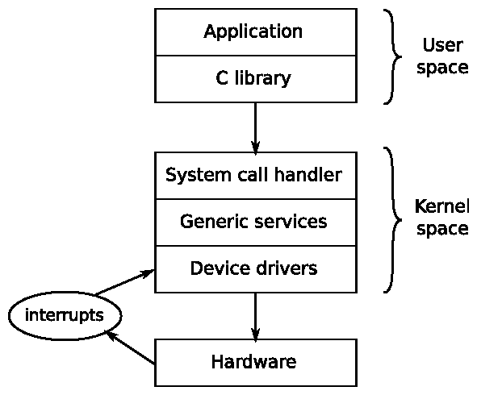
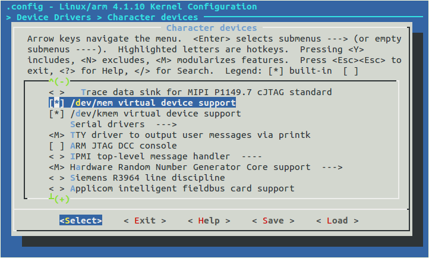

# Chương 4. Port và cấu hình kernel

Kernel là thành phần thứ ba của embedded Linux. Đây là thành phần chịu trách nhiệm quản lý tài nguyên và giao tiếp với hardware, vì vậy ảnh hưởng đến hầu hết mọi khía cạnh của bản build phần mềm cuối cùng. Kernel thường được điều chỉnh cho cấu hình hardware cụ thể của bạn; tuy nhiên, như đã thấy trong Chương 3, Tất cả về bootloader, device tree cho phép tạo một kernel dùng chung, được điều chỉnh cho hardware cụ thể bằng nội dung của device tree.

Trong chương này, chúng ta sẽ tìm hiểu cách lấy kernel cho một board, cũng như cách cấu hình và biên dịch kernel đó. Chúng ta sẽ xem lại bootstrap, lần này tập trung vào vai trò của kernel. Chúng ta cũng sẽ tìm hiểu device driver và cách chúng lấy thông tin từ device tree.

## Kernel làm gì?

Linux bắt đầu vào năm 1991 khi Linus Torvalds bắt đầu viết một operating system cho máy tính cá nhân Intel 386 và 486-based. Ông lấy cảm hứng từ operating system Minix do Andrew S. Tanenbaum viết trước đó bốn năm. Linux khác Minix ở nhiều điểm; những khác biệt chính là nó có kernel virtual memory 32-bit và code được công khai, sau đó phát hành theo giấy phép GPL 2.

Ông công bố nó vào ngày 25 tháng 8 năm 1991 trên newsgroup comp.os.minix trong một bài đăng nổi tiếng mở đầu như sau: Xin chào tất cả mọi người đang dùng minix - Tôi đang làm một operating system (miễn phí) (chỉ là sở thích, sẽ không lớn và chuyên nghiệp như gnu) cho các máy tương thích 386(486) AT. Dự án này đã được ấp ủ từ tháng tư, và đang bắt đầu sẵn sàng. Tôi muốn nhận mọi phản hồi về những điều mọi người thích/không thích ở minix, vì OS của tôi có phần giống nó (trong đó có cùng cách bố trí vật lý của file-system (vì lý do thực tế)). Nói thật chính xác, Linus đã viết một kernel chứ chưa viết trọn một operating system; kernel là một thành phần của operating system. Để tạo một hệ thống hoạt động được, ông sử dụng các thành phần từ dự án GNU, đặc biệt là toolchain, C library và các công cụ command-line cơ bản. Sự phân biệt này vẫn tồn tại đến ngày nay và đem lại cho Linux rất nhiều tính linh hoạt trong cách sử dụng. Kernel có thể kết hợp với GNU user space để tạo một Linux distribution hoàn chỉnh chạy trên desktop và server, đôi khi được gọi là GNU/Linux; kết hợp với Android user space để tạo operating system di động well-known; hoặc kết hợp với user space Busybox-based nhỏ để tạo một embedded system gọn nhẹ. Hãy so sánh với các operating system BSD, FreeBSD, OpenBSD và NetBSD, trong đó kernel, toolchain và user space được kết hợp trong một code base duy nhất.

Kernel có ba nhiệm vụ chính: quản lý tài nguyên, giao tiếp với hardware và cung cấp API có mức trừu tượng hóa hữu ích cho các chương trình user space, như được tóm lược trong sơ đồ sau:



Các ứng dụng chạy trong user space hoạt động ở CPU privilege level thấp. Ngoài gọi library, chúng có thể làm rất ít việc khác. Giao diện chính giữa user space và kernel space là C library, nơi chuyển các hàm user level, chẳng hạn các hàm do POSIX định nghĩa, thành kernel system call. Giao diện system call sử dụng phương thức architecture-specific, chẳng hạn trap hoặc software interrupt, để chuyển CPU từ user mode có đặc quyền thấp sang kernel mode có đặc quyền cao, cho phép truy cập mọi địa chỉ memory và CPU register. System call handler chuyển lời gọi đến kernel subsystem thích hợp: lời gọi scheduling đến scheduler, lời gọi filesystem đến code filesystem, v.v. Một số lời gọi cần dữ liệu từ hardware bên dưới và được chuyển xuống device driver. Trong một số trường hợp, chính hardware gọi một hàm kernel bằng cách phát sinh interrupt. Interrupt chỉ có thể được xử lý trong device driver, không bao giờ bởi ứng dụng user space.

Nói cách khác, mọi việc hữu ích mà ứng dụng của bạn thực hiện đều thông qua kernel. Vì vậy, kernel là một trong những thành phần quan trọng nhất của hệ thống.

## Chọn kernel

Bước tiếp theo là chọn kernel cho dự án, cân bằng mong muốn luôn sử dụng phiên bản phần mềm mới nhất với nhu cầu có các phần bổ sung vendor-specific.

### Chu kỳ phát triển kernel

Linux được phát triển nhanh chóng, với một phiên bản mới được phát hành sau mỗi 8 đến 12 tuần. Cách hình thành số phiên bản đã thay đổi đôi chút trong những năm gần đây. Trước tháng 7 năm 2011, sơ đồ phiên bản có ba số, với số phiên bản như 2.6.39. Số ở giữa cho biết đây là bản phát hành cho developer hay bản stable: số lẻ (2.1.x, 2.3.x, 2.5.x) dành cho developer và số chẵn dành cho người dùng cuối. Từ phiên bản 2.6 trở đi, ý tưởng về nhánh phát triển long-lived (các số lẻ) bị bỏ vì nó làm chậm tốc độ đưa tính năng mới đến người dùng. Việc đổi số từ 2.6.39 sang 3.0 vào tháng 7 năm 2011 hoàn toàn do Linus cảm thấy các số đang trở nên quá lớn: không có bước nhảy lớn nào về tính năng hay kiến trúc Linux giữa hai phiên bản đó. Ông cũng nhân dịp này bỏ số ở giữa. Sau đó, vào tháng 4 năm 2015, ông tăng số major từ 3 lên 4, một lần nữa chỉ để gọn gàng, không phải do thay đổi kiến trúc lớn nào.

Linus quản lý development kernel tree. Bạn có thể theo dõi bằng cách clone git tree của ông như sau:

```
$ git clone \
git://git.kernel.org/pub/scm/linux/kernel/git/torvalds/linux.git
```

Thao tác này checkout vào thư mục con `linux`. Bạn có thể cập nhật bằng cách thỉnh thoảng chạy lệnh `git pull` trong thư mục đó. Hiện tại, một chu kỳ phát triển kernel hoàn chỉnh bắt đầu bằng merge window kéo dài hai tuần, trong đó Linus chấp nhận patch cho các tính năng mới. Khi merge window kết thúc, giai đoạn ổn định bắt đầu; trong giai đoạn này, Linus tạo các release candidate có số phiên bản kết thúc bằng -rc1, -rc2, v.v., thường đến -rc7 hoặc -rc8. Mọi người kiểm thử các candidate rồi gửi báo cáo lỗi và bản sửa. Khi tất cả lỗi đáng kể đã được sửa, kernel được phát hành.

Code đưa vào trong merge window phải tương đối hoàn thiện từ trước. Thông thường, nó được pull từ repository của nhiều người bảo trì subsystem và kiến trúc của kernel. Nhờ giữ chu kỳ phát triển ngắn, tính năng có thể được merge khi sẵn sàng. Nếu người bảo trì kernel đánh giá một tính năng chưa đủ ổn định hoặc chưa phát triển đầy đủ, tính năng đó có thể đơn giản được hoãn đến bản phát hành tiếp theo.

Theo dõi những thay đổi giữa các bản phát hành không dễ. Bạn có thể đọc commit log trong git repository của Linus, nhưng với khoảng 10.000 mục trở lên mỗi bản phát hành, rất khó có được cái nhìn tổng quan. May thay, website Linux Kernel Newbies, `http://kernelnewbies.org`, cung cấp tổng quan ngắn gọn về từng phiên bản tại `http://kernelnewbies.org/LinuxVersions`.

### Các bản phát hành stable và hỗ trợ dài hạn

Tốc độ thay đổi nhanh của Linux là điều tốt vì đưa tính năng mới vào mainline code base, nhưng không thật phù hợp với vòng đời dài hơn của các dự án embedded. Các developer kernel giải quyết vấn đề theo hai cách. Trước hết, họ thừa nhận rằng một bản phát hành có thể chứa lỗi cần sửa trước khi bản kernel tiếp theo xuất hiện. Đó là vai trò của stable Linux kernel, do Greg Kroah-Hartman bảo trì. Sau khi phát hành, kernel chuyển từ mainline (do Linus bảo trì) sang stable (do Greg bảo trì). Các bản sửa lỗi của stable kernel được đánh dấu bằng số thứ ba: 3.18.1, 3.18.2, v.v. Trước phiên bản 3, có bốn số phiên bản: 2.6.29.1, 2.6.39.2, v.v.

Bạn có thể lấy stable tree bằng lệnh sau:

```
$ git clone \
git://git.kernel.org/pub/scm/linux/kernel/git/stable/linux-
stable.git
```

Bạn có thể dùng `git chckout` để lấy phiên bản cụ thể, ví dụ phiên bản 4.1.10:

```
$ cd linux-stable
$ git checkout v4.1.10
```

Thông thường, stable kernel chỉ được bảo trì đến bản phát hành mainline tiếp theo, sau 8 đến 12 tuần, nên bạn sẽ thấy chỉ có một hoặc đôi khi hai stable kernel tại `kernel.org`. Để phục vụ những người muốn có cập nhật trong thời gian dài hơn và được bảo đảm rằng lỗi sẽ được tìm và sửa, một số kernel được gắn nhãn long term và được bảo trì từ hai năm trở lên. Mỗi năm có ít nhất một long term kernel. Tại thời điểm viết sách, `kernel.org` có tổng cộng tám long term kernel: 4.1, 3.18, 3.14, 3.12, 3.10, 3.4, 3.2 và 2.6.32. Kernel cuối đã được bảo trì trong năm năm và đang ở phiên bản 2.6.32.68. Nếu đang xây dựng sản phẩm phải bảo trì trong khoảng thời gian như vậy, long term kernel mới nhất có thể là lựa chọn tốt.

### Hỗ trợ từ vendor

Trong một thế giới lý tưởng, bạn có thể tải kernel từ `kernel.org` và cấu hình cho bất kỳ thiết bị nào tuyên bố hỗ trợ Linux. Tuy nhiên, điều đó không phải lúc nào cũng khả thi: thực tế mainline Linux chỉ hỗ trợ tốt một tập con nhỏ trong số rất nhiều thiết bị có thể chạy Linux. Bạn có thể tìm được hỗ trợ cho board hoặc SoC từ các dự án open source độc lập, chẳng hạn Linaro hay Yocto Project, hoặc từ các công ty cung cấp hỗ trợ embedded Linux bên thứ ba; nhưng trong nhiều trường hợp, bạn buộc phải tìm đến vendor của SoC hoặc board để có kernel hoạt động được. Như chúng ta đã biết, một số vendor làm tốt hơn những vendor khác.

Lời khuyên duy nhất của tôi ở đây là chọn vendor hỗ trợ tốt, hoặc tốt hơn nữa, chịu khó đưa các thay đổi kernel của họ vào mainline.

### Cấp phép

Source code Linux được cấp phép theo GPL v2, nghĩa là bạn phải cung cấp source code kernel của mình theo một trong các cách được giấy phép quy định.

Toàn văn giấy phép kernel nằm trong file `COPYING`. File bắt đầu bằng phần bổ sung do Linus viết, khẳng định rằng code gọi kernel từ user space qua giao diện system call không được coi là tác phẩm phái sinh của kernel, nên không thuộc phạm vi giấy phép. Vì vậy, ứng dụng độc quyền chạy trên Linux không có vấn đề gì. Tuy nhiên, có một lĩnh vực cấp phép Linux gây tranh luận và nhầm lẫn không dứt: kernel module. Kernel module đơn giản là một đoạn code được dynamic linking với kernel tại runtime, nhờ đó mở rộng chức năng kernel. GPL không phân biệt static linking và dynamic linking, nên có vẻ source của kernel module thuộc phạm vi GPL. Nhưng trong những ngày đầu của Linux đã có tranh luận về ngoại lệ, ví dụ liên quan đến Andrew filesystem. Code này ra đời trước Linux và do đó (theo lập luận lúc ấy) không phải tác phẩm phái sinh, nên giấy phép không áp dụng. Các cuộc thảo luận tương tự diễn ra nhiều năm đối với những đoạn code khác, dẫn đến thông lệ hiện được chấp nhận rằng GPL không nhất thiết áp dụng cho kernel module. Điều này được thể hiện trong macro kernel `MODULE_LICENSE`, có thể mang giá trị `Proprietary` để cho biết module không phát hành theo GPL. Nếu định tự dùng các lập luận này, bạn nên đọc chuỗi email oft-quoted có tiêu đề Linux GPL and binary module exception clause? (`http://yarchive.net/comp/linux/gpl_modules.html`).

GPL nên được coi là điều tốt vì bảo đảm rằng khi bạn và tôi làm dự án embedded, chúng ta luôn có thể lấy source code kernel. Không có nó, embedded Linux sẽ khó sử dụng và phân mảnh hơn nhiều.

## Build kernel

Sau khi quyết định dùng kernel nào làm nền tảng cho bản build, bước tiếp theo là build nó.

### Lấy source

Giả sử bạn có board được mainline hỗ trợ. Bạn có thể lấy source code qua git hoặc tải tarball. Dùng git tốt hơn vì có thể xem commit history, dễ dàng xem những thay đổi bạn thực hiện và chuyển giữa các branch, phiên bản. Trong ví dụ này, chúng ta clone stable tree và checkout version tag 4.1.10:

```
$ git clone
git://git.kernel.org/pub/scm/linux/kernel/git/stable/linux-
stable.git linux
$ cd linux
$ git checkout v4.1.10
```

Ngoài ra, bạn có thể tải tarball từ `https://https://cdn.kernel.org/pub/linux/kernel/v4.x/linux-4.1.10.tar.xz`. Ở đây có rất nhiều code. Kernel 4.1 có hơn 38.000 file chứa source code C, header file và assembly code, tổng cộng hơn 12,5 triệu dòng code (đo bằng tiện ích cloc). Dù vậy, bạn vẫn nên biết cách bố trí code cơ bản và biết tương đối cần tìm một thành phần cụ thể ở đâu. Những thư mục chính đáng quan tâm gồm:

- `arch`: Chứa các file architecture-specific. Mỗi kiến trúc có một thư mục con.

- `Documentation`: Chứa tài liệu kernel. Luôn tìm ở đây trước nếu muốn biết thêm về một khía cạnh của Linux.

- `drivers`: Chứa device driver, với hàng nghìn driver. Mỗi loại driver có một thư mục con.

- `fs`: Chứa code filesystem.

- `include`: Chứa header file kernel, bao gồm các file cần thiết khi build toolchain.

- `init`: Chứa code start-up của kernel.

- `kernel`: Chứa các chức năng cốt lõi, gồm scheduling, locking, timer, power management và code debug/trace.

- `mm`: Chứa memory management.

- `net`: Chứa network protocol.

- `scripts`: Chứa nhiều script hữu ích, bao gồm device tree compiler, dtc, đã mô tả trong Chương 3, Tất cả về bootloader.

- `tools`: Chứa nhiều công cụ hữu ích, bao gồm công cụ Linux performance counters, perf, sẽ được mô tả trong Chương 13, Profiling và tracing.

Theo thời gian, bạn sẽ quen với cấu trúc này và nhận ra rằng, nếu tìm code serial port của một SoC cụ thể, bạn sẽ thấy nó trong `drivers/tty/serial` chứ không phải `arch/$ARCH/mach-foo`, vì đây là device driver chứ không phải thành phần cốt lõi giúp Linux chạy trên SoC đó.

### Hiểu cấu hình kernel

Một thế mạnh của Linux là mức độ cho phép cấu hình kernel để phù hợp nhiều nhiệm vụ, từ thiết bị nhỏ chuyên dụng như bộ điều nhiệt thông minh đến điện thoại di động phức tạp. Các phiên bản hiện tại có nhiều nghìn tùy chọn cấu hình. Cấu hình đúng tự nó đã là một công việc, nhưng trước hết tôi muốn chỉ ra cách cơ chế này hoạt động để bạn hiểu rõ hơn những gì đang diễn ra. Cơ chế cấu hình được gọi là `Kconfig`, còn build system tích hợp với nó được gọi là `Kbuild`. Cả hai được mô tả trong `Documentation/kbuild/`. Ngoài kernel, `Kconfig/Kbuild` còn được dùng trong một số dự án khác, gồm crosstool-NG, U-Boot, Barebox và BusyBox.

Các tùy chọn cấu hình được khai báo trong một hệ thống phân cấp các file tên `Kconfig`, với cú pháp mô tả trong `Documentation/kbuild/kconfig-language.txt`. Trong Linux, `Kconfig` cấp cao nhất có dạng:

```
mainmenu "Linux/$ARCH $KERNELVERSION Kernel Configuration"
config SRCARCH
  string
  option env="SRCARCH"
  source "arch/$SRCARCH/Kconfig"
```

Dòng cuối đưa vào file cấu hình architecture-dependent, file này lại nạp các file `Kconfig` khác tùy theo tùy chọn được bật. Vai trò như vậy của kiến trúc dẫn đến hai hệ quả: thứ nhất, phải chỉ định kiến trúc khi cấu hình Linux bằng cách đặt `ARCH=[architecture]`, nếu không sẽ mặc định dùng kiến trúc máy cục bộ; thứ hai, bố cục menu cấp cao nhất khác nhau theo kiến trúc.

Giá trị đưa vào `ARCH` là một trong các thư mục con trong `arch`, với điểm đặc biệt là cả `ARCH=i386` và `ARCH=x86_64` đều lấy source từ `arch/x86/Kconfig`.

Các file `Kconfig` chủ yếu gồm menu, được giới hạn bằng các keyword `menu`, `menu title`, `endmenu`, và các mục menu được đánh dấu bằng `config`. Đây là ví dụ lấy từ `drivers/char/Kconfig`:

```
menu "Character devices"
[...]
config DEVMEM
  bool "/dev/mem virtual device support"
  default y
    help
    Say Y here if you want to support the /dev/mem device.
    The /dev/mem device is used to access areas of physical
    memory.
    When in doubt, say "Y".
```

Tham số sau `config` đặt tên cho một variable, trong trường hợp này là `DEVMEM`. Vì tùy chọn này là Boolean, nó chỉ có hai giá trị: nếu bật thì được gán `y`; nếu không thì variable hoàn toàn không được định nghĩa. Tên mục menu hiển thị trên màn hình là chuỗi sau keyword `bool`. Mục cấu hình này cùng tất cả các mục khác được lưu trong file tên `.config` (lưu ý dấu chấm '`.`' ở đầu nghĩa là file ẩn, không xuất hiện khi dùng lệnh `ls` trừ khi gõ `ls -a` để hiển thị mọi file). Tên variable lưu trong `.config` có prefix `CONFIG_`, nên nếu bật `DEVMEM`, dòng sẽ là:

```
CONFIG_DEVMEM=y
```

Ngoài `bool` còn có một số data type khác. Danh sách gồm:

- `bool`: Là `y` hoặc không được định nghĩa.

- `tristate`: Dùng khi một tính năng có thể được build thành kernel module hoặc tích hợp vào kernel image chính. Giá trị `m` dành cho module, `y` để tích hợp, còn không định nghĩa nếu tính năng không được bật.

- `int`: Giá trị số nguyên viết bằng ký pháp thập phân.

- `hex`: Giá trị số nguyên không dấu viết bằng ký pháp thập lục phân.

- `string`: Giá trị chuỗi.

Có thể có dependency giữa các mục, thể hiện bằng cụm `depends on`, như sau:

```
config MTD_CMDLINE_PARTS
  tristate "Command line partition table parsing"
  depends on MTD
```

Nếu `CONFIG_MTD` chưa được bật ở nơi khác, tùy chọn menu này không được hiển thị nên không thể chọn.

Cũng có reverse dependency: keyword `select` bật các tùy chọn khác nếu tùy chọn này được bật. File `Kconfig` trong `arch/$ARCH` có rất nhiều câu lệnh `select` để bật các tính năng riêng của kiến trúc, như ví dụ cho arm ở đây:

```
config ARM
  bool
default y
  select ARCH_HAS_ATOMIC64_DEC_IF_POSITIVE
  select ARCH_HAS_ELF_RANDOMIZE
[...]
```

Có một số tiện ích cấu hình có thể đọc các file `Kconfig` và tạo file `.config`. Một số hiển thị menu trên màn hình và cho phép lựa chọn tương tác. `Menuconfig` có lẽ là tiện ích quen thuộc nhất, nhưng còn có `xconfig` và `gconfig`. Bạn khởi chạy từng tiện ích qua `make`, nhớ rằng với kernel phải cung cấp kiến trúc, như minh họa:

```
$ make ARCH=arm menuconfig
```

Ở đây, bạn thấy `menuconfig` với tùy chọn `DEVMEM` `config` được nhắc đến trong đoạn trước đang được chọn:



Cấu hình kernel bằng menuconfig

Dấu sao (`*)` bên trái một mục nghĩa là nó đã được chọn (`="y"`); nếu là `M,` thì mục đó được chọn để build thành kernel module.

Bạn thường gặp hướng dẫn như `enable CONFIG_BLK_DEV_INITRD,` nhưng với quá nhiều menu phải duyệt, việc tìm nơi đặt cấu hình có thể mất thời gian. Mọi trình chỉnh sửa cấu hình đều có chức năng `search`. Trong `menuconfig`, truy cập bằng phím dấu gạch chéo, `/`. Trong xconfig, chức năng nằm ở menu edit, nhưng trong trường hợp này hãy nhớ bỏ phần `CONFIG_` khỏi variable cần tìm.

Với nhiều thứ phải cấu hình như vậy, bắt đầu từ trang trắng mỗi khi muốn build kernel là không hợp lý, nên có một tập các file cấu hình đã biết hoạt động được trong `arch/$ARCH/configs`, mỗi file chứa giá trị cấu hình phù hợp cho một SoC hoặc nhóm SoC. Bạn có thể chọn bằng `make [configuration file name]`. Ví dụ, để cấu hình Linux chạy trên nhiều SoC dùng kiến trúc armv7-a, bao gồm AM335x của BeagleBone Black, hãy gõ:

```
$ make ARCH=arm multi_v7_defconfig
```

Đây là kernel dùng chung chạy trên nhiều board khác nhau. Với ứng dụng chuyên biệt hơn, ví dụ khi dùng kernel vendor-supplied, file cấu hình mặc định là một phần của board support package; bạn cần tìm đúng file trước khi có thể build kernel.

Có một target cấu hình hữu ích khác tên `oldconfig`. Nó lấy file `.config` hiện có và yêu cầu bạn cung cấp giá trị cho những tùy chọn còn thiếu. Bạn dùng nó khi chuyển cấu hình sang phiên bản kernel mới hơn: sao chép `.config` từ kernel cũ vào thư mục source mới và chạy `make ARCH=arm oldconfig` để cập nhật. Nó cũng có thể kiểm tra file `.config` do bạn chỉnh sửa thủ công (bỏ qua dòng chữ `Automatically generated file; DO NOT EDIT` ở đầu: đôi khi có thể bỏ qua cảnh báo).

Nếu thay đổi cấu hình, file `.config` đã sửa trở thành một phần của thiết bị và cần được đưa vào hệ thống quản lý phiên bản source code.

Khi bắt đầu build kernel, header file `include/generated/autoconf.h` được tạo, chứa một `#define` cho mỗi giá trị cấu hình để có thể đưa vào source kernel, giống hệt với U-Boot.

### Dùng LOCALVERSION để nhận diện kernel của bạn

Bạn có thể xác định phiên bản kernel đã build bằng target `make kernelversion`:

```
$ make kernelversion
4.1.10
```

Thông tin này được báo tại runtime qua lệnh `uname` và cũng dùng để đặt tên thư mục lưu kernel module. Nếu thay đổi cấu hình mặc định, bạn nên thêm thông tin phiên bản riêng bằng cách đặt `CONFIG_LOCALVERSION`, nằm trong menu cấu hình General setup. Cũng có thể (nhưng không được khuyến khích) làm tương tự bằng cách sửa makefile cấp cao nhất và thêm vào dòng bắt đầu bằng `EXTRAVERSION`. Ví dụ, nếu muốn đánh dấu kernel đang build bằng định danh `melp` và phiên bản 1.0, tôi sẽ định nghĩa local version trong file `.config` như sau:

```
CONFIG_LOCALVERSION="-melp-v1.0"
```

Chạy `make kernelversion` vẫn cho đầu ra như trước, nhưng nếu chạy `make kernelrelease,` thì tôi thấy:

```
$ make kernelrelease
4.1.10-melp-v1.0
```

Thông tin cũng được in ở đầu kernel log:

```
Starting kernel ...
[    0.000000] Booting Linux on physical CPU 0x0
[    0.000000] Linux version 4.1.10-melp-v1.0 (chris@builder) (gcc
version 4.9.1 (crosstool-NG 1.20.0) ) #3 SMP Thu Oct 15 21:29:35 BST 2015
```

Giờ tôi có thể nhận diện và theo dõi kernel tùy biến của mình.

### Kernel module

Tôi đã nhắc đến kernel module nhiều lần. Các Linux distribution cho desktop dùng chúng rộng rãi để có thể nạp đúng chức năng thiết bị và kernel tại runtime, tùy hardware được phát hiện và tính năng cần dùng. Không có module, mọi driver và tính năng đều phải được static linking vào kernel, khiến kernel lớn đến mức không thực tế.

Ngược lại, với thiết bị embedded, hardware và cấu hình kernel thường đã biết khi build, nên module không hữu ích bằng. Thực tế, chúng gây vấn đề vì tạo dependency về phiên bản giữa kernel và root filesystem, có thể làm boot thất bại nếu chỉ một trong hai được cập nhật. Vì vậy, khá phổ biến là kernel embedded được build hoàn toàn không có module. Dưới đây là vài trường hợp kernel module là ý tưởng tốt:

- Khi bạn có module độc quyền, vì các lý do cấp phép nêu ở phần trước.

- Để giảm boot time bằng cách trì hoãn nạp các driver non-essential.

- Khi có nhiều driver có thể được nạp và biên dịch static tất cả sẽ chiếm quá nhiều memory. Ví dụ, bạn có giao diện USB hỗ trợ nhiều loại thiết bị. Về cơ bản, đây cũng là lập luận được dùng trong các distribution desktop.

## Biên dịch

Build system của kernel, `kbuild`, là tập các script `make` lấy thông tin cấu hình từ file `.config`, xác định dependency và biên dịch mọi thứ cần thiết để tạo kernel image chứa tất cả thành phần static linking, có thể cả device tree binary và một hoặc nhiều kernel module. Dependency được thể hiện trong makefile ở từng thư mục có thành phần có thể build. Ví dụ, hai dòng sau lấy từ `drivers/char/Makefile`:

```
obj-y                    += mem.o random.o
obj-$(CONFIG_TTY_PRINTK) += ttyprintk.o
```

Rule `obj-y` biên dịch file vô điều kiện để tạo target, nên `mem.c` và `random.c` luôn là thành phần của kernel. Ở dòng thứ hai, `ttyprintk.c` phụ thuộc tham số cấu hình. Nếu `CONFIG_TTY_PRINTK` là `y`, nó được biên dịch tích hợp; nếu là `m`, nó được build thành module; nếu tham số không được định nghĩa, nó hoàn toàn không được biên dịch.

Với phần lớn target, chỉ cần gõ `make` (cùng `ARCH` và `CROSS_COMPILE` thích hợp) là đủ, nhưng đi từng bước sẽ giúp hiểu rõ hơn.

### Biên dịch kernel image

Để build kernel image, bạn cần biết bootloader yêu cầu gì. Đây là hướng dẫn sơ bộ:

- U-Boot: Trước đây U-Boot yêu cầu uImage, nhưng các phiên bản mới hơn có thể nạp file `zImage` bằng lệnh `bootz`

- Target x86: Yêu cầu file `bzImage`

- Phần lớn bootloader khác: Yêu cầu file `zImage`

Đây là ví dụ build file `zImage`:

```
$ make -j 4 ARCH=arm CROSS_COMPILE=arm-cortex_a8-linux-gnueabihf-
zImage
```

Tùy chọn `-j 4` cho `make` biết cần chạy song song bao nhiêu job, giúp giảm thời gian build. Nguyên tắc sơ bộ là chạy số job bằng số CPU core.

Tương tự khi build các target `bzImage` và `uImage`.

Có một vấn đề nhỏ khi build file `uImage` cho ARM hỗ trợ multi-platform, vốn là tiêu chuẩn với thế hệ kernel ARM SoC hiện tại. Hỗ trợ Multi-platform cho ARM được giới thiệu trong Linux 3.7. Nó cho phép một kernel binary chạy trên nhiều platform và là một bước hướng tới việc chỉ cần một số ít kernel cho mọi thiết bị ARM. Kernel chọn đúng platform bằng cách đọc machine number hoặc device tree do bootloader truyền vào. Vấn đề xuất hiện vì vị trí physical memory có thể khác nhau giữa các platform, nên relocation address của kernel (thường cách đầu physical RAM 0x8000 byte) cũng có thể khác. Relocation address được ghi vào header `uImage` bằng lệnh `mkimage` khi build kernel, nhưng lệnh sẽ thất bại nếu có nhiều hơn một relocation address để chọn. Nói cách khác, định dạng `uImage` không tương thích với image multi-platform. Bạn vẫn có thể tạo uImage binary từ bản build multi-platform nếu cung cấp `LOADADDR` của SoC cụ thể mà bạn muốn boot kernel này trên đó. Có thể tìm load address trong `mach-[your SoC]/Makefile.boot` và ghi lại giá trị `zreladdr-y`.

Với BeagleBone Black, lệnh đầy đủ như sau:

```
$ make -j 4 ARCH=arm CROSS_COMPILE=arm-cortex_a8-linux-gnueabihf-
LOADADDR=0x80008000 uImage
```

Bản build kernel tạo hai file trong thư mục cấp cao nhất: `vmlinux` và `System.map`. File thứ nhất, `vmlinux`, là kernel dạng ELF binary. Nếu biên dịch kernel có bật debug (`CONFIG_DEBUG_INFO=y`), file sẽ chứa debug symbol dùng được với debugger như `kgdb`. Bạn cũng có thể dùng các công cụ ELF binary khác như `size`:

```
$ arm-cortex_a8-linux-gnueabihf-size vmlinux
  text     data      bss        dec       hex    filename
8812564   790692   8423536   18026792   1131128   vmlinux
```

`System.map` chứa symbol table ở dạng con người đọc được.

Phần lớn bootloader không thể xử lý trực tiếp code ELF. Có thêm một giai đoạn xử lý lấy `vmlinux` rồi đặt các binary phù hợp cho từng bootloader vào `arch/$ARCH/boot`:

- `Image`: `vmlinux` chuyển sang raw binary.

- `zImage`: Với kiến trúc PowerPC, đây chỉ là bản nén của `Image`, nghĩa là bootloader phải giải nén. Với mọi kiến trúc khác, `Image` nén được gắn vào một đoạn code nhỏ để giải nén và relocate nó.

- `uImage`: `zImage` cộng header U-Boot 64-byte.

Trong khi build, bạn sẽ thấy bản tóm tắt các lệnh đang thực thi:

```
$ make -j 4 ARCH=arm CROSS_COMPILE=arm-cortex_a8-linux-gnueabihf-
zImage
CC     init/main.o
CHK    include/generated/compile.h
CC     init/version.o
CC     init/do_mounts.o
CC     init/do_mounts_rd.o
CC     init/do_mounts_initrd.o
LD     init/mounts.o
[...]
```

Đôi khi, khi build kernel thất bại, việc xem lệnh thực tế đang được thực thi sẽ hữu ích. Để làm vậy, thêm `V=1` vào command line:

```
$ make ARCH=arm CROSS_COMPILE=arm-cortex_a8-linux-gnueabihf- V=1
zImage
[...]
arm-cortex_a8-linux-gnueabihf-gcc -Wp,-
MD,init/.do_mounts_initrd.o.d  -nostdinc -isystem /home/chris/x-
tools/arm-cortex_a8-linux-gnueabihf/lib/gcc/arm-cortex_a8-linux-
gnueabihf/4.9.1/include -I./arch/arm/include -
Iarch/arm/include/generated/uapi -Iarch/arm/include/generated  -
Iinclude -I./arch/arm/include/uapi -
Iarch/arm/include/generated/uapi -I./include/uapi -
Iinclude/generated/uapi -include ./include/linux/kconfig.h -
D__KERNEL__ -mlittle-endian -Wall -Wundef -Wstrict-prototypes -
Wno-trigraphs -fno-strict-aliasing -fno-common -Werror-implicit-
function-declaration -Wno-format-security -std=gnu89 -fno-dwarf2-
cfi-asm -mabi=aapcs-linux -mno-thumb-interwork -mfpu=vfp -funwind-
tables -marm -D__LINUX_ARM_ARCH__=7 -march=armv7-a -msoft-float -
Uarm -fno-delete-null-pointer-checks -O2 --param=allow-store-data-
races=0 -Wframe-larger-than=1024 -fno-stack-protector -Wno-unused-
but-set-variable -fomit-frame-pointer -fno-var-tracking-
assignments -Wdeclaration-after-statement -Wno-pointer-sign -fno-
strict-overflow -fconserve-stack -Werror=implicit-int -
Werror=strict-prototypes -Werror=date-time -DCC_HAVE_ASM_GOTO    -
D"KBUILD_STR(s)=#s" -
D"KBUILD_BASENAME=KBUILD_STR(do_mounts_initrd)"  -
D"KBUILD_MODNAME=KBUILD_STR(mounts)" -c -o init/do_mounts_initrd.o
init/do_mounts_initrd.c
[...]
```

### Biên dịch device tree

Bước tiếp theo là build device tree, hoặc nhiều device tree nếu là bản build multi-platform. Target dtbs build device tree theo rule trong `arch/$ARCH/boot/dts/Makefile`, sử dụng các file device tree source trong thư mục đó:

```
$ make ARCH=arm dtbs
...
DTC     arch/arm/boot/dts/omap2420-h4.dtb
DTC     arch/arm/boot/dts/omap2420-n800.dtb
DTC     arch/arm/boot/dts/omap2420-n810.dtb
DTC     arch/arm/boot/dts/omap2420-n810-wimax.dtb
DTC     arch/arm/boot/dts/omap2430-sdp.dtb
...
```

Các file `.dtb` được tạo trong cùng thư mục với source.

### Biên dịch module

Nếu đã cấu hình một số tính năng để build thành module, bạn có thể build riêng bằng target `modules`:

```
$ make -j 4 ARCH=arm CROSS_COMPILE=arm-cortex_a8-linux-gnueabihf-
modules
```

Các module đã biên dịch có suffix `.ko` và được tạo trong cùng thư mục với source code, nghĩa là chúng nằm rải rác khắp kernel source tree. Tìm chúng hơi khó, nhưng có thể dùng make target `modules_install` để cài vào đúng vị trí. Vị trí mặc định là `/lib/modules` trên hệ thống phát triển, gần như chắc chắn không phải nơi bạn muốn. Để cài vào staging area của root filesystem (chúng ta sẽ bàn về root filesystem ở chương tiếp theo), cung cấp đường dẫn bằng `INSTALL_MOD_PATH`:

```
$ make -j4 ARCH=arm CROSS_COMPILE=arm-cortex_a8-linux-gnueabihf-
INSTALL_MOD_PATH=$HOME/rootfs modules_install
```

Kernel module được đặt vào thư mục `/lib/modules/[kernel version]`, tương đối so với root của filesystem.

## Dọn source kernel

Có ba make target để dọn kernel source tree:

- `clean`: Xóa object file và phần lớn file trung gian.

- `mrproper`: Xóa mọi file trung gian, bao gồm file `.config`. Dùng target này để đưa source tree về trạng thái ngay sau khi clone hoặc giải nén source code. Nếu tò mò về tên gọi, Mr Proper là sản phẩm tẩy rửa phổ biến ở một số nơi trên thế giới. Ý nghĩa của `make mrproper` là chà rửa source kernel thật kỹ.

- `distclean`: Giống mrproper nhưng còn xóa file backup của editor, file còn sót sau patch và các sản phẩm phụ khác của quá trình phát triển phần mềm.

## Boot kernel của bạn

Quá trình boot phụ thuộc nhiều vào thiết bị, tức device-dependent, nhưng đây là ví dụ dùng U-Boot trên BeagleBone Black và QEMU:.

### BeagleBone Black

Các lệnh U-Boot sau cho thấy cách boot Linux trên BeagleBone Black:

```
U-Boot# fatload mmc 0:1 0x80200000 zImage
reading zImage
4606360 bytes read in 254 ms (17.3 MiB/s)
U-Boot# fatload mmc 0:1 0x80f00000 am335x-boneblack.dtb
reading am335x-boneblack.dtb
29478 bytes read in 9 ms (3.1 MiB/s)
U-Boot# setenv bootargs console=ttyO0,115200
U-Boot# bootz 0x80200000 - 0x80f00000
Kernel image @ 0x80200000 [ 0x000000 - 0x464998 ]
## Flattened Device Tree blob at 80f00000
   Booting using the fdt blob at 0x80f00000
   Loading Device Tree to 8fff5000, end 8ffff325 ... OK
Starting kernel ...
[   0.000000] Booting Linux on physical CPU 0x0
...
```

Lưu ý chúng ta đặt kernel command line thành `console=ttyO0,115200`. Nó cho Linux biết thiết bị dùng làm console output; ở đây là UART đầu tiên trên board, thiết bị `ttyO0`, với tốc độ 115.200 bit mỗi giây. Không có nó, chúng ta sẽ không thấy thông báo nào sau `Starting the kernel ...`, nên không biết kernel có hoạt động hay không.

### QEMU

Giả sử đã cài `qemu-system-arm`, bạn có thể khởi chạy với kernel multi\_v7 và file `.dtb` cho ARM Versatile Express như sau:

```
$ QEMU_AUDIO_DRV=none \
qemu-system-arm -m 256M -nographic -M vexpress-a9 -kernel zImage -
dtb vexpress-v2p-ca9.dtb -append "console=ttyAMA0"
```

Lưu ý việc đặt `QEMU_AUDIO_DRV` thành `none` chỉ nhằm ngăn thông báo lỗi QEMU về cấu hình thiếu cho audio driver, vốn không được dùng ở đây.

Để thoát QEMU, gõ `Ctrl-A` rồi `x` (hai lần nhấn phím riêng biệt).

### Kernel panic

Mặc dù khởi đầu tốt, mọi thứ lại kết thúc tệ:

```
[    1.886379] Kernel panic - not syncing: VFS: Unable to mount
root fs on unknown-block(0,0)
[    1.895105] ---[ end Kernel panic - not syncing: VFS: Unable to
mount root fs on unknown-block(0, 0)
```

Đây là ví dụ điển hình về kernel panic. Panic xảy ra khi kernel gặp lỗi không thể phục hồi. Mặc định, kernel in thông báo ra console rồi dừng lại. Bạn có thể đặt tham số command line `panic` để cho phép một khoảng vài giây trước khi reboot sau panic.

Ở đây, lỗi không thể phục hồi là do không có root filesystem, minh họa rằng kernel vô dụng nếu không có user space điều khiển nó. Bạn có thể cung cấp user space bằng root filesystem dưới dạng ramdisk hoặc trên mass storage device có thể mount. Chúng ta sẽ bàn cách tạo root filesystem trong chương tiếp theo; nhưng để hệ thống chạy được, giả sử có ramdisk trong file `uRamdisk`, bạn có thể boot đến shell prompt bằng cách nhập các lệnh sau vào U-Boot:

```
fatload mmc 0:1 0x80200000 zImage
fatload mmc 0:1 0x80f00000 am335x-boneblack.dtb
fatload mmc 0:1 0x81000000 uRamdisk
setenv bootargs console=ttyO0,115200 rdinit=/bin/sh
bootz 0x80200000 0x81000000 0x80f00000
```

Ở đây, tôi thêm `rdinit=/bin/sh` vào command line để kernel chạy shell và cung cấp shell prompt. Bây giờ đầu ra trên console như sau:

```
...
[    1.930923] sr_init: No PMIC hook to init smartreflex
[    1.936424] sr_init: platform driver register failed for SR
[    1.964858] Freeing unused kernel memory: 408K (c0824000 -
c088a000)
/ # uname -a
Linux (none) 3.18.3 #1 SMP Wed Jan 21 08:34:58 GMT 2015 armv7l
GNU/Linux
/ #
```

Cuối cùng, chúng ta đã có prompt và có thể tương tác với thiết bị.

### Early user space

Để chuyển từ khởi tạo kernel sang user space, kernel phải mount root filesystem và thực thi một chương trình trong root filesystem đó. Có thể thông qua ramdisk như phần trước, hoặc mount filesystem thực trên block device. Toàn bộ code nằm trong `init/main.c`, bắt đầu bằng hàm `rest_init()` tạo thread đầu tiên với PID 1 và chạy code trong `kernel_init()`. Nếu có ramdisk, nó thử thực thi `program /init`, chương trình sẽ tiếp quản nhiệm vụ thiết lập user space.

Nếu không tìm thấy và chạy được `/init`, kernel thử mount filesystem bằng cách gọi hàm `prepare_namespace()` trong `init/do_mounts.c`. Việc này cần command line `root=` để cung cấp tên block device dùng để mount, thường có dạng:

- `root=/dev/<disk name><partition number>`

- `root=/dev/<disk name>p<partition number>`

Ví dụ, với partition đầu tiên trên SD card, giá trị là `root=/dev/mmcblk0p1`. Nếu mount thành công, nó thử thực thi `/sbin/init`, tiếp theo là `/etc/init`, `/bin/init` rồi `/bin/sh`, dừng ở chương trình đầu tiên hoạt động.

Chương trình `init` có thể được ghi đè trên command line. Với ramdisk, dùng `rdinit=`, (trước đó tôi dùng `rdinit=/bin/sh` để thực thi shell); với filesystem, dùng `init=`.

### Thông báo kernel

Các developer kernel thích in thông tin hữu ích bằng cách sử dụng rộng rãi `printk()` và các hàm tương tự. Thông báo được phân loại theo tầm quan trọng, với 0 là cao nhất:

| Level | Giá trị | Ý nghĩa |
|---|---|---|
| `KERN_EMERG` | 0 | Hệ thống không sử dụng được |
| `KERN_ALERT` | 1 | Phải hành động ngay lập tức |
| `KERN_CRIT` | 2 | Tình trạng nghiêm trọng |
| `KERN_ERR` | 3 | Tình trạng lỗi |
| `KERN_WARNING` | 4 | Tình trạng cảnh báo |
| `KERN_NOTICE` | 5 | Tình trạng bình thường nhưng đáng chú ý |
| `KERN_INFO` | 6 | Cung cấp thông tin |
| `KERN_DEBUG` | 7 | Thông báo Debug-level |

Trước tiên, chúng được ghi vào buffer `__log_buf`, có kích thước bằng hai lũy thừa `CONFIG_LOG_BUF_SHIFT`. Ví dụ, nếu giá trị là 16 thì `__log_buf` có kích thước 64 KiB. Bạn có thể dump toàn bộ buffer bằng lệnh `dmesg`.

Nếu level của thông báo nhỏ hơn console log level, nó vừa được hiển thị trên console vừa được đưa vào `__log_buf`. Console log level mặc định là 7, nghĩa là thông báo level 6 trở xuống được hiển thị, còn `KERN_DEBUG` level 7 bị lọc bỏ. Bạn có thể đổi console log level theo nhiều cách, bao gồm dùng tham số kernel `loglevel=<level>` hoặc lệnh `dmesg -n <level>`.

### Kernel command line

Kernel command line là chuỗi bootloader truyền vào kernel, qua variable `bootargs` trong trường hợp U-Boot; nó cũng có thể được định nghĩa trong device tree, hoặc đặt trong cấu hình kernel bằng `CONFIG_CMDLINE`.

Chúng ta đã thấy một số ví dụ về kernel command line, nhưng còn nhiều tham số khác. Danh sách đầy đủ nằm trong `Documentation/kernel-parameters.txt`. Đây là danh sách ngắn hơn gồm các tham số hữu ích nhất:

| Tên | Mô tả |
|---|---|
| `debug` | Đặt console log level thành mức cao nhất, tám, để bảo đảm bạn thấy mọi thông báo kernel trên console. |
| `init=` | Chương trình `init` chạy từ root filesystem đã mount, mặc định là `/sbin/init`. |
| `lpj=` | Đặt `loops_per_jiffy` thành hằng số cho trước, xem đoạn tiếp theo. |
| `panic=` | Hành vi khi kernel panic: nếu lớn hơn không, đây là số giây trước khi reboot; nếu bằng không, chờ mãi mãi (mặc định); nếu nhỏ hơn không, reboot ngay không trì hoãn. |
| `quiet` | Đặt console log level thành một, ngăn mọi thông báo trừ thông báo khẩn cấp. Vì phần lớn thiết bị có serial console, xuất tất cả các chuỗi đó mất thời gian. Vì vậy, giảm số thông báo bằng tùy chọn này giúp giảm boot time. |
| `rdinit=` | Chương trình `init` chạy từ ramdisk, mặc định là `/init`. |
| `ro` | Mount root device ở chế độ read-only. Không ảnh hưởng đến ramdisk, vốn luôn là read/write. |
| `root=` | Thiết bị để mount root filesystem. |
| `rootdelay=` | Số giây chờ trước khi thử mount root device, mặc định bằng không. Hữu ích nếu thiết bị cần thời gian probe hardware, nhưng cũng xem `rootwait`. |

| Tên | Mô tả |
|---|---|
| `rootfstype=` | Loại filesystem cho root device. Trong nhiều trường hợp, nó được auto-detected khi mount, nhưng bắt buộc phải có với filesystem `jffs2`. |
| `rootwait` | Chờ vô thời hạn đến khi phát hiện root device. Thường cần với thiết bị `mmc`. |
| `rw` | Mount root device ở chế độ read-write (mặc định). |

Tham số `lpj` thường được nhắc đến khi giảm boot time của kernel. Trong lúc khởi tạo, kernel chạy vòng lặp khoảng 250 ms để hiệu chỉnh delay loop. Giá trị được lưu trong variable `loops_per_jiffy` và báo như sau:

```
Calibrating delay loop... 996.14 BogoMIPS (lpj=4980736)
```

Nếu kernel luôn chạy trên cùng hardware, nó luôn tính ra cùng giá trị. Bạn có thể giảm 250 ms boot time bằng cách thêm `lpj=4980736` vào command line.

## Port Linux sang board mới

Phạm vi công việc phụ thuộc mức độ giống nhau giữa board của bạn và development board hiện có. Trong Chương 3, Tất cả về bootloader, chúng ta port U-Boot sang board mới tên Nova, dựa trên BeagleBone Black (khi nói dựa trên, thực tế chính là board đó), nên trong trường hợp này có rất ít thay đổi cần thực hiện với code kernel. Nếu port sang hardware hoàn toàn mới và sáng tạo, sẽ có nhiều việc hơn. Tôi chỉ xét trường hợp đơn giản.

Cách tổ chức code architecture-specific trong `arch/$ARCH` khác nhau tùy hệ thống. Kiến trúc x86 khá gọn vì các chi tiết hardware được phát hiện tại runtime. Kiến trúc PowerPC đặt các file SoC và board-specific trong thư mục con platforms. Kiến trúc ARM có nhiều file board và SoC-specific nhất vì có rất nhiều board và SoC ARM. Code Platform-dependent nằm trong các thư mục tên `mach-*` trong `arch/arm`, gần như mỗi SoC một thư mục. Các thư mục khác tên `plat-*` chứa code dùng chung cho nhiều phiên bản SoC. Với board Nova, thư mục liên quan là `mach-omap2`. Tuy nhiên, đừng để tên đánh lừa: nó chứa hỗ trợ cho chip OMAP2, 3 và 4.

Trong các phần tiếp theo, tôi sẽ port sang board Nova theo hai cách. Trước tiên, tôi chỉ cách làm với device tree, rồi đến cách không dùng device tree, vì có nhiều thiết bị đang triển khai thuộc nhóm này. Bạn sẽ thấy công việc đơn giản hơn nhiều khi có device tree.

### Có device tree

Việc đầu tiên là tạo device tree cho board và sửa nó để mô tả hardware bổ sung hoặc thay đổi trên board. Trong trường hợp đơn giản này, chúng ta chỉ sao chép `am335x-boneblack.dts` thành `nova.dts` và đổi tên board:

```
/dts-v1/;
#include "am33xx.dtsi"
#include "am335x-bone-common.dtsi"
/ {
     model = "Nova";
     compatible = "ti,am335x-bone-black", "ti,am335x-bone", "ti,am33xx";
  };
...
```

Chúng ta có thể build riêng `nova.dtb`:

```
$ make  ARCH=arm nova.dtb
```

Hoặc, nếu muốn `nova.dtb` được tạo mặc định cho platform OMAP2 bằng `make ARCH=arm dtbs`, chúng ta có thể thêm dòng sau vào `arch/arm/boot/dts/Makefile`:

```
dtb-$(CONFIG_SOC_AM33XX) += \
[...]
nova.dtb \
[...]
```

Bây giờ có thể boot cùng file `zImage` như trước, được cấu hình bằng `multi_v7_defconfig`, nhưng nạp `nova.dtb` như sau:

```
Starting kernel ...
[    0.000000] Booting Linux on physical CPU 0x0
[    0.000000] Initializing cgroup subsys cpuset
[    0.000000] Initializing cgroup subsys cpu
[    0.000000] Initializing cgroup subsys cpuacct
[    0.000000] Linux version 3.18.3-dirty (chris@builder) (gcc
version 4.9.1 (crosstool-N
G 1.20.0) ) #1 SMP Wed Jan 28 07:50:50 GMT 2015
[    0.000000] CPU: ARMv7 Processor [413fc082] revision 2 (ARMv7),
cr=10c5387d
[    0.000000] CPU: PIPT / VIPT nonaliasing data cache, VIPT
aliasing instruction cache
[    0.000000] Machine model: Nova
...
```

Chúng ta có thể tạo cấu hình tùy biến bằng cách sao chép `multi_v7_defconfig`, thêm các tính năng cần thiết và giảm kích thước code bằng cách bỏ những tính năng không cần.

### Không có device tree

Trước tiên, cần tạo tên cấu hình cho board, ở đây là `NOVABOARD`. Chúng ta cần thêm vào file `Kconfig` của thư mục `mach-` cho SoC và thêm dependency đối với chính phần hỗ trợ SoC, tức `OMAPAM33XX`.

Các dòng sau được thêm vào `arch/arm/mach-omap2/Kconfig`:

```
config MACH_NOVA BOARD
bool "Nova board"
depends on SOC_OMAPAM33XX
default n
```

Mỗi board có một source file tên `board-*.c`, chứa code và cấu hình riêng cho target. Với chúng ta, đó là `board-nova.c`, dựa trên bản sao của `board-am335xevm.c`. Phải có rule biên dịch phụ thuộc `CONFIG_MACH_NOVABOARD`, được bổ sung vào `arch/arm/mach-omap2/Makefile` như sau:

```
obj-$(CONFIG_MACH_NOVABOARD) += board-nova.o
```

Vì không dùng device tree để nhận diện board, chúng ta phải dùng cơ chế machine number cũ hơn. Đây là số duy nhất cho mỗi board, được bootloader truyền qua register r1 và được code khởi động ARM dùng để chọn đúng board support. Danh sách chính thức machine number ARM nằm tại: `www.arm.linux.org.uk/developer/machines/download.php`. Có thể yêu cầu machine number mới tại: `www.arm.linux.org.uk/developer/machines/?action=new#`.

Nếu tạm lấy machine number `4242`, chúng ta có thể thêm vào `arch/arm/tools/mach-types,` như sau:

```
machine_is_xxx   CONFIG_xxxx        MACH_TYPE_xxx      number
...
nova_board       MACH_NOVABOARD     NOVABOARD          4242
```

Khi build kernel, thông tin này sẽ được dùng để tạo header file `mach-types.h` trong `include/generated/`.

Machine number và board support được liên kết bằng một structure định nghĩa như sau:

```
MACHINE_START(NOVABOARD, "nova_board")
/* Maintainer: Chris Simmonds */
.atag_offset    = 0x100,
.map_io         = am335x_evm_map_io,
.init_early     = am33xx_init_early,
.init_irq       = ti81xx_init_irq,
.handle_irq     = omap3_intc_handle_irq,
.timer          = &omap3_am33xx_timer,
.init_machine   = am335x_evm_init,
MACHINE_END
```

Lưu ý một file board có thể có nhiều machine structure, cho phép tạo kernel chạy trên nhiều board khác nhau. Machine number do bootloader truyền vào sẽ chọn đúng structure.

Cuối cùng, cần một cấu hình mặc định mới cho board, chọn `CONFIG_MACH_NOVABOARD` và các tùy chọn riêng khác. Trong ví dụ sau, nó nằm ở `arch/arm/configs/novaboard_defconfig`. Bây giờ bạn có thể build kernel image như thường lệ:

```
$ make ARCH=arm novaboard_defconfig
$ make -j 4 ARCH=arm CROSS_COMPILE=arm-cortex_a8-linux-gnueabi-
zImage
```

Vẫn còn một bước trước khi hoàn tất. Bootloader cần được sửa để truyền đúng machine number. Giả sử dùng U-Boot, bạn cần sao chép các machine number Linux tạo trong `arch/arm/include/asm/mach-types.h` sang file U-Boot `arch/arm/include/asm/mach-types.h`. Sau đó, cập nhật header file cấu hình của Nova, `include/configs/nova.h`, và thêm dòng sau:

```
#define CONFIG_MACH_TYPE          MACH_TYPE_NOVABOARD
```

Cuối cùng, bạn có thể build U-Boot và dùng nó để boot kernel mới trên board Nova:

```
Starting kernel ...

[    0.000000] Linux version 3.2.0-00246-g0c74d7a-dirty
(chris@builder) (gcc version 4.9.
1 (crosstool-NG 1.20.0) ) #3 Wed Jan 28 11:45:10 GMT 2015
[    0.000000] CPU: ARMv7 Processor [413fc082] revision 2 (ARMv7),
cr=10c53c7d
[    0.000000] CPU: PIPT / VIPT nonaliasing data cache, VIPT
aliasing instruction cache
[    0.000000] Machine: nova_board
```

## Đọc thêm

Các tài nguyên sau cung cấp thêm thông tin về các chủ đề được giới thiệu trong chương:

- Linux Kernel Newbies, `kernelnewbies.org`

- Linux Weekly News, `www.lwn.net`

## Tổng kết

Linux là một operating system kernel rất mạnh và phức tạp, có thể kết hợp với nhiều loại user space, từ thiết bị embedded đơn giản đến thiết bị di động ngày càng phức tạp dùng Android, tới operating system server hoàn chỉnh. Một thế mạnh của nó là mức độ cho phép cấu hình. Nơi chính thức để lấy source code là `www.kerenl.org`, nhưng bạn có lẽ cần lấy source cho SoC hoặc board cụ thể từ vendor thiết bị hoặc third-party hỗ trợ thiết bị đó. Tùy biến kernel cho target cụ thể có thể gồm thay đổi code kernel cốt lõi, bổ sung driver cho thiết bị chưa có trong mainline Linux, file cấu hình kernel mặc định và file device tree source.

Thông thường, bạn bắt đầu với cấu hình mặc định cho target board, rồi tinh chỉnh bằng một công cụ cấu hình như `menuconfig`. Một điều cần cân nhắc lúc này là các tính năng kernel và driver nên được biên dịch thành module hay built-in. Kernel module thường không đem lại lợi thế lớn cho embedded system, nơi tập tính năng và hardware thường được xác định rõ. Tuy nhiên, module thường được dùng để đưa code độc quyền vào kernel, cũng như giảm boot time bằng cách nạp driver non-essential sau boot. Build kernel tạo một file kernel image nén, tên `zImage`, `bzImage` hoặc `uImage` tùy bootloader và kiến trúc target. Bản build kernel cũng tạo mọi kernel module (file `.ko`) đã cấu hình và device tree binary (file `.dtb`) nếu target yêu cầu.

Port Linux sang target board mới có thể khá đơn giản hoặc rất khó tùy hardware khác với hardware được mainline hay kernel của vendor hỗ trợ đến mức nào. Nếu hardware dựa trên reference design well-known, có thể chỉ cần sửa device tree hoặc platform data. Bạn cũng có thể cần thêm device driver, sẽ được bàn trong Chương 8, Giới thiệu device driver. Tuy nhiên, nếu hardware khác reference design hoàn toàn, có thể cần bổ sung hỗ trợ cốt lõi, nằm ngoài phạm vi sách này.

Kernel là lõi của hệ thống dựa trên Linux, nhưng không thể hoạt động một mình. Nó cần root filesystem chứa user space. Root filesystem có thể là ramdisk hoặc filesystem được truy cập qua block device, chủ đề của chương tiếp theo. Như đã thấy, boot kernel không có root filesystem dẫn đến kernel panic.
