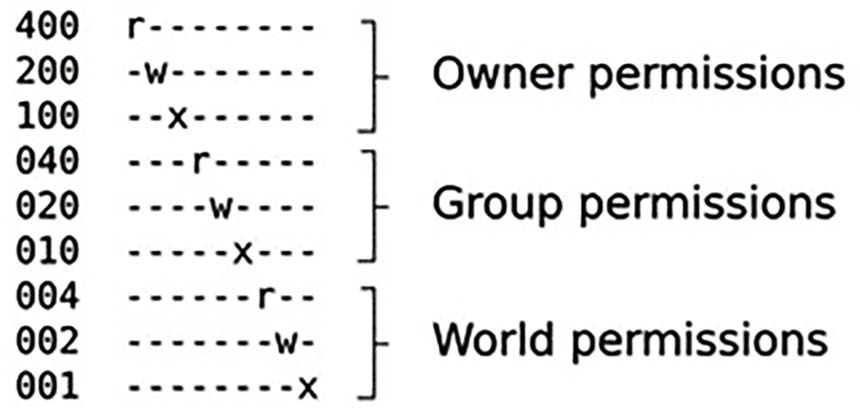

# Chương 5: Xây dựng root filesystem (Building a Root Filesystem)

Root filesystem là thành phần thứ tư của embedded Linux. Sau khi đọc chương này, bạn sẽ có thể build, boot và chạy một hệ thống embedded Linux đơn giản.

Các kỹ thuật được mô tả ở đây thường được gọi là roll your own, hay RYO. Vào những ngày đầu của embedded Linux, đây là cách duy nhất để tạo một root filesystem. Vẫn còn một số trường hợp sử dụng mà root filesystem RYO là phù hợp – ví dụ, khi lượng RAM hoặc bộ lưu trữ rất hạn chế, cho các bản demo nhanh, hoặc cho bất kỳ trường hợp nào mà yêu cầu của bạn không dễ được đáp ứng bởi các công cụ build system chuẩn. Tuy nhiên, những trường hợp này khá hiếm.

Mục đích của chương này là giáo dục. Nó không nhằm là một công thức để build các hệ thống nhúng hằng ngày. Hãy dùng các công cụ được mô tả trong chương tiếp theo cho việc đó.

Mục tiêu đầu tiên của chúng ta là tạo một root filesystem tối thiểu cho chúng ta một dấu nhắc shell. Sau đó, dùng nó làm nền, chúng ta sẽ thêm các script để khởi động các chương trình khác và cấu hình một network interface cùng quyền người dùng. Có các ví dụ cho cả hai target BeaglePlay và QEMU. Biết cách build root filesystem từ đầu là một kỹ năng hữu ích. Nó sẽ giúp bạn hiểu những gì đang diễn ra khi chúng ta xem các ví dụ phức tạp hơn ở các chương sau.

Trong chương này, chúng ta sẽ đề cập các chủ đề sau:

- Root filesystem nên chứa những gì?

- Chuyển root filesystem sang target

- Tạo một `initramfs` để boot

- Chương trình `init`

- Cấu hình tài khoản người dùng

- Một cách tốt hơn để quản lý device node

- Cấu hình mạng

- Tạo filesystem image bằng device table

- Mount root filesystem bằng NFS

- Dùng TFTP để nạp kernel

## Yêu cầu kỹ thuật

Để làm theo các ví dụ, hãy bảo đảm bạn có những thứ sau:

- Một hệ thống host Ubuntu 24.04 hoặc bản LTS mới hơn

- Một đầu đọc thẻ microSD và thẻ

- Một thẻ microSD đã chuẩn bị cho BeaglePlay từ Chương 4

- Một file `Image` cho QEMU từ Chương 4

- Một cáp serial USB to TTL với mức logic 3.3V

- Một BeaglePlay

- Một bộ nguồn USB-C 5V có khả năng cấp 3A

Code dùng trong chương này có trong thư mục `Chapter05` trong GitHub repository của cuốn sách: `https://github.com/PacktPublishing/Mastering-Embedded-Linux-Development/tree/main/Chapter05`.

## Root filesystem nên chứa những gì?

Kernel có được root filesystem hoặc dưới dạng một `initramfs` được bootloader truyền qua con trỏ, hoặc bằng cách mount block device được cho trên kernel command line với tham số `root=`. Khi đã có root filesystem, kernel thực thi chương trình đầu tiên – mặc định có tên là `init`, như được mô tả trong phần User space giai đoạn đầu ở Chương 4. Sau đó, về phía kernel, công việc của nó đã xong. Chương trình `init` có nhiệm vụ khởi động các chương trình khác và đưa hệ thống vào hoạt động.

Để tạo một root filesystem tối thiểu, bạn cần các thành phần sau:

- init: Đây là chương trình khởi động mọi thứ, thường bằng cách chạy một loạt script. Tôi sẽ mô tả chi tiết hơn nhiều cách `init` hoạt động trong Chương 13.

- shell: Cho bạn một dấu nhắc lệnh và (quan trọng hơn) chạy các shell script được `init` và các chương trình khác gọi.

- daemon: Đây là các chương trình chạy nền cung cấp dịch vụ cho các chương trình khác. Các ví dụ tiêu biểu là system log daemon (`syslogd`) và secure shell daemon (`sshd`). Chương trình `init` phải khởi động tập daemon ban đầu để hỗ trợ các ứng dụng hệ thống chính. Thực ra, bản thân `init` cũng là một daemon. Nó là daemon cung cấp dịch vụ khởi chạy các daemon khác.

- shared library: Hầu hết các chương trình được link với shared library, vì vậy chúng phải có mặt trong root filesystem.

- file cấu hình: Đây là một loạt file văn bản, thường được lưu trong thư mục `/etc`, dùng để cấu hình `init` và các daemon khác.

- device node: Đây là các file đặc biệt cho phép truy cập các device driver khác nhau.

- proc và sys: Đây là hai pseudo filesystem biểu diễn các cấu trúc dữ liệu của kernel dưới dạng một phân cấp thư mục và file. Nhiều chương trình và hàm thư viện phụ thuộc vào `/proc` và `/sys`.

- kernel module: Cần được cài đặt trong root filesystem, thường trong `/lib/modules/<kernel version>`.

Ngoài ra, còn có các ứng dụng device-specific khiến thiết bị làm được công việc mà nó được dự định, và các file dữ liệu runtime mà chúng tạo ra.

LƯU Ý QUAN TRỌNG

Trong một số trường hợp, bạn có thể dồn hầu hết các chương trình trên vào một chương trình duy nhất được link tĩnh và khởi động chương trình đó thay vì `init`. Ví dụ, nếu chương trình của bạn có tên là `/myprog`, bạn sẽ thêm lệnh sau vào kernel command line: `init=/myprog`.

Tôi mới chỉ gặp một cấu hình như vậy một lần, trong một hệ thống bảo mật mà system call fork đã bị vô hiệu hóa, khiến không thể khởi động bất kỳ chương trình nào khác. Nhược điểm của cách này là bạn không thể dùng nhiều công cụ thường có trong một hệ thống nhúng. Bạn phải tự làm mọi thứ.

### Bố cục thư mục

Linux kernel không quan tâm đến bố cục file và thư mục ngoài việc tồn tại chương trình được chỉ định bởi `init=` hoặc `rdinit=`, vì vậy bạn có thể tự do đặt mọi thứ ở bất cứ đâu. Ví dụ, hãy so sánh bố cục file của một thiết bị chạy Android với bố cục của một bản phân phối Linux desktop. Chúng gần như hoàn toàn khác nhau.

Tuy nhiên, nhiều chương trình mong đợi một số file nhất định ở những vị trí nhất định, và việc các thiết bị dùng bố cục tương tự giúp ích cho các developer chúng ta. Bố cục cơ bản của hầu hết các hệ thống Linux được định nghĩa trong Filesystem Hierarchy Standard (FHS), có tại `https://refspecs.linuxfoundation.org/fhs.shtml`. FHS bao quát mọi bản hiện thực của hệ điều hành Linux, từ lớn nhất đến nhỏ nhất. Các thiết bị nhúng có xu hướng dùng một tập con dựa trên nhu cầu của chúng, nhưng mỗi thiết bị thường bao gồm những thư mục sau:

- `/bin`: Các chương trình thiết yếu cho mọi người dùng

- `/dev`: Các device node và các file đặc biệt khác

- `/etc`: Các file cấu hình hệ thống

- `/lib`: Các shared library thiết yếu, bao gồm những thư viện tạo nên thư viện C

- `/proc`: Thông tin về các process được biểu diễn dưới dạng file ảo

- `/sbin`: Các chương trình thiết yếu cho quản trị viên hệ thống

- `/sys`: Thông tin về các thiết bị và driver của chúng, được biểu diễn dưới dạng file ảo

- `/tmp`: Nơi đặt các file tạm hoặc volatile

- `/usr`: Các chương trình, thư viện và tiện ích quản trị hệ thống bổ sung, lần lượt được lưu trong các thư mục `/usr/bin`, `/usr/lib` và `/usr/sbin`

LƯU Ý QUAN TRỌNG

Thư mục `/usr` chứa mọi file system-wide, read-only được cài đặt hoặc cung cấp bởi hệ điều hành. Trước đây rất lâu, `/bin` , `/sbin` và `/lib` chỉ chứa các file thực thi và thư viện cần cho việc boot, trong khi `/usr/bin`, `/usr/sbin` và `/usr/lib` chứa tất cả các file thực thi và binary khác. Sự phân biệt đó từ đó đã mờ đi, đỉnh điểm là một phong trào hiện đại gộp `/bin`, `/sbin` và `/lib` vào `/usr/bin`, `/usr/sbin` và `/usr/lib`. Ngày nay, các file trong `/bin`, `/sbin` và `/lib` chỉ là các symbolic link tới các thư mục tương ứng trong `/usr`. Thư mục `/usr/sbin`, giống như thư mục `/sbin`, dành cho các lệnh chỉ có thể được thực thi bởi người dùng `root`.

- `/var`: Một phân cấp file và thư mục có thể được sửa đổi lúc runtime, như các thông điệp log, một số trong đó phải được giữ lại sau khi boot

Có một số khác biệt tinh tế ở đây. Khác biệt giữa `/bin` và `/sbin` đơn giản là thư mục sau không cần nằm trong đường dẫn tìm kiếm của người dùng non-root. Người dùng các bản phân phối Red Hat-derived sẽ quen thuộc với điều này.

### Thư mục staging

Bạn nên bắt đầu bằng việc tạo một thư mục staging trên máy host, nơi bạn có thể tập hợp các file sẽ được chuyển sang target. Trong các ví dụ sau, tôi đã dùng `~/rootfs`. Bạn cần tạo một cấu trúc thư mục khung trong đó. Hãy xem như sau:

```
$ mkdir ~/rootfs
$ cd ~/rootfs
$ mkdir bin dev etc home lib proc sbin sys tmp usr var
$ mkdir usr/bin usr/lib usr/sbin
$ mkdir var/log
$ ln -s lib lib64
```

Để xem phân cấp thư mục rõ hơn, bạn có thể dùng lệnh `tree` tiện lợi với tùy chọn `-d` để chỉ hiển thị các thư mục:

```
$ tree -d
.
├── bin
├── dev
├── etc
├── home
├── lib
├── lib64 -> lib
├── proc
├── sbin
├── sys
├── tmp
├── usr
│   ├── bin
│   ├── lib
│   └── sbin
└── var
    └── log
```

Không phải thư mục nào cũng có cùng quyền truy cập file, và các file riêng lẻ bên trong một thư mục có thể có quyền chặt chẽ hơn chính thư mục đó.

### Quyền truy cập file POSIX

Mọi process hay chương trình đang chạy đều thuộc về một người dùng và một hoặc nhiều nhóm. Người dùng được biểu diễn bằng một số 32-bit gọi là user ID hay UID. Thông tin về người dùng, bao gồm ánh xạ từ UID sang tên, được giữ trong `/etc/passwd`. Tương tự, nhóm được biểu diễn bằng group ID hay GID, với thông tin được giữ trong `/etc/group`. Luôn có một người dùng `root` với UID là 0 và một nhóm `root` với GID là 0. Người dùng `root` còn được gọi là superuser vì, trong cấu hình mặc định, nó bỏ qua hầu hết các kiểm tra quyền và có thể truy cập mọi tài nguyên trong hệ thống. Bảo mật trong các hệ thống Linux-based chủ yếu là việc hạn chế quyền truy cập vào tài khoản root.

Mỗi file và thư mục cũng có một chủ sở hữu và thuộc về đúng một nhóm. Mức truy cập mà một process có đối với một file hoặc thư mục được điều khiển bởi một tập cờ quyền truy cập gọi là mode của file. Có ba bộ, mỗi bộ ba bit: bộ thứ nhất áp dụng cho chủ sở hữu file, bộ thứ hai cho các thành viên cùng nhóm với file, và bộ cuối cùng cho mọi người khác – phần còn lại của thế giới. Các bit dành cho quyền đọc (`r`), ghi (`w`) và thực thi (`x`) trên file. Ba bit cho 2<sup>3</sup> = 8 giá trị có thể, được biểu diễn bằng các chữ số bát phân từ 0 đến 7:

- 0: Không có quyền

- 1: Chỉ thực thi (--x)

- 2: Chỉ ghi (-w-)

- 3: Ghi và thực thi (-wx)

- 4: Chỉ đọc (r--)

- 5: Đọc và thực thi (r-x)

- 6: Đọc và ghi (rw-)

- 7: Đọc, ghi và thực thi (rwx)

Vì ba bit vừa khít một chữ số bát phân, quyền truy cập file thường được biểu diễn ở hệ bát phân.

Sau đây là một số mode file phổ biến:

- 600: Owner - rw-, Group - ---, và Others - ---

- 644: Owner - rw-, Group - r--, và Others - r--

- 666: Owner - rw-, Group - rw-, và Others - rw-

- 700: Owner - rwx, Group - ---, và Others - ---

- 755: Owner - rwx, Group - r-x, và Others - r-x

- 775: Owner - rwx, Group - rwx, và Others - r-x

- 777: Owner - rwx, Group - rwx, và Others - rwx

Bit đầu tiên (ngoài cùng bên trái) của một chữ số bát phân có giá trị 4, bit thứ hai (ở giữa) có giá trị 2, và bit thứ ba (ngoài cùng bên phải) có giá trị 1, như được thể hiện dưới đây:



Hình 5.1 – Quyền truy cập file

Nếu cả ba bit trong một bộ đều được đặt, thì giá trị bát phân của bộ đó là 4 + 2 + 1 = 7. Mỗi hàng trong sơ đồ trên gồm 3 bộ, tổng cộng 9 bit.

Có một chữ số bát phân thứ tư đứng trước, có giá trị mang ý nghĩa đặc biệt:

- SUID (4): Nếu file là file thực thi, nó thay đổi effective UID của process thành UID của chủ sở hữu file khi chương trình được chạy.

- SGID (2): Giống SUID, bit này thay đổi effective GID của process thành GID của nhóm của file.

- Sticky (1): Trên một thư mục, bit này hạn chế việc xóa để một người dùng không thể xóa các file thuộc sở hữu của người dùng khác. Bit này thường được đặt trên `/tmp` và `/var/tmp`.

Bit SUID có lẽ được dùng thường xuyên nhất. Nó cho người dùng non-root một sự leo thang đặc quyền tạm thời lên superuser để thực hiện một task. Chương trình `ping` là một ví dụ tốt: `ping` mở một raw socket, đây là một thao tác cần đặc quyền. File thực thi `ping` thuộc sở hữu của người dùng `root` và có bit SUID được đặt, để khi bạn chạy `ping`, nó thực thi với UID 0 bất kể UID của bạn là gì.

Để đặt chữ số bát phân đứng đầu này, hãy dùng các giá trị `4`, `2` và `1` với lệnh `chmod`. Ví dụ, để đặt SUID trên `/bin/ping` trong thư mục root staging, bạn sẽ thêm `4` vào trước mode `755` như sau:

```
$ cd ~/rootfs
$ ls -l bin/ping
-rwxr-xr-x 1 root root 35712 Feb 6 09:15 bin/ping
$ sudo chmod 4755 bin/ping
$ ls -l bin/ping
-rwsr-xr-x 1 root root 35712 Feb 6 09:15 bin/ping
```

Lưu ý rằng lệnh `ls` thứ hai cho thấy ba bit đầu tiên của mode là `rws`, trong khi trước đó chúng là `rwx`. Chữ `s` đó cho biết bit SUID đã được đặt.

### Quyền sở hữu file trong thư mục staging

Vì lý do bảo mật và ổn định, điều quan trọng là chú ý đến quyền sở hữu và quyền truy cập của các file sẽ được đặt lên thiết bị target. Nhìn chung, bạn muốn hạn chế các tài nguyên nhạy cảm chỉ cho người dùng `root` truy cập, và chạy càng ít chương trình bằng người dùng non-root càng tốt. Tốt nhất là chạy các chương trình bằng người dùng non-root để nếu chúng bị tấn công từ bên ngoài, chúng cung cấp cho kẻ tấn công càng ít tài nguyên hệ thống càng tốt.

Ví dụ, device node có tên `/dev/mem` cho phép truy cập bộ nhớ hệ thống, điều cần thiết với một số chương trình. Nhưng nếu ai cũng đọc và ghi được nó, thì không có bảo mật gì cả vì ai cũng có thể truy cập mọi thứ trong bộ nhớ. Vì vậy, `/dev/mem` nên thuộc sở hữu của `root`, thuộc nhóm `root` và có mode `600`, từ chối quyền đọc và ghi với mọi người trừ chủ sở hữu.

Tuy nhiên, có một vấn đề với thư mục staging. Các file bạn tạo ở đó sẽ thuộc sở hữu của bạn. Nhưng khi được cài đặt lên thiết bị, chúng nên thuộc về các chủ sở hữu và nhóm cụ thể, phần lớn là người dùng `root`. Một cách sửa hiển nhiên là đổi quyền sở hữu sang `root` ở giai đoạn này, bằng các lệnh như sau:

```
$ cd ~/rootfs
$ sudo chown -R root:root *
```

LƯU Ý QUAN TRỌNG

Đừng chạy lệnh `sudo chown -R root:root *` ở trên. Bạn có thể làm hỏng filesystem của mình không thể khắc phục được.

Vấn đề là bạn cần đặc quyền `root` để chạy lệnh `chown`. Và từ thời điểm đó trở đi, bạn sẽ cần là `root` để sửa bất kỳ file nào trong thư mục staging. Chẳng mấy chốc, bạn sẽ làm mọi việc phát triển khi đăng nhập bằng `root`, đó không phải là một ý hay. Đây là vấn đề mà chúng ta sẽ xem lại khi tạo một `initramfs` standalone.

### Các chương trình cho root filesystem

Giờ là lúc bắt đầu đưa vào root filesystem các chương trình thiết yếu cùng các thư viện, cấu hình và file dữ liệu hỗ trợ mà chúng cần để hoạt động. Tôi sẽ bắt đầu bằng một tổng quan về các loại chương trình bạn sẽ cần.

#### Chương trình init

`init` là chương trình đầu tiên được chạy, vì vậy nó là một phần thiết yếu của root filesystem. Trong chương này, chúng ta sẽ dùng chương trình `init` đơn giản do BusyBox cung cấp.

#### Shell

Chúng ta cần một shell để chạy script và cho chúng ta một dấu nhắc lệnh để có thể tương tác với hệ thống. Một shell tương tác có lẽ không cần thiết trong thiết bị sản xuất, nhưng nó hữu ích cho việc phát triển, debug và bảo trì. Có nhiều shell được dùng phổ biến trên các hệ thống nhúng:

- `bash`: Đây là gã khổng lồ mà tất cả chúng ta đều biết và yêu thích từ Linux desktop. Nó là một superset của Unix Bourne shell với nhiều phần mở rộng hay bashism.

- `ash`: Shell này cũng dựa trên Bourne shell và có lịch sử lâu dài với các biến thể BSD của Unix. BusyBox có một phiên bản `ash` đã được mở rộng để tương thích hơn với `bash`. Nó nhỏ hơn nhiều so với `bash`, vì vậy là một lựa chọn rất phổ biến cho các hệ thống nhúng.

- `hush`: Đây là một shell rất nhỏ mà chúng ta đã xem sơ qua trong Chương 3. Nó hữu ích trên các thiết bị có rất ít bộ nhớ. Có một phiên bản `hush` trong BusyBox.

MẸO

Nếu bạn dùng `ash` hoặc `hush` làm shell trên target, hãy bảo đảm bạn kiểm thử các shell script của mình trên target. Rất dễ bị cám dỗ chỉ kiểm thử chúng trên host bằng `bash` rồi bất ngờ khi chúng không chạy được sau khi copy sang target.

#### Tiện ích

Shell chỉ là một cách khởi chạy các chương trình khác. Một shell script không hơn gì một danh sách các chương trình cần chạy với một ít điều khiển luồng và một cách truyền thông tin giữa chúng. Để shell hữu ích, bạn cần các chương trình tiện ích mà command line Unix dựa vào. Ngay cả một root filesystem cơ bản cũng cần khoảng 50 tiện ích. Điều này đặt ra hai vấn đề. Thứ nhất, tìm source code cho từng tiện ích và cross-compiling tất cả là một công việc lớn. Thứ hai, tập chương trình kết quả chiếm vài chục megabyte. Đây là một vấn đề thật sự trong những ngày đầu của embedded Linux, khi bạn chỉ có vài megabyte. BusyBox được tạo ra chính là để giải quyết vấn đề này.

#### BusyBox đến giải cứu!

Nguồn gốc của BusyBox không liên quan gì đến embedded Linux. Bruce Perens bắt đầu project vào năm 1996 cho trình cài đặt Debian để có thể boot Linux từ một đĩa mềm 1.44 MB. Thật trùng hợp, đây cũng là cỡ dung lượng lưu trữ trên các thiết bị cùng thời, vì vậy cộng đồng embedded Linux nhanh chóng đón nhận nó. BusyBox đã nằm ở trung tâm của embedded Linux kể từ đó.

BusyBox được viết từ đầu để thực hiện các chức năng thiết yếu của những tiện ích Linux thiết yếu đó. Các developer tận dụng quy tắc 80/20: 80% hữu ích nhất của một chương trình được hiện thực trong 20% code. Vì vậy, các công cụ BusyBox hiện thực một tập con chức năng của các công cụ tương đương trên desktop, nhưng chúng làm đủ để hữu ích trong hầu hết các trường hợp.

Một mẹo khác mà BusyBox dùng là kết hợp tất cả các công cụ vào một binary duy nhất, giúp dễ dàng chia sẻ code giữa chúng. Nó hoạt động như sau: BusyBox là một tập hợp các applet, mỗi applet export hàm `main` của nó ở dạng `<applet>_main`. Ví dụ, lệnh `cat` được hiện thực trong `coreutils/cat.c` và export `cat_main`. Hàm `main` của BusyBox chuyển lời gọi tới applet đúng, dựa trên các đối số command-line.

Để đọc một file, bạn có thể khởi chạy BusyBox với tên của applet bạn muốn chạy, theo sau là các đối số mà applet mong đợi:

```
$ busybox cat my_file.txt
```

Bạn cũng có thể chạy BusyBox không có đối số để có danh sách tất cả các applet đã được compile.

Dùng BusyBox theo cách này khá vụng về. Một cách tốt hơn để BusyBox chạy applet `cat` là tạo một symbolic link từ `/bin/cat` tới `/bin/busybox`:

```
$ ls -l bin/cat bin/busybox
-rwxr-xr-x 1 root root 1137096 Aug 20 10:31 bin/busybox
lrwxrwxrwx 1 root root       7 Aug 20 10:31 bin/cat -> busybox
```

Khi bạn gõ `cat` tại command line, BusyBox là chương trình thực sự chạy. BusyBox chỉ phải kiểm tra đường dẫn tới file thực thi (`/bin/cat`) được truyền vào qua `argv[0]`, trích xuất tên ứng dụng (`cat`) và tra bảng để khớp `cat` với `cat_main`. Tất cả điều này được biểu diễn trong đoạn code hơi được đơn giản hóa này từ `libbb/appletlib.c`:

```
applet_name = argv[0];
applet_name = bb_basename(applet_name);
run_applet_and_exit(applet_name, argv);
```

BusyBox có hơn 300 applet, bao gồm một chương trình `init`, nhiều shell với các mức độ phức tạp khác nhau, và các tiện ích cho hầu hết các task quản trị. Thậm chí còn có một phiên bản đơn giản của trình soạn thảo `vi` để bạn có thể sửa file văn bản trên thiết bị. Một binary BusyBox điển hình sẽ chỉ bật vài chục applet.

Tóm lại, một bản cài đặt BusyBox điển hình gồm một chương trình duy nhất, với một symbolic link cho mỗi applet, nhưng hoạt động giống hệt như một tập hợp các ứng dụng riêng lẻ.

#### Build BusyBox

BusyBox dùng cùng hệ thống `Kconfig` và `Kbuild` như kernel, vì vậy cross-compiling khá đơn giản. Hãy lấy source bằng cách clone Git repo của BusyBox và checkout phiên bản bạn muốn (`1_36_1` là phiên bản mới nhất vào tháng Tám năm 2024):

```
$ git clone git://busybox.net/busybox.git
$ cd busybox
$ git checkout 1_36_1
```

Bạn cũng có thể tải file TAR tương ứng từ `https://busybox.net/downloads/`.

Cấu hình BusyBox với cấu hình mặc định, cấu hình này bật gần như tất cả các tính năng:

```
$ make distclean
$ make defconfig
```

Lúc này, có lẽ bạn muốn chạy `make menuconfig` để fine-tune cấu hình. Ví dụ, gần như chắc chắn bạn muốn đặt đường dẫn cài đặt trong Settings \| Installation Options (“make install” behavior) \| Destination path for ‘make install’ để trỏ tới thư mục staging. Sau đó, bạn có thể cross-compile theo cách thông thường. Nếu target bạn định dùng là BeaglePlay, hãy dùng các lệnh sau:

```
$ PATH=~/aarch64--glibc--stable-2024.02-1/bin/:$PATH
$ make ARCH=arm64 CROSS_COMPILE=aarch64-buildroot-linux-gnu-
```

Bạn có thể cross-compile BusyBox cho nền tảng ảo tổng quát Arm 64-bit được QEMU emulate theo cùng cách.

Trong cả hai trường hợp, kết quả là file thực thi `busybox`. Với một bản build cấu hình mặc định như thế này, kích thước khoảng 1,100 KB. Nếu kích thước này quá lớn với bạn, bạn có thể làm nó gọn lại bằng cách thay đổi cấu hình để bỏ các tiện ích không cần.

Để cài đặt BusyBox vào vùng staging, hãy dùng lệnh sau:

```
$ make ARCH=arm64 CROSS_COMPILE=aarch64-buildroot-linux-gnu- install
```

Lệnh này sẽ copy binary vào thư mục được cấu hình trong Destination path for ‘make install’ và tạo tất cả các symbolic link tới nó.

Giờ hãy xem một lựa chọn thay thế cho Busybox, được gọi là ToyBox.

#### ToyBox – một lựa chọn thay thế cho BusyBox

BusyBox không phải là lựa chọn duy nhất. Còn có ToyBox, mà bạn có thể tìm thấy tại `https://landley.net/toybox/`. Project được bắt đầu bởi Rob Landley, người trước đây là maintainer của BusyBox. ToyBox có cùng mục tiêu với BusyBox nhưng nhấn mạnh hơn vào việc tuân thủ các chuẩn (đặc biệt là POSIX-2008 và LSB 4.1) và ít chú trọng hơn vào khả năng tương thích với các phần mở rộng GNU của các chuẩn đó. ToyBox nhỏ hơn BusyBox, một phần vì nó hiện thực ít applet hơn.

License của ToyBox là BSD thay vì GPL v2, khiến nó tương thích với các hệ điều hành có user space BSD-licensed như Android. Vì vậy, ToyBox được đi kèm trên mọi thiết bị Android mới. Kể từ bản phát hành 0.8.3, `Makefile` của Toybox có thể build một hệ thống Linux đầy đủ boot tới dấu nhắc shell khi chỉ được cung cấp source của Linux và ToyBox.

### Thư viện cho root filesystem

Các chương trình được link với thư viện. Bạn có thể link tất cả chúng tĩnh để không có thư viện nào nằm trên thiết bị target. Cách này chiếm một lượng bộ lưu trữ lớn không cần thiết nếu bạn có nhiều hơn hai hoặc ba chương trình. Để giảm kích thước các chương trình, bạn cần copy các shared library từ toolchain sang thư mục staging. Nhưng làm sao biết cần copy những thư viện nào?

Một lựa chọn là copy tất cả các file `.so` từ thư mục `sysroot` của toolchain. Thay vì cố dự đoán những thư viện nào cần đưa vào, hãy cứ giả định rằng image của bạn rốt cuộc sẽ cần tất cả chúng. Điều này chắc chắn hợp lý, và nếu bạn đang tạo một nền tảng để người khác dùng cho nhiều ứng dụng, đó sẽ là cách tiếp cận đúng. Tuy nhiên, hãy lưu ý rằng một glibc đầy đủ khá lớn. Trong trường hợp bản build glibc của Buildroot, các thư viện, locale và các file hỗ trợ khác lên tới 22 MB. Bạn có thể giảm đáng kể con số đó bằng cách dùng musl hoặc uClibc-ng.

Một lựa chọn khác là cherry-pick chỉ những thư viện bạn cần. Để làm điều đó, bạn cần một cách phát hiện các dependency của thư viện. Hãy dùng lệnh `readelf` từ Chương 2 cho task này:

```
$ PATH=~/aarch64--glibc--stable-2024.02-1/bin/:$PATH
$ cd ~/rootfs
$ aarch64-buildroot-linux-gnu-readelf -a bin/busybox | grep "program
interpreter"
      [Requesting program interpreter: /lib/ld-linux-aarch64.so.1]
$ aarch64-buildroot-linux-gnu-readelf -a bin/busybox | grep "Shared
library"
 0x0000000000000001 (NEEDED)             Shared library: [libm.so.6]
 0x0000000000000001 (NEEDED)             Shared library: [libresolv.so.2]
 0x0000000000000001 (NEEDED)             Shared library: [libc.so.6]
 0x0000000000000001 (NEEDED)             Shared library: [ld-linux-
aarch64.so.1]
```

Lệnh `readelf` đầu tiên tìm trong binary `busybox` các dòng chứa `program interpreter`. Lệnh `readelf` thứ hai tìm trong binary `busybox` các dòng chứa `Shared library`. Giờ bạn cần tìm các file này trong thư mục `sysroot` của toolchain và copy chúng sang thư mục staging. Hãy nhớ rằng bạn có thể tìm `sysroot` như sau:

```
$ aarch64-buildroot-linux-gnu-gcc -print-sysroot
/home/frank/aarch64--glibc--stable-2024.02-1/aarch64-buildroot-linux-gnu/
sysroot
```

Để bớt phải gõ, hãy giữ một bản sao đường dẫn `sysroot` trong một biến shell:

```
$ export SYSROOT=$(aarch64-buildroot-linux-gnu-gcc -print-sysroot)
```

Hãy xem `/lib/ld-linux-aarch64.so.1` trong `sysroot`:

```
$ cd $SYSROOT
$ ls -l lib/ld-linux-aarch64.so.1
-rwxr-xr-x 1 frank frank 202248 Mar  3 00:48 lib/ld-linux-aarch64.so.1
```

Lặp lại bài tập cho `libc.so.6`, `libm.so.6` và `libresolv.so.2` để cuối cùng bạn có một danh sách bốn file. Giờ copy từng file vào thư mục `rootfs`:

```
$ cd ~/rootfs
$ cp $SYSROOT/lib/ld-linux-aarch64.so.1 lib
$ cp $SYSROOT/lib/libc.so.6 lib
$ cp $SYSROOT/lib/libm.so.6 lib
$ cp $SYSROOT/lib/libresolv.so.2 lib
```

Đây chỉ là các shared library mà `busybox` cần. Hãy lặp lại quy trình này cho mỗi chương trình bạn muốn thêm vào thư mục `rootfs`.

MẸO

Việc này chỉ đáng làm khi muốn có footprint nhúng nhỏ nhất có thể. Có nguy cơ bạn sẽ bỏ sót các thư viện được nạp qua lời gọi `dlopen(3)`–chủ yếu là các plugin. Chúng ta sẽ xem một ví dụ với các thư viện name service switch (NSS) khi cấu hình các network interface ở phần sau của chương này.

#### Giảm kích thước bằng cách strip

Thư viện và chương trình thường được compile với một số thông tin được lưu trong các bảng symbol để hỗ trợ debug và tracing. Bạn hiếm khi cần chúng trong một hệ thống sản xuất. Một cách nhanh và dễ để tiết kiệm dung lượng là strip các bảng symbol khỏi các binary. Ví dụ này cho thấy `libc` trước khi strip:

```
$ file rootfs/lib/libc.so.6
rootfs/lib/libc.so.6: ELF 64-bit LSB shared object, ARM aarch64, version 1
(GNU/Linux), dynamically linked, interpreter /lib/ld-linux-aarch64.so.1,
for GNU/Linux 3.7.0, with debug_info, not stripped
$ ls -og rootfs/lib/libc.so.6
-rwxr-xr-x 1 1925456 Dec 12 05:43 rootfs/lib/libc.so.6
```

Giờ hãy xem kết quả của việc strip thông tin debug:

```
$ aarch64-buildroot-linux-gnu-strip rootfs/lib/libc.so.6
$ file rootfs/lib/libc.so.6
rootfs/lib/libc.so.6: ELF 64-bit LSB shared object, ARM aarch64, version 1
(GNU/Linux), dynamically linked, interpreter /lib/ld-linux-aarch64.so.1,
for GNU/Linux 3.7.0, stripped
$ ls -og rootfs/lib/libc.so.6
-rwxr-xr-x 1 1392840 Dec 12 05:53 rootfs/lib/libc.so.6
```

Trong trường hợp này, chúng ta đã tiết kiệm được 532,616 byte, tức khoảng 28% kích thước file trước khi strip.

MẸO

Hãy cẩn thận khi strip kernel module. Một số symbol được module loader cần để di chuyển code module, vì vậy module sẽ không nạp được nếu chúng bị strip. Hãy dùng lệnh này để xóa debug symbol nhưng vẫn giữ những symbol dùng cho việc di chuyển: `strip --strip-unneeded <module name>`.

### Device node

Hầu hết các thiết bị trong Linux được biểu diễn bằng device node theo triết lý Unix rằng mọi thứ đều là file (trừ network interface, vốn là socket). Một device node có thể tham chiếu tới một block device hoặc một character device. Block device là các thiết bị lưu trữ dung lượng lớn như thẻ SD hoặc ổ cứng. Character device là gần như mọi thứ còn lại (lại trừ network interface).

Nơi thông thường cho device node là thư mục `/dev`. Ví dụ, một cổng serial có thể được biểu diễn bằng một device node tên là `/dev/ttyS0`.

Device node được tạo bằng chương trình tên là `mknod` (viết tắt của make node):

```
mknod <name> <type> <major> <minor>
```

Các tham số của `mknod` như sau:

- name là tên của device node mà bạn muốn tạo.

- type là c cho character device hoặc b cho block device.

- major và minor là một cặp số được kernel dùng để định tuyến các yêu cầu file tới code device driver thích hợp. Có một danh sách các số major và minor chuẩn trong file source kernel: `Documentation/admin-guide/devices.txt`.

Bạn sẽ cần tạo device node cho tất cả các thiết bị mà bạn muốn truy cập trên hệ thống. Bạn có thể làm thủ công bằng lệnh `mknod` được minh họa ở đây, hoặc tạo chúng tự động lúc runtime bằng một trong các device manager được nhắc đến ở phần sau.

Trong một root filesystem tối thiểu, bạn chỉ cần hai node để boot với BusyBox: `console` và `null`. `console` chỉ cần được truy cập bởi `root`, chủ sở hữu của device node, vì vậy quyền truy cập là `600` (`rw-------`). Thiết bị `null` nên được mọi người đọc và ghi, vì vậy mode là `666` (`rw-rw-rw-`). Hãy dùng tùy chọn `-m` của `mknod` để đặt `mode` khi tạo node. Bạn cần là `root` để tạo device node:

```
$ cd ~/rootfs
$ sudo mknod -m 666 dev/null c 1 3
$ sudo mknod -m 600 dev/console c 5 1
$ ls -l dev
total 0
crw------- 1 root root 5, 1 Aug 20 11:06 console
crw-rw-rw- 1 root root 1, 3 Aug 20 11:06 null
```

Bạn có thể xóa device node bằng lệnh `rm` chuẩn. Không có lệnh `rmnod` vì, một khi đã được tạo, chúng chỉ là file.

### Filesystem proc và sysfs

`proc` và `sysfs` là hai pseudo filesystem mở ra một cửa sổ nhìn vào hoạt động bên trong của kernel. Cả hai đều biểu diễn dữ liệu kernel dưới dạng file trong một phân cấp thư mục. Khi bạn đọc một trong các file này, nội dung bạn thấy không đến từ bộ lưu trữ trên đĩa. Thay vào đó, nó được một hàm trong kernel định dạng ngay khi đọc. Một số file cũng có thể ghi được, nghĩa là một hàm kernel được gọi với dữ liệu mới mà bạn đã ghi. Nếu dữ liệu được định dạng đúng và bạn có đủ quyền, thì hàm đó sửa đổi giá trị được lưu trong bộ nhớ của kernel. Nói cách khác, `proc` và `sysfs` cung cấp một cách khác để tương tác với device driver và các code kernel khác.

LƯU Ý QUAN TRỌNG

Các lệnh `mount` sau đây nhằm để chạy trên một thiết bị target nhúng, như BeaglePlay hoặc Versatile Express (QEMU). Đừng chạy chúng trên máy host.

Các filesystem `proc` và `sysfs` nên được mount vào các thư mục `/proc` và `/sys`:

```
# mount -t proc proc /proc
# mount -t sysfs sysfs /sys
```

Mặc dù rất giống nhau về khái niệm, hai filesystem này thực hiện các chức năng khác nhau. `proc` đã là một phần của Linux từ những ngày đầu. Mục đích ban đầu của nó là đưa thông tin về các process ra user space, vì vậy mới có tên này. Với mục đích đó, có một thư mục cho mỗi process tên là `/proc/<PID>`, chứa thông tin về trạng thái của nó. Lệnh liệt kê process (`ps`) đọc các file này để tạo ra output.

Cũng có các file cho thông tin về các phần khác của kernel. Ví dụ, `/proc/cpuinfo` cho bạn biết về CPU, `/proc/interrupts` có thông tin về các ngắt, v.v. Cuối cùng, `/proc/sys` chứa các file hiển thị và điều khiển trạng thái và hành vi của các subsystem kernel, đặc biệt là lập lịch, quản lý bộ nhớ và mạng. Trang manual là tài liệu tham khảo tốt nhất cho các file trong thư mục `proc`. Bạn có thể xem thông tin này bằng cách gõ `man 5 proc`.

Vai trò của `sysfs` là trình bày driver model của kernel cho user space. Nó export một phân cấp file liên quan đến các thiết bị và cách chúng được nối với nhau. Tôi sẽ đi vào chi tiết hơn về Linux driver model khi mô tả việc tương tác với device driver trong Chương 11.

#### Mount filesystem

Lệnh `mount` cho phép chúng ta gắn một filesystem vào một thư mục bên trong một filesystem khác, tạo thành một phân cấp filesystem. Filesystem ở trên cùng, được kernel mount khi boot, được gọi là root filesystem. Định dạng của lệnh `mount` như sau:

```
mount [-t vfstype] [-o options] device directory
```

Các tham số của `mount` như sau:

- vfstype là loại filesystem.

- options là một danh sách tùy chọn mount comma-separated.

- device là block device node mà filesystem nằm trên đó.

- directory là thư mục mà bạn muốn mount filesystem vào.

Có nhiều tùy chọn bạn có thể đưa ra sau `-o`. Hãy xem trang manual `mount(8)` để biết thêm thông tin. Gõ lệnh sau nếu bạn muốn mount một thẻ SD chứa filesystem ext4 ở phân vùng đầu tiên vào thư mục tên là `/mnt:`

```
# mount -t ext4 /dev/mmcblk0p1 /mnt
```

Giả sử mount thành công, bạn sẽ thấy các file được lưu trên thẻ SD trong thư mục `/mnt`. Trong một số trường hợp, bạn có thể bỏ loại filesystem và để kernel dò thiết bị để tìm ra những gì được lưu ở đó. Nếu mount thất bại, có thể trước tiên bạn cần unmount phân vùng nếu distro Linux của bạn được cấu hình để tự động mount tất cả các phân vùng trên thẻ SD khi thẻ được cắm vào.

Bạn có nhận thấy điều gì kỳ lạ trong các ví dụ mount filesystem `proc` sau đây không? Không có device node nào như `/dev/proc`, vì đó là một pseudo filesystem chứ không phải filesystem thật. Nhưng lệnh `mount` cần một tham số device. Do đó, chúng ta phải cung cấp một chuỗi ở chỗ của device, nhưng chuỗi đó là gì không quan trọng lắm. Hai lệnh này cho kết quả giống hệt nhau:

```
# mount -t proc procfs /proc
# mount -t proc nodevice /proc
```

Các chuỗi `procfs` và `nodevice` bị lệnh `mount` bỏ qua. Việc dùng loại filesystem ở chỗ của device khi mount pseudo filesystem là phổ biến.

### Kernel module

Nếu có kernel module, chúng cần được cài đặt vào root filesystem bằng make target `modules_install` của kernel, như chúng ta đã thấy trong Chương 4. Lệnh này sẽ copy chúng vào thư mục `/lib/modules/<kernel version>`, cùng với các file cấu hình mà lệnh `modprobe` cần.

Hãy lưu ý rằng bạn vừa tạo ra một dependency giữa kernel và root filesystem. Nếu cập nhật một bên, bạn sẽ phải cập nhật bên kia.

Giờ chúng ta đã biết cách mount một filesystem từ thẻ SD, hãy xem các lựa chọn khác nhau để mount root filesystem. Các lựa chọn thay thế (ramdisk và NFS) có thể khiến bạn ngạc nhiên, đặc biệt nếu bạn mới làm quen với embedded Linux. Ramdisk bảo vệ source image gốc khỏi hư hỏng và hao mòn. Chúng ta sẽ tìm hiểu thêm về hao mòn flash trong Chương 9. Network filesystem cho phép phát triển nhanh hơn vì các thay đổi file được lan truyền ngay lập tức tới (các) target.

## Chuyển root filesystem sang target

Sau khi tạo một root filesystem khung trong thư mục staging, bước tiếp theo là chuyển nó sang target. Có ba khả năng:

- initramfs: Đây là một filesystem image được bootloader nạp vào RAM. Ramdisk dễ tạo và không phụ thuộc vào driver lưu trữ dung lượng lớn. Chúng có thể được dùng trong chế độ bảo trì dự phòng khi root filesystem chính cần cập nhật. Chúng thậm chí có thể được dùng làm root filesystem chính trong các thiết bị nhúng nhỏ hơn. Ramdisk cũng thường được dùng làm early user space trong các bản phân phối Linux chính thống. Hãy nhớ rằng nội dung của root filesystem trên ramdisk là volatile, vì vậy mọi thay đổi đối với root filesystem lúc runtime đều mất khi hệ thống reboot. Bạn cần một loại bộ lưu trữ khác để lưu dữ liệu lâu dài như các tham số cấu hình.

- disk image: Một bản sao của root filesystem đã được format và sẵn sàng để nạp lên một thiết bị lưu trữ dung lượng lớn trên target. Nó có thể là một image ở định dạng ext4, sẵn sàng để copy lên thẻ SD, hoặc ở định dạng jffs2, sẵn sàng để nạp vào bộ nhớ flash qua bootloader. Tạo disk image có lẽ là lựa chọn phổ biến nhất. Có thêm thông tin về các loại bộ lưu trữ dung lượng lớn khác nhau trong Chương 9.

- network filesystem: Đây là khi thư mục staging được export ra mạng qua một NFS server và được target mount lúc boot. Việc này thường được làm trong quá trình phát triển, thay cho các chu kỳ lặp đi lặp lại tạo disk image và nạp lại nó lên thiết bị lưu trữ dung lượng lớn, việc nhanh chóng trở nên nhàm chán.

Tôi sẽ bắt đầu với `intiramfs` và dùng nó để minh họa một vài cải tiến cho root filesystem, như thêm username và một device manager để tạo device node tự động. Sau đó, tôi sẽ cho bạn thấy cách tạo một disk image và cách dùng NFS để mount root filesystem qua mạng.

## Tạo một initramfs để boot

Initial RAM filesystem hay `initramfs` là một archive cpio đã nén. cpio là một định dạng archive Unix cũ như TAR và ZIP, nhưng nó dễ giải mã hơn và vì vậy cần ít code hơn trong kernel. Bạn cần cấu hình kernel với `CONFIG_BLK_DEV_INITRD` để hỗ trợ `initramfs`.

Có ba cách khác nhau để tạo một ramdisk để boot: dưới dạng một archive cpio standalone, dưới dạng một archive cpio nhúng trong kernel image, và dưới dạng một device table mà kernel build system xử lý như một phần của quá trình build. Lựa chọn đầu tiên linh hoạt nhất vì chúng ta có thể kết hợp tùy ý kernel và ramdisk. Tuy nhiên, nó có nghĩa là phải xử lý hai file thay vì một, và không phải bootloader nào cũng có khả năng nạp một ramdisk riêng.

### Initramfs standalone

Chuỗi lệnh sau tạo archive, nén nó và thêm một U-Boot header để nạp lên target:

```
$ cd ~/rootfs
$ find . | cpio -H newc -ov --owner root:root > ../initramfs.cpio
$ cd ..
$ gzip initramfs.cpio
$ mkimage -A arm64 -O linux -T ramdisk -d initramfs.cpio.gz uRamdisk
```

Lưu ý rằng chúng ta chạy `cpio` với tùy chọn `--owner root:root`. Đây là một cách sửa nhanh cho vấn đề quyền sở hữu file được nhắc đến trước đó trong phần Quyền sở hữu file trong thư mục staging. Nó khiến mọi thứ trong archive cpio có UID và GID là 0.

Kích thước cuối cùng của file uRamdisk là khoảng 1.9 MB, không có kernel module. Cộng thêm 9.8 MB cho file kernel Image.gz và 1,061 KB cho U-Boot. Như vậy tổng cộng cần 13 MB bộ lưu trữ để boot board này. Chúng ta đã cách rất xa đĩa mềm 1.44 MB nơi mọi chuyện bắt đầu. Nếu kích thước là một vấn đề thật sự, bạn có thể dùng một trong các lựa chọn sau:

- Làm kernel nhỏ hơn bằng cách bỏ các driver và chức năng bạn không cần.

- Làm BusyBox nhỏ hơn bằng cách bỏ các tiện ích bạn không cần.

- Dùng musl libc hoặc uClibc-ng thay cho glibc.

- Compile BusyBox tĩnh.

### Boot một initramfs

Việc đơn giản nhất chúng ta có thể làm là chạy một shell trên console để có thể tương tác với target. Chúng ta có thể làm điều đó bằng cách thêm `rdinit=/bin/sh` vào kernel command line. Hai phần tiếp theo minh họa cách làm điều đó cho cả QEMU và BeaglePlay.

#### Boot với QEMU

QEMU có tùy chọn `-initrd` để nạp một `initramfs` vào bộ nhớ. Bạn đã có một file `Image` được compile bằng toolchain `aarch64-buildroot-linux-gnu` từ Chương 4. Từ chương này, bạn đã tạo một `initramfs`, bao gồm BusyBox được compile bằng cùng toolchain. Giờ bạn có thể khởi chạy QEMU bằng script trong `MELD/Chapter05/run-qemu-initramfs.sh` hoặc lệnh này:

```
$ cd ~
$ cd build_qemu
$ qemu-system-aarch64 -M virt -cpu cortex-a53 -nographic -smp 1 -kernel
arch/arm64/boot/Image -append "console=ttyAMA0 rdinit=/bin/sh" -initrd ~/
initramfs.cpio.gz
```

Bạn sẽ có một shell `root` với dấu nhắc `#`.

#### Boot BeaglePlay

Với BeaglePlay, chúng ta cần thẻ microSD đã chuẩn bị trong Chương 4, cùng một root filesystem được build bằng toolchain `aarch64-buildroot-linux-gnu`. Copy `uRamdisk` mà bạn đã tạo trước đó trong phần này vào phân vùng boot trên thẻ microSD. Boot BeaglePlay tới khi có dấu nhắc U-Boot. Sau đó, nhập các lệnh sau:

```
nova!> fatload mmc 1 0x80000000 Image.gz
nova!> fatload mmc 1 0x82000000 k3-am625-beagleplay.dtb
nova!> setenv kernel_comp_addr_r 0x85000000
nova!> setenv kernel_comp_size 0x20000000
nova!> fatload mmc 1 0x83000000 uRamdisk
nova!> setenv bootargs console=ttyS2,115200n8 rdinit=/bin/sh
nova!> booti 0x80000000 0x83000000 0x82000000
```

Nếu mọi thứ suôn sẻ, bạn sẽ có một shell `root` với dấu nhắc `#` trên serial console. Sau khi xong, chúng ta sẽ cần mount `proc` trên cả hai nền tảng.

#### Mount proc

Bạn sẽ thấy lệnh `ps` không hoạt động trên cả hai nền tảng. Đó là vì filesystem `proc` chưa được mount. Hãy thử mount nó:

```
# mount -t proc proc /proc
```

Chạy lại `ps`, và bạn sẽ thấy danh sách process.

Để cải tiến, hãy viết một shell script mount `proc` và mọi thứ khác cần làm lúc khởi động. Sau đó, bạn có thể chạy script này thay vì `/bin/sh` lúc boot. Đoạn trích sau minh họa cách hoạt động:

```
#!/bin/sh
/bin/mount -t proc proc /proc
# Other boot-time commands go here
/bin/sh
```

`/bin/sh` ở dòng cuối khởi chạy một shell mới, cho bạn một dấu nhắc shell `root` tương tác. Dùng shell làm `init` theo cách này rất tiện cho các mẹo nhanh – ví dụ, khi bạn muốn cứu một hệ thống có chương trình `init` bị hỏng. Tuy nhiên, trong hầu hết các trường hợp, bạn sẽ dùng một chương trình `init`, mà chúng ta sẽ đề cập trong phần tiếp theo của chương này. Trước đó, tôi muốn xem hai cách khác để nạp `initramfs`.

### Build initramfs vào kernel image

Cho đến giờ, chúng ta đã tạo một `initramfs` đã nén dưới dạng một file riêng và dùng bootloader để nạp nó vào bộ nhớ. Một số bootloader không có khả năng nạp file `initramfs` theo cách này. Để xử lý các tình huống này, Linux có thể được cấu hình để đưa `initramfs` vào kernel image. Để làm điều này, hãy thay đổi cấu hình kernel và đặt `CONFIG_INITRAMFS_SOURCE` thành đường dẫn đầy đủ tới file archive `initramfs.cpio.gz` đã nén mà bạn đã tạo trước đó cho `initramfs` standalone. Nếu bạn dùng `menuconfig`, trường đó nằm trong General setup \| Initramfs source file(s).

Sau khi đã thực hiện các thay đổi này, hãy build kernel. Việc boot giống như trước, chỉ khác là không có tùy chọn `-initrd` và file ramdisk cần truyền vào.

Nhập lệnh này cho QEMU:

```
$ qemu-system-aarch64 -M virt -cpu cortex-a53 -nographic -smp 1 -kernel
arch/arm64/boot/Image -append "console=ttyAMA0 rdinit=/bin/sh"
```

Với BeaglePlay, nhập các lệnh sau tại dấu nhắc U-Boot:

```
nova!> fatload mmc 1 0x80000000 Image.gz
nova!> fatload mmc 1 0x82000000 k3-am625-beagleplay.dtb
nova!> setenv kernel_comp_addr_r 0x85000000
nova!> setenv kernel_comp_size 0x20000000
nova!> setenv bootargs console=ttyS2,115200n8 rdinit=/bin/sh
nova!> booti 0x80000000 - 0x82000000
```

Hãy nhớ tạo lại archive `initramfs.cpio` và nén lại file `initramfs.cpio.gz` mỗi lần bạn thay đổi nội dung thư mục staging rồi build lại kernel:

MẸO

Nếu bạn gặp kernel panic sau khi boot:

```
[    0.549725] Run /bin/sh as init process
[    0.573389] Kernel panic - not syncing: Attempted to kill
init! exitcode=0x00000000
[    0.573688] CPU: 0 PID: 1 Comm: sh Not tainted 6.6.46 #13
…
[    0.576075] ---[ end Kernel panic - not syncing:
Attempted to kill init! exitcode=0x00000000 ]---
```

Hãy bảo đảm các device node `dev/null` và `dev/console` có trong thư mục staging.

### Build initramfs bằng device table

Device table là một file văn bản liệt kê các file, thư mục, device node và link được đưa vào một archive hoặc filesystem image. Ưu điểm vượt trội là nó cho phép bạn tạo các mục trong file archive thuộc sở hữu của người dùng `root`, hoặc bất kỳ UID nào khác, mà bản thân bạn không cần có đặc quyền `root`. Bạn thậm chí có thể tạo device node mà không cần đặc quyền `root`. Tất cả điều này khả thi vì archive chỉ là một file dữ liệu. Chỉ khi nó được Linux giải nén lúc boot thì các file và thư mục thật mới được tạo ra với các thuộc tính bạn đã chỉ định.

Kernel có một tính năng cho phép chúng ta dùng device table khi tạo `initramfs`. Bạn viết file device table rồi trỏ `CONFIG_INITRAMFS_SOURCE` tới nó. Sau đó, khi bạn build kernel, nó tạo archive cpio từ các chỉ dẫn trong device table. Không lúc nào bạn cần quyền `root`.

Sau đây là một device table cho root filesystem đơn giản của chúng ta. Để dễ quản lý, nó thiếu phần lớn các symbolic link tới BusyBox:

```
dir /bin 775 0 0
dir /sys 775 0 0
dir /tmp 775 0 0
dir /dev 775 0 0
nod /dev/null 666 0 0 c 1 3
nod /dev/console 600 0 0 c 5 1
dir /home 775 0 0
dir /proc 775 0 0
dir /lib 775 0 0
file /lib/libm.so.6 /home/frank/rootfs/lib/libm.so.6 755 0 0
file /lib/libresolv.so.2 /home/frank/rootfs/lib/libresolv.so.2 755 0 0
file /lib/libc.so.6 /home/frank/rootfs/lib/libc.so.6 755 0 0
file /lib/ld-linux-aarch64.so.1 /home/frank/rootfs/lib/ld-linux-aarch64.
so.1 755 0 0
```

Cú pháp khá dễ hiểu:

- `dir <name> <mode> <uid> <gid>`

- `file <name> <location> <mode> <uid> <gid>`

- `nod <name> <mode> <uid> <gid> <dev_type> <maj> <min>`

- `slink <name> <target> <mode> <uid> <gid>`

Các lệnh `dir`, `nod` và `slink` tạo một đối tượng filesystem trong archive cpio với tên, mode, user ID và group ID đã cho. Lệnh `file` copy file từ vị trí nguồn vào archive và đặt mode, user ID và group ID.

Việc tạo một archive `initramfs`.`cpio` từ đầu được đơn giản hóa nhờ một script trong source code kernel, tên là `gen_initramfs.sh`. Trước tiên, script này tạo một device table từ nội dung của thư mục đầu vào. Sau đó, nó chuyển device table này thành archive cpio hoàn chỉnh.

Để tạo một archive `initramfs.cpio` từ thư mục `rootfs` và đổi quyền sở hữu của mọi file thuộc user ID `1000` và group ID `1000` sang user ID `0` và group ID `0`, hãy nhập các lệnh sau:

```
$ cd ~
$ cp build_qemu/usr/gen_init_cpio linux-stable/usr/.
$ cd linux-stable
$ usr/gen_initramfs.sh -o ~/initramfs.cpio -u 1000 -g 1000 ~/rootfs
```

### Định dạng initrd cũ

Có một định dạng cũ hơn cho ramdisk Linux, được gọi là `initrd`. Đó là định dạng duy nhất có trước Linux 2.6 và vẫn cần nếu bạn dùng uClinux, biến thể MMU-less của Linux. Nó khá ít được biết đến, vì vậy tôi sẽ không đề cập ở đây.

Khi `initramfs` của chúng ta boot, hệ thống cần bắt đầu chạy các chương trình. Chương trình đầu tiên chạy là chương trình `init`.

## Chương trình init

Chạy một shell hoặc thậm chí một shell script lúc boot là ổn cho các trường hợp đơn giản, nhưng thực sự, bạn cần một thứ linh hoạt hơn. Thông thường, các hệ thống Unix chạy một chương trình gọi là `init`, chương trình này khởi động và giám sát các chương trình khác. Qua nhiều năm, đã có nhiều chương trình `init`, một số trong đó tôi sẽ mô tả trong Chương 13. Lúc này, tôi sẽ giới thiệu ngắn gọn `init` của BusyBox.

Chương trình `init` bắt đầu bằng việc đọc file cấu hình `/etc/inittab`. Sau đây là một ví dụ đơn giản, đủ cho nhu cầu của chúng ta:

```
::sysinit:/etc/init.d/rcS
::askfirst:-/bin/ash
```

Dòng đầu tiên chạy một shell script tên là `rcS` khi `init` được khởi động. Dòng thứ hai in thông điệp Please press Enter to activate this console ra console và khởi động một shell khi bạn nhấn Enter. Dấu `-` đứng trước `/bin/ash` có nghĩa là nó sẽ trở thành một login shell, shell này source `/etc/profile` và `$HOME/.profile` trước khi hiển thị dấu nhắc shell.

Một trong những ưu điểm của việc khởi chạy shell như thế này là job control được bật. Tác dụng thấy ngay nhất là bạn có thể dùng Ctrl + C để kết thúc chương trình hiện tại. Có thể trước đây bạn không để ý, nhưng hãy đợi đến khi bạn chạy chương trình `ping` và thấy mình không thể dừng nó!

`init` của BusyBox cung cấp một `inittab` mặc định nếu không có file nào trong root filesystem. Nó đầy đủ hơn một chút so với file ở trên.

Script tên là `/etc/init.d/rcS` là nơi đặt các lệnh khởi tạo cần được thực hiện lúc boot, như mount các filesystem `proc` và `sysfs`:

```
#!/bin/sh
mount -t proc proc /proc
mount -t sysfs sysfs /sys
```

Hãy bảo đảm bạn làm cho script `rcS` ở trên thực thi được như sau:

```
$ cd ~/rootfs
$ chmod +x etc/init.d/rcS
```

Bạn có thể thử `init` trên QEMU bằng cách thay đổi tham số `-append` như sau:

```
-append "console=ttyAMA0 rdinit=/sbin/init"
```

Với BeaglePlay, bạn cần đặt biến `bootargs` trong U-Boot như sau:

```
nova!> setenv bootargs console=ttyS2,115200n8 rdinit=/sbin/init
```

Giờ hãy xem kỹ hơn `inittab` mà `init` đọc trong lúc khởi động.

### Khởi động một daemon process

Thông thường, bạn muốn chạy một số background process nhất định lúc khởi động. Lấy `syslogd` (log daemon) làm ví dụ. Mục đích của `syslogd` là tích lũy các thông điệp log từ các chương trình khác, chủ yếu là các daemon khác. Đương nhiên, BusyBox có một applet cho việc đó!

Khởi động daemon đơn giản như thêm một dòng như thế này vào `etc/inittab`:

```
::respawn:/sbin/syslogd -n
```

`respawn` có nghĩa là nếu chương trình kết thúc, nó sẽ tự động được khởi động lại. `-n` có nghĩa là nó nên chạy như một foreground process. Log được ghi vào `/var/log/messages`.

LƯU Ý QUAN TRỌNG

Bạn cũng có thể muốn khởi động `klogd` theo cùng cách. `klogd` gửi các thông điệp log của kernel tới `syslogd` để chúng có thể được ghi vào bộ lưu trữ lâu dài.

Cho đến giờ, tất cả các process tôi đã nhắc đến đều chạy dưới quyền `root`, nhưng điều đó không lý tưởng.

## Cấu hình tài khoản người dùng

Như tôi đã nói, chạy mọi chương trình dưới quyền `root` là một thực hành không tốt, vì nếu một chương trình bị tấn công từ bên ngoài thì toàn bộ hệ thống gặp nguy hiểm. Tốt hơn là tạo các tài khoản người dùng không có đặc quyền và dùng chúng ở những nơi không cần `root` đầy đủ.

Username được cấu hình trong `/etc/passwd`. Mỗi người dùng có một dòng với bảy trường thông tin phân cách bằng dấu hai chấm. Theo thứ tự, đó là:

- Tên đăng nhập

- Mã hash dùng để kiểm tra mật khẩu, hoặc thường gặp hơn là một `x` để cho biết mật khẩu được lưu trong `/etc/shadow`

- UID hay user ID

- GID hay group ID

- Trường ghi chú (thường để trống)

- Thư mục home của người dùng

- Shell mà người dùng này sẽ dùng (tùy chọn)

Sau đây là một ví dụ đơn giản, trong đó chúng ta có người dùng `root` với UID 0 và người dùng `daemon` với UID 1:

```
root:x:0:0:root:/root:/bin/sh
daemon:x:1:1:daemon:/usr/sbin:/bin/false
```

Đặt shell cho người dùng `daemon` là `/bin/false` bảo đảm mọi nỗ lực đăng nhập bằng tên đó đều thất bại.

Nhiều chương trình phải đọc `/etc/passwd` để tra username và UID, vì vậy file phải world-readable. Đây là một vấn đề nếu các password hash cũng được lưu trong đó, vì một chương trình độc hại có thể lấy một bản sao và tìm ra mật khẩu thực bằng nhiều chương trình bẻ khóa. Để giảm việc lộ thông tin nhạy cảm này, mật khẩu được lưu trong `/etc/shadow`, và `x` được đặt vào trường mật khẩu để cho biết điều đó. File `/etc/shadow` chỉ cần được `root` truy cập, vì vậy miễn là người dùng `root` không bị xâm phạm, mật khẩu được an toàn.

File shadow password gồm một mục cho mỗi người dùng, gồm chín trường. Sau đây là một ví dụ tương ứng với file password được trình bày trong đoạn trước:

```
root::10933:0:99999:7:::
daemon:*:10933:0:99999:7:::
```

Hai trường đầu tiên là username và password hash. Bảy trường còn lại liên quan đến thời hạn mật khẩu, điều thường không phải là mối quan tâm trên các thiết bị nhúng. Nếu bạn tò mò về chi tiết đầy đủ, hãy tham khảo trang manual của `shadow(5)`.

Trong ví dụ, mật khẩu cho `root` trống, nghĩa là `root` có thể đăng nhập mà không cần mật khẩu. Có mật khẩu trống cho `root` là hữu ích trong quá trình phát triển nhưng không dành cho sản xuất. Bạn có thể tạo hoặc thay đổi một password hash bằng cách chạy lệnh `passwd` trên target, lệnh này sẽ ghi một hash mới vào `/etc/shadow`. Nếu bạn muốn tất cả các root filesystem tiếp theo có cùng mật khẩu này, bạn có thể copy file này trở lại thư mục staging.

Tên nhóm được lưu tương tự trong `/etc/group`. Mỗi nhóm có một dòng, gồm bốn trường phân cách bằng dấu hai chấm. Các trường là:

- Tên của nhóm

- Mật khẩu nhóm, hoặc thường gặp hơn là một `x` để cho biết không có mật khẩu nhóm

- GID hay group ID

- Một danh sách comma-separated các người dùng thuộc nhóm này (tùy chọn)

Sau đây là một ví dụ:

```
root:x:0:
daemon:x:1:
```

### Thêm tài khoản người dùng vào root filesystem

Đầu tiên, thêm các file `etc/passwd`, `etc/shadow` và `etc/group` vào thư mục staging, như được trình bày trong phần trước. Hãy bảo đảm quyền của `etc/shadow` là `0600`. Tiếp theo, khởi động thủ tục đăng nhập bằng cách khởi chạy một chương trình gọi là `getty`. Có một phiên bản `getty` trong BusyBox. Bạn khởi chạy nó từ `inittab` bằng từ khóa `respawn`, từ khóa này khởi động lại `getty` khi một login shell kết thúc. `inittab` của bạn nên như sau:

```
::sysinit:/etc/init.d/rcS
::respawn:/sbin/getty 115200 console
```

Sau đó, build lại ramdisk và thử nó bằng QEMU hoặc BeaglePlay như trước.

Ở phần trước của chương này, chúng ta đã học cách tạo device node bằng lệnh `mknod`. Giờ hãy xem một số cách dễ hơn để tạo device node.

## Một cách tốt hơn để quản lý device node

Tạo device node tĩnh bằng `mknod` vất vả và không linh hoạt. Tuy nhiên, có những cách khác để tạo device node tự động theo nhu cầu:

- `devtmpfs`: Đây là một pseudo filesystem mà bạn mount lên `/dev` lúc boot. Kernel đưa vào đó các device node cho tất cả các thiết bị mà kernel hiện biết. Kernel cũng tạo node cho các thiết bị mới khi chúng được phát hiện lúc runtime. Các node thuộc sở hữu của `root` và có quyền mặc định là `0600`. Một số device node well-known, như `/dev/null` và `/dev/random`, ghi đè giá trị mặc định thành `0666`. Để thấy chính xác việc này được thực hiện như thế nào, hãy xem file `drivers/char/mem.c` trong cây source Linux và quan sát cách `struct memdev` được khởi tạo.

- `mdev`: Đây là một applet BusyBox được dùng để đưa device node vào một thư mục và tạo node mới khi cần. Có một file cấu hình `/etc/mdev.conf` chứa các quy tắc về quyền sở hữu và mode của các node.

- `udev`: Đây là thứ tương đương chính thống của `mdev`. Bạn sẽ thấy nó trên Linux desktop và trong một số thiết bị nhúng. Nó rất linh hoạt và là lựa chọn tốt cho các thiết bị nhúng higher-end. Giờ nó là một phần của `systemd`.

LƯU Ý QUAN TRỌNG

Mặc dù cả `mdev` và `udev` đều tự tạo device node, dễ hơn là cứ để `devtmpfs` làm việc đó và dùng `mdev/udev` như một lớp bên trên để hiện thực chính sách đặt quyền sở hữu và quyền truy cập. Cách tiếp cận `devtmpfs` là cách duy nhất dễ bảo trì để tạo device node trước khi user space khởi động.

Sau khi giới thiệu `devtmpfs`, tôi sẽ mô tả cách `mdev` được dùng để gán quyền sở hữu và quyền truy cập cho device node lúc khởi động.

### Dùng devtmpfs

Việc hỗ trợ filesystem `devtmpfs` được điều khiển bởi biến cấu hình kernel `CONFIG_DEVTMPFS`. Nó không được bật trong cấu hình mặc định của nền tảng ảo tổng quát Arm 64-bit, vì vậy nếu muốn thử `devtmpfs` trên QEMU, bạn sẽ phải quay lại cấu hình kernel và bật tùy chọn này.

Nhập lệnh này để mount `devtmpfs`:

```
# mount -t devtmpfs devtmpfs /dev
```

Bạn sẽ thấy có nhiều device node hơn hẳn trong `/dev` sau đó. Để mount `devtmpfs` lúc khởi động, hãy thêm lệnh trên vào `/etc/init.d/rcS`:

```
#!/bin/sh
mount -t proc proc /proc
mount -t sysfs sysfs /sys
mount -t devtmpfs devtmpfs /dev
```

Nếu bạn bật `CONFIG_DEVTMPFS_MOUNT` trong cấu hình kernel, kernel sẽ tự động mount `devtmpfs` ngay sau khi mount root filesystem. Tuy nhiên, tùy chọn này không có tác dụng khi boot `initramfs`, như chúng ta đang làm ở đây.

### Dùng mdev

Mặc dù `mdev` hơi phức tạp hơn để thiết lập, nó cho phép bạn sửa đổi quyền của các device node khi chúng được tạo ra. Bạn bắt đầu bằng việc chạy `mdev` với tùy chọn `-s`, tùy chọn này khiến nó quét thư mục `/sys` để tìm thông tin về các thiết bị hiện tại. Từ thông tin này, nó đưa vào thư mục `/dev` các node tương ứng.

Nếu muốn theo dõi các thiết bị mới được kết nối và cũng tạo node cho chúng, bạn cần làm cho `mdev` trở thành một hot plug client bằng cách ghi vào `/proc/sys/kernel/hotplug`. Thêm hai dòng nữa vào `/etc/init.d/rcS`:

```
#!/bin/sh
mount -t proc proc /proc
mount -t sysfs sysfs /sys
mount -t devtmpfs devtmpfs /dev
echo /sbin/mdev > /proc/sys/kernel/hotplug
mdev -s
```

Mode mặc định là `660` và quyền sở hữu là `root:root`. Bạn có thể thay đổi điều này bằng cách thêm các quy tắc vào `/etc/mdev.conf`. Ví dụ, để cho các thiết bị `null`, `random` và `urandom` đúng mode của chúng, bạn sẽ thêm nội dung này vào `/etc/mdev.conf`:

```
null root:root 666
random root:root 444
urandom root:root 444
```

Định dạng được ghi tài liệu trong source code BusyBox tại `docs/mdev.txt`, và có thêm các ví dụ trong thư mục tên là `examples`.

### Rốt cuộc device node tĩnh có tệ đến vậy không?

Device node được tạo tĩnh có một ưu điểm so với việc chạy một device manager: chúng không tốn thời gian tạo trong lúc boot. Nếu giảm thiểu thời gian boot là ưu tiên, thì dùng device node được tạo tĩnh sẽ tiết kiệm được một khoảng thời gian đáng kể.

## Cấu hình mạng

Tiếp theo, hãy xem một số cấu hình mạng cơ bản để chúng ta có thể giao tiếp với thế giới bên ngoài. Tôi giả định rằng có một giao tiếp Ethernet (`eth0`) và chúng ta chỉ cần một cấu hình IPv4 đơn giản.

Các ví dụ này dùng các tiện ích mạng là một phần của BusyBox, đủ cho trường hợp sử dụng đơn giản của chúng ta. Tất cả những gì chúng ta cần là các chương trình old-but-reliable `ifup` và `ifdown`. Bạn có thể đọc trang manual của cả hai để biết chi tiết. Cấu hình mạng chính được lưu trong `/etc/network/interfaces`. Bạn sẽ cần tạo các thư mục này trong thư mục staging:

```
etc/network
etc/network/if-pre-up.d
etc/network/if-up.d
var/run
```

Sau đây là `/etc/network/interfaces` cho một địa chỉ IP tĩnh:

```
auto lo
iface lo inet loopback

auto eth0
iface eth0 inet static
    address 192.168.1.101
    netmask 255.255.255.0
    network 192.168.1.0
```

Sau đây là `/etc/network/interfaces` cho một địa chỉ IP động, được cấp phát bằng DHCP:

```
auto lo
iface lo inet loopback

auto eth0
iface eth0 inet dhcp
```

Bạn cũng cần cấu hình một chương trình DHCP client. BusyBox có một chương trình tên là `udchpcd`. Nó cần một shell script nằm ở `/usr/share/udhcpc/default.script`. Có một bản mặc định phù hợp tại `examples/udhcp/simple.script` trong source code BusyBox.

### Các thành phần mạng cho glibc

glibc dùng một cơ chế được gọi là name service switch (NSS) để điều khiển cách các tên được phân giải thành số cho mạng và người dùng. Username có thể được phân giải thành UID qua file `/etc/passwd`, và các dịch vụ mạng như HTTP có thể được phân giải thành số cổng dịch vụ qua `/etc/services`. Tất cả điều này được cấu hình bởi `/etc/nsswitch.conf`; xem trang manual `nss(5)` để biết đầy đủ chi tiết. Sau đây là một ví dụ đơn giản đủ cho hầu hết các bản hiện thực embedded Linux:

```
passwd:    files
group:     files
shadow:    files
hosts:     files dns
networks:  files
protocols: files
services:  files
```

Mọi thứ được phân giải bằng file có tên tương ứng trong `/etc`, ngoại trừ tên host, có thể được phân giải bằng một truy vấn DNS nếu chúng không có trong `/etc/hosts`.

Để việc này hoạt động, bạn cần đưa các file đó vào `/etc`. Network, protocol và service là như nhau trên mọi hệ thống Linux, vì vậy chúng có thể được copy từ `/etc` trên máy phát triển. Ít nhất, `/etc/hosts` nên chứa địa chỉ loopback:

```
127.0.0.1 localhost
```

Các file khác (`passwd`, `group` và `shadow`) đã được mô tả trong phần Cấu hình tài khoản người dùng ở trước.

Mảnh ghép cuối cùng là các thư viện thực hiện việc phân giải tên. Chúng là các plugin được nạp khi cần, dựa trên nội dung của `nsswitch.conf`. Điều đó có nghĩa là chúng không xuất hiện như dependency khi bạn dùng `readelf` hay `ldd`. Bạn sẽ đơn giản phải copy chúng từ `sysroot` của toolchain:

```
$ cd ~/rootfs
$ cp -a $SYSROOT/lib/libnss* lib
$ cp -a $SYSROOT/lib/libresolv* lib
```

Cuối cùng, thư mục staging của chúng ta đã hoàn chỉnh. Hãy tạo một filesystem từ nó.

## Tạo filesystem image bằng device table

Chúng ta đã thấy trong phần Tạo một initramfs để boot ở trước rằng kernel có tùy chọn tạo `initramfs` bằng một device table. Device table thực sự hữu ích vì chúng cho phép một người dùng non-root tạo device node và gán giá trị UID và GID tùy ý cho bất kỳ file hoặc thư mục nào. Cùng khái niệm đó đã được áp dụng cho các công cụ tạo các định dạng filesystem image khác, như trong bảng ánh xạ từ định dạng filesystem sang công cụ sau đây:

- jffs2: `mkfs.jffs2`

- ubifs: `mkfs:ubifs`

- ext2: `genext2fs`

Chúng ta sẽ đề cập jffs2 và ubifs trong Chương 9, khi xem xét các filesystem cho bộ nhớ flash. ext2 là một định dạng thường dùng cho managed flash memory, bao gồm thẻ SD. Ví dụ sau dùng ext2 để tạo một disk image có thể được copy lên thẻ SD.

Để bắt đầu, bạn cần cài đặt công cụ `genext2fs` trên host. Trên Ubuntu, package cần cài có tên là `genext2fs`:

```
$ sudo apt install genext2fs
```

`genext2fs` nhận một file device table với định dạng `<name> <type> <mode> <uid> <gid> <major>` `<minor> <start> <inc> <count>`. Ý nghĩa của các trường như sau:

- name

- type: một trong các giá trị sau:

- `f`: file thông thường

- `d`: thư mục

- `c`: file character device

- `b`: file block device

- `p`: FIFO (named pipe)

- uid: UID của file

- gid: GID của file

- major và minor: số thiết bị (chỉ cho device node)

- start, inc và count: cho phép bạn tạo một nhóm device node bắt đầu từ số minor trong start (chỉ cho device node)

Bạn không phải chỉ định những giá trị này cho mọi file như với bảng `initramfs` của kernel. Bạn chỉ cần trỏ tới một thư mục—thư mục staging—và liệt kê các thay đổi và ngoại lệ cần thực hiện trong filesystem image cuối cùng.

Sau đây là một ví dụ đơn giản tạo các device node tĩnh cho chúng ta:

```
/dev d 755 0 0 - - - - -
/dev/null c 666 0 0 1 3 0 0 -
/dev/console c 600 0 0 5 1 0 0 -
/dev/ttyO0 c 600 0 0 252 0 0 0 -
```

Sau đó, bạn có thể dùng `genext2fs` để tạo một filesystem image 8 MB (8,192 block với kích thước mặc định, 1,024 byte):

```
$ cd ~
$ genext2fs -b 8192 -d ~/rootfs -D ~/MELD/Chapter05/device-tables.txt -U
rootfs.ext2
```

Giờ bạn có thể copy image `rootfs.ext2` kết quả lên thẻ SD hoặc tương tự, như chúng ta sẽ làm tiếp theo.

### Boot BeaglePlay

Script tên là `MELD/format-sdcard.sh` tạo hai phân vùng trên thẻ microSD: một cho các file boot và một cho root filesystem. Giả sử bạn đã tạo root filesystem image như trong phần trước, bạn có thể dùng lệnh `dd` để ghi nó vào phân vùng thứ hai.

LƯU Ý QUAN TRỌNG

Như mọi khi, khi copy file trực tiếp vào thiết bị lưu trữ như thế này, hãy tuyệt đối chắc chắn rằng bạn biết thiết bị nào là thẻ microSD.

Trong trường hợp này, tôi dùng một đầu đọc thẻ built-in, là thiết bị có tên `/dev/mmcblk0`, vì vậy lệnh là:

```
$ sudo dd if=rootfs.ext2 of=/dev/mmcblk0p2
```

Lưu ý rằng đầu đọc thẻ trên hệ thống host của bạn có thể có tên khác.

Cắm thẻ microSD vào BeaglePlay và đặt kernel command line thành `root=/dev/mmcblk1p2`. Không giống các Beagle trước, trên BeaglePlay eMMC là thiết bị `mmcblk0` còn microSD là thiết bị `mmcblk1`. Sau đây là chuỗi lệnh U-Boot đầy đủ:

```
nova!> fatload mmc 1 0x80000000 Image.gz
nova!> fatload mmc 1 0x82000000 k3-am625-beagleplay.dtb
nova!> setenv kernel_comp_addr_r 0x85000000
nova!> setenv kernel_comp_size 0x20000000
nova!> setenv bootargs console=ttyS2,115200n8 root=/dev/mmcblk1p2
rootdelay=5 rootwait
nova!> booti 0x80000000 - 0x82000000
```

Đây là một ví dụ mount một filesystem ext2 từ một block device thông thường, như thẻ SD. Các nguyên tắc tương tự áp dụng cho các loại filesystem khác. Chúng ta sẽ xem chi tiết hơn khi đến Chương 9. Giờ hãy chuyển hướng và xem cách mount một filesystem qua mạng.

## Mount root filesystem bằng NFS

Nếu thiết bị của bạn có network interface, bạn có thể mount root filesystem qua mạng để phát triển nhanh bằng Network File System (NFS). Điều này cho bạn quyền truy cập bộ lưu trữ gần như không giới hạn trên máy host, vì vậy bạn có thể thêm các công cụ debug và file thực thi có bảng symbol lớn. Thêm vào đó, các cập nhật cho root filesystem trên máy phát triển có sẵn ngay lập tức trên target. Bạn cũng có thể truy cập tất cả các file log của target từ host.

Để bắt đầu, bạn cần cài đặt và cấu hình một NFS server trên máy host. Package cần cài trên Ubuntu có tên là `nfs-kernel-server`:

```
$ sudo apt install nfs-kernel-server
```

NFS server cần được cho biết những thư mục nào được export ra mạng. Việc này được điều khiển bởi `/etc/exports`. Mỗi export có một dòng. Định dạng được mô tả trong trang manual `exports(5)`. Để export root filesystem, file `exports` trên host của tôi chứa nội dung này:

```
/home/frank/rootfs *(rw,sync,no_subtree_check,no_root_squash)
```

`*` export thư mục tới bất kỳ địa chỉ nào trên mạng cục bộ của tôi. Nếu muốn, bạn có thể chỉ định một địa chỉ IP duy nhất hoặc một dải địa chỉ ở chỗ này. Tiếp theo là một danh sách tùy chọn trong dấu ngoặc đơn. Không được có dấu cách nào giữa `*` và dấu mở ngoặc. Các tùy chọn là:

- `rw`: Export thư mục ở dạng read-write.

- `sync`: Chọn phiên bản đồng bộ của giao thức NFS, mạnh mẽ hơn nhưng chậm hơn một chút so với tùy chọn async.

- `no_subtree_check`: Tắt việc kiểm tra subtree, điều có ảnh hưởng nhẹ đến bảo mật nhưng có thể cải thiện độ tin cậy trong một số trường hợp.

- `no_root_squash`: Cho phép các yêu cầu từ user ID 0 được xử lý mà không bị squash sang một user ID khác. Điều này cần thiết để target truy cập đúng các file thuộc sở hữu của `root`.

Sau khi thay đổi `/etc/exports`, hãy khởi động lại NFS server để áp dụng chúng:

```
$ sudo systemctl restart nfs-kernel-server
```

Giờ hãy thiết lập target để mount root filesystem qua NFS. Để việc này hoạt động, hãy cấu hình kernel với `CONFIG_ROOT_NFS`. Sau đó, cấu hình Linux để mount lúc boot bằng cách thêm nội dung sau vào kernel command line:

```
root=/dev/nfs rw nfsroot=<host-ip>:<root-dir> ip=<target-ip>
```

Các tùy chọn là:

- `rw`: Mount root filesystem ở dạng read-write.

- `nfsroot`: Chỉ định địa chỉ IP của host, theo sau là đường dẫn tới root filesystem được export.

- `ip`: Đây là địa chỉ IP được gán cho target. Thông thường, địa chỉ mạng được gán lúc runtime, như chúng ta đã thấy trong phần Cấu hình mạng. Tuy nhiên, trong trường hợp này, giao tiếp phải được cấu hình trước khi root filesystem được mount và `init` khởi động. Vì vậy, nó được cấu hình trên kernel command line.

LƯU Ý QUAN TRỌNG

Có thêm thông tin về NFS root mount trong source kernel tại `Documentation/admin-guide/nfs/nfsroot.rst`.

### Kiểm thử với BeaglePlay

Boot BeaglePlay từ thẻ microSD và nhập các lệnh sau tại dấu nhắc U-Boot:

```
nova!> setenv serverip 192.168.1.119
nova!> setenv ipaddr 192.168.1.176
nova!> setenv npath <path to staging directory>
nova!> setenv bootargs console=ttyS2,115200n8 root=/dev/nfs
ip=${ipaddr}:::::eth0 nfsroot=${serverip}:${npath},nfsvers=3,tcp rw
nova!> fatload mmc 1 0x80000000 Image.gz
nova!> fatload mmc 1 0x82000000 k3-am625-beagleplay.dtb
nova!> setenv kernel_comp_addr_r 0x85000000
nova!> setenv kernel_comp_size 0x20000000
nova!> booti 0x80000000 - 0x82000000
```

Thay `<path to staging directory>` bằng đường dẫn đầy đủ tới thư mục staging, và đổi các giá trị `serverip` và `ipaddr` cho khớp với địa chỉ IP của host Linux và BeaglePlay. Hãy bảo đảm BeaglePlay có thể ping tới `serverip` trước khi thử bài tập này.

### Các vấn đề về quyền truy cập file

Các file bạn đã copy vào thư mục staging sẽ thuộc sở hữu của UID của người dùng mà bạn đang đăng nhập (thường là `1000`). Tuy nhiên, target không biết gì về người dùng này. Hơn nữa, mọi file do target tạo ra sẽ thuộc sở hữu của các người dùng được target cấu hình (thường là người dùng root). Mọi thứ thật rối rắm. Đáng tiếc là không có lối thoát đơn giản nào.

Giải pháp tốt nhất là tạo một bản sao của thư mục staging và đổi quyền sở hữu UID và GID thành `0`, bằng lệnh `sudo chown -R 0:0 *`. Sau đó, export thư mục này làm NFS mount. Điều này mất đi sự tiện lợi của việc chỉ có một bản root filesystem dùng chung giữa hệ thống phát triển và hệ thống target, nhưng ít nhất quyền sở hữu file sẽ đúng.

Trong embedded Linux, không hiếm việc link tĩnh device driver vào kernel thay vì nạp chúng động từ root filesystem dưới dạng module lúc runtime. Vậy làm sao chúng ta có được cùng lợi ích lặp nhanh mà NFS mang lại khi sửa source code kernel hoặc DTB? Câu trả lời là TFTP.

## Dùng TFTP để nạp kernel

Giờ chúng ta đã biết cách mount root filesystem qua mạng bằng NFS, có thể bạn đang tự hỏi liệu có cách nào để cũng nạp kernel, device tree và `initramfs` qua mạng không. Nếu làm được điều này, thì thành phần duy nhất cần được ghi vào bộ lưu trữ trên target là bootloader. Mọi thứ khác có thể được nạp từ máy host. Điều này sẽ tiết kiệm thời gian, vì bạn không cần liên tục flash lại target. Bạn thậm chí có thể làm việc trong khi các driver lưu trữ flash vẫn đang được phát triển (chuyện này có xảy ra).

Trivial File Transfer Protocol (TFTP) là câu trả lời. TFTP là một giao thức truyền file rất đơn giản, được thiết kế để dễ hiện thực trong các bootloader như U-Boot.

Để bắt đầu, bạn cần cài đặt một TFTP daemon trên máy host. Package cần cài trên Ubuntu có tên là `tftpd-hpa`:

```
$ sudo apt install tftpd-hpa
```

Sửa nội dung của `/etc/default/tftpd-hpa` như sau:

```
TFTP_USERNAME="tftp"
TFTP_DIRECTORY="/var/lib/tftpboot"
TFTP_ADDRESS="0.0.0.0:69"
TFTP_OPTIONS="--secure"
```

Tạo thư mục `/var/lib/tftpboot` với quyền sở hữu và quyền truy cập cần thiết:

```
$ sudo mkdir -p /var/lib/tftpboot
$ sudo chown -R nobody:nogroup /var/lib/tftpboot
$ sudo chmod -R 777 /var/lib/tftpboot
```

Sau khi thay đổi `/etc/default/tftpd-hpa`, hãy khởi động lại TFTP server để áp dụng chúng:

```
$ sudo systemctl restart tftpd-hpa
```

Khi `tftpd-hpa` đã được cài đặt và đang chạy, hãy copy các file bạn muốn nạp lên target vào `/var/lib/tftpboot`. Với BeaglePlay, đó sẽ là `Image` và `k3-am625-beagleplay.dtb`:

```
$ cd ~
$ cp build_beagleplay/arch/arm64/boot/Image /var/lib/tftpboot/.
$ cp build_beagleplay/arch/arm64/boot/dts/ti/k3-am625-beagleplay.dtb /var/
lib/tftpboot/.
```

Sau đó, nhập các lệnh sau tại dấu nhắc U-Boot:

```
nova!> setenv serverip 192.168.1.119
nova!> setenv ipaddr 192.168.1.176
nova!> setenv npath <path to staging directory>
nova!> tftp 0x80000000 Image
nova!> tftp 0x82000000 k3-am625-beagleplay.dtb
nova!> setenv bootargs console=ttyS2,115200n8 root=/dev/nfs
ip=${ipaddr}:::::eth0 nfsroot=${serverip}:${npath},nfsvers=3,tcp rw
nova!> booti 0x80000000 - 0x82000000
```

Thay `<path to staging directory>` bằng đường dẫn đầy đủ tới thư mục staging, và đổi các giá trị `serverip` và `ipaddr` cho khớp với địa chỉ IP của host Linux và BeaglePlay. Có thể bạn sẽ thấy lệnh `tftp` bị treo mãi, in ra chữ `T`, nghĩa là các yêu cầu TFTP bị timeout. Có nhiều lý do khiến điều này xảy ra. Các lý do phổ biến nhất là:

- Địa chỉ IP sai cho `serverip`

- TFTP daemon không chạy trên server.

- Firewall trên server đang chặn giao thức TFTP. Hầu hết các firewall chặn cổng TFTP 69 theo mặc định.

Khi bạn đã giải quyết được vấn đề kết nối, U-Boot nạp các file từ máy host và boot theo cách thông thường.

## Tóm tắt

Một trong những điểm mạnh của Linux là nó hỗ trợ nhiều loại root filesystem, vì vậy nó có thể được điều chỉnh cho rất nhiều nhu cầu khác nhau. Chúng ta đã thấy có thể xây dựng thủ công một root filesystem đơn giản chỉ với một số ít thành phần. BusyBox đặc biệt hữu ích ở khía cạnh này.

Bằng cách đi qua quy trình từng bước một, chúng ta đã hiểu được một số hoạt động cơ bản của các hệ thống Linux, bao gồm cấu hình mạng và tài khoản người dùng. Tuy nhiên, task này nhanh chóng trở nên không thể quản lý được khi các thiết bị phức tạp hơn. Thêm vào đó, luôn có mối lo ever-present rằng có thể có một lỗ hổng bảo mật trong bản hiện thực mà chúng ta không để ý.

Trong chương tiếp theo, tôi sẽ cho bạn thấy cách dùng một build system nhúng có thể làm cho quá trình tạo một hệ thống embedded Linux dễ dàng và đáng tin cậy hơn nhiều. Tôi sẽ bắt đầu bằng việc xem Buildroot rồi chuyển sang xem Yocto Project phức tạp hơn nhưng mạnh mẽ.

## Tìm hiểu thêm

- Filesystem Hierarchy Standard, Phiên bản 3.0: `https://refspecs.linuxfoundation.org/fhs.shtml`

- Ramfs, rootfs and initramfs, của Rob Landley, một phần của source Linux tại `Documentation/filesystems/ramfs-rootfs-initramfs.rst`

## Tham gia cộng đồng của chúng tôi trên Discord

Hãy tham gia không gian Discord của cộng đồng chúng tôi để thảo luận với các tác giả và những độc giả khác: `https://packt.link/embeddedsystems`
