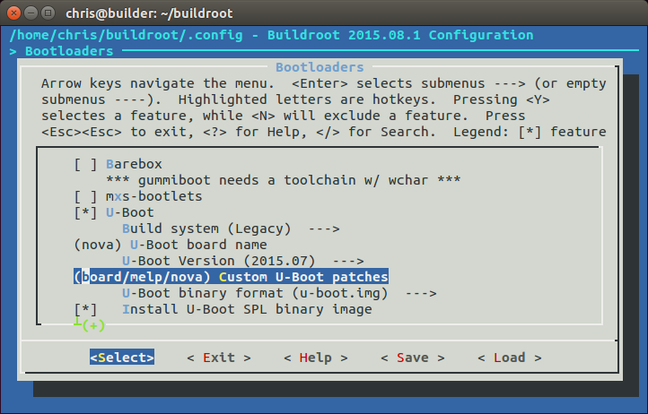
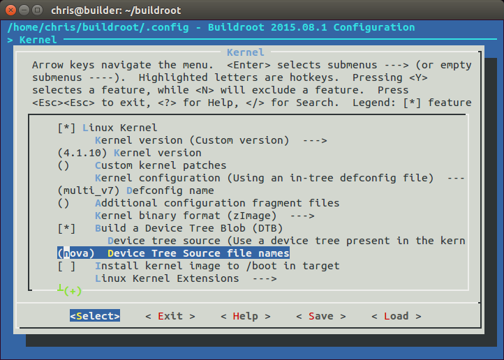
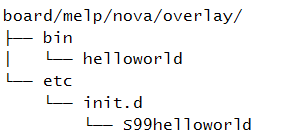
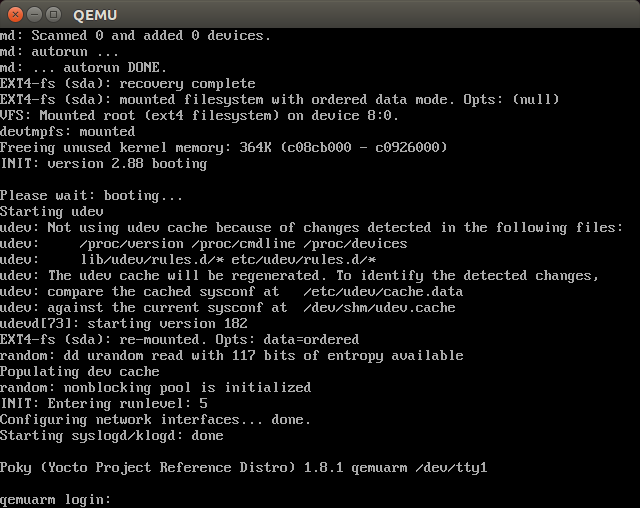

# Chương 6. Chọn build system

Các chương trước đã trình bày bốn thành phần của embedded Linux và chỉ dẫn step-by-step cách build toolchain, bootloader, kernel và root filesystem, rồi kết hợp thành hệ thống embedded Linux cơ bản. Có rất nhiều bước! Giờ là lúc tìm cách đơn giản hóa quy trình bằng cách tự động hóa nhiều nhất có thể. Tôi sẽ xem các build system embedded hỗ trợ ra sao, đặc biệt là hai hệ thống: Buildroot và Yocto Project. Cả hai đều là công cụ phức tạp và linh hoạt, cần cả một cuốn sách để mô tả đầy đủ cách hoạt động. Trong chương này, tôi chỉ muốn trình bày ý tưởng chung đằng sau build system. Tôi sẽ chỉ cách build device image đơn giản để có cảm nhận tổng thể về hệ thống, rồi thực hiện một số thay đổi hữu ích, sử dụng ví dụ board Nova từ các chương trước.

## Không còn phải tự làm embedded Linux từ đầu

Quy trình tạo hệ thống thủ công, như mô tả trong Chương 5, Xây dựng root filesystem, được gọi là roll your own (RYO). Ưu điểm là bạn hoàn toàn kiểm soát phần mềm và có thể điều chỉnh để làm bất cứ điều gì mong muốn. Nếu muốn nó làm điều gì đó thật khác thường nhưng sáng tạo, hoặc giảm memory footprint xuống thấp nhất có thể, RYO là lựa chọn phù hợp. Nhưng trong đại đa số trường hợp, build thủ công lãng phí thời gian và tạo ra hệ thống kém chất lượng, không thể bảo trì.

Chúng thường được xây dựng dần trong nhiều tháng, thường không có tài liệu và hiếm khi được tạo lại từ đầu vì không ai biết mỗi phần đến từ đâu.

## Build system

Ý tưởng của build system là tự động hóa mọi bước tôi đã mô tả đến đây. Một build system phải có khả năng build từ upstream source code một số hoặc tất cả thành phần sau:

- Toolchain

- Bootloader

- Kernel

- Root filesystem

Build từ upstream source quan trọng vì nhiều lý do. Nó giúp bạn yên tâm rằng có thể rebuild bất kỳ lúc nào, không phụ thuộc bên ngoài. Nó cũng có nghĩa là bạn có source code để debug và có thể đáp ứng yêu cầu giấy phép về phân phối source cho người dùng khi cần.

Vì vậy, để hoàn thành công việc, build system phải làm được những việc sau:

- Tải source từ upstream, trực tiếp từ hệ thống quản lý source code hoặc dưới dạng archive, rồi cache cục bộ

- Áp dụng patch để cho phép cross compilation, sửa lỗi architecture-dependent, áp dụng chính sách cấu hình cục bộ, v.v.

- Build các thành phần

- Tạo staging area và lắp ráp root filesystem

- Tạo image file ở nhiều định dạng, sẵn sàng nạp lên target

Những khả năng hữu ích khác gồm:

- Thêm package riêng chứa, ví dụ, ứng dụng hoặc thay đổi kernel

- Chọn nhiều profile root filesystem: lớn hoặc nhỏ, có hoặc không có đồ họa hay các tính năng khác

- Tạo SDK độc lập để phân phối cho developer khác, giúp họ không phải cài toàn bộ build system

- Theo dõi các giấy phép open source mà những package bạn chọn sử dụng

- Cho phép tạo bản cập nhật để cập nhật in-field

- Có giao diện người dùng user-friendly

Trong mọi trường hợp, chúng đóng gói các thành phần hệ thống thành package, một số cho host và một số cho target. Mỗi package được định nghĩa bằng tập rule để lấy source, build và cài kết quả vào đúng vị trí. Các package có dependency với nhau và có cơ chế build để giải quyết dependency, build tập package cần thiết.

Các build system open source đã trưởng thành đáng kể trong vài năm qua. Hiện có nhiều hệ thống, bao gồm:

- Buildroot: Hệ thống easy-to-use dùng GNU `make` và `Kconfig` (`http://buildroot.org`)

- EmbToolkit: Hệ thống đơn giản để tạo root filesystem; tại thời điểm viết sách, đây là hệ thống duy nhất hỗ trợ sẵn LLVM/Clang (`https://www.embtoolkit.org`)

- OpenEmbedded: Hệ thống mạnh, đồng thời là thành phần cốt lõi của Yocto Project và các hệ thống khác (`http://openembedded.org`)

- OpenWrt: Công cụ build hướng tới tạo firmware cho wireless router (`https://openwrt.org`)

- PTXdist: Build system open source do Pengutronix tài trợ (`http://www.pengutronix.de/software/ptxdist/index_en.html`)

- Tizen: Hệ thống toàn diện, chú trọng thiết bị di động, media và in-vehicle (`https://www.tizen.org`)

- Yocto Project: Mở rộng OpenEmbedded core bằng cấu hình, layer, công cụ và tài liệu; có lẽ là hệ thống phổ biến nhất (`http://www.yoctoproject.org`)

Tôi sẽ tập trung vào hai hệ thống: Buildroot và Yocto Project. Chúng tiếp cận vấn đề theo cách khác nhau và có mục tiêu khác nhau.

Mục tiêu chính của Buildroot là build root filesystem image, đúng như tên gọi, dù nó cũng có thể build bootloader và kernel image. Nó dễ cài đặt, cấu hình và tạo target image nhanh chóng.

Ngược lại, Yocto Project tổng quát hơn trong cách định nghĩa target system, nên có thể build các thiết bị embedded khá phức tạp. Mỗi thành phần được tạo thành package ở định dạng RPM, `.dpkg` hoặc `.ipk` (xem phần tiếp theo), sau đó các package được kết hợp thành filesystem image. Hơn nữa, bạn có thể cài package manager vào filesystem image để cập nhật package tại runtime. Nói cách khác, khi build bằng Yocto Project, thực chất bạn đang tạo Linux distribution tùy biến của riêng mình.

## Định dạng package và package manager

Các Linux distribution chủ đạo phần lớn được xây dựng từ tập hợp binary package (đã biên dịch) ở định dạng RPM hoặc deb. RPM viết tắt của Red Hat Package Manager, dùng trong Red Hat, Suse, Fedora và các distribution dựa trên chúng. Các distribution Debian-derived, gồm Ubuntu và Mint, dùng định dạng Debian package manager, `deb`. Ngoài ra còn có định dạng light-weight dành riêng cho thiết bị embedded, được gọi là Itsy PacKage, hay ipk, dựa trên `deb`.

Khả năng đưa package manager vào thiết bị là một khác biệt lớn giữa các build system. Khi đã có package manager trên target device, bạn có cách dễ dàng để triển khai package mới và cập nhật package hiện có. Tôi sẽ nói về hệ quả của điều này ở chương tiếp theo.

## Buildroot

Website dự án Buildroot nằm tại `http://buildroot.org`.

Các phiên bản Buildroot hiện tại có thể build toolchain, bootloader (U-Boot, Barebox, GRUB2 hoặc Gummiboot), kernel và root filesystem. Nó dùng GNU `make` làm công cụ build chính.

Có tài liệu trực tuyến tốt tại `http://buildroot.org/docs.html,` bao gồm The Buildroot User Manual.

### Bối cảnh

Buildroot là một trong những build system đầu tiên. Nó bắt đầu như một phần của dự án uClinux và uClibc nhằm tạo root filesystem nhỏ phục vụ kiểm thử. Nó trở thành dự án riêng vào cuối năm 2001 và tiếp tục phát triển đến năm 2006, sau đó bước vào giai đoạn tương đối trầm lắng. Tuy nhiên, từ năm 2009, khi Peter Korsgaard tiếp quản, nó phát triển nhanh chóng, bổ sung hỗ trợ toolchain dựa trên `glibc` và khả năng build bootloader, kernel.

Buildroot cũng là nền tảng của build system phổ biến khác, OpenWrt (`http://wiki.openwrt.org`), tách nhánh từ Buildroot vào khoảng năm 2004. Trọng tâm của OpenWrt là tạo phần mềm cho wireless router, nên tập package hướng tới hạ tầng networking. Nó còn có runtime package manager dùng định dạng `.ipk`, cho phép cập nhật hoặc nâng cấp thiết bị mà không cần re-flash toàn bộ image.

### Bản phát hành stable và hỗ trợ

Developer Buildroot tạo bản phát hành stable bốn lần mỗi năm, vào tháng 2, 5, 8 và 11. Chúng được đánh dấu bằng tag `git` dạng `<year>.02`, `<year>.05`, `<year>.08` và `<year>.11`. Thông thường, khi bắt đầu dự án, bạn dùng bản stable mới nhất. Tuy nhiên, các bản stable ít khi được cập nhật sau phát hành. Để có bản sửa bảo mật và sửa lỗi khác, bạn phải liên tục chuyển sang bản stable tiếp theo khi có, hoặc backport bản sửa vào phiên bản của mình.

### Cài đặt

Như thường lệ, bạn có thể cài Buildroot bằng cách clone repository hoặc tải archive. Đây là ví dụ lấy phiên bản 2015.08.1, bản stable mới nhất tại thời điểm viết sách:

```
$ git clone git://git.buildroot.net/buildroot
$ cd buildroot
$ git checkout 2015.08.1
```

TAR archive tương ứng có tại `http://buildroot.org/downloads`.

Tiếp theo, hãy đọc phần System Requirement trong The Buildroot User Manual tại `http://buildroot.org/downloads/manual/manual.html` và bảo đảm đã cài tất cả package được liệt kê.

### Cấu hình

Buildroot dùng các cơ chế `Kconfig` và `Kbuild` như kernel, đã được mô tả trong phần Hiểu cấu hình kernel ở Chương 4, Port và cấu hình kernel. Bạn có thể cấu hình từ đầu bằng `make menuconfig` (hoặc `xconfig` hay `gconfig`), hoặc chọn một trong khoảng 90 cấu hình cho các development board và QEMU emulator, lưu trong thư mục `configs/`. Gõ `make help` để liệt kê mọi target, bao gồm cấu hình mặc định.

Hãy bắt đầu bằng build cấu hình mặc định có thể chạy trên ARM QEMU emulator:

```
$ cd buildroot
$ make qemu_arm_versatile_defconfig
$ make
```

Lưu ý bạn không chỉ định số job song song cho `make` bằng tùy chọn `-j`: Buildroot tự sử dụng CPU tối ưu. Nếu muốn giới hạn số job, chạy `make menuconfig` và xem mục Build options.

Quá trình build mất từ nửa giờ đến một giờ, tùy khả năng host system và tốc độ kết nối Internet. Khi hoàn tất, bạn sẽ thấy hai thư mục mới được tạo:

- `dl/`: Chứa archive của các dự án upstream mà Buildroot đã build

- `output/`: Chứa mọi tài nguyên biên dịch trung gian và cuối cùng

Trong `output/`, bạn sẽ thấy:

- `build/`: Thư mục build cho từng thành phần.

- `host/`: Chứa các công cụ Buildroot cần và chạy trên host, gồm executable của toolchain (trong `output/host/usr/bin`).

- `images/`: Quan trọng nhất, chứa kết quả build. Tùy lựa chọn khi cấu hình, bạn sẽ thấy bootloader, kernel và một hoặc nhiều root filesystem image.

- `staging/`: Symbolic link đến `sysroot` của toolchain. Tên link hơi gây nhầm lẫn vì nó không trỏ đến staging area theo định nghĩa trong Chương 5, Xây dựng root filesystem.

- `target/`: Staging area cho root directory. Lưu ý không thể dùng nguyên trạng làm root filesystem vì file ownership và permission chưa đúng. Buildroot dùng device table, như mô tả ở chương trước, để đặt ownership và permission khi tạo filesystem image.

### Chạy

Một số cấu hình mẫu có mục tương ứng trong thư mục `boards/`, chứa file cấu hình tùy biến và thông tin cài kết quả lên target. Với hệ thống vừa build, file liên quan là `board/qemu/arm-vexpress/readme.txt`, hướng dẫn cách khởi động QEMU với target này. Giả sử đã cài `qemu-system-arm` như Chương 1, Bắt đầu, bạn có thể chạy bằng lệnh:

```
$ qemu-system-arm -M vexpress-a9 -m 256 \
-kernel output/images/zImage \
-dtb output/images/vexpress-v2p-ca9.dtb \
-drive file=output/images/rootfs.ext2,if=sd \
-append "console=ttyAMA0,115200 root=/dev/mmcblk0" \
-serial stdio -net nic,model=lan9118 -net user
```

Bạn sẽ thấy các thông báo boot kernel xuất hiện trong cùng cửa sổ terminal đã khởi động QEMU, sau đó là login prompt:

```
Booting Linux on physical CPU 0x0
Initializing cgroup subsys cpuset

Linux version 4.1.0 (chris@builder) (gcc version 4.9.3 (Buildroot
2015.08) ) #1 SMP Fri Oct 30 13:55:50 GMT 2015

CPU: ARMv7 Processor [410fc090] revision 0 (ARMv7), cr=10c5387d

CPU: PIPT / VIPT nonaliasing data cache, VIPT aliasing instruction
cache
Machine model: V2P-CA9
[...]
VFS: Mounted root (ext2 filesystem) readonly on device 179:0.
devtmpfs: mounted
Freeing unused kernel memory: 264K (8061e000 - 80660000)
random: nonblocking pool is initialized
Starting logging: OK
Starting mdev...
Initializing random number generator... done.
Starting network...

Welcome to Buildroot
buildroot login:
```

Đăng nhập bằng `root`, không có password. Bạn sẽ thấy QEMU mở thêm cửa sổ đen bên cạnh cửa sổ thông báo boot kernel. Nó dùng để hiển thị graphics frame buffer của target. Trong trường hợp này, target không bao giờ ghi vào `framebuffer`, nên cửa sổ có màu đen. Để đóng QEMU, gõ `poweroff` tại root prompt hoặc đóng cửa sổ `framebuffer`. Cách này hoạt động với QEMU 2.0 (mặc định trên Ubuntu 14.04), nhưng thất bại với các phiên bản cũ hơn, kể cả QEMU 1.0.50 (mặc định trên Ubuntu 12.04), vì vấn đề SCSI emulation.

### Tạo BSP tùy biến

Tiếp theo, hãy dùng Buildroot tạo BSP cho board Nova, sử dụng cùng các phiên bản U-Boot và Linux trong các chương trước. Những vị trí nên lưu thay đổi gồm:

- `board/<organization>/<device>`: Chứa patch, binary blob, bước build bổ sung, file cấu hình cho Linux, U-Boot và các thành phần khác

- `configs/<device>_defconfig`: Chứa cấu hình mặc định của board

- `packages/<organization>/<package_name>`: Nơi đặt package bổ sung cho board này

Chúng ta có thể dùng file cấu hình BeagleBone làm cơ sở, vì Nova rất gần với nó:

```
$ make clean  #  Always do a clean when changing targets
$ make beaglebone_defconfig
```

Giờ file `.config` đã được đặt cho BeagleBone. Tiếp theo, tạo thư mục cho cấu hình board:

```
$ mkdir -p board/melp/nova
```

#### U-Boot

Trong Chương 3, Tất cả về bootloader, chúng ta tạo bootloader tùy biến cho Nova dựa trên U-Boot phiên bản 2015.07 và tạo patch file cho nó. Có thể cấu hình Buildroot chọn cùng phiên bản và áp dụng patch. Bắt đầu bằng cách sao chép patch file vào `board/melp/nova`, rồi dùng `make menuconfig` đặt phiên bản U-Boot thành 2015.07, patch directory thành `board/melp/nova` và board name thành nova, như ảnh chụp màn hình:



#### Linux

Trong Chương 4, Port và cấu hình kernel, chúng ta dựa kernel trên Linux 4.1.10 và cung cấp device tree mới tên `nova.dts`. Sao chép device tree vào `board/melp/nova` và đổi cấu hình kernel Buildroot để dùng phiên bản này cùng device tree nova như ảnh chụp màn hình:



#### Build

Giờ bạn có thể build hệ thống cho board Nova chỉ bằng cách gõ `make`, tạo các file sau trong thư mục `output/images`:

```
MLO  nova.dtb  rootfs.ext2  u-boot.img  uEnv.txt  zImage
```

Bước cuối là lưu bản sao cấu hình để bạn và người khác có thể dùng lại:

```
$ make savedefconfig BR2_DEFCONFIG=configs/nova_defconfig
```

Giờ bạn đã có cấu hình Buildroot cho board Nova.

### Thêm code riêng

Giả sử bạn có một số chương trình tự phát triển muốn đưa vào bản build. Có hai lựa chọn: thứ nhất, build riêng bằng build system của chúng, rồi đưa binary vào bản build cuối dưới dạng overlay. Thứ hai, tạo Buildroot package có thể chọn từ menu và build như mọi package khác.

#### Overlay

Overlay đơn giản là cấu trúc thư mục được sao chép đè lên root filesystem của Buildroot ở giai đoạn muộn của quá trình build. Nó có thể chứa executable, library và bất cứ thứ gì bạn muốn đưa vào. Lưu ý mọi code đã biên dịch phải tương thích với library được triển khai tại runtime, nghĩa là phải biên dịch bằng cùng toolchain Buildroot sử dụng. Dùng toolchain Buildroot khá dễ: chỉ cần thêm vào path:

```
$ PATH=<path_to_buildroot>/output/host/usr/bin:$PATH
```

Prefix của công cụ là `<ARCH>-linux-`.

Thư mục overlay được đặt bằng `BR2_ROOTFS_OVERLAY`, chứa danh sách thư mục phân cách bằng dấu cách để overlay lên root filesystem Buildroot. Có thể cấu hình trong `menuconfig` bằng tùy chọn System configuration \| Root filesystem overlay directories. Ví dụ, nếu thêm chương trình `helloworld` vào thư mục `bin` và script khởi chạy nó khi boot, bạn sẽ tạo thư mục overlay có nội dung sau:



Sau đó thêm `board/melp/nova/overlay` vào các tùy chọn overlay.

Bố cục root filesystem được điều khiển bằng thư mục `system/skeleton`, và permission được đặt trong `device_table_dev.txt` cùng `device_table.txt`.

#### Thêm package

Buildroot package được lưu trong thư mục `package`, có hơn 1.000 package, mỗi package trong thư mục con riêng. Một package gồm ít nhất hai file: `Config.in,` chứa đoạn code `Kconfig` cần để package xuất hiện trong menu cấu hình, và `makefile` tên `<package_name>.mk`. Lưu ý package không chứa code, chỉ chứa hướng dẫn lấy code bằng cách tải tarball, thực hiện git pull, v.v.

`makefile` được viết theo định dạng Buildroot yêu cầu và chứa directive để Buildroot tải, cấu hình, biên dịch và cài chương trình. Viết `makefile` cho package mới là công việc phức tạp, được trình bày chi tiết trong Buildroot User Manual. Đây là ví dụ tạo package cho chương trình đơn giản lưu cục bộ, như chương trình `helloworld` của chúng ta.

Bắt đầu bằng cách tạo thư mục con `package/helloworld` với file cấu hình `Config.in` như sau:

```
config BR2_PACKAGE_HELLOWORLD
bool "helloworld"
help
  A friendly program that prints Hello World! every 10s
```

Dòng đầu phải có định dạng `BR2_PACKAGE_<uppercase package name>`. Theo sau là Boolean và tên package sẽ xuất hiện trong menu cấu hình, cho phép người dùng chọn package. Phần Help là tùy chọn (nhưng hy vọng hữu ích).

Tiếp theo, nối package mới vào menu Target Packages bằng cách sửa `package/Config.in` và nạp file cấu hình như phần trước. Bạn có thể thêm vào sub-menu hiện có, nhưng trong trường hợp này, tạo sub-menu mới chỉ chứa package của chúng ta có vẻ gọn hơn:

```
menu "My programs"
  source "package/helloworld/Config.in"
endmenu
```

Sau đó, tạo makefile `package/helloworld/helloworld.mk` để cung cấp dữ liệu Buildroot cần:

```
HELLOWORLD_VERSION:= 1.0.0
HELLOWORLD_SITE:= /home/chris/MELP/helloworld/
HELLOWORLD_SITE_METHOD:=local
HELLOWORLD_INSTALL_TARGET:=YES

define HELLOWORLD_BUILD_CMDS
  $(MAKE) CC="$(TARGET_CC)" LD="$(TARGET_LD)" -C $(@D) all
endef

define HELLOWORLD_INSTALL_TARGET_CMDS
  $(INSTALL) -D -m 0755 $(@D)/helloworld $(TARGET_DIR)/bin
endef

$(eval $(generic-package))
```

Vị trí code được hard-coded thành đường dẫn cục bộ. Trong trường hợp thực tế hơn, bạn lấy code từ hệ thống quản lý source code hoặc một central server nào đó: Buildroot User Guide hướng dẫn chi tiết và các package khác có nhiều ví dụ.

### Tuân thủ giấy phép

Buildroot dựa trên phần mềm open source, cũng như các package nó biên dịch. Vào một thời điểm trong dự án, bạn nên kiểm tra giấy phép bằng cách chạy:

```
$ make legal-info
```

Thông tin được thu thập vào `output/legal-info`. Bản tổng hợp giấy phép dùng để biên dịch công cụ host nằm trong `host-manifest.csv`, còn cho target nằm trong `manifest.csv`. Có thêm thông tin trong file `README` và Buildroot User Manual.

## Yocto Project

Yocto Project phức tạp hơn Buildroot. Nó không chỉ build được toolchain, bootloader, kernel và root filesystem như Buildroot, mà còn tạo được cả Linux distribution cho bạn, với binary package có thể cài tại runtime.

Yocto Project chủ yếu là tập recipe, tương tự Buildroot package nhưng được viết bằng sự kết hợp Python và shell script, cùng task scheduler tên BitBake tạo ra những gì bạn cấu hình từ các recipe.

Có rất nhiều tài liệu trực tuyến tại `https://www.yoctoproject.org/`.

### Bối cảnh

Cấu trúc Yocto Project dễ hiểu hơn nếu xem bối cảnh trước. Nguồn gốc của nó là OpenEmbedded, `http://openembedded.org/`, bản thân OpenEmbedded phát triển từ một số dự án port Linux sang các máy tính hand-held, gồm Sharp Zaurus và Compaq iPaq. OpenEmbedded ra đời năm 2003 như build system cho các máy hand-held đó, nhưng nhanh chóng mở rộng sang các board embedded khác. Nó đã và vẫn đang được phát triển bởi cộng đồng lập trình viên nhiệt tình.

Dự án OpenEmbedded hướng tới tạo tập binary package theo định dạng gọn `.ipk`, có thể kết hợp theo nhiều cách để tạo target system và cài trên target tại runtime. Nó thực hiện bằng cách tạo recipe cho từng phần mềm và dùng BitBake làm task scheduler. Nó đã và vẫn rất linh hoạt. Cung cấp đúng metadata, bạn có thể tạo cả Linux distribution theo đặc tả riêng. Một distribution khá nổi tiếng là The Ångström Distribution, `http://www.angstrom-distribution.org`, nhưng còn nhiều distribution khác. Vào khoảng năm 2005, Richard Purdie, lúc đó là developer ở OpenedHand, tạo một fork OpenEmbedded với lựa chọn package thận trọng hơn và các bản phát hành ổn định trong một khoảng thời gian. Ông đặt tên Poky, theo món ăn vặt Nhật (nếu quan tâm, Poky phát âm vần với hockey). Dù Poky là fork, OpenEmbedded và Poky vẫn song hành, chia sẻ cập nhật và giữ kiến trúc tương đối đồng bộ. Intel mua OpenedHand năm 2008 và chuyển Poky Linux cho Linux Foundation năm 2010 khi thành lập Yocto Project.

Từ năm 2010, các thành phần chung của OpenEmbedded và Poky được kết hợp thành dự án riêng tên OpenEmbedded core, hay oe-core.

Vì vậy, Yocto Project tập hợp một số thành phần, quan trọng nhất gồm:

- Poky: Reference distribution

- oe-core: Metadata cốt lõi, dùng chung với OpenEmbedded

- BitBake: Task scheduler, dùng chung với OpenEmbedded và các dự án khác

- Documentation: Tài liệu người dùng và hướng dẫn developer cho từng thành phần

- Hob: Giao diện đồ họa cho OpenEmbedded và BitBake

- Toaster: Giao diện web-based cho OpenEmbedded và BitBake

- ADT Eclipse: plug-in cho Eclipse giúp build dự án bằng Yocto Project SDK dễ hơn

Nói chính xác, Yocto Project là dự án bao trùm các sub-projects này. Nó dùng OpenEmbedded làm build system và Poky làm cấu hình mặc định, môi trường tham chiếu. Tuy nhiên, người ta thường dùng thuật ngữ "Yocto Project" để chỉ riêng build system. Tôi cảm thấy đã quá muộn để đảo ngược cách gọi này, nên để ngắn gọn, tôi cũng làm vậy. Tôi xin lỗi trước các developer OpenEmbedded.

Yocto Project cung cấp nền tảng ổn định, có thể dùng nguyên trạng hoặc mở rộng bằng meta layer, sẽ bàn ở phần sau. Nhiều vendor SoC cung cấp board support package cho thiết bị theo cách này. Meta layer cũng có thể tạo build system mở rộng, hoặc đơn giản khác đi. Một số là open source như Angstrom Project; số khác là thương mại, như MontaVista Carrier Grade Edition, Mentor Embedded Linux và Wind River Linux. Yocto Project có cơ chế kiểm thử tương thích và nhận diện thương hiệu để bảo đảm thành phần tương tác được. Bạn sẽ thấy các tuyên bố như Yocto Project Compatible 1.7 trên nhiều website. Vì vậy, nên coi Yocto Project là nền tảng của cả một mảng embedded Linux, đồng thời bản thân cũng là build system hoàn chỉnh. Bạn có thể thắc mắc về tên yocto. Yocto là SI prefix cho 10<sup>-24</sup>, giống như micro là 10<sup>-6</sup>. Vì sao đặt tên yocto? Một phần để chỉ ra nó có thể build hệ thống Linux rất nhỏ (dù công bằng mà nói, các build system khác cũng vậy), nhưng có lẽ còn để đi trước Ångström distribution dựa trên OpenEmbedded. Một Ångström là 10<sup>-10</sup>. So với yocto thì thật khổng lồ!

### Bản phát hành stable và hỗ trợ

Thông thường, Yocto Project phát hành mỗi sáu tháng, vào tháng 4 và tháng 10. Chúng chủ yếu được biết bằng code name, nhưng biết số phiên bản Yocto Project và Poky cũng hữu ích. Đây là bảng bốn bản phát hành gần nhất tại thời điểm viết sách:

| Code name | Ngày phát hành | Phiên bản Yocto | Phiên bản Poky |
|---|---|---|---|
| `Fido` | Tháng 4 năm 2015 | 1\.8 | 13 |
| `Dizzy` | Tháng 10 năm 2014 | 1\.7 | 12 |
| `Daisy` | Tháng 4 năm 2014 | 1\.6 | 11 |
| `Dora` | Tháng 10 năm 2013 | 1\.5 | 10 |

Các bản stable được hỗ trợ bản sửa bảo mật và lỗi nghiêm trọng trong chu kỳ hiện tại và chu kỳ tiếp theo, tức khoảng mười hai tháng sau phát hành. Những cập nhật này không được thay đổi phiên bản toolchain hay kernel. Như Buildroot, nếu muốn tiếp tục hỗ trợ, bạn có thể cập nhật lên bản stable tiếp theo hoặc backport thay đổi vào phiên bản của mình. Với Yocto Project, bạn còn có lựa chọn hỗ trợ thương mại trong nhiều năm từ vendor operating system như Mentor Graphics, Wind River và nhiều bên khác.

### Cài Yocto Project

Để lấy Yocto Project, bạn có thể clone repository, chọn code name làm branch, ở đây là `fido`:

```
$ git clone -b fido git://git.yoctoproject.org/poky.git
```

Bạn cũng có thể tải archive từ `http://downloads.yoctoproject.org/releases/yocto/yocto-1.8/poky-fido-13.0.0.tar.bz2`.

Trong trường hợp đầu, mọi thứ nằm trong thư mục `poky`; trường hợp thứ hai là `poky-fido-13.0.0/`. Ngoài ra, hãy đọc phần System Requirements trong Yocto Project Reference Manual (`http://www.yoctoproject.org/docs/current/ref-manual/ref-manual.html#detailed-supported-distros`), đặc biệt bảo đảm các package được liệt kê đã được cài trên host computer.

### Cấu hình

Như với Buildroot, hãy bắt đầu bằng bản build cho ARM QEMU emulator. Trước tiên, source một script để thiết lập environment:

```
$ cd poky
$ source oe-init-build-env
```

Thao tác đó tạo working directory tên `build` và chuyển nó thành current directory. Mọi file cấu hình, file trung gian và file có thể triển khai đều nằm trong thư mục này. Bạn phải source script mỗi khi muốn làm việc với dự án.

Bạn có thể chọn working directory khác bằng cách thêm nó làm tham số cho `oe-init-build-env`, ví dụ:

```
$ source oe-init-build-env build-qemuarm
```

Thao tác đó đưa bạn vào thư mục `build-qemuarm`. Như vậy có thể làm đồng thời nhiều dự án: chọn dự án muốn làm qua tham số của `oe-init-build-env`.

Ban đầu, thư mục `build` chỉ chứa một thư mục con tên `conf`, chứa các file cấu hình dự án:

- `local.conf`: Chứa đặc tả thiết bị sẽ build và build environment.

- `bblayers.conf`: Chứa danh sách thư mục có các layer bạn sẽ dùng. Layer sẽ được bàn thêm ở phần sau.

- `templateconf.cfg`: Chứa tên thư mục có các file `conf`. Mặc định trỏ đến `meta-yocto/conf`.

Hiện tại, chỉ cần đặt variable `MACHINE` trong `local.conf` thành `qemuarm` bằng cách bỏ ký tự comment ở đầu dòng:

```
MACHINE ?= "qemuarm"
```

### Build

Để thực sự build, bạn cần chạy `bitbake`, cho biết root filesystem image muốn tạo. Một số image thường gặp gồm:

- core-image-minimal: Hệ thống console-based nhỏ, hữu ích để kiểm thử và làm cơ sở cho image tùy biến.

- core-image-minimal-initramfs: Tương tự core-image-minimal, nhưng build thành ramdisk.

- core-image-x11: Image cơ bản hỗ trợ đồ họa qua X11 server và ứng dụng terminal xterminal.

- core-image-sato: Hệ thống đồ họa đầy đủ dựa trên Sato, môi trường đồ họa di động xây trên X11 và GNOME. Image chứa một số ứng dụng gồm terminal, editor và file manager.

Khi cung cấp target cuối cho BitBake, nó sẽ lần ngược và build mọi dependency trước, bắt đầu từ toolchain. Hiện tại, chúng ta chỉ muốn tạo minimal image để xem có hoạt động không:

```
$ bitbake core-image-minimal
```

Quá trình build có thể mất thời gian, có lẽ hơn một giờ. Khi hoàn tất, bạn sẽ thấy một số thư mục mới trong build directory, gồm `build/downloads` chứa mọi source đã tải cho bản build, và `build/tmp` chứa phần lớn build artifact. Trong `tmp`, bạn sẽ thấy:

- `work`: Chứa build directory và staging area cho mọi thành phần, gồm root filesystem

- `deploy`: Chứa binary cuối để triển khai lên target:

- `deploy/images/[machine name]`: Chứa bootloader, kernel và root filesystem image sẵn sàng chạy trên target

- `deploy/rpm`: Chứa các RPM package được dùng để tạo image

- `deploy/licenses`: Chứa file giấy phép trích xuất từ từng package

### Chạy

Khi build target QEMU, một phiên bản QEMU nội bộ được tạo, loại bỏ nhu cầu cài package QEMU của distribution và tránh dependency phiên bản. Có wrapper script tên `runqemu` cho QEMU nội bộ này.

Để chạy QEMU emulation, bảo đảm đã source `oe-init-build-env`, rồi chỉ cần gõ:

```
$ runqemu qemuarm
```

Trong trường hợp này, QEMU được cấu hình với graphic console, nên thông báo boot và login prompt xuất hiện trên màn hình framebuffer đen:



Bạn có thể đăng nhập bằng `root`, không cần password. Đóng QEMU bằng cách đóng cửa sổ framebuffer. Có thể khởi chạy QEMU không có cửa sổ đồ họa bằng cách thêm `nographic` vào command line:

```
$ runqemu qemuarm nographic
```

Trong trường hợp này, đóng QEMU bằng chuỗi phím Ctrl + A + X.

Script `runqemu` còn nhiều tùy chọn khác; gõ `runqemu help` để biết thêm.

### Layer

Metadata của Yocto Project được tổ chức thành layer; theo quy ước, tên mỗi layer bắt đầu bằng `meta`. Các layer cốt lõi gồm:

- meta: OpenEmbedded core

- meta-yocto: Metadata riêng của Yocto Project, gồm Poky distribution

- meta-yocto-bsp: Chứa board support package cho các reference machine mà Yocto Project hỗ trợ

Danh sách layer nơi BitBake tìm recipe được lưu trong `<your build directory>/conf/bblayers.conf`, mặc định gồm cả ba layer nêu trên.

Tổ chức recipe và dữ liệu cấu hình theo cách này giúp dễ mở rộng Yocto Project bằng layer mới. Layer bổ sung được cung cấp bởi nhà sản xuất SoC, chính Yocto Project và nhiều người muốn bổ sung giá trị cho Yocto Project, OpenEmbedded. Có danh sách layer hữu ích tại `http://layers.openembedded.org`. Một số ví dụ:

- meta-angstrom: Ångström distribution

- meta-qt5: Library và tiện ích Qt5

- meta-fsl-arm: BSP cho các SoC Freescale ARM-based

- meta-fsl-ppc: BSP cho các SoC Freescale PowerPC-based

- meta-intel: BSP cho CPU và SoC Intel

- meta-ti: BSP cho các SoC TI ARM-based

Thêm layer đơn giản là sao chép thư mục meta vào vị trí phù hợp, thường cạnh các meta layer mặc định, và thêm vào `bblayers.conf`. Chỉ cần bảo đảm tương thích với phiên bản Yocto Project đang dùng. Để minh họa cách layer hoạt động, hãy tạo layer cho board Nova, dùng trong phần còn lại của chương khi bổ sung tính năng. Mỗi meta layer phải có ít nhất một file cấu hình `conf/layer.conf`, và nên có file `README` cùng giấy phép. Có helper script tiện dụng làm những việc cơ bản này:

```
$ cd poky
$ scripts/yocto-layer create nova
```

Script hỏi priority và có muốn tạo recipe mẫu không. Trong ví dụ này, tôi chỉ chấp nhận mặc định:

```
Please enter the layer priority you'd like to use for the layer:
[default: 6]
Would you like to have an example recipe created? (y/n) [default: n]
Would you like to have an example bbappend file created? (y/n)
[default: n]
New layer created in meta-nova.
Don't forget to add it to your BBLAYERS (for details see meta-
nova\README).
```

Thao tác đó tạo layer tên `meta-nova`, có `conf/layer.conf`, bản phác thảo `README` và giấy phép MIT trong `COPYING.MIT`. File `layer.conf` như sau:

```
# We have a conf and classes directory, add to BBPATH
BBPATH .= ":${LAYERDIR}"

# We have recipes-* directories, add to BBFILES
BBFILES += "${LAYERDIR}/recipes-*/*/*.bb \
${LAYERDIR}/recipes-*/*/*.bbappend"

BBFILE_COLLECTIONS += "nova"
BBFILE_PATTERN_nova = "^${LAYERDIR}/"
BBFILE_PRIORITY_nova = "6"
```

Nó tự thêm vào `BBPATH` và thêm các recipe chứa bên trong vào `BBFILES`. Nhìn code, bạn thấy recipe được tìm trong thư mục có tên bắt đầu bằng `recipes-`, có tên file kết thúc bằng `.bb` (recipe BitBake thông thường) hoặc `.bbappend` (recipe mở rộng recipe thông thường hiện có bằng cách thêm và ghi đè hướng dẫn). Layer này có tên `nova`, được thêm vào danh sách layer `BBFILE_COLLECTIONS`, với priority `6`. Layer priority được dùng khi cùng recipe xuất hiện trong nhiều layer: recipe trong layer có priority cao nhất thắng. Vì sắp build cấu hình mới, tốt nhất hãy bắt đầu bằng cách tạo build directory mới tên `build-nova`:

```
$ cd ~/poky
$ . oe-init-build-env build-nova
```

Giờ cần thêm layer này vào cấu hình build, `conf/bblayers.conf`:

```
LCONF_VERSION = "6"

BBPATH = "${TOPDIR}"
BBFILES ?= ""

BBLAYERS ?= " \
  /home/chris/poky/meta \
  /home/chris/poky/meta-yocto \
  /home/chris/poky/meta-yocto-bsp \
  /home/chris/poky/meta-nova \
  "
BBLAYERS_NON_REMOVABLE ?= " \
  /home/chris/poky/meta \
  /home/chris/poky/meta-yocto \
  "
```

Có thể xác nhận thiết lập đúng bằng helper script khác:

```
$ bitbake-layers show-layers
layer                 path                     priority
==========================================================
meta              /home/chris/poky/meta            5
meta-yocto        /home/chris/poky/meta-yocto      5
meta-yocto-bsp    /home/chris/poky/meta-yocto-bsp  5
meta-nova         /home/chris/poky/meta-nova       6
```

Ở đó bạn thấy layer mới. Nó có priority `6`, nghĩa là có thể ghi đè recipe trong các layer khác có priority thấp hơn.

Lúc này nên chạy build với layer trống này. Target cuối là board Nova, nhưng hiện tại hãy build cho BeagelBone Black bằng cách bỏ comment trước `MACHINE ?= "beaglebone"` trong `conf/local.conf`. Sau đó build image nhỏ bằng `bitbake core-image-minimal` như trước.

Ngoài recipe, layer có thể chứa BitBake class, file cấu hình cho machine, distribution và nhiều thứ khác. Tiếp theo, tôi sẽ xem recipe, chỉ cách tạo image tùy biến và tạo package.

#### BitBake và recipe

BitBake xử lý metadata thuộc nhiều loại khác nhau, bao gồm:

- recipes: File kết thúc bằng `.bb`. Chúng chứa thông tin build một đơn vị phần mềm, gồm cách lấy source code, dependency với các thành phần khác, cách build và cài đặt.

- append: File kết thúc bằng `.bbappend`. Chúng cho phép ghi đè hoặc mở rộng một số chi tiết recipe. File `A.bbappend` chỉ thêm hướng dẫn vào cuối file recipe (`.bb`) có cùng tên gốc.

- include: File kết thúc bằng `.inc`. Chúng chứa thông tin chung cho nhiều recipe, cho phép chia sẻ thông tin. Có thể đưa file vào bằng keyword `include` hoặc `require`. Khác biệt là `require` gây lỗi nếu file không tồn tại, còn `include` thì không.

- classes: File kết thúc bằng `.bbclass`. Chúng chứa thông tin build chung, ví dụ cách build kernel hoặc dự án `autotools`. Class được kế thừa và mở rộng trong recipe, class khác bằng keyword `inherit`. Class `classes/base.bbclass` được ngầm kế thừa trong mọi recipe.

- configuration: File kết thúc bằng `.conf`. Chúng định nghĩa các variable cấu hình điều khiển quá trình build dự án.

Recipe là tập task được viết bằng sự kết hợp Python và shell code. Task có tên như `do_fetch`, `do_unpack`, `do_patch`, `do_configure`, `do_compile`, `do_install`, v.v. Bạn dùng BitBake để thực thi chúng.

Task mặc định là `do_build`, nên bạn đang chạy build task cho recipe đó. Có thể liệt kê task có trong recipe bằng cách chạy `bitbake core-image-minimal` như sau:

```
$ bitbake -c listtasks core-image-minimal
```

Tùy chọn `-c` cho phép chỉ định task, bỏ phần `do_`. Cách dùng phổ biến là `-c fetch` để lấy code recipe cần:

```
$ bitbake -c fetch busybox
```

Cũng có thể dùng `fetchall` để lấy code cho target và mọi dependency:

```
$ bitbake -c fetchall core-image-minimal
```

File recipe thường được đặt tên `<package-name>_version.bb`. Chúng có thể phụ thuộc recipe khác, cho phép BitBake xác định mọi subtask cần thực thi để hoàn thành công việc cấp cao nhất. Tiếc là sách không đủ chỗ mô tả cơ chế dependency, nhưng tài liệu Yocto Project có mô tả đầy đủ.

Ví dụ, để tạo recipe cho chương trình `helloworld` trong `meta-nova`, bạn tạo cấu trúc thư mục như sau:

```
meta-nova/recipes-local/helloworld
├── files
│   └── helloworld.c
└── helloworld_1.0.bb
```

Recipe là `helloworld_1.0.bb`, còn source nằm cục bộ trong thư mục con files của recipe directory. Recipe chứa các hướng dẫn:

```
DESCRIPTION = "A friendly program that prints Hello World!"
PRIORITY = "optional"
SECTION = "examples"

LICENSE = "GPLv2"
LIC_FILES_CHKSUM = "file://${COMMON_LICENSE_DIR}/GPL-
2.0;md5=801f80980d171dd6425610833a22dbe6"

SRC_URI = "file://helloworld.c"
S = "${WORKDIR}"

do_compile() {
  ${CC} ${CFLAGS} -o helloworld helloworld.c
}

do_install() {
  install -d ${D}${bindir}
  install -m 0755 helloworld ${D}${bindir}
}
```

Vị trí source code được đặt bằng `SRC_URI`: ở đây nó tìm trong các thư mục files, `helloworld` và `helloworld-1.0` trong recipe directory. Chỉ cần định nghĩa task `do_compile` và `do_install`, lần lượt biên dịch đơn giản một source file và cài vào target root filesystem: `${D}` mở rộng thành staging area của target device, còn `${bindir}` thành thư mục binary mặc định, `/usr/bin`. Mỗi recipe có giấy phép, được định nghĩa bằng `LICENSE`, ở đây đặt thành `GPLv2`. File chứa nội dung giấy phép và checksum được định nghĩa bằng `LIC_FILES_CHKSUM`. BitBake dừng build nếu checksum không khớp, cho biết giấy phép đã thay đổi theo cách nào đó. File giấy phép có thể là thành phần của package hoặc trỏ đến văn bản giấy phép chuẩn trong `meta/files/common-licenses`, như trường hợp này.

Mặc định, giấy phép thương mại không được phép, nhưng dễ dàng bật chúng. Cần chỉ định giấy phép trong recipe như sau:

```
LICENSE_FLAGS = "commercial"
```

Sau đó, trong `conf/local.conf`, cho phép rõ ràng giấy phép này như sau:

```
LICENSE_FLAGS_WHITELIST = "commercial"
```

Để bảo đảm biên dịch đúng, có thể yêu cầu BitBake build như sau:

```
$ bitbake  helloworld
```

Nếu mọi việc thuận lợi, bạn sẽ thấy working directory cho nó được tạo trong `tmp/work/cortexa8hf-vfp-neon-poky-linux-gnueabi/helloworld/`.

Bạn cũng sẽ thấy RPM package của nó trong `tmp/deploy/rpm/cortexa8hf_vfp_neon/helloworld-1.0-r0.cortexa8hf_vfp_neon.rpm`.

Tuy nhiên, nó chưa thuộc target image. Danh sách package cần cài được giữ trong variable tên `IMAGE_INSTALL`. Bạn có thể thêm vào cuối danh sách bằng cách thêm dòng sau vào `conf/local.conf`:

```
IMAGE_INSTALL_append = " helloworld"
```

Lưu ý phải có dấu cách giữa dấu ngoặc kép đầu và tên package đầu tiên. Giờ package sẽ được thêm vào mọi image bạn bitbake:

```
$ bitbake core-image-minimal
```

Nếu xem `tmp/deploy/images/beaglebone/core-image-minimal-beaglebone.tar.bz2`, bạn sẽ thấy `/usr/bin/helloworld` thực sự đã được cài.

### Tùy biến image qua local.conf

Trong quá trình phát triển, bạn thường muốn thêm package vào image hoặc tinh chỉnh theo cách khác. Như trên, chỉ cần thêm vào danh sách package cần cài bằng câu lệnh:

```
IMAGE_INSTALL_append = " strace helloworld"
```

Không có gì ngạc nhiên là bạn cũng làm được điều ngược lại: xóa package bằng cú pháp:

```
IMAGE_INSTALL_remove = "someapp"
```

Có thể thực hiện thay đổi rộng hơn qua `EXTRA_IMAGE_FEATURES`. Quá nhiều tính năng để liệt kê ở đây; tôi khuyên bạn xem phần Image Features trong Yocto Project Reference Manual và code trong `meta/classes/core-image.bbclass`. Đây là danh sách ngắn giúp hình dung những tính năng có thể bật:

- `dbg-pkgs`: Cài package debug symbol cho mọi package được cài trong image.

- `debug-tweaks`: Cho phép root login không cần password và các thay đổi khác giúp phát triển dễ hơn.

- `package-management`: Cài công cụ package management và giữ lại database của package manager.

- `read-only-rootfs`: Làm root filesystem thành read-only. Chúng ta sẽ trình bày chi tiết hơn trong Chương 7, Tạo chiến lược lưu trữ.

- `x11`: Cài X server.

- `x11-base`: Cài X server với môi trường tối thiểu.

- `x11-sato`: Cài môi trường OpenedHand Sato.

### Viết image recipe

Vấn đề của thay đổi trong `local.conf` là chúng chỉ có tính cục bộ. Nếu muốn tạo image chia sẻ với developer khác hoặc nạp lên production system, bạn nên đưa thay đổi vào image recipe.

Image recipe chứa hướng dẫn tạo các image file cho target, gồm bootloader, kernel và root filesystem image. Có thể lấy danh sách image sẵn có bằng lệnh:

```
$ ls meta*/recipes*/images/*.bb
```

Recipe cho `core-image-minimal` nằm trong `meta/recipes-core/images/core-image-minimal.bb`.

Cách đơn giản là lấy image recipe hiện có và sửa bằng các câu lệnh tương tự đã dùng trong `local.conf`. Ví dụ, giả sử muốn image giống `core-image-minimal` nhưng có thêm chương trình `helloworld` và tiện ích `strace`. Có thể làm bằng recipe file two-line, đưa vào (bằng keyword `require`) base image rồi thêm package mong muốn. Theo quy ước, image được đặt trong thư mục tên `images`, nên thêm recipe `nova-image.bb` với nội dung sau vào `meta-nova/recipes-local/images`:

```
require recipes-core/images/core-image-minimal.bb
IMAGE_INSTALL += "helloworld strace"
```

Giờ bạn có thể bỏ dòng `IMAGE_INSTALL_append` khỏi `local.conf` và build bằng:

```
$ bitbake nova-image
```

Nếu muốn đi xa hơn và kiểm soát hoàn toàn nội dung root filesystem, bạn có thể bắt đầu từ đầu với variable `IMAGE_INSTALL` trống và thêm nội dung như sau:

```
SUMMARY = "A small image with helloworld and strace packages"
IMAGE_INSTALL = "packagegroup-core-boot helloworld strace"
IMAGE_LINGUAS = " "
LICENSE = "MIT"
IMAGE_ROOTFS_SIZE ?= "8192"
inherit core-image
```

`IMAGE_LINGUAS` chứa danh sách locale `glibc` cần cài vào target image. Chúng có thể chiếm nhiều chỗ, nên ở đây đặt danh sách trống; điều này ổn nếu không cần hàm library locale-dependent. `IMAGE_ROOTFS_SIZE` là kích thước disk image kết quả, tính bằng KiB. Phần lớn công việc do class `core-image` được kế thừa ở cuối thực hiện.

### Tạo SDK

Khả năng tạo toolchain độc lập cho developer khác cài đặt rất hữu ích, tránh việc mọi thành viên nhóm đều phải cài đầy đủ Yocto Project. Lý tưởng nhất là toolchain bao gồm development library và header file cho tất cả library đã cài trên target. Bạn có thể làm với bất kỳ image nào bằng task `populate_sdk`, như sau:

```
$ bitbake nova-image -c populate_sdk
```

Kết quả là shell script self-installing trong `tmp/deploy/sdk` có tên:

```
poky-<c_library>-<host_machine>-<target_image><target_machine>-
toolchain-<version>.sh
```

Đây là ví dụ:

```
poky-glibc-x86_64-nova-image-cortexa8hf-vfp-neon-toolchain-
1.8.1.sh
```

Lưu ý mặc định toolchain không chứa static library. Bạn có thể bật riêng từng library bằng cách thêm các dòng như sau vào `local.conf` hoặc image recipe:

```
TOOLCHAIN_TARGET_TASK_append = " glibc-staticdev"
```

Cũng có thể bật toàn cục như sau:

```
SDKIMAGE_FEATURES_append = " staticdev-pkgs"
```

Nếu chỉ muốn toolchain cơ bản với C và C++ cross compiler, C library và header file, bạn có thể chạy:

```
$ bitbake meta-toolchain
```

Để cài SDK, chỉ cần chạy shell script. Thư mục cài mặc định là `/opt/poky`, nhưng install script cho phép thay đổi:

```
$ tmp/deploy/sdk/poky-glibc-x86_64-nova-image-cortexa8hf-vfp-neon-
toolchain-1.8.1.sh

Enter target directory for SDK (default: /opt/poky/1.8.1):

You are about to install the SDK to "/opt/poky/1.8.1". Proceed[Y/n]?

[sudo] password for chris:

Extracting SDK...done

Setting it up...done

SDK has been successfully set up and is ready to be used.
```

Để sử dụng toolchain, trước tiên source script thiết lập environment:

```
. /opt/poky/1.8.1/environment-setup-cortexa8hf-vfp-neon-poky-linux-
gnueabi
```

Toolchain tạo theo cách này không được cấu hình với `sysroot` hợp lệ:

```
$ arm-poky-linux-gnueabi-gcc -print-sysroot

/not/exist
```

Vì vậy, nếu thử cross compile như các chương trước, nó thất bại như sau:

```
$ arm-poky-linux-gnueabi-gcc helloworld.c -o helloworld

helloworld.c:1:19: fatal error: stdio.h: No such file or directory

#include <stdio.h>

                   ^

compilation terminated.
```

Nguyên nhân là compiler được cấu hình chung cho nhiều processor ARM; việc tinh chỉnh được thực hiện khi khởi chạy nó với đúng tập flag `gcc`. Miễn là dùng `$CC` để biên dịch, mọi thứ sẽ hoạt động tốt:

```
$ $CC helloworld.c -o helloworld
```

### Kiểm tra giấy phép

Yocto Project yêu cầu mỗi package phải có giấy phép. Bản sao giấy phép của từng package nằm trong `tmp/deploy/licenses/[packagenam.e]` khi package được build. Ngoài ra, bản tổng hợp package và giấy phép dùng trong image nằm trong thư mục `<image name>-<machine name>-<date stamp>`. Minh họa như sau:

```
$ ls tmp/deploy/licenses/nova-image-beaglebone-20151104150124
license.manifest  package.manifest
```

File đầu liệt kê giấy phép từng package sử dụng; file thứ hai chỉ liệt kê tên package.

## Đọc thêm

Bạn có thể xem tài liệu sau để biết thêm:

- The Buildroot User Manual, `http://buildroot.org/downloads/manual/manual.html`

- Tài liệu Yocto Project: Có chín reference guide và tài liệu thứ mười tổng hợp các tài liệu khác (được gọi là so-called Mega-manual") tại `https://www.yoctoproject.org/documentation`

- Instant Buildroot, của Daniel Manchón Vizuete, Packt Publishing, 2013

- Embedded Linux Development with Yocto Project, của Otavio Salvador và Daianne Angolini, Packt Publishing, 2014

## Tổng kết

Dùng build system giúp loại bỏ công việc nặng nhọc khi tạo hệ thống embedded Linux, và gần như luôn tốt hơn tự xây thủ công theo kiểu roll your own. Ngày nay có nhiều build system open source: Buildroot và Yocto Project đại diện hai cách tiếp cận. Buildroot đơn giản, nhanh, là lựa chọn tốt cho thiết bị single-purpose tương đối đơn giản: kiểu embedded Linux truyền thống theo cách nghĩ của tôi.

Yocto Project phức tạp và linh hoạt hơn. Nó dựa trên package, nghĩa là bạn có thể cài package manager và cập nhật từng package khi thiết bị đã triển khai. Cấu trúc meta layer giúp mở rộng metadata dễ dàng, và thực sự có sự hỗ trợ tốt trong cả cộng đồng lẫn ngành cho Yocto Project. Nhược điểm là quá trình học rất dốc: bạn nên dự kiến mất vài tháng để thành thạo, và ngay cả khi đó, đôi lúc nó vẫn làm điều bạn không ngờ tới, ít nhất đó là trải nghiệm của tôi.

Đừng quên mọi thiết bị tạo bằng các công cụ này đều cần được bảo trì sau triển khai trong một khoảng thời gian, thường nhiều năm. Yocto Project cung cấp point release khoảng một năm sau phát hành, còn Buildroot thường không cung cấp point release nào. Trong cả hai trường hợp, bạn sẽ phải tự bảo trì bản phát hành hoặc trả tiền hỗ trợ thương mại. Khả năng thứ ba, bỏ qua vấn đề, không nên được coi là lựa chọn!

Trong chương tiếp theo, tôi sẽ xem file storage, filesystem và cách các lựa chọn ở đó ảnh hưởng đến độ ổn định và khả năng bảo trì embedded Linux của bạn.
