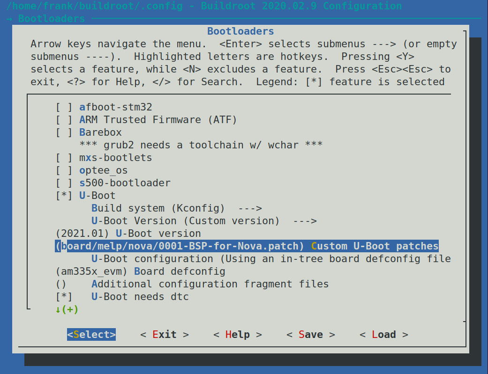
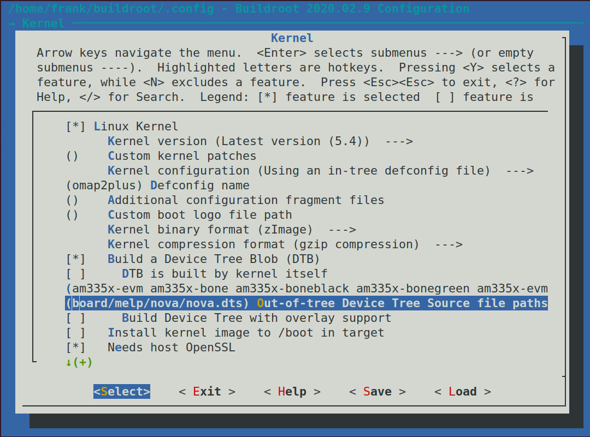
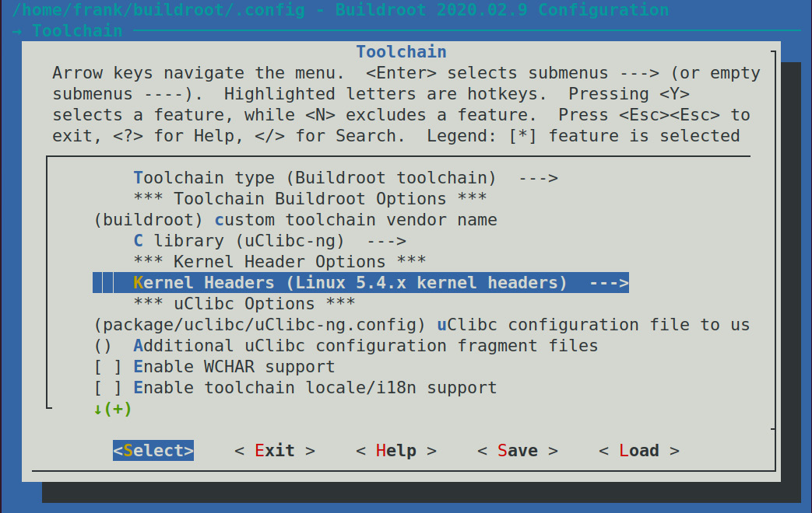
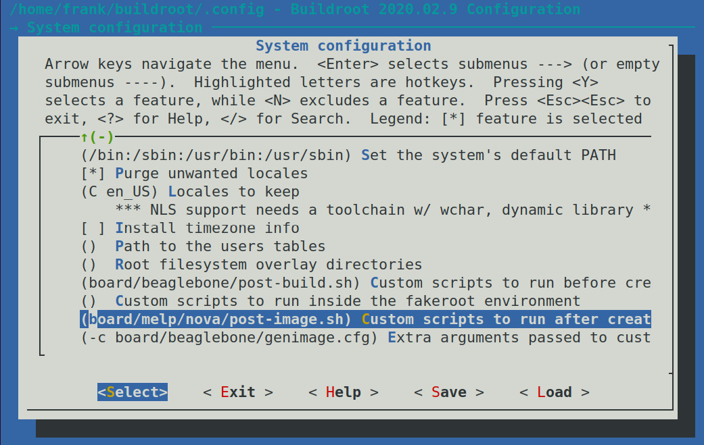
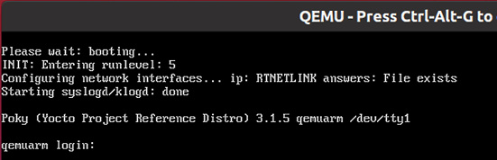

# *Chương 6*: Chọn build system (Selecting a Build System)

Trong các chương trước, chúng ta đã đề cập bốn thành phần của embedded Linux và chỉ cho bạn, từng bước một, cách build toolchain, bootloader, kernel và root filesystem, trước khi kết hợp chúng thành một hệ thống embedded Linux cơ bản. Và có rất nhiều bước! Giờ là lúc xem các cách đơn giản hóa quá trình này bằng cách tự động hóa nó nhiều nhất có thể. Chúng ta sẽ xem các build system nhúng có thể giúp ích như thế nào và đặc biệt xem xét hai trong số đó: Buildroot và Yocto Project. Cả hai đều là những công cụ phức tạp và linh hoạt, và sẽ cần cả một cuốn sách để mô tả đầy đủ cách chúng hoạt động. Trong chương này, tôi chỉ muốn cho bạn thấy các ý tưởng chung đằng sau build system. Tôi sẽ chỉ cho bạn cách build một device image đơn giản để có cảm nhận tổng thể về hệ thống, rồi cách thực hiện một số thay đổi hữu ích dùng ví dụ board Nova từ các chương trước, cũng như Raspberry Pi 4.

Trong chương này, chúng ta sẽ đề cập các chủ đề sau:

- So sánh các build system
- Phân phối binary
- Giới thiệu Buildroot
- Giới thiệu Yocto Project

Hãy bắt đầu!

## Yêu cầu kỹ thuật

Để làm theo các ví dụ trong chương này, hãy bảo đảm bạn có những thứ sau:

- Một hệ thống host Linux-based có ít nhất 60 GB dung lượng đĩa trống
- Etcher cho Linux
- Một đầu đọc thẻ microSD và thẻ
- Một cáp serial USB to TTL 3.3V
- A Raspberry Pi 4
- Một bộ nguồn USB-C 5V 3A
- Một cáp Ethernet và cổng để kết nối mạng
- A BeagleBone Black
- Một bộ nguồn DC 5V 1A

Toàn bộ code cho chương này có thể được tìm thấy trong thư mục `Chapter06` của repository GitHub của cuốn sách: [https://github.com/PacktPublishing/Mastering-Embedded-Linux-Programming-Third-Edition](https://github.com/PacktPublishing/Mastering-Embedded-Linux-Programming-Third-Edition).

## So sánh các build system

Trong [*Chương 5*](ch05_building_a_root_filesystem.vi.md), *Xây dựng root filesystem*, tôi đã mô tả quá trình tạo một hệ thống thủ công là quá trình **Roll Your Own** (**RYO**). Nó có lợi thế là bạn kiểm soát hoàn toàn phần mềm, và bạn có thể may đo nó để làm bất cứ điều gì bạn thích. Nếu bạn muốn nó làm điều gì đó thực sự khác thường nhưng đột phá, hoặc nếu bạn muốn giảm memory footprint xuống mức nhỏ nhất có thể, RYO là con đường nên đi. Nhưng, trong đại đa số tình huống, build thủ công là lãng phí thời gian và tạo ra các hệ thống kém chất lượng, không bảo trì được.

Ý tưởng của build system là tự động hóa tất cả các bước tôi đã mô tả đến giờ. Một build system phải có khả năng build, từ source code upstream, một số hoặc tất cả những thứ sau:

- Một toolchain
- Một bootloader
- Một kernel
- Một root filesystem

Build từ source code upstream quan trọng vì một số lý do. Nó có nghĩa là bạn yên tâm rằng mình có thể build lại bất cứ lúc nào, mà không có phụ thuộc bên ngoài. Nó cũng có nghĩa là bạn có source code để debug, và bạn có thể đáp ứng các yêu cầu license về việc phân phối code cho người dùng khi cần.

Do đó, để làm tròn nhiệm vụ, một build system phải có khả năng làm những việc sau:

1. Tải source code từ upstream, hoặc trực tiếp từ hệ thống quản lý source code hoặc dưới dạng archive, và cache nó cục bộ.
2. Áp patch để cho phép cross compilation, sửa các bug architecture-dependent, áp dụng các chính sách cấu hình cục bộ, v.v.
3. Build các component khác nhau.
4. Tạo một staging area và lắp ráp một root filesystem.
5. Tạo các file image ở nhiều định dạng, sẵn sàng nạp lên target.

Những thứ hữu ích khác như sau:

1. Thêm các package của riêng bạn chứa, chẳng hạn, application hay các thay đổi kernel.
2. Chọn các profile root filesystem khác nhau: lớn hay nhỏ, có hay không có đồ họa hay các tính năng khác.
3. Tạo một SDK độc lập mà bạn có thể phân phối cho các lập trình viên khác để họ không phải cài toàn bộ build system.
4. Theo dõi những license open source nào được dùng bởi các package khác nhau mà bạn đã chọn.
5. Có một giao diện người dùng user-friendly.

Trong mọi trường hợp, chúng đóng gói các component của hệ thống thành các package, một số cho host và một số cho target. Mỗi package được định nghĩa bởi một tập rule để lấy source, build nó, và cài kết quả vào đúng vị trí. Có các phụ thuộc giữa các package và một cơ chế build để giải quyết các phụ thuộc và build tập package cần thiết.

Các build system open source đã trưởng thành đáng kể trong vài năm qua. Có nhiều build system, bao gồm:

- **Buildroot**: Đây là một hệ thống easy-to-use dùng GNU Make và Kconfig ([https://buildroot.org](https://buildroot.org)).
- **EmbToolkit**: Đây là một hệ thống đơn giản để tạo root filesystem và toolchain, và là hệ thống duy nhất cho đến nay hỗ trợ LLVM/Clang ngay từ đầu ([https://www.embtoolkit.org](https://www.embtoolkit.org)).
- **OpenEmbedded**: Đây là một hệ thống mạnh mẽ, cũng là một thành phần lõi của Yocto Project và các project khác ([https://openembedded.org](https://openembedded.org)).
- **OpenWrt**: Đây là một công cụ build hướng tới việc build firmware cho router không dây ([https://openwrt.org](https://openwrt.org)) hỗ trợ sẵn quản lý package lúc runtime.
- **PTXdist**: Đây là một build system open source được Pengutronix tài trợ ([https://www.ptxdist.org](https://www.ptxdist.org)).
- **Yocto Project**: Project này mở rộng OpenEmbedded core với metadata, công cụ và tài liệu, và có lẽ là hệ thống phổ biến nhất ([https://www.yoctoproject.org](https://www.yoctoproject.org)).

Tôi sẽ tập trung vào hai trong số này: Buildroot và Yocto Project. Chúng tiếp cận vấn đề theo những cách khác nhau và có những mục tiêu khác nhau.

Buildroot có mục tiêu chính là build root filesystem image, do đó có tên như vậy, dù nó có thể build bootloader và kernel image, cũng như toolchain. Nó dễ cài đặt và cấu hình và tạo target image nhanh.

Mặt khác, Yocto Project tổng quát hơn trong cách nó định nghĩa hệ thống target, và vì vậy nó có thể build các thiết bị nhúng phức tạp. Mỗi component được tạo dưới dạng một binary package, theo mặc định dùng định dạng RPM, rồi các package được kết hợp để tạo filesystem image. Hơn nữa, bạn có thể cài một package manager trong filesystem image, cho phép cập nhật package lúc runtime. Nói cách khác, khi build với Yocto Project, thực chất bạn đang tạo bản phân phối Linux tùy biến của riêng mình. Hãy nhớ rằng việc enable quản lý package lúc runtime cũng có nghĩa là phải chuẩn bị và vận hành package repository tương ứng của riêng bạn.

## Phân phối binary

Các bản phân phối Linux mainstream, trong hầu hết trường hợp, được xây dựng từ tập các binary package (đã biên dịch trước) ở định dạng RPM hoặc DEB. **RPM** là viết tắt của **Red Hat package manager** và được dùng trong Red Hat, SUSE, Fedora và các bản phân phối khác dựa trên chúng. Debian và các bản phân phối Debian-derived, bao gồm Ubuntu và Mint, dùng định dạng Debian package manager được gọi là DEB. Ngoài ra, có một định dạng nhẹ đặc thù cho thiết bị nhúng được gọi là Itsy package format hay IPK, dựa trên DEB.

Khả năng đưa một package manager lên thiết bị là một trong những điểm khác biệt lớn giữa các build system. Khi đã có package manager trên thiết bị đích, bạn có một con đường dễ dàng để triển khai package mới lên đó và cập nhật các package hiện có. Tôi sẽ nói về các hàm ý của điều này trong [*Chương 10*](ch10_updating_software_in_the_field.vi.md), *Cập nhật phần mềm ngoài thực địa*.

## Giới thiệu Buildroot

Các phiên bản Buildroot hiện tại có khả năng build toolchain, bootloader, kernel và root filesystem. Nó dùng GNU `Make` làm công cụ build chính. Có tài liệu online tốt tại [https://buildroot.org/docs.html](https://buildroot.org/docs.html), bao gồm *The Buildroot user manual* tại [https://buildroot.org/downloads/manual/manual.html](https://buildroot.org/downloads/manual/manual.html).

### Bối cảnh

Buildroot là một trong những build system đầu tiên. Nó bắt đầu như một phần của các project uClinux và uClibc như một cách tạo root filesystem nhỏ để test. Nó trở thành một project riêng vào cuối năm 2001 và tiếp tục phát triển đến năm 2006, sau đó nó đi vào một giai đoạn khá trì trệ. Tuy nhiên, kể từ năm 2009, khi Peter Korsgaard tiếp quản việc điều hành, nó đã phát triển nhanh chóng, thêm hỗ trợ cho các toolchain glibc-based và tăng mạnh số package và target board.

Một điều thú vị là Buildroot cũng là tổ tiên của một build system phổ biến khác, OpenWrt ([http://wiki.openwrt.org](http://wiki.openwrt.org)), được fork từ Buildroot vào khoảng năm 2004. Trọng tâm chính của OpenWrt là tạo phần mềm cho router không dây, vì vậy tập package hướng tới hạ tầng mạng. Nó cũng có một package manager lúc runtime dùng định dạng IPK để thiết bị có thể được cập nhật hay nâng cấp mà không cần flash lại toàn bộ image. Tuy nhiên, Buildroot và OpenWrt đã phân kỳ tới mức giờ chúng gần như là hai build system hoàn toàn khác nhau. Package được build với cái này không tương thích với cái kia.

### Bản phát hành stable và long-term support

Các lập trình viên Buildroot tạo bản phát hành stable bốn lần mỗi năm, vào tháng Hai, tháng Năm, tháng Tám và tháng Mười Một. Chúng được đánh dấu bằng các Git tag dạng `<year>.02`, `<year>.05`, `<year>.08` và `<year>.11`. Thỉnh thoảng, một bản phát hành được đánh dấu là **long-term support** (**LTS**), nghĩa là sẽ có các point release để sửa lỗi bảo mật và các bug quan trọng khác trong 12 tháng sau bản phát hành ban đầu. Bản phát hành `2017.02` là bản đầu tiên nhận nhãn LTS.

### Cài đặt

Như thường lệ, bạn có thể cài Buildroot bằng cách clone repository hoặc tải một archive. Đây là một ví dụ lấy phiên bản `2020.02.9`, là phiên bản stable mới nhất tại thời điểm viết:

```
$ git clone git://git.buildroot.net/buildroot -b 2020.02.9
$ cd buildroot
```

Archive TAR tương đương có tại [https://buildroot.org/downloads](https://buildroot.org/downloads).

Tiếp theo, bạn nên đọc mục *System requirements* của *The Buildroot user manual*, có tại [https://buildroot.org/downloads/manual/manual.html](https://buildroot.org/downloads/manual/manual.html), và bảo đảm bạn đã cài tất cả các package được liệt kê ở đó.

### Cấu hình

Buildroot dùng cơ chế Kconfig/Kbuild của kernel, mà tôi đã mô tả trong mục *Hiểu cấu hình kernel* của [*Chương 4*](ch04_configuring_and_building_the_kernel.vi.md), *Cấu hình và build kernel*. Bạn có thể cấu hình Buildroot từ đầu trực tiếp bằng `make menuconfig` (`xconfig` hoặc `gconfig`), hoặc bạn có thể chọn một trong hơn 100 cấu hình cho các development board khác nhau và trình giả lập QEMU, được lưu trong thư mục `configs/`. Gõ `make list-defconfigs` sẽ liệt kê tất cả các cấu hình mặc định.

Hãy bắt đầu bằng việc build một cấu hình mặc định mà bạn có thể chạy trên trình giả lập QEMU Arm:

```
$ cd buildroot
$ make qemu_arm_versatile_defconfig
$ make
```

> **Lưu ý quan trọng**
>
> Bạn không cần cho `make` biết chạy bao nhiêu job song song bằng tùy chọn `-j`: Buildroot sẽ tự tận dụng tối ưu các CPU của bạn. Nếu bạn muốn giới hạn số job, bạn có thể chạy `make menuconfig` và tìm trong phần Build options.

Quá trình build sẽ mất từ nửa giờ đến một giờ hoặc hơn, tùy theo khả năng của hệ thống host và tốc độ kết nối internet. Nó sẽ tải khoảng 220 MiB code và chiếm khoảng 3.5 GiB dung lượng đĩa. Khi hoàn tất, bạn sẽ thấy hai thư mục mới đã được tạo:

- `dl/`: Chứa archive của các project upstream mà Buildroot đã build.
- `output/`: Chứa tất cả các tài nguyên đã biên dịch trung gian và cuối cùng.

Bạn sẽ thấy những thứ sau trong `output/`:

- `build/`: Ở đây, bạn sẽ tìm thấy thư mục build cho mỗi component.
- `host/`: Chứa nhiều công cụ mà Buildroot cần chạy trên host, bao gồm các file thực thi của toolchain (trong `output/host/usr/bin`).
- `images/`: Đây là thư mục quan trọng nhất vì nó chứa kết quả build. Tùy theo những gì bạn chọn khi cấu hình, bạn sẽ thấy một bootloader, một kernel và một hoặc nhiều root filesystem image.
- `staging/`: Đây là một symbolic link tới `sysroot` của toolchain. Tên của link hơi gây nhầm lẫn vì nó không trỏ tới một staging area, như tôi đã định nghĩa trong [*Chương 5*](ch05_building_a_root_filesystem.vi.md), *Xây dựng root filesystem*.
- `target/`: Đây là staging area cho thư mục `root`. Lưu ý rằng bạn không thể dùng nó làm root filesystem nguyên trạng vì quyền sở hữu và quyền truy cập file chưa được đặt đúng. Buildroot dùng một device table, như được mô tả ở chương trước, để đặt quyền sở hữu và quyền truy cập khi filesystem image được tạo trong thư mục `image/`.

### Chạy

Một số cấu hình mẫu có một entry tương ứng trong thư mục `board/`, chứa các file cấu hình tùy biến và thông tin về việc cài kết quả lên target. Trong trường hợp hệ thống bạn vừa build, file liên quan là `board/qemu/arm-versatile/readme.txt`, cho bạn biết cách khởi động QEMU với target này. Giả sử bạn đã cài `qemu-system-arm`, như được mô tả trong [*Chương 1*](ch01_starting_out.vi.md), *Bắt đầu*, bạn có thể chạy nó bằng lệnh này:

```
$ qemu-system-arm -M versatilepb -m 256 \
-kernel output/images/zImage \
-dtb output/images/versatile-pb.dtb \
-drive file=output/images/rootfs.ext2,if=scsi,format=raw \
-append "root=/dev/sda console=ttyAMA0,115200" \
-serial stdio -net nic,model=rtl8139 -net user
```

Có một script tên `MELP/Chapter06/run-qemu-buildroot.sh` trong kho code của cuốn sách bao gồm lệnh đó. Khi QEMU boot, bạn sẽ thấy các message boot kernel xuất hiện trong cùng cửa sổ Terminal nơi bạn khởi động QEMU, theo sau là dấu nhắc đăng nhập:

```
Booting Linux on physical CPU 0x0
Linux version 4.19.91 (frank@franktop) (gcc version 8.4.0 (Buildroot 2020.02.9)) #1 Sat Feb 13 11:54:41 PST 2021
CPU: ARM926EJ-S [41069265] revision 5 (ARMv5TEJ), cr=00093177
CPU: VIVT data cache, VIVT instruction cache
OF: fdt: Machine model: ARM Versatile PB
[…]
VFS: Mounted root (ext2 filesystem) readonly on device 8:0.
devtmpfs: mounted
Freeing unused kernel memory: 140K
This architecture does not have kernel memory protection.
Run /sbin/init as init process
EXT4-fs (sda): warning: mounting unchecked fs, running e2fsck is recommended
EXT4-fs (sda): re-mounted. Opts: (null)
Starting syslogd: OK
Starting klogd: OK
Running sysctl: OK
Initializing random number generator: OK
Saving random seed: random: dd: uninitialized urandom read (512 bytes read)
OK
Starting network: 8139cp 0000:00:0c.0 eth0: link up, 100Mbps, full-duplex, lpa 0x05E1
udhcpc: started, v1.31.1
random: mktemp: uninitialized urandom read (6 bytes read)
udhcpc: sending discover
udhcpc: sending select for 10.0.2.15
udhcpc: lease of 10.0.2.15 obtained, lease time 86400
deleting routers
random: mktemp: uninitialized urandom read (6 bytes read)
adding dns 10.0.2.3
OK
Welcome to Buildroot
buildroot login:
```

Đăng nhập bằng `root`, không có mật khẩu.

Bạn sẽ thấy QEMU khởi chạy một cửa sổ đen, ngoài cửa sổ chứa các message boot kernel. Nó ở đó để hiển thị graphics frame buffer của target. Trong trường hợp này, target không bao giờ ghi vào framebuffer, đó là lý do nó trông đen. Để đóng QEMU, hoặc nhấn *Ctrl + Alt + 2* để vào QEMU console rồi gõ `quit`, hoặc chỉ cần đóng cửa sổ framebuffer.

### Nhắm tới phần cứng thật

Các bước cấu hình và build một image bootable cho Raspberry Pi 4 gần như giống với Arm QEMU:

```
$ cd buildroot
$ make clean
$ make raspberrypi4_64_defconfig
$ make
```

Khi build xong, image được ghi vào một file tên `output/images/sdcard.img`. Script `post-image.sh` và file cấu hình `genimage-raspberrypi4-64.cfg` dùng để ghi file image đều nằm trong thư mục `board/raspberrypi/`. Để ghi `sdcard.img` lên thẻ microSD và boot nó trên Raspberry Pi 4, làm theo các bước sau:

1. Cắm một thẻ microSD vào máy host Linux.
2. Khởi chạy Etcher.
3. Click **Flash from file** từ Etcher.
4. Tìm image `sdcard.img` bạn đã build cho Raspberry Pi 4 và mở nó.
5. Click **Select target** từ Etcher.
6. Chọn thẻ microSD bạn đã cắm ở *Bước 1*.
7. Click **Flash** từ Etcher để ghi image.
8. Rút thẻ microSD ra khi Etcher đã flash xong.
9. Cắm thẻ microSD vào Raspberry Pi 4.
10. Cấp nguồn cho Raspberry Pi 4 qua cổng USB-C.

Xác nhận Pi 4 đã boot thành công bằng cách cắm nó vào Ethernet và quan sát thấy các đèn hoạt động mạng nhấp nháy. Để `ssh` vào Pi 4, bạn sẽ cần thêm một SSH server như `dropbear` hoặc `openssh` vào cấu hình image Buildroot.

### Tạo một BSP tùy biến

Tiếp theo, hãy dùng Buildroot để tạo một **Board Support Package (BSP)** cho board Nova dùng cùng phiên bản U-Boot và Linux từ các chương trước. Bạn có thể xem các thay đổi tôi đã làm với Buildroot trong mục này ở `MELP/Chapter06/buildroot`.

Các vị trí được khuyến nghị để lưu thay đổi như sau:

- `board/<organization>/<device>`: Chứa mọi patch, binary blob, bước build bổ sung, file cấu hình cho Linux, U-Boot và các component khác.
- `configs/<device>_defconfig`: Chứa cấu hình mặc định cho board.
- `package/<organization>/<package_name>`: Đây là nơi bạn có thể đặt mọi package bổ sung cho board này.

Hãy bắt đầu bằng việc tạo một thư mục để lưu các thay đổi cho board Nova:

```
$ mkdir -p board/melp/nova
```

Tiếp theo, dọn các artifact từ mọi lần build trước, điều bạn luôn nên làm khi thay đổi cấu hình:

```
$ make clean
```

Bây giờ, chọn cấu hình cho BeagleBone, thứ chúng ta sẽ dùng làm nền cho cấu hình Nova:

```
$ make beaglebone_defconfig
```

Lệnh `make beaglebone_defconfig` cấu hình Buildroot để build một image nhắm tới BeagleBone Black. Cấu hình này là điểm khởi đầu tốt, nhưng chúng ta vẫn cần tùy biến nó cho board Nova. Hãy bắt đầu bằng việc chọn patch U-Boot tùy biến mà chúng ta đã tạo cho Nova.

#### U-Boot

Trong [*Chương 3*](ch03_all_about_bootloaders.vi.md), *Tất cả về bootloader*, chúng ta đã tạo một bootloader tùy biến cho Nova dựa trên phiên bản `2021.01` của U-Boot và tạo một file patch cho nó, mà bạn sẽ tìm thấy trong `MELP/Chapter03/0001-BSP-for-Nova.patch`. Chúng ta có thể cấu hình Buildroot để chọn cùng phiên bản và áp patch của mình. Bắt đầu bằng việc sao chép file patch vào `board/melp/nova`, rồi dùng `make menuconfig` để đặt phiên bản U-Boot thành `2021.01`, file patch thành `board/melp/nova/0001-BSP-for-Nova.patch`, và tên board thành Nova, như được thể hiện trong ảnh chụp màn hình sau:



*Hình 6.1 – Chọn các patch U-Boot tùy biến*

Chúng ta cũng cần một script U-Boot để nạp device tree Nova và kernel từ thẻ SD. Chúng ta có thể đặt file vào `board/melp/nova/uEnv.txt`. Nó nên chứa các lệnh sau:

```
bootpart=0:1
bootdir=
bootargs=console=ttyO0,115200n8 root=/dev/mmcblk0p2 rw rootfstype=ext4 rootwait
uenvcmd=fatload mmc 0:1 88000000 nova.dtb;fatload mmc 0:1 82000000 zImage;bootz 82000000 - 88000000
```

Lưu ý rằng dù có hiện tượng xuống dòng hiển thị, `bootargs` và `uenvcmd` đều được định nghĩa trên một dòng duy nhất. `rootfstype=ext4 rootwait` là một phần của `bootargs`, còn `bootz 82000000 - 88000000` là một phần của `uenvcmd`.

Giờ chúng ta đã patch và cấu hình U-Boot cho board Nova, bước tiếp theo là patch và cấu hình kernel.

#### Linux

Trong [*Chương 4*](ch04_configuring_and_building_the_kernel.vi.md), *Cấu hình và build kernel*, chúng ta đã dựa kernel trên Linux 5.4.50 và cung cấp một device tree mới, nằm trong `MELP/Chapter04/nova.dts`. Sao chép device tree vào `board/melp/nova`, đổi cấu hình kernel của Buildroot sang Linux phiên bản 5.4, và đổi device tree source thành `board/melp/nova/nova.dts`, như được thể hiện trong ảnh chụp màn hình sau:



*Hình 6.2 – Chọn device tree source*

Chúng ta cũng sẽ phải đổi kernel series dùng cho kernel header để chúng khớp với kernel đang được build:



*Hình 6.3 – Chọn kernel header tùy biến*

Giờ chúng ta đã làm xong việc này, hãy build system image, hoàn chỉnh với kernel và root filesystem.

#### Build

Ở giai đoạn cuối của quá trình build, Buildroot dùng một công cụ tên `genimage` để tạo một image cho thẻ SD mà chúng ta có thể sao chép trực tiếp lên thẻ. Chúng ta cần một file cấu hình để bố trí image theo đúng cách. Chúng ta sẽ đặt tên file là `board/melp/nova/genimage.cfg` và điền nội dung, như được thể hiện ở đây:

```
image boot.vfat {
    vfat {
        files = {
            "MLO",
            "u-boot.img",
            "zImage",
            "uEnv.txt",
            "nova.dtb",
        }
    }
    size = 16M
}
image sdcard.img {
    hdimage {
    }
    partition u-boot {
        partition-type = 0xC
        bootable = "true"
        image = "boot.vfat"
    }
    partition rootfs {
        partition-type = 0x83
        image = "rootfs.ext4"
        size = 512M
    }
}
```

Việc này sẽ tạo một file tên `sdcard.img`, chứa hai phân vùng tên `u-boot` và `rootfs`. Phân vùng thứ nhất chứa các file boot được liệt kê trong `boot.vfat`, còn phân vùng thứ hai chứa root filesystem image tên `rootfs.ext4`, sẽ được Buildroot tạo ra.

Cuối cùng, chúng ta cần tạo một script `post-image.sh` sẽ gọi `genimage`, và nhờ đó tạo image thẻ SD. Chúng ta sẽ đặt nó ở `board/melp/nova/post-image.sh`:

```
#!/bin/sh
BOARD_DIR="$(dirname $0)"
cp ${BOARD_DIR}/uEnv.txt $BINARIES_DIR/uEnv.txt
GENIMAGE_CFG="${BOARD_DIR}/genimage.cfg"
GENIMAGE_TMP="${BUILD_DIR}/genimage.tmp"
rm -rf "${GENIMAGE_TMP}"
genimage \
    --rootpath "${TARGET_DIR}" \
    --tmppath "${GENIMAGE_TMP}" \
    --inputpath "${BINARIES_DIR}" \
    --outputpath "${BINARIES_DIR}" \
    --config "${GENIMAGE_CFG}"
```

Script này sao chép script `uEnv.txt` vào thư mục `output/images` và chạy `genimage` với file cấu hình của chúng ta.

Lưu ý rằng `post-image.sh` cần có quyền thực thi; nếu không, quá trình build sẽ thất bại ở cuối:

```
$ chmod +x board/melp/nova/post-image.sh
```

Bây giờ, chúng ta có thể chạy lại `make menuconfig` và đi sâu vào trang đó. Từ trang đó, điều hướng xuống **Custom scripts to run before creating filesystem images** và nhập đường dẫn tới script `post-image.sh` của chúng ta, như được thể hiện trong ảnh chụp màn hình này:



*Hình 6.4 – Chọn các script tùy biến để chạy sau khi tạo filesystem image*

Cuối cùng, bạn có thể build Linux cho board Nova chỉ bằng cách gõ `make`. Khi xong, bạn sẽ thấy các file này (và một số DTB bổ sung) trong thư mục `output/images/`:

```
nova.dtb      sdcard.img      rootfs.ext2        u-boot.img
boot.vfat     rootfs.ext4     uEnv.txt           MLO
rootfs.tar    bzImage
```

Để test, cắm một thẻ microSD vào đầu đọc thẻ và dùng Etcher để ghi `output/images/sdcard.img` ra thẻ SD, như chúng ta đã làm với Raspberry Pi 4. Không cần format thẻ microSD trước, như chúng ta đã làm ở chương trước, vì `genimage` đã tạo đúng bố cục đĩa cần thiết.

Khi Etcher xong, cắm thẻ microSD vào BeagleBone Black và cấp nguồn trong khi nhấn nút Switch Boot để buộc nó nạp từ thẻ SD. Bạn sẽ thấy nó boot với các phiên bản U-Boot, Linux mà chúng ta đã chọn, và với device tree Nova.

Sau khi đã chứng minh cấu hình tùy biến cho board Nova hoạt động, sẽ hay nếu giữ một bản sao cấu hình để bạn và những người khác có thể dùng lại, điều bạn có thể làm bằng lệnh này:

```
$ make savedefconfig BR2_DEFCONFIG=configs/nova_defconfig
```

Bây giờ, bạn có một cấu hình Buildroot cho board Nova. Sau này, bạn có thể lấy lại cấu hình này bằng cách gõ lệnh sau:

```
$ make nova_defconfig
```

Chúng ta đã cấu hình Buildroot thành công. Giờ, nếu bạn muốn thêm code của riêng mình vào thì sao? Chúng ta sẽ học cách làm điều đó trong mục tiếp theo.

### Thêm code của riêng bạn

Giả sử có một chương trình bạn đã phát triển và muốn đưa vào bản build. Bạn có hai lựa chọn: thứ nhất, bạn có thể build nó riêng bằng build system của chính nó, rồi đưa binary vào bản build cuối cùng dưới dạng một overlay. Thứ hai, bạn có thể tạo một package Buildroot có thể được chọn từ menu và build như mọi package khác.

#### Overlay

Overlay đơn giản là một cấu trúc thư mục được sao chép đè lên root filesystem của Buildroot ở giai đoạn sau của quá trình build. Nó có thể chứa file thực thi, thư viện và bất cứ thứ gì khác bạn muốn đưa vào. Lưu ý rằng mọi code đã biên dịch phải tương thích với các thư viện được triển khai lúc runtime, điều này, đến lượt nó, có nghĩa là nó phải được biên dịch bằng cùng toolchain mà Buildroot dùng. Dùng toolchain của Buildroot khá dễ. Chỉ cần thêm nó vào `PATH`:

```
$ PATH=<path_to_buildroot>/output/host/usr/bin:$PATH
```

Prefix của toolchain là `<ARCH>-linux-`. Vậy, để biên dịch một chương trình đơn giản, bạn sẽ làm đại loại như sau:

```
$ PATH=/home/frank/buildroot/output/host/usr/bin:$PATH
$ arm-linux-gcc helloworld.c -o helloworld
```

Khi đã biên dịch chương trình bằng toolchain đúng, bạn chỉ cần cài file thực thi và các file hỗ trợ khác vào một staging area, rồi đánh dấu nó là overlay cho Buildroot. Với ví dụ `helloworld`, bạn có thể đặt nó trong thư mục `board/melp/nova`:

```
$ mkdir -p board/melp/nova/overlay/usr/bin
$ cp helloworld board/melp/nova/overlay/usr/bin
```

Cuối cùng, bạn đặt `BR2_ROOTFS_OVERLAY` thành đường dẫn trỏ tới overlay. Nó có thể được cấu hình trong `menuconfig` bằng tùy chọn **System configuration | Root filesystem overlay directories**.

#### Thêm một package

Các package Buildroot (hơn 2,000 package) được lưu trong thư mục `package`, mỗi package trong thư mục con riêng. Một package gồm ít nhất hai file: `Config.in`, chứa đoạn code Kconfig cần để package hiển thị trong menu cấu hình, và một Makefile tên `<package_name>.mk`.

> **Lưu ý quan trọng**
>
> Lưu ý rằng một package Buildroot không chứa code, mà chỉ chứa các chỉ dẫn để lấy code bằng cách tải tarball, thực hiện `git pull` hay bất cứ việc gì cần thiết để có được source upstream.

Makefile được viết theo định dạng mà Buildroot mong đợi và chứa các directive cho phép Buildroot tải, cấu hình, biên dịch và cài chương trình. Viết một makefile package mới là một thao tác phức tạp, và được đề cập chi tiết trong *The Buildroot user manual*: [https://buildroot.org/downloads/manual/manual.html](https://buildroot.org/downloads/manual/manual.html). Đây là một ví dụ cho bạn thấy cách tạo một package cho một chương trình đơn giản được lưu cục bộ, chẳng hạn chương trình `helloworld` của chúng ta.

Bắt đầu bằng việc tạo thư mục con `package/helloworld/` với một file cấu hình, `Config.in`, trông như thế này:

```
config BR2_PACKAGE_HELLOWORLD
    bool "helloworld"
    help
      A friendly program that prints Hello World! Every 10s
```

Dòng đầu tiên phải có định dạng `BR2_PACKAGE_<uppercase package name>`. Tiếp theo là một `bool` và tên package, như nó sẽ xuất hiện trong menu cấu hình, cho phép người dùng chọn package này. Phần `help` là tùy chọn nhưng thường là ý hay vì nó đóng vai trò self-documentation.

Tiếp theo, liên kết package mới vào menu **Target Packages** bằng cách sửa `package/Config.in` và source file cấu hình, như được thể hiện ở đây:

```
menu "My programs"
      source "package/helloworld/Config.in"
endmenu
```

Bạn có thể nối package `helloworld` mới này vào một submenu có sẵn, nhưng gọn gàng hơn là tạo một submenu mới chỉ chứa package của chúng ta, và chèn nó trước `menu "Audio and video applications"`.

Sau khi chèn `menu "My programs"` vào `package/Config.in`, tạo một makefile, `package/helloworld/helloworld.mk`, để cung cấp dữ liệu mà Buildroot cần:

```
HELLOWORLD_VERSION = 1.0.0
HELLOWORLD_SITE = /home/frank/MELP/Chapter06/helloworld
HELLOWORLD_SITE_METHOD = local
define HELLOWORLD_BUILD_CMDS
    $(MAKE) CC="$(TARGET_CC)" LD="$(TARGET_LD)" -C $(@D) all
endef
define HELLOWORLD_INSTALL_TARGET_CMDS
    $(INSTALL) -D -m 0755 $(@D)/helloworld $(TARGET_DIR)/usr/bin/helloworld
endef
$(eval $(generic-package))
```

Bạn có thể tìm thấy package `helloworld` của tôi trong kho code của cuốn sách ở `MELP/Chapter06/buildroot/package/helloworld` và source code của chương trình ở `MELP/Chapter06/helloworld`. Vị trí của code được hardcode thành một đường dẫn cục bộ. Trong một trường hợp thực tế hơn, bạn sẽ lấy code từ một hệ thống quản lý source code hoặc từ một server trung tâm nào đó: có chi tiết về cách làm điều này trong *The Buildroot user manual*, và rất nhiều ví dụ trong các package khác.

### Tuân thủ license

Buildroot dựa trên một phần mềm open source, cũng như các package mà nó biên dịch. Vào lúc nào đó trong project, bạn nên kiểm tra các license, điều bạn có thể làm bằng cách chạy lệnh sau:

```
$ make legal-info
```

Thông tin được tập hợp vào `output/legal-info/`. Có bản tóm tắt các license dùng để biên dịch các công cụ host trong `host-manifest.csv` và, trên target, trong `manifest.csv`. Có thêm thông tin trong file `README` và trong *The Buildroot user manual*.

Chúng ta sẽ quay lại Buildroot trong [*Chương 14*](ch14_starting_with_busybox_runit.vi.md), *Bắt đầu với BusyBox runit*. Giờ hãy chuyển build system và bắt đầu tìm hiểu về Yocto Project.

## Giới thiệu Yocto Project

Yocto Project là một thứ phức tạp hơn Buildroot. Nó không chỉ có thể build toolchain, bootloader, kernel và root filesystem như Buildroot, mà còn có thể tạo cả một bản phân phối Linux cho bạn với các binary package có thể được cài lúc runtime. Quá trình build được tổ chức quanh các nhóm recipe, tương tự các package Buildroot nhưng được viết bằng sự kết hợp giữa Python và shell script. Yocto Project bao gồm một task scheduler gọi là **BitBake** tạo ra bất cứ thứ gì bạn đã cấu hình, từ các recipe. Có rất nhiều tài liệu online tại [https://www.yoctoproject.org](https://www.yoctoproject.org).

### Bối cảnh

Cấu trúc của Yocto Project dễ hiểu hơn nếu bạn xem bối cảnh trước. Nguồn gốc của nó nằm ở **OpenEmbedded** ([https://openembedded.org](https://openembedded.org)), project này đến lượt nó lại phát triển từ một số project port Linux sang nhiều máy tính cầm tay khác nhau, bao gồm Sharp Zaurus và Compaq iPaq. OpenEmbedded ra đời năm 2003 như build system cho các máy tính cầm tay đó. Ngay sau đó, các lập trình viên khác bắt đầu dùng nó như một build system chung cho các thiết bị chạy embedded Linux. Nó đã được, và tiếp tục được, phát triển bởi một cộng đồng lập trình viên nhiệt tình.

Project OpenEmbedded đặt mục tiêu tạo một tập binary package dùng định dạng IPK nhỏ gọn, sau đó có thể được kết hợp theo nhiều cách để tạo một hệ thống target và được cài lên target lúc runtime. Nó làm điều này bằng cách tạo recipe cho mỗi package và dùng BitBake làm task scheduler. Nó đã, và vẫn, rất linh hoạt. Bằng cách cung cấp metadata đúng, bạn có thể tạo cả một bản phân phối Linux theo đặc tả của riêng mình. Một bản phân phối khá well-known là **Ångström Distribution**, nhưng cũng có nhiều bản khác.

Vào khoảng năm 2005, Richard Purdie, khi đó là lập trình viên tại OpenedHand, đã tạo một fork của OpenEmbedded, với lựa chọn package thận trọng hơn, và tạo các bản phát hành ổn định trong một khoảng thời gian. Ông đặt tên nó là **Poky** theo tên một loại snack Nhật Bản (nếu bạn bận tâm những chuyện này, Poky được phát âm vần với hockey). Dù Poky là một fork, OpenEmbedded và Poky vẫn tiếp tục chạy song song, chia sẻ cập nhật và giữ kiến trúc ít nhiều đồng bộ. Intel mua OpenedHand năm 2008, và họ chuyển Poky Linux cho Linux Foundation năm 2010 khi thành lập Yocto Project.

Kể từ năm 2010, các thành phần chung của OpenEmbedded và Poky được gộp vào một project riêng gọi là **OpenEmbedded Core**, hay chỉ **OE-Core**.

Do đó, Yocto Project tập hợp nhiều thành phần, quan trọng nhất là:

- **OE-Core**: Đây là metadata lõi, và được chia sẻ với OpenEmbedded.
- **BitBake**: Đây là task scheduler, và được chia sẻ với OpenEmbedded và các project khác.
- **Poky**: Đây là bản phân phối tham chiếu.
- **Documentation**: Đây là các manual cho người dùng và hướng dẫn cho lập trình viên của từng thành phần.
- **Toaster**: Đây là một giao diện web-based cho BitBake và metadata của nó.

Yocto Project cung cấp một nền tảng ổn định, có thể được dùng nguyên trạng (as-is) hoặc được mở rộng bằng **meta layer**, thứ tôi sẽ bàn ở phần sau của chương này. Nhiều SoC vendor cung cấp BSP cho thiết bị của họ theo cách này. Meta layer cũng có thể được dùng để tạo các build system mở rộng hoặc chỉ đơn giản là khác. Một số là open source, chẳng hạn Ångström Distribution, trong khi số khác là thương mại, chẳng hạn MontaVista Carrier Grade Edition, Mentor Embedded Linux và Wind River Linux. Yocto Project có một chương trình branding và kiểm tra tương thích để bảo đảm khả năng tương tác giữa các thành phần. Bạn sẽ thấy các tuyên bố như "Yocto Project compatible" trên nhiều trang web.

Do đó, bạn nên coi Yocto Project là nền tảng của cả một mảng embedded Linux, đồng thời là một build system hoàn chỉnh theo đúng nghĩa của nó.

> **Lưu ý**
>
> Có thể bạn đang thắc mắc về cái tên Yocto. *yocto* là tiền tố SI cho 10⁻²⁴, giống như *micro* là 10⁻⁶. Tại sao đặt tên project là Yocto? Một phần là để chỉ ra rằng nó có thể build các hệ thống Linux rất nhỏ (dù công bằng mà nói, các build system khác cũng làm được), nhưng cũng để đi trước một bước so với Ångström Distribution, vốn dựa trên OpenEmbedded. Một Ångström là 10⁻¹⁰. Thật khổng lồ, so với một *yocto*!

### Bản phát hành stable và hỗ trợ

Thông thường, có một bản phát hành Yocto Project mỗi 6 tháng: vào tháng Tư và tháng Mười. Chúng chủ yếu được biết đến qua code name, nhưng cũng hữu ích khi biết số phiên bản của Yocto Project và Poky. Đây là bảng sáu bản phát hành gần nhất tại thời điểm viết:

| **Code name** | **Ngày phát hành** | **Phiên bản Yocto** | **Phiên bản Poky** |
|---|---|---|---|
| Gatesgarth | October 2020 | 3.2 | 24 |
| Dunfell | April 2020 | 3.1 | 23 |
| Zeus | October 2019 | 3.0 | 22 |
| Warrior | April 2019 | 2.7 | 21 |
| Thud | November 2018 | 2.6 | 20 |
| Sumo | April 2018 | 2.5 | 19 |

Các bản phát hành stable được hỗ trợ bằng các bản sửa lỗi bảo mật và bug nghiêm trọng cho chu kỳ phát hành hiện tại và chu kỳ tiếp theo. Nói cách khác, mỗi phiên bản được hỗ trợ khoảng 12 tháng sau khi phát hành. Ngoài ra, Dunfell là bản phát hành LTS đầu tiên của Yocto. Nhãn LTS có nghĩa là Dunfell sẽ nhận các bản sửa lỗi và cập nhật trong một khoảng thời gian kéo dài 2 năm. Do đó, kế hoạch từ nay về sau là chọn một bản phát hành LTS của Yocto Project mỗi 2 năm.

Như với Buildroot, nếu muốn được hỗ trợ tiếp, bạn có thể cập nhật lên bản phát hành stable tiếp theo, hoặc bạn có thể backport các thay đổi vào phiên bản của mình. Bạn cũng có lựa chọn hỗ trợ thương mại trong nhiều năm với Yocto Project từ các vendor hệ điều hành, chẳng hạn Mentor Graphics, Wind River và nhiều vendor khác. Bây giờ, hãy học cách cài Yocto Project.

### Cài đặt Yocto Project

Để có một bản Yocto Project, hãy clone repository, chọn code name làm nhánh, trong trường hợp này là `dunfell`:

```
$ git clone -b dunfell git://git.yoctoproject.org/poky.git
```

Thói quen tốt là chạy `git pull` định kỳ để lấy các bản sửa bug và bản vá bảo mật mới nhất từ nhánh remote.

Đọc các mục *Compatible Linux Distribution* và *Build Host Packages* của hướng dẫn *Yocto Project Quick Build* ([https://www.yoctoproject.org/docs/current/brief-yoctoprojectqs/brief-yoctoprojectqs.html](https://www.yoctoproject.org/docs/current/brief-yoctoprojectqs/brief-yoctoprojectqs.html)). Hãy bảo đảm các package thiết yếu cho bản phân phối Linux của bạn đã được cài trên máy host. Bước tiếp theo là cấu hình.

### Cấu hình

Như với Buildroot, hãy bắt đầu với một bản build cho trình giả lập QEMU Arm. Bắt đầu bằng việc source một script để thiết lập môi trường:

```
$ source poky/oe-init-build-env
```

Script này tạo một thư mục làm việc cho bạn tên `build/` và đặt nó làm thư mục hiện tại. Toàn bộ cấu hình, cũng như mọi file image trung gian và image target, sẽ được đặt vào thư mục này. Bạn phải source script này mỗi lần muốn làm việc với project này.

Bạn có thể chọn một thư mục làm việc khác bằng cách thêm nó làm tham số cho `oe-init-build-env`; chẳng hạn:

```
$ source poky/oe-init-build-env build-qemuarm
```

Lệnh này sẽ đưa bạn vào thư mục `build-qemuarm/`. Bằng cách này, bạn có thể có nhiều thư mục build, mỗi thư mục cho một project khác nhau: bạn chọn thư mục muốn làm việc qua tham số được truyền cho `oe-init-build-env`.

Ban đầu, thư mục build chỉ chứa một thư mục con tên `conf/`, chứa các file cấu hình sau cho project này:

- `local.conf`: Chứa đặc tả của thiết bị bạn sẽ build và môi trường build.
- `bblayers.conf`: Chứa đường dẫn của các meta layer bạn sẽ dùng. Tôi sẽ mô tả layer ở phần sau.

Hiện tại, chúng ta chỉ cần đặt biến `MACHINE` trong `conf/local.conf` thành `qemuarm` bằng cách bỏ ký tự comment (`#`) ở đầu dòng này:

```
MACHINE ?= "qemuarm"
```

Bây giờ, chúng ta đã sẵn sàng build image đầu tiên bằng Yocto.

### Build

Để thực sự build, bạn cần chạy BitBake, cho nó biết root filesystem image nào bạn muốn tạo. Một số image phổ biến như sau:

- `core-image-minimal`: Đây là một hệ thống console-based nhỏ, hữu ích cho việc test và làm nền cho các image tùy biến.
- `core-image-minimal-initramfs`: Image này tương tự `core-image-minimal` nhưng được build thành ramdisk.
- `core-image-x11`: Đây là một image cơ bản có hỗ trợ đồ họa qua một X11 server và ứng dụng Terminal `xterminal`.
- `core-image-full-cmdline`: Hệ thống console-based này mang lại trải nghiệm CLI tiêu chuẩn và hỗ trợ đầy đủ cho phần cứng target.

Khi đưa cho BitBake target cuối cùng, nó sẽ làm ngược lại và build tất cả các phụ thuộc trước, bắt đầu với toolchain. Hiện tại, chúng ta chỉ muốn tạo một image tối thiểu để xem nó hoạt động thế nào:

```
$ bitbake core-image-minimal
```

Quá trình build nhiều khả năng sẽ mất khá lâu (có lẽ hơn một giờ), ngay cả với nhiều CPU core và lượng RAM dồi dào. Nó sẽ tải khoảng 10 GiB source code, và chiếm khoảng 40 GiB dung lượng đĩa. Khi hoàn tất, bạn sẽ thấy nhiều thư mục mới trong thư mục build, bao gồm `downloads/`, chứa toàn bộ source được tải cho bản build, và `tmp/`, chứa phần lớn các build artifact. Bạn sẽ thấy những thứ sau trong `tmp/`:

- `work/`: Chứa thư mục build và staging area cho root filesystem.

- `deploy/`: Chứa các binary cuối cùng để triển khai lên target:

  `deploy/images/[machine name]/`: Chứa bootloader, kernel và các root filesystem image sẵn sàng chạy trên target.

  `deploy/rpm/`: Chứa các package RPM tạo nên các image.

  `deploy/licenses/`: Chứa các file license được trích từ mỗi package.

Khi build xong, chúng ta có thể boot image hoàn chỉnh trên QEMU.

### Chạy target QEMU

Khi bạn build một target QEMU, một phiên bản QEMU nội bộ được tạo ra, giúp loại bỏ nhu cầu cài package QEMU cho bản phân phối của bạn, và nhờ đó tránh các phụ thuộc phiên bản. Có một wrapper script tên `runqemu` mà chúng ta có thể dùng để chạy phiên bản QEMU này.

Để chạy bản giả lập QEMU, hãy bảo đảm bạn đã source `oe-init-build-env`, rồi chỉ cần gõ:

```
$ runqemu qemuarm
```

Trong trường hợp này, QEMU đã được cấu hình với một console đồ họa để dấu nhắc đăng nhập xuất hiện trong một framebuffer đen, như được thể hiện trong ảnh chụp màn hình sau:



*Hình 6.5 – Console đồ họa của QEMU*

Đăng nhập bằng `root`, không cần mật khẩu. Để đóng QEMU, đóng cửa sổ framebuffer.

Để khởi chạy QEMU không có cửa sổ đồ họa, thêm `nographic` vào command line:

```
$ runqemu qemuarm nographic
```

Trong trường hợp này, đóng QEMU bằng tổ hợp phím *Ctrl + A* rồi *x*.

Script `runqemu` có nhiều tùy chọn khác. Gõ `runqemu help` để biết thêm thông tin.

### Layer

Metadata của Yocto Project được tổ chức thành các layer. Theo quy ước, mỗi layer có tên bắt đầu bằng `meta`. Các layer lõi của Yocto Project như sau:

- `meta`: Đây là OpenEmbedded core và chứa một số thay đổi cho Poky.
- `meta-poky`: Đây là metadata đặc thù cho bản phân phối Poky.
- `meta-yocto-bsp`: Chứa các board support package cho các machine mà Yocto Project hỗ trợ.

Danh sách các layer mà BitBake tìm recipe được lưu trong `<your build directory>/conf/bblayers.conf` và, theo mặc định, bao gồm cả ba layer được nêu trong danh sách trên.

Bằng cách tổ chức recipe và các dữ liệu cấu hình khác theo cách này, rất dễ mở rộng Yocto Project bằng cách thêm layer mới. Các layer bổ sung có sẵn từ các nhà sản xuất SoC, từ chính Yocto Project, và từ rất nhiều người muốn tạo thêm giá trị cho Yocto Project và OpenEmbedded. Có một danh sách layer hữu ích tại [http://layers.openembedded.org/layerindex/](http://layers.openembedded.org/layerindex/). Đây là một số ví dụ:

- `meta-qt5`: Các thư viện và tiện ích Qt 5
- `meta-intel`: BSP cho CPU và SoC Intel
- `meta-raspberrypi`: BSP cho các board Raspberry Pi
- `meta-ti`: BSP cho các SoC TI Arm-based

Thêm một layer đơn giản như sao chép thư mục `meta` vào một vị trí phù hợp và thêm nó vào `bblayers.conf`. Hãy bảo đảm bạn đọc file `README` đi kèm mỗi layer để xem nó có những phụ thuộc gì vào các layer khác, cũng như nó tương thích với những phiên bản Yocto Project nào.

Để minh họa cách layer hoạt động, hãy tạo một layer cho board Nova, layer mà chúng ta có thể dùng cho phần còn lại của chương này khi thêm tính năng. Bạn có thể xem bản hiện thực hoàn chỉnh của layer trong kho code ở `MELP/Chapter06/meta-nova`.

Mỗi meta layer phải có ít nhất một file cấu hình, tên `conf/layer.conf`, và cũng nên có file `README` và một license.

Để tạo layer `meta-nova`, thực hiện các bước sau:

```
$ source poky/oe-init-build-env build-nova
$ bitbake-layers create-layer nova
$ mv nova ../meta-nova
```

Việc này sẽ đưa bạn vào một thư mục làm việc tên `build-nova` và tạo một layer tên `meta-nova` với một `conf/layer.conf`, một `README` phác thảo, và một `MIT LICENSE` trong `COPYING.MIT`. File `layer.conf` trông như thế này:

```
# We have a conf and classes directory, add to BBPATH
BBPATH .= ":${LAYERDIR}"
# We have recipes-* directories, add to BBFILES
BBFILES += "${LAYERDIR}/recipes-*/*/*.bb \
            ${LAYERDIR}/recipes-*/*/*.bbappend"
BBFILE_COLLECTIONS += "nova"
BBFILE_PATTERN_nova = "^${LAYERDIR}/"
BBFILE_PRIORITY_nova = "6"
LAYERDEPENDS_nova = "core"
LAYERSERIES_COMPAT_nova = "dunfell"
```

Nó tự thêm vào `BBPATH` và các recipe mà nó chứa vào `BBFILES`. Nhìn vào code, bạn có thể thấy các recipe được tìm trong các thư mục có tên bắt đầu bằng `recipes-` và có tên file kết thúc bằng `.bb` (cho recipe BitBake thông thường) hoặc `.bbappend` (cho recipe mở rộng recipe có sẵn bằng cách ghi đè hoặc thêm vào các chỉ dẫn). Layer này có tên `nova`, đã được thêm vào danh sách layer trong `BBFILE_COLLECTIONS`, và có độ ưu tiên là `6`. Độ ưu tiên của layer được dùng nếu cùng một recipe xuất hiện trong nhiều layer: recipe trong layer có độ ưu tiên cao nhất thắng.

Bây giờ, bạn cần thêm layer này vào cấu hình build bằng lệnh sau:

```
$ bitbake-layers add-layer ../meta-nova
```

Hãy bảo đảm chạy lệnh này từ thư mục làm việc `build-nova` sau khi đã source môi trường đó.

Bạn có thể xác nhận cấu trúc layer đã được thiết lập đúng như thế này:

```
$ bitbake-layers show-layers
NOTE: Starting bitbake server...
layer            path                               priority
==============================================================
meta             /home/frank/poky/meta                     5
meta-poky        /home/frank/poky/meta-poky                5
meta-yocto-bsp   /home/frank/poky/meta-yocto-bsp           5
meta-nova        /home/frank/meta-nova                     6
```

Ở đây, bạn có thể thấy layer mới. Nó có độ ưu tiên `6`, nghĩa là chúng ta có thể ghi đè các recipe trong các layer khác, vốn đều có độ ưu tiên thấp hơn.

Tại thời điểm này, sẽ là ý hay khi chạy một bản build dùng layer trống này. Target cuối cùng sẽ là board Nova nhưng, hiện tại, hãy build cho BeagleBone Black bằng cách bỏ comment `MACHINE ?= "beaglebone-yocto"` trong `conf/local.conf`. Sau đó, build một image nhỏ bằng `bitbake core-image-minimal`, như bạn đã làm trước đó.

Ngoài recipe, layer có thể chứa các class BitBake, file cấu hình cho machine, distribution, và hơn thế nữa. Tiếp theo, tôi sẽ xem xét recipe và chỉ cho bạn cách tạo một image tùy biến và cách tạo một package.

#### BitBake và recipe

BitBake xử lý nhiều loại metadata khác nhau, bao gồm:

- **Recipe**: Các file kết thúc bằng `.bb`. Chúng chứa thông tin về việc build một đơn vị phần mềm, bao gồm cách lấy bản sao source code, các phụ thuộc vào component khác, và cách build và cài nó.
- **Append**: Các file kết thúc bằng `.bbappend`. Chúng cho phép một số chi tiết của một recipe được ghi đè hoặc mở rộng. Một file `bbappend` đơn giản là nối các chỉ dẫn của nó vào cuối file recipe (`.bb`) có cùng tên gốc.
- **Include**: Các file kết thúc bằng `.inc`. Chúng chứa thông tin chung cho nhiều recipe, cho phép chia sẻ thông tin giữa chúng. Các file có thể được include bằng keyword **include** hoặc **require**. Khác biệt là `require` báo lỗi nếu file không tồn tại, còn `include` thì không.
- **Class**: Các file kết thúc bằng `.bbclass`. Chúng chứa thông tin build chung; chẳng hạn, cách build một kernel hay cách build một project autotools. Các class được kế thừa và mở rộng trong recipe và các class khác bằng keyword `inherit`. Class `classes/base.bbclass` được kế thừa ngầm định trong mọi recipe.
- **Configuration**: Các file kết thúc bằng `.conf`. Chúng định nghĩa nhiều biến cấu hình chi phối quá trình build của project.

Một recipe là một tập task được viết bằng sự kết hợp giữa Python và shell script. Các task có tên như `do_fetch`, `do_unpack`, `do_patch`, `do_configure`, `do_compile` và `do_install`. Bạn dùng BitBake để thực thi các task này. Task mặc định là `do_build`, thực hiện tất cả các subtask cần để build recipe. Bạn có thể liệt kê các task có trong một recipe bằng `bitbake -c listtasks [recipe]`. Ví dụ, bạn có thể liệt kê các task trong `core-image-minimal` như thế này:

```
$ bitbake -c listtasks core-image-minimal
```

> **Lưu ý quan trọng**
>
> Tùy chọn `-c` bảo BitBake chạy một task cụ thể từ một recipe mà không cần ghi phần `do_` ở đầu tên task.

Task `do_listtasks` đơn giản là một task đặc biệt liệt kê tất cả các task được định nghĩa trong một recipe. Một ví dụ khác là task `fetch`, tải source code cho một recipe:

```
$ bitbake -c fetch busybox
```

Để lấy code cho một target và tất cả các phụ thuộc của nó, điều hữu ích khi bạn muốn bảo đảm đã tải toàn bộ code cho image bạn sắp build, dùng lệnh sau:

```
$ bitbake core-image-minimal --runall=fetch
```

Các file recipe thường có tên `<package-name>_<version>.bb`. Chúng có thể có phụ thuộc vào các recipe khác, điều cho phép BitBake tính ra tất cả các subtask cần được thực thi để hoàn thành công việc top-level.

Ví dụ, để tạo một recipe cho chương trình `helloworld` trong `meta-nova`, bạn sẽ tạo một cấu trúc thư mục như thế này:

```
meta-nova/recipes-local/helloworld
├── files
│   └── helloworld.c
└── helloworld_1.0.bb
```

Recipe là `helloworld_1.0.bb` và source nằm cục bộ trong thư mục recipe, ở thư mục con `files/`. Recipe chứa các chỉ dẫn sau:

```
DESCRIPTION = "A friendly program that prints Hello World!"
PRIORITY = "optional"
SECTION = "examples"
LICENSE = "GPLv2"
LIC_FILES_CHKSUM = "file://${COMMON_LICENSE_DIR}/GPL-2.0;md5=801f80980d171dd6425610833a22dbe6"
SRC_URI = "file://helloworld.c"
S = "${WORKDIR}"
do_compile() {
    ${CC} ${CFLAGS} ${LDFLAGS} helloworld.c -o helloworld
}
do_install() {
    install -d ${D}${bindir}
    install -m 0755 helloworld ${D}${bindir}
}
```

Vị trí của source code được đặt bởi `SRC_URI`. Trong trường hợp này, URI `file://` có nghĩa là code nằm cục bộ trong thư mục `recipe`. BitBake sẽ tìm trong các thư mục `files/`, `helloworld/` và `helloworld-1.0/`, tương đối so với thư mục chứa recipe. Các task cần được định nghĩa là `do_compile` và `do_install`, biên dịch source file và cài nó vào root filesystem của target: `${D}` mở rộng thành staging area của recipe và `${bindir}` thành thư mục binary mặc định; tức là `/usr/bin`.

Mọi recipe đều có một license, được định nghĩa bởi `LICENSE`, ở đây được đặt là `GPLv2`. File chứa văn bản license và một checksum được định nghĩa bởi `LIC_FILES_CHKSUM`. BitBake sẽ dừng build nếu checksum không khớp, cho thấy license đã thay đổi theo cách nào đó. Lưu ý rằng giá trị checksum MD5 và `COMMON_LICENSE_DIR` nằm trên cùng một dòng, được phân cách bằng dấu chấm phẩy. File license có thể là một phần của package hoặc có thể trỏ tới một trong các văn bản license tiêu chuẩn trong `meta/files/common-licenses/`, như trường hợp ở đây.

Theo mặc định, license thương mại không được phép, nhưng rất dễ enable chúng. Bạn cần chỉ định license trong recipe, như được thể hiện ở đây:

```
LICENSE_FLAGS = "commercial"
```

Sau đó, trong file `conf/local.conf`, bạn sẽ cho phép license này một cách tường minh, như sau:

```
LICENSE_FLAGS_WHITELIST = "commercial"
```

Bây giờ, để bảo đảm recipe `helloworld` biên dịch đúng, bạn có thể yêu cầu BitBake build nó, như sau:

```
$ bitbake helloworld
```

Nếu mọi thứ suôn sẻ, bạn sẽ thấy nó đã tạo một thư mục làm việc cho recipe trong `tmp/work/cortexa8hf-neon-poky-linux-gnueabi/helloworld/`. Bạn cũng sẽ thấy có một package RPM cho nó trong `tmp/deploy/rpm/cortexa8hf_neon/helloworld-1.0-r0.cortexa8hf_neon.rpm`.

Tuy vậy, nó chưa là một phần của target image. Danh sách package cần cài được giữ trong một biến tên `IMAGE_INSTALL`. Bạn có thể nối nó vào cuối danh sách đó bằng cách thêm dòng này vào `conf/local.conf`:

```
IMAGE_INSTALL_append = " helloworld"
```

Lưu ý rằng phải có một khoảng trắng giữa dấu nháy kép mở và tên package đầu tiên. Bây giờ, package sẽ được thêm vào mọi image mà bạn `bitbake`:

```
$ bitbake core-image-minimal
```

Nếu bạn xem trong `tmp/deploy/images/beaglebone-yocto/core-image-minimal-beaglebone-yocto.tar.bz2`, bạn sẽ thấy `/usr/bin/helloworld` quả thực đã được cài.

### Tùy biến image qua local.conf

Bạn có thể thường muốn thêm một package vào image trong lúc phát triển hoặc tinh chỉnh nó theo những cách khác. Như đã thể hiện ở trên, bạn có thể đơn giản nối vào danh sách package cần cài bằng cách thêm một statement như thế này:

```
IMAGE_INSTALL_append = " strace helloworld"
```

Bạn có thể thực hiện các thay đổi sâu rộng hơn qua `EXTRA_IMAGE_FEATURES`. Đây là một danh sách ngắn cho bạn ý niệm về các tính năng bạn có thể enable:

- `dbg-pkgs`: Cài các package debug symbol cho tất cả các package được cài trong image.
- `debug-tweaks`: Cho phép đăng nhập `root` không mật khẩu và các thay đổi khác giúp việc phát triển dễ dàng hơn.
- `package-management`: Cài các công cụ quản lý package và giữ cơ sở dữ liệu package manager.
- `read-only-rootfs`: Làm root filesystem read-only. Chúng ta sẽ đề cập chi tiết hơn trong [*Chương 9*](ch09_creating_a_storage_strategy.vi.md), *Xây dựng chiến lược lưu trữ*.
- `x11`: Cài X server.
- `x11-base`: Cài X server với một môi trường tối thiểu.
- `x11-sato`: Cài môi trường OpenedHand Sato.

Có nhiều tính năng khác bạn có thể thêm theo cách này. Tôi khuyên bạn xem mục *Image Features* của *Yocto Project Reference Manual* tại [https://www.yoctoproject.org/docs/latest/ref-manual/ref-manual.html](https://www.yoctoproject.org/docs/latest/ref-manual/ref-manual.html), và cũng đọc qua code trong `meta/classes/core-image.bbclass`.

### Viết một image recipe

Vấn đề với việc thay đổi `local.conf` là chúng, thì đấy, mang tính cục bộ. Nếu bạn muốn tạo một image để chia sẻ với các lập trình viên khác hoặc để nạp lên hệ thống sản xuất, thì bạn nên đặt các thay đổi vào một **image recipe**.

Một image recipe chứa các chỉ dẫn về cách tạo các file image cho một target, bao gồm bootloader, kernel và các root filesystem image. Theo quy ước, image recipe được đặt trong một thư mục tên `images`, vì vậy bạn có thể có danh sách tất cả các image có sẵn bằng lệnh này:

```
$ ls meta*/recipes*/images/*.bb
```

Bạn sẽ thấy recipe cho `core-image-minimal` nằm trong `meta/recipes-core/images/core-image-minimal.bb`.

Một cách tiếp cận đơn giản là lấy một image recipe có sẵn và sửa nó bằng các statement tương tự như những gì bạn đã dùng trong `local.conf`.

Ví dụ, giả sử bạn muốn một image giống `core-image-minimal` nhưng có thêm chương trình `helloworld` và tiện ích `strace`. Bạn có thể làm điều đó với một file recipe two-line, include (bằng keyword `require`) image nền và thêm các package bạn muốn. Theo quy ước, image được đặt trong một thư mục tên `images`, vì vậy hãy thêm recipe `nova-image.bb` với nội dung sau vào `meta-nova/recipes-local/images`:

```
require recipes-core/images/core-image-minimal.bb
IMAGE_INSTALL += "helloworld strace"
```

Bây giờ, bạn có thể bỏ dòng `IMAGE_INSTALL_append` khỏi `local.conf` và build bằng lệnh này:

```
$ bitbake nova-image
```

Lần này, quá trình build sẽ nhanh hơn nhiều vì BitBake tái sử dụng các sản phẩm còn lại từ lần build `core-image-minimal`.

BitBake không chỉ build image để chạy trên thiết bị đích, mà còn có thể build một SDK để phát triển trên máy host.

### Tạo một SDK

Rất hữu ích khi có thể tạo một toolchain độc lập mà các lập trình viên khác có thể cài, tránh việc mọi người trong nhóm phải có một bản cài đặt Yocto Project đầy đủ. Lý tưởng nhất, bạn muốn toolchain bao gồm các thư viện phát triển và header file cho tất cả các thư viện được cài trên target. Bạn có thể làm điều đó cho bất kỳ image nào bằng task `populate_sdk`, như được thể hiện ở đây:

```
$ bitbake -c populate_sdk nova-image
```

Kết quả là một shell script self-installing trong `tmp/deploy/sdk`:

```
poky-<c_library>-<host_machine>-<target_image><target_machine>-toolchain-<version>.sh
```

Với SDK được build bằng recipe `nova-image`, nó là:

```
poky-glibc-x86_64-nova-image-cortexa8hf-neon-beaglebone-yocto-toolchain-3.1.5.sh
```

Nếu bạn chỉ muốn một toolchain cơ bản chỉ có các cross compiler C và C++, C library và header file, bạn có thể chạy lệnh này thay thế:

```
$ bitbake meta-toolchain
```

Để cài SDK, chỉ cần chạy shell script. Thư mục cài đặt mặc định là `/opt/poky`, nhưng script cài đặt cho phép bạn thay đổi điều này:

```
$ tmp/deploy/sdk/poky-glibc-x86_64-nova-image-cortexa8hf-neon-beaglebone-yocto-toolchain-3.1.5.sh
Poky (Yocto Project Reference Distro) SDK installer version 3.1.5
==============================================================
Enter target directory for SDK (default: /opt/poky/3.1.5):
You are about to install the SDK to "/opt/poky/3.1.5". Proceed [Y/n]? Y
[sudo] password for frank:
Extracting SDK............................................done
Setting it up...done
SDK has been successfully set up and is ready to be used.
Each time you wish to use the SDK in a new shell session, you need to source the environment setup script e.g.
$ . /opt/poky/3.1.5/environment-setup-cortexa8hf-neon-poky-linux-gnueabi
```

Để dùng toolchain, trước tiên hãy source môi trường và thiết lập script:

```
$ source /opt/poky/3.1.5/environment-setup-cortexa8hf-neon-poky-linux-gnueabi
```

> **Mẹo**
>
> Script `environment-setup-*` thiết lập mọi thứ cho SDK không tương thích với script `oe-init-build-env` mà bạn source khi làm việc trong thư mục build của Yocto Project. Một quy tắc tốt là luôn mở một phiên Terminal mới trước khi source bất kỳ script nào trong hai script đó.

Toolchain do Yocto Project tạo ra không có thư mục `sysroot` hợp lệ. Chúng ta biết điều này là đúng vì truyền tùy chọn `-print-sysroot` cho compiler của toolchain trả về `/not/exist`:

```
$ arm-poky-linux-gnueabi-gcc -print-sysroot
/not/exist
```

Do đó, nếu bạn cố cross compile, như tôi đã chỉ ra ở các chương trước, nó sẽ thất bại, như thế này:

```
$ arm-poky-linux-gnueabi-gcc helloworld.c -o helloworld
helloworld.c:1:10: fatal error: stdio.h: No such file or directory
    1 | #include <stdio.h>
      |          ^~~~~~~~~
compilation terminated.
```

Đó là vì compiler đã được cấu hình để hoạt động cho rất nhiều processor Arm, và việc fine-tuning được thực hiện khi bạn khởi chạy nó với tập flag đúng. Thay vào đó, bạn nên dùng các biến shell được tạo ra khi bạn source script `environment-setup` để cross compiling. Chúng bao gồm:

- `CC`: C compiler
- `CXX`: C++ compiler
- `CPP`: C preprocessor
- `AS`: Assembler
- `LD`: Linker

Ví dụ, đây là giá trị mà chúng ta thấy `CC` đã được đặt:

```
$ echo $CC
arm-poky-linux-gnueabi-gcc -mfpu=neon -mfloat-abi=hard -mcpu=cortex-a8 -fstack-protector-strong -D_FORTIFY_SOURCE=2 -Wformat -Wformat-security -Werror=format-security --sysroot=/opt/poky/3.1.5/sysroots/cortexa8hf-neon-poky-linux-gnueabi
```

Miễn là bạn dùng `$CC` để biên dịch, mọi thứ sẽ hoạt động tốt:

```
$ $CC -O helloworld.c -o helloworld
```

Tiếp theo, chúng ta sẽ xem việc kiểm tra license.

### Kiểm tra license

Yocto Project yêu cầu mỗi package có một license. Một bản sao license được đặt trong `tmp/deploy/licenses/[package name]` cho mỗi package khi nó được build. Ngoài ra, bản tóm tắt các package và license được dùng trong một image được đặt vào thư mục `<image name>-<machine name>-<date stamp>/`. Với `nova-image`, image chúng ta vừa build, thư mục sẽ có tên đại loại như sau:

```
tmp/deploy/licenses/nova-image-beaglebone-yocto-20210214072839/
```

Như vậy là hoàn tất phần khảo sát hai build system hàng đầu cho embedded Linux. Buildroot đơn giản và nhanh, khiến nó là lựa chọn tốt cho các thiết bị single-purpose khá đơn giản: embedded Linux truyền thống, như cách tôi nghĩ về chúng. Yocto Project phức tạp và linh hoạt hơn. Dù có sự hỗ trợ tốt từ cộng đồng và ngành công nghiệp cho Yocto Project, công cụ này vẫn có đường cong học tập rất dốc. Bạn có thể dự kiến mất vài tháng để thành thạo Yocto, và thậm chí khi đó, đôi khi nó vẫn làm những điều bạn không ngờ tới.

## Tóm tắt

Trong chương này, bạn đã học cách dùng cả Buildroot và Yocto Project để cấu hình, tùy biến và build các image embedded Linux. Chúng ta đã dùng Buildroot để tạo một BSP với một patch U-Boot tùy biến và đặc tả device tree cho một board giả định dựa trên BeagleBone Black. Sau đó chúng ta đã học cách thêm code của riêng mình vào image dưới dạng một package Buildroot. Bạn cũng đã được giới thiệu Yocto Project, thứ chúng ta sẽ đề cập sâu trong hai chương tiếp theo. Đặc biệt, bạn đã học một số thuật ngữ BitBake cơ bản, cách viết một image recipe, và cách tạo một SDK.

Đừng quên rằng mọi thiết bị bạn tạo bằng các công cụ này sẽ cần được bảo trì ngoài thực địa trong một khoảng thời gian, thường là nhiều năm. Cả Yocto Project và Buildroot đều cung cấp các point release trong khoảng 1 năm sau bản phát hành ban đầu, và Yocto Project giờ cung cấp long term support trong ít nhất 2 năm. Trong cả hai trường hợp, bạn sẽ thấy mình phải tự bảo trì bản phát hành của mình; nếu không, bạn sẽ phải trả tiền cho hỗ trợ thương mại. Khả năng thứ ba, phớt lờ vấn đề, không nên được coi là một lựa chọn!

Trong chương tiếp theo, chúng ta sẽ xem xét lưu trữ file và filesystem, và những cách mà các lựa chọn bạn đưa ra ở đó sẽ ảnh hưởng đến độ ổn định và khả năng bảo trì của hệ thống embedded Linux.

## Đọc thêm

Các tài liệu sau chứa thêm thông tin về các chủ đề đã được giới thiệu trong chương này:

- *The Buildroot user manual*, Buildroot Association: [http://buildroot.org/downloads/manual/manual.html](http://buildroot.org/downloads/manual/manual.html)
- *Yocto Project documentation*, Yocto Project: [https://www.yoctoproject.org/documentation](https://www.yoctoproject.org/documentation)
- *Embedded Linux Development Using the Yocto Project Cookbook*, của Alex González
