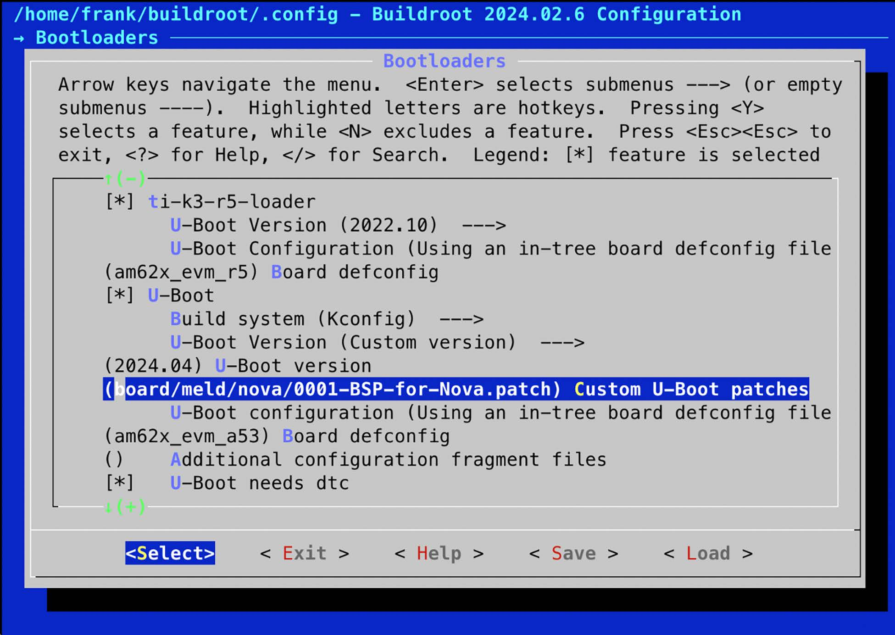
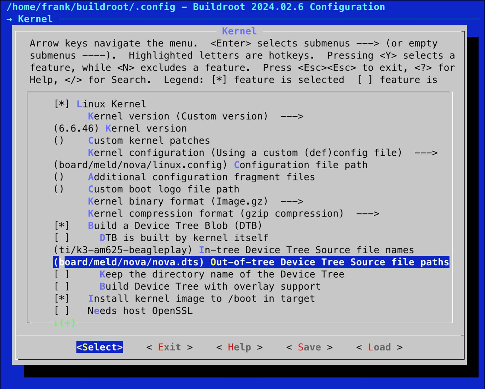
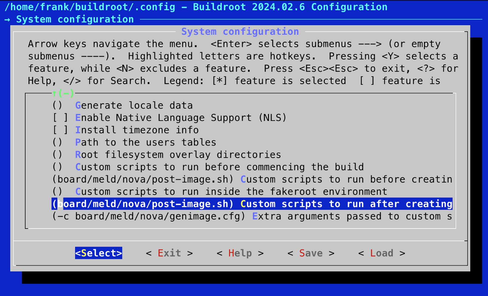

# Chương 6: Chọn build system (Selecting a Build System)

Các chương trước đã đề cập bốn thành phần đầu tiên của embedded Linux. Bạn đã build bootloader, kernel và root filesystem từng bước trước khi kết hợp chúng thành một hệ thống embedded Linux cơ bản. Đó là rất nhiều bước! Giờ là lúc đơn giản hóa quá trình bằng cách tự động hóa càng nhiều càng tốt. Các build system embedded Linux có thể giúp ích, và chúng ta sẽ xem xét hai build system cụ thể: Buildroot và The Yocto Project. Cả hai đều là những công cụ phức tạp, cần cả một cuốn sách để giải thích cách chúng hoạt động.

Trong chương này, tôi sẽ chỉ trình bày những ý tưởng chung đằng sau build system, đặt nền móng cho Chương 7 và 8. Đầu tiên, tôi sẽ cho bạn thấy cách build một image đơn giản để có cảm nhận tổng thể về hệ thống. Sau đó, tôi sẽ cho bạn thấy cách thực hiện một số sửa đổi hữu ích cho các ví dụ board Nova và Raspberry Pi 4 từ các chương trước. Trong các chương tiếp theo, chúng ta sẽ đi sâu hơn vào The Yocto Project, giờ là build system hàng đầu cho embedded Linux.

Trong chương này, chúng ta sẽ đề cập các chủ đề sau:

- So sánh các build system

- Phân phối binary

- Giới thiệu Buildroot

- Giới thiệu The Yocto Project

## Yêu cầu kỹ thuật

Để làm theo các ví dụ, hãy bảo đảm bạn có những thứ sau:

- Một hệ thống host Ubuntu 24.04 hoặc bản LTS mới hơn với ít nhất 90 GB dung lượng đĩa trống

- Một đầu đọc thẻ microSD và thẻ

- balenaEtcher cho Linux

- Một cáp Ethernet và router có cổng trống để kết nối mạng

- Một cáp serial USB-to-TTL với mức logic 3.3 V

- Raspberry Pi 4

- BeaglePlay

- Một bộ nguồn USB-C 5 V có khả năng cấp 3A

Code dùng trong chương này có trong thư mục của chương trong GitHub repository của cuốn sách: `https://github.com/PacktPublishing/Mastering-Embedded-Linux-Development/tree/main/Chapter06`.

## So sánh các build system

Trong Chương 5, tôi đã mô tả quá trình tạo image thủ công là quá trình Roll Your Own (RYO). Cách tiếp cận này cho bạn toàn quyền kiểm soát phần mềm để có thể điều chỉnh nó làm bất cứ điều gì bạn muốn. Nếu bạn muốn làm một điều thực sự khác thường nhưng sáng tạo, hoặc nếu bạn muốn giảm memory footprint xuống kích thước nhỏ nhất có thể, thì RYO là con đường cần đi. Nhưng trong hầu hết các tình huống, build thủ công là lãng phí thời gian và tạo ra các hệ thống kém chất lượng, khó bảo trì.

Ý tưởng đằng sau một build system là tự động hóa tất cả các bước đã mô tả cho đến thời điểm này. Một build system nên có khả năng build một vài hoặc tất cả những thứ sau từ source code upstream:

- toolchain

- bootloader

- kernel

- root filesystem

Build từ source code upstream quan trọng vì nhiều lý do. Nó cho bạn sự yên tâm rằng bạn có thể build lại bất cứ lúc nào mà không có dependency bên ngoài. Nó cũng có nghĩa là bạn có thể debug ở mức source và đáp ứng các yêu cầu license về việc phân phối code cho người dùng khi cần.

Để làm được việc của mình, một build system phải có khả năng:

- Tải source code từ upstream, trực tiếp từ hệ thống quản lý phiên bản hoặc dưới dạng archive, và cache nó cục bộ.

- Áp các patch để cho phép cross-compilation, sửa các bug architecture-dependent, áp dụng các chính sách cấu hình cục bộ, v.v.

- Build các thành phần khác nhau cùng với các dependency compile-time và runtime của chúng.

- Tạo một vùng staging và lắp ráp một root filesystem.

- Tạo các file image ở nhiều định dạng khác nhau, sẵn sàng để nạp lên target.

Một số điều hữu ích khác là:

- Thêm các package của riêng bạn chứa ứng dụng hoặc thay đổi kernel.

- Chọn các profile root filesystem khác nhau: lớn hay nhỏ, có hay không có đồ họa, và các tính năng khác.

- Tạo một SDK standalone mà bạn có thể phân phối cho các developer khác để họ không phải cài đặt toàn bộ build system.

- Theo dõi những license open source nào được dùng bởi các package khác nhau mà bạn đã chọn.

- Có giao diện người dùng thân thiện.

Trong mọi trường hợp, build system đóng gói các thành phần của một hệ thống thành các package, một số cho host và một số cho target. Mỗi package định nghĩa một tập quy tắc để lấy source, build nó và cài đặt kết quả vào đúng vị trí. Có các dependency giữa các package và một cơ chế để phân giải các dependency và build tập package cần thiết.

Các build system open source đã trưởng thành trong vài năm qua. Có nhiều build system, bao gồm:

- Buildroot: Là một hệ thống easy-to-use dùng GNU Make và Kconfig (`https://buildroot.org/`).

- OpenEmbedded: Là một hệ thống mạnh mẽ và là một thành phần lõi của Yocto (`https://openembedded.org`).

- OpenWrt: Là một công cụ build hướng tới việc build firmware cho router không dây (`https://openwrt.org/`), hỗ trợ sẵn việc quản lý package lúc runtime. Nó là một dẫn xuất của Buildroot.

- PTXdist: Là một build system open source do Pengutronix tài trợ (`https://www.ptxdist.org/`).

- Yocto: Mở rộng OpenEmbedded core với metadata, công cụ và tài liệu. Đây là build system embedded Linux phổ biến nhất hiện nay (`https://www.yoctoproject.org/`).

Tôi sẽ tập trung vào hai trong số đó: Buildroot và Yocto. Chúng tiếp cận vấn đề theo những cách khác nhau và với những mục tiêu khác nhau.

Buildroot có mục tiêu chính là build các root filesystem image, vì vậy mới có tên này. Nhưng nó cũng có thể build bootloader, kernel và thậm chí cả toolchain. Nó dễ cài đặt và cấu hình. Quan trọng nhất, Buildroot tạo ra target image nhanh.

Yocto tổng quát hơn trong cách định nghĩa hệ thống target, vì vậy nó có thể build các thiết bị nhúng phức tạp hơn. Mọi thành phần được tạo ra dưới dạng binary package theo mặc định dùng định dạng RPM. Các package sau đó được kết hợp để tạo filesystem image. Bạn có thể cài đặt một package manager trong filesystem image cho phép cập nhật package lúc runtime. Nói cách khác, khi build bằng Yocto, bạn đang tạo bản phân phối Linux tùy chỉnh của riêng mình. Hãy nhớ rằng bật quản lý package lúc runtime cũng có nghĩa là phải chuẩn bị và vận hành package feed repository tương ứng của riêng bạn.

## Phân phối binary

Các bản phân phối Linux chính thống trong hầu hết các trường hợp được xây dựng từ các tập binary package (đã compile sẵn) ở định dạng RPM hoặc DEB. RPM là viết tắt của Red Hat Package Manager và được dùng trong Red Hat, SUSE, Fedora và các bản phân phối RPM-based khác. Debian và các bản phân phối Debian-derived, bao gồm Ubuntu và Mint, dùng định dạng Debian package manager (DEB). Cũng có một định dạng gọn nhẹ cho các thiết bị nhúng được gọi là Itsy package (IPK), dựa trên DEB.

Khả năng đưa một package manager lên thiết bị là một trong những điểm khác biệt lớn giữa các build system. Khi đã có package manager trên thiết bị target, bạn có một cách dễ dàng để triển khai package mới và cập nhật các package hiện có. Tôi sẽ nói về những hệ quả của điều này trong Chương 10.

Giờ đến phần chính. Chúng ta sẽ bắt đầu với Buildroot. Là build system đơn giản hơn trong hai cái, Buildroot dễ bắt đầu hơn Yocto và là cách nhanh nhất để tạo một image có thể boot cho cả ba target của chúng ta.

## Giới thiệu Buildroot

Các phiên bản Buildroot hiện tại có thể build toolchain, bootloader, kernel và root filesystem. Buildroot dùng GNU Make làm công cụ build chính. Có tài liệu trực tuyến tốt tại `https://buildroot.org/docs.html` cùng với The Buildroot user manual tại `https://buildroot.org/downloads/manual/manual.html`.

### Bối cảnh

Buildroot là một trong những build system đầu tiên. Nó bắt đầu khi các project uClinux và uClibc cần một cách tạo root filesystem nhỏ để kiểm thử. Buildroot trở thành một project riêng vào cuối năm 2001 và tiếp tục phát triển đến năm 2006, sau đó nó rơi vào giai đoạn ngủ đông.

Tuy nhiên, kể từ khi Peter Korsgaard tiếp quản việc quản lý vào năm 2009, nó đã phát triển nhanh chóng, thêm hỗ trợ cho các toolchain glibc-based và số lượng package cùng target board tăng lên đáng kể. Peter vẫn là maintainer chính của Buildroot và đã có một sự nghiệp lâu dài, lừng lẫy với tư cách kỹ sư phần mềm tại Barco ở Bỉ.

Buildroot là tổ tiên của OpenWrt, một build system phổ biến khác được fork từ Buildroot vào khoảng năm 2004. Trọng tâm chính của OpenWrt là tạo phần mềm cho router không dây, vì vậy tập package hướng tới hạ tầng mạng. Nó cũng có một package manager IPK lúc runtime để thiết bị có thể được cập nhật hoặc nâng cấp mà không cần flash lại toàn bộ image. Buildroot và OpenWrt đã khác biệt đến mức giờ chúng gần như là hai build system hoàn toàn khác nhau. Các package được build bằng một hệ thống không tương thích với hệ thống kia.

### Bản phát hành stable và long-term support

Các developer Buildroot tạo ra các bản phát hành stable bốn lần một năm vào tháng Hai, tháng Năm, tháng Tám và tháng Mười Một. Chúng được đánh dấu bằng các Git tag dạng `<year>.02`, `<year>.05`, `<year>.08` và `<year>.11`. Mỗi bản phát hành `<year>.02` được đánh dấu là Long-Term Support (LTS), nghĩa là sẽ có các point release để sửa lỗi bảo mật và các bug quan trọng khác trong 12 tháng sau bản phát hành đầu tiên. Bản phát hành `2017.02` là bản đầu tiên nhận nhãn LTS.

### Cài đặt

Bạn cài đặt Buildroot bằng cách clone repository hoặc tải một archive. Sau đây là một ví dụ lấy phiên bản `2024.02.6`, phiên bản stable mới nhất tại thời điểm viết:

```
$ git clone git://git.buildroot.net/buildroot -b 2024.02.6
```

Archive TAR tương đương có tại `https://buildroot.org/downloads/`.

Hãy đọc phần có tiêu đề System requirements trong The Buildroot user manual, có tại `https://buildroot.org/downloads/manual/manual.html,` và bảo đảm cài đặt tất cả các package được liệt kê ở đó.

### Cấu hình

Buildroot dùng cơ chế Kconfig/Kbuild của kernel mà tôi đã mô tả trong phần Tìm hiểu cấu hình kernel ở Chương 4. Bạn có thể cấu hình Buildroot từ đầu trực tiếp bằng `make menuconfig` (`xconfig` hoặc `gconfig`). Hoặc bạn có thể chọn một trong 100+ cấu hình cho các development board khác nhau có trong thư mục `configs`. Gõ `make list-defconfigs` sẽ liệt kê tất cả các cấu hình mặc định.

Hãy bắt đầu bằng việc build một cấu hình mặc định mà bạn có thể chạy trên emulator QEMU Arm 64-bit:

```
$ cd buildroot
$ make qemu_aarch64_virt_defconfig
$ make
```

LƯU Ý QUAN TRỌNG

Đừng cho GNU Make biết số job chạy song song bằng tùy chọn `-j`. Buildroot sẽ tự tận dụng tối ưu các lõi CPU của bạn. Nếu muốn giới hạn số job, hãy chạy `make menuconfig` và tìm Number of jobs to run simultaneously trong Build options.

Quá trình build có thể mất tới một giờ tùy theo hệ thống host có bao nhiêu lõi CPU và tốc độ internet. Nó sẽ tải về khoảng 502 MB code và tiêu tốn khoảng 12 GB dung lượng đĩa. Khi hoàn tất, bạn sẽ thấy hai thư mục mới đã được tạo:

- `dl`: Chứa các archive của các project upstream mà Buildroot đã build.

- `output`: Chứa tất cả các artifact trung gian và kết quả compile cuối cùng.

Bên trong `output`, bạn sẽ thấy các thư mục con sau:

- `build`: Chứa thư mục build cho mỗi thành phần.

- `host`: Chứa các công cụ khác nhau mà Buildroot cần trên host, bao gồm các file thực thi của toolchain (trong `output/host/usr/bin`).

- `images`: Chứa kết quả hoàn chỉnh của lần build. Tùy theo những gì bạn chọn khi cấu hình, bạn sẽ thấy một bootloader, một kernel và một hoặc nhiều root filesystem image.

- `staging`: Là một symbolic link tới `sysroot` của toolchain. Tên của link hơi gây nhầm lẫn vì nó không trỏ tới một vùng staging như đã định nghĩa trong Chương 5.

- `target`: Là vùng staging cho thư mục root. Lưu ý rằng bạn không thể dùng nó làm root filesystem vì quyền sở hữu và quyền truy cập file không được đặt đúng. Buildroot dùng một device table như được mô tả trong chương trước để đặt quyền sở hữu và quyền truy cập khi filesystem image được tạo trong thư mục `image`.

### Chạy

Một số target mẫu có một thư mục con trong thư mục `board` chứa các file cấu hình tùy chỉnh và informationon về cách cài đặt kết quả.

Trong trường hợp hệ thống bạn vừa build, file liên quan là `board/qemu/aarch64-virt/readme.txt`. File `readme.txt` này cho bạn biết cách khởi động QEMU với target này. Giả sử bạn đã cài đặt `qemu-system-aarch64` như được mô tả trong Chương 1, bạn có thể chạy QEMU bằng lệnh này:

```
$ qemu-system-aarch64 -M virt -cpu cortex-a53 -nographic -smp 1 -kernel
output/images/Image -append "rootwait root=/dev/vda console=ttyAMA0"
-netdev user,id=eth0 -device virtio-net-device,netdev=eth0 -drive
file=output/images/rootfs.ext4,if=none,format=raw,id=hd0 -device virtio-
blk-device,drive=hd0
```

Có một script tên là `start-qemu.sh` trong `output/images` chứa lệnh đó. Khi QEMU khởi động, bạn sẽ thấy các thông điệp boot của kernel xuất hiện trong cùng cửa sổ terminal nơi bạn đã khởi động QEMU, theo sau là một dấu nhắc đăng nhập:

```
Booting Linux on physical CPU 0x0000000000 [0x410fd034]
Linux version 6.1.44 (frank@frank-nuc) (aarch64-buildroot-linux-gnu-gcc.
br_real (Buildroot 2024.02.6) 12.4.0, GNU ld (GNU Binutils) 2.40) #1 SMP
Wed Oct  9 21:24:21 PDT 2024
random: crng init done
Machine model: linux,dummy-virt
efi: UEFI not found.
<…>
VFS: Mounted root (ext4 filesystem) readonly on device 254:0.
devtmpfs: mounted
Freeing unused kernel memory: 1280K
Run /sbin/init as init process
EXT4-fs (vda): re-mounted. Quota mode: disabled.
Saving 256 bits of creditable seed for next boot
Starting syslogd: OK
Starting klogd: OK
Running sysctl: OK
Starting network: udhcpc: started, v1.36.1
udhcpc: broadcasting discover
udhcpc: broadcasting select for 10.0.2.15, server 10.0.2.2
udhcpc: lease of 10.0.2.15 obtained from 10.0.2.2, lease time 86400
deleting routers
adding dns 10.0.2.3
OK
Welcome to Buildroot
buildroot login:
```

Đăng nhập bằng `root` không có mật khẩu.

Để thoát QEMU, hãy gõ Ctrl + A rồi x.

### Nhắm tới phần cứng thật

Các bước để cấu hình và build một image có thể boot cho Raspberry Pi 4 gần như giống với QEMU Arm 64-bit:

```
$ cd buildroot
$ make clean
$ make raspberrypi4_64_defconfig
$ make
```

Image hoàn chỉnh được ghi vào một file tên là `output/images/sdcard.img`. Script `post-image.sh` và file cấu hình `genimage.cfg.in` dùng để ghi file image đều nằm trong `board/raspberrypi4-64 directory`. Để ghi `sdcard.img` lên thẻ microSD và boot nó trên Raspberry Pi 4:

1\. Cắm một thẻ microSD vào máy host Linux.

2\. Khởi chạy balenaEtcher.

3\. Nhấn Flash from file trong Etcher.

4\. Tìm image `sdcard.img` mà bạn đã build cho Raspberry Pi 4 và mở nó.

5\. Nhấn Select target trong Etcher.

6\. Chọn thẻ microSD mà bạn đã cắm vào ở bước 1.

7\. Nhấn Flash trong Etcher để ghi image.

8\. Đẩy thẻ microSD ra khi Etcher flash xong.

9\. Cắm thẻ microSD vào Raspberry Pi 4.

10\. Cấp nguồn cho Raspberry Pi 4 qua cổng USB-C.

Hãy xác nhận Raspberry Pi 4 đã boot thành công bằng cách cắm nó vào Ethernet và quan sát đèn hoạt động mạng nhấp nháy. Image mặc định này rất tối giản và hầu như không có gì ngoài BusyBox. Để SSH vào Raspberry Pi 4, bạn sẽ cần thêm một SSH server như `dropbear` hoặc `openssh` vào cấu hình image Buildroot.

### Tạo một BSP tùy chỉnh

Giờ hãy dùng Buildroot để tạo một Board Support Package (BSP) cho board Nova của chúng ta, dùng cùng các phiên bản U-Boot và Linux từ các chương trước. Bạn có thể xem các thay đổi tôi đã thực hiện với Buildroot trong phần này của cuốn sách dưới `MELD/Chapter06/buildroot`.

Các nơi được khuyên dùng để lưu các thay đổi của bạn là:

- `board/<organization>/<device>`: Chứa mọi patch, blob, bước build bổ sung và file cấu hình cho Linux, U-Boot và các thành phần khác

- `configs/<device>_defconfig`: Chứa cấu hình mặc định cho board

- `package/<organization>/<package_name>`: Là nơi đặt mọi package bổ sung cho board này

Tạo một thư mục để lưu các thay đổi cho board Nova:

```
$ mkdir -p board/meld/nova
```

Copy `nova_defconfig` từ `MELD/Chapter06/buildroot/configs` sang `buildroot`/`configs`:

```
$ cp ../MELD/Chapter06/buildroot/configs/nova_defconfig configs/.
```

Copy nội dung của `MELD/Chapter06/buildroot/board/meld/nova` sang `buildroot/board/meld/nova`:

```
$ cp ../MELD/Chapter06/buildroot/board/meld/nova/* board/meld/nova/.
```

Dọn sạch các artifact từ mọi lần build trước (luôn làm điều này khi thay đổi cấu hình):

```
$ make clean
```

Chọn cấu hình Nova:

```
$ make nova_defconfig
```

Lệnh `make nova_defconfig` cấu hình Buildroot để build một image nhắm tới BeaglePlay. Cấu hình này là một điểm khởi đầu tốt, nhưng chúng ta vẫn cần tùy chỉnh nó cho board Nova. Hãy bắt đầu bằng việc chọn U-Boot patch tùy chỉnh mà chúng ta đã tạo cho Nova.

#### U-Boot

Trong Chương 3, chúng ta đã tạo một bootloader tùy chỉnh cho Nova dựa trên phiên bản `f036fb` của fork U-Boot của TI và tạo một file patch cho nó được lưu thành `MELD/Chapter03/0001-BSP-for-Nova.patch`. Chúng ta có thể cấu hình Buildroot để chọn cùng phiên bản U-Boot đó và áp patch của chúng ta. Chạy `make` `nova_defconfig` đã đặt phiên bản U-Boot thành `f036fb`.

Copy file patch vào `board/meld/nova`:

```
$ cp ../MELD/Chapter03/0001-BSP-for-Nova.patch board/meld/nova/.
```

Giờ hãy chạy `make menuconfig` và đi vào trang Bootloaders. Từ trang đó, đi xuống Custom U-Boot patches và kiểm tra đường dẫn tới patch của chúng ta như sau:



Hình 6.1 – Chọn custom U-Boot patches

Giờ chúng ta đã patch U-Boot cho board Nova, bước tiếp theo là patch kernel.

#### Linux

Trong Chương 4, chúng ta đã dựa kernel trên Linux 6.6.46 và cung cấp một device tree mới từ `MELD/Chapter04/nova.dts`. Chạy `make nova_defconfig` đã đặt phiên bản kernel thành Linux 6.6.46 và thay đổi kernel series dùng cho kernel header cho khớp với kernel đang được build. Thoát khỏi trang Bootloaders và đi vào trang Kernel. Xác nhận rằng giá trị của Out-of-tree Device Tree Source file paths được đặt thành `board/meld/nova/nova.dts`:



Hình 6.2 – Chọn device tree source

Giờ chúng ta đã định nghĩa device tree, hãy build system image hoàn chỉnh với kernel và root filesystem.

#### Build

Ở giai đoạn cuối của quá trình build, Buildroot dùng một công cụ tên là `genimage` để tạo một image cho thẻ microSD mà chúng ta có thể copy trực tiếp lên thẻ. Chúng ta cần một file cấu hình để bố trí image theo đúng cách. Sửa file `board/meld/nova/genimage.cfg` có sẵn bằng cách thay `"k3-am625-beagleplay.dtb"` bằng `"nova.dtb"` như sau:

```
image boot.vfat {
                vfat {
                                files = {
                                                "tiboot3.bin",
                                                "tispl.bin",
                                                "u-boot.img",
                                                "Image.gz",
                                                "nova.dtb",  // HERE
                                }
                }

                size = 16M
}

image sdcard.img {
                hdimage {
                }

                partition u-boot {
                                partition-type = 0xC
                                bootable = "true"
                                image = "boot.vfat"
                }

                partition rootfs {
                                partition-type = 0x83
                                image = "rootfs.ext4"
                }
}
```

Lệnh này sẽ tạo một file tên là `sdcard.img`, chứa hai phân vùng tên là `u-boot` và `rootfs`. Phân vùng đầu chứa các file boot được liệt kê trong `boot.vfat`, còn phân vùng thứ hai chứa root filesystem image tên là `rootfs.ext4`, sẽ được Buildroot tạo ra.

Cuối cùng, chúng ta cần một script `post-image.sh` sẽ gọi `genimage` và tạo image cho thẻ microSD. Xem `board/meld/nova/post-image.sh`:

```
#!/bin/sh
BOARD_DIR="$(dirname $0)"

cp ${BUILD_DIR}/ti-k3-r5-loader-2022.10/tiboot3.bin $BINARIES_DIR/tiboot3.
bin

GENIMAGE_CFG="${BOARD_DIR}/genimage.cfg" GENIMAGE_TMP="${BUILD_DIR}/
genimage.tmp"

rm -rf "${GENIMAGE_TMP}"

genimage \
    --rootpath "${TARGET_DIR}" \
    --tmppath "${GENIMAGE_TMP}" \
    --inputpath "${BINARIES_DIR}" \
    --outputpath "${BINARIES_DIR}" \
    --config "${GENIMAGE_CFG}"
```

Script này copy R5 firmware image vào thư mục `output/images` và chạy `genimage` với file cấu hình của chúng ta.

Lưu ý rằng `post-image.sh` cần có quyền thực thi; nếu không, quá trình build sẽ thất bại ở cuối:

```
$ chmod +x board/meld/nova/post-image.sh
```

Giờ hãy chạy `make menuconfig` và đi vào trang System configuration. Từ trang đó, đi xuống Custom scripts to run before creating filesystem images và để ý đường dẫn tới script `post-image.sh` của chúng ta:



Hình 6.3 – Chọn custom scripts to run after creating filesystem images

Cuối cùng, bạn có thể build Linux cho board Nova chỉ bằng cách gõ `make`. Khi build xong, bạn sẽ thấy các file này trong thư mục `output/images`:

```
bl31.bin                 rootfs.ext2  tee-header_v2.bin    tispl.bin
boot.vfat                rootfs.ext4  tee-pageable_v2.bin  u-boot.img
Image.gz                 rootfs.tar   tee-pager_v2.bin
nova.dtb                 sdcard.img   tiboot3.bin
r5-u-boot-spl.bin        tee.bin      ti-connectivity
```

Để kiểm thử, hãy cắm một thẻ microSD vào đầu đọc thẻ và dùng balenaEtcher để ghi `output/images/sdcard.img` lên thẻ microSD như chúng ta đã làm cho Raspberry Pi 4. Không cần format thẻ microSD trước như ở chương trước vì `genimage` đã tạo chính xác bố cục đĩa cần thiết.

Sau khi đã chứng minh cấu hình tùy chỉnh cho board Nova hoạt động, sẽ tốt nếu lưu các thay đổi trở lại file `nova_defconfig` để chúng ta và người khác có thể dùng lại. Bạn có thể làm điều đó bằng lệnh này:

```
$ make savedefconfig BR2_DEFCONFIG=configs/nova_defconfig
```

Giờ bạn đã có một cấu hình Buildroot tùy chỉnh cho board Nova. Bạn có thể lấy lại cấu hình này bằng cách gõ lệnh sau:

```
$ make nova_defconfig
```

Vậy là chúng ta đã cấu hình Buildroot thành công. Trong phần tiếp theo, chúng ta sẽ học cách thêm code của riêng mình vào một image Buildroot.

### Thêm code của riêng bạn

Giả sử bạn phát triển một chương trình và muốn đưa nó vào bản build. Bạn có hai lựa chọn. Thứ nhất, build nó riêng bằng build system của chính nó rồi đưa binary vào bản build cuối cùng dưới dạng một overlay. Thứ hai, tạo một package Buildroot có thể được chọn từ menu và build nó như mọi package khác.

#### Overlay

Overlay đơn giản là một cấu trúc thư mục được copy chồng lên root filesystem của Buildroot ở một giai đoạn muộn trong quá trình build. Nó có thể chứa file thực thi, thư viện và bất kỳ thứ gì khác bạn muốn đưa vào. Lưu ý rằng mọi code đã compile phải tương thích với các thư viện được triển khai lúc runtime, nghĩa là nó phải được compile bằng cùng toolchain mà Buildroot dùng.

Dùng toolchain của Buildroot khá dễ; chỉ cần thêm nó vào `PATH`:

```
$ PATH=<path_to_buildroot>/output/host/usr/bin:$PATH
```

Tiền tố của toolchain là `<ARCH>-linux-`. Vì vậy, để compile một chương trình đơn giản, bạn sẽ làm như sau:

```
$ PATH=/home/frank/buildroot/output/host/usr/bin:$PATH
$ aarch64-linux-gcc helloworld.c -o helloworld
```

Sau khi đã compile chương trình bằng đúng toolchain, hãy cài đặt các file thực thi và các file hỗ trợ khác vào một vùng staging và đánh dấu nó là một overlay cho Buildroot. Với ví dụ `helloworld`, bạn có thể đặt nó trong thư mục `board/meld/nova`:

```
$ mkdir -p board/meld/nova/overlay/usr/bin
$ cp helloworld board/meld/nova/overlay/usr/bin
```

Cuối cùng, đặt `BR2_ROOTFS_OVERLAY` thành đường dẫn trỏ tới overlay. Nó có thể được cấu hình trong `menuconfig` bằng tùy chọn System configuration \| Root filesystem overlay directories.

#### Thêm một package

Các package Buildroot (hơn 2,000 package) được lưu trong thư mục `package`, mỗi package trong thư mục con riêng. Một package gồm ít nhất hai file: `Config.in`, chứa đoạn code Kconfig cần để package hiển thị trong menu cấu hình, và một makefile tên là `<package_name>.mk`.

LƯU Ý QUAN TRỌNG

Lưu ý rằng một package Buildroot không chứa code, chỉ chứa các chỉ dẫn để lấy code bằng cách tải một tarball, chạy `git clone`, hoặc bất cứ cách nào cần thiết để lấy source upstream.

Makefile được viết theo định dạng mà Buildroot mong đợi và chứa các directive cho phép Buildroot tải về, cấu hình, compile và cài đặt chương trình. Viết một makefile package mới là một thao tác phức tạp, được trình bày chi tiết trong The Buildroot user manual.

Sau đây là một ví dụ cho bạn thấy cách tạo một package cho một chương trình đơn giản như chương trình `helloworld` của chúng ta. Bắt đầu bằng việc tạo một thư mục con `package/helloworld` với một file `Config.in` trông như sau:

```
config BR2_PACKAGE_HELLOWORLD
    bool "helloworld"
    help
      A friendly program that prints Hello World! every 10s
```

Dòng đầu tiên phải có định dạng `BR2_PACKAGE_<uppercase package name>`. Theo sau là `bool` và tên package như nó sẽ xuất hiện trong menu cấu hình. Dòng thứ hai là thứ cho phép người dùng chọn package này. Phần `help` là tùy chọn nhưng thường là một ý hay vì nó đóng vai trò self-documentation.

Nối package mới vào menu Target Packages bằng cách sửa `package/Config.in` và source file cấu hình như dưới đây:

```
menu "My programs"
  source "package/helloworld/Config.in"
endmenu
```

Bạn có thể nối package `helloworld` mới này vào một submenu có sẵn, nhưng gọn gàng hơn là tạo một submenu mới chỉ với package của chúng ta và chèn nó trước menu Audio and video applications.

Sau khi chèn menu My programs vào `package/Config.in`, hãy tạo một file `package/helloworld/helloworld.mk` để cung cấp dữ liệu mà Buildroot cần:

```
HELLOWORLD_VERSION = 1.0.0

HELLOWORLD_SITE = /home/frank/MELD/Chapter06/helloworld
HELLOWORLD_SITE_METHOD = local

define HELLOWORLD_BUILD_CMDS
    $(MAKE) CC="$(TARGET_CC)" LD="$(TARGET_LD)" -C $(@D) all
endef

define HELLOWORLD_INSTALL_TARGET_CMDS
    $(INSTALL) -D -m 0755 $(@D)/helloworld $(TARGET_DIR)/usr/bin/
helloworld
endef

$(eval $(generic-package))
```

Bạn có thể tìm thấy package `helloworld` của tôi trong kho code của cuốn sách tại `MELD/Chapter06/buildroot/package/helloworld` và source code của chương trình trong `MELD/Chapter06/helloworld`. Vị trí của code được hardcode thành một đường dẫn cục bộ.

Trong một trường hợp thực tế hơn, bạn sẽ lấy code từ một hệ thống quản lý source code hoặc từ một server trung tâm nào đó. Có các chi tiết về cách làm điều này trong The Buildroot user manual và rất nhiều ví dụ trong các package khác.

### Tuân thủ license

Buildroot dựa trên phần mềm open source. Các package mà nó compile cũng vậy. Đến một lúc nào đó trong project, bạn nên kiểm tra các license bằng cách chạy:

```
$ make legal-info
```

Thông tin license được thu thập trong thư mục `output/legal-info`. Có các bản tóm tắt license được dùng để compile các công cụ host trong `host-manifest.csv` và cho target trong `manifest.csv`. Có thêm thông tin trong file `README` và trong The Buildroot user manual.

Giờ hãy chuyển build system và bắt đầu tìm hiểu về The Yocto Project.

## Giới thiệu The Yocto Project

The Yocto Project phức tạp hơn Buildroot nhiều. Nó không chỉ build được toolchain, bootloader, kernel và root filesystem, mà còn có thể tạo cho bạn cả một bản phân phối Linux với các binary package có thể được cài đặt lúc runtime. Quá trình build được tổ chức xung quanh các nhóm recipe được viết bằng sự kết hợp giữa Python và shell script. The Yocto Project bao gồm một task scheduler gọi là BitBake, tạo ra bất cứ thứ gì bạn đã cấu hình từ các recipe. Có rất nhiều tài liệu trực tuyến tại `https://www.yoctoproject.org/`.

### Bối cảnh

Cấu trúc của The Yocto Project sẽ dễ hiểu hơn nếu bạn xem bối cảnh trước. Gốc rễ của nó nằm ở OpenEmbedded (`https://openembedded.org`), project này phát triển từ một số project port Linux sang nhiều máy tính hand-held khác nhau, bao gồm Sharp Zaurus và Compaq iPAQ. OpenEmbedded ra đời vào năm 2003 như build system cho các máy tính hand-held đó. Không lâu sau, các developer khác bắt đầu dùng nó như một build system tổng quát cho các thiết bị chạy embedded Linux. Nó đã và đang tiếp tục được phát triển bởi một cộng đồng lập trình viên nhiệt tình.

Project OpenEmbedded đặt mục tiêu tạo ra một tập binary package dùng định dạng IPK gọn nhẹ. Các package này sau đó có thể được cài đặt trên target lúc runtime để tạo ra nhiều loại hệ thống. Nó làm điều này bằng cách tạo recipe cho mỗi package và dùng BitBake làm task scheduler. OpenEmbedded rất linh hoạt. Bằng cách cung cấp đúng metadata, bạn có thể tạo cả một bản phân phối Linux theo đặc tả của mình.

Vào năm 2005, Richard Purdie, khi đó là một developer tại OpenedHand, đã tạo một fork của OpenEmbedded với các lựa chọn package thận trọng hơn và tạo các bản phát hành ổn định trong một khoảng thời gian. Ông đặt tên nó là Poky (vần với hockey) theo tên một món ăn vặt Nhật Bản. Mặc dù Poky là một fork, OpenEmbedded và Poky vẫn tiếp tục theo sát nhau, chia sẻ cập nhật và giữ kiến trúc đồng bộ. Intel mua OpenedHand vào năm 2008 và chuyển Poky sang Linux Foundation vào năm 2010 khi họ thành lập The Yocto Project.

Kể từ năm 2010, các thành phần chung của OpenEmbedded và Poky đã được kết hợp vào một project riêng được gọi là OpenEmbedded Core, hay đơn giản là OE-Core.

The Yocto Project tập hợp nhiều thành phần, quan trọng nhất là:

- OE-Core: Là metadata lõi được chia sẻ với OpenEmbedded.

- BitBake: Là task scheduler được chia sẻ với OpenEmbedded và các project khác.

- Poky: Là bản phân phối tham chiếu. Git repo của Poky cũng bao gồm một layer `meta-yocto-bsp` với các machine phần cứng tham chiếu.

- Tài liệu: Là các user manual và developer guide cho từng thành phần.

- Toaster: là một giao diện web-based cho BitBake và metadata của nó.

Yocto cung cấp một nền tảng ổn định có thể được dùng as-is hoặc được mở rộng bằng các meta layer mà tôi sẽ bàn ở phần sau của chương này. Nhiều nhà cung cấp SoC cung cấp BSP cho thiết bị của họ theo cách này. Meta layer cũng có thể được dùng để tạo các build system mở rộng hoặc khác biệt. Một số là open source như Poky, số khác là thương mại như Wind River Linux. Yocto có một chương trình thương hiệu và kiểm thử tương thích để bảo đảm khả năng tương tác giữa các thành phần. Bạn sẽ thấy các tuyên bố như “Yocto Project compatible” trên nhiều trang web.

Do đó, bạn nên coi Yocto là nền móng cho cả một mảng embedded Linux, ngoài việc là một build system hoàn chỉnh theo đúng nghĩa của nó.

LƯU Ý QUAN TRỌNG

Có thể bạn đang thắc mắc về cái tên. Hóa ra yocto là tiền tố SI cho 10<sup>-24</sup>, giống như micro là 10<sup>-6</sup>. Vì sao đặt tên project là Yocto? Cái tên được chọn một phần để cho thấy nó có thể build các hệ thống Linux rất nhỏ (dù công bằng mà nói thì các build system khác cũng làm được). Nó cũng là một cú đá xéo tới Ångström Distribution giờ đã không còn, vốn dựa trên OpenEmbedded. Một Ångström là 10<sup>10</sup>. Con số đó khổng lồ so với một yocto!

### Các bản phát hành stable và hỗ trợ

Theo thường lệ, cứ sáu tháng lại có một bản phát hành Yocto: vào tháng Tư và tháng Mười. Chúng chủ yếu được biết đến bằng code name, nhưng biết số phiên bản Yocto và BitBake của chúng cũng hữu ích. Sau đây là bảng sáu bản phát hành gần đây nhất tại thời điểm viết:

| Code Name | Ngày phát hành | Phiên bản Yocto | Phiên bản BitBake |
|---|---|---|---|
| Scarthgap | April 2024 | 5.0 | 2.8 |
| Nanbield | November 2023 | 4.3 | 2.6 |
| Mickledore | May 2023 | 4.2 | 2.4 |
| Langdale | October 2022 | 4.1 | 2.2 |
| Kirkstone | May 2022 | 4.0 | 2.0 |
| Honister | October 2021 | 3.4 | 1.52 |

Bảng 6.1 – Sáu bản phát hành gần đây nhất của Yocto

Các bản phát hành stable được hỗ trợ sửa lỗi bảo mật và bug nghiêm trọng cho chu kỳ phát hành hiện tại và chu kỳ tiếp theo. Nói cách khác, mỗi phiên bản stable được hỗ trợ khoảng 12 tháng sau khi phát hành. Ngoài các bản phát hành stable, Yocto cũng cung cấp các bản phát hành LTS. Bản phát hành 3.1 (dunfell) của Yocto vào tháng Tư năm 2020 là bản phát hành LTS đầu tiên. Nhãn LTS có nghĩa là phiên bản Yocto đó sẽ nhận các bản sửa lỗi và cập nhật trong một khoảng thời gian kéo dài hai năm. Do đó, kế hoạch tiếp theo là chọn một bản phát hành Yocto làm LTS mỗi hai năm.

Giống như với Buildroot, nếu muốn được hỗ trợ tiếp, bạn có thể cập nhật lên bản phát hành stable tiếp theo hoặc backport các thay đổi về phiên bản của mình. Với Yocto, bạn còn có lựa chọn hỗ trợ thương mại trong nhiều năm từ các nhà cung cấp hệ điều hành như Siemens và Wind River.

### Cài đặt The Yocto Project

Để có một bản sao The Yocto Project, hãy clone repo và chọn code name (trong trường hợp này là `scarthgap`) làm branch:

```
$ git clone -b scarthgap git://git.yoctoproject.org/poky.git
```

Vì chúng ta build image cho BeaglePlay, chúng ta cũng cần clone repo `meta-ti`:

```
$ git clone -b scarthgap https://github.com/TexasInstruments-Sandbox/meta-
ti
```

Và vì layer `meta-ti-bsp` phụ thuộc vào layer `meta-arm`, chúng ta phải clone cả repo đó:

```
$ git clone -b scarthgap git://git.yoctoproject.org/meta-arm
```

Lưu ý rằng tên branch của cả `meta-ti` và `meta-arm` đều phải khớp với code name của Yocto để bảo đảm các layer bổ sung này tương thích với phiên bản scarthgap của Yocto. Một thực hành tốt nữa là định kỳ chạy `git pull` để lấy các bản sửa bug và patch bảo mật mới nhất từ tất cả các remote branch.

Hãy đọc các mục Compatible Linux Distribution và Build Host Packages trong Yocto Project Quick Build guide (`https://docs.yoctoproject.org/brief-yoctoprojectqs/`). Hãy bảo đảm các package thiết yếu cho bản phân phối host Ubuntu đã được cài đặt trên máy host của bạn. Bước tiếp theo là cấu hình.

LƯU Ý QUAN TRỌNG

Ubuntu 24.04 LTS (Noble Numbat) chưa được The Yocto Project hỗ trợ chính thức tại thời điểm viết. Khi Noble Numbat được phát hành, người dùng gặp nhiều lỗi BitBake liên quan đến quyền truy cập. Các lỗi này là kết quả của những hạn chế bảo mật tăng cường mà AppArmor áp đặt lên hệ điều hành. Để tạm thời tắt các cơ chế bảo vệ này của AppArmor:

`$ echo 0 | sudo tee /proc/sys/kernel/apparmor_restrict_unprivileged_userns`

Hãy nhớ chạy lại lệnh này mỗi lần bạn reboot host Ubuntu trước khi dùng Yocto.

### Cấu hình

Hãy bắt đầu bằng việc build cho emulator QEMU Arm 64-bit. Bắt đầu bằng cách source một script để thiết lập môi trường:

```
$ source poky/oe-init-build-env
```

Lệnh này tạo cho bạn một thư mục làm việc tên là `build` và đặt nó làm thư mục hiện tại. Tất cả các file cấu hình, file trung gian và file target image sẽ được đặt trong thư mục này. Bạn phải source script này mỗi lần muốn làm việc với project này.

Để chọn một thư mục làm việc khác, hãy thêm nó làm tham số cho `oe-init-build-env` như sau:

```
$ source poky/oe-init-build-env build-qemu-arm64
```

Lệnh này sẽ đưa bạn vào thư mục `build-qemu-arm64`. Bằng cách này, bạn có thể có nhiều thư mục build, mỗi thư mục cho một project khác nhau. Bạn chọn thư mục muốn làm việc thông qua tham số được truyền cho `oe-init-build-env`.

Ban đầu, thư mục `build` chỉ chứa một thư mục con tên là `conf` với các file cấu hình cho project này:

- `local.conf`: Chứa đặc tả của thiết bị bạn sẽ build và môi trường build.

- `bblayers.conf`: Chứa đường dẫn của các meta layer bạn sẽ dùng. Tôi sẽ mô tả layer ở phần sau.

Lúc này, chúng ta chỉ cần đặt biến `MACHINE` trong `conf/local.conf` thành `qemuarm64` bằng cách xóa ký tự comment (#) ở đầu dòng này:

```
MACHINE ?= "qemuarm64"
```

Giờ chúng ta đã sẵn sàng build image đầu tiên bằng Yocto.

### Build

Để thực hiện build, bạn cần chạy BitBake và cho nó biết root filesystem image nào bạn muốn tạo. Một số image phổ biến là:

- `core-image-minimal`: Là một hệ thống console-based nhỏ, hữu ích cho việc kiểm thử và làm nền cho các image tùy chỉnh.

- `core-image-minimal-initramfs`: Tương tự `core-image-minimal` nhưng được build dưới dạng một RAM disk.

- `core-image-x11`: Là một image cơ bản có hỗ trợ đồ họa qua một X11 server và ứng dụng terminal XTerminal.

- `core-image-full-cmdline`: Là một hệ thống console-based cung cấp trải nghiệm CLI chuẩn và hỗ trợ đầy đủ cho phần cứng target.

Bằng cách đưa cho BitBake target cuối cùng, nó sẽ làm ngược lại và build tất cả các dependency bắt đầu từ toolchain. Lúc này, chúng ta chỉ muốn tạo một image tối thiểu để xem nó hoạt động như thế nào:

```
$ bitbake core-image-minimal
```

Lần build đầu tiên sẽ mất khá nhiều thời gian (nhiều khả năng hơn một giờ) ngay cả với nhiều lõi CPU và nhiều RAM. Nó sẽ tải về khoảng 4.9 GB source code và tiêu tốn khoảng 49 GB dung lượng đĩa. Khi build xong, bạn sẽ thấy nhiều thư mục mới trong thư mục `build`.

Các thư mục này bao gồm `downloads`, chứa toàn bộ source được tải về cho lần build, và `tmp`, chứa phần lớn các build artifact. Bên trong `tmp`, bạn sẽ thấy:

- `work`: Chứa thư mục build và vùng staging cho root filesystem.

- `deploy`: Chứa các binary cuối cùng để triển khai lên target:

- `deploy/images/<machine name>`: Chứa bootloader, kernel và root filesystem image cho target.

- `deploy/rpm`: Chứa các package RPM tạo nên các image.

- `deploy/licenses`: Chứa các file license được trích xuất từ mỗi package.

Khi build xong, chúng ta có thể boot image hoàn chỉnh trên QEMU.

### Chạy target QEMU

Khi bạn build một target QEMU, một phiên bản QEMU nội bộ được tạo ra. Điều này loại bỏ nhu cầu cài đặt package QEMU cho bản phân phối của bạn. Có một wrapper script tên là `runqemu` để chạy phiên bản QEMU nội bộ này.

Để chạy emulation QEMU, hãy bảo đảm trước tiên chạy `source oe-init-build-env build-qemu-arm64` rồi gõ:

```
$ runqemu qemuarm64
```

Trong trường hợp này, QEMU đã được cấu hình với một graphic console nên dấu nhắc đăng nhập xuất hiện trong một framebuffer màu đen. Đăng nhập bằng root không có mật khẩu. Đóng cửa sổ framebuffer để thoát QEMU.

Để khởi chạy QEMU không có cửa sổ đồ họa, hãy thêm `nographic` vào command line:

```
$ runqemu qemuarm64 nographic
```

Trong trường hợp `nographic`, hãy đóng QEMU bằng tổ hợp phím Ctrl + A rồi x.

Script `runqemu` có nhiều tùy chọn khác. Gõ `runqemu help` để biết thêm thông tin.

### Layer

Metadata của Yocto được cấu trúc thành các layer. Một layer là một thư mục chứa một tập metadata BitBake dưới dạng các file recipe. Mỗi file recipe được dùng để build một software package riêng lẻ. Các layer được xếp chồng lên nhau để build hay “bake” tất cả các software recipe thành một image Linux hoàn chỉnh, giống như nướng một chiếc bánh. Theo quy ước, mỗi layer có tên bắt đầu bằng `meta`. Các layer lõi là:

- `meta`: Tương đương với một OpenEmbedded core chưa sửa đổi.

- `meta-poky`: Là metadata dành riêng cho bản phân phối Poky.

- `meta-yocto-bsp`: Chứa các BSP cho các machine tham chiếu mà Yocto thường xuyên kiểm thử.

Danh sách các layer mà BitBake tìm recipe được lưu trong `<your build directory>/conf/bblayers.conf` và mặc định bao gồm cả ba layer trong danh sách trên.

Cấu trúc recipe và các dữ liệu cấu hình khác theo cách này giúp rất dễ mở rộng Yocto bằng cách thêm layer mới. Có các layer bổ sung từ các nhà sản xuất SoC, từ chính The Yocto Project và từ rất nhiều người muốn đóng góp giá trị cho Yocto và OpenEmbedded. Có một danh sách layer hữu ích tại `https://layers.openembedded.org/layerindex/`. Sau đây là một số ví dụ:

- `meta-qt5`: Các thư viện và tiện ích Qt 5

- `meta-intel`: BSP cho CPU và SoC của Intel

- `meta-raspberrypi`: BSP cho các board Raspberry Pi

- `meta-ti`: BSP cho các SoC Arm-based của TI

Thêm một layer đơn giản như copy thư mục meta vào một vị trí phù hợp và thêm nó vào `bblayers.conf`. Hãy bảo đảm bạn đọc file `REAMDE` đi kèm mỗi layer để xem nó phụ thuộc vào những layer khác nào và tương thích với những phiên bản Yocto nào.

Để minh họa cách layer hoạt động, hãy tạo một layer cho board Nova mà chúng ta có thể dùng cho phần còn lại của chương khi thêm tính năng. Bạn có thể xem bản hiện thực đầy đủ của layer dưới `MELD/Chapter06/meta-nova` trong kho code.

Mỗi meta layer phải có ít nhất một file cấu hình tên là `conf/layer.conf` và cũng nên có một file `README` và một license.

Để tạo layer `meta-nova`, hãy thực hiện các bước sau:

```
$ source poky/oe-init-build-env build-nova
$ bitbake-layers create-layer nova
$ mv nova ../meta-nova
```

Lệnh này sẽ đưa bạn vào một thư mục làm việc tên là `build-nova` và tạo một layer tên là `meta-nova` với một `conf/layer.conf`, một `README` phác thảo và một license `COPYING.MIT` dưới `../meta-nova`. File `layer.conf` trông như sau:

```
# We have a conf and classes directory, add to BBPATH
BBPATH .= ":${LAYERDIR}"
# We have recipes-* directories, add to BBFILES
BBFILES += "${LAYERDIR}/recipes-*/*/*.bb \
            ${LAYERDIR}/recipes-*/*/*.bbappend"

BBFILE_COLLECTIONS += "nova"
BBFILE_PATTERN_nova = "^${LAYERDIR}/"
BBFILE_PRIORITY_nova = "6"

LAYERDEPENDS_nova = "core"
LAYERSERIES_COMPAT_nova = "scarthgap"
```

Layer tự thêm nó vào `BBPATH` và thêm các recipe mà nó chứa vào `BBFILES`. Nhìn vào code, bạn có thể thấy các recipe nằm trong các thư mục có tên bắt đầu bằng `recipes-` và có tên file kết thúc bằng `.bb` (với recipe BitBake thông thường) hoặc `.bbappend` (với các recipe mở rộng recipe có sẵn bằng cách ghi đè hoặc bổ sung chỉ dẫn). Layer này có tên `nova` và được thêm vào danh sách layer trong `BBFILE_COLLECTIONS` với mức ưu tiên `6`. Mức ưu tiên layer được dùng nếu cùng một recipe xuất hiện trong nhiều layer. Recipe trong layer có mức ưu tiên cao nhất sẽ thắng.

Trước khi thêm layer Nova, trước tiên chúng ta phải thêm các layer `meta-arm-toolchain`, `meta-arm` và `meta-ti-bsp` theo đúng thứ tự đó:

```
$ bitbake-layers add-layer ../meta-arm/meta-arm-toolchain
$ bitbake-layers add-layer ../meta-arm/meta-arm
$ bitbake-layers add-layer ../meta-ti/meta-ti-bsp
```

Giờ thêm layer Nova vào cấu hình build:

```
$ bitbake-layers add-layer ../meta-nova
```

Hãy bảo đảm chạy tất cả các lệnh `bitbake-layers add-layer` này từ thư mục làm việc `build-nova` sau khi source môi trường đó.

Xác nhận rằng cấu trúc layer được thiết lập đúng như sau:

```
$ bitbake-layers show-layers
NOTE: Starting bitbake server...
layer                 path                                      priority
==========================================================================
core                  /home/frank/poky/meta                     5
yocto                 /home/frank/poky/meta-poky                5
yoctobsp              /home/frank/poky/meta-yocto-bsp           5
arm-toolchain         /home/frank/meta-arm/meta-arm-toolchain   5
meta-arm              /home/frank/meta-arm/meta-arm             5
meta-ti-bsp           /home/frank/meta-ti/meta-ti-bsp           6
nova                  /home/frank/meta-nova                     6
```

Ở đó bạn có thể thấy layer mới. Vì nó có mức ưu tiên `6`, nó có thể ghi đè recipe trong các layer khác, vốn đều có mức ưu tiên thấp hơn.

Hãy chạy một lần build với layer rỗng này. Target cuối cùng sẽ là board Nova, nhưng lúc này, hãy build cho BeaglePlay bằng cách thêm `MACHINE ?= "beagleplay-ti"` vào `conf/local.conf`. Sau đó build một image nhỏ bằng `bitbake core-image-minimal` như trước.

Ngoài recipe, layer có thể chứa các class BitBake, file cấu hình, bản phân phối, v.v. Tiếp theo tôi sẽ xem xét recipe và cho bạn thấy cách tạo một image tùy chỉnh và một package.

#### BitBake và recipe

BitBake xử lý metadata thuộc nhiều loại khác nhau:

- recipe (các file kết thúc bằng `.bb`): Chứa thông tin về việc build một đơn vị phần mềm, bao gồm cách lấy bản sao source code, các dependency vào thành phần khác, và cách build và cài đặt nó.

- append (các file kết thúc bằng `.bbappend`): Ghi đè hoặc mở rộng một số chi tiết của một recipe. Một file `.bbappend` nối các chỉ dẫn của nó vào cuối một file recipe (`.bb`) có cùng tên gốc.

- include (các file kết thúc bằng `.inc`): Chứa thông tin chung cho nhiều recipe, cho phép chia sẻ thông tin giữa chúng. Các file có thể được include bằng từ khóa include hoặc require. Khác biệt là `require` báo lỗi nếu file không tồn tại còn `include` thì không.

- class (các file kết thúc bằng `.bbclass`): Chứa thông tin build chung như cách build một kernel hoặc cách build một project Autotools. Class được kế thừa bởi recipe và bởi các class khác bằng từ khóa `inherit`. Class `classes/base.bbclass` được mọi recipe kế thừa ngầm định.

- configuration (các file kết thúc bằng `.conf`): Định nghĩa nhiều biến cấu hình chi phối quá trình build của một project.

Một recipe là một tập hợp các task được viết bằng sự kết hợp giữa Python và shell script. Các task có tên như `do_fetch`, `do_unpack`, `do_patch`, `do_configure`, `do_compile` và `do_install`. Bạn dùng BitBake để thực thi các task này. Task mặc định là `do_build`, thực hiện tất cả các subtask cần để build recipe. Bạn có thể liệt kê các task có trong một recipe bằng `bitbake -c listtasks` `<recipe>`. Ví dụ, để liệt kê các task trong `core-image-minimal`:

```
$ bitbake -c listtasks core-image-minimal
```

LƯU Ý QUAN TRỌNG

Tùy chọn `-c` cho BitBake biết cần chạy một task cụ thể từ một recipe mà không cần ghi phần `do_` ở đầu tên task.

`do_listtasks` là một task đặc biệt liệt kê tất cả các task được định nghĩa trong một recipe. Sau đây là task `fetch`, task này tải source code cho một recipe:

```
$ bitbake -c fetch busybox
```

Để lấy code cho một target và tất cả các dependency của nó (hữu ích khi bạn muốn bảo đảm đã tải về toàn bộ code cho image sắp build), hãy dùng lệnh sau:

```
$ bitbake core-image-minimal --runall=fetch
```

Các file recipe thường được đặt tên `<package-name>_<version>.bb`. Chúng có thể có dependency vào các recipe khác, điều cho phép BitBake tính ra tất cả các subtask cần được thực thi để hoàn thành công việc top-level.

Để tạo một recipe cho chương trình `helloworld` của chúng ta trong `meta-nova`, bạn sẽ tạo một cấu trúc thư mục như sau:

```
meta-nova/recipes-local/helloworld
├── files
│   └── helloworld.c
└── helloworld_1.0.bb
```

Recipe là `helloworld_1.0.bb` và source được giữ cục bộ cùng recipe trong thư mục con `files`. Recipe chứa các chỉ dẫn sau:

```
DESCRIPTION = "A friendly program that prints Hello World!"
SECTION = "examples"

LICENSE = "GPL-2.0-only"
LIC_FILES_CHKSUM = "file://${COMMON_LICENSE_DIR}/GPL-2.0-only;md5=801f8098
0d171dd6425610833a22dbe6"
SRC_URI = "file://helloworld.c"

S = "${WORKDIR}"

do_compile() {
    ${CC} ${CFLAGS} ${LDFLAGS} helloworld.c -o helloworld
}

do_install() {
    install -d ${D}${bindir}
    install -m 0755 helloworld ${D}${bindir}
}
```

Vị trí của source code được đặt bởi `SRC_URI`. Trong trường hợp này, URI `file://` có nghĩa là code nằm cục bộ trong thư mục recipe. BitBake sẽ tìm trong các thư mục `files`, `helloworld` và `helloworld-1.0` tính tương đối từ thư mục chứa recipe. Các task cần được định nghĩa là `do_compile` và `do_install`, compile file source và cài đặt nó vào root filesystem của target: `${D}` mở rộng thành vùng staging của recipe và `${bindir}` thành thư mục binary mặc định `/usr/bin`.

Mọi recipe đều có một license được định nghĩa bởi `LICENSE`, ở đây được đặt thành `GPL-2.0-only`. File chứa văn bản license và một checksum được định nghĩa bởi `LIC_FILES_CHKSUM`. BitBake sẽ dừng build nếu checksum không khớp, cho thấy license đã thay đổi theo cách nào đó. Lưu ý rằng giá trị checksum MD5 và `COMMON_LICENSE_DIR` nằm trên cùng một dòng, phân cách bằng dấu chấm phẩy. File license có thể là một phần của package, hoặc có thể trỏ tới một trong các văn bản license chuẩn trong `meta/files/common-licenses` như trường hợp ở đây.

License thương mại bị cấm theo mặc định, nhưng rất dễ bật chúng. Bạn cần chỉ định license trong recipe như sau:

```
LICENSE_FLAGS = "commercial"
```

Sau đó, trong `conf/local.conf`, hãy cho phép tường minh license này như sau:

```
LICENSE_FLAGS_ACCEPTED = "commercial"
```

Để bảo đảm recipe `helloworld` compile đúng, hãy yêu cầu BitBake build nó:

```
$ bitbake helloworld
```

Nếu mọi thứ suôn sẻ, bạn sẽ thấy nó đã tạo một thư mục làm việc cho recipe trong `tmp/work/aarch64-poky-linux/helloworld`. Bạn cũng sẽ thấy có một package RPM cho nó trong `tmp/deploy/rpm/aarch64/helloworld-1.0-r0.aarch64.rpm`.

Package này chưa là một phần của target image. Danh sách các package cần cài đặt được giữ trong một biến tên là `IMAGE_INSTALL`. Bạn có thể nối vào cuối danh sách đó bằng cách thêm dòng này vào `conf/local.conf`:

```
IMAGE_INSTALL:append = " helloworld"
```

Lưu ý rằng cần có một dấu cách giữa dấu ngoặc kép mở và tên package đầu tiên. Giờ package sẽ được thêm vào bất kỳ image nào mà bạn `bitbake`:

```
$ bitbake core-image-minimal
```

Nếu xem trong `deploy-ti/images/beagleplay-ti/core-image-minimal-beagleplay-ti.rootfs.tar.xz`, bạn sẽ thấy `/usr/bin/helloworld` quả thực đã được cài đặt.

### Tùy chỉnh image qua local.conf

Bạn thường có thể muốn thêm một package vào image trong quá trình phát triển hoặc tinh chỉnh nó theo những cách khác. Như chúng ta vừa thấy, bạn có thể đơn giản nối thêm vào danh sách các package cần cài đặt bằng cách thêm một câu lệnh như:

```
IMAGE_INSTALL:append = " helloworld"
```

Bạn có thể thực hiện các thay đổi sâu rộng hơn qua `EXTRA_IMAGE_FEATURES`. Sau đây là một danh sách ngắn, sẽ cho bạn ý tưởng về các tính năng có thể bật:

- `dbg-pkgs`: Cài đặt các package debug symbol cho tất cả các package được cài đặt trong image.

- `debug-tweaks`: Cho phép đăng nhập `root` không cần mật khẩu và các thay đổi khác giúp việc phát triển dễ dàng hơn. Đừng bao giờ bật `debug-tweaks` trong các image sản xuất.

- `package-management`: Cài đặt các công cụ quản lý package và giữ lại cơ sở dữ liệu của package manager.

- `read-only-rootfs`: Làm cho root filesystem read-only. Chúng ta sẽ đề cập chi tiết hơn trong Chương 9.

- `x11`: Cài đặt X server.

- `x11-base`: Cài đặt X server với một môi trường tối giản.

Có nhiều tính năng khác bạn có thể thêm theo cách này. Tôi khuyên bạn xem mục Image Features của Yocto Project Reference Manual tại `https://docs.yoctoproject.org/ref-manual/` và đọc code trong `meta/classes-recipe/core-image.bbclass`.

### Viết một image recipe

Vấn đề khi thay đổi `local.conf` là chúng, ừ thì, mang tính cục bộ. Nếu bạn muốn tạo một image để chia sẻ với các developer khác hoặc để nạp lên hệ thống sản xuất, thì bạn nên đặt các thay đổi vào một image recipe.

Một image recipe chứa các chỉ dẫn về cách tạo các file image cho một target, bao gồm bootloader, kernel và root filesystem image. Theo quy ước, image recipe được đặt vào một thư mục tên là `images`. Bạn có thể có danh sách tất cả các image có sẵn bằng cách quét thư mục `poky` và mọi layer bổ sung mà bạn đã clone:

```
$ cd ~
$ ls poky/meta*/recipes*/images/*.bb
$ ls meta*/recipes*/images/*.bb
```

Bạn sẽ thấy recipe của `core-image-minimal` nằm trong `poky`/`meta/recipes-core/images/core-image-minimal.bb`.

Một cách tiếp cận đơn giản là lấy một image recipe có sẵn và sửa nó bằng các câu lệnh giống như những câu lệnh bạn đã dùng trong `local.conf`.

Hãy tưởng tượng bạn muốn một image giống `core-image-minimal` nhưng có thêm chương trình `helloworld` và tiện ích `strace`. Bạn có thể làm điều đó với một file recipe two-line, include (bằng từ khóa `require`) image cơ sở và thêm các package bạn muốn. Theo quy ước, image được đặt trong một thư mục tên là `images`, vì vậy hãy thêm recipe `nova-image.bb` với nội dung này vào `meta-nova/recipes-local/images`:

```
require recipes-core/images/core-image-minimal.bb

IMAGE_INSTALL:append = " helloworld strace"
```

Giờ hãy xóa dòng `IMAGE_INSTALL:append` khỏi `local.conf` và build image:

```
$ bitbake nova-image
```

Lần này, quá trình build sẽ nhanh hơn nhiều vì BitBake dùng lại các build object trung gian đã build trong các lần chạy trước.

BitBake không chỉ build image để chạy trên thiết bị target, mà còn có thể build một SDK để cross-development trên máy host.

### Tạo một SDK

Việc có thể tạo một toolchain standalone mà các developer khác cài đặt được rất hữu ích. Điều này tránh việc mọi người trong nhóm phải cài đặt đầy đủ Yocto. Lý tưởng nhất, bạn muốn toolchain bao gồm các thư viện phát triển và file header cho tất cả các thư viện được cài đặt trên target. Bạn có thể làm điều đó cho bất kỳ image nào bằng task `populate_sdk`, như sau:

```
$ bitbake -c populate_sdk nova-image
```

Kết quả là một shell script self-installing trong `deploy-ti/sdk`:

```
poky-<c_library>-<host_machine>-<target_image>-<target_machine>-toolchain-
<version>.sh
```

Với SDK được build bằng recipe `nova-image`:

```
poky-glibc-x86_64-nova-image-aarch64-beagleplay-toolchain-<version>.sh
```

Nếu bạn chỉ muốn một toolchain cơ bản chỉ có các cross-compilers C và C++, thư viện C và các file header, thì hãy chạy lệnh này thay thế:

```
$ bitbake meta-toolchain
```

Để cài đặt SDK, chỉ cần chạy shell script. Thư mục cài đặt mặc định là `/opt/poky` nhưng script cài đặt cho phép bạn thay đổi điều này:

```
$ deploy-ti/sdk/poky-glibc-x86_64-nova-image-aarch64-beagleplay-toolchain-
5.0.3.sh
Poky (Yocto Project Reference Distro) SDK installer version 5.0.3
=================================================================
Enter target directory for SDK (default: /opt/poky/5.0.3):
You are about to install the SDK to "/opt/poky/5.0.3". Proceed [Y/n]? Y
[sudo] password for frank:
Extracting SDK............................................................
....................................................done
Setting it up...done
SDK has been successfully set up and is ready to be used.
Each time you wish to use the SDK in a new shell session, you need to
source the environment setup script e.g.
 $ . /opt/poky/5.0.3/environment-setup-aarch64-poky-linux
```

Để dùng toolchain, trước tiên hãy source môi trường và thiết lập script:

```
$ source /opt/poky/<version>/environment-setup-aarch64-poky-linux
```

MẸO

Script `environment-setup-*` thiết lập mọi thứ cho SDK không tương thích với script `oe-init-build-env` mà bạn source khi làm việc trong thư mục build của Yocto. Một quy tắc tốt là luôn mở một phiên terminal mới trước khi source một trong hai script.

Toolchain do The Yocto Project tạo ra không có thư mục `sysroot` hợp lệ. Chúng ta biết điều này là đúng vì truyền tùy chọn `-print-sysroot` cho compiler của toolchain trả về `/not/exist`:

```
$ aarch64-poky-linux-gcc -print-sysroot
/not/exist
```

Do đó, nếu bạn cố cross-compile, nó sẽ thất bại như sau:

```
$ aarch64-poky-linux-gcc helloworld.c -o helloworld
helloworld.c:1:10: fatal error: stdio.h: No such file or directory
    1 | #include <stdio.h>
      |          ^~~~~~~~~
compilation terminated.
```

Đó là vì compiler đã được cấu hình để làm việc với nhiều loại bộ xử lý Arm và việc fine-tuning được thực hiện khi bạn khởi chạy nó với đúng tập flag. Thay vào đó, bạn nên dùng các biến shell được tạo ra khi source script `environment-setup` để cross-compiling. Các biến này bao gồm:

- `CC`: C compiler

- `CXX`: C++ compiler

- `CPP`: C preprocessor

- `AS`: Assembler

- `LD`: Linker

Đây là giá trị mà `CC` đã được đặt:

```
$ echo $CC
aarch64-poky-linux-gcc -mbranch-protection=standard -fstack-protector-
strong -O2 -D_FORTIFY_SOURCE=2 -Wformat -Wformat-security -Werror=format-
security --sysroot=/opt/poky/5.0.3/sysroots/aarch64-poky-linux
```

Miễn là bạn dùng `$CC` để compile, mọi thứ sẽ hoạt động tốt:

```
$ $CC -O helloworld.c -o helloworld
```

### Kiểm tra license

The Yocto Project yêu cầu mỗi package phải có một license. Một bản sao của license được đặt trong `tmp/deploy/licenses/<package name>` cho mỗi package khi nó được build. Ngoài ra, một bản tóm tắt các package và license được dùng trong một image được đặt vào thư mục: `<image name>-<machine` `name>.rootfs-<date stamp>`. Với `nova-image` mà chúng ta vừa build, thư mục sẽ có tên tương tự như sau:

```
tmp/deploy/licenses/beagleplay/nova-image-beagleplay.rootfs-20241012221506
```

Phần này hoàn tất việc khảo sát hai build system hàng đầu cho embedded Linux. Buildroot đơn giản và nhanh, khiến nó là lựa chọn tốt cho các thiết bị single-purpose đơn giản. Yocto phức tạp và linh hoạt hơn. Mặc dù có sự hỗ trợ tốt cho Yocto trong cộng đồng và ngành công nghiệp, công cụ này vẫn có đường cong học tập rất dốc. Bạn có thể dự kiến sẽ mất vài tháng để thành thạo Yocto, và ngay cả khi đó, đôi khi nó vẫn làm những điều khiến bạn bất ngờ.

## Tóm tắt

Trong chương này, bạn đã học cách dùng cả Buildroot và The Yocto Project để cấu hình, tùy chỉnh và build các image embedded Linux. Chúng ta đã dùng Buildroot để tạo một BSP với một U-Boot patch tùy chỉnh và đặc tả device tree cho một board giả định dựa trên BeaglePlay. Sau đó, chúng ta đã học cách thêm code của riêng mình vào một image dưới dạng một package Buildroot. Bạn đã được giới thiệu về The Yocto Project, mà chúng ta sẽ đề cập chuyên sâu trong hai chương tiếp theo. Đặc biệt, bạn đã học một số thuật ngữ BitBake cơ bản, cách viết một image recipe và cách tạo một SDK.

Đừng quên rằng mọi thiết bị bạn tạo ra bằng các công cụ này sẽ cần được bảo trì ngoài thực địa trong một khoảng thời gian, thường kéo dài nhiều năm. Cả Yocto và Buildroot đều cung cấp point release trong khoảng một năm sau bản phát hành đầu tiên, và Yocto giờ cung cấp hỗ trợ long-term trong ít nhất bốn năm. Trong cả hai trường hợp, bạn sẽ thấy mình phải tự bảo trì các bản phát hành hoặc trả tiền cho hỗ trợ thương mại. Khả năng thứ ba, phớt lờ vấn đề, không phải là một lựa chọn!

## Tìm hiểu thêm

- The Buildroot user manual, của Buildroot Association – `https://buildroot.org/downloads/manual/manual.html`

- Yocto Project Documentation, của Yocto Project – `https://docs.yoctoproject.org/`
