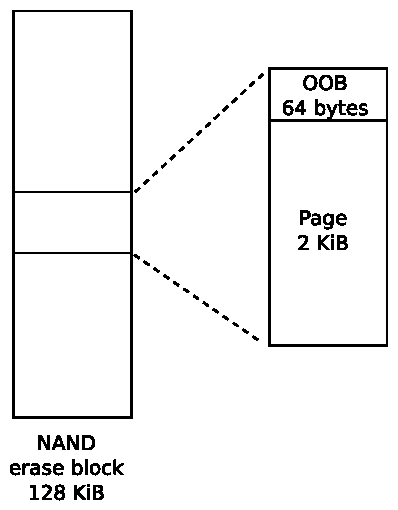
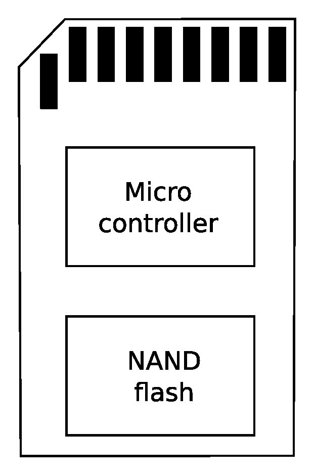
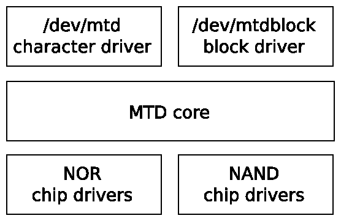
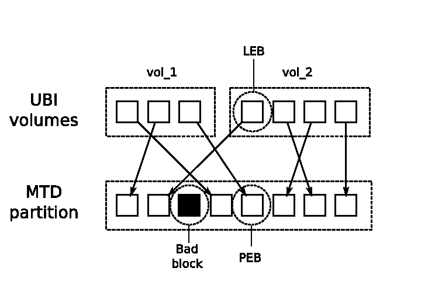
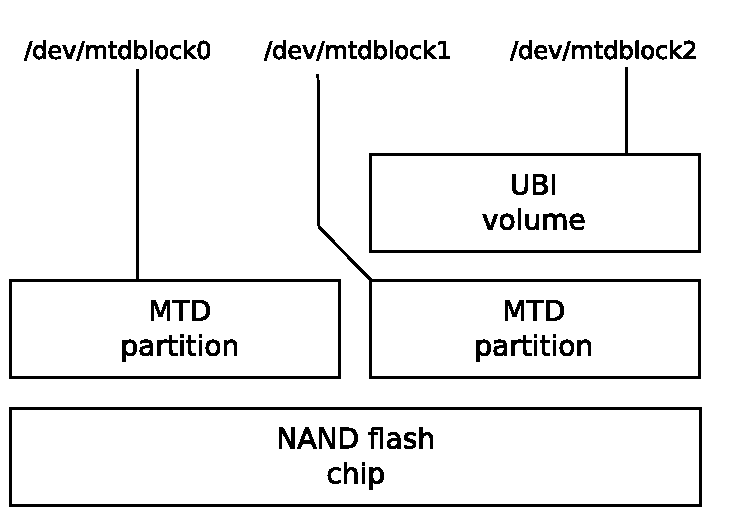
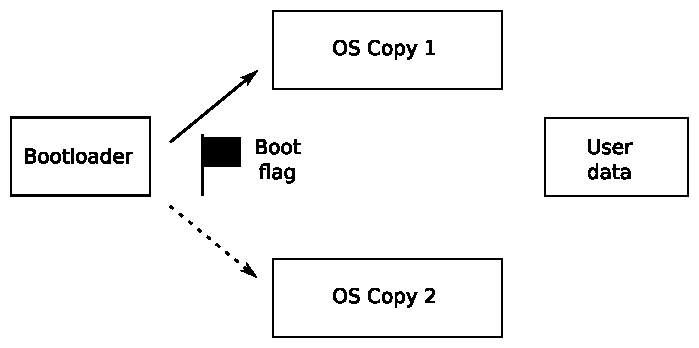
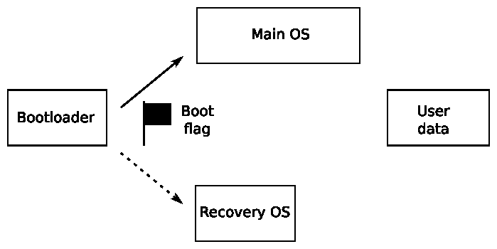

# Chương 7. Tạo chiến lược lưu trữ

Các lựa chọn mass storage cho thiết bị embedded ảnh hưởng lớn đến phần còn lại của hệ thống về độ vững chắc, tốc độ và phương thức cập nhật in-field.

Phần lớn thiết bị dùng flash memory dưới hình thức nào đó. Flash memory đã rẻ đi nhiều trong vài năm qua, trong khi dung lượng tăng từ hàng chục megabyte lên hàng chục gigabyte.

Trong chương này, tôi bắt đầu bằng việc xem chi tiết công nghệ đằng sau flash memory và cách tổ chức memory khác nhau ảnh hưởng đến phần mềm driver cấp thấp phải quản lý nó, bao gồm Linux memory technology device layer, MTD.

Với mỗi công nghệ flash, có các lựa chọn filesystem khác nhau. Tôi sẽ mô tả những loại thường gặp nhất trên thiết bị embedded và kết thúc khảo sát bằng phần tổng hợp lựa chọn cho từng loại flash.

Các phần cuối xét kỹ thuật tận dụng flash memory, cách cập nhật thiết bị sau triển khai, rồi kết hợp mọi thứ thành chiến lược lưu trữ nhất quán.

## Lựa chọn lưu trữ

Thiết bị embedded cần lưu trữ tiêu thụ ít điện, nhỏ gọn về vật lý, vững chắc và đáng tin cậy trong vòng đời có thể hàng chục năm. Trong gần như mọi trường hợp, điều đó nghĩa là solid state storage, được đưa vào từ nhiều năm trước với read-only memory (ROM), nhưng trong 20 năm qua đã là một dạng flash memory. Trong thời gian đó có nhiều thế hệ flash memory, tiến từ NOR sang NAND rồi đến managed flash như eMMC.

NOR flash đắt nhưng đáng tin cậy, có thể được map vào CPU address space, cho phép thực thi code trực tiếp từ flash. Chip NOR flash thuộc loại low-capacity, từ vài megabyte đến khoảng một gigabyte. NAND flash memory rẻ hơn NOR nhiều và có dung lượng cao hơn, từ hàng chục megabyte đến hàng chục gigabyte. Tuy nhiên, nó cần nhiều hỗ trợ hardware và software để trở thành phương tiện lưu trữ hữu ích.

Managed flash memory gồm một hoặc nhiều chip NAND flash đóng gói cùng controller xử lý các phức tạp của flash memory và cung cấp hardware interface tương tự hard disk. Điểm hấp dẫn là nó loại bỏ độ phức tạp khỏi phần mềm driver và cách ly người thiết kế hệ thống khỏi thay đổi thường xuyên của công nghệ flash. SD card, chip eMMC và USB flash drive thuộc nhóm này. Gần như mọi smartphone và tablet thế hệ hiện tại có eMMC storage, và xu hướng đó có khả năng lan sang các loại thiết bị embedded khác.

Hard drive hiếm gặp trong embedded system. Ngoại lệ là ghi video kỹ thuật số trong set-top box và smart TV, nơi cần dung lượng lưu trữ lớn với thời gian ghi nhanh.

Trong mọi trường hợp, độ vững chắc quan trọng hàng đầu: bạn muốn thiết bị boot và đạt trạng thái hoạt động dù bị mất điện hay reset bất ngờ. Nên chọn filesystem hoạt động tốt trong các tình huống đó.

### NOR flash

Memory cell trong chip NOR flash được tổ chức thành erase block, ví dụ 128 KiB. Erase một block đặt mọi bit thành 1. Có thể program từng word (8, 16 hoặc 32 bit tùy độ rộng data bus). Mỗi erase cycle làm memory cell hư hại đôi chút; sau một số chu kỳ, erase block trở nên không đáng tin cậy và không thể dùng nữa. Số erase cycle tối đa phải có trong data sheet chip, nhưng thường nằm trong khoảng 100K đến 1M.

Dữ liệu có thể được đọc từng word. Chip thường được map vào CPU address space, nghĩa là có thể thực thi code trực tiếp từ NOR flash. Vì vậy, đây là nơi thuận tiện để đặt code bootloader, không cần khởi tạo ngoài việc nối cứng address mapping. SoC hỗ trợ NOR flash theo cách này có cấu hình cung cấp memory mapping mặc định bao trùm reset vector của CPU. Kernel, thậm chí root filesystem, cũng có thể nằm trong flash memory, tránh sao chép vào RAM và nhờ đó tạo thiết bị có memory footprint nhỏ. Kỹ thuật này gọi là eXecute In Place, hay XIP. Nó rất chuyên biệt nên tôi không xét thêm ở đây. Có một số tài liệu tham khảo ở cuối chương.

Có giao diện register-level chuẩn cho chip NOR flash gọi là common flash interface, hay CFI, được mọi chip hiện đại hỗ trợ.

### NAND flash

NAND flash rẻ hơn NOR flash nhiều và có dung lượng cao hơn. Chip NAND thế hệ đầu lưu một bit mỗi memory cell theo tổ chức nay gọi là SLC, hay single level cell. Các thế hệ sau chuyển sang hai bit mỗi cell trong chip multi-level cell (MLC), và nay là ba bit mỗi cell trong chip tri-level cell (TLC). Khi số bit mỗi cell tăng, độ tin cậy lưu trữ giảm, đòi hỏi hardware controller và software phức tạp hơn để bù lại.

Giống NOR flash, NAND flash được tổ chức thành erase block kích thước từ 16 KiB đến 512 KiB, và erase một block cũng đặt mọi bit thành 1. Tuy nhiên, số erase cycle trước khi block không đáng tin cậy thấp hơn, thường chỉ 1K chu kỳ với chip TLC và đến 100K với SLC. NAND flash chỉ có thể đọc, ghi theo page, thường 2 hoặc 4 KiB. Vì không thể truy cập byte-by-byte, nó không thể map vào address space, nên code và dữ liệu phải sao chép vào RAM trước khi truy cập.

Truyền dữ liệu đến và đi từ chip dễ gặp bit flip, có thể phát hiện và sửa bằng Error Correction Codes. Chip SLC thường dùng hamming code đơn giản, có thể triển khai hiệu quả bằng software và sửa lỗi một bit trong một lần đọc page. Chip MLC và TLC cần code phức tạp hơn như BCH (Bose-Chaudhuri-Hocquenghem), sửa được đến lỗi 8-bit mỗi page. Những code này cần hardware hỗ trợ. Error correction code phải được lưu ở đâu đó, nên mỗi page có vùng memory bổ sung gọi là out of band (OOB), hay spare area. Thiết kế MLC thường có 1 byte OOB cho mỗi 32 byte lưu trữ chính; vì vậy, thiết bị page 2 KiB có 64 byte OOB mỗi page, còn page 4 KiB có 128 byte. Chip MLC và TLC có vùng OOB lớn hơn theo tỷ lệ để chứa error correction code phức tạp hơn. Sơ đồ sau thể hiện tổ chức chip có erase block 128 KiB và page 2 KiB:



Trong sản xuất, nhà sản xuất kiểm tra mọi block và đánh dấu block lỗi bằng flag trong vùng OOB của từng page thuộc block. Không hiếm khi chip mới hoàn toàn có đến 2% block bị đánh dấu bad như vậy. Hơn nữa, đặc tả cho phép tỷ lệ block tương tự báo lỗi khi erase trước khi đạt giới hạn erase cycle. NAND flash driver phải phát hiện và đánh dấu bad.

Sau khi vùng OOB dành chỗ cho bad block flag và ECC byte, vẫn còn một số byte dư. Một số flash filesystem dùng các byte trống để lưu filesystem metadata. Vì vậy, nhiều thành phần quan tâm bố cục OOB: code boot ROM của SoC, bootloader, kernel MTD driver, code filesystem và công cụ tạo filesystem image. Chuẩn hóa không nhiều, nên dễ gặp tình huống bootloader ghi dữ liệu bằng định dạng OOB mà kernel MTD driver không đọc được. Bạn phải bảo đảm tất cả thống nhất. Truy cập chip NAND flash cần NAND flash controller, thường là một phần SoC. Bạn cần driver tương ứng trong bootloader và kernel. NAND flash controller xử lý hardware interface với chip, truyền dữ liệu đến và đi từ page, và có thể gồm hardware sửa lỗi.

Có giao diện register-level chuẩn cho chip NAND flash gọi là open NAND flash interface, hay ONFi, được phần lớn chip hiện đại tuân theo. Xem `http://www.onfi.org`.

### Managed flash

Gánh nặng hỗ trợ flash memory trong operating system, đặc biệt NAND, giảm đi nếu có hardware interface well-defined và flash controller chuẩn che giấu độ phức tạp của memory. Đó là managed flash memory, ngày càng phổ biến. Về bản chất, nó kết hợp một hoặc nhiều flash chip với microcontroller cung cấp thiết bị lưu trữ lý tưởng có sector size nhỏ, tương thích filesystem thông thường. Những loại managed flash quan trọng nhất cho embedded system là Secure Digital (SD) card và biến thể embedded gọi là eMMC.

#### MultiMediaCard và secure digital card

MultiMediaCard (MMC) được SanDisk và Siemens giới thiệu năm 1997 như dạng lưu trữ đóng gói dùng flash memory. Không lâu sau, năm 1999, SanDisk, Matsushita và Toshiba tạo SD card dựa trên MMC nhưng bổ sung encryption và DRM (đó là phần secure). Cả hai hướng tới điện tử tiêu dùng như máy ảnh số, máy nghe nhạc và thiết bị tương tự. Hiện SD card là dạng managed flash chủ đạo cho điện tử tiêu dùng và embedded, dù tính năng encryption ít được dùng. Phiên bản đặc tả SD mới cho phép đóng gói nhỏ hơn (mini SD và micro SD, thường viết uSD) và dung lượng lớn hơn: high capacity, SDHC, đến 32 GB và extended capacity, SDXC, đến 2 TB. Hardware interface MMC và SD card rất giống nhau; có thể dùng MMC fully-sized trong khe SD card full-sized (nhưng không thể ngược lại). Phiên bản đầu dùng Serial Peripheral Interface (SPI) 1-bit; card mới hơn dùng giao diện 4-bit. Có command set để đọc, ghi memory theo sector 512 byte. Bên trong package có microcontroller và một hoặc nhiều chip NAND flash như sơ đồ sau:



Microcontroller triển khai command set và quản lý flash memory, thực hiện chức năng flash translation layer như mô tả sau trong chương. Card được pre-formatted bằng FAT filesystem: FAT16 trên SDSC, FAT32 trên SDHC và exFAT trên SDXC. Chất lượng chip NAND flash và software trên microcontroller khác nhau rất lớn giữa các card. Khó chắc có card nào đủ tin cậy cho ứng dụng embedded chuyên sâu, và chắc chắn không phải với FAT filesystem vốn dễ hỏng file. Nhớ rằng trường hợp sử dụng chính của MMC và SD card là lưu trữ tháo rời trên máy ảnh, tablet và điện thoại.

#### eMMC

eMMC, hay Embedded MMC, đơn giản là MMC memory được đóng gói để hàn lên motherboard, dùng giao diện 4- hoặc 8-bit truyền dữ liệu. Tuy nhiên, chúng được thiết kế làm lưu trữ cho operating system, nên các thành phần có khả năng thực hiện nhiệm vụ đó. Chip thường không được pre-formatted bằng filesystem nào.

#### Các loại managed flash khác

Một trong những công nghệ managed flash đầu tiên là CompactFlash (CF), dùng tập con giao diện PCMCIA (Personal Computer Memory Card International Association). CF đưa memory ra qua giao diện parallel ATA và xuất hiện với operating system như hard disk chuẩn. Chúng phổ biến trong single board computer x86-based và thiết bị video, camera chuyên nghiệp.

Một định dạng khác chúng ta dùng hằng ngày là USB flash drive. Ở đây, memory được truy cập qua USB interface, controller triển khai đặc tả USB mass storage cùng flash translation layer và giao diện với một hoặc nhiều flash chip. USB mass storage protocol lại dựa trên SCSI disk command set. Giống MMC và SD card, chúng thường được pre-formatted bằng FAT filesystem. Trường hợp sử dụng chính trong embedded system là trao đổi dữ liệu với PC.

Lựa chọn managed flash storage được bổ sung gần đây là universal flash storage (UFS). Giống eMMC, nó được đóng gói thành chip gắn trên motherboard. Nó có serial interface high-speed, đạt data rate lớn hơn eMMC và hỗ trợ SCSI disk command set.

## Truy cập flash memory từ bootloader

Trong Chương 3, Tất cả về bootloader, tôi nhắc đến nhu cầu bootloader nạp kernel binary và image khác từ nhiều thiết bị flash, cũng như thực hiện bảo trì hệ thống như erase và reprogram flash memory. Vì vậy, bootloader phải có driver và hạ tầng hỗ trợ thao tác read, erase, write trên loại memory của bạn, dù là NOR, NAND hay managed. Tôi dùng U-Boot trong ví dụ sau; các bootloader khác làm theo mô hình tương tự.

### U-Boot và NOR flash

U-Boot có driver cho chip NOR CFI trong `drivers/mtd`, cùng lệnh `erase` để erase memory và `cp.b` để sao chép từng byte, program flash. Giả sử NOR flash memory được map từ 0x40000000 đến 0x48000000, trong đó 4MiB bắt đầu ở 0x40040000 là kernel image, thì bạn nạp kernel mới vào flash bằng các lệnh U-Boot:

```
U-Boot# tftpboot 100000 uImage
U-Boot# erase 40040000 403fffff
U-Boot# cp.b 100000 40040000 $(filesize)
```

Variable `filesize` ở ví dụ trên được lệnh `tftpboot` đặt bằng kích thước file vừa tải.

### U-Boot và NAND flash

Với NAND flash, cần driver cho NAND flash controller trên SoC, tìm trong `drivers/mtd/nand`. Bạn dùng lệnh `nand` để quản lý memory bằng các sub-commands `erase`, `write`, `read`. Ví dụ này cho thấy kernel image được nạp vào RAM tại 0x82000000 rồi đưa vào flash từ offset 0x280000:

```
U-Boot# tftpboot 82000000 uImage
U-Boot# nand erase 280000 400000
U-Boot# nand write 82000000 280000 $(filesize)
```

U-Boot cũng có thể đọc file lưu trong filesystem JFFS2, YAFFS2 và UBIFS.

### U-Boot và MMC, SD, eMMC

U-Boot có driver cho một số MMC controller trong `drivers/mmc`. Có thể truy cập raw data bằng `mmc read` và `mmc write` ở mức giao diện người dùng, cho phép xử lý raw kernel và filesystem image.

U-boot cũng có thể đọc file từ filesystem FAT32 và ext4 trên MMC storage.

## Truy cập flash memory từ Linux

Raw NOR và NAND flash memory được memory technology device sub-system, hay MTD, xử lý; nó cung cấp giao diện cơ bản để read, erase, write các block flash memory. Với NAND flash, có hàm xử lý vùng OOB và nhận diện bad block.

Với managed flash, cần driver xử lý hardware interface cụ thể. MMC/SD card và eMMC dùng driver mmcblk; CompactFlash và hard drive dùng SCSI Disk driver, sd. USB flash drive dùng driver usb\_storage cùng driver sd.

### Memory technology device

Memory technology devices (MTD) sub-system được David Woodhouse khởi xướng năm 1999 và phát triển mạnh trong những năm sau. Ở phần này, tôi tập trung vào cách nó xử lý hai công nghệ chính, NOR và NAND flash.

MTD gồm ba layer: tập hàm cốt lõi, tập driver cho các loại chip và các driver user-level cung cấp flash memory dưới dạng character device hoặc block device như sơ đồ:



Chip driver ở mức thấp nhất, giao tiếp với flash chip. Chỉ cần một số ít driver cho chip NOR flash, đủ bao phủ chuẩn CFI và các biến thể cùng một số chip non-compliant nay phần lớn đã lỗi thời. Với NAND flash, cần driver cho NAND flash controller đang dùng, thường được cung cấp trong board support package. Mainline kernel hiện tại có driver cho khoảng 40 controller trong thư mục `drivers/mtd/nand`.

#### MTD partition

Trong phần lớn trường hợp, bạn muốn chia flash memory thành một số vùng, ví dụ dành chỗ cho bootloader, kernel image hoặc root filesystem. MTD có nhiều cách chỉ định kích thước và vị trí partition, những cách chính gồm:

- Qua kernel command line bằng `CONFIG_MTD_CMDLINE_PARTS`

- Qua device tree bằng `CONFIG_MTD_OF_PARTS`

- Bằng platform mapping driver

Với lựa chọn đầu, tùy chọn kernel command line cần dùng là `mtdparts`, được định nghĩa như sau trong source code Linux tại `drivers/mtd/cmdlinepart.c`:

```
mtdparts=<mtddef>[;<mtddef]
<mtddef>  := <mtd-id>:<partdef>[,<partdef>]
<mtd-id>  := unique name for the chip
<partdef> := <size>[@<offset>][<name>][ro][lk]
<size>    := size of partition OR "-" to denote all remaining
             space
<offset>  := offset to the start of the partition; leave blank
             to follow the previous partition without any gap
<name>    := '(' NAME ')'
```

Có lẽ ví dụ sẽ giúp rõ hơn. Giả sử có flash chip 128 MB cần chia thành năm partition. Command line điển hình là:

```
mtdparts=:512k(SPL)ro,780k(U-Boot)ro,128k(U-BootEnv),
4m(Kernel),-(Filesystem)
```

Thành phần đầu trước dấu hai chấm, `:`, là `mtd-id`, xác định flash chip bằng số hoặc tên do board support package gán. Nếu chỉ có một chip như ở đây, có thể để trống. Nếu nhiều chip, thông tin mỗi chip được phân cách bằng dấu chấm phẩy, `;`. Với mỗi chip, có danh sách partition comma-separated, mỗi partition có kích thước bằng byte, kilobyte `k`, hoặc megabyte `m`, và tên trong ngoặc. Suffix `ro` làm partition thành read-only đối với MTD, thường dùng để ngăn vô tình ghi đè bootloader. Kích thước partition cuối có thể thay bằng dấu gạch ngang `-`, nghĩa là chiếm toàn bộ chỗ còn lại.

Bạn có thể xem tổng hợp cấu hình tại runtime bằng cách đọc `/proc/mtd`:

```
# cat /proc/mtd
dev:    size   erasesize   name
mtd0: 00080000 00020000  "SPL"
mtd1: 000C3000 00020000  "U-Boot"
mtd2: 00020000 00020000  "U-BootEnv"
mtd3: 00400000 00020000  "Kernel"
mtd4: 07A9D000 00020000  "Filesystem"
```

Thông tin chi tiết hơn cho mỗi partition nằm trong `/sys/class/mtd`, gồm erase block size và page size, và được tóm tắt rõ bằng `mtdinfo`:

```
# mtdinfo /dev/mtd0
mtd0
Name:                           SPL
Type:                           nand
Eraseblock size:                131072 bytes, 128.0 KiB
Amount of eraseblocks:          4 (524288 bytes, 512.0 KiB)
Minimum input/output unit size: 2048 bytes
Sub-page size:                  512 bytes
OOB size:                       64 bytes
Character device major/minor:   90:0
Bad blocks are allowed:         true
Device is writable:             false
```

Thông tin partition tương đương có thể viết thành một phần device tree như sau:

```
nand@0,0 {
  #address-cells = <1>;
  #size-cells = <1>;
  partition@0 {
    label = "SPL";
    reg = <0 0x80000>;
  };
  partition@80000 {
    label = "U-Boot";
    reg = <0x80000 0xc3000>;
  };
  partition@143000 {
    label = "U-BootEnv";
    reg = <0x143000 0x20000>;
  };
  partition@163000 {
    label = "Kernel";
    reg = <0x163000 0x400000>;
  };
  partition@563000 {
    label = "Filesystem";
    reg = <0x563000 0x7a9d000>;
  };
};
```

Cách thứ ba là viết thông tin partition thành platform data trong structure `mtd_partition`, như ví dụ lấy từ `arch/arm/mach-omap2/board-omap3beagle.c` (NAND\_BLOCK\_SIZE được định nghĩa ở nơi khác là 128K):

```
static struct mtd_partition omap3beagle_nand_partitions[] = {
  {
    .name           = "X-Loader",
    .offset         = 0,
    .size           = 4 * NAND_BLOCK_SIZE,
    .mask_flags     = MTD_WRITEABLE,    /* force read-only */
  },
  {
    .name           = "U-Boot",
    .offset         = 0x80000;
    .size           = 15 * NAND_BLOCK_SIZE,
    .mask_flags     = MTD_WRITEABLE,    /* force read-only */
  },
  {
    .name           = "U-Boot Env",
    .offset         = 0x260000;
    .size           = 1 * NAND_BLOCK_SIZE,
  },
  {
    .name           = "Kernel",
    .offset         = 0x280000;
    .size           = 32 * NAND_BLOCK_SIZE,
  },
  {
    .name           = "File System",
    .offset         = 0x680000;
    .size           = MTDPART_SIZ_FULL,
  },
};
```

#### MTD device driver

Mức trên cùng của MTD sub-system là cặp device driver:

- Character device, có major number 90. Có hai device node cho mỗi MTD partition number: `N: /dev/mtdN` (minor number=N\*2) và `/dev/mtdNro` (minor number=(N\*2 + 1)). Node sau chỉ là phiên bản read-only của node trước.

- Block device, có major number 31 và minor number N. Device node có dạng `/dev/mtdblockN`.

#### MTD character device, mtd

Character device quan trọng nhất: cho phép truy cập flash memory bên dưới như mảng byte để đọc, ghi (program) flash. Nó cũng triển khai một số hàm `ioctl` cho phép erase block và quản lý vùng OOB trên chip NAND. Danh sách sau nằm trong `include/uapi/mtd/mtd-abi.h`:

| IOCTL | Mô tả |
|---|---|
| `MEMGETINFO` | Lấy thông tin đặc tính MTD cơ bản |
| `MEMERASE` | Erase block trong MTD partition |
| `MEMWRITEOOB` | Ghi dữ liệu out-of-band cho page |
| `MEMREADOOB` | Đọc dữ liệu out-of-band cho page |
| `MEMLOCK` | Lock chip (nếu hỗ trợ) |
| `MEMUNLOCK` | Unlock chip (nếu hỗ trợ) |
| `MEMGETREGIONCOUNT` | Lấy số erase region: giá trị non-zero nếu partition có các erase block với kích thước khác nhau, điều phổ biến trên NOR flash nhưng hiếm gặp trên NAND |
| `MEMGETREGIONINFO` | Nếu `MEMGETREGIONCOUNT` là non-zero, có thể dùng để lấy offset, kích thước và số block của mỗi region |
| `MEMGETOOBSEL` | Không còn được khuyến nghị sử dụng |
| `MEMGETBADBLOCK` | Lấy bad block flag |
| `MEMSETBADBLOCK` | Đặt bad block flag |
| `OTPSELECT` | Đặt chế độ OTP (one-time programmable), nếu chip hỗ trợ |
| `OTPGETREGIONCOUNT` | Lấy số OTP region |
| `OTPGETREGIONINFO` | Lấy thông tin về OTP region |
| `ECCGETLAYOUT` | Không còn được khuyến nghị sử dụng |

Có tập tiện ích tên `mtd-utils` để thao tác flash memory, sử dụng các hàm `ioctl` này. Source có tại `http://git.infradead.org/mtd-utils.git`, đồng thời có dạng package trong Yocto Project và Buildroot. Các công cụ thiết yếu được liệt kê dưới đây. Package còn chứa tiện ích cho filesystem JFFS2 và UBI/UBIFS, sẽ được bàn sau. Với mỗi công cụ, MTD character device là một tham số:

- flash\_erase: Erase một dải block.

- flash\_lock: Lock một dải block.

- flash\_unlock: Unlock một dải block.

- nanddump: Dump memory từ NAND flash, có thể gồm vùng OOB. Bỏ qua bad block.

- nandtest: Kiểm thử và chẩn đoán NAND flash.

- nandwrite: Ghi (program) từ data file vào NAND flash, bỏ qua bad block.

Luôn phải erase flash memory trước khi ghi nội dung mới: `flash_erase` là lệnh làm việc đó.

Để program NOR flash, chỉ cần sao chép byte vào MTD device node bằng lệnh `cp` hoặc tương tự.

Tiếc là cách này không hoạt động với NAND memory vì việc sao chép thất bại tại bad block đầu tiên. Thay vào đó, dùng `nandwrite`, nó bỏ qua bad block. Để đọc lại NAND memory, dùng `nanddump`, cũng bỏ qua bad block.

#### MTD block device, mtdblock

Driver mtdblock ít được dùng. Mục đích của nó là cung cấp flash memory dưới dạng block device để format và mount thành filesystem. Tuy nhiên, nó có hạn chế nghiêm trọng vì không xử lý bad block trong NAND flash, không wear leveling và không xử lý chênh lệch kích thước giữa filesystem block với flash erase block. Nói cách khác, nó không có flash translation layer, thứ thiết yếu cho lưu trữ file đáng tin cậy. Trường hợp duy nhất mtdblock hữu ích là mount filesystem read-only như Squashfs trên flash memory đáng tin cậy như NOR.

Nếu muốn một filesystem read-only trên NAND flash, bạn nên dùng UBI driver, như mô tả ở phần sau của chương.

#### Ghi log kernel oops vào MTD

Lỗi kernel, hay oopsies, thường được ghi qua daemon `klogd` và `syslogd` vào circular memory buffer hoặc file. Sau reboot, log mất nếu dùng ring buffer; ngay cả với file, log có thể chưa được ghi đúng trước khi hệ thống crash.

Cách đáng tin cậy hơn là ghi oops và kernel panic vào MTD partition dưới dạng circular log buffer. Bật bằng `CONFIG_MTD_OOPS` và thêm `console=ttyMTDN` vào kernel command line, với `N` là MTD device number để ghi thông báo.

#### Mô phỏng NAND memory

NAND simulator giả lập chip NAND bằng RAM hệ thống. Công dụng chính là kiểm thử code cần NAND-aware khi không có NAND memory vật lý. Đặc biệt, khả năng mô phỏng bad block, bit flip và lỗi khác cho phép kiểm thử code path khó kích hoạt bằng flash memory thật. Để biết thêm, nơi tốt nhất là chính code, nơi có mô tả đầy đủ các cách cấu hình driver. Code nằm trong `drivers/mtd/nand/nandsim.c`. Bật bằng cấu hình kernel `CONFIG_MTD_NAND_NANDSIM`.

### MMC block driver

MMC/SD card và chip eMMC được truy cập bằng block driver mmcblk. Bạn cần host controller phù hợp MMC adapter đang dùng, nằm trong board support package. Driver ở source code Linux trong `drivers/mmc/host`.

MMC storage được chia partition bằng partition table giống hệt hard disk, dùng fdisk hoặc tiện ích tương tự.

## Filesystem cho flash memory

Có nhiều thách thức khi dùng flash memory hiệu quả cho mass storage: chênh lệch kích thước erase block và disk sector, giới hạn erase cycle mỗi erase block, và nhu cầu xử lý bad block trên chip NAND. Những khác biệt này được giải quyết tổng thể bằng Flash Translation Layer, hay FTL.

### Flash translation layer

Flash translation layer có các tính năng sau:

- Sub allocation: Filesystem hoạt động tốt nhất với allocation unit nhỏ, truyền thống là sector 512-byte. Nó nhỏ hơn nhiều flash erase block 128 KiB hoặc hơn. Vì vậy, erase block phải được sub-divided thành đơn vị nhỏ hơn để tránh lãng phí lượng lớn dung lượng.

- Garbage collection: Hệ quả của sub-allocation là erase block chứa hỗn hợp dữ liệu tốt và dữ liệu cũ sau khi filesystem được dùng một thời gian. Vì chỉ giải phóng được toàn erase block, cách duy nhất thu hồi chỗ trống là gom dữ liệu tốt vào một nơi rồi trả erase block nay đã trống về free list: đó là garbage collection, thường triển khai bằng background thread.

- Wear leveling: Số erase cycle của mỗi block có giới hạn. Để tối đa hóa tuổi thọ chip, cần di chuyển dữ liệu sao cho mỗi block được xóa với số lần gần bằng nhau.

- Bad block handling: Với chip NAND flash, phải tránh dùng block được đánh dấu bad và cũng đánh dấu good block thành bad nếu không thể erase.

- Độ vững chắc: Thiết bị embedded có thể tắt điện hay reset không báo trước, nên filesystem phải chịu được mà không hỏng, thường bằng cách tích hợp journal hoặc log transaction.

Có nhiều cách triển khai flash translation layer:

- Trong filesystem: Như JFFS2, YAFFS2 và UBIFS

- Trong block device driver: UBI driver, nơi UBIFS phụ thuộc, triển khai một số khía cạnh flash translation layer

- Trong device controller: Như thiết bị managed flash

Khi flash translation layer nằm trong filesystem hoặc block driver, code thuộc kernel nên là open source; chúng ta xem được cách hoạt động và có thể kỳ vọng được cải thiện theo thời gian. Ngược lại, FTL nằm trong thiết bị managed flash bị che khuất, không thể kiểm chứng có hoạt động như mong muốn hay không. Hơn nữa, đưa FTL vào disk controller khiến nó thiếu thông tin chỉ có ở filesystem layer, chẳng hạn sector nào thuộc file đã xóa nên không còn chứa dữ liệu hữu ích. Vấn đề sau được giải quyết bằng cách thêm lệnh truyền thông tin giữa filesystem và thiết bị, sẽ mô tả trong phần lệnh `TRIM` sau đây; nhưng vấn đề khả năng thấy code vẫn còn. Nếu dùng managed flash, bạn chỉ có thể chọn nhà sản xuất đáng tin.

## Filesystem cho NOR và NAND flash memory

Để dùng raw flash chip làm mass storage, phải dùng filesystem hiểu đặc thù công nghệ bên dưới. Có ba filesystem như vậy:

- Journaling Flash File System 2, JFFS2: Flash filesystem đầu tiên cho Linux, vẫn dùng ngày nay. Nó hoạt động với NOR và NAND memory, nhưng nổi tiếng chậm khi mount.

- Yet Another Flash File System 2, YAFFS2: Tương tự JFFS2, nhưng riêng cho NAND flash memory. Google chọn nó làm raw flash filesystem ưu tiên trên thiết bị Android.

- Unsorted Block Image File System, UBIFS: Filesystem flash-aware mới nhất cho cả NOR và NAND memory, dùng cùng UBI block driver. Nó thường có hiệu năng tốt hơn JFFS2 hay YAFFS2, nên nên được ưu tiên cho thiết kế mới.

Tất cả đều dùng MTD làm giao diện chung tới flash memory.

### JFFS2

Journaling Flash File System bắt đầu trong software của network camera Axis 2100 năm 1999. Nhiều năm, nó là flash filesystem duy nhất cho Linux, được triển khai trên hàng nghìn loại thiết bị khác nhau. Ngày nay không còn là lựa chọn tốt nhất, nhưng tôi trình bày trước vì nó cho thấy điểm khởi đầu của quá trình tiến hóa.

JFFS2 là filesystem log-structured dùng MTD truy cập flash memory. Trong filesystem log-structured, thay đổi được ghi tuần tự thành node vào flash memory. Node có thể chứa thay đổi directory, như tên file được tạo và xóa, hoặc thay đổi dữ liệu file. Sau một thời gian, node có thể bị thay thế bởi thông tin trong node tiếp theo và trở thành obsolete node.

Erase block được chia thành ba loại:

- free: Hoàn toàn không chứa node

- clean: Chỉ chứa node hợp lệ

- dirty: Chứa ít nhất một obsolete node

Tại mỗi thời điểm, có một block nhận cập nhật, gọi là open block. Nếu mất điện hoặc reset hệ thống, dữ liệu duy nhất có thể mất là lần ghi cuối vào open block. Ngoài ra, node được nén khi ghi, tăng dung lượng lưu trữ hiệu dụng của flash chip; điều này quan trọng nếu dùng NOR flash memory đắt tiền.

Khi số free block xuống dưới ngưỡng, kernel thread garbage collector được khởi chạy, quét dirty block và sao chép node hợp lệ vào open block, sau đó giải phóng dirty block. Đồng thời, garbage collector cung cấp dạng wear leveling đơn giản vì luân chuyển dữ liệu hợp lệ giữa các block. Cách chọn open block khiến mỗi block được erase số lần gần bằng nhau, miễn là chứa dữ liệu thỉnh thoảng thay đổi. Đôi khi clean block được chọn cho garbage collection để bảo đảm block chứa dữ liệu static hiếm khi ghi cũng được wear leveling.

Filesystem JFFS2 có write through cache, nghĩa là ghi đồng bộ vào flash memory như khi mount bằng tùy chọn `-o sync`. Điều này tăng độ tin cậy nhưng kéo dài thời gian ghi. Còn có vấn đề với lần ghi nhỏ: nếu độ dài lần ghi tương đương kích thước node header (40 byte), overhead trở nên lớn. Trường hợp đặc biệt well-known là log file, ví dụ do syslogd tạo.

#### Summary node

JFFS2 có một nhược điểm nổi trội: vì không có index on-chip, phải suy ra cấu trúc directory tại mount-time bằng cách đọc log từ đầu đến cuối. Kết thúc quét, bạn có bức tranh đầy đủ về cấu trúc directory của node hợp lệ, nhưng thời gian tỷ lệ với kích thước partition. Không hiếm thời gian mount cỡ một giây mỗi megabyte, dẫn tới tổng thời gian hàng chục hoặc hàng trăm giây.

Để giảm thời gian quét khi mount, summary node trở thành tùy chọn trong Linux 2.6.15. Summary node được ghi ở cuối open erase block ngay trước khi đóng. Nó chứa mọi thông tin cần cho quét mount-time, giảm lượng dữ liệu phải xử lý. Summary node có thể giảm thời gian mount từ hai đến năm lần, đổi lại overhead khoảng 5% dung lượng lưu trữ. Chúng được bật bằng cấu hình kernel `CONFIG_JFFS2_SUMMARY`.

#### Clean marker

Block đã erase có mọi bit bằng 1 không thể phân biệt với block được ghi toàn 1, nhưng trường hợp sau memory cell chưa được làm mới và không thể program lại cho đến khi erase. JFFS2 dùng cơ chế clean marker để phân biệt hai tình huống. Sau khi erase block thành công, clean marker được ghi vào đầu block hoặc vùng OOB của page đầu. Nếu có clean marker thì đó phải là clean block.

#### Tạo filesystem JFFS2

Tạo filesystem JFFS2 trống tại runtime đơn giản là erase MTD partition có clean marker rồi mount. Không có bước format vì filesystem JFFS2 trống hoàn toàn gồm free block. Ví dụ, để format MTD partition 6, nhập các lệnh sau trên thiết bị:

```
# flash_erase -j /dev/mtd6 0 0
# mount -t jffs2 mtd6 /mnt
```

Tùy chọn `-j` của `flash_erase` thêm clean marker; mount với type `jffs2` sẽ cung cấp partition như filesystem trống. Lưu ý thiết bị mount được ghi là `mtd6`, không phải `/dev/mtd6`. Hoặc có thể dùng block device node `/dev/mtdblock6`. Đây chỉ là đặc điểm riêng JFFS2. Sau mount, có thể dùng như mọi filesystem; khi boot và mount lần sau, tất cả file vẫn còn.

Có thể tạo filesystem image trực tiếp từ staging area trên hệ thống phát triển bằng `mkfs.jffs2` để ghi file ở định dạng JFFS2 và `sumtool` để thêm summary node. Cả hai thuộc package `mtd-utils`.

Ví dụ, để tạo image các file trong `rootfs` cho thiết bị NAND flash có erase block size 128 KB (0x20000) và summary node, dùng hai lệnh:

```
$ mkfs.jffs2 -n -e 0x20000 -p -d ~/rootfs -o ~/rootfs.jffs2
$ sumtool -n -e 0x20000 -p -i ~/rootfs.jffs2 -o ~/rootfs-sum.jffs2
```

Tùy chọn `-p` thêm padding vào cuối image file để kích thước bằng số nguyên erase block. Tùy chọn `-n` ngăn tạo clean marker trong image, bình thường với thiết bị NAND vì clean marker nằm trong OOB. Với NOR, bỏ tùy chọn `-n`. Có thể dùng device table với `mkfs.jffs2` để đặt permission và ownership file bằng cách thêm `-D` \[device table\]. Dĩ nhiên Buildroot và Yocto Project làm tất cả việc này cho bạn.

Bạn có thể program image vào flash memory từ bootloader. Ví dụ, nếu đã nạp filesystem image vào RAM tại địa chỉ 0x82000000 và muốn nạp vào flash partition bắt đầu cách đầu flash chip 0x163000 byte, dài 0x7a9d000 byte, các lệnh U-Boot là:

```
nand erase clean 163000 7a9d000
nand write 82000000 163000 7a9d000
```

Có thể làm tương tự từ Linux bằng driver mtd như sau:

```
# flash_erase -j /dev/mtd6 0 0
# nandwrite /dev/mtd6 rootfs-sum.jffs2
```

Để boot với root filesystem JFFS2, cần truyền thiết bị `mtdblock` cho partition cùng root `fstype` trên kernel command line, vì JFFS2 không thể auto-detected:

```
root=/dev/mtdblock6 rootfstype=jffs2
```

### YAFFS2

Filesystem YAFFS được Charles Manning bắt đầu viết năm 2001, riêng để xử lý chip NAND flash vào lúc JFFS2 chưa hỗ trợ. Các thay đổi sau nhằm hỗ trợ page lớn hơn (2 KiB) dẫn tới YAFFS2. Website YAFFS là `http://www.yaffs.net`.

YAFFS cũng là filesystem log-structured theo cùng nguyên tắc thiết kế JFFS2. Các quyết định thiết kế khác giúp quét mount-time nhanh hơn, garbage collection đơn giản, nhanh hơn, và không có compression, tăng tốc đọc ghi nhưng sử dụng dung lượng kém hiệu quả hơn.

YAFFS không giới hạn ở Linux; nó được port sang nhiều operating system. Nó có giấy phép kép: GPLv2 để tương thích Linux và giấy phép thương mại cho operating system khác. Tiếc rằng code YAFFS chưa bao giờ merge vào mainline Linux, nên bạn phải patch kernel như code sau.

Để lấy YAFFS2 và patch kernel, bạn làm:

```
$ git clone git://www.aleph1.co.uk/yaffs2
$ cd yaffs2
$ ./patch-ker.sh c m <path to your link source>
```

Sau đó, cấu hình kernel bằng `CONFIG_YAFFS_YAFFS2`.

#### Tạo filesystem YAFFS2

Giống JFFS2, để tạo filesystem YAFFS2 tại runtime, chỉ cần erase partition rồi mount; nhưng lưu ý lần này không bật clean marker:

```
# flash_erase /dev/mtd/mtd6 0 0
# mount -t yaffs2 /dev/mtdblock6 /mnt
```

Để tạo filesystem image, đơn giản nhất là dùng công cụ `mkyaffs2` từ `https://code.google.com/p/yaffs2utils` bằng lệnh:

```
$ mkyaffs2 -c 2048 -s 64 rootfs rootfs.yaffs2
```

Ở đây `-c` là page size và `-s` là OOB size. Có công cụ tên `mkyaffs2image` thuộc code YAFFS, nhưng có vài nhược điểm. Thứ nhất, page và OOB size được hard-coded trong source: bạn phải sửa và biên dịch lại nếu memory không khớp mặc định 2.048 và 64. Thứ hai, bố cục OOB không tương thích MTD, dùng hai byte đầu làm bad block marker, trong khi `mkyaffs2image` dùng chúng lưu một phần YAFFS metadata.

Để sao chép image vào MTD partition từ Linux shell prompt, làm các bước:

```
# flash_erase /dev/mtd6 0 0
# nandwrite -a /dev/mtd6 rootfs.yaffs2
```

Để boot với root filesystem YAFFS2, thêm vào kernel command line:

```
root=/dev/mtdblock6 rootfstype=yaffs2
```

### UBI và UBIFS

Driver unsorted block image (UBI) là volume manager cho flash memory, xử lý bad block và wear leveling. Nó được Artem Bityutskiy triển khai và xuất hiện lần đầu trong Linux 2.6.22. Song song, các kỹ sư Nokia phát triển filesystem tận dụng tính năng UBI, gọi là UBIFS; nó xuất hiện trong Linux 2.6.27. Chia flash translation layer theo cách này giúp code module hóa hơn, đồng thời cho phép filesystem khác tận dụng UBI driver như sẽ thấy sau.

#### UBI

UBI cung cấp góc nhìn lý tưởng, đáng tin cậy về flash chip bằng cách map physical erase block (PEB) sang logical erase block (LEB). Bad block không được map sang LEB nên không bao giờ dùng. Nếu block không erase được, nó bị đánh dấu bad và loại khỏi mapping. UBI giữ số lần mỗi PEB được erase trong header của LEB và đổi mapping để bảo đảm mỗi PEB được erase số lần bằng nhau. UBI truy cập flash memory qua MTD layer. Tính năng bổ sung là chia MTD partition thành một số UBI volume, cải thiện wear leveling như sau. Giả sử có hai filesystem, một chứa dữ liệu tương đối static, ví dụ root filesystem, còn một chứa dữ liệu liên tục thay đổi. Nếu lưu trên MTD partition riêng, wear leveling chỉ tác động vùng thứ hai; nếu lưu trong hai UBI volume cùng một MTD partition, wear leveling diễn ra trên cả hai vùng và tuổi thọ flash memory tăng. Sơ đồ sau minh họa tình huống:



Theo cách này, UBI đáp ứng hai yêu cầu flash translation layer: wear leveling và bad block handling.

Để chuẩn bị MTD partition cho UBI, không dùng `flash_erase` như JFFS2 và YAFFS2, mà dùng tiện ích `ubiformat`, giữ nguyên erase count lưu trong PED header. `ubiformat` cần biết đơn vị IO nhỏ nhất, với phần lớn NAND flash chip là page size, nhưng một số chip cho phép đọc ghi sub page bằng một nửa hoặc một phần tư page size. Xem data sheet chip để biết chi tiết; nếu chưa chắc, dùng page size. Ví dụ này chuẩn bị `mtd6` với page size 2.048 byte:

```
# ubiformat /dev/mtd6 -s 2048
```

Bạn dùng lệnh `ubiattach` để load UBI driver trên một MTD partition đã được chuẩn bị theo cách này:

```
# ubiattach -p /dev/mtd6 -O 2048
```

Thao tác tạo device node `/dev/ubi0`, qua đó truy cập UBI volume. Có thể dùng `ubiattach` nhiều lần cho MTD partition khác, khi đó truy cập qua `/dev/ubi1`, `/dev/ubi2`, v.v. Mapping PEB sang LEB được nạp vào memory trong attach phase, mất thời gian tỷ lệ số PEB, thường vài giây. Linux 3.7 thêm tính năng UBI fastmap, định kỳ checkpoint mapping xuống flash để giảm attach time. Tùy chọn cấu hình kernel là `CONFIG_MTD_UBI_FASTMAP`.

Lần đầu attach MTD partition sau `ubiformat` sẽ chưa có volume. Có thể tạo bằng `ubimkvol`. Ví dụ, giả sử MTD partition 128MB cần chia thành hai volume 32 MB và 96 MB, dùng chip có erase block 128 KB và page 2 KB:

```
# ubimkvol /dev/ubi0 -N vol_1 -s 32MiB
# ubimkvol /dev/ubi0 -N vol_2 -s 96MiB
```

Bây giờ, bạn có các device node `/dev/ubi0_0` và `/dev/ubi0_1`. Bạn có thể xác nhận trạng thái bằng `ubinfo`:

```
# ubinfo -a /dev/ubi0
ubi0
Volumes count:                           2
Logical eraseblock size:                 15360 bytes, 15.0 KiB
Total amount of logical eraseblocks:     8192 (125829120 bytes,
120.0 MiB)
Amount of available logical eraseblocks: 0 (0 bytes)
Maximum count of volumes                 89
Count of bad physical eraseblocks:       0
Count of reserved physical eraseblocks:  160
Current maximum erase counter value:     1
Minimum input/output unit size:          512 bytes
Character device major/minor:            250:0
Present volumes:                         0, 1
Volume ID:   0 (on ubi0)
Type:        dynamic
Alignment:   1
Size:        2185 LEBs (33561600 bytes, 32.0 MiB)
State:       OK
Name:        vol_1
Character device major/minor: 250:1
-----------------------------------
Volume ID:   1 (on ubi0)
Type:        dynamic
Alignment:   1
Size:        5843 LEBs (89748480 bytes, 85.6 MiB)
State:       OK
Name:        vol_2
Character device major/minor: 250:2
```

Lưu ý rằng mỗi LEB có một header chứa meta information mà UBI sử dụng, nên LEB nhỏ hơn PEB một page. Chẳng hạn, một chip có PEB size 128 KB và page 2 KB sẽ có LEB 126 KB. Đây là thông tin quan trọng bạn cần khi tạo UBIFS image.

#### UBIFS

UBIFS dùng UBI volume để tạo filesystem vững chắc. Nó thêm sub-allocation và garbage collection để tạo flash translation layer hoàn chỉnh. Khác JFFS2 và YAFFS2, nó lưu index information on-chip nên mount nhanh, dù đừng quên attach UBI volume trước đó có thể mất thời gian đáng kể. Nó còn cho phép write-back caching như disk filesystem thông thường, nghĩa là ghi nhanh hơn nhiều, nhưng có vấn đề quen thuộc là có thể mất dữ liệu chưa flush từ cache xuống flash memory khi mất điện. Có thể giải quyết bằng cách dùng cẩn thận các hàm `fsync(2)` và `fdatasync(2)` để buộc flush dữ liệu file tại thời điểm quan trọng.

UBIFS có journal để phục hồi nhanh khi mất điện. Journal chiếm dung lượng, thường 4 MiB hoặc hơn, nên UBIFS không phù hợp thiết bị flash rất nhỏ.

Sau khi tạo các UBI volume, bạn có thể mount chúng bằng device node của volume, `/dev/ubi0_0`, hoặc bằng device node của toàn bộ partition kèm volume name, như sau:

```
# mount -t ubifs ubi0:vol_1 /mnt
```

Tạo filesystem image cho UBIFS là quy trình two-stage: trước tiên tạo UBIFS image bằng `mkfs.ubifs`, rồi đưa vào UBI volume bằng `ubinize`.

Ở giai đoạn đầu, `mkfs.ubifs` cần được cung cấp page size bằng `-m`, kích thước UBI LEB bằng `-e` (hãy nhớ rằng LEB thường nhỏ hơn PEB một page), và số erase block tối đa trong volume bằng `-c`. Nếu volume đầu tiên có kích thước 32 MiB và mỗi erase block là 128 KiB, số erase block sẽ là 256. Vì vậy, để lấy nội dung directory rootfs và tạo UBIFS image có tên `rootfs.ubi`, bạn nhập lệnh sau:

```
$ mkfs.ubifs -r rootfs -m 2048 -e 126KiB -c 256 -o rootfs.ubi
```

Bước thứ hai cần tạo file cấu hình cho `ubinize`, mô tả đặc tính từng volume trong image. Trang trợ giúp (`ubinize -h`) cho biết chi tiết định dạng. Ví dụ này tạo hai volume `vol_1` và `vol_2`:

```
[ubifsi_vol_1]
mode=ubi
image=rootfs.ubi
vol_id=0
vol_name=vol_1
vol_size=32MiB
vol_type=dynamic

[ubifsi_vol_2]
mode=ubi
image=data.ubi
vol_id=1
vol_name=vol_2
vol_type=dynamic
vol_flags=autoresize
```

Volume thứ hai có flag auto-resize nên mở rộng để lấp chỗ còn lại trên MTD partition. Chỉ một volume được có flag này. Từ thông tin đó, `ubinize` tạo image file có tên qua tham số `-o`, PEB size `-p`, page size `-m` và sub-page size `-s`:

```
$ ubinize -o ~/ubi.img -p 128KiB -m 2048 -s 512 ubinize.cfg
```

Để cài image lên target, nhập các lệnh sau trên target:

```
# ubiformat /dev/mtd6 -s 2048
# nandwrite /dev/mtd6 /ubi.img
# ubiattach -p /dev/mtd6 -O 2048
```

Nếu muốn boot với UBIFS root filesystem, bạn cung cấp các kernel command line parameter sau:

```
ubi.mtd=6 root=ubi0:vol_1 rootfstype=ubifs
```

## Filesystem cho managed flash

Khi xu hướng sử dụng công nghệ managed flash tiếp tục phát triển, đặc biệt là eMMC, chúng ta cần xem xét cách dùng chúng hiệu quả. Mặc dù có vẻ mang các đặc tính giống hard disk drive, một số NAND flash chip có những hạn chế về erase block lớn, erase cycle hữu hạn và xử lý bad block. Và dĩ nhiên, chúng ta cần hệ thống vững chắc khi xảy ra mất nguồn.

Có thể dùng mọi disk filesystem thông thường, nhưng nên chọn loại giảm disk write và khởi động lại nhanh sau shutdown ngoài dự kiến, thường nhờ journal.

### Flashbench

Để dùng flash memory bên dưới tối ưu, cần biết erase block size và page size. Nhà sản xuất thường không công bố các số này, nhưng có thể suy ra bằng quan sát hành vi chip hoặc card.

Flashbench là công cụ như vậy. Ban đầu do Arnd Bergman viết, như bài LWN tại `http://lwn.net/Articles/428584` mô tả. Lấy code từ `https://github.com/bradfa/flashbench`.

Đây là lần chạy điển hình trên SDHC card SanDisk GiB:

```
$ sudo ./flashbench -a  /dev/mmcblk0 --blocksize=1024
align 536870912 pre 4.38ms  on 4.48ms   post 3.92ms  diff 332µs
align 268435456 pre 4.86ms  on 4.9ms    post 4.48ms  diff 227µs
align 134217728 pre 4.57ms  on 5.99ms   post 5.12ms  diff 1.15ms
align 67108864  pre 4.95ms  on 5.03ms   post 4.54ms  diff 292µs
align 33554432  pre 5.46ms  on 5.48ms   post 4.58ms  diff 462µs
align 16777216  pre 3.16ms  on 3.28ms   post 2.52ms  diff 446µs
align 8388608   pre 3.89ms  on 4.1ms    post 3.07ms  diff 622µs
align 4194304   pre 4.01ms  on 4.89ms   post 3.9ms   diff 940µs
align 2097152   pre 3.55ms  on 4.42ms   post 3.46ms  diff 917µs
align 1048576   pre 4.19ms  on 5.02ms   post 4.09ms  diff 876µs
align 524288    pre 3.83ms  on 4.55ms   post 3.65ms  diff 805µs
align 262144    pre 3.95ms  on 4.25ms   post 3.57ms  diff 485µs
align 131072    pre 4.2ms   on 4.25ms   post 3.58ms  diff 362µs
align 65536     pre 3.89ms  on 4.24ms   post 3.57ms  diff 511µs
align 32768     pre 3.94ms  on 4.28ms   post 3.6ms   diff 502µs
align 16384     pre 4.82ms  on 4.86ms   post 4.17ms  diff 372µs
align 8192      pre 4.81ms  on 4.83ms   post 4.16ms  diff 349µs
align 4096      pre 4.16ms  on 4.21ms   post 4.16ms  diff 52.4µs
align 2048      pre 4.16ms  on 4.16ms   post 4.17ms  diff 9ns
```

Flashbench đọc block, ở đây 1.024 byte, ngay trước và sau các ranh giới power-of-two. Khi vượt ranh giới page hoặc erase block, lần đọc sau ranh giới lâu hơn. Cột ngoài cùng bên phải cho biết chênh lệch và đáng quan tâm nhất. Đọc từ dưới lên, có bước nhảy lớn ở 4 KiB, nhiều khả năng là page size. Có bước nhảy thứ hai từ 52.4µs lên 349µs tại 8 KiB. Điều này khá phổ biến, cho biết card có thể dùng truy cập multi-plane để đọc hai page 4 KiB cùng lúc. Sau đó, khác biệt ít rõ hơn, nhưng có bước nhảy rõ từ 485µs lên 805µs tại 512 KiB, có lẽ là erase block size. Với card được kiểm thử khá cũ, đây là những con số có thể dự kiến.

### Discard và TRIM

Thông thường, khi xóa file, chỉ directory node đã sửa được ghi xuống storage, còn sector chứa nội dung file giữ nguyên. Khi flash translation layer nằm trong disk controller như managed flash, nó không biết nhóm disk sector này không còn chứa dữ liệu hữu ích nên cuối cùng vẫn sao chép dữ liệu cũ.

Vài năm qua, việc thêm transaction truyền thông tin về sector đã xóa xuống disk controller đã cải thiện tình hình. Đặc tả SCSI và SATA có lệnh `TRIM`, MMC có lệnh tương tự tên `ERASE`. Trong Linux, tính năng gọi là `discard`.

Để dùng `discard`, cần storage device hỗ trợ nó – phần lớn chip eMMC hiện tại có – và Linux device driver tương ứng. Kiểm tra bằng các tham số block system queue trong `/sys/block/<block device>/queue/`. Những tham số đáng quan tâm:

- `discard_granularity`: Kích thước allocation unit nội bộ của thiết bị

- `discard_max_bytes`: Số byte tối đa có thể discard trong một lần

- `discard_zeroes_data`: Nếu là `1`, dữ liệu đã discard được đặt thành zero

Nếu thiết bị hoặc device driver không hỗ trợ `discard`, mọi giá trị này bằng zero. Đây là các tham số thấy từ chip eMMC trên BeagleBone Black:

```
# grep -s "" /sys/block/mmcblk0/queue/discard_*
/sys/block/mmcblk0/queue/discard_granularity:2097152
/sys/block/mmcblk0/queue/discard_max_bytes:2199023255040
/sys/block/mmcblk0/queue/discard_zeroes_data:1
```

Có thêm thông tin trong file tài liệu kernel `Documentation/block/queue-sysfs.txt`.

Có thể bật `discard` khi mount filesystem bằng cách thêm tùy chọn `-o discard` vào lệnh `mount`. Cả ext4 và F2FS hỗ trợ.

Bảo đảm storage device hỗ trợ `discard` trước khi dùng tùy chọn `-o discard mount`, nếu không có thể mất dữ liệu.

Cũng có thể buộc `discard` từ command line độc lập với cách mount partition, bằng lệnh `fstrim` thuộc package `util-linux`. Thông thường, chạy định kỳ, có lẽ mỗi tuần, để giải phóng chỗ không dùng. `fstrim` hoạt động trên filesystem đã mount; để trim root filesystem `/`, gõ:

```
# fstrim -v /
/: 2061000704 bytes were trimmed
```

Ví dụ trước dùng verbose option `-v` để in số byte có khả năng được giải phóng. Trong trường hợp này, 2.061.000.704 là lượng dung lượng trống xấp xỉ trong filesystem, nên đó là lượng storage tối đa có thể đã được giải phóng.

### Ext4

Extended filesystem, ext, là filesystem chính cho Linux desktop từ năm 1992. Phiên bản hiện tại ext4 rất ổn định, đã kiểm thử kỹ và có journal giúp phục hồi nhanh, phần lớn ít rắc rối sau shutdown ngoài dự kiến. Đây là lựa chọn tốt cho managed flash device và là filesystem ưu tiên cho thiết bị Android có eMMC storage. Nếu thiết bị hỗ trợ `discard`, nên mount với tùy chọn `-o discard`.

Để format và tạo filesystem ext4 tại runtime, gõ:

```
# mkfs.ext4 /dev/mmcblk0p2
# mount -t ext4 -o discard /dev/mmcblk0p1 /mnt
```

Để tạo filesystem image, có thể dùng tiện ích `genext2fs` tại `http://genext2fs.sourceforge.net`. Trong ví dụ, tôi chỉ định block size bằng `-B` và số block trong image bằng `-b`:

```
$ genext2fs -B 1024 -b 10000 -d rootfs rootfs.ext4
```

`genext2fs` có thể dùng device table đặt permission và ownership file như Chương 5, Xây dựng root filesystem, bằng `-D [file table]`.

Như tên cho thấy, nó thực tế tạo image định dạng `.ext2`. Có thể nâng cấp bằng `tune2fs` như sau (chi tiết tùy chọn lệnh nằm trong trang hướng dẫn của `tune2fs`):

```
$ tune2fs -j -J size=1 -O filetype,extents,uninit_bg,dir_index
rootfs.ext4
$ e2fsck -pDf rootfs.ext4
```

Cả Yocto Project và Buildroot dùng chính xác các bước này khi tạo image định dạng `.ext4`.

Dù journal hữu ích cho thiết bị có thể mất điện không báo trước, nó thêm write cycle vào mỗi write transaction, làm mòn flash memory. Nếu thiết bị battery-powered, đặc biệt pin không tháo rời, khả năng mất điện ngoài dự kiến thấp, nên có thể muốn bỏ journal.

### F2FS

Flash-Friendly File System, F2FS, là filesystem log-structured thiết kế cho managed flash device, đặc biệt eMMC và SD. Samsung viết nó và nó được merge vào mainline Linux 3.8. Nó được đánh dấu experimental, cho biết chưa triển khai rộng, nhưng có vẻ một số thiết bị Android đang dùng.

F2FS tính đến page và erase block size, cố căn dữ liệu theo các ranh giới này. Định dạng log đem lại khả năng chịu mất điện và hiệu năng ghi tốt, trong vài kiểm thử cải thiện two-fold so với ext4. Có mô tả tốt về thiết kế F2FS trong tài liệu kernel `Documentation/filesystems/f2fs.txt` và tài liệu tham khảo cuối chương.

Tiện ích `mfs2.fs2` tạo filesystem F2FS trống với label `-l`:

```
# mkfs.f2fs -l rootfs /dev/mmcblock0p1
# mount -t f2fs /dev/mmcblock0p1 /mnt
```

Hiện chưa có công cụ tạo filesystem image F2FS off-line.

### FAT16/32

Filesystem cũ của Microsoft, FAT16 và FAT32, tiếp tục quan trọng như định dạng chung được phần lớn operating system hiểu. Khi mua SD card hay USB flash drive, gần như chắc chắn được format FAT32; đôi khi microcontroller on-card được tối ưu cho kiểu truy cập FAT32. Ngoài ra, một số boot ROM yêu cầu FAT partition cho second stage bootloader, ví dụ chip TI OMAP-based. Tuy nhiên, định dạng FAT chắc chắn không phù hợp lưu file quan trọng vì dễ hỏng và sử dụng dung lượng kém. Linux hỗ trợ FAT16 qua filesystem `msdos`, cả FAT32 và FAT16 qua filesystem `vfat`. Phần lớn trường hợp cần thêm driver `vfat`. Sau đó, để mount thiết bị, ví dụ SD card trên hardware adapter `mmc` thứ hai, gõ:

```
# mount -t vfat /dev/mmcblock1p1 /mnt
```

Trong quá khứ đã có vấn đề giấy phép với driver `vfat`, có thể (hoặc không) vi phạm bằng sáng chế Microsoft.

FAT32 giới hạn device size 32 GiB. Thiết bị dung lượng lớn hơn có thể format bằng Microsoft exFAT, và SDXC card bắt buộc dùng nó. Không có kernel driver cho exFAT, nhưng có thể hỗ trợ bằng FUSE driver user-space. Vì exFAT thuộc sở hữu Microsoft, hỗ trợ định dạng này trên thiết bị chắc chắn có hệ quả cấp phép.

## Filesystem nén Read-only

Nén dữ liệu hữu ích nếu không đủ storage chứa mọi thứ. JFFS2 và UBIFS đều mặc định nén dữ liệu on-the-fly. Tuy nhiên, nếu file không bao giờ được ghi, như root filesystem thường gặp, có thể đạt compression ratio tốt hơn bằng filesystem nén read-only. Linux hỗ trợ một số loại: `romfs`, `cramfs`, `squashfs`. Hai loại đầu đã lỗi thời, nên tôi chỉ mô tả `squashfs`.

### squashfs

`squashfs` được Phillip Lougher viết năm 2002 thay thế `cramfs`. Nó tồn tại dưới dạng kernel patch lâu dài, cuối cùng merge vào mainline Linux phiên bản 2.6.29 năm 2009. Nó rất dễ dùng: tạo filesystem image bằng `mksquashfs` rồi cài vào flash memory:

```
$ mksquashfs rootfs rootfs.squashfs
```

Filesystem kết quả là read-only, nên không có cơ chế sửa bất kỳ file nào tại runtime. Cách duy nhất cập nhật filesystem `squashfs` là erase toàn partition rồi program image mới. `squashfs` không có khả năng bad block-aware nên phải dùng flash memory tin cậy như NOR flash. Có thể dùng trên NAND flash nếu dùng UBI tạo MTD volume giả lập, đáng tin cậy bên trên UBI. Phải bật cấu hình kernel `CONFIG_MTD_UBI_BLOCK`, tạo MTD block device read-only cho mỗi UBI volume. Sơ đồ sau có hai MTD partition, mỗi partition có thiết bị `mtdblock` đi kèm. Partition thứ hai còn tạo UBI volume, được cung cấp thành thiết bị `mtdblock` thứ ba đáng tin cậy, dùng được cho mọi filesystem read-only không có khả năng bad block-aware:



## Filesystem tạm thời

Luôn có một số file chỉ tồn tại trong thời gian ngắn hoặc không còn ý nghĩa sau khi reboot. Nhiều file như vậy được đặt trong `/tmp`, nên việc tránh để chúng được ghi xuống permanent storage là hợp lý.

Temporary filesystem, `tmpfs`, là lựa chọn lý tưởng cho mục đích này. Bạn có thể tạo một filesystem tạm RAM-based chỉ bằng cách mount `tmpfs`:

```
# mount -t tmpfs tmp_files /tmp
```

Giống `procfs` và `sysfs`, không có device node gắn với `tmpfs`, nên phải cung cấp chuỗi place-keeper, là `tmp_files` trong ví dụ trên.

Lượng memory sử dụng tăng giảm khi file được tạo, xóa. Kích thước tối đa mặc định là nửa physical RAM. Phần lớn trường hợp, để `tmpfs` lớn đến vậy là thảm họa, nên rất nên giới hạn bằng tham số `-o size`. Tham số có thể tính bằng byte, KiB (`k`), MiB (`m`) hoặc GiB (`g`), ví dụ:

```
mount -t tmpfs -o size=1m tmp_files /tmp
```

Ngoài `/tmp`, vài thư mục con của `/var` chứa volatile data, và nên dùng `tmpfs` cho chúng, bằng cách tạo filesystem riêng cho từng thư mục hoặc tiết kiệm hơn là dùng symbolic link. Buildroot làm như sau:

```
/var/cache -> /tmp
/var/lock ->  /tmp
/var/log ->   /tmp
/var/run ->   /tmp
/var/spool -> /tmp
/var/tmp ->   /tmp
```

Trong Yocto Project, `/run` và `/var/volatile` là mount `tmpfs`, có symbolic link trỏ đến như sau:

```
/tmp ->       /var/tmp
/var/lock ->  /run/lock
/var/log ->   /var/volatile/log
/var/run ->   /run
/var/tmp ->   /var/volatile/tmp
```

## Làm root filesystem thành read-only

Bạn cần làm target device sống sót qua sự kiện bất ngờ, gồm file corruption, mà vẫn boot và đạt ít nhất mức chức năng tối thiểu. Làm root filesystem read-only là phần then chốt vì loại bỏ over-writes vô tình. Thực hiện read-only rất dễ: thay `rw` bằng `ro` trên kernel command line hoặc dùng filesystem vốn read-only như `squashfs`. Tuy nhiên, một số file và directory theo truyền thống phải ghi được:

- `/etc/resolv.conf`: File được network configuration script ghi để lưu địa chỉ DNS name server. Thông tin là volatile, nên chỉ cần tạo symlink đến thư mục tạm, ví dụ `/etc/resolv.conf -> /var/run/resolv.conf`.

- `/etc/passwd`: File này cùng `/etc/group`, `/etc/shadow`, `/etc/gshadow` lưu tên user, group và password. Cần symbolic link tới vùng persistent storage giống `resolv.conf`.

- `/var/lib`: Nhiều ứng dụng mong có thể ghi vào đây và giữ cả dữ liệu lâu dài. Một giải pháp là sao chép tập file cơ sở vào filesystem `tmpfs` lúc boot, rồi bind mount `/var/lib` sang vị trí mới bằng chuỗi lệnh như sau trong một boot script:

```
mkdir -p /var/volatile/lib
cp -a /var/lib/* /var/volatile/lib
mount --bind /var/volatile/lib /var/lib
```

- `/var/log`: Nơi syslog và daemon khác giữ log. Nhìn chung không nên ghi log vào flash memory vì tạo nhiều write cycle nhỏ. Giải pháp đơn giản là mount `/var/log` bằng `tmpfs`, khiến mọi log message thành volatile. Với `syslogd`, BusyBox có phiên bản ghi được vào circular ring buffer.

Nếu dùng Yocto Project, có thể tạo root filesystem read-only bằng cách thêm `IMAGE_FEATURES = "read-only-rootfs"` vào `conf/local.conf` hoặc image recipe.

## Lựa chọn filesystem

Đến đây, chúng ta đã tìm hiểu công nghệ đằng sau solid state memory và nhiều loại filesystem. Bây giờ là lúc tổng hợp các lựa chọn.

Trong phần lớn trường hợp, có thể chia nhu cầu lưu trữ thành ba nhóm:

- Dữ liệu lâu dài, đọc và ghi được: Cấu hình runtime, network parameter, password, data log và dữ liệu người dùng

- Dữ liệu lâu dài, read-only: Chương trình, library và file cấu hình không đổi, ví dụ root filesystem

- Dữ liệu volatile: Lưu trữ tạm, ví dụ `/tmp`

Lựa chọn cho storage read-write như sau:

- NOR: UBIFS hoặc JFFS2

- NAND: UBIFS, JFFS2 hoặc YAFFS2

- eMMC: ext4 hoặc F2FS

Với storage read-only, có thể dùng tất cả loại trên mount bằng thuộc tính `ro`. Ngoài ra, nếu muốn tiết kiệm dung lượng, dùng `squashfs`; với NAND flash dùng giả lập thiết bị UBI `mtdblock` để xử lý bad block.

Cuối cùng, với volatile storage, chỉ có một lựa chọn, `tmpfs`.

## Cập nhật sau triển khai

Đã có các lỗ hổng bảo mật well-publicized, gồm Heartbleed (lỗi trong library OpenSSL) và Shellshock (lỗi trong bash shell), cả hai có thể gây hậu quả nghiêm trọng cho thiết bị embedded Linux đang triển khai. Chỉ riêng lý do này cũng rất cần cơ chế cập nhật thiết bị sau triển khai để sửa vấn đề bảo mật khi xuất hiện. Còn lý do tốt khác: triển khai các bản sửa lỗi và cập nhật tính năng.

Nguyên tắc định hướng cơ chế cập nhật là không gây hại, nhớ định luật Murphy: nếu có thể sai, cuối cùng sẽ sai. Mọi cơ chế cập nhật phải:

- Vững chắc: Không làm thiết bị ngừng hoạt động. Tôi sẽ nói về cập nhật atomic; hoặc hệ thống cập nhật thành công, hoặc hoàn toàn không cập nhật và tiếp tục chạy như trước.

- Failsafe: Xử lý êm thấm cập nhật bị gián đoạn.

- An toàn: Không cho cập nhật trái phép, nếu không nó trở thành cơ chế tấn công.

Có thể đạt atomicity bằng cách giữ bản sao các thành phần muốn cập nhật và chuyển sang bản mới khi an toàn.

Failsafety đòi hỏi cơ chế phát hiện cập nhật thất bại, như hardware watchdog, cùng bản sao software đã biết tốt để quay về.

Với cập nhật cục bộ có người giám sát, có thể bảo đảm bảo mật qua xác thực bằng password hoặc PIN code. Nhưng nếu cập nhật từ xa tự động, cần một mức xác thực qua network. Cuối cùng, có thể muốn thêm secure bootloader và update binary có chữ ký.

Một số thành phần dễ cập nhật hơn thành phần khác. Bootloader rất khó cập nhật vì thường có giới hạn hardware chỉ cho một bootloader, nên không có backup nếu thất bại. Mặt khác, bootloader ít khi gây runtime bug. Lời khuyên tốt nhất là tránh cập nhật bootloader sau triển khai.

### Mức độ chi tiết: file, package hay image?

Đây là câu hỏi lớn, phụ thuộc thiết kế tổng thể và mức độ vững chắc mong muốn.

Cập nhật file có thể atomic: ghi nội dung mới vào file tạm trong cùng filesystem, rồi dùng hàm POSIX `rename(2)` chuyển đè file cũ. Cách này hoạt động vì rename được bảo đảm atomic. Tuy nhiên, đây chỉ là một phần vấn đề, vì còn dependency giữa file cần xét.

Cập nhật theo package (`RPM`, `dpkg` hoặc `ipk`) là lựa chọn tốt hơn nếu có runtime package manager. Dù sao, đây là cách desktop distribution dùng nhiều năm. Package manager có database cập nhật, theo dõi package đã và chưa cập nhật. Mỗi package có update script thiết kế để bảo đảm cập nhật atomic. Ưu điểm lớn là dễ cập nhật package hiện tại, cài package mới, xóa package lỗi thời. Nếu root filesystem mount read-only, phải tạm remount read-write khi cập nhật, mở một khoảng thời gian ngắn có thể xảy ra corruption.

Package manager cũng có nhược điểm. Chúng không cập nhật được kernel hoặc image khác trong raw flash memory. Sau nhiều lần triển khai và cập nhật, có thể có rất nhiều tổ hợp package và phiên bản, làm phức tạp QA mỗi chu kỳ cập nhật. Package manager không hoàn toàn chống chịu mất điện trong lúc cập nhật.

Lựa chọn thứ ba là cập nhật toàn bộ system image: kernel, root filesystem, ứng dụng người dùng, v.v.

### Cập nhật image atomic

Để quá trình cập nhật có tính atomic, chúng ta cần hai thứ: một bản sao operating system thứ hai có thể dùng trong khi cập nhật, và một cơ chế trong bootloader để chọn bản operating system sẽ được load. Bản sao thứ hai có thể giống hệt bản đầu, tạo ra khả năng dự phòng đầy đủ cho operating system, hoặc là một operating system nhỏ chuyên dùng để cập nhật bản chính. Trong phương án đầu tiên, có hai bản operating system, mỗi bản gồm Linux kernel, root filesystem và các ứng dụng hệ thống, như sơ đồ sau:



Ban đầu, boot flag chưa được đặt nên bootloader nạp bản 1. Để cài cập nhật, updater application thuộc operating system ghi đè bản 2. Khi hoàn tất, nó đặt boot flag và reboot. Giờ bootloader nạp operating system mới. Khi cài cập nhật tiếp theo, updater trong bản 2 ghi đè bản 1 và xóa boot flag; bạn cứ ping-pong giữa hai bản.

Nếu cập nhật thất bại, boot flag không đổi và operating system tốt gần nhất được dùng. Ngay cả khi cập nhật gồm nhiều thành phần, kernel image, DTB, root filesystem và system application filesystem, toàn bộ vẫn atomic vì boot flag chỉ cập nhật khi mọi cập nhật hoàn tất.

Nhược điểm chính của phương án này là nó cần dung lượng lưu trữ cho hai bản sao operating system.

Bạn có thể giảm yêu cầu storage bằng cách giữ một operating system tối thiểu chỉ để cập nhật operating system chính, như sơ đồ sau:



Khi muốn cài cập nhật, đặt boot flag và reboot. Khi recovery operating system chạy, nó khởi động updater ghi đè các image operating system chính. Xong, nó xóa boot flag và reboot lần nữa, lần này nạp operating system chính mới.

Recovery operating system thường nhỏ hơn bản chính rất nhiều, có thể chỉ vài megabyte, nên storage overhead không lớn. Thực tế Android dùng phương án này. Operating system chính vài trăm megabyte, nhưng operating system recovery mode là ramdisk đơn giản chỉ vài megabyte.

## Đọc thêm

Các tài nguyên sau cung cấp thêm thông tin về chủ đề được giới thiệu trong chương:

- XIP: The past, the present... the future?, Vitaly Wool, presentation at FOSDEM 2007: `https://archive.fosdem.org/2007/slides/devrooms/embedded/Vitaly_Wool_XIP.pdf`

- Tài liệu MTD tổng quát, `http://www.linux-mtd.infradead.org/doc/general.html`

- Optimizing Linux with cheap flash drives, Arnd Bergmann: `http://lwn.net/Articles/428584/`

- Flash memory card design: `https://wiki.linaro.org/WorkingGroups/KernelArchived/Projects/FlashCardSurvey`

- eMMC/SSD File System Tuning Methodology: `http://elinux.org/images/b/b6/EMMC-SSD_File_System_Tuning_Methodology_v1.0.pdf`

- Flash-Friendly File System (F2FS): `http://elinux.org/images/1/12/Elc2013_Hwang.pdf`

- An f2fS teardown: `http://lwn.net/Articles/518988/`

- Building Murphy-compatible embedded Linux systems, Gilad Ben-Yossef: `https://www.kernel.org/doc/ols/2005/ols2005v1-pages-21-36.pdf`

## Tổng kết

Flash memory là công nghệ lưu trữ được chọn cho embedded Linux ngay từ đầu; qua nhiều năm Linux có hỗ trợ rất tốt, từ driver low-level tới filesystem flash-aware, mới nhất là UBIFS.

Tuy nhiên, khi tốc độ ra mắt công nghệ flash mới tăng, theo kịp thay đổi ở phân khúc cao ngày càng khó. Người thiết kế hệ thống ngày càng chuyển sang managed flash dạng eMMC để có hardware và software interface ổn định, độc lập với memory chip bên trong. Developer embedded Linux đang bắt đầu nắm vững chip mới. Hỗ trợ TRIM trong ext4 và F2FS đã vững và dần xuất hiện trong chính chip. Sự xuất hiện filesystem mới tối ưu cho managed flash như F2FS cũng là bước tiến đáng hoan nghênh.

Tuy nhiên, thực tế flash memory vẫn khác hard disk drive. Phải cẩn thận giảm số lần ghi filesystem – đặc biệt chip TLC mật độ cao hơn có thể chỉ chịu được 1.000 erase cycle.

Cuối cùng, phải có chiến lược cập nhật file và image lưu trên thiết bị sau triển khai. Phần then chốt là quyết định có dùng package manager không. Package manager cho tính linh hoạt nhưng không thể cho giải pháp cập nhật hoàn toàn chống Murphy. Lựa chọn phụ thuộc cân bằng giữa tiện lợi và độ vững chắc.

Chương tiếp theo mô tả cách điều khiển hardware component của hệ thống bằng device driver, cả theo nghĩa thông thường là driver thuộc kernel, lẫn mức độ có thể điều khiển hardware từ user space.
