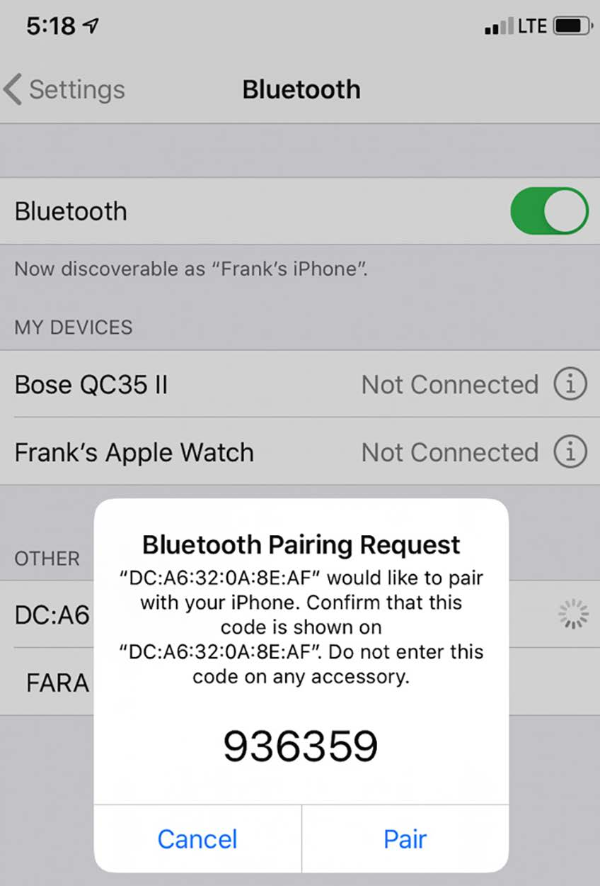

# Chương 7: Phát triển với Yocto (Developing with Yocto)

Đưa Linux lên một phần cứng chưa được hỗ trợ có thể là một quá trình gian nan. May mắn thay, Yocto cung cấp các Board Support Package (BSP) để khởi động việc phát triển embedded Linux trên các single-board computer phổ biến như BeaglePlay và Raspberry Pi 4. Xây dựng trên nền một BSP layer có sẵn cho phép chúng ta nhanh chóng tận dụng các thiết bị ngoại vi built-in phức tạp như Bluetooth và Wi-Fi. Trong chương này, chúng ta sẽ tạo một layer ứng dụng tùy chỉnh để làm đúng điều đó.

Tiếp theo, chúng ta sẽ xem workflow phát triển mà extensible SDK của Yocto mang lại. Sửa đổi phần mềm chạy trên thiết bị target thường có nghĩa là phải thay thẻ microSD. Vì việc build lại và triển khai lại toàn bộ image quá time-consuming, tôi sẽ cho bạn thấy cách dùng `devtool` để nhanh chóng tự động hóa và lặp lại công việc. Trong khi làm vậy, bạn cũng sẽ học cách lưu công việc của mình vào các layer riêng để nó không bị mất.

Yocto không chỉ build các image Linux mà cả các bản phân phối Linux hoàn chỉnh. Chúng ta sẽ bàn về lý do làm vậy trước khi đi qua các bước lắp ráp bản phân phối Linux của riêng mình. Trong nhiều lựa chọn phải đưa ra, có việc có thêm quản lý package lúc runtime hay không để phát triển ứng dụng nhanh trên thiết bị target. Điều này phải trả giá bằng việc phải duy trì một cơ sở dữ liệu package và một package server từ xa, điều tôi sẽ đề cập ở cuối.

Trong chương này, chúng ta sẽ đề cập các chủ đề sau:

- Xây dựng trên nền một BSP có sẵn

- Ghi lại các thay đổi bằng `devtool`

- Build distro của riêng bạn

- Chuẩn bị một package server từ xa

## Yêu cầu kỹ thuật

Để làm theo các ví dụ, hãy bảo đảm bạn có những thứ sau:

- Một hệ thống host Ubuntu 24.04 hoặc bản LTS mới hơn với ít nhất 90 GB dung lượng đĩa trống

- Bản phát hành LTS Yocto 5.0 (scarthgap)

- Một đầu đọc thẻ microSD và thẻ

- balenaEtcher cho Linux

- Một cáp Ethernet và router có cổng trống để kết nối mạng

- Một router Wi-Fi

- Một smartphone có Bluetooth

- Raspberry Pi 4

- Một bộ nguồn USB-C 5 V có khả năng cấp 3A

Bạn đã build bản phát hành LTS 5.0 (scarthgap) của Yocto trong Chương 6. Nếu chưa, hãy tham khảo các mục Compatible Linux Distribution và Build Host Packages của Yocto Project Quick Build guide (`https://docs.yoctoproject.org/brief-yoctoprojectqs/`) trước khi build Yocto trên host Linux theo các hướng dẫn trong Chương 6.

Code dùng trong chương này có trong thư mục của chương trong GitHub repository của cuốn sách: `https://github.com/PacktPublishing/Mastering-Embedded-Linux-Development`.

## Xây dựng trên nền một BSP có sẵn

Một BSP layer thêm hỗ trợ cho một thiết bị phần cứng cụ thể hoặc một họ thiết bị vào Yocto. Sự hỗ trợ này thường bao gồm bootloader, các device tree blob và các kernel driver bổ sung cần để boot Linux trên phần cứng cụ thể đó. Một BSP cũng có thể bao gồm mọi phần mềm user-space và firmware ngoại vi bổ sung cần để bật và tận dụng đầy đủ mọi tính năng của phần cứng. Theo quy ước, tên BSP layer bắt đầu bằng tiền tố `meta-` theo sau là tên của machine. Tìm BSP tốt nhất cho thiết bị target của bạn là bước đầu tiên để build một image có thể boot cho nó bằng Yocto.

OpenEmbedded layer index (`https://layers.openembedded.org/layerindex)` là nơi tốt nhất để bắt đầu tìm các BSP chất lượng. Nhà sản xuất board hoặc nhà cung cấp chip của bạn cũng có thể cung cấp các BSP layer. The Yocto Project cung cấp một BSP cho mọi biến thể của Raspberry Pi. Bạn có thể tìm thấy Git repository cho BSP layer đó và tất cả các layer khác được The Yocto Project công nhận trong các source repository của project (`https://git.yoctoproject.org`).

### Build một BSP có sẵn

Các bài tập sau giả định bạn đã clone hoặc giải nén bản phát hành scarthgap của Yocto vào một thư mục tên là `poky` trong môi trường host. Trước khi tiếp tục, chúng ta cũng cần clone các layer dependency sau ở cấp trên thư mục `poky` một bậc, để các thư mục layer và `poky` nằm cạnh nhau:

```
$ git clone -b scarthgap git://git.openembedded.org/meta-openembedded
$ git clone -b scarthgap git://git.yoctoproject.org/meta-raspberrypi
```

Lưu ý rằng tên branch của các layer dependency khớp với bản phát hành Yocto để bảo đảm tương thích. Hãy giữ cả ba bản clone luôn cập nhật và đồng bộ với remote của chúng bằng cách định kỳ chạy `git pull`. Layer `meta-raspberrypi` là BSP cho tất cả các Raspberry Pi. Khi các dependency này đã có, bạn có thể build một image được tùy chỉnh cho Raspberry Pi 4. Nhưng trước khi làm điều đó, hãy khám phá các recipe cho các image tổng quát của Yocto:

1\. Đầu tiên, đi tới thư mục nơi bạn đã clone Yocto:

```
$ cd poky
```

2\. Tiếp theo, đi xuống thư mục chứa các recipe cho các image chuẩn:

```
$ cd meta/recipes-core/images
```

3\. Liệt kê các core image recipe:

```
$ ls -1 core*
core-image-base.bb
core-image-initramfs-boot.bb
core-image-minimal.bb
core-image-minimal-dev.bb
core-image-minimal-initramfs.bb
core-image-minimal-mtdutils.bb
core-image-ptest-all.bb
core-image-ptest.bb
core-image-ptest-fast.bb
core-image-tiny-initramfs.bb
```

4\. Hiển thị recipe `core-image-base`:

```
$ cat core-image-base.bb
SUMMARY = "A console-only image that fully supports the target
device \
hardware."

IMAGE_FEATURES += "splash"
LICENSE = "MIT"

inherit core-image
```

5\. Lưu ý rằng recipe này kế thừa từ `core-image`, vì vậy nó đang import nội dung của `core-image.bbclass`, mà chúng ta sẽ xem sau.

6\. Hiển thị recipe `core-image-minimal`:

```
$ cat core-image-minimal.bb
SUMMARY = "A small image just capable of allowing a device to boot."

IMAGE_INSTALL = "packagegroup-core-boot ${CORE_IMAGE_EXTRA_INSTALL}"

IMAGE_LINGUAS = " "

LICENSE = "MIT"

inherit core-image

IMAGE_ROOTFS_SIZE ?= "8192"
IMAGE_ROOTFS_EXTRA_SPACE:append = "${@bb.utils.contains("DISTRO_
FEATURES", "systemd", " + 4096", "", d)}"
```

7\. Giống `core-image-base`, recipe này cũng kế thừa từ file class `core-image`.

8\. Hiển thị recipe `core-image-minimal-dev`:

```
$ cat core-image-minimal-dev.bb
require core-image-minimal.bb

DESCRIPTION = "A small image just capable of allowing a device to
boot and \
is suitable for development work."

IMAGE_FEATURES += "dev-pkgs"
```

9\. Đi lên thư mục classes dưới poky/meta:

```
$ cd ../../classes-recipe
```

10\. Cuối cùng, hiển thị file class `core-image`:

```
$ cat core-image.bbclass
```

11\. Lưu ý danh sách dài các `IMAGE_FEATURES` có sẵn ở đầu file class này, bao gồm tính năng `dev-pkgs` đã được nhắc đến.

Các image chuẩn như `core-image-minimal` và `core-image-minimal-dev` là machine-agnostic. Trong Chương 6, chúng ta đã build `core-image-minimal` cho cả emulator QEMU Arm và BeaglePlay. Chúng ta cũng có thể dễ dàng build một image `core-image-minimal` cho Raspberry Pi 4. Ngược lại, một BSP layer bao gồm các image recipe dành cho một board hoặc một dòng board cụ thể.

Giờ hãy xem recipe `rpi-test-image` bên trong BSP layer `meta-rasberrypi` để thấy cách hỗ trợ cả Wi-Fi và Bluetooth được thêm vào `core-image-base` cho Raspberry Pi 4:

1\. Đầu tiên, đi tới thư mục ở cấp trên thư mục nơi bạn đã clone Yocto một bậc:

```
$ cd ../../..
```

2\. Tiếp theo, đi xuống thư mục bên trong BSP layer `meta-raspberrypi` chứa các image recipe cho Raspberry Pi:

```
$ cd meta-raspberrypi/recipes-core/images
```

3\. Liệt kê các image recipe của Raspberry Pi:

```
$ ls -1
rpi-test-image.bb
```

4\. Hiển thị recipe `rpi-test-image`:

```
$ cat rpi-test-image.bb
# Base this image on core-image-base
include recipes-core/images/core-image-base.bb

COMPATIBLE_MACHINE = "^rpi$"

IMAGE_INSTALL:append = " packagegroup-rpi-test"
```

5\. Lưu ý rằng biến `IMAGE_INSTALL` đã được override để nó có thể nối thêm `packagegroup-rpi-test` và đưa các package đó vào image.

6\. Đi tới thư mục `packagegroups` bên cạnh, dưới `metaraspberrypi/recipes-core`:

```
$ cd ../packagegroups
```

7\. Cuối cùng, hiển thị recipe `packagegroup-rpi-test`:

```
$ cat packagegroup-rpi-test.bb
DESCRIPTION = "RaspberryPi Test Packagegroup"
LICENSE = "MIT"
LIC_FILES_CHKSUM = "file://${COMMON_LICENSE_DIR}/
MIT;md5=0835ade698e0bcf8506ecda2f7b4f302"

PACKAGE_ARCH = "${MACHINE_ARCH}"

inherit packagegroup

COMPATIBLE_MACHINE = "^rpi$"

OMXPLAYER  = "${@bb.utils.contains('MACHINE_FEATURES',
'vc4graphics', '', 'omxplayer', d)}"

RDEPENDS:${PN} = "\
    ${OMXPLAYER} \
    bcm2835-tests \
    raspi-gpio \
    rpio \
    rpi-gpio \
    pi-blaster \
    python3-adafruit-circuitpython-register \
    python3-adafruit-platformdetect \
    python3-adafruit-pureio \
    python3-rtimu \
    connman \
    connman-client \
    wireless-regdb-static \
    bluez5 \
"

RRECOMMENDS:${PN} = "\
    ${@bb.utils.contains("BBFILE_COLLECTIONS", "meta-multimedia",
"bigbuckbunny-1080p bigbuckbunny-480p bigbuckbunny-720p", "", d)} \
    ${MACHINE_EXTRA_RRECOMMENDS} \
"
```

8\. Lưu ý rằng các package `connman`, `connman-client` và `bluez5` được đưa vào danh sách runtime dependency để Wi-Fi và Bluetooth được bật đầy đủ.

Cuối cùng, hãy build `rpi-test-image` cho Raspberry Pi 4:

1\. Đầu tiên, đi tới thư mục ở cấp trên thư mục nơi bạn đã clone Yocto một bậc:

```
$ cd ../../..
```

2\. Tiếp theo, thiết lập môi trường làm việc BitBake:

```
$ source poky/oe-init-build-env build-rpi
```

3\. Lệnh này thiết lập một loạt biến môi trường và đưa bạn vào một thư mục `build-rpi` mới được tạo.

4\. Sau đó, thêm các layer sau vào image:

```
$ bitbake-layers add-layer ../meta-openembedded/meta-oe
$ bitbake-layers add-layer ../meta-openembedded/meta-python
$ bitbake-layers add-layer ../meta-openembedded/meta-networking
$ bitbake-layers add-layer ../meta-openembedded/meta-multimedia
$ bitbake-layers add-layer ../meta-raspberrypi
```

LƯU Ý QUAN TRỌNG

Thứ tự thêm các layer này là quan trọng, vì các layer `meta-networking` và `meta-multimedia` đều phụ thuộc vào layer `meta-python`. Nếu `bitbake-layers add-layer` hoặc `bitbake-layers show-layers` bắt đầu thất bại do lỗi parse, hãy xóa thư mục `build-rpi` và làm lại bài tập này từ bước 1.

5\. Xác nhận rằng tất cả các layer cần thiết đã được thêm vào image:

```
$ bitbake-layers show-layers
```

6\. Output của lệnh sẽ trông như sau:

```
layer              path                                   priority
==================================================================
core               /home/frank/poky/meta                         5
yocto              /home/frank/poky/meta-poky                    5
yoctobsp           /home/frank/poky/meta-yocto-bsp               5
openembedded-layer /home/frank/meta-openembedded/meta-oe         5
meta-python        /home/frank/meta-openembedded/meta-python     5
networking-layer   /home/frank/meta-openembedded/meta-networking 5
multimedia-layer   /home/frank/meta-openembedded/meta-multimedia 5
raspberrypi        /home/frank/meta-raspberrypi                  9
```

7\. Quan sát các thay đổi mà các lệnh `bitbake-layers add-layer` ở trên đã thực hiện với `bblayers.conf`:

```
$ cat conf/bblayers.conf
```

8\. Cùng tám layer từ bước trước sẽ được gán cho biến `BBLAYERS`.

9\. Liệt kê các machine được BSP layer `meta-raspberrypi` hỗ trợ:

```
$ ls ../meta-raspberrypi/conf/machine
```

10\. Lưu ý rằng có các cấu hình machine `raspberrypi4` và `raspberrypi4-64`.

11\. Thêm dòng sau vào file `conf/local.conf`:

```
MACHINE = "raspberrypi4-64"
```

12\. Dòng này ghi đè giá trị mặc định sau trong file `conf/local.conf`:

```
MACHINE ??= "qemux86-64"
```

13\. Đặt biến `MACHINE` thành `raspberrypi4-64` bảo đảm image chúng ta sắp build hoạt động cho Raspberry Pi 4.

14\. Thêm dòng sau vào file `conf/local.conf`:

```
LICENSE_FLAGS_ACCEPTED = "synaptics-killswitch"
```

15\. Dòng này chặn lỗi build sau:

```
ERROR: Nothing RPROVIDES 'linux-firmware-rpidistro-bcm43455'
```

16\. Giờ hãy nối `ssh-server-openssh` vào danh sách `EXTRA_IMAGE_FEATURES` trong file `conf/local.conf`:

```
EXTRA_IMAGE_FEATURES ?= "debug-tweaks ssh-server-openssh"
```

17\. Việc này thêm một SSH server vào image để truy cập qua mạng cục bộ.

18\. Cuối cùng, build image:

```
$ bitbake rpi-test-image
```

Lần build đầu tiên có thể mất từ vài phút đến vài giờ để hoàn tất, tùy theo môi trường host của bạn có bao nhiêu lõi CPU.

`TARGET_SYS` nên là `aarch64-poky-linux` và `MACHINE` nên là `raspberrypi4-64`, vì image này nhắm tới 64-bit cho các lõi Arm Cortex-A72 trong Raspberry Pi 4.

Khi image build xong, sẽ có một file tên là `rpi-test-image-raspberrypi4-64.rootfs.wic.bz2` trong thư mục `tmp/deploy/images/raspberrypi4-64`:

```
$ ls -l tmp/deploy/images/raspberrypi4-64/rpi-test*wic.bz2
```

Lưu ý rằng `rpi-test-image-raspberrypi4-64.rootfs.wic.bz2` là một symbolic link trỏ tới file image thực trong cùng thư mục. Một số nguyên biểu thị ngày và giờ build được nối vào tên file image trước phần mở rộng `wic.bz2`.

Giờ hãy ghi image đó lên thẻ microSD bằng Etcher và boot nó trên Raspberry Pi 4:

1\. Cắm một thẻ microSD vào máy host.

2\. Khởi chạy Etcher.

3\. Nhấn Flash from file trong Etcher.

4\. Tìm image `wic.bz2` mà bạn đã build cho Raspberry Pi 4 và mở nó.

5\. Nhấn Select target trong Etcher.

6\. Chọn thẻ microSD mà bạn đã cắm vào ở bước 1.

7\. Nhấn Flash trong Etcher để ghi image.

8\. Đẩy thẻ microSD ra khi Etcher flash xong.

9\. Cắm thẻ microSD vào Raspberry Pi 4.

10\. Cấp nguồn cho Raspberry Pi 4 qua cổng USB-C của nó.

Hãy xác nhận Raspberry Pi 4 đã boot thành công bằng cách cắm nó vào Ethernet và quan sát đèn hoạt động mạng nhấp nháy.

### Điều khiển Wi-Fi

Trong bài tập trước, chúng ta đã build một image có thể boot cho Raspberry Pi 4 với Ethernet, Wi-Fi và Bluetooth hoạt động. Giờ thiết bị đã boot và kết nối với mạng cục bộ qua Ethernet, hãy kết nối tới một mạng Wi-Fi gần đó. Chúng ta sẽ dùng `connman` cho bài tập này vì đó là thứ layer `meta-raspberrypi` đi kèm sẵn. Các BSP layer khác dựa vào các daemon cấu hình network interface khác, như `systemd-networkd` và `NetworkManager`. Hãy làm theo các bước sau:

1\. Image chúng ta đã build có hostname là `raspberrypi4-64`, vì vậy bạn có thể SSH vào thiết bị với tư cách root:

```
$ ssh root@raspberrypi4-64.local
```

2\. Nhập `yes` khi được hỏi có muốn tiếp tục kết nối không. Bạn sẽ không bị hỏi mật khẩu. Nếu không tìm thấy host nào tại `raspberrypi4-64.local`, hãy dùng một công cụ như `arp-scan` để tìm địa chỉ IP của Raspberry Pi 4 và SSH vào địa chỉ đó thay vì dùng hostname.

3\. Khi đã vào, hãy xác nhận rằng driver Wi-Fi đã có:

```
root@raspberrypi4-64:~# lsmod | grep 80211
cfg80211              753664  1 brcmfmac
rfkill                 32768  6 nfc,bluetooth,cfg80211
```

4\. Khởi động `connman-client`:

```
root@raspberrypi4-64:~# connmanctl
connmanctl>
```

5\. Bật Wi-Fi:

```
connmanctl> enable wifi
Enabled wifi
```

6\. Bỏ qua `"Error wifi: Already enabled"` nếu Wi-Fi đã được bật.

7\. Đăng ký `connmanctl` làm connection agent:

```
connmanctl> agent on
Agent registered
```

8\. Quét các mạng Wi-Fi:

```
connmanctl> scan wifi
Scan completed for wifi
```

9\. Liệt kê tất cả các mạng Wi-Fi có sẵn:

```
connmanctl> services
*AO Wired ethernet_dca6320a8ead_cable
 RT-AC66U_B1_38_2G wifi_
dca6320a8eae_52542d41433636555f42315f33385f3247_managed_psk
 RT-AC66U_B1_38_5G wifi_
dca6320a8eae_52542d41433636555f42315f33385f3547_managed_psk
```

10\. `RT-AC66U_B1_38_2G` và `RT-AC66U_B1_38_5G` là SSID mạng Wi-Fi của một router ASUS. Danh sách của bạn sẽ trông khác. `*AO` đứng trước `Wired` cho biết thiết bị hiện đang online qua Ethernet.

11\. Kết nối tới một mạng Wi-Fi:

```
connmanctl> connect wifi_
dca6320a8eae_52542d41433636555f42315f33385f3547_managed_psk
Agent RequestInput wifi_
dca6320a8eae_52542d41433636555f42315f33385f3547_managed_psk
 Passphrase = [ Type=psk, Requirement=mandatory ]
Passphrase? somepassword
Connected wifi_dca6320a8eae_52542d41433636555f42315f33385f3547_
managed_psk
```

12\. Thay service identifier sau `connect` bằng service identifier của bạn hoặc mạng đích từ bước trước. Thay `somepassword` bằng passphrase Wi-Fi của bạn.

13\. Liệt kê lại các service:

```
connmanctl> services
*AO Wired ethernet_dca6320a8ead_cable
*AR RT-AC66U_B1_38_5G wifi_
dca6320a8eae_52542d41433636555f42315f33385f3547_managed_psk
 RT-AC66U_B1_38_2G wifi_
ca6320a8eae_52542d41433636555f42315f33385f3247_managed_psk
```

14\. Lần này, `*AR` xuất hiện trước SSID mà bạn vừa kết nối, cho biết kết nối mạng này đã sẵn sàng. Ethernet được ưu tiên hơn Wi-Fi, vì vậy thiết bị vẫn online qua `Wired`.

15\. Thoát `connman-client`:

```
connmanctl> quit
```

16\. Rút Raspberry Pi 4 khỏi Ethernet, qua đó đóng phiên SSH:

```
root@raspberrypi4-64:~# client_loop: send disconnect: Broken pipe
```

17\. Kết nối lại với Raspberry Pi 4:

```
$ ssh root@raspberrypi4-64.local
```

18\. Khởi động lại `connman-client`:

```
root@raspberrypi4-64:~# connmanctl
connmanctl>
```

19\. Liệt kê lại các service:

```
connmanctl> services
*AO RT-AC66U_B1_38_5G wifi_
dca6320a8eae_52542d41433636555f42315f33385f3547_managed_psk
```

20\. Quan sát rằng kết nối `Wired` giờ đã biến mất và SSID Wi-Fi mà bạn đã kết nối, trước đó ở trạng thái ready, giờ đã được nâng lên online.

Daemon `connman` lưu thông tin xác thực Wi-Fi của bạn vào một thư mục network profile dưới `/var/lib/connman`, thư mục này được giữ lại trên thẻ microSD. Điều này có nghĩa là `connman` sẽ tự động kết nối lại với mạng Wi-Fi khi Raspberry Pi 4 khởi động. Không cần làm lại các bước này sau khi tắt bật nguồn. Bạn có thể để Ethernet rút ra nếu muốn.

### Điều khiển Bluetooth

Ngoài các package `connman` và `connman-client`, layer `meta-raspberrypi` bao gồm `bluez5` làm Bluetooth stack. Tất cả các package này cùng các driver Bluetooth cần thiết đều được đưa vào `rpi-test-image`, image mà chúng ta đã build cho Raspberry Pi 4. Hãy cho Bluetooth hoạt động và thử ghép đôi nó với một thiết bị khác:

1\. Cấp nguồn cho Raspberry Pi 4 và SSH vào:

```
$ ssh root@raspberrypi4-64.local
```

2\. Xác nhận rằng các driver Bluetooth đã có:

```
root@raspberrypi4-64:~# lsmod | grep bluetooth
bluetooth             643072  29 hci_uart,btbcm,bnep,rfcomm
ecdh_generic           16384  1 bluetooth
rfkill                 32768  7 nfc,bluetooth,cfg80211
libaes                 12288  3 aes_arm64,bluetooth,aes_generic
```

3\. Khởi tạo driver HCI UART cho kết nối Bluetooth:

```
root@raspberrypi4-64:~# btuart
```

4\. Khởi động `connman-client`:

```
root@raspberrypi4-64:~# connmanctl
connmanctl>
```

5\. Bật Bluetooth:

```
connmanctl> enable bluetooth
Enabled Bluetooth
```

6\. Bỏ qua `"Error bluetooth: Already enabled"` nếu Bluetooth đã được bật.

7\. Thoát `connman-client`:

```
connmanctl> quit
```

8\. Khởi động Bluetooth CLI:

```
root@raspberrypi4-64:~# bluetoothctl
Agent registered
[CHG] Controller DC:A6:32:0A:8E:AF Pairable: yes
```

9\. Yêu cầu default agent:

```
[bluetooth]# default-agent
Default agent request successful
```

10\. Bật nguồn controller:

```
[bluetooth]# power on
Changing power on succeeded
```

11\. Hiển thị thông tin về controller:

```
[bluetooth]# show
Controller DC:A6:32:0A:8E:AF (public)
Name: BlueZ 5.72
Alias: BlueZ 5.72
Class: 0x00200000
Powered: yes
Discoverable: no
DiscoverableTimeout: 0x000000b4
Pairable: yes
```

12\. Bắt đầu quét các thiết bị Bluetooth:

```
[bluetooth]# scan on
Discovery started
[CHG] Controller DC:A6:32:0A:8E:AF Discovering: yes
…
[NEW] Device DC:08:0F:03:52:CD Frank's iPhone
…
```

13\. Nếu smartphone của bạn ở gần và đã bật Bluetooth, nó sẽ xuất hiện trong danh sách dưới dạng thiết bị `[NEW]`. Phần `DC:08:0F:03:52:CD` cạnh `Frank's` `iPhone` là địa chỉ MAC Bluetooth của smartphone của tôi.

14\. Dừng quét các thiết bị Bluetooth:

```
[bluetooth]# scan off
…
[CHG] Controller DC:A6:32:0A:8E:AF Discovering: no
Discovery stopped
```

15\. Nếu bạn có một chiếc iPhone đang mở, hãy vào Bluetooth trong Settings để có thể chấp nhận yêu cầu ghép đôi từ Raspberry Pi 4.

16\. Thử ghép đôi với smartphone:

```
[bluetooth]# pair DC:08:0F:03:52:CD
Attempting to pair with DC:08:0F:03:52:CD
[CHG] Device DC:08:0F:03:52:CD Connected: yes
Request confirmation
[agent] Confirm passkey 936359 (yes/no):
```

17\. Thay `DC:08:0F:03:52:CD` bằng địa chỉ MAC Bluetooth của smartphone của bạn.

18\. Trước khi nhập `yes`, hãy chấp nhận yêu cầu ghép đôi từ smartphone:



Hình 7.1 – Yêu cầu ghép đôi Bluetooth

19\. Nhập `yes` để xác nhận passkey:

```
[agent] Confirm passkey 936359 (yes/no): yes
[CHG] Device DC:08:0F:03:52:CD ServicesResolved: yes
[CHG] Device DC:08:0F:03:52:CD Paired: yes
Pairing successful
[CHG] Device DC:08:0F:03:52:CD ServicesResolved: no
[CHG] Device DC:08:0F:03:52:CD Connected: no
```

20\. Kết nối với smartphone:

```
[bluetooth]# connect DC:08:0F:03:52:CD
Attempting to connect to DC:08:0F:03:52:CD
[CHG] Device DC:08:0F:03:52:CD Connected: yes
Connection successful
[CHG] Device DC:08:0F:03:52:CD ServicesResolved: yes
Authorize service
```

21\. Một lần nữa, thay `DC:08:0F:03:52:CD` bằng địa chỉ MAC Bluetooth của smartphone của bạn.

22\. Khi được hỏi có ủy quyền cho service không, hãy nhập `yes`:

```
[agent] Authorize service 0000110e-0000-1000-8000-
00805f9b34fb (yes/no): yes
[Frank's iPhone]#
```

Raspberry Pi 4 của bạn giờ đã được ghép đôi và kết nối với smartphone qua Bluetooth. Nó sẽ xuất hiện trong danh sách thiết bị Bluetooth của smartphone dưới tên BlueZ 5.72. Chương trình `bluetoothctl` có rất nhiều lệnh và submenu. Chúng ta mới chỉ chạm tới bề mặt. Tôi khuyên bạn nhập `help` và xem qua self-documentation để có ý tưởng về những gì bạn có thể làm từ command line. Giống như `connman`, BlueZ Bluetooth stack là một D-Bus service, vì vậy bạn có thể giao tiếp với nó bằng lập trình qua D-Bus từ Python hoặc các ngôn ngữ lập trình high-level khác bằng D-Bus binding.

### Thêm một layer tùy chỉnh

Nếu bạn đang dùng Raspberry Pi 4 để làm prototype cho một sản phẩm mới, thì bạn có thể nhanh chóng tạo các image tùy chỉnh bằng cách thêm package vào danh sách đã được gán cho biến `IMAGE_INSTALL:append` trong `conf/local.conf`. Mặc dù kỹ thuật đơn giản này hoạt động được, đến một lúc nào đó bạn sẽ muốn bắt đầu phát triển ứng dụng nhúng của riêng mình.

Làm sao để build phần mềm bổ sung này để có thể đưa nó vào các image tùy chỉnh? Câu trả lời là tạo một layer tùy chỉnh với một recipe mới để build phần mềm của bạn.

1\. Đầu tiên, đi tới thư mục ở cấp trên thư mục nơi bạn đã clone Yocto một bậc.

2\. Tiếp theo, thiết lập môi trường làm việc BitBake:

```
$ source poky/oe-init-build-env build-rpi
```

3\. Lệnh này thiết lập một loạt biến môi trường và đưa bạn trở lại thư mục `build-rpi`.

4\. Tạo một layer mới cho ứng dụng của bạn:

```
$ bitbake-layers create-layer ../meta-gattd
NOTE: Starting bitbake server...
Add your new layer with 'bitbake-layers add-layer ../meta-gattd'
```

5\. Layer này có tên `meta-gattd` cho GATT daemon. Hãy đặt tên layer theo ý bạn, nhưng hãy tuân theo quy ước tiền tố `meta-`.

6\. Đi lên thư mục layer mới:

```
$ cd ../meta-gattd
```

7\. Xem cấu trúc file của layer:

```
$ tree
.
├── conf
│   └── layer.conf
├── COPYING.MIT
├── README
└── recipes-example
    └── example
        └── example_0.1.bb
```

8\. Đổi tên thư mục `recipes-examples`:

```
$ mv recipes-example recipes-gattd
```

9\. Đổi tên thư mục `example`:

```
$ cd recipes-gattd
$ mv example gattd
```

10\. Đổi tên file recipe ví dụ:

```
$ cd gattd
$ mv example_0.1.bb gattd_0.1.bb
```

11\. Hiển thị file recipe đã đổi tên:

```
$ cat gattd_0.1.bb
```

12\. Bạn muốn đưa vào recipe này metadata cần để build phần mềm của bạn, bao gồm `SRC_URI` và các checksum `md5`.

13\. Lúc này, chỉ cần thay gattd\_0.1.bb bằng recipe hoàn chỉnh mà tôi đã cung cấp cho bạn tại `MELD/Chapter07/meta-gattd/recipes-gattd/gattd/gattd_0.1.bb`.

14\. Tạo một Git repository cho layer mới và push nó lên GitHub.

15\. Tạo một branch `scarthgap` trong Git repository và push nó lên GitHub.

Giờ chúng ta đã có một layer tùy chỉnh cho ứng dụng, hãy thêm nó vào image đang làm việc:

1\. Đầu tiên, đi tới thư mục ở cấp trên thư mục nơi bạn đã clone Yocto một bậc:

```
$ cd ../../..
```

2\. Clone layer của bạn hoặc layer `meta-gattd` của tôi từ GitHub:

```
$ git clone -b scarthgap https://github.com/fvasquez/meta-gattd.git
```

3\. Thay `fvasquez` bằng username GitHub của bạn và `meta-gattd` bằng tên repo của layer.

4\. Tiếp theo, thiết lập môi trường làm việc BitBake:

```
$ source poky/oe-init-build-env build-rpi
```

5\. Lệnh này thiết lập một loạt biến môi trường và đưa bạn trở lại thư mục `build-rpi`.

6\. Sau đó, thêm layer vừa clone vào image:

```
$ bitbake-layers add-layer ../meta-gattd
```

7\. Thay `meta-gattd` bằng tên layer của bạn.

8\. Xác nhận rằng tất cả các layer cần thiết đã được thêm vào image:

```
$ bitbake-layers show-layers
```

9\. Sẽ có tổng cộng chín layer trong danh sách, bao gồm layer mới của bạn.

10\. Giờ hãy thêm package bổ sung vào file `conf/local.conf`:

```
CORE_IMAGE_EXTRA_INSTALL += "gattd"
```

11\. `CORE_IMAGE_EXTRA_INSTALL` là một biến tiện lợi được dùng để thêm package bổ sung vào một image kế thừa từ class `core-image`, như `rpi-test-image`. `IMAGE_INSTALL` là biến điều khiển những package nào được đưa vào bất kỳ image nào. Chúng ta không thể dùng `IMAGE_INSTALL += "gattd"` trong `conf/local.conf` vì nó thay thế phép gán lazy mặc định được thực hiện trong `core-image.bbclass`. Hãy dùng `IMAGE_INSTALL:append = " gattd"` hoặc `CORE_IMAGE_EXTRA_INSTALL += " gattd"` thay thế.

12\. Cuối cùng, build lại image:

```
$ bitbake rpi-test-image
```

Nếu phần mềm của bạn build và cài đặt thành công, nó sẽ được đưa vào image hoàn chỉnh `rpi-test-image-raspberrypi4-64.rootfs.wic.bz2`. Hãy ghi image đó lên thẻ microSD và boot nó trên Raspberry Pi 4 để kiểm chứng. Sẽ có một script Python tại `/usr/bin/gatt_server.py`.

Thêm package vào `conf/local.conf` là hợp lý trong những giai đoạn đầu tiên của việc phát triển. Khi bạn sẵn sàng chia sẻ thành quả lao động với phần còn lại của nhóm, bạn nên tạo một image recipe và đặt các package của mình vào đó. Ở cuối chương trước, chúng ta đã đi trọn con đường và viết một recipe `nova-image` để thêm package `helloworld` vào `core-image-minimal`.

Giờ chúng ta đã dành khá nhiều thời gian kiểm thử các image mới build trên phần cứng thật, đã đến lúc quay lại với phần mềm. Trong phần tiếp theo, chúng ta sẽ xem một công cụ được thiết kế để tinh gọn chu kỳ compile, test và debug tẻ nhạt mà chúng ta đã quen khi phát triển phần mềm nhúng.

## Ghi lại các thay đổi bằng devtool

Trong chương trước, bạn đã học cách tạo một recipe cho chương trình `helloworld` từ đầu. Cách tiếp cận copy-paste để đóng gói recipe có thể hiệu quả lúc đầu, nhưng nó sớm trở nên rất bực bội khi project lớn lên và số recipe bạn cần bảo trì tăng lên. Tôi ở đây để cho bạn thấy một cách tốt hơn để làm việc với package recipe – cả recipe của bạn lẫn những recipe được bên thứ ba đóng góp lên upstream. Đó là `devtool`, và nó là nền tảng của extensible SDK của Yocto.

### Các workflow phát triển

Trước khi bắt đầu với `devtool`, bạn cần bảo đảm rằng mình làm việc trong một layer mới thay vì sửa recipe in-tree. Nếu không, bạn có thể dễ dàng ghi đè và mất hàng giờ làm việc:

1\. Đầu tiên, đi tới thư mục ở cấp trên thư mục nơi bạn đã clone Yocto một bậc.

2\. Tiếp theo, thiết lập môi trường làm việc BitBake:

```
$ source poky/oe-init-build-env build-mine
```

3\. Lệnh này thiết lập một loạt biến môi trường và đưa bạn vào một thư mục `build-mine` mới.

4\. Đặt `MACHINE` trong `conf/local.conf` cho Arm 64-bit:

```
MACHINE ?= "qemuarm64"
```

5\. Tạo layer mới:

```
$ bitbake-layers create-layer ../meta-mine
```

6\. Giờ thêm layer mới:

```
$ bitbake-layers add-layer ../meta-mine
```

7\. Kiểm tra rằng layer mới đã được tạo ở nơi bạn muốn:

```
$ bitbake-layers show-layers
```

Output của `bitbake-layers show-layers` sẽ trông như sau:

```
layer              path                                   priority
==================================================================
core               /home/frank/poky/meta                         5
yocto              /home/frank/poky/meta-poky                    5
yoctobsp           /home/frank/poky/meta-yocto-bsp               5
meta-mine          /home/frank/meta-mine                         6
```

Để có trải nghiệm first-hand với các workflow phát triển, bạn sẽ cần một target để triển khai lên. Điều đó có nghĩa là phải build một image:

```
$ devtool build-image core-image-full-cmdline
```

Build một image đầy đủ mất vài giờ ở lần đầu. Khi hoàn tất, hãy boot nó:

```
$ runqemu qemuarm64 nographic
<…>
Poky (Yocto Project Reference Distro) 5.0.4 qemuarm64 ttyAMA0
qemuarm64 login: root
root@qemuarm64:~#
```

Bằng cách chỉ định tùy chọn `nographic`, chúng ta có thể chạy QEMU trực tiếp trong một shell riêng. Điều này giúp gõ dễ hơn so với phải xử lý output đồ họa được emulate. Đăng nhập bằng `root`. Không có mật khẩu. Hãy để QEMU chạy lúc này vì chúng ta cần nó cho các bài tập tiếp theo. Bạn có thể SSH vào VM này bằng `ssh root@192.168.7.2`.

`devtool` hỗ trợ ba workflow phát triển phổ biến:

- Thêm một recipe mới.

- Patch source được build bởi một recipe có sẵn.

- Nâng cấp một recipe để fetch phiên bản mới hơn của source upstream.

Khi bạn khởi động bất kỳ workflow nào trong số này, `devtool` tạo một workspace tạm thời để bạn thực hiện thay đổi. Sandbox này chứa các file recipe và source đã fetch. Khi bạn làm xong, `devtool` tích hợp các thay đổi trở lại layer của bạn để workspace có thể bị hủy.

### Tạo một recipe mới

Giả sử có một phần mềm open source mà bạn muốn nhưng chưa ai gửi BitBake recipe cho nó. Và giả sử phần mềm đó là công cụ file-signing, kiểm chứng và cài đặt `validator`. Trong trường hợp này, bạn có thể tải một source tarball release của `validator` từ GitHub và tạo một recipe cho nó. Đó chính xác là việc `devtool add` làm.

Đầu tiên, `devtool add` tạo một workspace với Git repository cục bộ riêng. Bên trong thư mục workspace mới này, nó tạo một thư mục `recipes/validator` và giải nén nội dung tarball vào một thư mục `sources/validator`. `devtool` biết về các build system phổ biến như Autotools và CMake và sẽ cố hết sức để tìm ra đây là loại project gì (Autotools trong trường hợp `validator`). Sau đó nó dùng metadata đã parse và dữ liệu package đã build được cache từ các lần build BitBake trước để tìm ra giá trị của `DEPENDS` và `RDEPENDS` cũng như những file nào cần inherit và require:

1\. Đầu tiên, mở một shell khác và đi tới thư mục ở cấp trên thư mục nơi bạn đã clone Yocto một bậc.

2\. Tiếp theo, thiết lập môi trường BitBake:

```
$ source poky/oe-init-build-env build-mine
```

3\. Lệnh này thiết lập một loạt biến môi trường và đưa bạn trở lại thư mục làm việc `build-mine`.

4\. Sau đó, chạy `devtool add` với URL của source tarball release:

```
$ devtool add https://github.com/containers/validator/releases/
download/0.2.2/validator-0.2.2.tar.xz
```

5\. `devtool add` sẽ tạo một recipe mà bạn có thể build sau đó.

6\. Trước khi build recipe mới, hãy xem nó:

```
$ devtool edit-recipe validator
```

7\. `devtool` sẽ mở `recipes/validator/validator_0.2.2.bb` trong một trình soạn thảo. Lưu ý rằng `devtool` đã điền sẵn các checksum MD5 cho bạn.

8\. Thêm dòng này vào cuối `validator_0.2.2.bb`:

```
FILES:${PN} += "${datadir}"
do_install:append() {
    rm -rf ${D}/usr/lib/dracut
}
```

9\. Sửa mọi lỗi hiển nhiên, lưu mọi thay đổi và thoát trình soạn thảo.

10\. Để build recipe mới, hãy dùng lệnh sau:

```
$ devtool build validator
```

11\. Tiếp theo, triển khai file thực thi `validator` đã compile lên target emulator:

```
$ devtool deploy-target validator root@192.168.7.2
```

12\. Lệnh này cài đặt các build artifact cần thiết lên target emulator.

13\. Từ shell QEMU, chạy file thực thi `validator` mà bạn vừa build và triển khai:

```
root@qemuarm64:~# validator --help
```

14\. Nếu bạn thấy một loạt self-documentation liên quan đến `validator`, thì việc build và triển khai đã thành công. Nếu không, hãy dùng `devtool` để lặp lại các bước sửa, build và triển khai cho đến khi bạn tin rằng `validator` hoạt động.

15\. Khi đã hài lòng, hãy dọn dẹp target emulator:

```
$ devtool undeploy-target validator root@192.168.7.2
```

16\. Merge toàn bộ công việc trở lại layer của bạn:

```
$ devtool finish -f validator ../meta-mine
```

17\. Xóa các source còn sót lại khỏi workspace:

```
$ devtool reset validator
```

Nếu bạn nghĩ người khác có thể được lợi từ recipe mới của mình, hãy gửi một patch cho Yocto.

### Sửa đổi source được build bởi một recipe

Giả sử bạn tìm thấy một bug trong `jq`, một bộ tiền xử lý JSON command-line. Bạn tìm trong Git repository tại `https://github.com/stedolan/jq` và thấy chưa ai báo cáo vấn đề này. Sau đó, bạn xem source code. Hóa ra bản sửa chỉ cần vài thay đổi code nhỏ, vì vậy bạn quyết định tự patch `jq`. Đó là lúc `devtool` modify phát huy tác dụng.

Lần này, khi `devtool` xem metadata đã cache của Yocto, nó thấy đã có một recipe cho `jq`. Giống như `devtool add`, `devtool modify` tạo một workspace tạm thời mới với Git repository cục bộ riêng, nơi nó copy các file recipe và giải nén source upstream. `jq` được viết bằng C và nằm trong một layer OpenEmbedded có sẵn tên là `meta-oe`. Chúng ta cần thêm layer này cũng như các dependency của `jq` vào image đang làm việc trước khi có thể sửa source của package:

1\. Đầu tiên, xóa một vài layer khỏi môi trường `build-mine`:

```
$ bitbake-layers remove-layer workspace
$ bitbake-layers remove-layer meta-mine
```

2\. Tiếp theo, clone repository `meta-openembedded` từ GitHub nếu nó chưa có:

```
$ git clone -b scarthgap https://github.com/openembedded/meta-
openembedded.git ../meta-openembedded
```

3\. Sau đó, thêm các layer `meta-oe` và `meta-mine` vào image:

```
$ bitbake-layers add-layer ../meta-openembedded/meta-oe
$ bitbake-layers add-layer ../meta-mine
```

4\. Xác nhận rằng tất cả các layer cần thiết đã được thêm vào image:

```
$ bitbake-layers show-layers
```

5\. Output của lệnh sẽ trông như sau:

```
layer              path                                   priority
==================================================================
core               /home/frank/poky/meta                         5
yocto              /home/frank/poky/meta-poky                    5
yoctobsp           /home/frank/poky/meta-yocto-bsp               5
openembedded-layer /home/frank/meta-openembedded/meta-oe         5
meta-mine          /home/frank/meta-mine                         6
```

6\. Thêm dòng sau vào `conf/local.conf` vì package `onig` là một runtime dependency của `jq`:

```
IMAGE_INSTALL:append = " onig"
```

7\. Build lại image:

```
$ devtool build-image core-image-full-cmdline
```

8\. Thoát QEMU bằng Ctrl + A và x từ shell kia và khởi động lại emulator:

```
$ runqemu qemuarm64 nographic
```

Giống như nhiều công cụ patch khác, `devtool modify` dùng commit message của bạn để tạo tên file patch, vì vậy hãy giữ commit message ngắn gọn và có ý nghĩa. Nó cũng tự động tạo chính các file patch dựa trên lịch sử GitHub của bạn và tạo một file `.bbappend` với các tên file patch mới. Hãy nhớ prune và squash các Git commit để `devtool` chia công việc của bạn thành các file patch hợp lý:

1\. Chạy `devtool modify` với tên của package bạn muốn sửa:

```
$ devtool modify jq
```

2\. Thực hiện thay đổi code bằng trình soạn thảo bạn ưa thích. Dùng workflow Git add và commit chuẩn để theo dõi những gì bạn đã làm.

3\. Build source đã sửa bằng lệnh sau:

```
$ devtool build jq
```

4\. Tiếp theo, triển khai file thực thi `jq` đã compile lên target emulator:

```
$ devtool deploy-target jq root@192.168.7.2
```

5\. Lệnh này cài đặt các build artifact cần thiết lên target emulator.

6\. Nếu kết nối thất bại, hãy xóa key cũ của emulator như sau:

```
$ ssh-keygen -f "/home/frank/.ssh/known_hosts" -R "192.168.7.2"
```

7\. Thay `frank` bằng username của bạn trong đường dẫn.

8\. Từ shell QEMU, chạy file thực thi `jq` mà bạn vừa build và triển khai. Nếu bạn không còn tái tạo được bug, thì các thay đổi của bạn đã có tác dụng. Nếu không, hãy lặp lại các bước sửa, build và triển khai cho đến khi hài lòng.

9\. Khi đã hài lòng, hãy dọn dẹp target emulator:

```
$ devtool undeploy-target jq root@192.168.7.2
```

10\. Merge toàn bộ công việc trở lại layer của bạn:

```
$ devtool finish jq ../meta-mine
```

11\. Nếu merge thất bại vì cây source Git bị dirty, hãy xóa hoặc unstage mọi build artifact `jq` còn sót lại và thử lại `devtool finish`.

12\. Xóa các source còn sót lại khỏi workspace:

```
$ devtool reset jq
```

Nếu bạn nghĩ người khác có thể được lợi từ patch của mình, hãy gửi chúng cho các maintainer của project upstream.

### Nâng cấp một recipe lên phiên bản mới hơn

Giả sử bạn đang dùng mypy, công cụ kiểm tra kiểu tĩnh cho Python, để phát triển trên thiết bị target và một phiên bản mypy mới vừa được phát hành. Phiên bản mới nhất này của mypy có một tính năng mới mà bạn nóng lòng muốn dùng. Thay vì chờ các maintainer recipe mypy nâng cấp lên phiên bản mới, bạn quyết định tự nâng cấp recipe. Bạn sẽ nghĩ việc này dễ như tăng một số phiên bản trong file recipe, nhưng còn có cả các checksum của source archive. Chẳng phải sẽ tuyệt vời nếu quy trình tẻ nhạt này có thể được tự động hóa hoàn toàn sao? Đoán xem devtool upgrade dùng để làm gì? mypy là một module Python 3, vì vậy image của bạn cần bao gồm Python 3, mypy và các dependency của mypy trước khi bạn có thể nâng cấp nó. Để có tất cả chúng, hãy làm theo các bước sau:

1\. Đầu tiên, xóa một vài layer khỏi môi trường build-mine:

```
$ bitbake-layers remove-layer workspace
$ bitbake-layers remove-layer meta-mine
```

2\. Tiếp theo, thêm các layer meta-python và meta-mine vào image:

```
$ bitbake-layers add-layer ../meta-openembedded/meta-python
$ bitbake-layers add-layer ../meta-mine
```

3\. 3. Xác nhận rằng tất cả các layer cần thiết đã được thêm vào project:

```
$ bitbake-layers show-layers
```

4\. Output của lệnh sẽ trông như sau:

```
layer              path                                   priority
==================================================================
core               /home/frank/poky/meta                         5
yocto              /home/frank/poky/meta-poky                    5
yoctobsp           /home/frank/poky/meta-yocto-bsp               5
openembedded-layer /home/frank/meta-openembedded/meta-oe         5
meta-python        /home/frank/meta-openembedded/meta-python     5
meta-mine          /home/frank/meta-mine                         6
```

5\. Giờ sẽ có rất nhiều module Python để bạn dùng:

```
$ bitbake -s | grep ^python3
```

6\. Một trong các module đó là `python3-mypy`.

7\. Bảo đảm `python3` và `python3-mypy` được build và cài đặt trên image bằng cách tìm cả hai trong `conf/local.conf`. Nếu chúng không có ở đó, bạn có thể đưa cả hai vào bằng cách thêm dòng sau vào `conf/local.conf`:

```
IMAGE_INSTALL:append = " python3 python3-mypy"
```

8\. Build lại image:

```
$ devtool build-image core-image-full-cmdline
```

9\. Thoát QEMU bằng Ctrl + A và x từ shell kia và khởi động lại emulator:

```
$ runqemu qemuarm64 nographic
```

LƯU Ý QUAN TRỌNG

Tại thời điểm viết, phiên bản mypy có trong meta-python là 1.9.0 và phiên bản mypy mới nhất có trên PyPI là 1.12.1.

Giờ mọi thứ đã sẵn sàng, hãy thực hiện việc nâng cấp:

1\. Đầu tiên, chạy devtool upgrade với tên của package và phiên bản đích cần nâng cấp lên:

```
$ devtool upgrade python3-mypy --version 1.12.1
```

2\. Trước khi build recipe đã nâng cấp, hãy xem nó:

```
$ devtool edit-recipe python3-mypy
```

3\. devtool sẽ mở `recipes/python3-mypy/python3-mypy_1.12.1.bb` trong một trình soạn thảo. Không có gì version-specific cần thay đổi trong recipe này, vì vậy hãy lưu file mới và thoát trình soạn thảo.

4\. Để build recipe mới, hãy dùng lệnh này:

```
$ devtool build python3-mypy
```

5\. Tiếp theo, triển khai module mypy mới lên target emulator:

```
$ devtool deploy-target python3-mypy root@192.168.7.2
```

   Lệnh này cài đặt các build artifact cần thiết lên target emulator.

6\. Nếu kết nối thất bại, hãy xóa key cũ của emulator như sau:

```
$ ssh-keygen -f "/home/frank/.ssh/known_hosts" -R "192.168.7.2"
```

   Thay frank bằng username của bạn trong đường dẫn.

7\. Từ shell QEMU, kiểm tra phiên bản mypy nào đã được triển khai:

```
root@qemuarm64:~# mypy --version
mypy 1.12.1 (compiled: no)
```

8\. Nếu nhập `mypy --version` trả về ‘`1.12.1`', thì việc nâng cấp đã thành công. Nếu không, hãy dùng devtool để lặp lại các bước sửa, build và triển khai cho đến khi bạn tìm ra điều gì sai.

9\. Khi đã hài lòng, hãy dọn dẹp target emulator:

```
$ devtool undeploy-target python3-mypy root@192.168.7.2
```

10\. Dọn dẹp workspace:

```
rm -rf workspace/sources/python3-mypy/build
rm -rf workspace/sources/python3-mypy/mypy/__pycache__
```

11\. Commit một thay đổi vào SOURCES.txt:

```
cd workspace/sources/python3-mypy
git add mypy.egg-info/SOURCES.txt
git commit -m "add setup cfg to egg SOURCES"
```

12\. Merge toàn bộ công việc trở lại layer của bạn:

```
$ cd ../../..
$ devtool finish python3-mypy ../meta-mine
```

   devtool finish chuyển các source vào một thư mục tên là attic.

13\. Nếu merge thất bại vì cây source GitHub bị dirty, hãy xóa hoặc unstage mọi build artifact `python3-mypy` còn sót lại và thử lại devtool finish.

14\. Xóa các source còn sót lại khỏi workspace:

```
$ devtool reset python3-mypy
```

Nếu bạn nghĩ người khác cũng có thể nóng lòng nâng cấp distro của họ lên phiên bản mới nhất của một package, hãy gửi một patch cho Yocto.

Cuối cùng, chúng ta đã đến chủ đề cách build distro của riêng mình. Tính năng này là độc nhất của Yocto và đáng chú ý là không có trong Buildroot. Một distro layer là một abstraction mạnh mẽ có thể được chia sẻ giữa nhiều project nhắm tới các phần cứng khác nhau.

## Build distro của riêng bạn

Ở đầu chương trước, tôi đã nói với bạn về các distro layer như `meta-poky` và distribution metadata chứa trong các thư mục con `conf/distro` của chúng. Như chúng ta đã thấy, bạn không cần distro layer riêng để build các image tùy chỉnh của mình. Bạn có thể đi rất xa mà không bao giờ phải sửa distribution metadata của Poky. Nhưng nếu bạn muốn thay đổi các chính sách distro (ví dụ, tính năng, bản triển khai thư viện C, lựa chọn package manager, v.v.), thì bạn có thể chọn build distro của riêng mình.

Build distro của riêng bạn là một quá trình three-step:

1\. Tạo một distro layer mới.

2\. Tạo một file cấu hình distro.

3\. Thêm recipe vào distro.

Nhưng trước khi đi vào chi tiết kỹ thuật về cách làm điều đó, hãy xét khi nào là thời điểm thích hợp để tự tạo distro.

### Khi nào nên và khi nào không nên

Các thiết lập distro định nghĩa định dạng package (`rpm`, `deb` hoặc `ipk`), package feed, hệ thống `init` (`systemd` hoặc `sysvinit`) và các phiên bản package cụ thể. Bạn có thể tạo distro của riêng mình trong một layer mới bằng cách kế thừa từ Poky và ghi đè những gì cần thay đổi cho distro. Tuy nhiên, nếu bạn thấy mình thêm rất nhiều giá trị vào file `local.conf` của thư mục build ngoài các thiết lập cục bộ hiển nhiên (như đường dẫn tương đối), thì có lẽ đã đến lúc tạo distro của riêng bạn từ đầu.

### Tạo một distro layer mới

Bạn đã biết cách tạo một layer. Tạo một distro layer cũng không khác.

1\. Đầu tiên, đi tới thư mục ở cấp trên thư mục nơi bạn đã clone Yocto một bậc.

2\. Tiếp theo, thiết lập môi trường làm việc BitBake:

```
$ source poky/oe-init-build-env build-rpi
```

3\. Lệnh này thiết lập một loạt biến môi trường và đưa bạn trở lại thư mục `build-rpi` từ trước.

4\. Xóa layer `meta-gattd` khỏi môi trường `build-rpi`:

```
$ bitbake-layers remove-layer meta-gattd
```

5\. Comment hoặc xóa `CORE_IMAGE_EXTRA_INSTALL` khỏi `conf/local.conf`:

```
#CORE_IMAGE_EXTRA_INSTALL += "gattd"
```

6\. Tạo một layer mới cho distro của chúng ta:

```
$ bitbake-layers create-layer ../meta-mackerel
```

7\. Giờ thêm layer mới vào cấu hình `build-rpi`:

```
$ bitbake-layers add-layer ../meta-mackerel
```

Tên distro của chúng ta là `mackerel`. Tạo distro layer riêng cho phép chúng ta giữ các chính sách distro tách biệt với các package recipe (phần triển khai).

### Cấu hình distro

Tạo file cấu hình distro trong thư mục `conf/distro` của distro layer `meta-mackerel`. Đặt cho nó cùng tên với distro của bạn (ví dụ, `mackerel.conf`).

Đặt các biến bắt buộc `DISTRO_NAME` và `DISTRO_VERSSION` trong `conf/distro/mackerel.conf`:

```
DISTRO_NAME = "Mackerel (Mackerel Embedded Linux Distro)"
DISTRO_VERSION = "0.1"
```

Các biến tùy chọn sau cũng có thể được đặt trong `mackerel.conf`:

```
DISTRO_FEATURES: Add software support for these features.
DISTRO_EXTRA_RDEPENDS: Add these packages to all images.
DISTRO_EXTRA_RRECOMMENDS: Add these packages if they exist.
TCLIBC: Select this version of the C standard library.
```

Khi đã xong các biến đó, bạn có thể định nghĩa gần như bất kỳ biến nào trong `conf/local.conf` mà bạn muốn cho distro. Hãy xem các thư mục `conf/distro` của các distro khác, như của Poky, để thấy cách họ tổ chức, hoặc copy và dùng `poky/meta/conf/distro/defaultsetup.conf` làm template. Nếu bạn quyết định chia file cấu hình distro thành nhiều file include, hãy bảo đảm đặt chúng trong thư mục `conf/distro/include` của layer.

### Thêm recipe vào distro

Thêm metadata distro-related vào distro layer. Bạn sẽ muốn thêm recipe cho các file cấu hình bổ sung. Đây là những file cấu hình chưa được cài đặt bởi một recipe có sẵn. Quan trọng hơn, bạn cũng sẽ muốn thêm các append file để tùy chỉnh các recipe có sẵn và thêm file cấu hình của chúng vào distro.

### Quản lý package lúc runtime

Đưa một package manager vào các distro image rất tốt cho việc bật các bản cập nhật over-the-air an toàn và phát triển ứng dụng nhanh. Khi nhóm của bạn làm việc với phần mềm thay đổi nhiều lần một ngày, cập nhật package thường xuyên là một cách giữ mọi người đồng bộ và tiến lên. Cập nhật toàn bộ image là không cần thiết (chỉ một package thay đổi) và gây gián đoạn (cần reboot). Khả năng fetch package từ một server từ xa và cài đặt chúng lên thiết bị target được gọi là quản lý package lúc runtime.

Yocto hỗ trợ các định dạng package khác nhau (`rpm`, `ipk` và `deb`) và các package manager khác nhau (`dnf` và `opkg`). Định dạng package bạn chọn cho distro quyết định package manager nào bạn có thể đưa vào nó.

Để chọn một định dạng package cho distro, bạn có thể đặt biến `PACKAGE_CLASSES` trong file `conf` của distro. Thêm dòng này vào `meta-mackerel/conf/distro/mackerel.conf`:

```
PACKAGE_CLASSES ?= "package_ipk"
```

Giờ hãy quay lại thư mục `build-rpi`:

```
$ source poky/oe-init-build-env build-rpi
```

Chúng ta đang nhắm tới Raspberry Pi 4, vì vậy hãy bảo đảm `MACHINE` vẫn được đặt tương ứng trong `conf/local.conf`:

```
MACHINE = "raspberrypi4-64"
```

Comment `PACKAGE_CLASSES` trong `conf/local.conf` của thư mục build vì distro của chúng ta đã chọn `package_ipk`:

```
#PACKAGE_CLASSES ?= "package_rpm"
```

Để bật quản lý package lúc runtime, hãy nối `package-management` vào danh sách `EXTRA_IMAGE_FEATURES` trong `conf/local.conf` của thư mục build:

```
EXTRA_IMAGE_FEATURES ?= "debug-tweaks ssh-server-openssh package-
management"
```

Việc này sẽ cài một cơ sở dữ liệu package chứa tất cả các package từ bản build hiện tại vào distro image. Một cơ sở dữ liệu package được đưa vào sẵn là tùy chọn, vì bạn luôn có thể khởi tạo cơ sở dữ liệu package trên target sau khi distro image đã được triển khai.

Cuối cùng, đặt biến `DISTRO` trong file `conf/local.conf` của thư mục build thành tên distro của chúng ta:

```
DISTRO = "mackerel"
```

Việc này trỏ file `conf/local.conf` của thư mục build tới file cấu hình distro của chúng ta.

Cuối cùng, chúng ta đã sẵn sàng build distro:

```
$ bitbake -c clean rpi-test-image
$ bitbake rpi-test-image
```

Chúng ta đang build lại `rpi-test-image` với một định dạng package khác, vì vậy sẽ mất một lúc. Các image hoàn chỉnh lần này được đặt trong một thư mục khác:

```
$ ls tmp-glibc/deploy/images/raspberrypi4-64/rpi-test-image*wic.bz2
```

Ghi image lên thẻ microSD bằng Etcher và boot nó trên Raspberry Pi 4. Cắm nó vào Ethernet và SSH vào như bạn đã làm trước đó:

```
$ ssh root@raspberrypi4-64.local
```

Nếu kết nối thất bại, hãy xóa key cũ của Raspberry Pi như sau:

```
$ ssh-keygen -f "/home/frank/.ssh/known_hosts" -R "raspberrypi4-64.local"
```

Thay `frank` bằng username của bạn trong đường dẫn.

Sau khi đăng nhập, hãy xác nhận rằng package manager `opkg` đã được cài đặt:

```
root@raspberrypi4-64:~# which opkg
/usr/bin/opkg
```

Một package manager không mấy hữu ích nếu không có package server từ xa để kéo package về.

## Chuẩn bị một package server từ xa

Thiết lập một package server HTTP từ xa và trỏ các client target tới nó dễ hơn bạn nghĩ. Cấu hình địa chỉ server client-side khác nhau giữa các package manager. Chúng ta sẽ cấu hình `opkg` thủ công trên Raspberry Pi 4.

Hãy bắt đầu với package server:

1\. Đầu tiên, đi tới thư mục ở cấp trên thư mục nơi bạn đã clone Yocto một bậc.

2\. Tiếp theo, thiết lập môi trường làm việc BitBake:

```
$ source poky/oe-init-build-env build-rpi
```

3\. Lệnh này thiết lập một loạt biến môi trường và đưa bạn trở lại thư mục `build-rpi`.

4\. Build package `curl`:

```
$ bitbake curl
```

5\. Tạo package index:

```
$ bitbake package-index
```

6\. Tìm các file cài đặt package:

```
$ ls tmp-glibc/deploy/ipk
```

7\. Sẽ có ba thư mục, tên là cortexa72, all và raspberrypi4\_64, trong ipk. Thư mục kiến trúc là cortexa72 còn thư mục machine là raspberrypi4\_64. Tên của hai thư mục này sẽ khác nhau tùy theo cách image của bạn được cấu hình để build.

8\. Đi tới thư mục `ipk`, nơi chứa các file cài đặt package:

```
$ cd tmp-glibc/deploy/ipk
```

9\. Lấy địa chỉ IP của máy host Linux.

10\. Khởi động package server HTTP:

```
$ sudo python3 -m http.server --bind 192.168.1.69 80
[sudo] password for frank:
Serving HTTP on 192.168.1.69 port 80
(http://192.168.1.69:80/) ...
```

11\. Thay `192.168.1.69` bằng địa chỉ IP của máy host Linux.

Giờ hãy cấu hình client target:

1\. SSH trở lại Raspberry Pi 4:

```
$ ssh root@raspberrypi4-64.local
```

2\. Sửa `/etc/opkg/opkg.conf` để nó trông như sau:

```
src/gz all http://192.168.1.69/all
src/gz cortexa72 http://192.168.1.69/cortexa72
src/gz raspberrypi4_64 http://192.168.1.69/raspberrypi4_64
dest root /
option lists_dir /var/lib/opkg/lists
```

3\. Thay `192.168.1.69` bằng địa chỉ IP của máy host Linux.

4\. Chạy `opkg update`:

```
root@raspberrypi4-64:~# opkg update
Downloading http://192.168.1.69/all/Packages.gz.
Updated source 'all'.
Downloading http://192.168.1.69/aarch64/Packages.gz.
Updated source 'aarch64'.
Downloading http://192.168.1.69/raspberrypi4_64/Packages.gz.
Updated source 'raspberrypi4_64'.
```

5\. Thử chạy `curl`:

```
root@raspberrypi4-64:~# curl
```

6\. Lệnh sẽ thất bại vì `curl` chưa được cài đặt.

7\. Cài đặt `curl`:

```
root@raspberrypi4-64:~# opkg install curl
Installing libcurl4 (7.69.1) on root
Downloading http://192.168.1.69/aarch64/
libcurl4_7.69.1-r0_aarch64.ipk.
Installing curl (7.69.1) on root
Downloading http://192.168.1.69/aarch64/curl_7.69.1-r0_aarch64.ipk.
Configuring libcurl4.
Configuring curl.
```

8\. Xác nhận rằng `curl` đã được cài đặt:

```
root@raspberrypi4-64:~# curl
curl: try 'curl --help' for more information
root@raspberrypi4-64:~# which curl
/usr/bin/curl
```

Khi tiếp tục làm việc trong thư mục `build-rpi` từ một máy host Linux, bạn có thể kiểm tra cập nhật từ Raspberry Pi 4:

```
root@raspberrypi4-64:~# opkg list-upgradable
```

Sau đó, bạn có thể áp dụng chúng:

```
root@raspberrypi4-64:~# opkg upgrade
```

Cách này nhanh hơn việc ghi lại image, thay thẻ microSD và reboot.

## Tóm tắt

Tôi biết đó là rất nhiều thứ để tiếp thu. Và tin tôi đi – đây mới chỉ là khởi đầu. Yocto chắc chắn có đường cong học tập dốc. May mắn thay, có rất nhiều tài liệu và một cộng đồng thân thiện để hướng dẫn bạn. Cũng có `devtool` để tự động hóa phần lớn sự tẻ nhạt và lỗi của việc phát triển copy-paste. Nếu bạn dùng các công cụ được cung cấp và liên tục lưu công việc vào các layer riêng, Yocto không nhất thiết phải đau khổ. Chẳng mấy chốc, bạn sẽ tự tạo distro layer và vận hành package server từ xa của riêng mình.

Một package server từ xa chỉ là một cách để triển khai package và ứng dụng. Chúng ta sẽ tìm hiểu một vài cách khác ở Chương 15. Bất chấp tiêu đề, một số kỹ thuật chúng ta sẽ xem trong chương đó (ví dụ, conda) áp dụng cho mọi ngôn ngữ lập trình. Mặc dù package manager rất tốt cho việc phát triển, quản lý package lúc runtime không thường được dùng trên các hệ thống nhúng chạy trong sản xuất. Chúng ta sẽ xem kỹ các cơ chế cập nhật over-the-air dạng full image và containerized trong Chương 10.

## Tìm hiểu thêm

- Transitioning to a custom environment for systems development, của Yocto Project – `https://docs.yoctoproject.org/transitioning-to-a-custom-environment.html`

- Yocto Project Development Tasks Manual, của Yocto Project – `https://docs.yoctoproject.org/dev-manual/`

- Using Devtool to Streamline Your Yocto Project Workflow, của Tim Orling – `https://www.youtube.com/watch?v=CiD7rB35CRE`
