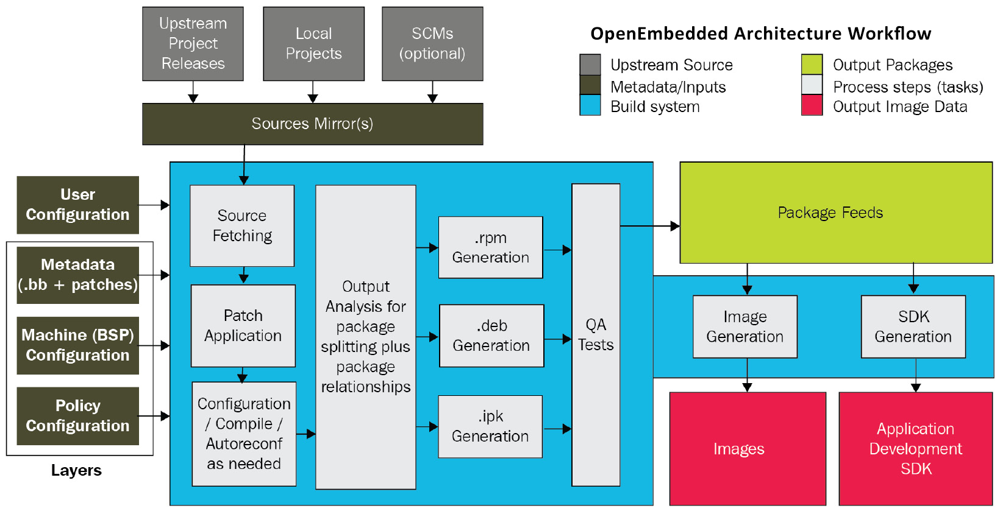
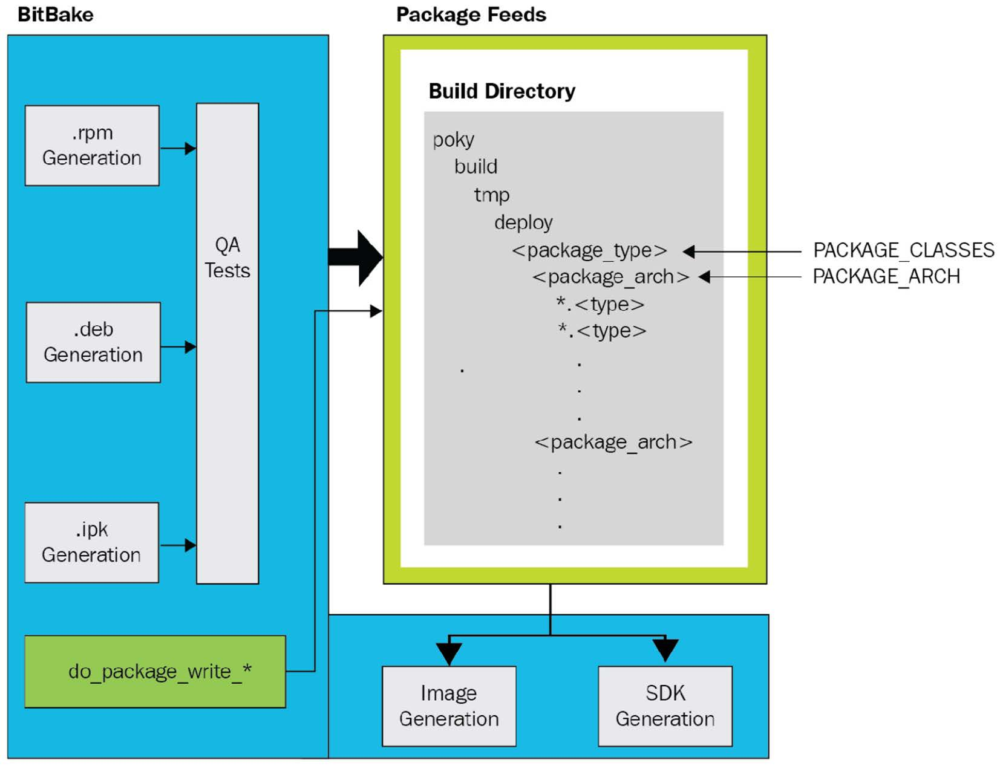
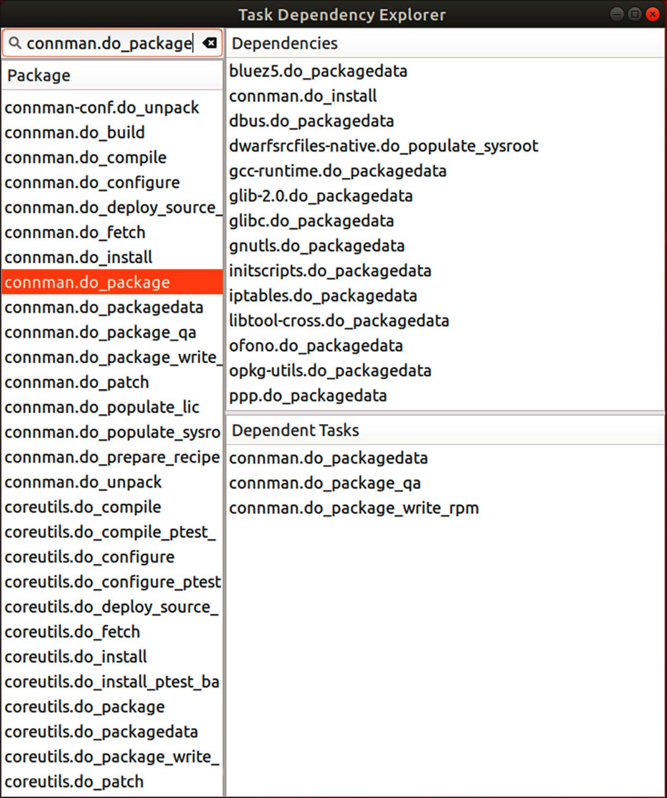

# Chương 8: Yocto bên trong (Yocto under the Hood)

Trong chương này, chúng ta sẽ đi sâu hơn vào Yocto, build system hàng đầu của embedded Linux. Chúng ta sẽ bắt đầu bằng một chuyến tham quan kiến trúc của Yocto, đưa bạn đi qua toàn bộ workflow build từng bước một. Tiếp theo, chúng ta sẽ xem cách tiếp cận multi-layer của Yocto và vì sao tách metadata thành các layer khác nhau là một ý hay. Khi ngày càng nhiều layer BitBake chồng lên nhau trong các project của bạn, các vấn đề chắc chắn sẽ phát sinh. Chúng ta sẽ xem xét một số cách debug lỗi build Yocto, bao gồm task log, `devshell` và đồ thị dependency.

Sau khi tháo rời build system, chúng ta sẽ quay lại chủ đề BitBake từ chương trước. Lần này, chúng ta sẽ đề cập nhiều hơn về cú pháp và ngữ nghĩa cơ bản để bạn có thể tự viết recipe từ đầu. Chúng ta sẽ xem các ví dụ real-world về code BitBake shell và Python từ các file recipe, include và cấu hình thực tế để bạn biết điều gì đang chờ khi bắt đầu dấn thân vào đại dương metadata của Yocto.

Trong chương này, chúng ta sẽ đề cập các chủ đề sau:

- Phân tích kiến trúc và workflow của Yocto

- Tách metadata thành các layer

- Xử lý lỗi build

- Tìm hiểu cú pháp và ngữ nghĩa của BitBake

## Yêu cầu kỹ thuật

Để làm theo các ví dụ, hãy bảo đảm bạn có những thứ sau:

- Một hệ thống host Linux-based với ít nhất 90 GB dung lượng đĩa trống

- Bản phát hành LTS Yocto 5.0 (scarthgap)

Bạn đã build bản phát hành LTS 5.0 (scarthgap) của Yocto trong Chương 6. Nếu chưa, hãy tham khảo các mục Compatible Linux Distribution và Build Host Packages của Yocto Project Quick Build guide (`https://docs.yoctoproject.org/brief-yoctoprojectqs/)` trước khi build Yocto trên host Linux theo các hướng dẫn trong Chương 6.

Code dùng trong chương này có trong thư mục của chương trong GitHub repository của cuốn sách: `https://github.com/PacktPublishing/Mastering-Embedded-Linux-Development`.

## Phân tích kiến trúc và workflow của Yocto

Yocto là một gã khổng lồ phức tạp. Tháo rời nó là bước đầu tiên để hiểu nó. Kiến trúc của một build system có thể được tổ chức theo workflow của nó. Yocto có workflow từ project OpenEmbedded mà nó dựa trên. Các nguồn tài liệu đi vào hệ thống như input dưới dạng metadata là các recipe BitBake. Build system dùng metadata này để fetch, cấu hình và compile source code thành các binary package feed. Các output package riêng lẻ này được lắp ráp bên trong một vùng staging trước khi image Linux hoàn chỉnh và SDK được tạo ra, kèm một manifest bao gồm license cho mỗi package có trên đó:



Hình 8.1 – Workflow kiến trúc OpenEmbedded

Sau đây là bảy bước của workflow build system Yocto, như được thể hiện trong sơ đồ trên:

1\. Định nghĩa các layer cho metadata policy, machine và software.

2\. Fetch source từ source URI của một project phần mềm.

3\. Giải nén source code, áp mọi patch và compile phần mềm.

4\. Cài đặt các build artifact vào một vùng staging để đóng gói.

5\. Đóng gói các build artifact đã cài đặt vào một package feed cho root filesystem.

6\. Chạy các kiểm tra QA trên một binary package feed trước khi gửi nó đi.

7\. Tạo image Linux hoàn chỉnh và một SDK song song.

Ngoại trừ bước đầu và bước cuối, tất cả các bước trong workflow này được thực hiện trên cơ sở per-package. Code linting, sanitizing và các hình thức phân tích tĩnh khác có thể diễn ra trước hoặc sau khi compile. Unit test và integration test có thể chạy trực tiếp trên máy build, trên một instance QEMU đóng vai trò stand-in cho SoC target, hoặc trên chính target. Khi một lần build hoàn tất, image hoàn chỉnh sau đó có thể được triển khai lên một nhóm thiết bị chuyên dụng để kiểm thử thêm. Là tiêu chuẩn vàng cho các build system embedded Linux, Yocto là một thành phần sống còn của pipeline phần mềm CI/ CD cho nhiều sản phẩm.

Các package mà Yocto tạo ra có thể ở định dạng `rpm`, `deb` hoặc `ipk`. Ngoài binary package chính, build system mặc định cố gắng tạo tất cả các package sau cho một recipe:

- `dbg`: Các file binary, bao gồm debug symbol

- `static-dev`: Các file header và thư viện tĩnh

- `dev`: Các file header và symlink của shared library

- `doc`: Tài liệu, bao gồm các trang man

- `locale`: Thông tin dịch ngôn ngữ

Các package không chứa file nào sẽ không được tạo, trừ khi biến `ALLOW_EMPTY` được bật. Tập package được tạo theo mặc định được quyết định bởi biến `PACKAGES`. Cả hai biến được định nghĩa trong `meta/classes-recipe/packagegroup.bbclass`, nhưng giá trị của chúng có thể bị ghi đè bởi các package group recipe kế thừa từ class BitBake đó.

Build một SDK mở ra một workflow phát triển hoàn toàn khác để thao tác với từng package recipe. Trong phần Ghi lại các thay đổi bằng devtool của chương trước, chúng ta đã học cách dùng `devtool` để thêm và sửa các package phần mềm SDK để có thể tích hợp chúng trở lại vào một image.

### Metadata

Metadata là input đi vào build system. Nó điều khiển những gì được build và build như thế nào. Metadata không chỉ là recipe. BSP, policy, patch và các dạng file cấu hình khác cũng là metadata. Phiên bản nào của một package cần build và lấy source code từ đâu chắc chắn là các dạng metadata. Một developer đưa ra tất cả những lựa chọn này bằng cách đặt tên file, đặt biến và chạy lệnh. Các hành động cấu hình, giá trị đối số này và các artifact kết quả của chúng lại là một dạng metadata khác. Yocto parse tất cả các input này và biến chúng thành một image Linux hoàn chỉnh.

Lựa chọn đầu tiên mà một developer đưa ra khi build với Yocto là nhắm tới kiến trúc machine nào. Bạn làm điều này bằng cách đặt biến `MACHINE` trong file `conf/local.conf` của project. Khi nhắm tới QEMU, tôi thích dùng `MACHINE ?= "qemuarm64"` để chỉ định `aarch64` làm kiến trúc machine. Yocto bảo đảm rằng các compiler flag đúng được lan truyền từ một BSP xuống các build layer khác.

Các thiết lập Architecture-specific được định nghĩa trong các file gọi là tune, nằm trong thư mục `meta/conf/machine/include` của Yocto và trong chính các BSP layer riêng lẻ. Một số BSP layer được đi kèm với mỗi bản phát hành Yocto. Chúng ta đã làm việc nhiều với BSP layer `meta-raspberrypi` trong chương trước. Source của mỗi BSP nằm trong Git repository riêng của nó.

Để clone BSP layer của Xilinx, chứa hỗ trợ cho họ SoC Zynq của họ, hãy dùng lệnh sau:

```
$ git clone git://git.yoctoproject.org/meta-xilinx
```

Đây chỉ là một ví dụ trong số nhiều BSP layer đi kèm Yocto. Bạn sẽ không cần layer này cho bất kỳ bài tập nào tiếp theo, vì vậy cứ thoải mái bỏ nó đi.

Metadata cần source code để tác động lên. Task `do_fetch` của BitBake có thể lấy các file source của recipe theo nhiều cách khác nhau. Sau đây là hai phương pháp nổi bật nhất:

- Khi người khác phát triển một phần mềm mà bạn cần, cách dễ nhất để lấy nó là bảo BitBake tải một tarball release của project.

- Để mở rộng phần mềm open source của người khác, chỉ cần fork repository trên GitHub. Task `do_fetch` của BitBake sau đó có thể dùng Git để clone các file source từ một `SRC_URI` cho trước.

Nếu nhóm của bạn chịu trách nhiệm về phần mềm, thì bạn có thể chọn nhúng nó vào môi trường làm việc dưới dạng một project cục bộ. Bạn có thể làm điều này bằng cách lồng nó vào như một thư mục con hoặc định nghĩa nó out-of-tree bằng class `externalsrc`. Nhúng có nghĩa là các source bị gắn với layer repository của bạn và không thể dễ dàng được dùng ở nơi khác. Các project Out-of-tree dùng `externalsrc` yêu cầu các đường dẫn giống hệt nhau trên mọi instance build và phá hoại khả năng tái lập. Cả hai kỹ thuật này chỉ là công cụ dùng để đẩy nhanh việc phát triển. Không nên dùng kỹ thuật nào trong sản xuất.

Policy là các thuộc tính được đóng gói cùng nhau thành một distribution layer. Chúng bao gồm những thứ như các tính năng nào (ví dụ, `systemd`), bản triển khai thư viện C (`glibc` hoặc `musl`) và package manager mà một bản phân phối Linux cần. Mỗi distro layer có thư mục con `conf/distro` riêng. Các file `.conf` bên trong thư mục đó định nghĩa các policy top-level cho một bản phân phối hoặc image. Hãy xem thư mục con `meta-poky` để có một ví dụ về distro layer. Distribution layer tham chiếu Poky này bao gồm các file `.conf` để build các biến thể default, tiny, bleeding-edge và alternative của Poky cho thiết bị target của bạn. Chúng ta đã đề cập điều này trong chương trước, ở phần Build distro của riêng bạn.

### Các build task

Chúng ta đã thấy cách task `do_fetch` của BitBake tải source cho một recipe. Các bước tiếp theo trong quá trình build là giải nén, patch, cấu hình và compile source code đó: `do_unpack`, `do_patch`, `do_configure` và `do_compile`.

Task `do_patch` dùng biến `FILESPATH` và biến `SRC_URI` của recipe để tìm các file patch và áp chúng vào source code dự kiến. Biến `FILESPATH`, nằm trong `meta/classes/base.bbclass`, định nghĩa tập thư mục mặc định mà build system dùng để tìm file patch (Yocto Project Reference Manual, `https://docs.yoctoproject.org/ref-manual/index.html`). Theo quy ước, các file patch có tên kết thúc bằng `.diff` và `.patch` và nằm trong một thư mục con bên dưới nơi chứa file recipe tương ứng. Hành vi mặc định này có thể được mở rộng và ghi đè bằng cách định nghĩa một biến `FILESEXTRAPATHS` và nối các đường dẫn file vào biến `SRC_URI` của recipe.

Sau khi patch source code, các task `do_configure` và `do_compile` cấu hình, compile và link nó:



Hình 8.2 – Package feed

Khi `do_compile` xong, task `do_install` copy các file kết quả vào một vùng staging, nơi chúng được chuẩn bị để đóng gói. Ở đó, task `do_package` xử lý các build artifact và lắp ráp chúng thành một hoặc nhiều package. Trước khi chúng được gửi tới vùng package feed, task `do_package_qa` cho các package artifact đi qua một loạt kiểm tra QA. Các kiểm tra QA được tự động tạo này được định nghĩa trong `meta/classes-global/insane.bbclass`. Cuối cùng, các task `do_package_write_*` tạo ra từng package riêng lẻ và gửi chúng tới vùng package feed. Khi vùng package feed đã được đưa nội dung vào, BitBake sẵn sàng tạo image và SDK.

### Tạo image

Tạo một image là một quá trình multi-stage dựa vào nhiều biến để thực hiện một loạt task. Task `do_rootfs` tạo root filesystem cho một image. Các biến sau quyết định những package nào được cài đặt lên image:

- `IMAGE_INSTALL`: Các package cần cài đặt lên image

- `PACKAGE_EXCLUDE`: Các package cần bỏ khỏi image

- `IMAGE_FEATURES`: Các package bổ sung cần cài đặt lên image

- `PACKAGE_CLASSES`: Định dạng package (`rpm`, `deb` hoặc `ipk`) cần dùng

- `IMAGE_LINGUAS`: Các ngôn ngữ (văn hóa) cần đưa vào các package hỗ trợ

Hãy nhớ lại rằng chúng ta đã thêm package vào biến `IMAGE_INSTALL` ở Chương 6, trong phần Viết một image recipe. Danh sách package từ biến `IMAGE_INSTALL` được truyền cho một package manager (`dnf`, `apt` hoặc `opkg`) để chúng có thể được cài đặt lên image. Package manager nào được gọi phụ thuộc vào định dạng của package feed: `do_package_write_rpm`, `do_package_write_deb` hoặc `do_package_write_ipk`. Việc cài đặt package diễn ra bất kể có package manager lúc runtime trên target hay không. Nếu không có package manager trên đó, thì các script cài đặt và metadata của package bị xóa khỏi image ở cuối giai đoạn này vì mục đích sạch sẽ và để tiết kiệm dung lượng.

Khi cài đặt package hoàn tất, các script post-installation của package được chạy. Các script post-installation này đi kèm trong các package. Nếu tất cả các script post-installation chạy thành công, một manifest được ghi ra và các tối ưu hóa được thực hiện trên root filesystem image. File `.manifest` top-level này liệt kê tất cả các package đã được cài đặt lên image. Các tối ưu hóa mặc định về kích thước thư viện và thời gian khởi động file thực thi được định nghĩa bởi biến `ROOTFS_POSTPROCESS_COMMAND`.

Giờ root filesystem đã được đưa đầy đủ nội dung, task `do_image` có thể bắt đầu xử lý image. Đầu tiên, tất cả các lệnh pre-processing được định nghĩa bởi biến `IMAGE_PREPROCESS_COMMAND` được thực thi. Tiếp theo, quá trình tạo ra các file output image cuối cùng. Nó làm điều này bằng cách khởi chạy một task `do_image_*` cho mỗi loại image (ví dụ, `cpio.lz4`, `ext4` và `squashfs-lzo`) được chỉ định trong biến `IMAGE_FSTYPES`. Build system sau đó lấy nội dung của thư mục `IMAGE_ROOTFS` và chuyển nó thành một hoặc nhiều file image. Các file output image này được nén khi định dạng filesystem được chỉ định cho phép. Cuối cùng, task `do_image_complete` hoàn tất image bằng cách thực thi mọi lệnh post-processing được định nghĩa bởi biến `IMAGE_POSTPROCESS_COMMAND`.

Giờ chúng ta đã lần theo toàn bộ workflow build của Yocto từ đầu đến cuối, hãy xem một số thực hành tốt nhất để cấu trúc các project lớn.

## Tách metadata thành các layer

Metadata của Yocto được tổ chức xung quanh các khái niệm sau:

- distro: Các tính năng OS, bao gồm lựa chọn thư viện C, hệ thống init và window manager

- machine: Kiến trúc CPU, kernel, driver và bootloader

- recipe: Các binary và/hoặc script ứng dụng

- image: Phát triển, sản xuất hàng loạt hoặc production

Các khái niệm này ánh xạ trực tiếp tới các sản phẩm phụ thực tế của build system, nhờ đó cho chúng ta định hướng khi thiết kế project. Chúng ta có thể vội vàng gom mọi thứ vào một layer duy nhất, nhưng điều đó nhiều khả năng sẽ dẫn đến một project kém linh hoạt và khó bảo trì. Phần cứng chắc chắn sẽ được sửa đổi, và một thiết bị tiêu dùng thành công nhanh chóng nhân lên thành một dòng sản phẩm. Vì những lý do này, tốt hơn là áp dụng cách tiếp cận multi-layered ngay từ đầu để chúng ta có được các thành phần phần mềm dễ sửa đổi, thay thế và dùng lại.

Ít nhất, bạn nên tạo các layer distribution, BSP và ứng dụng riêng cho mỗi project lớn bạn bắt đầu với Yocto. Distribution layer build OS target (distro Linux) mà (các) ứng dụng của bạn sẽ chạy trên đó. Các file cấu hình frame buffer và window manager thuộc về distribution layer. BSP layer chỉ định bootloader, kernel và device tree cần để phần cứng hoạt động. Layer ứng dụng chứa các recipe cần để build tất cả các package tạo nên (các) ứng dụng tùy chỉnh của bạn.

Chúng ta đã gặp biến `MACHINE` lần đầu ở Chương 6, khi thực hiện các lần build đầu tiên với Yocto. Chúng ta đã xem biến `DISTRO` ở cuối chương trước khi tạo distribution layer riêng. Các bài tập Yocto khác trong cuốn sách này dựa vào `meta-poky` làm distro layer. Các layer được thêm vào bản build bằng cách chèn chúng vào biến `BBLAYERS` trong file `conf/bblayers.conf` ở thư mục build đang dùng. Sau đây là một ví dụ về định nghĩa `BBLAYERS` mặc định của Poky:

```
BBLAYERS ?= " \
  /home/frank/poky/meta \
  /home/frank/poky/meta-poky \
  /home/frank/poky/meta-yocto-bsp \
  "
```

Thay vì sửa trực tiếp `bblayers.conf`, hãy dùng công cụ command-line `bitbake-layers` để làm việc với các layer của project. Hãy cưỡng lại cám dỗ sửa trực tiếp cây source Poky. Luôn tạo layer của riêng bạn (ví dụ, `meta-mine`) phía trên Poky và thực hiện thay đổi ở đó.

Đây là cách biến `BBLAYERS` nên trông trong file `conf/bblayers.conf` ở thư mục build đang dùng (ví dụ, `build-mine`) trong quá trình phát triển:

```
BBLAYERS ?= " \
  /home/frank/poky/meta \
  /home/frank/poky/meta-poky \
  /home/frank/poky/meta-yocto-bsp \
  /home/frank/meta-mine \
  /home/frank/build-mine/workspace \
  "
```

`workspace` là một layer tạm thời đặc biệt mà chúng ta đã gặp ở chương trước khi thử nghiệm với `devtool`. Mọi layer BitBake đều có cùng cấu trúc thư mục cơ bản bất kể nó là loại layer gì. Tên thư mục layer thường bắt đầu bằng tiền tố `meta` theo quy ước. Hãy xem layer giả sau:

```
$ tree meta-example
meta-example
├── classes
│ ├── class-a.bbclass
│ ├── ...
│ └── class-z.bbclass
├── conf
│ └── layer.conf
├── COPYING.MIT
├── README
├── recipes-a
│ ├── package-a
│ │ └── package-a_0.1.bb
│ ├── ...
│ └── package-z
│ └── package-z_0.1.bb
├── recipes-b
│ └── ...
└── recipes-c
 └── ...
```

Mọi layer phải có một thư mục conf với một file `layer.conf` để BitBake có thể thiết lập các đường dẫn và mẫu tìm kiếm cho các file metadata. Chúng ta đã xem kỹ nội dung của `layer.conf` ở Chương 6, khi tạo một layer meta-nova cho board Nova. Các BSP layer và distribution layer cũng có thể có một thư mục con `machine` hoặc `distro` dưới thư mục `conf` với nhiều file `.conf` hơn. Chúng ta đã xem xét cấu trúc của các machine layer và distro layer trong chương trước khi xây dựng trên nền layer `meta-raspberrypi` và tạo distro layer `meta-mackerel` riêng.

Thư mục con `classes` chỉ cần cho các layer định nghĩa class BitBake riêng. Recipe được tổ chức theo danh mục, như connectivity, vì vậy `recipes-a` thực ra là chỗ giữ chỗ cho `recipes-connectivity`, v.v. Một danh mục có thể chứa một hoặc nhiều package, mỗi package có tập file recipe BitBake (`.bb`) riêng. Các file recipe được đánh phiên bản theo số phát hành của package. Một lần nữa, các tên như `package-a` và `package-z` chỉ là chỗ giữ chỗ cho các package thật.

Rất dễ bị lạc giữa tất cả các layer khác nhau này. Ngay cả khi bạn đã thành thạo hơn với Yocto, sẽ có nhiều lần bạn tự hỏi làm sao một file cụ thể lại nằm trên image của mình. Hoặc, nhiều khả năng hơn, các file recipe mà bạn cần sửa hoặc mở rộng để làm điều cần làm nằm ở đâu? May mắn thay, Yocto cung cấp một số công cụ command-line giúp bạn trả lời những câu hỏi này. Tôi khuyên bạn khám phá `recipetool`, `oe-pkgdata-util` và `oe-pkgdata-browser` và làm quen với chúng. Bạn có thể tiết kiệm cho mình nhiều giờ bực bội.

## Xử lý lỗi build

Trong hai chương trước, chúng ta đã học cách build các image có thể boot cho QEMU, board Nova và Raspberry Pi 4. Nhưng điều gì xảy ra khi mọi thứ trục trặc? Trong phần này, chúng ta sẽ đề cập một số kỹ thuật debug hữu ích giúp viễn cảnh vật lộn với lỗi build Yocto bớt đáng sợ hơn.

Để thực thi các lệnh trong các bài tập tiếp theo, bạn cần kích hoạt một môi trường BitBake:

1\. Đầu tiên, đi tới thư mục ở cấp trên thư mục nơi bạn đã clone Yocto một bậc.

2\. Tiếp theo, thiết lập môi trường làm việc BitBake:

```
$ source poky/oe-init-build-env build-rpi
```

Lệnh này thiết lập một loạt biến môi trường và đưa bạn trở lại thư mục `build-rpi` mà chúng ta đã tạo ở chương trước.

### Cô lập lỗi

Vậy là lần build của bạn thất bại, nhưng nó thất bại ở đâu? Bạn có một thông báo lỗi, nhưng nó có nghĩa là gì và đến từ đâu? Đừng tuyệt vọng. Bước đầu tiên khi debug là tái tạo bug. Khi đã tái tạo được bug, bạn có thể thu hẹp vấn đề xuống một loạt bước đã biết. Lần lại các bước đó là cách bạn phát hiện chỗ hỏng:

1\. Đầu tiên, xem thông báo lỗi build của BitBake và xem bạn có nhận ra tên package hoặc task nào không. Nếu không chắc có những package nào trong workspace, bạn có thể dùng lệnh sau để có danh sách:

```
$ bitbake-layers show-recipes
```

2\. Khi đã xác định package nào build thất bại, hãy tìm trong các layer hiện tại mọi file recipe hoặc append liên quan đến package đó như sau:

```
$ find ../poky -name "*connman*.bb*"
```

3\. Package cần tìm trong trường hợp này là `connman`. Đối số `../poky` trong lệnh find ở trên giả định thư mục build của bạn nằm cạnh `poky`, giống như `build-rpi` từ chương trước.

4\. Tiếp theo, liệt kê tất cả các task có sẵn cho recipe `connman`:

```
$ bitbake -c listtasks connman
```

5\. Để tái tạo lỗi, bạn có thể build lại `connman` như sau:

```
$ bitbake -c clean connman && bitbake connman
```

Giờ bạn đã biết recipe và task nơi lần build thất bại, bạn đã sẵn sàng chuyển sang giai đoạn debug tiếp theo.

### Dump môi trường

Khi debug một lỗi build, bạn sẽ muốn xem giá trị hiện tại của các biến trong môi trường của BitBake. Hãy bắt đầu từ trên xuống:

1\. Đầu tiên, dump môi trường toàn cục và tìm giá trị của `DISTRO_FEATURES`:

```
$ bitbake -e | less
```

2\. Nhập `/DISTRO_FEATURES=` (lưu ý dấu gạch chéo ở đầu); `less` sẽ nhảy tới một dòng trông đại loại như thế này:

```
DISTRO_FEATURES="acl alsa argp bluetooth ext2 ipv4 ipv6 largefile
pcmcia usbgadget usbhost wifi xattr nfs zeroconf pci 3g nfc x11 vfat
largefile opengl ptest multiarch wayland vulkan pulseaudio sysvinit
gobject-introspection-data ldconfig"
```

3\. Để dump môi trường package của BusyBox và tìm thư mục source của nó, hãy dùng lệnh sau:

```
$ bitbake -e busybox | grep ^S=
```

4\. Để tìm thư mục làm việc của ConnMan, hãy dùng lệnh sau:

```
$ bitbake-getvar -r connman WORKDIR
```

5\. Thư mục làm việc của một package là nơi lưu các task log của recipe trong các lần build BitBake.

Ở bước 1, chúng ta có thể pipe output từ `bitbake -e` vào `grep`, nhưng `less` cho phép lần theo việc đánh giá biến dễ hơn. Nhập `/DISTRO_FEATURES` không có dấu bằng ở cuối trong less để tìm thêm các lần xuất hiện của biến. Nhấn n để nhảy tới lần xuất hiện tiếp theo và N để nhảy lại lần xuất hiện trước.

Các lệnh tương tự hoạt động cho cả image recipe lẫn package recipe:

```
$ bitbake -e core-image-minimal | grep ^S=
```

Trong trường hợp này, môi trường target cần dump thuộc về `core-image-minimal`.

Giờ bạn đã biết các file source và task log nằm ở đâu, hãy xem một số task log.

### Đọc task log

BitBake tạo một file log cho mỗi shell task và lưu nó vào một thư mục temp trong thư mục làm việc của package. Trong trường hợp ConnMan, đường dẫn tới thư mục temp đó trông đại loại như sau:

```
$ ./tmp-glibc/work/cortexa72-oe-linux/connman/1.42/temp
```

Định dạng tên file log là `log.do_<task>.<pid>`. Cũng có các symlink không có `<pid>` ở cuối tên, trỏ tới các file log mới nhất cho mỗi task. Các file log chứa output của lần chạy task, trong hầu hết các trường hợp là tất cả thông tin bạn cần để debug vấn đề. Nếu không, đoán xem bạn có thể làm gì?

### Thêm logging

Logging từ Python khác với logging từ shell trong BitBake. Để log từ Python, bạn có thể dùng module `bb` của BitBake, module này gọi tới module `logger` chuẩn của Python, như sau:

```
bb.plain -> none; Output: logs console
bb.note -> logger.info; Output: logs
bb.warn -> logger.warning; Output: logs console
bb.error -> logger.error; Output: logs console
bb.fatal -> logger.critical; Output: logs console
bb.debug -> logger.debug; Output: logs console
```

Để log từ shell, bạn có thể dùng class `logging` của BitBake, có source tại `meta/classes-global/logging.bbclass`. Mọi recipe kế thừa `base.bbclass` đều tự động kế thừa `logging.bbclass`. Điều này có nghĩa là tất cả các hàm logging sau đều đã có sẵn cho bạn từ hầu hết các file recipe shell:

```
bbplain -> Prints exactly what is passed in. Use sparingly.
bbnote -> Prints noteworthy conditions with the NOTE prefix.
bbwarn -> Prints a non-fatal warning with the WARNING prefix.
bberror -> Prints a non-fatal error with the ERROR prefix.
bbfatal -> Prints a fatal error and halts the build.
bbdebug -> Prints debug messages depending on log level.
```

Theo source của `logging.bbclass`, hàm `bbdebug` nhận một mức debug log kiểu số nguyên làm đối số đầu tiên:

```
# Usage: bbdebug 1 "first level debug message"
# bbdebug 2 "second level debug message
bbdebug () {
    USAGE = 'Usage: bbdebug [123] "message"'
    …
}
```

Tùy theo mức debug log, một thông điệp `bbdebug` có thể được hoặc không được đưa ra console.

### Chạy lệnh từ devshell

BitBake cung cấp một development shell để bạn có thể chạy các lệnh build thủ công trong một môi trường tương tác hơn. Khởi chạy một `devshell` cần một terminal multiplexer như `tmux`. Để cài đặt `tmux`, hãy dùng lệnh sau:

```
$ sudo apt install tmux
```

Để vào một `devshell` để build ConnMan, hãy dùng lệnh sau:

```
$ bitbake -c devshell connman
```

Đầu tiên, lệnh này giải nén và patch source code cho ConnMan. Tiếp theo, nó mở một terminal mới trong thư mục source của ConnMan với môi trường đã được thiết lập đúng để build. Khi đã ở bên trong một `devshell`, bạn có thể chạy các lệnh như `./configure` và `make`, hoặc gọi trực tiếp cross-compiler bằng `$CC`. `devshell` rất phù hợp để thử nghiệm các giá trị như `CFLAGS` hay `LDFLAGS`, những giá trị được truyền cho các công cụ như CMake và Autotools dưới dạng đối số command-line hoặc biến môi trường. Ít nhất, bạn có thể tăng mức độ chi tiết của các lệnh build nếu các thông báo lỗi bạn đang đọc không có ý nghĩa.

### Vẽ đồ thị dependency

Đôi khi, nguyên nhân của lỗi build không thể được tìm thấy trong các file recipe của package vì lỗi thực ra xảy ra khi build một trong các dependency của package. Để có danh sách dependency của package ConnMan, hãy dùng lệnh sau:

```
$ bitbake -v connman
```

Chúng ta có thể dùng task explorer built-in của BitBake để hiển thị và duyệt các dependency:

```
$ bitbake -g connman -u taskexp
```

Lệnh trên khởi chạy UI đồ họa của task explorer sau khi phân tích ConnMan:

LƯU Ý QUAN TRỌNG

Một số image lớn hơn như core-image-x11 có cây dependency package phức tạp, nhiều khả năng sẽ làm task explorer bị crash.



Hình 8.3 – Task explorer

Giờ hãy rời chủ đề build và lỗi build để đắm mình vào nguyên liệu thô của The Yocto Project. Tôi đang nói đến metadata BitBake.

## Tìm hiểu cú pháp và ngữ nghĩa của BitBake

BitBake là một task runner. Về mặt đó nó giống GNU Make, chỉ khác là nó hoạt động trên recipe thay vì makefile. Metadata trong các recipe này định nghĩa các task bằng shell và Python. Bản thân BitBake được viết bằng Python. Project OpenEmbedded mà Yocto dựa trên gồm BitBake và một tập lớn các recipe để build các bản phân phối embedded Linux. Sức mạnh của BitBake nằm ở khả năng chạy các task song song trong khi vẫn thỏa mãn các dependency inter-task. Cách tiếp cận metadata phân lớp và inheritance-based cho phép Yocto mở rộng quy mô theo những cách mà các build system Buildroot-based đơn giản là không thể.

Trong Chương 6, chúng ta đã học về năm loại file metadata BitBake: `.bb`, `.bbappend`, `.inc`, `.bbclass` và `.conf`. Chúng ta cũng đã viết các recipe BitBake để build một chương trình `helloworld` cơ bản và image `nova-image`. Giờ chúng ta sẽ xem kỹ hơn nội dung của các file metadata BitBake. Chúng ta biết rằng các task được viết bằng sự pha trộn giữa shell và Python, nhưng cái gì đi đâu và tại sao? Những cấu trúc ngôn ngữ nào có sẵn cho chúng ta và chúng ta có thể làm gì với chúng? Làm sao kết hợp metadata để build ứng dụng? Trước khi có thể khai thác toàn bộ sức mạnh của Yocto, bạn cần học cách đọc và viết metadata BitBake. Để làm điều đó, bạn cần học cú pháp và ngữ nghĩa của BitBake.

### Task

Task là các hàm mà BitBake cần chạy theo trình tự để thực thi một recipe. Hãy nhớ rằng tên task bắt đầu bằng tiền tố `do_`. Sau đây là một task từ `recipes-core/systemd`:

```
do_deploy () {
    install ${B}/src/boot/efi/systemd-boot*.efi ${DEPLOYDIR}
}
addtask deploy before do_build after do_compile
```

Trong ví dụ này, một hàm tên là `do_deploy` được định nghĩa và ngay lập tức được nâng lên thành task bằng lệnh `addtask`. Lệnh `addtask` cũng chỉ định các dependency inter-task. Ví dụ, task `do_deploy` này phụ thuộc vào việc task `do_compile` hoàn tất, còn task `do_build` phụ thuộc vào việc task `do_deploy` hoàn tất. Các dependency được biểu diễn bằng `addtask` chỉ có thể là nội bộ trong file recipe.

Task cũng có thể bị xóa bằng lệnh `deltask`. Lệnh này ngăn BitBake thực thi task như một phần của recipe. Để xóa task `do_deploy` ở trên, hãy dùng lệnh sau:

```
deltask do_deploy
```

Lệnh này xóa task khỏi recipe, nhưng định nghĩa hàm `do_deploy` gốc vẫn còn và vẫn có thể được gọi.

### Dependency

Để bảo đảm xử lý song song hiệu quả, BitBake xử lý các dependency ở mức task. Chúng ta vừa thấy cách `addtask` có thể được dùng để biểu diễn dependency giữa các task trong một file recipe duy nhất. Dependency giữa các task trong các recipe khác nhau cũng tồn tại. Thực ra, các dependency inter-task này chính là thứ chúng ta thường nghĩ đến khi xét các dependency build-time và runtime giữa các package.

#### Dependency Inter-task

Variable flag (varflag) là một cách gắn thuộc tính cho biến. Chúng hoạt động như các key trong một hash map theo nghĩa cho phép bạn gán key với value và lấy value bằng key. BitBake định nghĩa một tập lớn varflag để dùng trong recipe và class. Các varflag này cho biết các thành phần và dependency của một task là gì. Sau đây là một số ví dụ về varflag:

```
do_patch[postfuncs] += "copy_sources"
do_package_index[depends] += "signing-keys:do_deploy"
do_rootfs[recrdeptask] += "do_package_write_deb do_package_qa"
```

Giá trị được gán cho key của một varflag thường là một hoặc nhiều task khác. Điều này có nghĩa là varflag của BitBake cho chúng ta một cách khác để biểu diễn dependency inter-task, khác với `addtask`. Lệnh `addtask` chỉ định khi nào một task được thực thi (ví dụ, `before do_build after do_compile`). Hầu hết các developer embedded Linux có lẽ sẽ không bao giờ cần động tới varflag trong công việc day-to-day. Tôi giới thiệu chúng ở đây để chúng ta có thể hiểu các ví dụ `DEPENDS` và `RDEPENDS` sau đây.

#### Dependency Build-time

BitBake dùng biến `DEPENDS` để quản lý các dependency build-time. Varflag `deptask` của một task chỉ ra task phải hoàn tất cho mỗi mục trong `DEPENDS` trước khi task đó có thể được thực thi (BitBake User Manual, `https://docs.yoctoproject.org/bitbake/bitbake-user-manual/bitbake-user-manual-metadata.html#build-dependencies`):

```
do_package[deptask] += "do_packagedata"
```

Trong ví dụ này, task `do_packagedata` của mỗi mục trong `DEPENDS` phải hoàn tất trước khi `do_package` có thể thực thi.

Ngoài ra, bạn có thể bỏ qua biến `DEPENDS` và định nghĩa tường minh các dependency build-time bằng flag `depends`:

```
do_patch[depends] += "quilt-native:do_populate_sysroot"
```

Trong ví dụ này, task `do_populate_sysroot` thuộc namespace `quilt-native` phải hoàn tất trước khi `do_patch` có thể thực thi. Các task của một recipe thường được nhóm lại trong namespace riêng của chúng để cho phép kiểu truy cập trực tiếp này.

#### Dependency runtime

BitBake dùng các biến `PACKAGES` và `RDEPENDS` để quản lý các dependency runtime. Biến `PACKAGES` liệt kê tất cả các package runtime mà một recipe tạo ra. Mỗi package đó có thể có các dependency runtime `RDEPENDS`. Đây là các package phải được cài đặt để một package cho trước chạy được. Varflag `rdeptask` của một task chỉ định những task nào phải hoàn tất cho mỗi dependency runtime trước khi task đó có thể được thực thi (BitBake User Manual, `https://docs.yoctoproject.org/bitbake/bitbake-user-manual/bitbake-user-manual-metadata.html#runtime-dependencies`):

```
do_package_qa[rdeptask] = "do_packagedata"
```

Trong ví dụ này, task `do_package_data` của mỗi mục trong `RDEPENDS` phải hoàn tất trước khi `do_package_qa` có thể thực thi.

Tương tự, flag `rdepends` hoạt động giống flag `depends` bằng cách cho phép bạn bỏ qua biến `RDEPENDS`. Khác biệt duy nhất là `rdepends` được áp dụng lúc runtime thay vì lúc build.

### Biến

Cú pháp biến BitBake giống cú pháp biến của Make. Phạm vi của một biến trong BitBake phụ thuộc vào loại file metadata nơi biến được định nghĩa. Mọi biến được khai báo trong một file recipe (`.bb`) là cục bộ. Mọi biến được khai báo trong một file cấu hình (`.conf`) là toàn cục. Một image chỉ là một recipe, vì vậy một image không thể ảnh hưởng đến những gì xảy ra trong một recipe khác.

#### Gán và mở rộng

Việc gán và mở rộng biến hoạt động giống như trong shell. Mặc định, phép gán diễn ra ngay khi câu lệnh được parse và là vô điều kiện. Ký tự `$` kích hoạt việc mở rộng biến. Dấu ngoặc nhọn bao quanh là tùy chọn và dùng để bảo vệ biến khỏi bị mở rộng cùng các ký tự ngay sau nó. Các biến được mở rộng thường được bọc trong dấu ngoặc kép để tránh vô tình tách từ và globbing:

```
OLDPKGNAME = "dbus-x11"
PROVIDES:${PN} = "${OLDPKGNAME}"
```

Biến có thể thay đổi và thường được đánh giá tại thời điểm tham chiếu, không phải lúc gán, giống như trong Make. Điều này có nghĩa là nếu một biến được tham chiếu ở right-hand side của một phép gán, thì biến được tham chiếu đó không được đánh giá cho đến khi biến ở left-hand side được mở rộng. Vì vậy, nếu một giá trị ở right-hand side thay đổi theo thời gian, thì giá trị của biến ở left-hand side cũng thay đổi theo.

Phép gán có điều kiện chỉ định nghĩa một biến nếu nó chưa được định nghĩa tại thời điểm parse. Điều này ngăn việc gán lại khi bạn không muốn hành vi đó:

```
PREFERRED_PROVIDER_virtual/kernel ?= "linux-yocto"
```

Phép gán có điều kiện được dùng ở đầu makefile để ngăn các biến có thể đã được build system đặt (ví dụ, `CC`, `CFLAGS` và `LDFLAGS`) bị ghi đè. Phép gán có điều kiện bảo đảm chúng ta không append hoặc prepend vào một biến chưa được định nghĩa ở phần sau trong recipe.

Phép gán lazy dùng ??= hoạt động giống hệt ?= ngoại trừ việc phép gán được thực hiện ở cuối quá trình parse thay vì ngay lập tức (BitBake User Manual, HYPERLINK “`https://docs.yoctoproject.org/bitbake/bitbake-user-manual/bitbake-user-manual-metadata.html`#setting-a-weak-default-value”):

```
TOOLCHAIN_TEST_HOST ??= "localhost"
```

Điều đó có nghĩa là nếu một tên biến nằm ở left-hand side của nhiều phép gán lazy, thì câu lệnh gán lazy cuối cùng sẽ thắng.

Một dạng gán biến khác buộc right-hand side của phép gán được đánh giá ngay lập tức tại thời điểm parse:

```
target_datadir := "${datadir}"
```

Lưu ý rằng toán tử`:=` cho phép gán tức thời đến từ Make chứ không phải shell.

#### Append và prepend

Append hoặc prepend vào một biến hoặc variable flag trong BitBake rất dễ. Hai toán tử sau chèn một dấu cách duy nhất vào giữa giá trị ở left-hand side và giá trị được append hoặc prepend từ right-hand side:

```
CXXFLAGS += "-std=c++11"
PACKAGES =+ "gdbserver"
```

Lưu ý rằng toán tử `+=` có nghĩa là tăng chứ không phải append khi áp dụng cho một số nguyên thay vì giá trị chuỗi.

Nếu muốn bỏ dấu cách đó, cũng có các toán tử gán làm điều này:

```
BBPATH .= ":${LAYERDIR}"
FILESEXTRAPATHS =. "${FILE_DIRNAME}/systemd:"
```

Các phiên bản single-space của các toán tử gán append và prepend được dùng khắp các file metadata BitBake.

#### Override

BitBake cung cấp một cú pháp thay thế để append và prepend vào biến. Kiểu nối này được gọi là override syntax:

```
CFLAGS:append = " -DSQLITE_ENABLE_COLUMN_METADATA"
PROVIDES:prepend = "${PN}"
```

Dù thoạt nhìn có thể không hiển nhiên, hai dòng trên không định nghĩa biến mới. Các hậu tố `:append` và `:prepend` sửa đổi hoặc override giá trị của các biến có sẵn. Chúng hoạt động giống `.=` và `=.` của BitBake hơn là các toán tử `+=` và `=+`, theo nghĩa chúng bỏ dấu cách khi kết hợp chuỗi. Khác với các toán tử đó, override là lazy, vì vậy phép gán không diễn ra cho đến khi toàn bộ việc parse hoàn tất.

Cuối cùng, hãy xem một dạng gán có điều kiện nâng cao hơn liên quan đến biến `OVERRIDES` được định nghĩa trong `meta/conf/bitbake.conf`. Biến `OVERRIDES` là một danh sách colon-separated các điều kiện mà bạn muốn được thỏa mãn. Danh sách này được dùng để chọn giữa nhiều phiên bản của cùng một biến, mỗi phiên bản được phân biệt bằng một hậu tố khác nhau. Các hậu tố khác nhau khớp với tên của các điều kiện. Giả sử danh sách `OVERRIDES` chứa `${TRANSLATED_TARGET_ARCH}` làm một điều kiện. Giờ bạn có thể định nghĩa một phiên bản của một biến có điều kiện là kiến trúc CPU target `aarch64`, như biến `VALGRINDARCH:aarch64`:

```
VALGRINDARCH ?= "${TARGET_ARCH}"
VALGRINDARCH:aarch64 = "arm64"
VALGRINDARCH:x86-64 = "amd64"
```

Khi biến `TRANSLATED_TARGET_ARCH` mở rộng thành `aarch64`, phiên bản V`ALGRINDARCH:aarch64` của biến `VALGRINDARCH` được chọn thay cho tất cả các override khác. Chọn giá trị biến dựa trên `OVERRIDES` gọn gàng và ít dễ vỡ hơn các phương pháp gán có điều kiện khác, như các directive `#ifdef` trong C.

BitBake cũng hỗ trợ các thao tác append và prepend vào giá trị biến dựa trên việc một mục cụ thể có nằm trong `OVERRIDES` hay không (BitBake User Manual, `https://docs.yoctoproject.org/bitbake/bitbake-user-manual/bitbake-user-manual-metadata.html#conditional-metadata`). Sau đây là nhiều ví dụ real-world:

```
EXTRA_OEMAKE:prepend:task-compile = "${PARALLEL_MAKE} "
EXTRA_OEMAKE:prepend:task-install = "${PARALLEL_MAKEINST} "
DEPENDS = "attr libaio libcap acl openssl zip-native"
DEPENDS:append:libc-musl = " fts "
EXTRA_OECONF:append:libc-musl = " LIBS=-lfts "
EXTRA_OEMAKE:append:libc-musl = " LIBC=musl "
```

Lưu ý cách `libc-musl` là một điều kiện để append các giá trị chuỗi vào các biến `DEPENDS`, `EXTRA_OECONF` và `EXTRA_OEMAKE`. Giống như override syntax vô điều kiện ở trên để append và prepend vào biến, cú pháp có điều kiện này cũng là lazy. Phép gán không diễn ra cho đến sau khi các recipe và file cấu hình đã được parse.

Append và prepend có điều kiện vào biến dựa trên nội dung của `OVERRIDES` là phức tạp và có thể dẫn đến những bất ngờ không mong muốn. Tôi khuyên bạn thực hành nhiều với các phép gán có điều kiện dựa trên `OVERRIDES` trước khi dùng các tính năng BitBake nâng cao này.

#### Inline Python

Ký hiệu `@` trong BitBake cho phép chúng ta chèn và thực thi code Python bên trong biến. Một biểu thức inline Python được đánh giá mỗi lần biến ở left-hand side của toán tử `=` được mở rộng. Một biểu thức inline Python ở right-hand side của toán tử `:=` chỉ được đánh giá một lần lúc parse. Sau đây là một số ví dụ về mở rộng biến bằng inline Python:

```
PV = "${@bb.parse.vars_from_file(d.getVar('FILE', False),d)[1] or '1.0'}"
BOOST_MAJ = "${@"_".join(d.getVar("PV").split(".")[0:2])}"
GO_PARALLEL_BUILD ?= "${@oe.utils.parallel_make_argument(d, '-p %d')}"
```

Lưu ý rằng `bb` và `oe` là alias cho các module Python của BitBake và OpenEmbedded. Ngoài ra, lưu ý rằng `d.getVar("PV")` được dùng để lấy giá trị của biến `PV` từ môi trường runtime của task. Biến `d` tham chiếu tới một đối tượng datastore mà BitBake lưu một bản sao môi trường thực thi gốc vào đó. Đây phần lớn là cách code BitBake shell và Python tương tác với nhau.

### Hàm

Hàm là chất liệu tạo nên các task BitBake. Chúng được viết bằng shell hoặc Python và được định nghĩa bên trong các file `.bbclass`, `.bb` và `.inc`.

#### Shell

Các hàm viết bằng shell được thực thi dưới dạng hàm hoặc task. Các hàm chạy dưới dạng task thường có tên bắt đầu bằng tiền tố `do_`. Một hàm trong shell trông như sau:

```
meson_do_install() {
    DESTDIR='${D}' ninja -v ${PARALLEL_MAKEINST} install
}
```

Hãy nhớ giữ shell-agnostic khi viết hàm. BitBake thực thi các đoạn shell bằng `/bin/sh`, có thể là Bash shell hoặc không, tùy theo distro của host. Hãy tránh Bashism bằng cách chạy linter `scripts/verify-bashisms` trên các shell script của bạn.

#### Python

BitBake hiểu ba loại hàm Python: pure, BitBake style và anonymous.

##### Hàm Python pure

Một hàm Python pure được viết bằng Python thông thường và được gọi bởi code Python khác. Với từ pure, tôi muốn nói hàm này sống hoàn toàn trong phạm vi môi trường thực thi của trình thông dịch Python, chứ không phải pure theo nghĩa lập trình hàm. Sau đây là một ví dụ từ `meta/recipes-connectivity/bluez5/bluez5.inc`:

```
def get_noinst_tools_paths (d, bb, tools):
    s = list()
    bindir = d.getVar("bindir")
    for bdp in tools.split():
        f = os.path.basename(bdp)
        s.append("%s/%s" % (bindir, f))
    return "\n".join(s)
```

Lưu ý rằng hàm này nhận tham số giống như một hàm Python thật. Còn một vài điều đáng chú ý nữa tôi muốn chỉ ra về hàm này. Thứ nhất, đối tượng datastore không có sẵn, vì vậy bạn cần truyền nó vào như một tham số của hàm (biến `d` trong trường hợp này). Thứ hai, module `os` tự động có sẵn, vì vậy không cần import hay truyền nó vào.

Hàm Python pure có thể được gọi bởi inline Python được gán cho biến shell bằng ký hiệu `@`. Thực ra, đó chính xác là điều xảy ra ở dòng tiếp theo của file include này:

```
FILES:${PN}-noinst-tools = \
"${@get_noinst_tools_paths(d, bb, d.getVar('NOINST_TOOLS'))}"
```

Lưu ý rằng cả đối tượng datastore `d` và module `bb` đều tự động có sẵn bên trong phạm vi inline Python sau ký hiệu `@`.

##### Hàm Python BitBake-style

Một định nghĩa hàm Python BitBake-style được đánh dấu bằng từ khóa `python` thay vì từ khóa `def` gốc của Python. Các hàm này được thực thi bằng cách gọi `bb.build.exec_func()` từ các hàm Python khác, bao gồm cả các hàm nội bộ của chính BitBake. Khác với hàm Python pure, các hàm BitBake-style không nhận tham số. Việc không có tham số không phải là vấn đề lớn vì đối tượng datastore luôn có sẵn dưới dạng một biến toàn cục (tức là `d`). Dù không mấy Pythonic, kiểu định nghĩa hàm BitBake chiếm ưu thế khắp Yocto. Sau đây là một định nghĩa hàm Python BitBake-style từ `meta/classes/sign_rpm.bbclass`:

```
python sign_rpm () {
    import glob
    from oe.gpg_sign import get_signer

    signer = get_signer(d, d.getVar('RPM_GPG_BACKEND'))
    rpms = glob.glob(d.getVar('RPM_PKGWRITEDIR') + '/*')

    signer.sign_rpms(rpms,
                     d.getVar('RPM_GPG_NAME'),
                     d.getVar('RPM_GPG_PASSPHRASE'),
                     d.getVar('RPM_FILE_CHECKSUM_DIGEST'),
                     int(d.getVar('RPM_GPG_SIGN_CHUNK')),
                     d.getVar('RPM_FSK_PATH'),
                     d.getVar('RPM_FSK_PASSWORD'))
}
```

##### Hàm Python anonymous

Một hàm Python anonymous trông rất giống một hàm Python BitBake-style, nhưng nó thực thi trong lúc parse. Vì chạy trước, các hàm anonymous phù hợp cho các thao tác có thể được thực hiện lúc parse, như khởi tạo biến và các dạng thiết lập khác. Định nghĩa hàm anonymous có thể được viết có hoặc không có tên hàm `__anonymous`:

```
python __anonymous () {
    systemd_packages = "${PN} ${PN}-wait-online"
    pkgconfig = d.getVar('PACKAGECONFIG')
    if ('openvpn' or 'vpnc' or 'l2tp' or 'pptp') in pkgconfig.split():
        systemd_packages += " ${PN}-vpn"
    d.setVar('SYSTEMD_PACKAGES', systemd_packages)
}
python () {
    packages = d.getVar('PACKAGES').split()
    if d.getVar('PACKAGEGROUP_DISABLE_COMPLEMENTARY') != '1':
        types = ['', '-dbg', '-dev']
        if bb.utils.contains('DISTRO_FEATURES', 'ptest', True, False, d):
            types.append('-ptest')
        packages = [pkg + suffix for pkg in packages
                    for suffix in types]
        d.setVar('PACKAGES', ' '.join(packages))
    for pkg in packages:
        d.setVar('ALLOW_EMPTY_%s' % pkg, '1')
}
```

Biến `d` bên trong một hàm Python anonymous đại diện cho datastore của toàn bộ recipe (BitBake User Manual, `https://docs.yoctoproject.org/bitbake/bitbake-user-manual/bitbake-user-manual-metadata.html#anonymous-python-functions`). Vì vậy, khi bạn đặt một biến bên trong phạm vi hàm anonymous, giá trị đó sẽ có sẵn cho các hàm khác thông qua đối tượng datastore toàn cục khi chúng chạy.

### Xem lại RDEPENDS

Hãy quay lại chủ đề runtime dependency. Đây là các package phải được cài đặt để một package cho trước chạy được. Danh sách này được định nghĩa trong biến `RDEPENDS` của package. Sau đây là một đoạn trích thú vị từ `populate_sdk_base.bbclass`:

```
do_sdk_depends[rdepends] = "${@get_sdk_ext_rdepends(d)}"
```

Và đây là định nghĩa của hàm inline Python tương ứng:

```
def get_sdk_ext_rdepends(d):
    localdata = d.createCopy()
    localdata.appendVar('OVERRIDES', ':task-populate-sdk-ext')
    return localdata.getVarFlag('do_populate_sdk', 'rdepends')
```

Có khá nhiều thứ cần phân tích ở đây. Thứ nhất, hàm tạo một bản sao của đối tượng datastore để không sửa đổi môi trường runtime của task. Hãy nhớ rằng biến `OVERRIDES` là một danh sách điều kiện dùng để chọn giữa nhiều phiên bản của một biến. Dòng tiếp theo thêm một điều kiện `task-populate-sdk-ext` vào danh sách `OVERRIDES` trong bản sao cục bộ của datastore. Cuối cùng, hàm trả về giá trị của `rdepends varflag` cho task `do_populate_sdk`. Khác biệt lúc này là `rdepends` được đánh giá bằng các phiên bản `_task-populate-sdk-ext` của các biến như sau:

```
SDK_EXT:task-populate-sdk-ext = "-ext"
SDK_DIR:task-populate-sdk-ext = "${WORKDIR}/sdk-ext"
```

Tôi thấy cách dùng `OVERRIDES` tạm thời này vừa khéo léo vừa đáng sợ.

Cú pháp và ngữ nghĩa của BitBake có thể có vẻ đáng ngại. Kết hợp shell và Python tạo ra một sự pha trộn thú vị các tính năng ngôn ngữ. Giờ chúng ta không chỉ biết cách định nghĩa biến và hàm, mà còn có thể kế thừa từ các file class, override biến và thay đổi điều kiện bằng lập trình. Các khái niệm nâng cao này xuất hiện lặp đi lặp lại trong các file `.bb`, `.bbappend`, `.inc`, `.bbclass` và `.conf` và sẽ ngày càng trở nên quen thuộc theo thời gian. Khi chúng ta cố gắng thành thạo BitBake và bắt đầu thử sức với những khả năng mới có, sai sót chắc chắn sẽ xảy ra.

## Tóm tắt

Mặc dù bạn có thể build gần như mọi thứ bằng Yocto, không phải lúc nào cũng dễ biết build system đang làm gì và làm như thế nào. Tuy vậy, vẫn có hy vọng. Có các công cụ command-line giúp chúng ta tìm ra một thứ đến từ đâu và cách thay đổi nó. Có các task log mà chúng ta có thể đọc và ghi vào. Cũng có `devshell`, mà chúng ta có thể dùng để cấu hình và compile từng thứ riêng lẻ từ command line. Và nếu chia project thành nhiều layer ngay từ đầu, chúng ta nhiều khả năng sẽ thu được nhiều giá trị hơn từ công việc mình làm.

Sự pha trộn shell và Python của BitBake hỗ trợ một số cấu trúc ngôn ngữ mạnh mẽ, như kế thừa, override và chọn biến có điều kiện. Điều đó vừa tốt vừa xấu. Tốt ở chỗ các layer và recipe hoàn toàn có thể kết hợp và tùy chỉnh.

Xấu ở chỗ metadata trong các file recipe khác nhau và các layer khác nhau có thể tương tác theo những cách kỳ lạ và bất ngờ. Kết hợp các tính năng ngôn ngữ mạnh mẽ đó với khả năng của đối tượng datastore trong vai trò cổng nối giữa môi trường thực thi shell và Python, và bạn có một công thức cho vô số giờ vui vẻ.

Phần này kết thúc chuyến khám phá in-depth The Yocto Project và phần thứ hai của cuốn sách, Build image Embedded Linux. Trong phần tiếp theo của cuốn sách, chúng ta chuyển hướng và xem xét Kiến trúc hệ thống và các quyết định thiết kế, bắt đầu với Chương 9. Chúng ta sẽ có dịp dùng lại Yocto trong Chương 10, khi đánh giá Mender.

## Tìm hiểu thêm

- Yocto Project Overview and Concepts Manual, của Yocto Project – `https://docs.yoctoproject.org/overview-manual/`

- What I wish I’d known about Yocto Project, của Yocto Project – `https://docs.yoctoproject.org/what-i-wish-id-known.html`

- BitBake User Manual, của Richard Purdie, Chris Larson và Phil Blundell – `https://docs.yoctoproject.org/bitbake/`

- Embedded Linux Development Using Yocto Project Cookbook, của Alex Gonzalez

## Tham gia cộng đồng của chúng tôi trên Discord

Hãy tham gia không gian Discord của cộng đồng chúng tôi để thảo luận với các tác giả và những độc giả khác: `https://packt.link/embeddedsystems`
