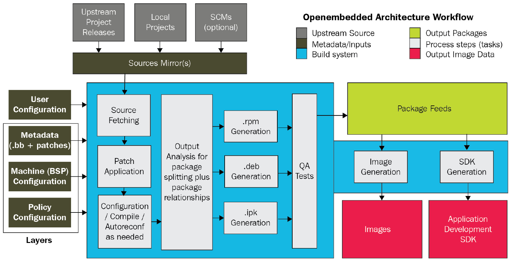

# *Chương 8*: Yocto bên trong (Yocto Under the Hood)

Trong chương này, chúng ta sẽ đi sâu hơn vào **Yocto**, build system hàng đầu của embedded Linux. Chúng ta sẽ bắt đầu với một chuyến tham quan kiến trúc của Yocto, đưa bạn đi qua toàn bộ workflow build từng bước một. Tiếp theo, chúng ta sẽ xem cách tiếp cận multi-layer của Yocto và vì sao tách metadata thành các layer khác nhau là ý hay. Khi ngày càng nhiều layer **BitBake** chồng lên nhau trong project, các vấn đề chắc chắn sẽ nảy sinh. Chúng ta sẽ xem xét một số cách debug lỗi build Yocto, bao gồm task log, `devshell` và đồ thị phụ thuộc.

Sau khi mổ xẻ build system, chúng ta sẽ quay lại chủ đề BitBake từ chương trước. Lần này, chúng ta sẽ đề cập thêm về cú pháp và ngữ nghĩa cơ bản để bạn có thể tự viết recipe từ đầu. Chúng ta sẽ xem các ví dụ real-world về code shell và Python của BitBake từ các file recipe, include và cấu hình thực tế để bạn biết điều gì đang chờ khi bắt đầu dấn thân vào đại dương metadata của Yocto.

Trong chương này, chúng ta sẽ đề cập các chủ đề sau:

- Phân tích kiến trúc và workflow của Yocto
- Tách metadata thành các layer
- Khắc phục lỗi build
- Hiểu cú pháp và ngữ nghĩa của BitBake

Hãy bắt đầu!

## Yêu cầu kỹ thuật

Để làm theo các ví dụ trong chương này, hãy bảo đảm bạn có những thứ sau:

- Một hệ thống host Linux-based có ít nhất 60 GB dung lượng đĩa trống
- Bản phát hành Yocto 3.1 (Dunfell) LTS

Lẽ ra bạn đã build bản phát hành Yocto 3.1 (Dunfell) LTS trong [*Chương 6*](ch06_selecting_a_build_system.vi.md), *Chọn build system*. Nếu chưa, hãy tham khảo các mục *Compatible Linux Distribution* và *Build Host Packages* của hướng dẫn *Yocto Project Quick Build* ([https://www.yoctoproject.org/docs/current/brief-yoctoprojectqs/brief-yoctoprojectqs.html](https://www.yoctoproject.org/docs/current/brief-yoctoprojectqs/brief-yoctoprojectqs.html)) trước khi build Yocto trên host Linux theo hướng dẫn trong [*Chương 6*](ch06_selecting_a_build_system.vi.md).

## Phân tích kiến trúc và workflow của Yocto

**Yocto** là một thứ phức tạp. Mổ xẻ nó là bước đầu tiên để hiểu nó. Kiến trúc của một build system có thể được tổ chức theo workflow của nó. Yocto lấy workflow từ project **OpenEmbedded**, project mà nó dựa trên. Các nguyên liệu source đi vào hệ thống như input thông qua metadata dưới dạng BitBake recipe. Build system dùng metadata này để fetch, cấu hình và biên dịch source code thành các binary package feed. Các package output riêng lẻ này được lắp ráp bên trong một staging area trước khi Linux image và SDK hoàn chỉnh được tạo ra, kèm theo một manifest bao gồm license cho mỗi package có trên đó:



*Hình 8.1 – Workflow kiến trúc OpenEmbedded*

Đây là bảy bước trong workflow của build system Yocto, như được thể hiện trong sơ đồ trên:

1. Định nghĩa các layer cho metadata chính sách, machine và phần mềm.
2. Fetch source từ source URI của một project phần mềm.
3. Giải nén source code, áp mọi patch và biên dịch phần mềm.
4. Cài các build artifact vào một staging area để đóng gói.
5. Gói các build artifact đã cài thành một package feed cho root filesystem.
6. Chạy các kiểm tra QA trên binary package feed trước khi đưa nó lên.
7. Tạo Linux image hoàn chỉnh và một SDK song song.

Trừ bước đầu và bước cuối, tất cả các bước trong workflow này được thực hiện trên cơ sở per-recipe. Linting code, sanitizing và các dạng phân tích tĩnh khác có thể diễn ra trước hoặc sau khi biên dịch. Unit test và integration test có thể chạy trực tiếp trên máy build, trên một instance QEMU đóng vai trò stand-in cho SoC target, hoặc trên chính target. Khi một bản build hoàn tất, image hoàn chỉnh sau đó có thể được triển khai lên một nhóm thiết bị chuyên dụng để test thêm. Là tiêu chuẩn vàng cho các build system embedded Linux, Yocto là một thành phần thiết yếu của pipeline CI/CD phần mềm cho nhiều sản phẩm.

Các package mà Yocto tạo ra có thể ở định dạng `rpm`, `deb` hoặc `ipk`. Ngoài binary package chính, build system mặc định cố tạo tất cả các package sau cho một recipe:

- `dbg`: Các file binary, bao gồm debug symbol
- `static-dev`: Header file và static library
- `dev`: Header file và symlink của shared library
- `doc`: Tài liệu, bao gồm man page
- `locale`: Thông tin dịch ngôn ngữ

Các package không chứa file nào sẽ không được tạo trừ khi biến `ALLOW_EMPTY` được enable. Tập package được tạo mặc định được xác định bởi biến `PACKAGES`. Cả hai biến đều được định nghĩa trong `meta/classes/packagegroup.bbclass`, nhưng giá trị của chúng có thể bị ghi đè bởi các recipe package group kế thừa từ class `BitBake` đó.

Build một SDK mở ra cả một workflow phát triển khác để thao tác các package recipe riêng lẻ. Trong mục *Ghi lại thay đổi với devtool* của chương trước, chúng ta đã học cách dùng `devtool` để thêm và sửa các package phần mềm SDK để có thể tích hợp chúng trở lại một image.

### Metadata

**Metadata** là input đi vào build system. Nó điều khiển những gì được build và build như thế nào. Metadata không chỉ là recipe. BSP, chính sách, patch và các dạng file cấu hình khác cũng là metadata. Phiên bản nào của một package cần build và lấy source code từ đâu chắc chắn cũng là các dạng metadata. Một lập trình viên đưa ra tất cả các lựa chọn này bằng cách đặt tên file, đặt biến và chạy lệnh. Các hành động cấu hình, giá trị đối số và các artifact kết quả của chúng lại là một dạng metadata khác. Yocto phân tích tất cả các input này và biến chúng thành một Linux image hoàn chỉnh.

Lựa chọn đầu tiên một lập trình viên đưa ra khi build với Yocto là nhắm tới kiến trúc machine nào. Bạn làm điều này bằng cách đặt biến `MACHINE` trong file `conf/local.conf` của project. Khi nhắm tới QEMU, tôi thích dùng `MACHINE ?= "qemuarm64"` để chỉ định `aarch64` làm kiến trúc machine. Yocto bảo đảm các compiler flag đúng được lan truyền từ BSP xuống các build layer khác.

Các thiết lập Architecture-specific được định nghĩa trong các file gọi là *tune*, nằm trong thư mục `meta/conf/machine/include` của Yocto, và trong chính các BSP layer riêng lẻ. Một số BSP layer được đi kèm trong mọi bản phát hành Yocto. Chúng ta đã làm việc nhiều với BSP layer `meta-raspberrypi` trong chương trước. Source của mỗi BSP nằm trong repository Git riêng của nó.

Để clone BSP layer của Xilinx, layer chứa hỗ trợ cho họ SoC Zynq của họ, dùng lệnh sau:

```
$ git clone git://git.yoctoproject.org/meta-xilinx
```

Đây chỉ là một ví dụ trong số rất nhiều BSP layer đi kèm Yocto. Bạn sẽ không cần layer này cho bất kỳ bài tập nào tiếp theo, vì vậy cứ thoải mái bỏ nó đi.

Metadata cần source code để tác động lên. Task `do_fetch` của BitBake có thể lấy các source file của recipe theo nhiều cách khác nhau. Đây là hai phương pháp nổi bật nhất:

- Khi người khác phát triển một phần mềm bạn cần, cách dễ nhất để có nó là bảo BitBake tải một tarball release của project.
- Để mở rộng phần mềm open source của người khác, chỉ cần fork repository trên GitHub. Task `do_fetch` của BitBake khi đó có thể dùng Git để clone các source file từ một `SRC_URI` cho trước.

Nếu nhóm của bạn chịu trách nhiệm về phần mềm, thì bạn có thể chọn nhúng nó vào môi trường làm việc như một project cục bộ. Bạn có thể làm điều này hoặc bằng cách lồng nó như một thư mục con hoặc định nghĩa nó out-of-tree bằng class `externalsrc`. Nhúng có nghĩa là source bị gắn với repository layer của bạn và không thể dễ dàng được dùng ở nơi khác. Các project Out-of-tree dùng `externalsrc` đòi hỏi đường dẫn giống hệt nhau trên mọi instance build và phá hỏng khả năng tái tạo. Cả hai kỹ thuật này chỉ là công cụ dùng để đẩy nhanh việc phát triển. Không cái nào nên được dùng trong sản xuất.

Chính sách là các thuộc tính được gói lại với nhau thành một distribution layer. Chúng bao gồm những thứ như các tính năng nào (chẳng hạn `systemd`), bản hiện thực C library (`glibc` hoặc `musl`) và package manager mà một bản phân phối Linux cần. Mỗi distro layer có thư mục con `conf/distro` riêng. Các file `.conf` bên trong thư mục đó định nghĩa các chính sách top-level cho một bản phân phối hay image. Xem thư mục con `meta-poky` để có ví dụ về một distro layer. Distribution layer tham chiếu Poky này bao gồm các file `.conf` để build các phiên bản default, tiny, bleeding edge và alternative của Poky cho thiết bị đích của bạn. Chúng ta đã đề cập điều này ở chương trước, trong mục *Build distro của riêng bạn*.

### Build task

Chúng ta đã thấy task `do_fetch` của BitBake tải và giải nén source cho một recipe như thế nào. Các bước tiếp theo trong quá trình build là patch, cấu hình và biên dịch source code đó: `do_patch`, `do_configure` và `do_compile`.

Task `do_patch` dùng biến `FILESPATH` và biến `SRC_URI` của recipe để tìm các file patch và áp chúng lên source code dự định. Biến `FILESPATH`, nằm trong `meta/classes/base.bbclass`, định nghĩa tập thư mục mặc định mà build system dùng để tìm file patch (*Yocto Project Reference Manual*, [https://www.yoctoproject.org/docs/current/ref-manual/ref-manual.html#ref-tasks-patch](https://www.yoctoproject.org/docs/current/ref-manual/ref-manual.html#ref-tasks-patch)). Theo quy ước, file patch có tên kết thúc bằng `.diff` và `.patch` và nằm trong một thư mục con bên dưới nơi đặt file recipe tương ứng. Hành vi mặc định này có thể được mở rộng và ghi đè bằng cách định nghĩa biến `FILESEXTRAPATHS` và nối đường dẫn file vào biến `SRC_URI` của recipe. Sau khi patch source code, các task `do_configure` và `do_compile` cấu hình, biên dịch và link nó:


*Hình 8.2 – Package feed*

Khi `do_compile` xong, task `do_install` sao chép các file kết quả vào một staging area, nơi chúng được chuẩn bị để đóng gói. Ở đó, các task `do_package` và `do_package_data` phối hợp với nhau để xử lý các build artifact trong staging area và chia chúng thành các package. Trước khi được đưa vào khu vực package feed, task `do_package_qa` cho các package artifact trải qua một loạt kiểm tra QA. Các kiểm tra QA tự động tạo này được định nghĩa trong `meta/classes/insane.bbclass`. Cuối cùng, các task `do_package_write_*` tạo các package riêng lẻ và gửi chúng tới khu vực package feed. Khi khu vực package feed đã được điền đầy, BitBake sẵn sàng tạo image và SDK.

### Tạo image

Tạo một image là một quá trình multi-stage dựa vào một số biến để thực hiện một loạt task. Task `do_rootfs` tạo root filesystem cho một image. Các biến sau xác định những package nào được cài lên image:

- `IMAGE_INSTALL`: Các package cần cài lên image
- `PACKAGE_EXCLUDE`: Các package cần bỏ khỏi image
- `IMAGE_FEATURES`: Các package bổ sung cần cài lên image
- `PACKAGE_CLASSES`: Định dạng package (`rpm`, `deb` hoặc `ipk`) được dùng
- `IMAGE_LINGUAS`: Các ngôn ngữ (văn hóa) cần đưa vào package hỗ trợ

Nhớ rằng chúng ta đã thêm package vào biến `IMAGE_INSTALL` hồi [*Chương 6*](ch06_selecting_a_build_system.vi.md), *Chọn build system*, trong mục *Viết một image recipe*. Danh sách package từ biến `IMAGE_INSTALL` được truyền cho một package manager (`dnf`, `apt` hoặc `opkg`) để chúng có thể được cài lên image. Package manager nào được gọi phụ thuộc vào định dạng của package feed: `do_package_write_rpm`, `do_package_write_deb` hoặc `do_package_write_ipk`. Việc cài package diễn ra bất kể có package manager runtime trên target hay không. Nếu không có package manager trên target, thì các file không thiết yếu bị xóa khỏi image ở cuối giai đoạn cài package này vì mục đích gọn gàng và để tiết kiệm không gian.

Khi việc cài package hoàn tất, các script post-installation của package được chạy. Các script post-installation này đi kèm với package. Nếu tất cả các script post-installation chạy thành công, một manifest được ghi ra và các tối ưu được thực hiện trên root filesystem image. File `.manifest` top-level này liệt kê tất cả các package đã được cài trên image. Các tối ưu mặc định về kích thước thư viện và thời gian khởi động file thực thi được định nghĩa bởi biến `ROOTFS_POSTPROCESS_COMMAND`.

Giờ root filesystem đã được điền đầy đủ, task `do_image` có thể bắt đầu xử lý image. Đầu tiên, tất cả các lệnh pre-processing được định nghĩa bởi biến `IMAGE_PREPROCESS_COMMAND` được thực thi. Tiếp theo, quá trình tạo ra các file output image cuối cùng. Nó làm điều này bằng cách khởi chạy một task `do_image_*` cho mỗi loại image (chẳng hạn `cpio.lz4`, `ext4` và `squashfs-lzo`) được chỉ định trong biến `IMAGE_FSTYPES`. Build system sau đó lấy nội dung của thư mục `IMAGE_ROOTFS` và chuyển nó thành một hoặc nhiều file image. Các file output image này được nén khi định dạng filesystem chỉ định cho phép. Cuối cùng, task `do_image_complete` hoàn tất image bằng cách thực thi mọi lệnh post-processing được định nghĩa bởi biến `IMAGE_POSTPROCESS_COMMAND`.

Giờ chúng ta đã lần theo toàn bộ workflow build của Yocto end-to-end, hãy xem một số best practice để tổ chức các project lớn.

## Tách metadata thành các layer

Metadata của Yocto được tổ chức quanh các khái niệm sau:

- **distro**: Các tính năng OS, bao gồm lựa chọn C library, hệ thống `init` và window manager
- **machine**: Kiến trúc CPU, kernel, driver và bootloader
- **recipe**: Binary và/hoặc script của application
- **image**: Development, manufacturing hoặc production

Các khái niệm này ánh xạ trực tiếp tới các sản phẩm phụ thực tế của build system, nhờ đó cho chúng ta định hướng khi thiết kế project. Chúng ta có thể vội vàng gom mọi thứ vào một layer duy nhất, nhưng điều đó nhiều khả năng sẽ dẫn đến một project cứng nhắc và không bảo trì được. Phần cứng chắc chắn sẽ được sửa đổi, và một thiết bị tiêu dùng thành công nhanh chóng nhân lên thành cả một dòng sản phẩm. Vì những lý do này, tốt hơn là áp dụng cách tiếp cận multi-layered từ sớm để cuối cùng chúng ta có các component phần mềm có thể dễ dàng sửa, thay thế và tái sử dụng.

Tối thiểu, bạn nên tạo các layer distribution, BSP và application riêng cho mỗi project lớn bạn bắt đầu với Yocto. Distribution layer build OS target (Linux distro) mà (các) application của bạn sẽ chạy trên đó. Các file cấu hình frame buffer và window manager thuộc về distribution layer. BSP layer chỉ định bootloader, kernel và device tree cần để phần cứng hoạt động. Application layer chứa các recipe cần để build tất cả các package tạo nên (các) application tùy biến của bạn.

Chúng ta lần đầu gặp biến `MACHINE` hồi [*Chương 6*](ch06_selecting_a_build_system.vi.md), *Chọn build system*, khi thực hiện các bản build đầu tiên với Yocto. Chúng ta đã xem biến `DISTRO` ở gần cuối chương trước, khi tạo distribution layer của riêng mình. Các bài tập Yocto khác trong cuốn sách này dựa vào `meta-poky` làm distro layer. Layer được thêm vào bản build bằng cách chèn chúng vào biến `BBLAYERS` trong file `conf/bblayers.conf` của thư mục build đang dùng. Đây là một ví dụ về định nghĩa `BBLAYERS` mặc định của Poky:

```
BBLAYERS ?= " \
  /home/frank/poky/meta \
  /home/frank/poky/meta-poky \
  /home/frank/poky/meta-yocto-bsp \
  "
```

Thay vì sửa trực tiếp `bblayers.conf`, hãy dùng công cụ command-line `bitbake-layers` để làm việc với các layer của project. Hãy cưỡng lại cám dỗ sửa trực tiếp cây source Poky. Luôn tạo layer của riêng bạn (chẳng hạn `meta-mine`) bên trên Poky và thực hiện thay đổi ở đó. Đây là cách biến `BBLAYERS` nên trông trong file `conf/bblayers.conf` của thư mục build đang dùng (chẳng hạn `build-mine`) trong lúc phát triển:

```
BBLAYERS ?= " \
  /home/frank/poky/meta \
  /home/frank/poky/meta-poky \
  /home/frank/poky/meta-yocto-bsp \
  /home/frank/meta-mine \
  /home/frank/build-mine/workspace \
  "
```

`workspace` là một layer tạm đặc biệt mà chúng ta đã gặp ở chương trước khi thử nghiệm với `devtool`. Mọi BitBake layer đều có cùng cấu trúc thư mục cơ bản, bất kể nó là loại layer gì. Tên thư mục layer theo quy ước thường bắt đầu bằng prefix `meta-`. Lấy layer giả sau làm ví dụ:

```
$ tree meta-example
meta-example
├── classes
│   ├── class-a.bbclass
│   ├── ...
│   └── class-z.bbclass
├── conf
│   └── layer.conf
├── COPYING.MIT
├── README
├── recipes-a
│   ├── package-a
│   │   └── package-a_0.1.bb
│   ├── ...
│   └── package-z
│       └── package-z_0.1.bb
├── recipes-b
│   └── ...
└── recipes-c
    └── ...
```

Mọi layer phải có một thư mục `conf` với file `layer.conf` để BitBake có thể thiết lập đường dẫn và các pattern tìm kiếm cho các file metadata. Chúng ta đã xem kỹ nội dung của `layer.conf` hồi [*Chương 6*](ch06_selecting_a_build_system.vi.md), *Chọn build system*, khi tạo layer `meta-nova` cho board Nova. Các BSP layer và distribution layer cũng có thể có thư mục con `machine` hoặc `distro` bên dưới thư mục `conf` với thêm các file .`conf`. Chúng ta đã xem cấu trúc của các layer machine và distro ở chương trước, khi xây dựng trên layer `meta-raspberrypi` và tạo distro layer `meta-mackerel` của riêng mình.

Thư mục con `classes` chỉ cần cho các layer định nghĩa BitBake class của riêng chúng. Recipe được tổ chức theo danh mục, chẳng hạn *connectivity*, vì vậy `recipes-a` thực ra là placeholder cho `recipes-connectivity` v.v. Một danh mục có thể chứa một hoặc nhiều package, mỗi package có tập file BitBake recipe (`.bb`) riêng. Các file recipe được đánh phiên bản theo số phát hành package. Một lần nữa, các tên như `package-a` và `package-z` chỉ là placeholder cho các package thực.

Rất dễ bị lạc giữa tất cả các layer khác nhau này. Ngay cả khi bạn đã thành thạo hơn với Yocto, sẽ có nhiều lần bạn thấy mình tự hỏi làm sao một file cụ thể lại có trên image. Hoặc, nhiều khả năng hơn, các file recipe mà bạn cần sửa hay mở rộng để làm điều mình cần nằm ở đâu? May mắn là Yocto cung cấp một số công cụ command-line để giúp bạn trả lời những câu hỏi này. Tôi khuyên bạn khám phá `recipetool`, `oe-pkgdata-util` và `oe-pkgdata-browser` và làm quen với chúng. Bạn có thể tiết kiệm cho mình rất nhiều giờ.

## Khắc phục lỗi build

Trong hai chương trước, chúng ta đã học cách build các image bootable cho QEMU, board Nova và Raspberry Pi 4. Nhưng điều gì xảy ra khi mọi thứ trục trặc? Trong mục này, chúng ta sẽ đề cập một số kỹ thuật debug hữu ích giúp việc vật lộn với lỗi build Yocto bớt đáng sợ hơn.

Để thực thi các lệnh trong các bài tập sau, bạn cần kích hoạt một môi trường BitBake, như sau:

1. Đầu tiên, điều hướng tới một cấp phía trên thư mục nơi bạn đã clone Yocto.

2. Tiếp theo, thiết lập môi trường làm việc BitBake:

   ```
   $ source poky/oe-init-build-env build-rpi
   ```

Lệnh này đặt một loạt biến môi trường và đưa bạn trở lại thư mục `build-rpi` mà chúng ta đã tạo ở chương trước.

### Cô lập lỗi

Vậy, bản build của bạn thất bại, nhưng nó thất bại ở đâu? Bạn có một thông báo lỗi, nhưng nó có nghĩa là gì và đến từ đâu? Đừng tuyệt vọng. Bước đầu tiên trong debug là tái hiện bug. Khi đã tái hiện được bug, bạn có thể thu hẹp vấn đề vào một chuỗi bước đã biết. Đi lại các bước đó là cách bạn phát hiện chỗ trục trặc:

1. Đầu tiên, xem thông báo lỗi build của BitBake và xem bạn có nhận ra tên package hay task nào không. Nếu bạn không chắc có những package nào trong workspace, bạn có thể dùng lệnh sau để có danh sách:

   ```
   $ bitbake-layers show-recipes
   ```

2. Khi đã xác định được package nào build thất bại, hãy tìm trong các layer hiện tại mọi recipe hay append file liên quan đến package đó, như sau:

   ```
   $ find ../poky -name "*connman*.bb*"
   ```

   Package cần tìm trong trường hợp này là `connman`. Đối số `../poky` trong lệnh `find` ở trên giả định thư mục build của bạn nằm cạnh `poky`, như `build-pi` từ chương trước.

3. Tiếp theo, liệt kê tất cả các task có sẵn cho recipe `connman`:

   ```
   $ bitbake -c listtasks connman
   ```

4. Để tái hiện lỗi, bạn có thể build lại `connman`, như sau:

   ```
   $ bitbake -c clean connman && bitbake connman
   ```

Giờ bạn đã biết recipe và task nơi bản build thất bại, bạn đã sẵn sàng chuyển sang giai đoạn debug tiếp theo.

### Dump môi trường

Khi debug một lỗi build, bạn sẽ muốn thấy giá trị hiện tại của các biến trong môi trường của BitBake. Hãy bắt đầu từ trên xuống:

1. Đầu tiên, dump môi trường toàn cục và tìm giá trị của `DISTRO_FEATURES`:

   ```
   $ bitbake -e | less
   ```

   Nhập `/DISTRO_FEATURES=` (lưu ý dấu gạch chéo ở đầu); `less` sẽ nhảy tới một dòng trông đại loại như thế này:

   ```
   DISTRO_FEATURES="acl alsa argp bluetooth ext2 ipv4 ipv6 largefile pcmcia usbgadget usbhost wifi xattr nfs zeroconf pci 3g nfc x11 vfat largefile opengl ptest multiarch wayland vulkan pulseaudio sysvinit gobject-introspection-data ldconfig"
   ```

2. Để dump môi trường package của busybox và tìm thư mục source của nó, dùng lệnh sau:

   ```
   $ bitbake -e busybox | grep ^S=
   ```

3. Để dump môi trường package của connman và tìm thư mục làm việc của nó, dùng lệnh sau:

   ```
   $ bitbake -e connman | grep ^WORKDIR=
   ```

   Thư mục làm việc của một package là nơi các task log của recipe được lưu trong các lần build BitBake.

Ở *Bước 1*, chúng ta có thể đã pipe output từ `bitbake -e` vào `grep`, nhưng `less` cho phép chúng ta theo dõi việc đánh giá biến dễ hơn. Nhập `/DISTRO_FEATURES` không có dấu bằng ở cuối trong `less` để tìm thêm các lần xuất hiện của biến. Nhấn *n* để nhảy tới lần xuất hiện tiếp theo và *N* để nhảy lùi về lần xuất hiện trước.

Các lệnh tương tự hoạt động với image recipe cũng như package recipe:

```
$ bitbake -e core-image-minimal | grep ^S=
```

Trong trường hợp này, môi trường target cần dump thuộc về `core-image-minimal`.

Giờ bạn đã biết source và các file task log ở đâu, hãy xem một số task log.

### Đọc task log

BitBake tạo một file log cho mỗi shell task và lưu nó vào một thư mục temp trong thư mục làm việc của package. Trong trường hợp `connman`, đường dẫn tới thư mục temp đó trông đại loại như thế này:

```
$ ./tmp/work/aarch64-poky-linux/connman/1.37-r0/temp
```

Định dạng tên file log là `log.do_<task>.<pid>`. Cũng có các `symlinks` không có `<pid>` ở cuối tên, trỏ tới file log mới nhất cho mỗi task. Các file log chứa output của lần chạy task, trong hầu hết trường hợp là tất cả thông tin bạn cần để debug vấn đề. Nếu không, đoán xem bạn có thể làm gì?

### Thêm logging

Logging từ Python khác với logging từ Shell trong BitBake. Để log từ Python, bạn có thể dùng module `bb` của BitBake, module này gọi tới module `logger` tiêu chuẩn của Python, như được thể hiện ở đây:

```
bb.plain -> none; Output: logs console
bb.note -> logger.info; Output: logs
bb.warn -> logger.warning; Output: logs console
bb.error -> logger.error; Output: logs console
bb.fatal -> logger.critical; Output: logs console
bb.debug -> logger.debug; Output: logs console
```

Để log từ shell, bạn có thể dùng class `logging` của BitBake, có source ở `meta/classes/logging.bbclass`. Mọi recipe kế thừa `base.bbclass` tự động kế thừa `logging.bbclass`. Điều này có nghĩa là tất cả các function logging sau lẽ ra đã có sẵn cho bạn từ hầu hết các file shell recipe:

```
bbplain -> Prints exactly what is passed in. Use sparingly.
bbnote -> Prints noteworthy conditions with the NOTE prefix.
bbwarn -> Prints a non-fatal warning with the WARNING prefix.
bberror -> Prints a non-fatal error with the ERROR prefix.
bbfatal -> Prints a fatal error and halts the build.
bbdebug -> Prints debug messages depending on log level.
```

Theo source của `logging.bbclass`, function `bbdebug` nhận một debug log level dạng số nguyên làm đối số đầu tiên:

```
# Usage: bbdebug 1 "first level debug message"
#        bbdebug 2 "second level debug message
bbdebug () {
    USAGE = 'Usage: bbdebug [123] "message"'
    …
}
```

Tùy theo debug log level, một message `bbdebug` có thể đi hoặc không đi tới console.

### Chạy lệnh từ devshell

BitBake cung cấp một development shell để bạn có thể chạy các lệnh build thủ công trong một môi trường tương tác hơn. Để vào một `devshell` để build `connman`, dùng lệnh sau:

```
$ bitbake -c devshell connman
```

Đầu tiên, lệnh này giải nén và patch source code cho `connman`. Tiếp theo, nó mở một Terminal mới trong thư mục source của connman với môi trường đã được thiết lập đúng để build. Khi đã ở trong một `devshell`, bạn có thể chạy các lệnh như `./configure` và `make` hoặc gọi trực tiếp cross-compiler bằng `$CC`. `devshell` hoàn hảo để thử nghiệm các giá trị như `CFLAGS` hay `LDFLAGS`, được truyền cho các công cụ như CMake và Autotools dưới dạng đối số command-line hay biến môi trường. Ít nhất, bạn có thể tăng mức chi tiết của các lệnh build nếu các thông báo lỗi bạn đang đọc không có ý nghĩa.

### Vẽ đồ thị phụ thuộc

Đôi khi, nguyên nhân của lỗi build không thể được tìm thấy bên trong các file recipe của package vì lỗi thực ra xảy ra khi build một trong các phụ thuộc của package. Để có danh sách phụ thuộc cho package `connman`, dùng lệnh sau:

```
$ bitbake -v connman
```

Chúng ta có thể dùng task explorer built-in của BitBake để hiển thị và điều hướng các phụ thuộc:

```
$ bitbake -g connman -u taskexp
```

Lệnh trên khởi chạy UI đồ họa của task explorer sau khi phân tích `connman`:

> **Lưu ý quan trọng**
>
> Một số image lớn hơn, chẳng hạn core-image-x11, có cây phụ thuộc package phức tạp nhiều khả năng sẽ làm task explorer crash.


*Hình 8.3 – Task explorer*

Bây giờ, hãy rời chủ đề build và lỗi build để đắm mình vào nguyên liệu thô của Yocto Project; tức là metadata BitBake.

## Hiểu cú pháp và ngữ nghĩa của BitBake

BitBake là một task runner. Về mặt đó nó tương tự GNU `make`, ngoại trừ việc nó hoạt động trên recipe thay vì makefile. Metadata trong các recipe này định nghĩa task bằng shell và Python. Bản thân BitBake được viết bằng Python. Project OpenEmbedded mà Yocto dựa trên gồm BitBake và một tập lớn recipe để build các bản phân phối embedded Linux. Sức mạnh của BitBake nằm ở khả năng chạy task song song trong khi vẫn thỏa mãn các phụ thuộc inter-task. Cách tiếp cận metadata phân lớp và inheritance-based của nó cho phép Yocto mở rộng theo những cách mà các build system Buildroot-based đơn giản là không thể.

Trong [*Chương 6*](ch06_selecting_a_build_system.vi.md), *Chọn build system*, chúng ta đã học về năm loại file metadata BitBake; tức là `.bb`, `.bbappend`, `.inc`, `.bbclass` và `.conf`. Chúng ta cũng đã viết các BitBake recipe để build một chương trình `helloworld` cơ bản và image `nova-image`. Bây giờ, chúng ta sẽ xem kỹ hơn nội dung của các file metadata BitBake. Chúng ta biết rằng task được viết bằng sự pha trộn giữa shell và Python, nhưng cái gì đặt ở đâu và vì sao? Những construct ngôn ngữ nào có sẵn cho chúng ta, và chúng ta có thể làm gì với chúng? Làm sao chúng ta kết hợp metadata để build application? Trước khi có thể khai thác toàn bộ sức mạnh của Yocto, bạn cần học đọc và viết BitBake.

### Task

Task là các function mà BitBake cần chạy theo trình tự để thực thi một recipe. Nhớ rằng tên task bắt đầu bằng prefix `do_`. Đây là một task từ `recipes-core/systemd`:

```
do_deploy () {
    install ${B}/src/boot/efi/systemd-boot*.efi ${DEPLOYDIR}
}
addtask deploy before do_build after do_compile
```

Trong ví dụ này, một function tên `do_deploy` được định nghĩa và ngay lập tức được nâng lên thành task bằng lệnh `addtask`. Lệnh `addtask` cũng chỉ định các phụ thuộc inter-task. Chẳng hạn, task `do_deploy` này phụ thuộc vào việc task `do_compile` hoàn tất, trong khi task `do_build` phụ thuộc vào việc task `do_deploy` hoàn tất. Các phụ thuộc được biểu diễn bằng `addtask` chỉ có thể nằm nội bộ trong file recipe.

Task cũng có thể được xóa bằng lệnh `deltask`. Lệnh này ngăn BitBake thực thi task như một phần của recipe. Để xóa task `do_deploy` ở trên, dùng lệnh sau:

```
deltask do_deploy
```

Lệnh này xóa task khỏi recipe, nhưng định nghĩa function `do_deploy` gốc vẫn còn và vẫn có thể được gọi.

### Phụ thuộc

Để bảo đảm xử lý song song hiệu quả, BitBake xử lý phụ thuộc ở mức task. Chúng ta đã thấy `addtask` có thể được dùng để biểu diễn phụ thuộc giữa các task trong một file recipe duy nhất như thế nào. Cũng tồn tại phụ thuộc giữa các task trong các recipe khác nhau. Thực tế, các phụ thuộc inter-task này là thứ chúng ta thường nghĩ đến khi xét các phụ thuộc build-time và runtime giữa các package.

#### Phụ thuộc Inter-task

Variable flag (**varflags**) là một cách gắn thuộc tính cho biến. Chúng hoạt động giống key trong hash map theo nghĩa cho phép bạn gán key cho value và lấy value theo key. BitBake định nghĩa một tập lớn varflag để dùng trong recipe và class. Các varflag này chỉ ra các thành phần và phụ thuộc của một task là gì. Đây là một số ví dụ về varflag:

```
do_patch[postfuncs] += "copy_sources"
do_package_index[depends] += "signing-keys:do_deploy"
do_rootfs[recrdeptask] += "do_package_write_deb do_package_qa"
```

Giá trị được gán cho key của một varflag thường là một hoặc nhiều task khác. Điều này có nghĩa là varflag của BitBake cho chúng ta một cách khác để biểu diễn phụ thuộc inter-task, khác với `addtask`. Hầu hết lập trình viên embedded Linux có lẽ sẽ không bao giờ cần đụng tới varflag trong công việc day-to-day. Tôi giới thiệu chúng ở đây để chúng ta có thể hiểu các ví dụ `DEPENDS` và `RDEPENDS` sau.

#### Phụ thuộc Build-time

BitBake dùng biến `DEPENDS` để quản lý phụ thuộc build-time. Varflag `deptask` của một task chỉ ra task phải hoàn tất cho mỗi mục trong `DEPENDS` trước khi task đó có thể được thực thi (*BitBake User Manual*, [https://www.yoctoproject.org/docs/current/bitbake-user-manual/bitbake-user-manual.html#build-dependencies](https://www.yoctoproject.org/docs/current/bitbake-user-manual/bitbake-user-manual.html#build-dependencies)):

```
do_package[deptask] += "do_packagedata"
```

Trong ví dụ này, task `do_packagedata` của mỗi mục trong `DEPENDS` phải hoàn tất trước khi `do_package` có thể thực thi.

Ngoài ra, bạn có thể bỏ qua biến `DEPENDS` và định nghĩa phụ thuộc build-time một cách tường minh bằng flag `depends`:

```
do_patch[depends] += "quilt-native:do_populate_sysroot"
```

Trong ví dụ này, task `do_populate_sysroot` thuộc namespace `quilt-native` phải hoàn tất trước khi `do_patch` có thể thực thi. Các task của một recipe thường được gom lại trong namespace riêng của chúng để cho phép kiểu truy cập trực tiếp này.

#### Phụ thuộc runtime

BitBake dùng các biến `PACKAGES` và `RDEPENDS` để quản lý phụ thuộc runtime. Biến `PACKAGES` liệt kê tất cả các package runtime mà một recipe tạo ra. Mỗi package đó có thể có các phụ thuộc runtime `RDEPENDS`. Đây là các package phải được cài để một package cho trước có thể chạy. Varflag `rdeptask` của một task chỉ định những task nào phải hoàn tất cho mọi phụ thuộc runtime trước khi task đó có thể được thực thi (*BitBake User Manual*, [https://www.yoctoproject.org/docs/current/bitbake-user-manual/bitbake-user-manual.html#runtime-dependencies](https://www.yoctoproject.org/docs/current/bitbake-user-manual/bitbake-user-manual.html#runtime-dependencies)):

```
do_package_qa[rdeptask] = "do_packagedata"
```

Trong ví dụ này, task `do_package_data` của mỗi mục trong `RDEPENDS` phải hoàn tất trước khi `do_package_qa` có thể thực thi.

Tương tự, flag `rdepends` hoạt động giống flag `depends` ở chỗ cho phép bạn bỏ qua biến `RDEPENDS`. Khác biệt duy nhất là `rdepends` được áp dụng lúc runtime thay vì build-time.

### Biến

Cú pháp biến BitBake giống cú pháp biến của `make`. Phạm vi của một biến trong BitBake phụ thuộc vào loại file metadata nơi biến được định nghĩa. Mọi biến được khai báo trong file recipe (`.bb`) là cục bộ. Mọi biến được khai báo trong file cấu hình (`.conf`) là toàn cục. Một image chỉ là một recipe, vì vậy một image không thể ảnh hưởng đến những gì xảy ra trong recipe khác.

#### Gán và mở rộng biến

Gán và mở rộng biến hoạt động như trong shell. Theo mặc định, phép gán xảy ra ngay khi statement được parse và là vô điều kiện. Ký tự `$` kích hoạt việc mở rộng biến. Dấu ngoặc nhọn bao quanh là tùy chọn và dùng để bảo vệ biến cần mở rộng khỏi các ký tự đứng ngay sau nó. Các biến được mở rộng thường được bao trong dấu nháy kép để tránh tách từ và globbing ngoài ý muốn:

```
OLDPKGNAME = "dbus-x11"
PROVIDES_${PN} = "${OLDPKGNAME}"
```

Biến là mutable và thường được đánh giá tại thời điểm tham chiếu, không phải lúc gán, giống trong `make`. Điều này có nghĩa là nếu một biến được tham chiếu ở right-hand side của một phép gán, thì biến được tham chiếu đó không được đánh giá cho đến khi biến ở left-hand side được mở rộng. Vì vậy, nếu một giá trị ở right-hand side thay đổi theo thời gian, thì giá trị của biến ở left-hand side cũng thay đổi theo.

Gán có điều kiện chỉ định nghĩa một biến nếu nó chưa được định nghĩa tại thời điểm parse. Điều này ngăn việc gán lại khi bạn không muốn hành vi đó:

```
PREFERRED_PROVIDER_virtual/kernel ?= "linux-yocto"
```

Gán có điều kiện được dùng ở đầu các makefile để ngăn các biến có thể đã được build system đặt (chẳng hạn `CC`, `CFLAGS` và `LDFLAGS`) bị ghi đè. Gán có điều kiện bảo đảm chúng ta không append hay prepend vào một biến chưa được định nghĩa về sau trong recipe.

Gán lazy bằng `??=` hoạt động giống hệt `?=`, ngoại trừ việc phép gán được thực hiện ở cuối quá trình parse thay vì ngay lập tức (*BitBake User Manual*, [https://www.yoctoproject.org/docs/current/bitbake-user-manual/bitbake-user-manual.html#setting-a-weak-default-value](https://www.yoctoproject.org/docs/current/bitbake-user-manual/bitbake-user-manual.html#setting-a-weak-default-value)):

```
TOOLCHAIN_TEST_HOST ??= "localhost"
```

Điều đó có nghĩa là nếu một tên biến nằm ở left-hand side của nhiều phép gán lazy, thì statement gán lazy cuối cùng thắng.

Một dạng gán biến khác buộc right-hand side của phép gán được đánh giá ngay lập tức tại thời điểm parse:

```
target_datadir := "${datadir}"
```

Lưu ý rằng operator `:=` cho phép gán tức thời đến từ `make`, không phải shell.

#### Append và prepend

Append hay prepend vào biến hoặc variable flag trong BitBake rất dễ. Hai operator sau chèn một khoảng trắng duy nhất in-between giá trị ở left-hand side và giá trị được append hay prepend từ right-hand side:

```
CXXFLAGS += "-std=c++11"
PACKAGES =+ "gdbserver"
```

Lưu ý rằng operator `+=` có nghĩa là tăng giá trị, không phải append, khi áp dụng cho giá trị số nguyên thay vì giá trị chuỗi.

Nếu bạn muốn bỏ khoảng trắng đó, cũng có các operator gán làm điều đó:

```
BBPATH .= ":${LAYERDIR}"
FILESEXTRAPATHS =. "${FILE_DIRNAME}/systemd:"
```

Các phiên bản có một khoảng trắng của các operator gán append và prepend được dùng khắp các file metadata BitBake.

#### Override

BitBake cung cấp một cú pháp thay thế để append và prepend vào biến. Kiểu nối này được gọi là cú pháp *override*:

```
CFLAGS_append = " -DSQLITE_ENABLE_COLUMN_METADATA"
PROVIDES_prepend = "${PN} "
```

Dù có thể không hiển nhiên khi mới nhìn, hai dòng trên không định nghĩa biến mới. Các hậu tố `_append` và `_prepend` sửa đổi hay *override* giá trị của các biến có sẵn. Chúng hoạt động giống `.=` và `=.` của BitBake hơn là các operator `+=` và `=+` theo nghĩa chúng bỏ khoảng trắng khi nối chuỗi. Khác với các operator đó, override là lazy, vì vậy phép gán không diễn ra cho đến khi toàn bộ việc parse hoàn tất.

Cuối cùng, hãy xem một dạng gán có điều kiện nâng cao hơn liên quan đến biến `OVERRIDES` được định nghĩa trong `meta/conf/bitbake.conf`. Biến `OVERRIDES` là một danh sách colon-separated các điều kiện mà bạn muốn được thỏa mãn. Danh sách này được dùng để chọn giữa nhiều phiên bản của cùng một biến, mỗi phiên bản được phân biệt bằng một hậu tố khác nhau. Các hậu tố khác nhau khớp với tên của các điều kiện. Giả sử danh sách `OVERRIDES` chứa `${TRANSLATED_TARGET_ARCH}` làm một điều kiện. Bây giờ, bạn có thể định nghĩa một phiên bản của biến có điều kiện theo kiến trúc CPU target là `aarch64`, chẳng hạn biến `VALGRINDARCH_aarch64`:

```
VALGRINDARCH ?= "${TARGET_ARCH}"
VALGRINDARCH_aarch64 = "arm64"
VALGRINDARCH_x86-64 = "amd64"
```

Khi biến `TRANSLATED_TARGET_ARCH` mở rộng thành `aarch64`, phiên bản `VALGRINDARCH_aarch64` của biến `VALGRINDARCH` được chọn thay vì tất cả các override khác. Chọn giá trị biến dựa trên `OVERRIDES` gọn gàng và ít dễ vỡ hơn các phương pháp gán có điều kiện khác, chẳng hạn các directive `#ifdef` trong C.

BitBake cũng hỗ trợ các thao tác append và prepend vào giá trị biến dựa trên việc một mục cụ thể có được liệt kê trong `OVERRIDES` hay không (*BitBake User Manual*, [https://www.yoctoproject.org/docs/current/bitbake-user-manual/bitbake-user-manual.html#conditional-metadata](https://www.yoctoproject.org/docs/current/bitbake-user-manual/bitbake-user-manual.html#conditional-metadata)). Đây là nhiều ví dụ real-world:

```
EXTRA_OEMAKE_prepend_task-compile = "${PARALLEL_MAKE} "
EXTRA_OEMAKE_prepend_task-install = "${PARALLEL_MAKEINST} "
DEPENDS = "attr libaio libcap acl openssl zip-native"
DEPENDS_append_libc-musl = " fts "
EXTRA_OECONF_append_libc-musl = " LIBS=-lfts "
EXTRA_OEMAKE_append_libc-musl = " LIBC=musl "
```

Hãy để ý cách `libc-musl` là một điều kiện để append giá trị chuỗi vào các biến `DEPENDS`, `EXTRA_OECONF` và `EXTRA_OEMAKE`. Giống cú pháp override vô điều kiện ở trên cho việc append và prepend vào biến, cú pháp có điều kiện này cũng là lazy. Phép gán không xảy ra cho đến sau khi các recipe và file cấu hình đã được parse.

Append và prepend có điều kiện vào biến dựa trên nội dung của `OVERRIDES` phức tạp và có thể dẫn đến những bất ngờ không mong muốn. Tôi khuyên bạn thực hành nhiều với gán có điều kiện dựa trên `OVERRIDES` trước khi áp dụng các tính năng BitBake còn nâng cao hơn này.

#### Inline Python

Ký hiệu `@` trong BitBake cho phép chúng ta chèn và thực thi code Python bên trong biến. Một biểu thức inline Python được đánh giá mỗi lần biến ở left-hand side của operator `=` được mở rộng. Một biểu thức inline Python ở right-hand side của operator `:=` chỉ được đánh giá một lần lúc parse-time. Đây là một số ví dụ về mở rộng biến inline Python:

```
PV = "${@bb.parse.vars_from_file(d.getVar('FILE', False),d)[1] or '1.0'}"
BOOST_MAJ = "${@"_".join(d.getVar("PV").split(".")[0:2])}"
GO_PARALLEL_BUILD ?= "${@oe.utils.parallel_make_argument(d, '-p %d')}"
```

Lưu ý rằng `bb` và `oe` là alias cho các module Python của BitBake và OpenEmbedded. Ngoài ra, lưu ý rằng `d.getVar("PV")` được dùng để lấy giá trị của biến `PV` từ môi trường runtime của task. Biến `d` tham chiếu tới một object datastore mà BitBake lưu một bản sao của môi trường thực thi gốc vào đó. Đây phần lớn là cách code shell và Python của BitBake tương tác với nhau.

### Function

Function là thứ tạo nên các task BitBake. Chúng được viết bằng shell hoặc Python và được định nghĩa bên trong các file `.bbclass`, `.bb` và `.inc`.

#### Shell

Function viết bằng shell được thực thi như function hoặc task. Các function chạy như task thường có tên bắt đầu bằng prefix `do_`. Đây là cách một function trông trong shell:

```
meson_do_install() {
    DESTDIR='${D}' ninja -v ${PARALLEL_MAKEINST} install
}
```

Hãy nhớ giữ tính shell-agnostic khi viết function. BitBake thực thi các đoạn shell bằng `/bin/sh`, có thể là hoặc không là Bash shell, tùy theo distro của host. Hãy tránh bashism bằng cách chạy linter `scripts/verify-bashisms` trên các shell script của bạn.

#### Python

BitBake hiểu ba loại function Python: pure, kiểu BitBake và anonymous.

##### Function Python pure

Một **pure Python function** được viết bằng Python thông thường và được gọi bởi code Python khác. Với chữ *pure*, ý tôi là function sống hoàn toàn trong phạm vi môi trường thực thi của Python interpreter, không phải *pure* theo nghĩa lập trình hàm. Đây là một ví dụ từ `meta/recipes-connectivity/bluez5/bluez5.inc`:

```
def get_noinst_tools_paths (d, bb, tools):
    s = list()
    bindir = d.getVar("bindir")
    for bdp in tools.split():
        f = os.path.basename(bdp)
        s.append("%s/%s" % (bindir, f))
    return "\n".join(s)
```

Lưu ý rằng function này nhận tham số giống một function Python thực thụ. Còn vài điều đáng chú ý khác tôi muốn chỉ ra về function này. Thứ nhất, object datastore không có sẵn, vì vậy bạn cần truyền nó vào như một tham số function (biến `d`, trong trường hợp này). Thứ hai, module `os` tự động có sẵn, vì vậy không cần import hay truyền nó vào.

Pure Python function có thể được gọi bởi inline Python được gán cho biến shell bằng ký hiệu `@`. Thực tế, đó chính xác là điều xảy ra ở dòng tiếp theo của include file này:

```
FILES_${PN}-noinst-tools = \
"${@get_noinst_tools_paths(d, bb, d.getVar('NOINST_TOOLS'))}"
```

Lưu ý rằng cả object datastore `d` lẫn module `bb` đều tự động có sẵn bên trong phạm vi inline Python sau ký hiệu `@`.

##### Function Python kiểu BitBake

Định nghĩa một **BitBake style Python function** được đánh dấu bằng keyword `python` thay vì keyword `def` gốc của Python. Các function này được thực thi bằng cách gọi `bb.build.exec_func()` từ các function Python khác, bao gồm cả các function nội bộ của BitBake. Khác với pure Python function, function kiểu BitBake không nhận tham số. Việc không có tham số không phải vấn đề lớn vì object datastore luôn có sẵn như một biến toàn cục; tức là `d`. Dù không Pythonic lắm, kiểu định nghĩa function của BitBake chiếm ưu thế khắp Yocto. Đây là một định nghĩa function Python kiểu BitBake từ `meta/classes/sign_rpm.bbclass`:

```
python sign_rpm () {
    import glob
    from oe.gpg_sign import get_signer
    signer = get_signer(d, d.getVar('RPM_GPG_BACKEND'))
    rpms = glob.glob(d.getVar('RPM_PKGWRITEDIR') + '/*')

    signer.sign_rpms(rpms,
                     d.getVar('RPM_GPG_NAME'),
                     d.getVar('RPM_GPG_PASSPHRASE'),
                     d.getVar('RPM_FILE_CHECKSUM_DIGEST'),
                     int(d.getVar('RPM_GPG_SIGN_CHUNK')),
                     d.getVar('RPM_FSK_PATH'),
                     d.getVar('RPM_FSK_PASSWORD'))
}
```

##### Function Python anonymous

Một **anonymous Python function** trông rất giống function Python kiểu BitBake, nhưng nó thực thi trong lúc parse. Vì chúng chạy trước, function anonymous phù hợp cho các thao tác có thể làm lúc parse-time, chẳng hạn khởi tạo biến và các dạng thiết lập khác. Định nghĩa function anonymous có thể được viết có hoặc không có tên function `__anonymous`:

```
python __anonymous () {
    systemd_packages = "${PN} ${PN}-wait-online"
    pkgconfig = d.getVar('PACKAGECONFIG')
    if ('openvpn' or 'vpnc' or 'l2tp' or 'pptp') in pkgconfig.split():
        systemd_packages += " ${PN}-vpn"
    d.setVar('SYSTEMD_PACKAGES', systemd_packages)
}
python () {
    packages = d.getVar('PACKAGES').split()
    if d.getVar('PACKAGEGROUP_DISABLE_COMPLEMENTARY') != '1':
        types = ['', '-dbg', '-dev']
        if bb.utils.contains('DISTRO_FEATURES', 'ptest', True, False, d):
            types.append('-ptest')
        packages = [pkg + suffix for pkg in packages
                    for suffix in types]
        d.setVar('PACKAGES', ' '.join(packages))
    for pkg in packages:
        d.setVar('ALLOW_EMPTY_%s' % pkg, '1')
}
```

Biến `d` bên trong một anonymous Python function biểu diễn datastore cho toàn bộ recipe (*BitBake User Manual*, [https://www.yoctoproject.org/docs/current/bitbake-user-manual/bitbake-user-manual.html#anonymous-python-functions](https://www.yoctoproject.org/docs/current/bitbake-user-manual/bitbake-user-manual.html#anonymous-python-functions)). Vì vậy, khi bạn đặt một biến bên trong phạm vi function anonymous, giá trị đó sẽ có sẵn cho các function khác thông qua object datastore toàn cục khi chúng chạy.

### Xem lại RDEPENDS

Hãy quay lại chủ đề phụ thuộc runtime. Đây là các package phải được cài để một package cho trước có thể chạy. Danh sách này được định nghĩa trong biến `RDEPENDS` của package. Đây là một đoạn trích thú vị từ `populate_sdk_base.bbclass`:

```
do_sdk_depends[rdepends] = "${@get_sdk_ext_rdepends(d)}"
```

Và đây là định nghĩa của function inline Python tương ứng:

```
def get_sdk_ext_rdepends(d):
    localdata = d.createCopy()
    localdata.appendVar('OVERRIDES', ':task-populate-sdk-ext')
    return localdata.getVarFlag('do_populate_sdk', 'rdepends')
```

Có khá nhiều thứ cần mổ xẻ ở đây. Đầu tiên, function tạo một bản sao của object datastore để không sửa đổi môi trường runtime của task. Nhớ rằng biến `OVERRIDES` là một danh sách các điều kiện dùng để chọn giữa nhiều phiên bản của một biến. Dòng tiếp theo thêm một điều kiện `task-populate-sdk-ext` vào danh sách `OVERRIDES` trong bản sao cục bộ của datastore. Cuối cùng, function trả về giá trị của varflag `rdepends` cho task `do_populate_sdk`. Khác biệt bây giờ là `rdepends` được đánh giá bằng các phiên bản `_task-populate-sdk-ext` của các biến, chẳng hạn như:

```
SDK_EXT_task-populate-sdk-ext = "-ext"
SDK_DIR_task-populate-sdk-ext = "${WORKDIR}/sdk-ext"
```

Tôi thấy cách dùng `OVERRIDES` tạm thời này vừa thông minh vừa đáng sợ.

Cú pháp và ngữ nghĩa BitBake có thể trông đáng sợ. Kết hợp shell và Python tạo ra một hỗn hợp thú vị các tính năng ngôn ngữ. Giờ chúng ta không chỉ biết cách định nghĩa biến và function, mà còn có thể kế thừa từ class file, override biến và thay đổi điều kiện bằng lập trình. Các khái niệm nâng cao này xuất hiện lặp đi lặp lại trong các file `.bb`, `.bbappend`, `.inc`, `.bbclass` và `.conf` và sẽ ngày càng dễ nhận ra theo thời gian. Khi chúng ta phấn đấu thành thạo BitBake và bắt đầu thử thách những khả năng mới có, sai sót chắc chắn sẽ xảy ra.

## Tóm tắt

Dù bạn có thể build gần như mọi thứ với Yocto, không phải lúc nào cũng dễ biết build system đang làm gì hay làm như thế nào. Tuy vậy, vẫn có hy vọng. Có các công cụ command-line giúp chúng ta tìm ra một thứ đến từ đâu và cách thay đổi nó. Có các task log chúng ta có thể đọc và ghi. Cũng có `devshell`, mà chúng ta có thể dùng để cấu hình và biên dịch từng thứ riêng lẻ từ command line. Và nếu chúng ta chia project thành nhiều layer ngay từ đầu, chúng ta nhiều khả năng sẽ thu được nhiều giá trị hơn từ công việc mình làm.

Sự pha trộn shell và Python của BitBake hỗ trợ một số construct ngôn ngữ mạnh mẽ, chẳng hạn kế thừa, override và chọn biến có điều kiện. Điều đó vừa tốt vừa xấu. Tốt theo nghĩa các layer và recipe hoàn toàn có thể kết hợp và tùy biến. Xấu theo nghĩa metadata trong các file recipe khác nhau và các layer khác nhau có thể tương tác theo những cách kỳ lạ và bất ngờ. Kết hợp những tính năng ngôn ngữ mạnh mẽ đó với khả năng của object datastore đóng vai trò cổng nối giữa môi trường thực thi shell và Python, và bạn có một công thức cho vô số giờ vui vẻ.

Như vậy là kết thúc chuyến khám phá in-depth của chúng ta về Yocto Project và phần đầu tiên của cuốn sách về *Các thành phần của Embedded Linux*. Trong phần tiếp theo của cuốn sách, chúng ta chuyển hướng và xem xét *Kiến trúc hệ thống và các quyết định thiết kế*, bắt đầu với [*Chương 9*](ch09_creating_a_storage_strategy.vi.md), *Xây dựng chiến lược lưu trữ*. Chúng ta sẽ có dịp dùng Yocto lần nữa trong [*Chương 10*](ch10_updating_software_in_the_field.vi.md), *Cập nhật phần mềm ngoài thực địa*, khi đánh giá Mender.

## Đọc thêm

Các tài liệu sau chứa thêm thông tin về các chủ đề đã được giới thiệu trong chương này:

- *Yocto Projects Overview and Concepts Manual*, của Scott Rifenbark: [https://www.yoctoproject.org/docs/latest/overview-manual/overview-manual.html](https://www.yoctoproject.org/docs/latest/overview-manual/overview-manual.html)
- *What I Wish I'd Known* (Những điều tôi ước mình đã biết), Yocto Project: [https://www.yoctoproject.org/docs/what-i-wish-id-known](https://www.yoctoproject.org/docs/what-i-wish-id-known)
- *BitBake User Manual*, của Richard Purdie, Chris Larson và Phil Blundell: [https://www.yoctoproject.org/docs/latest/bitbake-user-manual/bitbake-user-manual.html](https://www.yoctoproject.org/docs/latest/bitbake-user-manual/bitbake-user-manual.html)
- *Embedded Linux Projects Using Yocto Project Cookbook*, của Alex Gonzalez
