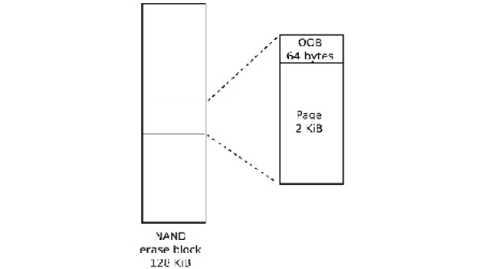
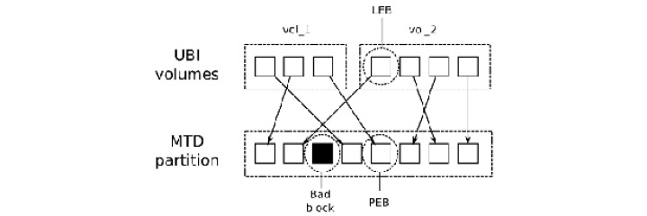
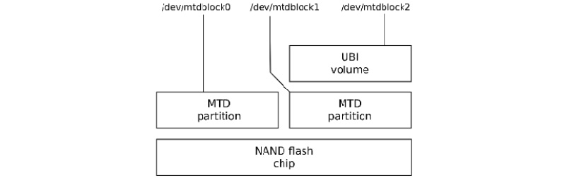

# *Chương 9*: Xây dựng chiến lược lưu trữ (Creating a Storage Strategy)

Các lựa chọn mass storage cho thiết bị nhúng có ảnh hưởng lớn tới phần còn lại của hệ thống về độ bền vững, tốc độ và các phương pháp dùng cho cập nhật in-field. Hầu hết thiết bị dùng flash memory dưới dạng này hay dạng khác. Flash memory đã trở nên rẻ hơn nhiều trong vài năm qua khi dung lượng lưu trữ tăng từ hàng chục megabyte lên hàng chục gigabyte.

Trong chương này, chúng ta sẽ bắt đầu bằng cái nhìn chi tiết về công nghệ đằng sau flash memory, cũng như cách các chiến lược tổ chức bộ nhớ khác nhau ảnh hưởng tới phần mềm driver low-level phải quản lý nó, bao gồm layer **memory technology device** (**MTD**) của Linux.

Với mỗi công nghệ flash, có những lựa chọn filesystem khác nhau. Tôi sẽ mô tả những filesystem thường gặp nhất trên thiết bị nhúng và hoàn tất cuộc khảo sát bằng một bản tóm tắt các lựa chọn cho từng loại flash memory. Cuối cùng, chúng ta sẽ xét một số kỹ thuật tận dụng tốt nhất flash memory và gom mọi thứ lại thành một chiến lược lưu trữ mạch lạc.

Trong chương này, chúng ta sẽ đề cập các chủ đề sau:

- Các lựa chọn lưu trữ
- Truy cập flash memory từ bootloader
- Truy cập flash memory từ Linux
- Filesystem cho flash memory
- Filesystem cho flash NOR và NAND
- Filesystem cho managed flash
- Filesystem nén Read-only
- Filesystem tạm
- Làm cho root filesystem thành read-only
- Lựa chọn filesystem

Hãy bắt đầu!

## Yêu cầu kỹ thuật

Để làm theo các ví dụ trong chương này, hãy bảo đảm bạn có những thứ sau:

- Một hệ thống host Linux-based đã cài `e2fsprogs`, `genext2fs`, `mtd-utils`, `squashfs-tools` và `util-linux` hoặc các gói tương đương
- Cây source U-Boot từ [*Chương 3*](ch03_all_about_bootloaders.vi.md), *Tất cả về bootloader*
- Một đầu đọc thẻ microSD và thẻ
- Một cáp serial USB to TTL 3.3V
- Cây source Linux kernel từ [*Chương 4*](ch04_configuring_and_building_the_kernel.vi.md), *Cấu hình và build kernel*
- BeagleBone Black
- Một nguồn điện DC 5V 1A

Lẽ ra bạn đã tải về và build U-Boot cho BeagleBone Black hồi [*Chương 3*](ch03_all_about_bootloaders.vi.md), *Tất cả về bootloader*. Lẽ ra bạn đã có cây source Linux kernel từ [*Chương 4*](ch04_configuring_and_building_the_kernel.vi.md), *Cấu hình và build kernel*.

Ubuntu cung cấp package cho hầu hết các công cụ cần để tạo và format các filesystem khác nhau. Để cài các công cụ trên một hệ thống Ubuntu 20.04 LTS, dùng lệnh sau:

```
$ sudo apt install e2fsprogs genext2fs mtd-utils squashfs-tools util-linux
```

Package `mtd-utils` bao gồm `mtdinfo`, `mkfs.jffs2`, `sumtool`, `nandwrite` và các công cụ command-line của UBI.

## Các lựa chọn lưu trữ

Thiết bị nhúng cần bộ lưu trữ tiêu thụ ít điện, nhỏ gọn về mặt vật lý, bền và đáng tin cậy qua một vòng đời có lẽ hàng chục năm. Trong hầu hết mọi trường hợp, điều này có nghĩa là lưu trữ solid-state. Lưu trữ Solid-state đã được giới thiệu từ nhiều năm trước với **read-only memory** (**ROM**), nhưng trong 20 năm qua, nó là flash memory loại này hay loại khác. Đã có vài thế hệ flash memory trong khoảng thời gian đó, tiến từ NOR sang NAND rồi tới managed flash như eMMC.

Flash NOR đắt nhưng đáng tin cậy và có thể được map vào không gian địa chỉ CPU, cho phép bạn thực thi code trực tiếp từ flash. Chip flash NOR có dung lượng thấp, từ vài megabyte tới khoảng một gigabyte.

Flash memory NAND rẻ hơn NOR nhiều và có dung lượng cao hơn, trong khoảng hàng chục megabyte tới hàng chục gigabyte. Tuy nhiên, nó cần rất nhiều hỗ trợ phần cứng và phần mềm để biến nó thành một phương tiện lưu trữ hữu dụng.

Managed flash memory gồm một hoặc nhiều chip flash NAND, đóng gói cùng một controller xử lý những phức tạp của flash memory và đưa ra một giao diện phần cứng tương tự giao diện của ổ cứng. Điểm hấp dẫn là nó loại bỏ sự phức tạp khỏi phần mềm driver và cách ly người thiết kế hệ thống khỏi những thay đổi thường xuyên trong công nghệ flash. Thẻ SD, chip eMMC và ổ flash USB thuộc loại này. Hầu như tất cả các thế hệ smartphone và tablet hiện tại đều có bộ lưu trữ eMMC, và xu hướng này nhiều khả năng sẽ lan sang các loại thiết bị nhúng khác.

Ổ cứng hiếm khi được thấy trong hệ thống nhúng. Một ngoại lệ là ghi video số trong các set-top box và smart TV, nơi cần lượng lưu trữ lớn với thời gian ghi nhanh.

Trong mọi trường hợp, độ bền vững là quan trọng hàng đầu: bạn muốn thiết bị boot được và đạt tới trạng thái hoạt động, bất chấp mất điện và reset bất ngờ. Bạn nên chọn các filesystem hoạt động tốt trong những tình huống như vậy.

Trong mục này, chúng ta sẽ học sự khác biệt giữa flash NOR và NAND và xét các lựa chọn khi chọn một công nghệ managed flash.

### Flash NOR

Các ô nhớ trong chip flash NOR được sắp xếp thành các erase block có kích thước, chẳng hạn, 128 KiB. Xóa một block sẽ đặt tất cả các bit thành 1. Nó có thể được lập trình từng word một (8, 16 hoặc 32 bit, tùy độ rộng data bus). Mỗi chu kỳ xóa làm hỏng nhẹ các ô nhớ, và sau một số chu kỳ, erase block trở nên không đáng tin cậy và không thể dùng nữa. Số chu kỳ xóa tối đa lẽ ra phải được cho trong data sheet của chip nhưng thường nằm trong khoảng 100K tới 1M.

Dữ liệu có thể được đọc từng word một. Chip thường được map vào không gian địa chỉ CPU, nghĩa là bạn có thể thực thi code trực tiếp từ flash NOR. Điều này khiến nó là nơi thuận tiện để đặt code bootloader vì nó không cần khởi tạo gì ngoài việc nối cứng ánh xạ địa chỉ. Các SoC hỗ trợ flash NOR theo cách này có các cấu hình cung cấp ánh xạ bộ nhớ mặc định sao cho nó bao trùm reset vector của CPU.

Kernel, và thậm chí cả root filesystem, cũng có thể nằm trong flash memory, tránh nhu cầu sao chép chúng vào RAM, và nhờ đó tạo ra các thiết bị có memory footprint nhỏ. Kỹ thuật này được gọi là **eXecute In Place**, hay **XIP**. Nó rất chuyên biệt, và tôi sẽ không xem xét nó thêm ở đây. Tôi đã đưa vào một số tài liệu tham khảo ở cuối chương này, trong mục *Đọc thêm*.

Có một giao diện register-level tiêu chuẩn cho chip flash NOR gọi là **Common Flash Interface** hay **CFI**, mà mọi chip hiện đại đều hỗ trợ. CFI được mô tả trong tiêu chuẩn JESD68, bạn có thể lấy từ [https://www.jedec.org/](https://www.jedec.org/).

Giờ chúng ta đã học flash NOR là gì, hãy xem flash NAND.

### Flash NAND

Flash NAND rẻ hơn flash NOR nhiều và có dung lượng cao hơn. Các chip NAND First-generation lưu một bit mỗi ô nhớ theo tổ chức mà giờ được gọi là **single-level cell** (**SLC**). Các thế hệ sau chuyển sang hai bit mỗi ô trong chip **multi-level cell** (**MLC**) và giờ là ba bit mỗi ô trong chip **tri-level cell** (**TLC**). Khi số bit mỗi ô tăng, độ tin cậy của bộ lưu trữ giảm, đòi hỏi phần cứng controller và phần mềm phức tạp hơn để bù lại. Khi độ tin cậy là mối bận tâm, bạn nên bảo đảm mình dùng chip flash NAND SLC.

Giống flash NOR, flash NAND được tổ chức thành các erase block có kích thước từ 16 KiB tới 512 KiB và, một lần nữa, xóa một block sẽ đặt tất cả các bit thành 1. Tuy nhiên, số chu kỳ xóa trước khi block trở nên không đáng tin cậy thấp hơn, thường chỉ khoảng 1K chu kỳ với chip TLC và tới 100K với SLC. Flash NAND chỉ có thể được đọc và ghi theo page, thường là 2 hoặc 4 KiB. Vì chúng không thể được truy cập từng byte, chúng không thể được map vào không gian địa chỉ, nên code và dữ liệu phải được sao chép vào RAM trước khi có thể được truy cập.

Việc truyền dữ liệu tới và từ chip dễ bị bit flip, có thể được phát hiện và sửa bằng **error-correction codes** (**ECCs**). Chip SLC thường dùng một **hamming code** đơn giản, có thể được hiện thực hiệu quả bằng phần mềm và có thể sửa một lỗi single-bit trong một lần đọc page. Chip MLC và TLC cần các mã tinh vi hơn, chẳng hạn **Bose-Chaudhuri-Hocquenghem** (**BCH**), có thể sửa tới 8-bit lỗi mỗi page. Những mã này cần hỗ trợ phần cứng.

ECC phải được lưu ở đâu đó, và vì vậy có một vùng nhớ phụ thêm cho mỗi page gọi là vùng **out-of-band** (**OOB**), hay spare area. Các thiết kế SLC thường có 1 byte OOB cho mỗi 32 byte lưu trữ chính, nên với thiết bị page 2 KiB, OOB là 64 byte mỗi page, và với page 4 KiB, nó là 128 byte. Chip MLC và TLC có vùng OOB lớn hơn theo tỷ lệ, để chứa các ECC phức tạp hơn. Sơ đồ sau cho thấy tổ chức của một chip có erase block 128 KiB và page 2 KiB:



*Hình 9.1 – Vùng OOB*

Trong quá trình sản xuất, nhà sản xuất test tất cả các block và đánh dấu mọi block hỏng bằng cách đặt một flag trong vùng OOB của mỗi page trong block. Không hiếm khi thấy các chip mới tinh có tới 2% số block bị đánh dấu hỏng theo cách này. Lưu thông tin OOB để phân tích trước khi xóa vùng có thể hữu ích khi có vấn đề. Hơn nữa, theo specification, một tỷ lệ block tương tự được phép báo lỗi khi xóa trước khi đạt giới hạn chu kỳ xóa. Driver flash NAND nên phát hiện điều này và đánh dấu nó là hỏng.

Sau khi đã dành chỗ trong vùng OOB cho bad block flag và các byte ECC, vẫn còn lại một số byte. Một số flash filesystem tận dụng các byte trống này để lưu metadata filesystem. Do đó, nhiều phần của hệ thống quan tâm tới layout của vùng OOB: code boot ROM của SoC, bootloader, driver MTD của kernel, code filesystem và các công cụ tạo filesystem image. Không có nhiều chuẩn hóa, nên rất dễ rơi vào tình huống bootloader ghi dữ liệu theo một định dạng OOB mà driver MTD của kernel không đọc được. Việc bảo đảm tất cả đều thống nhất là trách nhiệm của bạn.

Truy cập chip flash NAND cần một NAND flash controller, thường là một phần của SoC. Bạn sẽ cần driver tương ứng trong bootloader và kernel. NAND flash controller xử lý giao diện phần cứng cho chip, truyền dữ liệu tới và từ các page, và có thể bao gồm phần cứng sửa lỗi.

Có một giao diện register-level tiêu chuẩn cho chip flash NAND được gọi là **Open NAND Flash Interface** hay **ONFI**, mà hầu hết chip hiện đại tuân theo. Xem [http://www.onfi.org/](http://www.onfi.org/) để biết thêm thông tin.

Công nghệ flash NAND hiện đại rất phức tạp. Ghép flash memory NAND với một controller không còn đủ nữa. Chúng ta cũng cần một giao diện tới phần cứng trừu tượng hóa đi hầu hết các chi tiết kỹ thuật, chẳng hạn sửa lỗi.

#### Managed flash

Gánh nặng hỗ trợ flash memory trong hệ điều hành – đặc biệt là NAND – trở nên nhỏ hơn nếu có một giao diện phần cứng well-defined và một flash controller tiêu chuẩn che giấu những phức tạp của bộ nhớ. Đây là managed flash memory, và nó ngày càng phổ biến. Về bản chất, nó có nghĩa là kết hợp một hoặc nhiều chip flash với một microcontroller cung cấp một thiết bị lưu trữ lý tưởng với kích thước sector nhỏ, và tương thích với các filesystem thông thường. Các loại chip quan trọng nhất cho hệ thống nhúng là thẻ **Secure Digital** (**SD**) và biến thể nhúng được gọi là **eMMC**.

##### MultiMediaCard và thẻ Secure Digital

**MultiMediaCard** (**MMC**) được SanDisk và Siemens giới thiệu năm 1997 như một dạng lưu trữ đóng gói dùng flash memory. Ngay sau đó, năm 1999, SanDisk, Matsushita và Toshiba tạo ra thẻ **Secure Digital** (**SD**), dựa trên MMC nhưng thêm mã hóa và DRM (phần "secure" trong tên). Cả hai đều nhắm tới điện tử tiêu dùng như máy ảnh số, máy nghe nhạc và các thiết bị tương tự. Hiện nay, thẻ SD là dạng managed flash thống trị cho điện tử tiêu dùng và nhúng, dù các tính năng mã hóa hiếm khi được dùng. Các phiên bản mới hơn của specification SD cho phép đóng gói nhỏ hơn (mini SD và microSD, thường được viết là uSD) và dung lượng lớn hơn: SDHC dung lượng cao tới 32 GB và SDXC dung lượng mở rộng tới 2TB.

Giao diện phần cứng của thẻ MMC và SD rất giống nhau, và có thể dùng thẻ MMC full-sized trong khe thẻ SD full-sized (nhưng không thể làm ngược lại). Các phiên bản đầu dùng **Serial Peripheral Interface** (**SPI**) 1-bit; các thẻ gần đây hơn dùng giao diện 4-bit.

Có một tập lệnh để đọc và ghi bộ nhớ theo các sector 512 byte. Bên trong package là một microcontroller và một hoặc nhiều chip flash NAND, như được thể hiện trong sơ đồ sau:


*Hình 9.2 – Package thẻ SD*

Microcontroller hiện thực tập lệnh và quản lý flash memory, thực hiện chức năng của một flash translation layer, như được mô tả ở phần sau của chương này. Chúng được format sẵn với filesystem FAT: FAT16 trên thẻ SDSC, FAT32 trên SDHC và exFAT trên SDXC. Chất lượng của các chip flash NAND và phần mềm trên microcontroller khác nhau rất nhiều giữa các thẻ. Còn đáng ngờ liệu có thẻ nào đủ đáng tin cậy cho việc dùng nhúng sâu hay không, và chắc chắn là không với filesystem FAT, vốn dễ bị hỏng file. Hãy nhớ rằng use case chính của thẻ MMC và SD là lưu trữ tháo rời được trên máy ảnh, tablet và điện thoại.

##### eMMC

**Embedded MMC** hay **eMMC** đơn giản là bộ nhớ MMC được đóng gói để có thể được hàn lên bo mạch chủ, dùng giao diện 4- hoặc 8-bit để truyền dữ liệu. Tuy nhiên, chúng được dự định dùng làm bộ lưu trữ cho hệ điều hành, nên các component có khả năng thực hiện nhiệm vụ đó. Các chip thường không được format sẵn với filesystem nào.

##### Các loại managed flash khác

Một trong những công nghệ managed flash đầu tiên là **CompactFlash** (**CF**), dùng một tập con của giao diện phần cứng **Personal Computer Memory Card International Association** (**PCMCIA**). CF đưa bộ nhớ ra qua một giao diện ATA song song và xuất hiện với hệ điều hành như một ổ cứng tiêu chuẩn. Chúng phổ biến trong các single board computer x86-based và thiết bị video, máy ảnh chuyên nghiệp.

Một định dạng khác mà chúng ta dùng hằng ngày là **USB flash drive**. Trong trường hợp này, bộ nhớ được truy cập qua giao diện USB và controller hiện thực specification USB mass storage, cũng như flash translation layer và giao diện tới chip flash, hay các chip. Đến lượt nó, giao thức USB mass storage dựa trên tập lệnh đĩa SCSI. Giống thẻ MMC và SD, chúng thường được format sẵn với filesystem FAT. Use case chính của chúng trong hệ thống nhúng là trao đổi dữ liệu với PC.

Một bổ sung gần đây vào danh sách các lựa chọn managed flash là **Universal Flash Storage** (**UFS**). Giống eMMC, nó được đóng gói trong một chip gắn trên bo mạch chủ. Nó có một giao diện serial high-speed và có thể đạt tốc độ dữ liệu lớn hơn eMMC. Nó hỗ trợ tập lệnh đĩa SCSI.

Giờ chúng ta đã biết có những loại flash nào, hãy học cách U-Boot nạp kernel image từ mỗi loại.

## Truy cập flash memory từ bootloader

Trong [*Chương 3*](ch03_all_about_bootloaders.vi.md), *Tất cả về bootloader*, tôi đã đề cập nhu cầu bootloader phải nạp kernel binary và các image khác từ nhiều thiết bị flash khác nhau, và thực hiện các tác vụ bảo trì hệ thống như xóa và lập trình lại flash memory. Từ đó suy ra bootloader phải có các driver và hạ tầng cần thiết để hỗ trợ các thao tác đọc, xóa và ghi trên loại bộ nhớ bạn có, dù là NOR, NAND hay managed. Tôi sẽ dùng U-Boot trong các ví dụ sau; các bootloader khác theo một khuôn mẫu tương tự.

### U-Boot và flash NOR

U-Boot có driver cho chip NOR CFI trong `drivers/mtd` và dùng các lệnh `erase` khác nhau để xóa bộ nhớ và `cp.b` để sao chép dữ liệu từng byte, lập trình các ô flash. Giả sử bạn có flash memory NOR được map từ `0x40000000` tới `0x48000000`, trong đó 4 MiB, bắt đầu tại `0x40040000`, là một kernel image. Ở đây, bạn sẽ nạp một kernel mới vào flash bằng các lệnh U-Boot này:

```
=> tftpboot 100000 uImage
=> erase 40040000 403fffff
=> cp.b 100000 40040000 $(filesize)
```

Biến `filesize` trong ví dụ trên được lệnh `tftpboot` đặt bằng kích thước của file vừa tải về.

### U-Boot và flash NAND

Với flash NAND, bạn cần một driver cho NAND flash controller trên SoC, có thể tìm trong source code U-Boot ở thư mục `drivers/mtd/nand`. Bạn có thể dùng lệnh `nand` để quản lý bộ nhớ với các sub-commands `erase`, `write` và `read`. Ví dụ này cho thấy một kernel image được nạp vào RAM tại `0x82000000` rồi được đặt vào flash, bắt đầu tại offset `0x280000`:

```
=> tftpboot 82000000 uImage
=> nand erase 280000 400000
=> nand write 82000000 280000 $(filesize)
```

U-Boot cũng có thể đọc các file lưu trong filesystem JFFS2, YAFFS2 và UBIFS. `nand write` sẽ bỏ qua các block bị đánh dấu hỏng. Nếu dữ liệu bạn đang ghi là cho một filesystem, hãy bảo đảm filesystem đó cũng bỏ qua bad block.

### U-Boot và MMC, SD và eMMC

U-Boot có driver cho một số MMC controller trong `drivers/mmc`. Bạn có thể truy cập dữ liệu thô bằng `mmc read` và `mmc write` ở mức giao diện người dùng, cho phép bạn xử lý kernel image và filesystem image thô.

U-Boot cũng có thể đọc file từ filesystem FAT32 và ext4 trên bộ lưu trữ MMC.

U-Boot cần driver để truy cập NOR, NAND và managed flash. Bạn nên dùng driver nào phụ thuộc vào lựa chọn chip NOR hoặc flash controller trên SoC. Truy cập flash NOR và NAND thô từ Linux liên quan tới thêm các layer phần mềm.

## Truy cập flash memory từ Linux

Flash memory NOR và NAND thô được xử lý bởi subsystem **Memory Technology Device**, hay **MTD**, cung cấp cho bạn các giao diện cơ bản để đọc, xóa và ghi các block flash memory. Trong trường hợp flash NAND, cũng có các function xử lý vùng OOB và được dùng để nhận diện bad block.

Với managed flash, bạn cần driver để xử lý một giao diện phần cứng cụ thể. Thẻ MMC/SD và eMMC dùng driver `mmcblk`, trong khi CompactFlash và ổ cứng dùng driver đĩa SCSI, `sd`. Ổ flash USB dùng driver `usb_storage`, cùng với driver `sd`.

### Memory technology device

Subsystem MTD được David Woodhouse khởi đầu năm 1999 và đã được phát triển rộng rãi qua những năm sau đó. Trong mục này, tôi sẽ tập trung vào cách nó xử lý hai công nghệ chính, flash NOR và NAND.

MTD gồm ba layer: một tập function lõi, một tập driver cho các loại chip khác nhau, và các driver user-level trình bày flash memory như một character device hoặc một block device, như được thể hiện trong sơ đồ sau:


*Hình 9.3 – Các layer MTD*

Các chip driver nằm ở mức thấp nhất và giao tiếp với chip flash. Chỉ cần một số ít driver cho chip flash NOR, đủ để bao quát chuẩn CFI và các biến thể, cộng với một vài chip non-compliant, mà giờ hầu hết đã lỗi thời. Với flash NAND, bạn sẽ cần một driver cho NAND flash controller bạn đang dùng; driver này thường được cung cấp như một phần của board support package. Có driver cho khoảng 40 controller như vậy trong kernel mainline hiện tại, trong thư mục `drivers/mtd/nand`.

#### Partition MTD

Trong hầu hết trường hợp, bạn sẽ muốn chia flash memory thành một số vùng, chẳng hạn để có chỗ cho bootloader, kernel image hay root filesystem. Trong MTD, có vài cách để chỉ định kích thước và vị trí của partition, với các cách chính như sau:

- Qua kernel command line bằng `CONFIG_MTD_CMDLINE_PARTS`
- Qua device tree bằng `CONFIG_MTD_OF_PARTS`
- Với một driver platform-mapping

Trong trường hợp lựa chọn đầu tiên, tùy chọn kernel command-line cần dùng là `mtdparts`, được định nghĩa như sau trong source code Linux ở `drivers/mtd/cmdlinepart.c`:

```
mtdparts=<mtddef>[;<mtddef]
<mtddef> := <mtd-id>:<partdef>[,<partdef>]
<mtd-id> := unique name for the chip
<partdef> := <size>[@<offset>][<name>][ro][lk]
<size> := size of partition OR "-" to denote all remaining
     space
<offset> := offset to the start of the partition; leave blank
     to follow the previous partition without any gap
<name> := '(' NAME ')'
```

Có lẽ một ví dụ sẽ giúp ích. Hãy tưởng tượng bạn có một chip flash 128 MiB cần được chia thành năm partition. Một command line điển hình sẽ là thế này:

```
mtdparts=:512k(SPL)ro,780k(U-Boot)ro,128k(U-BootEnv),
4m(Kernel),-(Filesystem)
```

Phần tử đầu tiên, trước dấu hai chấm, là `mtd-id`, nhận diện chip flash, hoặc theo số hoặc theo tên được board support package gán. Nếu chỉ có một chip, như ở đây, nó có thể để trống. Nếu có nhiều hơn một chip, thông tin cho mỗi chip được ngăn cách bằng dấu chấm phẩy. Sau đó, với mỗi chip, có một danh sách comma-separated các partition, mỗi partition có kích thước tính bằng byte, KiB (`k`) hoặc MiB (`m`), và một tên trong ngoặc đơn. Hậu tố `ro` làm partition thành read-only với MTD và thường được dùng để ngăn vô tình ghi đè bootloader. Kích thước của partition cuối cùng cho chip có thể được thay bằng dấu gạch ngang (`-`), cho biết nó nên chiếm toàn bộ không gian còn lại.

Bạn có thể xem tóm tắt cấu hình lúc runtime bằng cách đọc `/proc/mtd`:

```
# cat /proc/mtd
dev: size erasesize name
mtd0: 00080000 00020000 "SPL"
mtd1: 000C3000 00020000 "U-Boot"
mtd2: 00020000 00020000 "U-BootEnv"
mtd3: 00400000 00020000 "Kernel"
mtd4: 07A9D000 00020000 "Filesystem"
```

Có thông tin chi tiết hơn cho mỗi partition trong `/sys/class/mtd`, bao gồm kích thước erase block và kích thước page, và nó được tóm tắt gọn gàng bằng `mtdinfo`:

```
# mtdinfo /dev/mtd0
mtd0
Name:           SPL
Type:           nand
Eraseblock size:       131072 bytes, 128.0 KiB
Amount of eraseblocks:     4 (524288 bytes, 512.0 KiB)
Minimum input/output unit size: 2048 bytes
Sub-page size:        512 bytes
OOB size:        64 bytes
Character device major/minor:  90:0
Bad blocks are allowed:    true
Device is writable:   false
```

Một cách khác để chỉ định partition MTD là qua device tree. Đây là một ví dụ tạo cùng các partition như ví dụ command line:

```
nand@0,0 {
 #address-cells = <1>;
 #size-cells = <1>;
 partition@0 {
  label = "SPL";
  reg = <0 0x80000>;
 };
 partition@80000 {
  label = "U-Boot";
  reg = <0x80000 0xc3000>;
 };
 partition@143000 {
  label = "U-BootEnv";
  reg = <0x143000 0x20000>;
 };
 partition@163000 {
  label = "Kernel";
  reg = <0x163000 0x400000>;
 };
 partition@563000 {
  label = "Filesystem";
  reg = <0x563000 0x7a9d000>;
 };
};
```

Lựa chọn thứ ba là viết code thông tin partition dưới dạng platform data trong một cấu trúc `mtd_partition`, như được thể hiện trong ví dụ này lấy từ `arch/arm/mach-omap2/board-omap3beagle.c` (`NAND_BLOCK_SIZE` được định nghĩa ở chỗ khác là `128 KiB`):

```
static struct mtd_partition omap3beagle_nand_partitions[] = {
 {
  .name = "X-Loader",
  .offset = 0,
  .size = 4 * NAND_BLOCK_SIZE,
  .mask_flags = MTD_WRITEABLE, /* force read-only */
 },
 {
  .name = "U-Boot",
  .offset = 0x80000;
  .size = 15 * NAND_BLOCK_SIZE,
  .mask_flags = MTD_WRITEABLE, /* force read-only */
 },
 {
  .name = "U-Boot Env",
  .offset = 0x260000;
  .size = 1 * NAND_BLOCK_SIZE,
 },
 {
  .name = "Kernel",
  .offset = 0x280000;
  .size = 32 * NAND_BLOCK_SIZE,
 },
 {
  .name = "File System",
  .offset = 0x680000;
  .size = MTDPART_SIZ_FULL,
 },
};
```

Platform data đã bị deprecated: bạn sẽ chỉ thấy nó được dùng trong các BSP cho các SoC cũ chưa được cập nhật để dùng device tree.

#### Device driver MTD

Mức trên của subsystem MTD chứa một cặp device driver:

- Một character device, với major number `90`. Có hai device node cho mỗi số partition MTD, N: `/dev/mtdN` (minor number=N\*2) và `/dev/mtdNro` (minor number=(N\*2 + 1)). Cái sau chỉ là phiên bản read-only của cái trước.
- Một block device, với major number `31` và minor number N. Các device node có dạng `/dev/mtdblockN`.

Hãy xem character device trước vì nó là cái được dùng phổ biến hơn trong hai cái.

#### Character device MTD, mtd

Character device là quan trọng nhất: chúng cho phép bạn truy cập flash memory bên dưới như một mảng byte để bạn có thể đọc và ghi (lập trình) flash. Nó cũng hiện thực một số function `ioctl` cho phép bạn xóa block và quản lý vùng OOB trên chip NAND. Danh sách sau được lấy từ `include/uapi/mtd/mtd-abi.h`:

- `MEMGETINFO`: Lấy thông tin đặc tính MTD cơ bản.
- `MEMERASE`: Xóa các block trong partition MTD.
- `MEMWRITEOOB`: Ghi dữ liệu out-of-band cho page.
- `MEMREADOOB`: Đọc dữ liệu out-of-band cho page.
- `MEMLOCK`: Khóa chip (nếu được hỗ trợ).
- `MEMUNLOCK`: Mở khóa chip (nếu được hỗ trợ).
- `MEMGETREGIONCOUNT`: Lấy số erase region: non-zero nếu có các erase block với kích thước khác nhau trong partition, điều phổ biến với flash NOR, hiếm trên NAND.
- `MEMGETREGIONINFO`: Nếu `MEMGETREGIONCOUNT` là non-zero, có thể dùng cái này để lấy offset, kích thước và số block của mỗi region.
- `MEMGETOOBSEL`: Deprecated.
- `MEMGETBADBLOCK`: Lấy bad block flag.
- `MEMSETBADBLOCK`: Đặt bad block flag.
- `OTPSELECT`: Đặt chế độ OTP (one-time programmable), nếu chip hỗ trợ.
- `OTPGETREGIONCOUNT`: Lấy số OTP region.
- `OTPGETREGIONINFO`: Lấy thông tin về một OTP region.
- `ECCGETLAYOUT`: Deprecated.

Có một tập chương trình tiện ích gọi là `mtd-utils` để thao tác flash memory, tận dụng các function `ioctl` này. Source có thể được tìm thấy tại git://git.infradead.org/mtd-utils.git và có sẵn dưới dạng package trong Yocto Project và Buildroot. Các công cụ thiết yếu được liệt kê trong danh sách sau. Package này cũng chứa các tiện ích cho filesystem JFFS2 và UBI/UBIFS, mà tôi sẽ đề cập sau. Với mỗi công cụ này, MTD character device là một trong các tham số sau:

- **flash_erase**: Xóa một dải block.

- **flash_lock**: Khóa một dải block.

- **flash_unlock**: Mở khóa một dải block.

- **nanddump**: Dump bộ nhớ từ flash NAND, tùy chọn bao gồm cả vùng OOB. Bỏ qua bad block.

- **nandtest**: Test và chẩn đoán flash NAND.

- **nandwrite**: Ghi (lập trình) dữ liệu từ một file vào flash NAND, bỏ qua bad block.

  > **Mẹo**
  >
  > Bạn phải luôn xóa flash memory trước khi ghi nội dung mới vào nó: `flash_erase` là lệnh làm việc này.

Để lập trình flash NOR, bạn chỉ cần sao chép byte tới device node MTD bằng một lệnh sao chép file như `cp`.

Đáng tiếc, điều này không hoạt động với bộ nhớ NAND vì việc sao chép sẽ thất bại ở bad block đầu tiên. Thay vào đó, hãy dùng `nandwrite`, công cụ bỏ qua mọi bad block. Để đọc lại bộ nhớ NAND, bạn nên dùng `nanddump`, công cụ cũng bỏ qua bad block.

#### Block device MTD, mtdblock

Driver `mtdblock` không được dùng thường xuyên. Mục đích của nó là trình bày flash memory như một block device mà bạn có thể dùng để format và mount một filesystem. Tuy nhiên, nó có những hạn chế nghiêm trọng vì nó không xử lý bad block trong flash NAND, nó không làm wear leveling, và nó không xử lý sự không khớp về kích thước giữa block của filesystem và erase block của flash. Nói cách khác, nó không có flash translation layer, thứ thiết yếu cho việc lưu trữ file đáng tin cậy. Trường hợp duy nhất mà device `mtdblock` hữu ích là để mount các file system read-only như SquashFS trên nền flash memory đáng tin cậy như NOR.

> **Mẹo**
>
> Nếu bạn muốn một filesystem read-only trên flash NAND, bạn nên dùng driver UBI, như được mô tả ở phần sau của chương này.

#### Ghi log kernel oops vào MTD

Một lỗi kernel, hay oops, thường được ghi log qua các daemon klogd và syslogd vào một buffer bộ nhớ vòng hoặc một file. Sau khi reboot, log sẽ bị mất trong trường hợp ring buffer, và ngay cả trong trường hợp file, nó có thể chưa được ghi đúng cách trước khi hệ thống crash. Một phương pháp đáng tin cậy hơn là ghi oops và kernel panic vào một partition MTD dưới dạng circular log buffer. Bạn có thể enable nó bằng `CONFIG_MTD_OOPS` và thêm `console=ttyMTDN` vào kernel command line, với `N` là số MTD device để ghi message vào.

#### Giả lập bộ nhớ NAND

NAND simulator giả lập một chip NAND bằng RAM của hệ thống. Công dụng chính là để test code phải NAND-aware mà không cần truy cập bộ nhớ NAND vật lý. Đặc biệt, khả năng giả lập bad block, bit flip và các lỗi khác cho phép bạn test các nhánh code khó kích hoạt bằng flash memory thật. Để biết thêm thông tin, nơi tốt nhất để xem là chính code, nơi cung cấp mô tả toàn diện về các cách bạn có thể cấu hình driver. Code nằm trong `drivers/mtd/nand/nandsim.c`. Enable nó bằng cấu hình kernel `CONFIG_MTD_NAND_NANDSIM`.

### MMC block driver

Thẻ MMC/SD và chip eMMC được truy cập bằng block driver `mmcblk`. Bạn cần một host controller khớp với MMC adapter bạn đang dùng, là một phần của board support package. Các driver nằm trong source code Linux ở `drivers/mmc/host`.

Bộ lưu trữ MMC được phân vùng bằng một partition table theo đúng cách bạn làm với ổ cứng; tức là, bằng `fdisk` hoặc một tiện ích tương tự.

Giờ chúng ta đã biết Linux truy cập từng loại flash như thế nào. Tiếp theo, chúng ta sẽ xem các vấn đề cố hữu của flash memory và cách Linux xử lý chúng, hoặc thông qua filesystem hoặc thông qua block device driver.

## Filesystem cho flash memory

Có vài thách thức khi tận dụng hiệu quả flash memory cho mass storage: sự không khớp giữa kích thước của một erase block và một disk sector, số chu kỳ xóa giới hạn cho mỗi erase block, và nhu cầu xử lý bad block trên chip NAND. Những khác biệt này được giải quyết bởi một **flash translation layer**, hay **FTL**.

### Flash translation layer

Một flash translation layer có các tính năng sau:

- **Sub allocation**: Filesystem hoạt động tốt nhất với đơn vị cấp phát nhỏ, theo truyền thống là một sector 512-byte. Đơn vị này nhỏ hơn nhiều so với một erase block flash 128 KiB trở lên. Vì vậy, erase block phải được chia nhỏ thành các đơn vị nhỏ hơn để tránh lãng phí lượng lớn không gian.
- **Garbage collection**: Một hệ quả của suballocation là một erase block sẽ chứa hỗn hợp dữ liệu tốt và dữ liệu cũ một khi filesystem đã được dùng một thời gian. Vì chúng ta chỉ có thể giải phóng toàn bộ erase block, cách duy nhất để thu hồi không gian trống này là gom dữ liệu tốt vào một chỗ, rồi trả erase block giờ đã trống về free list. Việc này được gọi là garbage collection, và nó thường được hiện thực như một background thread.
- **Wear leveling**: Có giới hạn về số chu kỳ xóa cho mỗi block. Để tối đa hóa tuổi thọ của chip, điều quan trọng là di chuyển dữ liệu sao cho mỗi block được xóa khoảng cùng số lần.
- **Bad block handling**: Trên chip flash NAND, bạn phải tránh dùng mọi block bị đánh dấu hỏng và cũng phải đánh dấu block tốt là hỏng nếu không thể xóa chúng.
- **Robustness**: Thiết bị nhúng có thể bị tắt nguồn hoặc reset mà không báo trước, nên mọi filesystem nên có khả năng đối phó mà không bị hỏng, thường bằng cách tích hợp một journal hoặc một log các transaction.

Có vài cách triển khai flash translation layer:

- **Trong filesystem**: Như với JFFS2, YAFFS2 và UBIFS.
- **Trong block device driver**: Driver UBI, mà UBIFS phụ thuộc vào, hiện thực một số khía cạnh của flash translation layer.
- **Trong device controller**: Như với các thiết bị managed flash.

Khi flash translation layer nằm trong filesystem hoặc block driver, code là một phần của kernel và vì vậy là open source, nghĩa là chúng ta có thể xem nó hoạt động thế nào và có thể kỳ vọng nó sẽ được cải thiện theo thời gian. Mặt khác, nếu FTL nằm bên trong một thiết bị managed flash, nó bị che khỏi tầm nhìn và chúng ta không thể kiểm chứng nó có hoạt động như mình muốn hay không. Không chỉ vậy, đặt FTL vào disk controller có nghĩa là nó bỏ lỡ thông tin được giữ ở layer filesystem, chẳng hạn những sector nào thuộc về các file đã bị xóa và vì vậy không còn chứa dữ liệu hữu ích nữa. Vấn đề sau được giải quyết bằng cách thêm các lệnh truyền thông tin này giữa filesystem và thiết bị. Tôi sẽ mô tả cách điều này hoạt động trong mục về lệnh TRIM ở phần sau. Tuy nhiên, vấn đề về khả năng nhìn thấy code vẫn còn. Nếu bạn đang dùng managed flash, bạn chỉ có thể chọn một nhà sản xuất mà bạn tin tưởng.

Giờ chúng ta đã biết động cơ đằng sau các filesystem, hãy xem filesystem nào phù hợp nhất với loại flash nào.

## Filesystem cho flash NOR và NAND

Để dùng chip flash thô cho mass storage, bạn phải dùng một filesystem hiểu những đặc thù của công nghệ bên dưới. Có ba filesystem như vậy:

- **JFFS2 (Journaling Flash File System 2)**: Đây là flash filesystem đầu tiên cho Linux và vẫn được dùng đến ngày nay. Nó hoạt động với bộ nhớ NOR và NAND, nhưng nổi tiếng là chậm khi mount.
- **YAFFS2 (Yet Another Flash File System 2)**: Filesystem này tương tự JFFS2, nhưng dành riêng cho flash memory NAND. Nó được Google chọn làm raw flash filesystem ưu tiên trên các thiết bị Android.
- **UBIFS (Unsorted Block Image File System)**: Filesystem này làm việc kết hợp với block driver UBI để tạo ra một flash filesystem đáng tin cậy. Nó hoạt động tốt với cả bộ nhớ NOR lẫn NAND, và vì nó nhìn chung cho hiệu năng tốt hơn JFFS2 hay YAFFS2, nó nên là giải pháp ưu tiên cho các thiết kế mới.

Tất cả các filesystem này đều dùng MTD làm giao diện chung tới flash memory.

### JFFS2

**Journaling Flash File System** khởi nguồn từ phần mềm cho network camera Axis 2100 năm 1999. Trong nhiều năm, nó là flash filesystem duy nhất cho Linux và đã được triển khai trên hàng nghìn loại thiết bị khác nhau. Ngày nay, nó không phải lựa chọn tốt nhất, nhưng tôi sẽ đề cập nó trước vì nó cho thấy điểm khởi đầu của con đường tiến hóa.

JFFS2 là một filesystem log-structured dùng MTD để truy cập flash memory. Trong một filesystem log-structured, các thay đổi được ghi tuần tự dưới dạng node vào flash memory. Một node có thể chứa các thay đổi đối với một thư mục, chẳng hạn tên của các file được tạo và xóa, hoặc nó có thể chứa các thay đổi đối với dữ liệu file. Sau một thời gian, một node có thể bị thay thế bởi thông tin chứa trong các node tiếp theo và trở thành một node lỗi thời. Cả flash NOR và NAND đều được tổ chức thành erase block. Xóa một block sẽ đặt tất cả các bit của nó thành 1.

JFFS2 phân loại erase block thành ba loại:

- **Free**: Block này không chứa node nào.
- **Clean**: Block này chỉ chứa các node hợp lệ.
- **Dirty**: Block này chứa ít nhất một node lỗi thời.

Tại bất kỳ thời điểm nào, có một block đang nhận cập nhật, được gọi là open block. Nếu mất điện hoặc hệ thống bị reset, dữ liệu duy nhất có thể bị mất là lần ghi cuối cùng vào open block. Ngoài ra, các node được nén khi được ghi, tăng dung lượng lưu trữ hiệu dụng của chip flash, điều quan trọng nếu bạn đang dùng flash memory NOR đắt tiền.

Khi số free block giảm xuống dưới một ngưỡng nhất định, một kernel thread garbage collector được khởi động, quét tìm dirty block, sao chép các node hợp lệ vào open block, rồi giải phóng dirty block.

Đồng thời, garbage collector cung cấp một dạng wear leveling thô sơ vì nó luân chuyển dữ liệu hợp lệ từ block này sang block khác. Cách open block được chọn có nghĩa là mỗi block được xóa khoảng cùng số lần, miễn là nó chứa dữ liệu thay đổi theo thời gian. Đôi khi, một clean block được chọn cho garbage collection để bảo đảm các block chứa dữ liệu tĩnh hiếm khi được ghi cũng được wear-leveled.

Filesystem JFFS2 có một write-through cache, nghĩa là các lần ghi được ghi đồng bộ vào flash memory như thể chúng được mount với tùy chọn `-o` sync. Dù cải thiện độ tin cậy, nó làm tăng thời gian ghi dữ liệu. Còn một vấn đề nữa với các lần ghi nhỏ: nếu độ dài của một lần ghi tương đương với kích thước node header (40 byte), overhead trở nên cao. Một trường hợp biên well-known là các file log, chẳng hạn được tạo bởi `syslogd`.

#### Summary node

Có một nhược điểm lấn át tất cả của JFFS2: vì không có index on-chip, cấu trúc thư mục phải được suy ra lúc mount-time bằng cách đọc log từ đầu đến cuối. Ở cuối lần quét, bạn có một bức tranh hoàn chỉnh về cấu trúc thư mục của các node hợp lệ, nhưng thời gian tốn tỷ lệ với kích thước partition. Không hiếm khi thấy thời gian mount cỡ một giây mỗi megabyte, dẫn đến tổng thời gian mount hàng chục hay hàng trăm giây.

Summary node trở thành một tùy chọn trong Linux 2.6.15 để giảm thời gian quét trong lúc mount. Một summary node được ghi ở cuối open erase block, ngay trước khi nó được đóng. Summary node chứa tất cả thông tin cần cho lần quét mount-time, nhờ đó giảm lượng dữ liệu cần xử lý trong lúc quét. Summary node có thể giảm thời gian mount từ hai đến năm lần, với cái giá là overhead khoảng 5% không gian lưu trữ. Chúng được enable bằng cấu hình kernel `CONFIG_JFFS2_SUMMARY`.

#### Clean marker

Một block đã xóa với tất cả các bit được đặt thành 1 không thể phân biệt với một block đã được ghi toàn 1, nhưng block sau chưa được làm mới các ô nhớ và không thể được lập trình lại cho đến khi được xóa. JFFS2 dùng một cơ chế gọi là **clean marker** để phân biệt hai tình huống này. Sau một lần xóa block thành công, một clean marker được ghi, hoặc vào đầu block hoặc vào vùng OOB của page đầu tiên của block. Nếu clean marker tồn tại, thì đó phải là một clean block.

#### Tạo filesystem JFFS2

Tạo một filesystem JFFS2 rỗng lúc runtime đơn giản chỉ là xóa một partition MTD với clean marker rồi mount nó. Không có bước format vì một filesystem JFFS2 trống hoàn toàn gồm các free block. Chẳng hạn, để format partition MTD 6, bạn sẽ nhập các lệnh này trên thiết bị:

```
# flash_erase -j /dev/mtd6 0 0
# mount -t jffs2 mtd6 /mnt
```

Tùy chọn `-j` của `flash_erase` thêm clean marker, và mount với kiểu `jffs2` trình bày partition như một filesystem rỗng. Lưu ý rằng thiết bị cần mount được cho là `mtd6`, không phải `/dev/mtd6`. Ngoài ra, bạn có thể cho device node block `/dev/mtdblock6`. Đây chỉ là một đặc thù của JFFS2. Khi đã mount, bạn có thể đối xử với nó như mọi filesystem khác.

Bạn có thể tạo một filesystem image trực tiếp từ staging area của hệ thống phát triển bằng `mkfs.jffs2` để ghi các file ra theo định dạng JFFS2, và `sumtool` để thêm summary node. Cả hai đều là một phần của package `mtd-utils`.

Ví dụ, để tạo một image của các file trong `rootfs` cho một thiết bị flash NAND có kích thước erase block 128 KiB (`0x20000`) và có summary node, bạn sẽ dùng hai lệnh này:

```
$ mkfs.jffs2 -n -e 0x20000 -p -d ~/rootfs -o ~/rootfs.jffs2
$ sumtool -n -e 0x20000 -p -i ~/rootfs.jffs2 -o ~/rootfs-sum.jffs2
```

Tùy chọn `-p` thêm padding ở cuối file image để nó là một số nguyên erase block. Tùy chọn `-n` ngăn việc tạo clean marker trong image, điều bình thường với thiết bị NAND, vì clean marker nằm trong vùng OOB. Với thiết bị NOR, bạn sẽ bỏ tùy chọn `-n`. Bạn có thể dùng một device table với `mkfs.jffs2` để đặt quyền và quyền sở hữu của file bằng cách thêm `-D [device table]`. Tất nhiên, Buildroot và Yocto Project sẽ làm tất cả việc này cho bạn.

Bạn có thể lập trình image vào flash memory từ bootloader. Chẳng hạn, nếu bạn đã nạp một filesystem image vào RAM tại địa chỉ `0x82000000` và bạn muốn nạp nó vào một partition flash bắt đầu tại `0x163000` byte tính từ đầu chip flash và dài `0x7a9d000` byte, các lệnh U-Boot cho việc này sẽ như sau:

```
nand erase clean 163000 7a9d000
nand write 82000000 163000 7a9d000
```

Bạn có thể làm điều tương tự từ Linux bằng driver `mtd`, như thế này:

```
# flash_erase -j /dev/mtd6 0 0
# nandwrite /dev/mtd6 rootfs-sum.jffs2
```

Để boot với root filesystem JFFS2, bạn cần truyền device `mtdblock` trên kernel command line cho partition và một `rootfstype` vì JFFS2 không thể được auto-detected:

```
root=/dev/mtdblock6 rootfstype=jffs2
```

Không lâu sau khi JFFS2 được giới thiệu, một filesystem log-structured khác xuất hiện.

### YAFFS2

Filesystem YAFFS được Charles Manning viết, bắt đầu từ năm 2001, dành riêng để xử lý chip flash NAND vào thời điểm JFFS2 chưa làm được. Các thay đổi sau đó để xử lý kích thước page lớn hơn (2 KiB) dẫn đến YAFFS2. Website của YAFFS là [https://www.yaffs.net](https://www.yaffs.net).

YAFFS cũng là một filesystem log-structured theo cùng các nguyên tắc thiết kế như JFFS2. Các quyết định thiết kế khác nhau có nghĩa là nó có lần quét mount-time nhanh hơn, garbage collection đơn giản và nhanh hơn, và không có nén, điều làm tăng tốc đọc và ghi với cái giá là sử dụng bộ lưu trữ kém hiệu quả hơn.

YAFFS không chỉ giới hạn ở Linux; nó đã được port sang nhiều hệ điều hành. Nó có license kép: GPLv2, để tương thích với Linux, và một license thương mại cho các hệ điều hành khác. Đáng tiếc, code YAFFS chưa bao giờ được merge vào Linux mainline, nên bạn sẽ phải patch kernel của mình.

Để lấy YAFFS2 và patch một kernel, bạn sẽ dùng các lệnh sau:

```
$ git clone git://www.aleph1.co.uk/yaffs2
$ cd yaffs2
$ ./patch-ker.sh c m <path to your link source>
```

Sau đó, bạn có thể cấu hình kernel với `CONFIG_YAFFS_YAFFS2`.

#### Tạo filesystem YAFFS2

Giống JFFS2, để tạo một filesystem YAFFS2 lúc runtime, bạn chỉ cần xóa partition và mount nó, nhưng lưu ý rằng trong trường hợp này, bạn không enable clean marker:

```
# flash_erase /dev/mtd/mtd6 0 0
# mount -t yaffs2 /dev/mtdblock6 /mnt
```

Để tạo một filesystem image, cách đơn giản nhất là dùng công cụ `mkyaffs2` từ [https://code.google.com/p/yaffs2utils](https://code.google.com/p/yaffs2utils) bằng lệnh sau:

```
$ mkyaffs2 -c 2048 -s 64 rootfs rootfs.yaffs2
```

Ở đây, `-c` là kích thước page và `-s` là kích thước OOB. Có một công cụ tên `mkyaffs2image` là một phần của code YAFFS, nhưng nó có một vài nhược điểm. Thứ nhất, kích thước page và OOB được hard code trong source: bạn sẽ phải sửa và biên dịch lại nếu bộ nhớ của bạn không khớp các giá trị mặc định là 2,048 và 64. Thứ hai, layout OOB không tương thích với MTD, vốn dùng hai byte đầu tiên làm bad block marker, trong khi `mkyaffs2image` dùng các byte đó để lưu một phần metadata của YAFFS.

Để sao chép image vào partition MTD từ một shell prompt Linux trên target, hãy làm theo các bước sau:

```
# flash_erase /dev/mtd6 0 0
# nandwrite -a /dev/mtd6 rootfs.yaffs2
```

Để boot với root filesystem YAFFS2, thêm phần sau vào kernel command line:

```
root=/dev/mtdblock6 rootfstype=yaffs2
```

Nhân tiện đang nói về filesystem cho flash NOR và NAND thô, hãy xem một trong những lựa chọn hiện đại hơn. Filesystem này chạy trên nền driver UBI.

### UBI và UBIFS

Driver **Unsorted Block Image** (**UBI**) là một volume manager cho flash memory, đảm nhận việc xử lý bad block và wear leveling. Nó được Artem Bityutskiy hiện thực và lần đầu xuất hiện trong Linux 2.6.22. Song song với đó, các kỹ sư ở Nokia đang làm một filesystem tận dụng các tính năng của UBI, mà họ gọi là **UBIFS**; nó xuất hiện trong Linux 2.6.27. Chia flash translation layer theo cách này làm code mô-đun hơn và cũng cho phép các filesystem khác tận dụng driver UBI, như chúng ta sẽ thấy ở phần sau.

#### UBI

UBI cung cấp một cái nhìn lý tưởng hóa, đáng tin cậy về một chip flash bằng cách ánh xạ **physical erase blocks** (**PEB**) sang **logical erase blocks** (**LEB**). Bad block không được ánh xạ sang LEB và vì vậy không bao giờ được dùng. Nếu một block không thể xóa được, nó bị đánh dấu hỏng và bị loại khỏi ánh xạ. UBI giữ số đếm số lần mỗi PEB đã bị xóa trong header của LEB, rồi thay đổi ánh xạ để bảo đảm mỗi PEB được xóa cùng số lần.

UBI truy cập flash memory thông qua layer MTD. Như một tính năng bổ sung, nó có thể chia một partition MTD thành một số UBI volume, điều cải thiện wear leveling theo cách sau: hãy tưởng tượng bạn có hai filesystem, một chứa dữ liệu khá tĩnh, chẳng hạn root filesystem, và cái kia chứa dữ liệu thay đổi liên tục.

Nếu chúng được lưu trong các partition MTD riêng biệt, wear leveling chỉ có tác dụng trên cái thứ hai, trong khi nếu bạn chọn lưu chúng trong hai UBI volume trong một partition MTD duy nhất, wear leveling diễn ra trên cả hai vùng lưu trữ, và tuổi thọ của flash memory được tăng lên. Sơ đồ sau minh họa tình huống này:



*Hình 9.4 – UBI volume*

Bằng cách này, UBI thỏa mãn hai trong các yêu cầu của một flash translation layer: wear leveling và xử lý bad-block.

Để chuẩn bị một partition MTD cho UBI, bạn không dùng `flash_erase` như với JFFS2 và YAFFS2. Thay vào đó, bạn dùng tiện ích `ubiformat`, công cụ giữ lại số đếm xóa được lưu trong header PEB. `ubiformat` cần biết đơn vị I/O tối thiểu, mà với hầu hết chip flash NAND là kích thước page, nhưng một số chip cho phép đọc và ghi theo các subpage bằng một nửa hoặc một phần tư kích thước page. Tham khảo data sheet của chip để biết chi tiết và, nếu nghi ngờ, hãy dùng kích thước page. Ví dụ này chuẩn bị `mtd6` dùng kích thước page `2048` byte:

```
# ubiformat /dev/mtd6 -s 2048
ubiformat: mtd0 (nand), size 134217728 bytes (128.0 MiB),
1024 eraseblocks of 131072 bytes (128.0 KiB),
min. I/O size 2048 bytes
```

Sau đó, bạn có thể dùng lệnh `ubiattach` để nạp driver UBI trên một partition MTD đã được chuẩn bị theo cách này:

```
# ubiattach -p /dev/mtd6 -O 2048
UBI device number 0, total 1024 LEBs (130023424 bytes, 124.0 MiB),
available 998 LEBs (126722048 bytes, 120.9 MiB),
LEB size 126976 bytes (124.0 KiB)
```

Lệnh này tạo device node `/dev/ubi0`, qua đó bạn có thể truy cập các UBI volume. Bạn có thể dùng `ubiattach` trên nhiều partition MTD, khi đó chúng có thể được truy cập qua `/dev/ubi1`, `/dev/ubi2`, v.v. Lưu ý rằng vì mỗi LEB có một header chứa meta information mà UBI dùng, LEB nhỏ hơn PEB hai page. Chẳng hạn, một chip có kích thước PEB 128 KiB và page 2 KiB sẽ có LEB 124 KiB. Đây là thông tin quan trọng mà bạn sẽ cần khi tạo một UBIFS image.

Ánh xạ PEB-to-LEB được nạp vào bộ nhớ trong giai đoạn attach, một quá trình tốn thời gian tỷ lệ với số PEB, thường là vài giây. Một tính năng mới được thêm vào Linux 3.7 gọi là UBI fastmap, tính năng thỉnh thoảng checkpoint ánh xạ vào flash và nhờ đó giảm thời gian attach. Tùy chọn cấu hình kernel cho việc này là `CONFIG_MTD_UBI_FASTMAP`.

Lần đầu tiên bạn attach vào một partition MTD sau một `ubiformat`, sẽ không có volume nào. Bạn có thể tạo volume bằng `ubimkvol`. Chẳng hạn, giả sử bạn có một partition MTD 128 MiB và bạn muốn chia nó thành hai volume; volume thứ nhất có kích thước 32 MiB và volume thứ hai sẽ chiếm phần không gian còn lại:

```
# ubimkvol /dev/ubi0 -N vol_1 -s 32MiB
Volume ID 0, size 265 LEBs (33648640 bytes, 32.1 MiB),
LEB size 126976 bytes (124.0 KiB), dynamic, name "vol_1", alignment 1
# ubimkvol /dev/ubi0 -N vol_2 -m
Volume ID 1, size 733 LEBs (93073408 bytes, 88.8 MiB),
LEB size 126976 bytes (124.0 KiB), dynamic, name "vol_2", alignment 1
```

Giờ bạn có một thiết bị với hai node: `/dev/ubi0_0` và `/dev/ubi0_1`. Bạn có thể xác nhận điều này bằng `ubinfo`:

```
# ubinfo -a /dev/ubi0
ubi0
Volumes count: 2
Logical eraseblock size: 126976 bytes, 124.0 KiB
Total amount of logical eraseblocks: 1024 (130023424 bytes, 124.0 MiB)
Amount of available logical eraseblocks: 0 (0 bytes)
Maximum count of volumes 128
Count of bad physical eraseblocks: 0
Count of reserved physical eraseblocks: 20
Current maximum erase counter value: 1
Minimum input/output unit size: 2048 bytes
Character device major/minor: 250:0
Present volumes: 0, 1
Volume ID: 0 (on ubi0)
Type: dynamic
Alignment: 1
Size: 265 LEBs (33648640 bytes, 32.1 MiB)
State: OK
Name: vol_1
Character device major/minor: 250:1
-----------------------------------
Volume ID: 1 (on ubi0)
Type: dynamic
Alignment: 1
Size: 733 LEBs (93073408 bytes, 88.8 MiB)
State: OK
Name: vol_2
Character device major/minor: 250:2
```

Tại thời điểm này, bạn có một partition MTD 128 MiB chứa hai UBI volume có kích thước 32 MiB và 88.8 MiB. Tổng dung lượng lưu trữ có sẵn là 32 MiB cộng 88.8 MiB, bằng 120.8 MiB. Phần không gian còn lại, 7.2 MiB, bị chiếm bởi các header UBI ở đầu mỗi PEB, và không gian được dành riêng để ánh xạ ra ngoài các block bị hỏng trong suốt vòng đời của chip.

#### UBIFS

UBIFS dùng một UBI volume để tạo một filesystem bền vững. Nó thêm sub-allocation và garbage collection để tạo một flash translation layer hoàn chỉnh. Khác với JFFS2 và YAFFS2, nó lưu thông tin index on-chip, nên việc mount nhanh, dù đừng quên rằng việc attach UBI volume trước đó có thể tốn một lượng thời gian đáng kể. Nó cũng cho phép caching write-back như trong một disk filesystem thông thường, nghĩa là các lần ghi nhanh hơn nhiều, nhưng với vấn đề thường gặp là có thể mất dữ liệu chưa được flush từ cache xuống flash memory trong trường hợp mất điện. Bạn có thể giải quyết vấn đề này bằng cách dùng cẩn thận các function `fsync(2)` và `fdatasync(2)` để buộc flush dữ liệu file tại các điểm then chốt.

UBIFS có một journal để phục hồi nhanh trong trường hợp mất điện. Kích thước tối thiểu của journal là 4 MiB, nên UBIFS không phù hợp với các thiết bị flash rất nhỏ.

Khi bạn đã tạo các UBI volume, bạn có thể mount chúng bằng device node của volume, chẳng hạn `/dev/ubi0_0`, hoặc bằng device node của toàn bộ partition cộng với tên volume, như được thể hiện ở đây:

```
# mount -t ubifs ubi0:vol_1 /mnt
```

Tạo một filesystem image cho UBIFS là một quá trình two-stage: đầu tiên, bạn tạo một UBIFS image bằng `mkfs.ubifs`, rồi nhúng nó vào một UBI volume bằng `ubinize`.

Ở giai đoạn đầu, `mkfs.ubifs` cần được cho biết kích thước page bằng `-m`, kích thước UBI LEB bằng `-e`, và số erase block tối đa trong volume bằng `-c`. Nếu volume đầu tiên là 32 MiB và một erase block là 128 KiB, thì số erase block là 256. Vì vậy, để lấy nội dung của thư mục `rootfs` và tạo một UBIFS image tên `rootfs.ubi`, bạn sẽ gõ như sau:

```
$ mkfs.ubifs -r rootfs -m 2048 -e 124KiB -c 256 -o rootfs.ubi
```

Giai đoạn thứ hai đòi hỏi bạn tạo một file cấu hình cho `ubinize`, mô tả các đặc tính của mỗi volume trong image. Trang help (`ubinize -h`) cung cấp chi tiết về định dạng. Ví dụ này tạo hai volume, `vol_1` và `vol_2`:

```
[ubifsi_vol_1]
mode=ubi
image=rootfs.ubi
vol_id=0
vol_name=vol_1
vol_size=32MiB
vol_type=dynamic
[ubifsi_vol_2]
mode=ubi
image=data.ubi
vol_id=1
vol_name=vol_2
vol_type=dynamic
vol_flags=autoresize
```

Volume thứ hai có flag `auto-resize` nên sẽ mở rộng để lấp đầy phần không gian còn lại trên partition MTD. Chỉ một volume có thể có flag này. Từ thông tin này, `ubinize` sẽ tạo một file image có tên do tham số `-o` chỉ định, với kích thước PEB là `-p`, kích thước page là `-m`, và kích thước sub-page là `-s`:

```
$ ubinize -o ~/ubi.img -p 128KiB -m 2048 -s 512 ubinize.cfg
```

Để cài image này lên target, bạn sẽ nhập các lệnh này trên target:

```
# ubiformat /dev/mtd6 -s 2048
# nandwrite /dev/mtd6 /ubi.img
# ubiattach -p /dev/mtd6 -O 2048
```

Nếu bạn muốn boot với root filesystem UBIFS, bạn sẽ cần cung cấp các tham số kernel command-line này:

```
ubi.mtd=6 root=ubi0:vol_1 rootfstype=ubifs
```

UBIFS hoàn tất cuộc khảo sát của chúng ta về filesystem cho flash memory NOR và NAND thô. Tiếp theo, chúng ta sẽ xem filesystem cho managed flash.

## Filesystem cho managed flash

Khi xu hướng hướng tới các công nghệ managed flash tiếp tục, đặc biệt là eMMC, chúng ta cần xem xét cách dùng nó hiệu quả. Dù chúng có vẻ có cùng đặc tính như ổ đĩa cứng, các chip flash NAND bên dưới có những hạn chế là erase block lớn với số chu kỳ xóa giới hạn và việc xử lý bad block. Và, tất nhiên, chúng ta cần độ bền vững trong trường hợp mất điện.

Có thể dùng bất kỳ disk filesystem thông thường nào, nhưng chúng ta nên cố chọn một filesystem giảm số lần ghi đĩa và khởi động lại nhanh sau một lần tắt máy ngoài kế hoạch.

### Flashbench

Để tận dụng tối ưu flash memory bên dưới, bạn cần biết kích thước erase block và kích thước page. Theo lệ thường, các nhà sản xuất không công bố những con số này, nhưng có thể suy ra chúng bằng cách quan sát hành vi của chip hoặc thẻ.

Flashbench là một công cụ như vậy. Ban đầu nó được viết bởi Arnd Bergmann, như được mô tả trong bài viết LWN có tại [https://lwn.net/Articles/428584](https://lwn.net/Articles/428584). Bạn có thể lấy code từ [https://github.com/bradfa/flashbench](https://github.com/bradfa/flashbench).

Đây là một lần chạy điển hình trên một thẻ SDHC SanDisk 4 GB:

```
$ sudo ./flashbench -a /dev/mmcblk0 --blocksize=1024
align 536870912 pre 4.38ms on 4.48ms post 3.92ms diff 332µs
align 268435456 pre 4.86ms on 4.9ms post 4.48ms diff 227µs
align 134217728 pre 4.57ms on 5.99ms post 5.12ms diff 1.15ms
align 67108864 pre 4.95ms on 5.03ms post 4.54ms diff 292µs
align 33554432 pre 5.46ms on 5.48ms post 4.58ms diff 462µs
align 16777216 pre 3.16ms on 3.28ms post 2.52ms diff 446µs
align 8388608 pre 3.89ms on 4.1ms post 3.07ms diff 622µs
align 4194304 pre 4.01ms on 4.89ms post 3.9ms diff 940µs
align 2097152 pre 3.55ms on 4.42ms post 3.46ms diff 917µs
align 1048576 pre 4.19ms on 5.02ms post 4.09ms diff 876µs
align 524288 pre 3.83ms on 4.55ms post 3.65ms diff 805µs
align 262144 pre 3.95ms on 4.25ms post 3.57ms diff 485µs
align 131072 pre 4.2ms on 4.25ms post 3.58ms diff 362µs
align 65536 pre 3.89ms on 4.24ms post 3.57ms diff 511µs
align 32768 pre 3.94ms on 4.28ms post 3.6ms diff 502µs
align 16384 pre 4.82ms on 4.86ms post 4.17ms diff 372µs
align 8192 pre 4.81ms on 4.83ms post 4.16ms diff 349µs
align 4096 pre 4.16ms on 4.21ms post 4.16ms diff 52.4µs
align 2048 pre 4.16ms on 4.16ms post 4.17ms diff 9ns
```

`flashbench` đọc các block, trong trường hợp này là 1,024 byte, ngay trước và ngay sau các ranh giới power-of-two khác nhau. Khi bạn vượt qua ranh giới một page hay một erase block, các lần đọc sau ranh giới tốn nhiều thời gian hơn. Cột ngoài cùng bên phải cho thấy độ chênh lệch và là cột thú vị nhất. Đọc từ dưới lên, có một bước nhảy lớn ở 4 KiB, đây là kích thước khả dĩ nhất của một page. Có một bước nhảy thứ hai từ 52.4µs lên 349µs ở 8 KiB. Điều này khá phổ biến và cho thấy thẻ có thể dùng truy cập multi-plane để đọc hai page 4 KiB cùng lúc. Vượt quá đó, các chênh lệch ít rõ rệt hơn, nhưng có một bước nhảy rõ ràng từ 485µs lên 805µs ở 512 KiB, có lẽ là kích thước erase block. Xét rằng thẻ được test khá cũ, đây là loại con số bạn có thể kỳ vọng.

### Discard và TRIM

Thông thường, khi bạn xóa một file, chỉ node thư mục đã sửa đổi được ghi vào bộ lưu trữ, trong khi các sector chứa nội dung file vẫn không đổi. Khi flash translation layer nằm trong disk controller, như với managed flash, nó không biết rằng nhóm disk sector này không còn chứa dữ liệu hữu ích nữa và vì vậy cuối cùng nó lại sao chép dữ liệu cũ.

Trong vài năm gần đây, việc bổ sung các transaction truyền thông tin về các sector đã bị xóa xuống disk controller đã cải thiện tình hình này. Các specification SCSI và SATA có lệnh `TRIM`, và MMC có một lệnh tương tự tên `ERASE`. Trong Linux, tính năng này được gọi là **discard**.

Để dùng discard, bạn cần một thiết bị lưu trữ hỗ trợ nó – hầu hết chip eMMC hiện nay đều hỗ trợ – và một Linux device driver tương ứng. Bạn có thể kiểm tra điều này bằng cách xem các tham số queue của hệ thống block trong `/sys/block/<block device>/queue/`.

Những tham số đáng quan tâm như sau:

- `discard_granularity`: Kích thước của đơn vị cấp phát nội bộ của thiết bị.
- `discard_max_bytes`: Số byte tối đa có thể được discard trong một lần.
- `discard_zeroes_data`: Nếu là `1`, dữ liệu bị discard sẽ được đặt thành `0`.

Nếu thiết bị hoặc device driver không hỗ trợ discard, các giá trị này sẽ đều được đặt thành `0`. Ví dụ, đây là các tham số bạn sẽ thấy từ chip eMMC 2 GiB trên BeagleBone Black của tôi:

```
# grep -s "" /sys/block/mmcblk0/queue/discard_*
/sys/block/mmcblk0/queue/discard_granularity:2097152
/sys/block/mmcblk0/queue/discard_max_bytes:2199023255040
/sys/block/mmcblk0/queue/discard_zeroes_data:1
```

Thêm thông tin có thể được tìm thấy trong file tài liệu kernel; tức là `Documentation/block/queue-sysfs.txt`.

Bạn có thể enable discard khi mount một filesystem bằng cách thêm tùy chọn `-o discard` vào lệnh `mount`. Cả ext4 và F2FS đều hỗ trợ nó.

> **Mẹo**
>
> Hãy bảo đảm thiết bị lưu trữ hỗ trợ discard trước khi dùng tùy chọn mount `-o discard`, vì có thể xảy ra mất dữ liệu.

Cũng có thể ép discard từ command line độc lập với cách partition được mount bằng lệnh `fstrim`, là một phần của package `util-linux`. Thông thường, bạn sẽ chạy lệnh này định kỳ để giải phóng không gian không dùng. `fstrim` hoạt động trên một filesystem đã mount, nên để trim root filesystem, `/`, bạn sẽ gõ như sau:

```
# fstrim -v /
/: 2061000704 bytes were trimmed
```

Ví dụ trên dùng tùy chọn verbose, `-v`, để nó in ra số byte có khả năng đã được giải phóng. Trong trường hợp này, 2,061,000,704 là lượng không gian trống xấp xỉ trong filesystem, nên đó là lượng lưu trữ tối đa có thể đã được trim.

### Ext4

**Extended filesystem**, **ext**, đã là filesystem chính cho Linux desktop từ năm 1992. Phiên bản hiện tại, **ext4**, rất ổn định và well-tested, và có một journal giúp việc phục hồi từ một lần tắt máy ngoài kế hoạch nhanh và hầu như không đau đớn. Nó là một lựa chọn tốt cho các thiết bị managed flash, và bạn sẽ thấy nó là filesystem ưu tiên cho các thiết bị Android có bộ lưu trữ eMMC. Nếu thiết bị hỗ trợ discard, bạn có thể mount với tùy chọn `-o discard`.

Để format và tạo một filesystem ext4 lúc runtime, bạn sẽ gõ như sau:

```
# mkfs.ext4 /dev/mmcblk0p2
# mount -t ext4 -o discard /dev/mmcblk0p1 /mnt
```

Để tạo một filesystem image lúc build, bạn có thể dùng tiện ích `genext2fs`, có tại [http://genext2fs.sourceforge.net](http://genext2fs.sourceforge.net). Trong ví dụ này, tôi đã chỉ định kích thước block bằng `-B` và số block trong image bằng `-b`:

```
$ genext2fs -B 1024 -b 10000 -d rootfs rootfs.ext4
```

`genext2fs` có thể dùng một device table để đặt quyền và quyền sở hữu file, như được mô tả trong [*Chương 5*](ch05_building_a_root_filesystem.vi.md), *Xây dựng root filesystem*, với `-D [file table]`.

Như cái tên ngụ ý, lệnh này thực ra sẽ tạo một image ở định dạng `Ext2`. Bạn có thể nâng cấp lên `Ext4` bằng `tune2fs` như sau (chi tiết về các tùy chọn của lệnh có thể được tìm thấy trong manual page `tune2fs(8)`):

```
$ tune2fs -j -J size=1 -O filetype,extents,uninit_bg,dir_index \
rootfs.ext4
$ e2fsck -pDf rootfs.ext4
```

Cả Yocto Project và Buildroot đều dùng đúng các bước này khi tạo image ở định dạng `Ext4`.

Dù journal là một tài sản cho các thiết bị có thể mất điện mà không báo trước, nó thêm các chu kỳ ghi phụ vào mỗi write transaction, làm mòn flash memory. Nếu thiết bị chạy bằng pin, đặc biệt nếu pin không tháo rời được, khả năng mất điện ngoài kế hoạch là nhỏ, nên bạn có thể muốn bỏ journal.

Ngay cả với journaling, filesystem vẫn có thể bị hỏng khi mất điện bất ngờ. Ở nhiều thiết bị, nhấn giữ nút nguồn, rút dây nguồn hoặc tháo pin có thể dẫn đến tắt máy tức thì. Do bản chất của buffered I/O, dữ liệu đang được ghi ra flash có thể bị mất nếu mất điện trước khi việc ghi được flush xong xuống bộ lưu trữ. Vì những lý do này, nên chạy `fsck` non-interactively trên một partition người dùng để kiểm tra và sửa mọi hỏng hóc filesystem trước khi mount. Nếu không, hỏng hóc có thể tích tụ theo thời gian cho đến khi trở thành một vấn đề nghiêm trọng.

### F2FS

**Flash-Friendly File System**, được biết đến là **F2FS**, là một filesystem log-structured được thiết kế cho các thiết bị managed flash, đặc biệt là chip eMMC và thẻ SD. Nó được Samsung viết và được merge vào Linux mainline ở bản 3.8. Nó được đánh dấu là experimental, cho thấy nó chưa được triển khai rộng rãi, nhưng có vẻ một số thiết bị Android đang dùng nó.

F2FS tính đến kích thước page và erase block, rồi cố căn chỉnh dữ liệu theo các ranh giới này. Định dạng log cung cấp khả năng chống chịu khi mất điện và cũng cho hiệu năng ghi tốt, trong một số bài test cho thấy cải thiện gấp đôi so với ext4. Có một mô tả tốt về thiết kế của F2FS trong tài liệu kernel ở `Documentation/filesystems/f2fs.txt`, và có các tài liệu tham khảo ở cuối chương này, trong mục *Đọc thêm*.

Tiện ích `mkfs.f2fs` tạo một filesystem F2FS rỗng với nhãn `-l`:

```
# mkfs.f2fs -l rootfs /dev/mmcblock0p1
# mount -t f2fs /dev/mmcblock0p1 /mnt
```

Hiện (chưa) có công cụ nào bạn có thể dùng để tạo filesystem image F2FS offline.

### FAT16/32

Các filesystem cũ của Microsoft, FAT16 và FAT32, tiếp tục quan trọng như một định dạng chung được hầu hết hệ điều hành hiểu. Khi bạn mua một thẻ SD hay ổ flash USB, gần như chắc chắn nó được format FAT32 và, trong một số trường hợp, microcontroller on-card được tối ưu cho các mẫu truy cập FAT32. Ngoài ra, một số boot ROM yêu cầu một partition FAT cho bootloader second-stage – chẳng hạn các chip OMAP-based của TI. Tuy nhiên, các định dạng FAT chắc chắn không phù hợp để lưu các file quan trọng vì chúng dễ bị hỏng và sử dụng không gian lưu trữ kém.

Linux hỗ trợ FAT16 thông qua filesystem `msdos` và cả FAT32 lẫn FAT16 thông qua filesystem `vfat`. Để mount một thiết bị, chẳng hạn một thẻ SD, trên MMC hardware adapter thứ hai, bạn sẽ gõ thế này:

```
# mount -t vfat /dev/mmcblock1p1 /mnt
```

> **Lưu ý quan trọng**
>
> Trước đây, đã có các vấn đề license với driver vfat, driver này có thể (hoặc không) vi phạm một bằng sáng chế do Microsoft nắm giữ.

FAT32 có giới hạn 32 GiB về kích thước thiết bị. Các thiết bị có dung lượng lớn hơn có thể được format bằng định dạng exFAT của Microsoft, và nó là yêu cầu bắt buộc với thẻ SDXC. Không có kernel driver cho exFAT, nhưng nó có thể được hỗ trợ bằng một FUSE driver ở user space. Vì exFAT thuộc sở hữu độc quyền của Microsoft, chắc chắn sẽ có các hệ lụy về license nếu bạn hỗ trợ định dạng này trên thiết bị của mình.

Vậy là xong các filesystem read-write hướng tới managed flash. Còn các filesystem read-only space-saving thì sao? Lựa chọn rất đơn giản: SquashFS.

## Filesystem nén Read-only

Nén dữ liệu hữu ích nếu bạn không có đủ bộ lưu trữ để chứa mọi thứ. Cả JFFS2 và UBIFS đều mặc định nén dữ liệu on-the-fly. Tuy nhiên, nếu các file sẽ không bao giờ được ghi, như thường thấy với root filesystem, bạn có thể đạt tỷ lệ nén tốt hơn bằng cách dùng một filesystem nén read-only. Linux hỗ trợ một vài filesystem như vậy: `romfs`, `cramfs` và `squashfs`. Hai cái đầu giờ đã lỗi thời, nên tôi sẽ chỉ mô tả SquashFS.

### SquashFS

Filesystem SquashFS được Phillip Lougher viết năm 2002 để thay thế cramfs. Nó tồn tại dưới dạng kernel patch trong một thời gian dài, cuối cùng được merge vào Linux mainline ở phiên bản 2.6.29 năm 2009. Nó rất dễ dùng: bạn tạo một filesystem image bằng `mksquashfs` và cài nó vào flash memory:

```
$ mksquashfs rootfs rootfs.squashfs
```

Filesystem kết quả là read-only, nên không có cơ chế nào để sửa đổi bất kỳ file nào lúc runtime. Cách duy nhất để cập nhật một filesystem SquashFS là xóa toàn bộ partition và lập trình vào một image mới.

SquashFS không bad-block aware nên phải được dùng với flash memory đáng tin cậy như flash NOR. Tuy nhiên, nó có thể được dùng trên flash NAND miễn là bạn dùng UBI để tạo một MTD giả lập, đáng tin cậy. Bạn phải enable cấu hình kernel `CONFIG_MTD_UBI_BLOCK`, cấu hình này sẽ tạo một MTD block device read-only cho mỗi UBI volume. Sơ đồ sau cho thấy hai partition MTD, mỗi partition đi kèm các device `mtdblock`. Partition thứ hai cũng được dùng để tạo một UBI volume được trình bày như một device `mtdblock` thứ ba, đáng tin cậy, mà bạn có thể dùng cho mọi filesystem read-only không bad-block aware:



*Hình 9.5 – UBI volume*

Một filesystem read-only rất tốt cho nội dung bất biến, nhưng còn các file tạm không cần tồn tại qua các lần reboot thì sao? Đây là lúc RAM disk trở nên hữu dụng.

## Filesystem tạm

Luôn có một số file có vòng đời ngắn hoặc không có ý nghĩa gì sau một lần reboot. Nhiều file như vậy được đặt vào `/tmp`, và vì vậy hợp lý khi giữ những file này không đi tới bộ lưu trữ vĩnh viễn.

Filesystem tạm, `tmpfs`, lý tưởng cho mục đích này. Bạn có thể tạo một filesystem tạm RAM-based đơn giản bằng cách mount tmpfs:

```
# mount -t tmpfs tmp_files /tmp
```

Giống `procfs` và `sysfs`, không có device node nào gắn với `tmpfs`, nên bạn phải cung cấp một chuỗi giữ chỗ, là `tmp_files` trong ví dụ trên.

Lượng bộ nhớ được dùng sẽ tăng và giảm khi các file được tạo và xóa. Kích thước tối đa mặc định là một nửa RAM vật lý. Trong hầu hết trường hợp, sẽ là thảm họa nếu `tmpfs` phình lớn tới mức đó, nên rất nên giới hạn nó bằng tham số `-o` size. Tham số có thể được cho bằng byte, KiB (`k`), MiB (`m`) hoặc GiB (`g`), chẳng hạn như thế này:

```
# mount -t tmpfs -o size=1m tmp_files /tmp
```

Ngoài `/tmp`, một số thư mục con của `/var` chứa dữ liệu volatile, và cũng là thực hành tốt khi dùng `tmpfs` cho chúng, hoặc bằng cách tạo một filesystem riêng cho mỗi thư mục hoặc, tiết kiệm hơn, dùng symbolic link. Buildroot làm điều này như sau:

```
/var/cache -> /tmp
/var/lock -> /tmp
/var/log -> /tmp
/var/run -> /tmp
/var/spool -> /tmp
/var/tmp -> /tmp
```

Trong Yocto Project, `/run` và `/var/volatile` là các mount `tmpfs` với các symbolic link trỏ tới chúng, như được thể hiện ở đây:

```
/tmp -> /var/tmp
/var/lock -> /run/lock
/var/log -> /var/volatile/log
/var/run -> /run
/var/tmp -> /var/volatile/tmp
```

Không hiếm khi nạp root filesystem vào RAM trên các hệ thống embedded Linux. Bằng cách đó, mọi hư hại đối với nội dung của nó có thể xảy ra lúc runtime đều không vĩnh viễn. Tuy nhiên, root filesystem không cần nằm trên SquashFS hay `tmpfs` để được bảo vệ; bạn chỉ cần làm cho root filesystem thành read-only.

## Làm cho root filesystem thành read-only

Bạn cần làm cho thiết bị target có khả năng sống sót qua các sự kiện bất ngờ, bao gồm hỏng file, và vẫn có thể boot và đạt ít nhất một mức chức năng tối thiểu. Làm cho root filesystem thành read-only là một phần then chốt để đạt được tham vọng này vì nó loại bỏ việc ghi đè vô tình. Làm nó thành read-only rất dễ: thay `rw` bằng `ro` trên kernel command line hoặc dùng một filesystem vốn read-only như SquashFS. Tuy nhiên, bạn sẽ thấy có một vài file và thư mục theo truyền thống là ghi được:

- `/etc/resolv.conf`: File này được các script cấu hình mạng ghi để lưu địa chỉ của các DNS name server. Thông tin này là volatile, nên bạn chỉ cần biến nó thành một symlink tới một thư mục tạm; chẳng hạn, `/etc/resolv.conf -> /var/run/resolv.conf`.

- `/etc/passwd`: File này, cùng với `/etc/group`, `/etc/shadow` và `/etc/gshadow`, lưu tên và mật khẩu của user và group. Chúng cần được symbolic link tới một vùng lưu trữ bền vững.

- `/var/lib`: Nhiều application mong đợi có thể ghi vào thư mục này và cũng giữ dữ liệu vĩnh viễn ở đây. Một giải pháp là sao chép một tập file cơ sở vào một filesystem `tmpfs` lúc boot rồi bind mount `/var/lib` tới vị trí mới. Bạn có thể làm điều này bằng cách đặt một chuỗi lệnh như những lệnh sau vào một trong các boot script:

  ```
  $ mkdir -p /var/volatile/lib
  $ cp -a /var/lib/* /var/volatile/lib
  $ mount --bind /var/volatile/lib /var/lib
  ```

- `/var/log`: Đây là nơi `syslog` và các daemon khác giữ log của chúng. Nói chung, ghi log vào flash memory là không mong muốn vì nó tạo ra nhiều chu kỳ ghi nhỏ. Một giải pháp đơn giản là mount `/var/log` bằng `tmpfs`, làm cho mọi log message thành volatile. Trong trường hợp `syslogd`, BusyBox có một phiên bản có thể ghi log vào một circular ring buffer.

Nếu bạn đang dùng Yocto Project, bạn có thể tạo một root filesystem read-only bằng cách thêm `IMAGE_FEATURES = "read-only-rootfs"` vào `conf/local.conf` hoặc vào image recipe của bạn.

## Lựa chọn filesystem

Cho đến giờ, chúng ta đã xem công nghệ đằng sau bộ nhớ solid-state và nhiều loại filesystem. Bây giờ, đã đến lúc tóm tắt các lựa chọn có sẵn. Trong hầu hết trường hợp, bạn sẽ có thể chia yêu cầu lưu trữ của mình thành ba loại sau:

- **Dữ liệu read-write**, **vĩnh viễn**: Cấu hình runtime, tham số mạng, mật khẩu, data log và dữ liệu người dùng
- **Dữ liệu read-only**, **vĩnh viễn**: Chương trình, thư viện và file cấu hình không đổi; chẳng hạn, root filesystem
- **Dữ liệu volatile**: Lưu trữ tạm; chẳng hạn, `/tmp`

Các lựa chọn cho lưu trữ read-write như sau:

- NOR: UBIFS hoặc JFFS2
- NAND: UBIFS, JFFS2 hoặc YAFFS2
- eMMC: ext4 hoặc F2FS

Với lưu trữ read-only, bạn có thể dùng bất kỳ cái nào trong số này, mount với thuộc tính `ro`. Ngoài ra, nếu muốn tiết kiệm không gian, bạn có thể dùng SquashFS. Cuối cùng, với lưu trữ volatile, chỉ có một lựa chọn: `tmpfs`.

## Tóm tắt

Flash memory đã là công nghệ lưu trữ được chọn cho embedded Linux ngay từ đầu, và qua nhiều năm, Linux đã có được hỗ trợ rất tốt, từ các driver low-level lên tới các filesystem flash-aware, mà mới nhất là UBIFS.

Khi tốc độ ra đời các công nghệ flash mới tăng lên, ngày càng khó theo kịp những thay đổi ở phân khúc cao cấp. Người thiết kế hệ thống ngày càng chuyển sang managed flash dưới dạng eMMC, để có một giao diện phần cứng và phần mềm ổn định, độc lập với các chip nhớ bên trong. Các lập trình viên embedded Linux đang bắt đầu làm chủ những chip mới này. Hỗ trợ TRIM trong ext4 và F2FS đã well-established, và nó đang dần tìm đường vào chính các chip. Ngoài ra, sự xuất hiện của các filesystem mới được tối ưu để quản lý flash, chẳng hạn F2FS, là một bước tiến đáng hoan nghênh.

Tuy nhiên, sự thật vẫn là flash memory không giống ổ đĩa cứng. Bạn phải cẩn thận giảm thiểu số lần ghi filesystem – đặc biệt khi các chip TLC mật độ cao hơn có thể chỉ hỗ trợ khoảng 1,000 chu kỳ xóa.

Trong chương tiếp theo, tôi sẽ tiếp tục chủ đề các lựa chọn lưu trữ, khi xem xét các cách khác nhau để giữ phần mềm luôn cập nhật trên các thiết bị có thể được triển khai tới những địa điểm xa.

## Đọc thêm

Các tài liệu sau chứa thêm thông tin về các chủ đề đã được giới thiệu trong chương này:

- *XIP: The past, the present... the future?*, của Vitaly Wool: [https://archive.fosdem.org/2007/slides/devrooms/embedded/Vitaly_Wool_XIP.pdf](https://archive.fosdem.org/2007/slides/devrooms/embedded/Vitaly_Wool_XIP.pdf)
- *General MTD documentation* (Tài liệu chung về MTD): [http://www.linux-mtd.infradead.org/doc/general.html](http://www.linux-mtd.infradead.org/doc/general.html)
- *Optimizing Linux with cheap flash drives*, của Arnd Bergmann: [https://lwn.net/Articles/428584/](https://lwn.net/Articles/428584/)
- *eMMC/SSD File System Tuning Methodology* (Phương pháp tinh chỉnh file system cho eMMC/SSD), Cogent Embedded, Inc.: [https://elinux.org/images/b/b6/EMMC-SSD_File_System_Tuning_Methodology_v1.0.pdf](https://elinux.org/images/b/b6/EMMC-SSD_File_System_Tuning_Methodology_v1.0.pdf)
- *Flash-Friendly File System (F2FS)*, của Joo-Young Hwang: [https://elinux.org/images/1/12/Elc2013_Hwang.pdf](https://elinux.org/images/1/12/Elc2013_Hwang.pdf)
- *An F2FS teardown*, của Neil Brown: [https://lwn.net/Articles/518988/](https://lwn.net/Articles/518988/)
