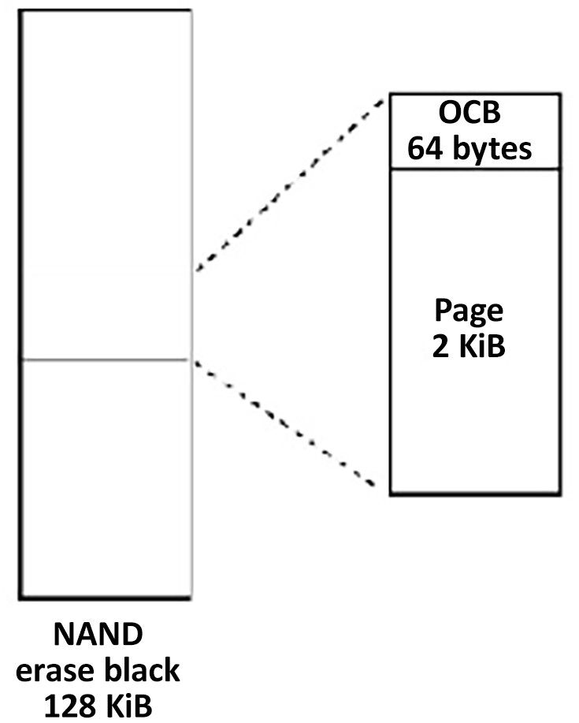
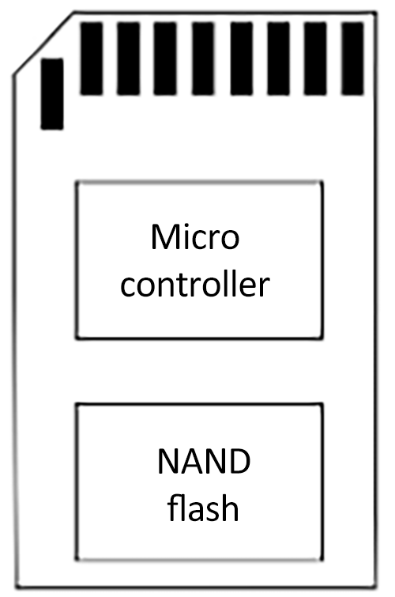
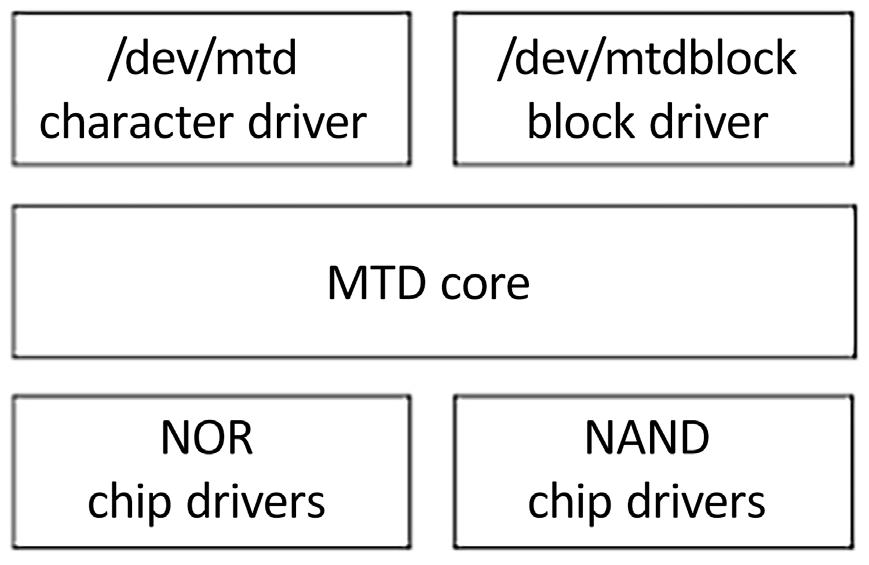
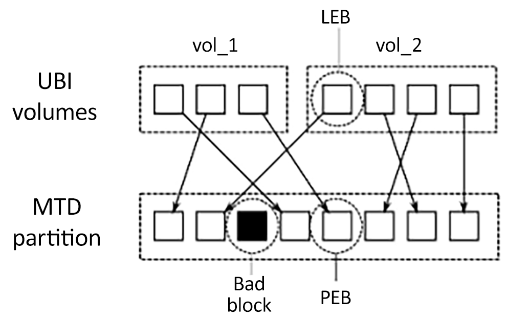
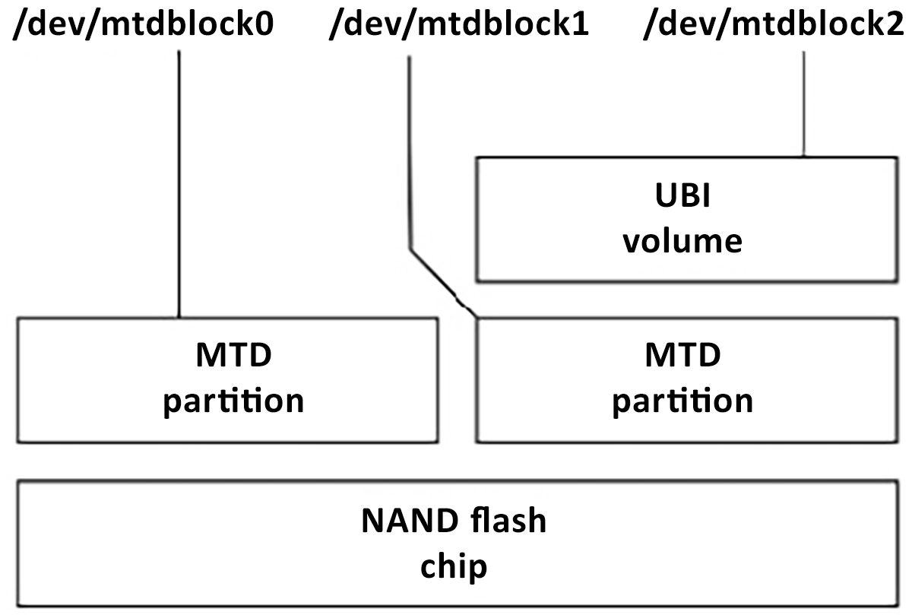

# Chương 9: Xây dựng chiến lược lưu trữ (Creating a Storage Strategy)

Các lựa chọn bộ lưu trữ dung lượng lớn cho thiết bị nhúng có tác động lớn đến phần còn lại của hệ thống về độ bền vững, tốc độ và các phương pháp dùng cho việc cập nhật in-field. Hầu hết các thiết bị dùng bộ nhớ flash dưới hình thức này hay hình thức khác. Bộ nhớ flash đã trở nên rẻ hơn nhiều trong vài năm qua khi dung lượng lưu trữ tăng từ hàng chục megabyte lên hàng chục gigabyte.

Trong chương này, chúng ta sẽ bắt đầu bằng việc xem xét chi tiết công nghệ đằng sau bộ nhớ flash cũng như cách các chiến lược tổ chức bộ nhớ khác nhau ảnh hưởng đến phần mềm driver low-level phải quản lý nó, bao gồm layer memory technology device (MTD) của Linux.

Với mỗi công nghệ flash, có những lựa chọn khác nhau về filesystem. Tôi sẽ mô tả những filesystem thường gặp nhất trên các thiết bị nhúng và hoàn tất phần khảo sát bằng một bản tóm tắt các lựa chọn cho mỗi loại bộ nhớ flash. Cuối cùng, chúng ta sẽ xem xét một số kỹ thuật tận dụng tốt nhất bộ nhớ flash và gom mọi thứ lại thành một chiến lược lưu trữ nhất quán.

Trong chương này, chúng ta sẽ đề cập các chủ đề sau:

- Các lựa chọn lưu trữ

- Truy cập bộ nhớ flash từ bootloader

- Truy cập bộ nhớ flash từ Linux

- Filesystem cho bộ nhớ flash

- Filesystem cho bộ nhớ flash NOR và NAND

- Filesystem cho managed flash

- Filesystem nén Read-only

- Filesystem tạm

- Làm cho root filesystem read-only

- Lựa chọn filesystem

## Yêu cầu kỹ thuật

Để làm theo các ví dụ, hãy bảo đảm bạn có những thứ sau:

- Một hệ thống host Linux-based đã cài đặt `e2fsprogs`, `genext2fs`, `mtd-utils`, `squashfs-tools` và `util-linux` hoặc các công cụ tương đương

- Một đầu đọc thẻ microSD và thẻ

- balenaEtcher cho Linux

- Cây source U-Boot từ Chương 3

- Cây source Linux kernel từ Chương 4

- Một cáp serial USB to TTL với các chân logic-level 3.3V

- Một BeaglePlay

- Một bộ nguồn USB-C 5V có khả năng cấp 3A

Bạn đã tải và build U-Boot cho BeaglePlay ở Chương 3. Bạn đã có cây source Linux kernel từ Chương 4.

Ubuntu cung cấp package cho hầu hết các công cụ cần để tạo và format các filesystem khác nhau. Để cài đặt các công cụ này trên một hệ thống Ubuntu 24.04 LTS, hãy dùng lệnh sau:

```
$ sudo apt install e2fsprogs genext2fs mtd-utils squashfs-tools util-linux
```

Package `mtd-utils` bao gồm `mtdinfo`, `mkfs.jffs2`, `sumtool`, `nandwrite` và các công cụ command-line UBI.

## Các lựa chọn lưu trữ

Các thiết bị nhúng cần bộ lưu trữ tiêu thụ ít điện, nhỏ gọn về vật lý, bền vững và đáng tin cậy trong suốt vòng đời có thể kéo dài hàng chục năm. Trong hầu hết mọi trường hợp, điều này có nghĩa là bộ lưu trữ solid-state. Bộ lưu trữ Solid-state đã được giới thiệu từ nhiều năm trước với read-only memory (ROM), nhưng trong 20 năm qua, nó là bộ nhớ flash thuộc loại nào đó. Đã có nhiều thế hệ bộ nhớ flash trong thời gian đó, tiến từ NOR sang NAND đến managed flash như eMMC.

Flash NOR đắt nhưng đáng tin cậy và có thể được map vào không gian địa chỉ CPU, cho phép bạn thực thi code trực tiếp từ flash. Các chip flash NOR có dung lượng thấp, từ vài megabyte đến khoảng một gigabyte.

Bộ nhớ flash NAND rẻ hơn nhiều so với NOR và có dung lượng cao hơn, từ hàng chục megabyte đến hàng chục gigabyte. Tuy nhiên, nó cần rất nhiều hỗ trợ phần cứng và phần mềm để biến nó thành một phương tiện lưu trữ hữu ích.

Bộ nhớ managed flash gồm một hoặc nhiều chip flash NAND được đóng gói cùng một controller xử lý các phức tạp của bộ nhớ flash và cung cấp một giao diện phần cứng tương tự như của ổ cứng. Điểm hấp dẫn là nó loại bỏ sự phức tạp khỏi phần mềm driver và che chắn cho người thiết kế hệ thống khỏi những thay đổi thường xuyên trong công nghệ flash.

Thẻ SD, chip eMMC và ổ flash USB thuộc loại này. Gần như tất cả các thế hệ smartphone và tablet hiện nay đều có bộ lưu trữ eMMC và xu hướng này nhiều khả năng sẽ lan sang các loại thiết bị nhúng khác.

Ổ cứng hiếm khi được dùng trong các hệ thống nhúng. Một ngoại lệ là ghi video số trong các set-top box và smart TV, nơi cần lượng lưu trữ lớn với thời gian ghi nhanh.

Trong mọi trường hợp, độ bền vững là quan trọng hàng đầu: bạn muốn thiết bị boot và đạt trạng thái hoạt động bất chấp mất điện và reset bất ngờ. Bạn nên chọn các filesystem hoạt động tốt trong những tình huống như vậy. Lựa chọn công nghệ thiết bị lưu trữ giới hạn lựa chọn filesystem của bạn.

Trong phần này, chúng ta sẽ tìm hiểu khác biệt giữa flash NOR và NAND và xem xét các lựa chọn khi chọn một công nghệ managed flash.

### Flash NOR

Các ô nhớ trong chip flash NOR được sắp xếp thành các erase block có kích thước, ví dụ, 128 KB. Xóa một block sẽ đặt tất cả các bit thành 1. Nó có thể được lập trình từng word một (8, 16 hoặc 32 bit tùy theo độ rộng bus dữ liệu). Mỗi chu kỳ xóa làm hỏng nhẹ các ô nhớ, và sau một số chu kỳ, erase block trở nên không đáng tin cậy và không thể dùng được nữa. Số chu kỳ xóa tối đa nên được cho trong data sheet của chip, nhưng thường nằm trong khoảng 1 K đến 1 M.

Dữ liệu có thể được đọc từng word một. Chip thường được map vào không gian địa chỉ CPU, nghĩa là bạn có thể thực thi code trực tiếp từ flash NOR. Điều này khiến nó là nơi thuận tiện để đặt code bootloader, vì nó không cần khởi tạo gì ngoài việc cố định ánh xạ địa chỉ bằng phần cứng. Các SoC hỗ trợ flash NOR theo cách này có các cấu hình cung cấp một ánh xạ bộ nhớ mặc định sao cho nó bao gồm reset vector của CPU.

Kernel, và thậm chí cả root filesystem, cũng có thể được đặt trong bộ nhớ flash, tránh nhu cầu copy chúng vào RAM và nhờ đó tạo ra các thiết bị có memory footprint nhỏ. Kỹ thuật này được gọi là Execute-in-Place hay XIP. Nó rất chuyên biệt, và tôi sẽ không xem xét thêm ở đây. Tôi đã đưa vào một số tài liệu tham khảo ở cuối chương này trong mục Tìm hiểu thêm.

Có một giao diện register-level chuẩn cho chip flash NOR gọi là Common Flash Interface hay CFI, mà mọi chip hiện đại đều hỗ trợ. CFI được mô tả trong chuẩn JESD68, mà bạn có thể lấy từ `https://www.jedec.org/`.

Giờ chúng ta đã biết flash NOR là gì, hãy xem flash NAND.

### Flash NAND

Flash NAND rẻ hơn nhiều so với flash NOR và có dung lượng cao hơn. Các chip NAND First-generation lưu một bit mỗi ô nhớ theo cách tổ chức mà giờ được gọi là single-level cell (SLC). Các thế hệ sau chuyển sang hai bit mỗi ô trong các chip multi-level cell (MLC) và giờ là ba bit mỗi ô trong các chip tri-level cell (TLC). Khi số bit mỗi ô tăng lên, độ tin cậy của bộ lưu trữ giảm đi, đòi hỏi phần cứng và phần mềm controller phức tạp hơn để bù đắp. Ở những nơi độ tin cậy là mối quan tâm, bạn nên bảo đảm mình dùng các chip flash NAND SLC.

Giống như flash NOR, flash NAND được tổ chức thành các erase block có kích thước từ 16 KB đến 512 KB và, một lần nữa, xóa một block sẽ đặt tất cả các bit thành 1. Tuy nhiên, số chu kỳ xóa trước khi block trở nên không đáng tin cậy thấp hơn. Thường chỉ có khoảng 1 K chu kỳ cho chip TLC và lên tới 100 K cho SLC. Flash NAND chỉ có thể được đọc và ghi theo page (thường là 2 hoặc 4 KB). Vì chúng không thể được truy cập từng byte, chúng không thể được map vào không gian địa chỉ, vì vậy code và dữ liệu phải được copy vào RAM trước khi có thể được truy cập.

Việc truyền dữ liệu tới và từ chip dễ bị bit flip, có thể được phát hiện và sửa bằng error-correction code (ECC). Chip SLC thường dùng một mã hamming đơn giản, có thể được triển khai hiệu quả bằng phần mềm và có thể sửa một lỗi single-bit trong một lần đọc page. Chip MLC và TLC cần các mã tinh vi hơn như Bose-Chaudhuri-Hocquenghem (BCH), có thể sửa tới 8 bit lỗi mỗi page. Sửa nhiều lỗi như vậy cần hỗ trợ phần cứng bên trong flash controller.

Các ECC cần được lưu ở đâu đó, vì vậy có thêm một vùng nhớ mỗi page được gọi là vùng out-of-band (OOB) hay spare area. Các thiết kế SLC thường có 1 byte OOB cho mỗi 32 byte lưu trữ chính. Vì vậy, với một thiết bị page 2 KB, OOB là 64 byte mỗi page, và với page 4 KB, nó là 128 byte. Chip MLC và TLC có vùng OOB lớn hơn tương ứng để chứa các ECC phức tạp hơn. Sơ đồ sau cho thấy cách tổ chức của một chip với erase block 128 KB và page 2 KB:



Hình 9.1 – Vùng OOB

Trong quá trình sản xuất, nhà sản xuất kiểm thử tất cả các block và đánh dấu những block hỏng bằng cách đặt một flag trong vùng OOB của mỗi page trong block. Không hiếm khi thấy các chip brand-new có tới 2% block bị đánh dấu hỏng theo cách này. Lưu thông tin OOB để phân tích trước khi xóa vùng đó có thể hữu ích khi có vấn đề. Hơn nữa, theo đặc tả, một tỷ lệ block tương tự có thể báo lỗi khi xóa trước khi đạt giới hạn chu kỳ xóa. Driver flash NAND nên phát hiện điều này và đánh dấu block đó là hỏng.

Sau khi đã dành chỗ trong vùng OOB cho một flag bad block và các byte ECC, vẫn còn lại một số byte. Một số filesystem flash tận dụng các byte trống này để lưu metadata của filesystem. Do đó, nhiều phần của hệ thống quan tâm đến bố cục của vùng OOB: boot code ROM của SoC, bootloader, driver MTD của kernel, code filesystem và các công cụ tạo filesystem image. Không có nhiều tiêu chuẩn hóa, vì vậy rất dễ rơi vào tình huống bootloader ghi dữ liệu bằng một định dạng OOB mà driver MTD của kernel không đọc được. Việc bảo đảm tất cả chúng thống nhất là trách nhiệm của bạn.

Truy cập chip flash NAND cần một NAND flash controller, thường là một phần của SoC. Bạn sẽ cần driver tương ứng trong bootloader và kernel. NAND flash controller xử lý giao diện phần cứng của chip, truyền dữ liệu tới và từ các page, và có thể bao gồm phần cứng để sửa lỗi.

Có một giao diện register-level chuẩn cho chip flash NAND được gọi là Open NAND Flash Interface hay ONFI, mà hầu hết các chip hiện đại tuân theo. Xem `https://onfi.org/` để biết thêm thông tin.

Công nghệ flash NAND hiện đại rất phức tạp. Ghép bộ nhớ flash NAND với một controller không còn đủ nữa. Chúng ta cũng cần một giao diện tới phần cứng trừu tượng hóa đi phần lớn các chi tiết kỹ thuật như sửa lỗi.

### Managed flash

Gánh nặng hỗ trợ bộ nhớ flash trong hệ điều hành – đặc biệt là NAND – trở nên nhỏ hơn nếu có một giao diện phần cứng well-defined và một flash controller chuẩn che giấu các phức tạp của bộ nhớ. Đây là bộ nhớ managed flash, và nó đang ngày càng phổ biến. Về bản chất, nó có nghĩa là kết hợp một hoặc nhiều chip flash với một vi điều khiển cung cấp một thiết bị lưu trữ lý tưởng với kích thước sector nhỏ và tương thích với các filesystem thông thường. Các loại chip quan trọng nhất cho hệ thống nhúng là thẻ Secure Digital (SD) và biến thể nhúng được gọi là eMMC.

#### Thẻ MultiMediaCard và Secure Digital

MultiMediaCard (MMC) được SanDisk và Siemens giới thiệu vào năm 1997 như một dạng lưu trữ đóng gói dùng bộ nhớ flash. Không lâu sau, vào năm 1999, SanDisk, Matsushita và Toshiba tạo ra thẻ SD, dựa trên MMC nhưng thêm mã hóa và Digital Rights Management (DRM), vì vậy mới có phần “secure” trong tên. Cả hai đều được dành cho thiết bị điện tử tiêu dùng như máy ảnh số, máy nghe nhạc và các thiết bị tương tự. Hiện nay, thẻ SD là dạng managed flash thống trị cho điện tử tiêu dùng và nhúng, mặc dù các tính năng mã hóa hiếm khi được dùng. Các phiên bản mới hơn của đặc tả SD cho phép đóng gói nhỏ hơn (miniSD và microSD) và dung lượng lớn hơn: SDHC dung lượng cao tới 32 GB và SDXC dung lượng mở rộng tới 2 TB.

Giao diện phần cứng cho thẻ MMC và SD rất giống nhau. Có thể dùng thẻ MMC full-sized trong khe thẻ SD full-sized (nhưng không thể ngược lại). Các phiên bản đầu dùng một Serial Peripheral Interface (SPI) 1 bit. Các thẻ mới hơn dùng giao diện 4 bit.

Có một tập lệnh để đọc và ghi bộ nhớ theo sector 512 byte. Bên trong gói là một vi điều khiển và một hoặc nhiều chip flash NAND, như được thể hiện trong sơ đồ sau:



Hình 9.2 – Gói thẻ SD

Vi điều khiển triển khai tập lệnh và quản lý bộ nhớ flash, thực hiện chức năng của một flash translation layer, như được mô tả ở phần sau của chương này. Chúng được format sẵn với một filesystem FAT: FAT16 trên thẻ SDSC, FAT32 trên SDHC và exFAT trên SDXC. Chất lượng của các chip flash NAND và phần mềm trên vi điều khiển khác nhau rất nhiều giữa các thẻ. Còn đáng nghi ngờ liệu thẻ nào trong số đó đủ đáng tin cậy cho việc dùng nhúng sâu. Chắc chắn là không với một filesystem FAT, vốn dễ bị hỏng file. Hãy nhớ rằng trường hợp sử dụng chính của thẻ MMC và SD là bộ lưu trữ tháo rời trên máy ảnh, tablet và điện thoại.

#### eMMC

Embedded MMC hay eMMC đơn giản là bộ nhớ MMC được đóng gói để có thể hàn lên bo mạch chủ, dùng giao diện 4 hoặc 8 bit để truyền dữ liệu. Tuy nhiên, chúng được dự định dùng làm bộ lưu trữ cho hệ điều hành, vì vậy các linh kiện có khả năng thực hiện nhiệm vụ đó. Các chip thường không được format sẵn với filesystem nào.

#### Các loại managed flash khác

Một trong những công nghệ managed flash đầu tiên là CompactFlash (CF), dùng một tập con của giao diện phần cứng Personal Computer Memory Card International Association (PCMCIA). CF cung cấp bộ nhớ qua giao diện Parallel Advanced Technology Attachment (PATA) và xuất hiện với hệ điều hành như một ổ cứng chuẩn. Chúng từng phổ biến trong các single-board computer x86-based và thiết bị video, máy ảnh chuyên nghiệp.

Một định dạng khác mà chúng ta dùng hằng ngày là ổ flash USB. Trong trường hợp này, bộ nhớ được truy cập qua giao diện USB và controller triển khai đặc tả USB mass storage cũng như flash translation layer và giao diện tới (các) chip flash. Giao thức USB mass storage dựa trên tập lệnh đĩa SCSI. Giống như thẻ MMC và SD, chúng thường được format sẵn với filesystem FAT. Trường hợp sử dụng chính của chúng trong hệ thống nhúng là trao đổi dữ liệu với PC.

Một bổ sung gần đây vào danh sách lựa chọn bộ lưu trữ managed flash là Universal Flash Storage (UFS). Giống như eMMC, nó được đóng gói trong một chip gắn trên bo mạch chủ. Nó có giao diện serial high-speed và có thể đạt tốc độ dữ liệu lớn hơn eMMC. Nó hỗ trợ tập lệnh đĩa SCSI.

Giờ chúng ta đã biết có những loại flash nào, hãy học cách U-Boot nạp một kernel image từ mỗi loại.

## Truy cập bộ nhớ flash từ bootloader

Trong Chương 3, tôi đã nhắc đến nhu cầu bootloader nạp các kernel binary và các image khác từ nhiều thiết bị flash khác nhau và thực hiện các task bảo trì hệ thống như xóa và lập trình lại bộ nhớ flash. Từ đó suy ra bootloader phải có các driver và hạ tầng cần thiết để hỗ trợ các thao tác đọc, xóa và ghi trên loại bộ nhớ bạn có, dù là NOR, NAND hay managed. Tôi sẽ dùng U-Boot trong các ví dụ sau. Các bootloader khác theo một mẫu tương tự.

### U-Boot và flash NOR

U-Boot có driver cho chip NOR CFI trong `drivers/mtd` và dùng nhiều lệnh `erase` khác nhau để xóa bộ nhớ và `cp.b` để copy dữ liệu từng byte lên các ô flash. Giả sử bạn có bộ nhớ flash NOR được map từ `0x40000000` đến `0x48000000`, trong đó 4 MB, bắt đầu tại `0x40040000`, là một kernel image. Ở đây, bạn sẽ nạp một kernel mới vào flash bằng các lệnh U-Boot sau:

```
=> tftpboot 0x100000 uImage
=> erase 0x40040000 0x403fffff
=> cp.b 0x100000 0x40040000 $(filesize)
```

Biến `filesize` trong ví dụ trên được lệnh `tftpboot` đặt thành kích thước của file vừa tải về.

### U-Boot và flash NAND

Với flash NAND, bạn cần một driver cho NAND flash controller trên SoC, mà bạn có thể tìm thấy trong source code U-Boot ở thư mục `drivers/mtd/nand`.

Bạn có thể dùng lệnh `nand` để quản lý bộ nhớ bằng các sub-commands `erase`, `write` và `read` của nó. Ví dụ này cho thấy một kernel image được nạp vào RAM tại `0x82000000` rồi được đặt vào flash bắt đầu tại offset `0x280000`:

```
=> tftpboot 0x82000000 uImage
=> nand erase 0x280000 0x400000
=> nand write 0x82000000 0x280000 $(filesize)
```

U-Boot cũng có thể đọc các file được lưu trong các filesystem JFFS2, YAFFS2 và UBIFS. `nand write` sẽ bỏ qua các block bị đánh dấu là hỏng.

LƯU Ý QUAN TRỌNG

Nếu dữ liệu bạn đang ghi là cho một filesystem, hãy bảo đảm filesystem đó cũng bỏ qua các bad block.

### U-Boot và MMC, SD, eMMC

U-Boot có driver cho nhiều MMC controller trong `drivers/mmc`. Bạn có thể truy cập dữ liệu thô bằng `mmc read` và `mmc write` ở mức giao diện người dùng, cho phép xử lý các kernel image và filesystem image thô.

U-Boot cũng có thể đọc file từ các filesystem FAT32 và ext4 trên bộ lưu trữ MMC.

U-Boot cần driver để truy cập flash NOR, NAND và managed flash. Driver nào bạn nên dùng phụ thuộc vào lựa chọn chip NOR hoặc flash controller trên SoC. Truy cập flash NOR và NAND thô từ Linux liên quan đến các lớp phần mềm bổ sung.

## Truy cập bộ nhớ flash từ Linux

Bộ nhớ flash NOR và NAND thô được xử lý bởi subsystem Memory Technology Device (MTD), cung cấp cho bạn các giao diện cơ bản để đọc, xóa và ghi các block bộ nhớ flash. Trong trường hợp flash NAND, cũng có các hàm xử lý vùng OOB và được dùng để nhận diện bad block.

Với managed flash, bạn cần driver để xử lý một giao diện phần cứng cụ thể. Thẻ MMC/SD và eMMC dùng driver `mmcblk`. Trong khi CompactFlash và ổ cứng dùng driver đĩa SCSI `sd`. Ổ flash USB dùng driver `usb_storage` cùng với driver `sd`.

### Memory technology device

Subsystem MTD được David Woodhouse bắt đầu vào năm 1999 và đã được phát triển rộng rãi qua những năm sau đó. Trong phần này, tôi sẽ tập trung vào cách nó xử lý hai công nghệ chính, flash NOR và NAND flash.MTD gồm ba lớp: một tập hàm lõi, một tập driver cho các loại chip khác nhau, và các driver user-level trình bày bộ nhớ flash dưới dạng character device hoặc block device:



Hình 9.3 – Các lớp MTD

Các chip driver nằm ở mức thấp nhất và giao tiếp với các chip flash. Chỉ cần một số ít driver cho chip flash NOR, đủ để bao quát chuẩn CFI và các biến thể, cộng với một vài chip non-compliant, giờ hầu hết đã lỗi thời. Với flash NAND, bạn sẽ cần một driver cho NAND flash controller đang dùng. Driver này thường được cung cấp như một phần của board support package. Có driver cho khoảng 40 controller trong kernel mainline hiện tại, ở thư mục `drivers/mtd/nand`.

#### Phân vùng MTD

Trong hầu hết các trường hợp, bạn sẽ muốn chia bộ nhớ flash thành một số vùng, ví dụ, để cung cấp chỗ cho bootloader, kernel image hoặc root filesystem. Trong MTD, có nhiều cách để chỉ định kích thước và vị trí của các phân vùng, các cách chính như sau:

- Qua kernel command line bằng `CONFIG_MTD_CMDLINE_PARTS`

- Qua device tree bằng `CONFIG_MTD_OF_PARTS`

- Bằng một driver platform-mapping

Với lựa chọn đầu tiên, tùy chọn kernel command-line cần dùng là `mtdparts`, được định nghĩa trong source code Linux bên trong `drivers/mtd/parsers/cmdlinepart.c`:

```
<mtddef>  := <mtd-id>:<partdef>[,<partdef>]
<partdef> := <size>[@<offset>][<name>][ro][lk][slc]
<mtd-id>  := unique name used in mapping driver/device (mtd->name)
<size>    := standard linux memsize OR "-" to denote all remaining space
             size is automatically truncated at end of device
             if specified or truncated size is 0 the part is skipped
<offset>  := standard linux memsize
             if omitted the part will immediately follow the previous part
             or 0 if the first part
<name>    := '(' NAME ')'
```

Có lẽ một ví dụ sẽ giúp ích. Hãy tưởng tượng bạn có một chip flash 128 MB cần được chia thành năm phân vùng. Một command line điển hình sẽ là:

```
mtdparts=:512k(SPL)ro,780k(U-Boot)ro,128k(U-BootEnv),4m(Kernel),-
(Filesystem)
```

Phần tử đầu tiên trước dấu hai chấm là `mtd-id`, nhận diện chip flash theo số hoặc theo tên được board support package gán. Nếu chỉ có một chip, như trường hợp ở đây, nó có thể để trống. Nếu có nhiều hơn một chip, thông tin cho mỗi chip được phân cách bằng dấu chấm phẩy. Sau đó, với mỗi chip, có một danh sách phân vùng comma-separated, mỗi phân vùng có một kích thước tính bằng byte, KB (`k`) hoặc MB (`m`), và một tên trong dấu ngoặc đơn. Hậu tố `ro` làm cho phân vùng read-only đối với MTD và thường được dùng để ngăn việc vô tình ghi đè bootloader. Kích thước của phân vùng cuối cùng trên chip có thể được thay bằng một dấu gạch ngang (`-`) cho biết nó nên chiếm toàn bộ không gian còn lại.

Bạn có thể xem bản tóm tắt cấu hình lúc runtime bằng cách đọc `/proc/mtd`:

```
# cat /proc/mtd
dev: size erasesize name
mtd0: 00080000 00020000 "SPL"
mtd1: 000C3000 00020000 "U-Boot"
mtd2: 00020000 00020000 "U-BootEnv"
mtd3: 00400000 00020000 "Kernel"
mtd4: 07A9D000 00020000 "Filesystem"
```

Có thông tin chi tiết hơn cho mỗi phân vùng trong `/sys/class/mtd`, bao gồm kích thước erase block và kích thước page. Nó được tóm tắt gọn gàng bằng `mtdinfo`:

```
# mtdinfo /dev/mtd0
mtd0
Name: SPL
Type: nand
272 Creating a Storage Strategy
Eraseblock size: 131072 bytes, 128.0 KiB
Amount of eraseblocks: 4 (524288 bytes, 512.0 KiB)
Minimum input/output unit size: 2048 bytes
Sub-page size: 512 bytes
OOB size: 64 bytes
Character device major/minor: 90:0
Bad blocks are allowed: true
Device is writable: false
```

Một cách khác để chỉ định các phân vùng MTD là qua device tree. Sau đây là một ví dụ tạo cùng các phân vùng như ví dụ command-line:

```
nand@0,0 {
 #address-cells = <1>;
 #size-cells = <1>;
 partition@0 {
  label = "SPL";
  reg = <0 0x80000>;
 };
 partition@80000 {
  label = "U-Boot";
  reg = <0x80000 0xc3000>;
 };
 partition@143000 {
  label = "U-BootEnv";
  reg = <0x143000 0x20000>;
 };
 partition@163000 {
  label = "Kernel";
  reg = <0x163000 0x400000>;
 };
 partition@563000 {
  label = "Filesystem";
  reg = <0x563000 0x7a9d000>;
 };
};
```

Lựa chọn thứ ba là viết thông tin phân vùng dưới dạng platform data trong một cấu trúc `mtd_partition` như trong ví dụ này lấy từ `arch/arm/mach-omap2/board-omap3beagle.c` (`NAND_BLOCK_SIZE` được định nghĩa ở nơi khác là 128 KB):

```
static struct mtd_partition omap3beagle_nand_partitions[] = {
 {
  .name = "X-Loader",
  .offset = 0,
  .size = 4 * NAND_BLOCK_SIZE,
  .mask_flags = MTD_WRITEABLE, /* force read-only */
 },
 {
  .name = "U-Boot",
  .offset = 0x80000;
  .size = 15 * NAND_BLOCK_SIZE,
  .mask_flags = MTD_WRITEABLE, /* force read-only */
 },
 {
  .name = "U-Boot Env",
  .offset = 0x260000;
  .size = 1 * NAND_BLOCK_SIZE,
 },
 {
  .name = "Kernel",
  .offset = 0x280000;
  .size = 32 * NAND_BLOCK_SIZE,
 },
 {
  .name = "File System",
  .offset = 0x680000;
  .size = MTDPART_SIZ_FULL,
 },
};
```

Platform data đã bị deprecated: bạn sẽ chỉ thấy nó được dùng trong BSP cho các SoC cũ chưa được cập nhật để dùng device tree.

#### Các device driver MTD

Lớp trên của subsystem MTD chứa một cặp device driver:

- Một character device với major number là `90`. Có hai device node cho mỗi số phân vùng MTD, N: `/dev/mtdN` (minor number=N\*2) và `/dev/mtdNro` (minor number=(N\*2 + 1)). Node sau chỉ là phiên bản read-only của node trước.

- Một block device với major number là `31` và minor number là N. Các device node có dạng `/dev/mtdblockN`.

Hãy xem character device trước vì nó được dùng phổ biến hơn trong hai loại. Character device hoạt động giống như file trên bộ lưu trữ, theo nghĩa bạn có thể dễ dàng đọc văn bản từ chúng và ghi văn bản vào chúng.

#### Character device MTD, mtd

Các character device là quan trọng nhất: chúng cho phép bạn truy cập bộ nhớ flash bên dưới như một mảng byte để có thể đọc và ghi (lập trình) flash. Nó cũng triển khai một số hàm `ioctl` cho phép bạn xóa block và quản lý vùng OOB trên chip NAND. Danh sách sau được lấy từ `include/uapi/mtd/mtd-abi.h`:

- `MEMGETINFO`: Lấy thông tin đặc tính MTD cơ bản.

- `MEMERASE`: Xóa các block trong phân vùng MTD.

- `MEMWRITEOOB`: Ghi dữ liệu out-of-band cho page.

- `MEMREADOOB`: Đọc dữ liệu out-of-band cho page.

- `MEMLOCK`: Khóa chip (nếu được hỗ trợ).

- `MEMUNLOCK`: Mở khóa chip (nếu được hỗ trợ).

- `MEMGETREGIONCOUNT`: Lấy số erase region: non-zero nếu có các erase block với kích thước khác nhau trong phân vùng, điều phổ biến với flash NOR nhưng hiếm với NAND.

- `MEMGETREGIONINFO`: Có thể được dùng để lấy offset, kích thước và số block của mỗi region nếu `MEMGETREGIONCOUNT` là non-zero.

- `MEMGETOOBSEL`: Đã deprecated.

- `MEMGETBADBLOCK`: Lấy flag bad block.

- `MEMSETBADBLOCK`: Đặt flag bad block.

- `OTPSELECT`: Đặt chế độ OTP (one-time programmable) nếu chip hỗ trợ.

- `OTPGETREGIONCOUNT`: Lấy số OTP region.

- `OTPGETREGIONINFO`: Lấy thông tin về một OTP region.

- `ECCGETLAYOUT`: Đã deprecated.

Có một tập chương trình tiện ích được gọi là `mtd-utils` để thao tác bộ nhớ flash, dùng các hàm `ioctl` này. Source có tại `git://git.infradead.org/mtd-utils.git` và có sẵn dưới dạng package trong The Yocto Project và Buildroot. Các công cụ thiết yếu được thể hiện trong danh sách sau. Package này cũng chứa các tiện ích cho filesystem JFFS2 và UBI/UBIFS, mà tôi sẽ đề cập sau. Với mỗi công cụ này, MTD character device là một trong các tham số sau:

- `flash_erase`: Xóa một dải block.

- `flash_lock`: Khóa một dải block.

- `flash_unlock`: Mở khóa một dải block.

- `nanddump:` Dump bộ nhớ từ flash NAND, tùy chọn bao gồm cả vùng OOB. Bỏ qua các bad block.

- `nandtest`: Kiểm thử và chẩn đoán flash NAND.

- `nandwrite`: Ghi (lập trình) dữ liệu từ một file vào flash NAND, bỏ qua các bad block.

MẸO

Bạn phải luôn xóa bộ nhớ flash trước khi ghi nội dung mới vào nó.

`flash_erase` là lệnh làm việc này.

Để lập trình flash NOR, bạn chỉ cần copy byte vào device node MTD bằng một lệnh copy file như cp.

Đáng tiếc, cách này không hoạt động với bộ nhớ NAND vì việc copy sẽ thất bại ở bad block đầu tiên. Thay vào đó, hãy dùng `nandwrite`, công cụ bỏ qua mọi bad block. Để đọc lại bộ nhớ NAND, bạn nên dùng `nanddump`, công cụ cũng bỏ qua các bad block.

#### Block device MTD, mtdblock

Driver `mtdblock` không được dùng thường xuyên. Mục đích của nó là trình bày bộ nhớ flash như một block device mà bạn có thể dùng để format và mount một filesystem. Tuy nhiên, nó có những hạn chế nghiêm trọng vì không xử lý bad block trong flash NAND, không làm wear leveling và không xử lý sự không khớp kích thước giữa block của filesystem và erase block của flash. Nói cách khác, nó không có flash translation layer, thứ thiết yếu cho việc lưu file đáng tin cậy. Trường hợp duy nhất mà thiết bị `mtdblock` hữu ích là để mount các file system read-only như SquashFS trên nền bộ nhớ flash đáng tin cậy như NOR.

MẸO

Nếu muốn một filesystem read-only trên flash NAND, bạn nên dùng driver UBI như được mô tả ở phần sau của chương này.

#### Ghi log kernel oops vào MTD

Một lỗi kernel hay oops thường được ghi log qua các daemon `klogd` và `syslogd` vào một memory buffer vòng hoặc một file. Sau khi reboot, log sẽ bị mất trong trường hợp ring buffer. Ngay cả trong trường hợp file, có thể nó chưa được ghi đúng cách trước khi hệ thống crash. Một phương pháp đáng tin cậy hơn là ghi oops và kernel panic vào một phân vùng MTD dưới dạng circular log buffer. Bạn có thể bật nó bằng `CONFIG_MTD_OOPS` và thêm `console=ttyMTDN` vào kernel command line, với `N` là số MTD device để ghi thông điệp vào.

#### Mô phỏng bộ nhớ NAND

NAND simulator emulate một chip NAND bằng RAM hệ thống. Công dụng chính của nó là kiểm thử code phải NAND-aware mà không cần truy cập bộ nhớ NAND vật lý. Khả năng mô phỏng bad block, bit flip và các lỗi khác cho phép bạn kiểm thử các đường code khó thực thi với bộ nhớ flash thật. Để biết thêm thông tin, nơi tốt nhất để xem là chính code, nơi cung cấp mô tả đầy đủ về các cách bạn có thể cấu hình driver. Code nằm trong `drivers/mtd/nand/nandsim.c`. Bật nó bằng cấu hình kernel `CONFIG_MTD_NAND_NANDSIM`.

### Block driver MMC

Thẻ MMC/SD và chip eMMC được truy cập bằng block driver `mmcblk`. Bạn cần một host controller khớp với MMC adapter đang dùng, thứ là một phần của board support package. Các driver nằm trong source code Linux dưới `drivers/mmc/host`.

Bộ lưu trữ MMC được phân vùng bằng một bảng phân vùng theo đúng cách bạn làm với ổ cứng. Tức là, bằng `fdisk` hoặc một tiện ích tương tự.

Giờ chúng ta đã biết Linux truy cập từng loại flash như thế nào. Tiếp theo, chúng ta sẽ xem các vấn đề cố hữu của bộ nhớ flash và cách Linux xử lý chúng, hoặc qua filesystem hoặc qua block device driver.

## Filesystem cho bộ nhớ flash

Có nhiều thách thức khi sử dụng hiệu quả bộ nhớ flash làm bộ lưu trữ dung lượng lớn: sự không khớp giữa kích thước erase block và sector đĩa, số chu kỳ xóa hạn chế cho mỗi erase block, và nhu cầu xử lý bad block trên chip NAND. Những khác biệt này được giải quyết bởi một flash translation layer (FTL).

### Flash translation layer

Một flash translation layer có các tính năng sau:

- Sub allocation: Filesystem hoạt động tốt nhất với đơn vị cấp phát nhỏ, theo truyền thống là một sector 512 byte. Đơn vị này nhỏ hơn nhiều so với một erase block flash 128 KB trở lên. Vì vậy, erase block cần được chia nhỏ thành các đơn vị nhỏ hơn để tránh lãng phí lượng lớn không gian.

- Garbage collection: Một hệ quả của sub allocation là một erase block sẽ chứa lẫn dữ liệu tốt và dữ liệu cũ sau khi filesystem được dùng một thời gian. Vì chúng ta chỉ có thể giải phóng toàn bộ erase block, cách duy nhất để thu hồi không gian trống này là gom dữ liệu tốt vào một chỗ rồi trả erase block giờ đã trống về danh sách trống. Việc này được gọi là garbage collection, và nó thường được triển khai dưới dạng một background thread.

- Wear leveling: Có giới hạn về số chu kỳ xóa cho mỗi block. Để tối đa hóa tuổi thọ của chip, điều quan trọng là di chuyển dữ liệu xung quanh để mỗi block được xóa với số lần gần như nhau.

- Xử lý bad block: Trên chip flash NAND, bạn phải tránh dùng bất kỳ block nào bị đánh dấu hỏng và cũng phải đánh dấu block tốt là hỏng nếu chúng không thể được xóa.

- Độ bền vững: Thiết bị nhúng có thể bị tắt nguồn hoặc reset mà không báo trước. Mọi filesystem nên có khả năng đối phó mà không bị hỏng, thường bằng cách tích hợp một journal hoặc một log giao dịch.

Có nhiều cách triển khai flash translation layer:

- Trong filesystem: Như với JFFS2, YAFFS2 và UBIFS.

- Trong block device driver: Driver UBI, mà UBIFS phụ thuộc vào, triển khai một số khía cạnh của flash translation layer.

- Trong device controller: Như với các thiết bị managed flash.

Khi flash translation layer nằm trong filesystem hoặc block driver, code là một phần của kernel nên chúng ta có thể xem nó hoạt động thế nào và kỳ vọng nó sẽ được cải thiện theo thời gian. Mặt khác, nếu FTL nằm bên trong một thiết bị managed flash, nó bị che khuất, và chúng ta không thể kiểm chứng nó có hoạt động như mong muốn không. Không chỉ vậy, đặt FTL vào disk controller có nghĩa là nó bỏ lỡ thông tin hữu ích được giữ ở lớp filesystem, như những sector nào thuộc về các file đã bị xóa. Vấn đề sau được giải quyết bằng cách thêm các lệnh truyền thông tin này giữa filesystem và thiết bị. Tôi sẽ mô tả cách nó hoạt động ở phần sau, trong mục về lệnh `TRIM`. Tuy nhiên, câu hỏi về khả năng xem code vẫn còn. Nếu dùng managed flash, bạn chỉ còn cách chọn một nhà sản xuất mà mình tin tưởng.

Giờ chúng ta đã biết động cơ đằng sau các filesystem, hãy xem filesystem nào phù hợp nhất với loại flash nào.

## Filesystem cho bộ nhớ flash NOR và NAND

Để dùng chip flash thô làm bộ lưu trữ dung lượng lớn, bạn phải dùng một filesystem hiểu được những đặc thù của công nghệ bên dưới. Có ba filesystem như vậy:

- JFFS2 (Journaling Flash File System 2): Đây là filesystem flash đầu tiên cho Linux và vẫn được dùng ngày nay. Nó hoạt động với bộ nhớ NOR và NAND nhưng nổi tiếng là chậm khi mount.

- YAFFS2 (Yet Another Flash File System 2): Filesystem này giống JFFS2 nhưng dành riêng cho bộ nhớ flash NAND. Nó được Google áp dụng làm filesystem flash thô ưu tiên trên các thiết bị Android.

- UBIFS (Unsorted Block Image File System): Filesystem này hoạt động cùng block driver UBI để tạo ra một filesystem flash đáng tin cậy. Nó hoạt động tốt với cả bộ nhớ NOR và NAND. Vì nhìn chung nó cho hiệu năng tốt hơn JFFS2 hoặc YAFFS2, nó nên là giải pháp ưu tiên cho các thiết kế mới.

Tất cả chúng đều dùng MTD làm giao diện chung tới bộ nhớ flash.

### JFFS2

Journaling Flash File System khởi đầu trong phần mềm cho network camera Axis 2100 từ năm 1999. Trong nhiều năm, nó là filesystem flash duy nhất cho Linux và đã được triển khai trên nhiều loại thiết bị khác nhau. Ngày nay, nó không phải là lựa chọn tốt nhất, nhưng tôi sẽ đề cập nó trước vì nó cho thấy điểm khởi đầu của con đường tiến hóa.

JFFS2 là một filesystem log-structured dùng MTD để truy cập bộ nhớ flash. Trong một filesystem log-structured, các thay đổi được ghi tuần tự dưới dạng các node vào bộ nhớ flash. Một node có thể chứa các thay đổi đối với một thư mục, như tên các file được tạo và xóa, hoặc có thể chứa các thay đổi đối với dữ liệu file. Sau một thời gian, một node có thể bị thay thế bởi thông tin chứa trong các node sau và trở thành một node lỗi thời. Cả flash NOR và NAND đều được tổ chức thành các erase block. Xóa một block sẽ đặt tất cả các bit của nó thành 1.

JFFS2 phân loại erase block thành ba loại:

- Free: Không chứa node nào.

- Clean: Chỉ chứa các node hợp lệ.

- Dirty: Chứa ít nhất một node lỗi thời.

Tại bất kỳ thời điểm nào, có một block nhận các cập nhật, được gọi là open block. Nếu mất điện hoặc hệ thống bị reset, dữ liệu duy nhất có thể bị mất là lần ghi cuối cùng vào open block. Ngoài ra, các node được nén khi ghi, làm tăng dung lượng lưu trữ hiệu quả của chip flash, điều quan trọng nếu bạn dùng bộ nhớ flash NOR đắt tiền.

Khi số free block giảm xuống dưới một ngưỡng nhất định, một kernel thread garbage collector được khởi động, quét tìm các dirty block, copy các node hợp lệ vào open block rồi giải phóng dirty block.

Đồng thời, garbage collector cung cấp một dạng wear leveling thô sơ vì nó luân chuyển dữ liệu hợp lệ từ block này sang block khác. Cách chọn open block có nghĩa là mỗi block được xóa với số lần gần như nhau miễn là nó chứa dữ liệu thỉnh thoảng thay đổi. Đôi khi, một clean block được chọn cho garbage collection để bảo đảm các block chứa dữ liệu tĩnh hiếm khi được ghi cũng được wear-leveled.

Filesystem JFFS2 có một cache write-through, nghĩa là các lần ghi được ghi vào bộ nhớ flash một cách đồng bộ như thể chúng được mount với tùy chọn `-o` sync. Mặc dù cải thiện độ tin cậy, cách này làm tăng thời gian ghi dữ liệu. Còn một vấn đề nữa với các lần ghi nhỏ: nếu độ dài của một lần ghi tương đương kích thước của node header (40 byte), overhead trở nên cao. Một trường hợp biên well-known là các file log như những file do `syslogd` tạo ra.

#### Summary node

Có một nhược điểm lớn của JFFS2: vì không có index on-chip, cấu trúc thư mục phải được suy ra lúc mount bằng cách đọc log từ đầu đến cuối. Ở cuối lần quét, bạn có bức tranh đầy đủ về cấu trúc thư mục của các node hợp lệ, nhưng thời gian mount tỷ lệ với kích thước phân vùng. Không hiếm khi thấy thời gian mount vào cỡ một giây mỗi megabyte, dẫn đến tổng thời gian mount hàng chục hoặc hàng trăm giây.

Summary node trở thành một tùy chọn trong Linux 2.6.15 để giảm thời gian quét khi mount. Một summary node được ghi ở cuối open erase block, ngay trước khi nó được đóng. Summary node chứa tất cả thông tin cần cho lần quét mount-time, qua đó giảm lượng dữ liệu cần xử lý trong lần quét. Summary node có thể giảm thời gian mount từ hai đến năm lần với cái giá là overhead khoảng 5% không gian lưu trữ. Chúng được bật bằng cấu hình kernel `CONFIG_JFFS2_SUMMARY`.

#### Clean marker

Một block đã xóa với tất cả các bit được đặt thành 1 không thể phân biệt với một block đã được ghi toàn số 1, nhưng block sau chưa được làm mới các ô nhớ và không thể được lập trình lại cho đến khi được xóa. JFFS2 dùng một cơ chế gọi là clean marker để phân biệt hai tình huống này. Sau khi xóa block thành công, một clean marker được ghi vào đầu block hoặc vào vùng OOB của page đầu tiên của block. Nếu clean marker tồn tại, thì đó phải là một clean block.

#### Tạo một filesystem JFFS2

Tạo một filesystem JFFS2 rỗng lúc runtime đơn giản như xóa một phân vùng MTD với clean marker rồi mount nó. Không có bước format vì một filesystem JFFS2 trống gồm toàn free block. Ví dụ, để format phân vùng MTD 6, bạn sẽ nhập các lệnh sau trên thiết bị:

```
# flash_erase -j /dev/mtd6 0 0
# mount -t jffs2 mtd6 /mnt
```

Tùy chọn `-j` của `flash_erase` thêm các clean marker, và mount với loại `jffs2` sẽ trình bày phân vùng như một filesystem rỗng. Lưu ý rằng thiết bị cần mount được cho là `mtd6`, không phải `/dev/mtd6`. Ngoài ra, bạn có thể đưa device node block `/dev/mtdblock6`. Đây chỉ là một đặc thù của JFFS2. Khi đã mount, bạn có thể đối xử với nó như mọi filesystem khác.

Bạn có thể tạo một filesystem image trực tiếp từ vùng staging của hệ thống phát triển bằng `mkfs.jffs2` để ghi các file ra ở định dạng JFFS2 và `sumtool` để thêm các summary node. Cả hai đều là một phần của package `mtd-utils`.

Ví dụ, để tạo một image các file trong `rootfs` cho một thiết bị flash NAND có kích thước erase block 128 KB (`0x20000`) và có summary node, bạn sẽ dùng hai lệnh sau:

```
$ mkfs.jffs2 -n -e 0x20000 -p -d ~/rootfs -o ~/rootfs.jffs2
$ sumtool -n -e 0x20000 -p -i ~/rootfs.jffs2 -o ~/rootfs-sum.jffs2
```

Tùy chọn `-p` thêm phần đệm ở cuối file image để nó là một số nguyên erase block. Tùy chọn `-n` chặn việc tạo clean marker trong image, điều bình thường với thiết bị NAND vì clean marker nằm trong vùng OOB. Với thiết bị NOR, bạn sẽ bỏ tùy chọn `-n`. Bạn có thể dùng một device table với `mkfs.jffs2` để đặt quyền truy cập và quyền sở hữu file bằng cách thêm `-D <device table>`. Tất nhiên, Buildroot và The Yocto Project sẽ làm tất cả những điều này cho bạn.

Bạn có thể lập trình image vào bộ nhớ flash từ bootloader. Ví dụ, nếu bạn đã nạp một filesystem image vào RAM tại địa chỉ `0x82000000` và muốn nạp nó vào một phân vùng flash bắt đầu tại `0x163000` byte tính từ đầu chip flash và dài `0x7a9d000` byte, các lệnh U-Boot cho việc này sẽ là:

```
nand erase clean 163000 7a9d000
nand write 82000000 163000 7a9d000
```

Bạn có thể làm điều tương tự từ Linux bằng driver `mtd` như sau:

```
# flash_erase -j /dev/mtd6 0 0
# nandwrite /dev/mtd6 rootfs-sum.jffs2
```

Để boot với một root filesystem JFFS2, bạn cần truyền thiết bị `mtdblock` trên kernel command line cho phân vùng và một `rootfstype`, vì JFFS2 không thể được auto-detected:

```
root=/dev/mtdblock6 rootfstype=jffs2
```

Không lâu sau khi JFFS2 được giới thiệu, một filesystem log-structured khác xuất hiện.

### YAFFS2

Filesystem YAFFS được Charles Manning viết từ năm 2001 để xử lý chip flash NAND vào thời điểm JFFS2 chưa làm được. Các thay đổi tiếp theo để xử lý kích thước page lớn hơn (2 KB) dẫn đến YAFFS2. Website của YAFFS là `https://yaffs.net/`.

YAFFS cũng là một filesystem log-structured tuân theo cùng các nguyên tắc thiết kế như JFFS2. Các quyết định thiết kế khác biệt có nghĩa là nó có lần quét mount-time nhanh hơn, garbage collection đơn giản và nhanh hơn, và không nén, điều này tăng tốc việc đọc và ghi với cái giá là dùng bộ lưu trữ kém hiệu quả hơn.

YAFFS không giới hạn ở Linux. Nó đã được port sang nhiều hệ điều hành. Nó có license kép: GPLv2 (tương thích với Linux) và một license thương mại cho các hệ điều hành khác. Đáng tiếc, code YAFFS chưa bao giờ được merge vào Linux mainline nên bạn sẽ phải patch kernel.

Để lấy YAFFS2 và patch một kernel, hãy làm như sau:

```
$ git clone git://www.aleph1.co.uk/yaffs2
$ cd yaffs2
$ ./patch-ker.sh c m <path to your link source>
```

Sau đó, bạn có thể cấu hình kernel với `CONFIG_YAFFS_YAFFS2`.

#### Tạo một filesystem YAFFS2

Giống như JFFS2, để tạo một filesystem YAFFS2 lúc runtime, bạn chỉ cần xóa phân vùng và mount nó, nhưng lưu ý rằng trong trường hợp này, bạn không bật clean marker:

```
# flash_erase /dev/mtd/mtd6 0 0
# mount -t yaffs2 /dev/mtdblock6 /mnt
```

Để tạo một filesystem image, cách đơn giản nhất là dùng công cụ `mkyaffs2` từ `https://code.google.com/archive/p/yaffs2utils/:`

```
$ mkyaffs2 -c 2048 -s 64 rootfs rootfs.yaffs2
```

Ở đây, `-c` là kích thước page và `-s` là kích thước OOB. Có một công cụ tên là `mkyaffs2image` là một phần của code YAFFS, nhưng nó có một vài nhược điểm. Thứ nhất, kích thước page và OOB bị hard coded trong source, vì vậy bạn sẽ phải sửa và compile lại nếu bộ nhớ của bạn không khớp với giá trị mặc định 2,048 và 64. Thứ hai, bố cục OOB không tương thích với MTD, vốn dùng hai byte đầu tiên làm bad block marker, trong khi `mkyaffs2image` dùng các byte đó để lưu một phần metadata YAFFS.

Để copy image vào phân vùng MTD từ dấu nhắc shell Linux trên target, hãy làm theo các bước sau:

```
# flash_erase /dev/mtd6 0 0
# nandwrite -a /dev/mtd6 rootfs.yaffs2
```

Để boot với một root filesystem YAFFS2, hãy thêm nội dung sau vào kernel command line:

```
root=/dev/mtdblock6 rootfstype=yaffs2
```

Nhân tiện đang nói về chủ đề filesystem cho flash NOR và NAND thô, hãy xem một trong những lựa chọn hiện đại hơn. Filesystem này chạy trên nền driver UBI.

### UBI và UBIFS

Driver Unsorted Block Image (UBI) là một volume manager cho bộ nhớ flash, đảm nhận việc xử lý bad block và wear leveling. Nó được Artem Bityutskiy triển khai và xuất hiện lần đầu trong Linux 2.6.22. Song song với đó, các kỹ sư tại Nokia đang làm một filesystem tận dụng các tính năng của UBI, mà họ gọi là UBIFS. Nó xuất hiện trong Linux 2.6.27. Tách flash translation layer theo cách này làm code module hóa hơn và cũng cho phép các filesystem khác tận dụng driver UBI, như chúng ta sẽ thấy ở phần sau.

#### UBI

UBI cung cấp một cái nhìn lý tưởng hóa, đáng tin cậy về một chip flash bằng cách ánh xạ các physical erase block (PEB) sang logical erase block (LEB). Bad block không được ánh xạ sang LEB nên không bao giờ được dùng. Nếu một block không thể xóa được, nó bị đánh dấu là hỏng và bị bỏ khỏi ánh xạ. UBI giữ một bộ đếm số lần mỗi PEB đã bị xóa trong header của LEB rồi thay đổi ánh xạ để bảo đảm mỗi PEB được xóa với số lần như nhau.

UBI truy cập bộ nhớ flash qua lớp MTD. Như một tính năng bổ sung, nó có thể chia một phân vùng MTD thành nhiều UBI volume, điều cải thiện wear leveling như sau. Hãy tưởng tượng bạn có hai filesystem: một chứa dữ liệu khá tĩnh, như root filesystem, và một chứa dữ liệu thay đổi liên tục.

Nếu chúng được lưu trong các phân vùng MTD riêng, wear leveling chỉ tác động đến cái thứ hai. Trong khi đó, nếu bạn chọn lưu chúng trong hai UBI volume trong một phân vùng MTD duy nhất, wear leveling diễn ra trên cả hai vùng của bộ lưu trữ, và tuổi thọ của bộ nhớ flash được tăng lên. Sơ đồ sau minh họa tình huống này:



Hình 9.4 – Các UBI volume

Bằng cách này, UBI đáp ứng hai yêu cầu của một flash translation layer: wear leveling và xử lý bad-block.

Để chuẩn bị một phân vùng MTD cho UBI, bạn không dùng `flash_erase` như với JFFS2 và YAFFS2. Thay vào đó, bạn dùng tiện ích `ubiformat`, tiện ích này giữ lại các bộ đếm xóa được lưu trong header PEB. `ubiformat` cần biết đơn vị I/O tối thiểu, với hầu hết chip flash NAND là kích thước page, nhưng một số chip cho phép đọc và ghi theo subpage bằng một nửa hoặc một phần tư kích thước page. Hãy tham khảo data sheet của chip để biết chi tiết và, nếu còn nghi ngờ, hãy dùng kích thước page. Ví dụ này chuẩn bị `mtd6` dùng kích thước page 2048 byte:

```
# ubiformat /dev/mtd6 -s 2048
ubiformat: mtd0 (nand), size 134217728 bytes (128.0 MiB), 1024 eraseblocks
of 131072 bytes (128.0 KiB), min. I/O size 2048 bytes
```

Sau đó, bạn có thể dùng lệnh `ubiattach` để nạp driver UBI trên một phân vùng MTD đã được chuẩn bị theo cách này:

```
# ubiattach -p /dev/mtd6 -O 2048
UBI device number 0, total 1024 LEBs (130023424 bytes, 124.0 MiB),
available 998 LEBs (126722048 bytes, 120.9 MiB), LEB size 126976 bytes
(124.0 KiB)
```

Lệnh này tạo device node `/dev/ubi0`, qua đó bạn có thể truy cập các UBI volume. Bạn có thể dùng `ubiattach` trên nhiều phân vùng MTD, khi đó chúng có thể được truy cập qua `/dev/ubi1`, `/dev/ubi2`, v.v. Lưu ý rằng vì mỗi LEB có một header chứa thông tin meta được UBI dùng, LEB nhỏ hơn PEB hai page. Ví dụ, một chip có kích thước PEB 128 KB và page 2 KB sẽ có LEB 124 KB. Đây là thông tin quan trọng mà bạn sẽ cần khi tạo một image UBIFS.

Ánh xạ PEB-to-LEB được nạp vào bộ nhớ trong giai đoạn attach, một quá trình mất thời gian tỷ lệ với số PEB, thường là vài giây. Một tính năng mới được thêm vào Linux 3.7, gọi là UBI fastmap, thỉnh thoảng lưu checkpoint ánh xạ vào flash và nhờ đó giảm thời gian attach. Tùy chọn cấu hình kernel cho việc này là `CONFIG_MTD_UBI_FASTMAP`.

Lần đầu tiên attach vào một phân vùng MTD sau `ubiformat`, sẽ không có volume nào. Bạn có thể tạo volume bằng `ubimkvol`. Ví dụ, giả sử bạn có một phân vùng MTD 128 MB và muốn chia nó thành hai volume. Volume thứ nhất có kích thước 32 MB và volume thứ hai sẽ chiếm phần không gian còn lại:

```
# ubimkvol /dev/ubi0 -N vol_1 -s 32MiB
Volume ID 0, size 265 LEBs (33648640 bytes, 32.1 MiB), LEB size 126976
bytes (124.0 KiB), dynamic, name "vol_1", alignment 1
# ubimkvol /dev/ubi0 -N vol_2 -m
Volume ID 1, size 733 LEBs (93073408 bytes, 88.8 MiB), LEB size 126976
bytes (124.0 KiB), dynamic, name "vol_2", alignment 1
```

Giờ bạn có một thiết bị với hai node: `/dev/ubi0_0` và `/dev/ubi0_1`. Bạn có thể xác nhận điều này bằng `ubinfo`:

```
# ubinfo -a /dev/ubi0
ubi0
Volumes count: 2
Logical eraseblock size: 126976 bytes, 124.0 KiB
Total amount of logical eraseblocks: 1024 (130023424 bytes, 124.0 MiB)
Amount of available logical eraseblocks: 0 (0 bytes)
Maximum count of volumes 128
Count of bad physical eraseblocks: 0
Count of reserved physical eraseblocks: 20
Current maximum erase counter value: 1
Minimum input/output unit size: 2048 bytes
Character device major/minor: 250:0
Present volumes: 0, 1

Volume ID: 0 (on ubi0)
Type: dynamic
Alignment: 1
Size: 265 LEBs (33648640 bytes, 32.1 MiB)
State: OK
Name: vol_1
Character device major/minor: 250:1
-----------------------------------
Volume ID: 1 (on ubi0)
Type: dynamic
Alignment: 1
Size: 733 LEBs (93073408 bytes, 88.8 MiB)
State: OK
Name: vol_2
Character device major/minor: 250:2
```

Đến lúc này, bạn có một phân vùng MTD 128 MB chứa hai UBI volume có kích thước 32 MB và 88.8 MB. Tổng dung lượng có sẵn là 32 MB cộng 88.8 MB, bằng 120.8 MB. Phần không gian còn lại, 7.2 MB, bị chiếm bởi các header UBI ở đầu mỗi PEB, và không gian được dành riêng để ánh xạ thay thế các block trở nên hỏng trong suốt vòng đời của chip.

#### UBIFS

UBIFS dùng một UBI volume để tạo ra một filesystem bền vững. Nó thêm sub-allocation và garbage collection để tạo nên một flash translation layer hoàn chỉnh. Khác với JFFS2 và YAFFS2, nó lưu thông tin index on-chip, vì vậy mount rất nhanh, mặc dù đừng quên rằng việc attach UBI volume trước đó có thể mất một khoảng thời gian đáng kể. Nó cũng cho phép caching write-back như trong một filesystem đĩa thông thường, vì vậy ghi nhanh hơn nhiều, nhưng dữ liệu chưa được flush vào bộ nhớ flash sẽ mất nếu mất điện. Bạn có thể giải quyết vấn đề này bằng cách dùng cẩn thận các hàm `fsync(2)` và `fdatasync(2)` để buộc flush dữ liệu file tại các điểm quan trọng.

UBIFS có một journal để phục hồi nhanh khi mất điện. Kích thước tối thiểu của journal là 4 MB nên UBIFS không phù hợp cho các thiết bị flash rất nhỏ.

Khi đã tạo các UBI volume, bạn có thể mount chúng bằng device node của volume, như `/dev/ubi0_0`, hoặc bằng device node của toàn bộ phân vùng cộng với tên volume, như sau:

```
# mount -t ubifs ubi0:vol_1 /mnt
```

Tạo một filesystem image cho UBIFS là một quá trình two-stage. Đầu tiên, bạn tạo một image UBIFS bằng `mkfs.ubifs`, rồi nhúng nó vào một UBI volume bằng `ubinize`. Ở giai đoạn đầu, `mkfs.ubifs` cần được cho biết kích thước page bằng `-m`, kích thước LEB của UBI bằng `-e`, và số erase block tối đa trong volume bằng `-c`. Nếu volume đầu tiên là 32 MB và một erase block là 128 KB, thì số erase block là 256. Vì vậy, để lấy nội dung thư mục `rootfs` và tạo một image UBIFS tên là `rootfs.ubi`, hãy gõ lệnh sau:

```
$ mkfs.ubifs -r rootfs -m 2048 -e 124KiB -c 256 -o rootfs.ubi
```

Giai đoạn thứ hai yêu cầu bạn tạo một file cấu hình cho `ubinize` mô tả các đặc tính của mỗi volume trong image. Trang trợ giúp (`ubinize -h`) cung cấp chi tiết về định dạng. Ví dụ này tạo hai volume (`vol_1` và `vol_2`):

```
[ubifsi_vol_1]
mode=ubi
image=rootfs.ubi
vol_id=0
vol_name=vol_1
vol_size=32MiB
vol_type=dynamic

[ubifsi_vol_2]
mode=ubi
image=data.ubi
vol_id=1
vol_name=vol_2
vol_type=dynamic
vol_flags=autoresize
```

Volume thứ hai có flag auto-resize nên sẽ mở rộng để lấp đầy phần không gian còn lại trên phân vùng MTD. Chỉ một volume có thể có flag này. Từ thông tin này, `ubinize` sẽ tạo một file image được đặt tên bởi tham số `-o`, với kích thước PEB là `-p`, kích thước page là `-m` và kích thước sub-page là `-s`:

```
$ ubinize -o ~/ubi.img -p 128KiB -m 2048 -s 512 ubinize.cfg
```

Để cài đặt image này lên target, bạn sẽ nhập các lệnh sau trên target:

```
# ubiformat /dev/mtd6 -s 2048
# nandwrite /dev/mtd6 /ubi.img
# ubiattach -p /dev/mtd6 -O 2048
```

Nếu muốn boot với một root filesystem UBIFS, bạn sẽ cần cung cấp các tham số kernel command-line sau:

```
ubi.mtd=6 root=ubi0:vol_1 rootfstype=ubifs
```

UBIFS hoàn tất phần khảo sát các filesystem cho bộ nhớ flash NOR và NAND thô. Tiếp theo, chúng ta sẽ xem các filesystem cho managed flash.

## Filesystem cho managed flash

Khi xu hướng hướng tới các công nghệ managed flash tiếp tục, đặc biệt là eMMC, chúng ta cần xem xét cách dùng chúng hiệu quả. Mặc dù chúng có vẻ có cùng đặc tính như ổ cứng, các chip flash NAND bên dưới có những hạn chế về erase block lớn với số chu kỳ xóa hạn chế và việc xử lý bad block. Chúng ta cũng cần độ bền vững khi mất điện.

Có thể dùng bất kỳ filesystem đĩa thông thường nào, nhưng chúng ta nên cố chọn một filesystem giảm số lần ghi đĩa và khởi động lại nhanh sau một lần tắt máy không theo kế hoạch.

### Flashbench

Để tận dụng tối ưu bộ nhớ flash bên dưới, bạn cần biết kích thước erase block và kích thước page. Theo lệ thường, các nhà sản xuất không công bố những con số này, nhưng có thể suy ra chúng bằng cách quan sát hành vi của chip hoặc thẻ.

Flashbench là một công cụ như vậy. Nó ban đầu được viết bởi Arnd Bergman như được mô tả trong bài viết LWN tại `https://lwn.net/Articles/428584.` Bạn có thể lấy code từ `https://github.com/bradfa/flashbench`.

Sau đây là một lần chạy điển hình trên một thẻ SDHC SanDisk 4 GB:

```
$ sudo ./flashbench -a /dev/mmcblk0 --blocksize=1024
align 536870912 pre 4.38ms on 4.48ms post 3.92ms diff 332µs
align 268435456 pre 4.86ms on 4.9ms post 4.48ms diff 227µs
align 134217728 pre 4.57ms on 5.99ms post 5.12ms diff 1.15ms
align 67108864 pre 4.95ms on 5.03ms post 4.54ms diff 292µs
align 33554432 pre 5.46ms on 5.48ms post 4.58ms diff 462µs
align 16777216 pre 3.16ms on 3.28ms post 2.52ms diff 446µs
align 8388608 pre 3.89ms on 4.1ms post 3.07ms diff 622µs
align 4194304 pre 4.01ms on 4.89ms post 3.9ms diff 940µs
align 2097152 pre 3.55ms on 4.42ms post 3.46ms diff 917µs
align 1048576 pre 4.19ms on 5.02ms post 4.09ms diff 876µs
align 524288 pre 3.83ms on 4.55ms post 3.65ms diff 805µs
align 262144 pre 3.95ms on 4.25ms post 3.57ms diff 485µs
align 131072 pre 4.2ms on 4.25ms post 3.58ms diff 362µs
align 65536 pre 3.89ms on 4.24ms post 3.57ms diff 511µs
align 32768 pre 3.94ms on 4.28ms post 3.6ms diff 502µs
align 16384 pre 4.82ms on 4.86ms post 4.17ms diff 372µs
align 8192 pre 4.81ms on 4.83ms post 4.16ms diff 349µs
align 4096 pre 4.16ms on 4.21ms post 4.16ms diff 52.4µs
align 2048 pre 4.16ms on 4.16ms post 4.17ms diff 9ns
```

Trong trường hợp này, `flashbench` đọc các block 1,024 byte ngay trước và ngay sau các ranh giới power-of-two khác nhau. Khi bạn vượt qua một ranh giới page hoặc erase block, các lần đọc sau ranh giới mất nhiều thời gian hơn. Cột ngoài cùng bên phải cho thấy chênh lệch và là cột thú vị nhất. Đọc từ dưới lên, có một bước nhảy lớn tại 4 KB, rất có thể là kích thước của một page. Có một bước nhảy thứ hai từ 52.4µs lên 349µs tại 8 KB. Điều này khá phổ biến và cho thấy thẻ có thể dùng truy cập multi-plane để đọc hai page 4 KB cùng lúc. Sau đó, các chênh lệch kém rõ ràng hơn, nhưng có một bước nhảy rõ ràng từ 485µs lên 805µs tại 512 KB, có lẽ là kích thước của erase block. Vì thẻ được kiểm thử khá cũ, đây là những con số mà bạn có thể mong đợi.

### Discard và TRIM

Thông thường, khi bạn xóa một file, chỉ node thư mục đã sửa đổi được ghi vào bộ lưu trữ, trong khi các sector chứa nội dung file vẫn giữ nguyên. Khi flash translation layer nằm trong disk controller, như với managed flash, nó không biết rằng nhóm sector đĩa này không còn chứa dữ liệu hữu ích và vì vậy rốt cuộc copy cả dữ liệu cũ.

Trong vài năm gần đây, việc bổ sung các giao dịch truyền thông tin về các sector đã xóa xuống disk controller đã cải thiện tình hình này. Các đặc tả SCSI và SATA có một lệnh `TRIM`, và MMC có một lệnh tương tự tên là `ERASE`. Trong Linux, tính năng này được gọi là discard.

Để dùng discard, bạn cần một thiết bị lưu trữ hỗ trợ nó – hầu hết các chip eMMC hiện nay đều hỗ trợ – và một device driver Linux tương ứng. Bạn có thể kiểm tra điều này bằng cách xem các tham số hàng đợi của block system trong `/sys/block/<block device>/queue/`.

Những tham số đáng quan tâm như sau:

- `discard_granularity`: Kích thước của đơn vị cấp phát nội bộ của thiết bị.

- `discard_max_bytes`: Số byte tối đa có thể discard trong một lần.

- `discard_zeroes_data`: Nếu được đặt thành `1`, dữ liệu bị discard sẽ được đặt thành 0.

Nếu thiết bị hoặc device driver không hỗ trợ discard, tất cả các giá trị này sẽ được đặt thành `0`. Ví dụ, đây là các tham số bạn sẽ thấy từ chip eMMC 2 GB trên BeagleBone Black của tôi:

```
# grep -s "" /sys/block/mmcblk0/queue/discard_*
/sys/block/mmcblk0/queue/discard_granularity:2097152
/sys/block/mmcblk0/queue/discard_max_bytes:2199023255040
/sys/block/mmcblk0/queue/discard_zeroes_data:1
```

Có thêm thông tin trong file tài liệu kernel `Documentation/block/queue-sysfs.txt`.

Bạn có thể bật discard khi mount một filesystem bằng cách thêm tùy chọn `-o` discard vào lệnh mount. Cả ext4 và F2FS đều hỗ trợ nó.

Mẹo

Hãy bảo đảm thiết bị lưu trữ hỗ trợ discard trước khi dùng tùy chọn mount `-o` discard, vì có thể mất dữ liệu.

Cũng có thể buộc discard từ command line, độc lập với cách phân vùng được mount, bằng lệnh `fstrim`, một phần của package `util-linux`. Thông thường, bạn sẽ chạy lệnh này định kỳ để giải phóng không gian không dùng. `fstrim` hoạt động trên một filesystem đã mount, vì vậy để trim root filesystem, bạn sẽ gõ lệnh sau:

```
# sudo fstrim -v /
/: 2061000704 bytes were trimmed
```

Ví dụ trên dùng tùy chọn verbose `-v` để nó in ra số byte có thể đã được giải phóng. Trong trường hợp này, 2,061,000,704 là lượng không gian trống xấp xỉ trong filesystem, vì vậy đó là lượng lưu trữ tối đa có thể đã được trim.

### Ext4

Extended filesystem (ext) đã là filesystem chính cho Linux desktop từ năm 1992. Phiên bản hiện tại (ext4) rất ổn định, well-tested và có một journal giúp việc phục hồi sau một lần tắt máy không theo kế hoạch nhanh và hầu như không đau đớn. Nó là một lựa chọn tốt cho các thiết bị managed flash, và bạn sẽ thấy nó là filesystem được ưu tiên cho các thiết bị Android có bộ lưu trữ eMMC. Nếu thiết bị hỗ trợ discard, bạn có thể mount một filesystem ext4 trên nó với tùy chọn `-o` discard.

Để format và tạo một filesystem ext4 lúc runtime, hãy gõ lệnh sau:

```
# mkfs.ext4 /dev/mmcblk0p2
# mount -t ext4 -o discard /dev/mmcblk0p1 /mnt
```

Để tạo một filesystem image lúc build, bạn có thể dùng tiện ích `genext2fs` có tại `https://github.com/bestouff/genext2fs`. Trong ví dụ này, tôi đã chỉ định kích thước block bằng `-B` và số block trong image bằng `-b`:

```
$ genext2fs -B 1024 -b 10000 -d rootfs rootfs.ext4
```

`genext2fs` có thể dùng một device table để đặt quyền truy cập và quyền sở hữu file như được mô tả trong Chương 5 bằng `-D <file table>`.

Như tên gọi gợi ý, lệnh này sẽ tạo một image ở định dạng ext2. Bạn có thể nâng cấp lên ext4 bằng tune2fs như sau (chi tiết về các tùy chọn của lệnh có trong trang manual `tune2fs(8)`):

```
$ tune2fs -j -J size=1 -O filetype,extents,uninit_bg,dir_index rootfs.ext4
$ e2fsck -pDf rootfs.ext4
```

Cả The Yocto Project và Buildroot đều dùng chính xác các bước này khi tạo image ở định dạng ext4.

Mặc dù journal là một tài sản cho các thiết bị có thể mất điện mà không báo trước, nó thêm các chu kỳ ghi bổ sung cho mỗi giao dịch ghi, làm hao mòn bộ nhớ flash. Nếu thiết bị là battery-powered, đặc biệt nếu pin không tháo được, khả năng mất điện không theo kế hoạch là nhỏ, vì vậy bạn có thể muốn bỏ journal.

Ngay cả với journaling, filesystem vẫn có thể bị hỏng khi mất điện bất ngờ. Trên nhiều thiết bị, giữ nút nguồn, rút dây nguồn hoặc tháo pin có thể dẫn đến tắt máy ngay lập tức.

Do bản chất của buffered I/O, dữ liệu đang được ghi ra flash có thể bị mất nếu mất điện trước khi việc flush xuống bộ lưu trữ hoàn tất. Vì những lý do này, nên chạy `fsck` non-interactively trên một phân vùng người dùng để kiểm tra và sửa mọi hỏng hóc filesystem trước khi mount. Nếu không, hỏng hóc có thể tích tụ theo thời gian cho đến khi trở thành vấn đề nghiêm trọng.

### F2FS

Flash-Friendly File System (F2FS) là một filesystem log-structured được thiết kế cho các thiết bị managed flash, đặc biệt là chip eMMC và thẻ SD. Nó được Samsung viết và được merge vào Linux mainline ở phiên bản 3.8. Nó được đánh dấu là thử nghiệm, cho thấy nó chưa được triển khai rộng rãi, nhưng có vẻ một số thiết bị Android đang dùng nó.

F2FS tính đến kích thước page và erase block rồi cố gắng căn chỉnh dữ liệu theo các ranh giới này. Định dạng log mang lại khả năng phục hồi khi mất điện và cũng cho hiệu năng ghi tốt. Trong một số bài kiểm thử, F2FS cho thấy cải thiện gấp đôi so với ext4. Có một mô tả tốt về thiết kế của F2FS trong file tài liệu kernel `Documentation/filesystems/f2fs.txt` và có các tài liệu tham khảo ở cuối chương này trong mục Tìm hiểu thêm.

Tiện ích `mkfs.f2fs` tạo một filesystem F2FS rỗng với nhãn `-l`:

```
# mkfs.f2fs -l rootfs /dev/mmcblock0p1
# mount -t f2fs /dev/mmcblock0p1 /mnt
```

Hiện chưa có công cụ nào bạn có thể dùng để tạo image filesystem F2FS offline.

### FAT16/32

Các filesystem cũ của Microsoft (FAT16 và FAT32) tiếp tục quan trọng như một định dạng chung mà hầu hết các hệ điều hành đều hiểu. Khi bạn mua một thẻ SD hoặc ổ flash USB, gần như chắc chắn nó được format FAT32, và trong một số trường hợp, vi điều khiển on-card được tối ưu cho các mẫu truy cập FAT32. Ngoài ra, một số boot ROM cần một phân vùng FAT cho bootloader second-stage. Tuy nhiên, các định dạng FAT chắc chắn không phù hợp để lưu các file quan trọng vì chúng dễ bị hỏng và sử dụng không gian lưu trữ kém hiệu quả.

Linux hỗ trợ FAT16 qua cả hai filesystem `msdos` và `vfat`, nhưng FAT32 chỉ được hỗ trợ qua filesystem `vfat`. Để mount một thiết bị, chẳng hạn một thẻ SD, trên MMC hardware adapter thứ hai, hãy gõ lệnh này:

```
# mount -t vfat /dev/mmcblock1p1 /mnt
```

LƯU Ý QUAN TRỌNG

Trước đây, đã có các vấn đề license với driver `vfat`, driver này có thể (hoặc không) vi phạm một bằng sáng chế mà Microsoft nắm giữ.

FAT32 có giới hạn 32 GB về kích thước thiết bị. Các thiết bị có dung lượng lớn hơn có thể được format bằng định dạng exFAT của Microsoft, và đây là yêu cầu cho thẻ SDXC. Không có kernel driver cho exFAT, nhưng nó có thể được hỗ trợ bằng một driver FUSE trong user space. Vì exFAT là độc quyền của Microsoft, chắc chắn sẽ có các hệ quả về license nếu bạn hỗ trợ định dạng này trên thiết bị.

Vậy là xong các filesystem read-write dành cho managed flash. Còn các filesystem read-only space-saving thì sao? Lựa chọn rất đơn giản: SquashFS.

## Filesystem nén Read-only

Nén dữ liệu hữu ích nếu bạn không có đủ bộ lưu trữ để chứa mọi thứ. Cả JFFS2 và UBIFS đều nén dữ liệu on-the-fly theo mặc định. Tuy nhiên, nếu các file sẽ không bao giờ được ghi, như thường là trường hợp với root filesystem, bạn có thể đạt tỷ lệ nén tốt hơn bằng một filesystem nén read-only. Linux hỗ trợ một số filesystem như vậy: `romfs`, `cramfs` và `squashfs`. Hai cái đầu giờ đã lỗi thời, vì vậy tôi sẽ chỉ mô tả SquashFS.

### SquashFS

Filesystem SquashFS được Phillip Lougher viết vào năm 2002 để thay thế `cramfs`. Nó tồn tại dưới dạng một kernel patch trong thời gian dài, cuối cùng được merge vào Linux mainline ở phiên bản 2.6.29 vào năm 2009. Nó rất dễ dùng. Bạn tạo một filesystem image bằng `mksquashfs` và cài đặt nó vào bộ nhớ flash:

```
$ mksquashfs rootfs rootfs.squashfs
```

Filesystem kết quả là read-only nên không có cơ chế nào để sửa bất kỳ file nào lúc runtime. Cách duy nhất để cập nhật một filesystem SquashFS là xóa toàn bộ phân vùng và lập trình một image mới vào.

SquashFS không bad-block aware nên nó phải được dùng với bộ nhớ flash đáng tin cậy như flash NOR. Tuy nhiên, nó có thể được dùng trên flash NAND miễn là bạn dùng UBI để tạo một MTD được emulate, đáng tin cậy. Bạn phải bật cấu hình kernel `CONFIG_MTD_UBI_BLOCK`, cấu hình này sẽ tạo một MTD block device read-only cho mỗi UBI volume. Sơ đồ sau cho thấy hai phân vùng MTD, mỗi phân vùng có thiết bị `mtdblock` đi kèm. Phân vùng thứ hai cũng được dùng để tạo một UBI volume được trình bày dưới dạng một thiết bị `mtdblock` thứ ba, đáng tin cậy, mà bạn có thể dùng cho bất kỳ filesystem read-only nào không bad-block aware:



Hình 9.5 – UBI volume

Một filesystem read-only rất tốt cho nội dung bất biến, nhưng còn các file tạm không cần được giữ lại qua các lần reboot thì sao? Đây là lúc RAM disk phát huy tác dụng.

## Filesystem tạm

Luôn có một số file có thời gian sống ngắn hoặc không còn ý nghĩa sau khi reboot. Nhiều file như vậy được đặt vào `/tmp`, vì vậy hợp lý là giữ các file này không đi tới bộ lưu trữ lâu dài.

Temporary filesystem (`tmpfs`) là lý tưởng cho mục đích này. Bạn có thể tạo một filesystem tạm RAM-based bằng cách đơn giản mount `tmpfs`:

```
# mount -t tmpfs tmp_files /tmp
```

Giống như `procfs` và `sysfs`, không có device node nào gắn với `tmpfs`, vì vậy bạn phải cung cấp một chuỗi giữ chỗ, là `tmp_files` trong ví dụ trên.

Lượng bộ nhớ được dùng sẽ tăng và giảm khi các file được tạo và xóa. Kích thước tối đa mặc định là một nửa RAM vật lý. Trong hầu hết các trường hợp, sẽ là thảm họa nếu `tmpfs` lớn đến mức đó, vì vậy rất nên giới hạn nó bằng tham số `-o` size. Tham số có thể được cho bằng byte, KB (k), MB (m) hoặc GB (g), ví dụ như sau:

```
# mount -t tmpfs -o size=1m tmp_files /tmp
```

Ngoài `/tmp`, một số thư mục con của `/var` chứa dữ liệu volatile và một thực hành tốt là cũng dùng `tmpfs` cho chúng, hoặc bằng cách tạo một filesystem riêng cho mỗi thư mục, hoặc tiết kiệm hơn là dùng symbolic link. Buildroot làm như sau:

```
/var/cache -> /tmp
/var/lock -> /tmp
/var/log -> /tmp
/var/run -> /tmp
/var/spool -> /tmp
/var/tmp -> /tmp
```

Trong The Yocto Project, `/run` và `/var/volatile` là các mount `tmpfs` với symbolic link trỏ tới chúng như sau:

```
/tmp -> /var/tmp
/var/lock -> /run/lock
/var/log -> /var/volatile/log
/var/run -> /run
/var/tmp -> /var/volatile/tmp
```

Không hiếm việc nạp root filesystem vào RAM trên các hệ thống embedded Linux. Bằng cách đó, mọi hư hại đối với nội dung của nó có thể xảy ra lúc runtime không phải là vĩnh viễn. Root filesystem không cần nằm trên SquashFS hay `tmpfs` để được bảo vệ. Bạn chỉ cần bảo đảm root filesystem là read-only.

## Làm cho root filesystem read-only

Bạn cần làm cho thiết bị target có khả năng sống sót qua các sự kiện bất ngờ, bao gồm hỏng file, và vẫn có thể boot và đạt ít nhất một mức chức năng tối thiểu. Làm cho root filesystem read-only là một phần then chốt để đạt được tham vọng này vì nó loại bỏ việc vô tình ghi đè. Làm nó read-only rất dễ. Hãy thay `rw` bằng `ro` trên kernel command line hoặc dùng một filesystem vốn read-only như SquashFS. Tuy nhiên, bạn sẽ thấy có một vài file và thư mục theo truyền thống là ghi được:

- `/etc/resolv.conf`: File này được các script cấu hình mạng ghi để lưu địa chỉ của các DNS name server. Thông tin này volatile nên bạn chỉ cần biến nó thành một symlink tới một thư mục tạm như `/etc/resolv.conf -> /var/run/resolv.conf`.

- `/etc/passwd`: File này, cùng với `/etc/group`, `/etc/shadow` và `/etc/gshadow`, lưu tên người dùng, tên nhóm và mật khẩu. Chúng cần được symbolic link tới một vùng lưu trữ lâu dài.

- `/var/lib`: Nhiều ứng dụng mong đợi có thể ghi vào thư mục này và lưu dữ liệu lâu dài ở đây. Một giải pháp là copy một tập file cơ sở vào một filesystem `tmpfs` lúc boot rồi bind mount `/var/lib` tới vị trí mới. Bạn có thể làm điều này bằng cách đặt một chuỗi lệnh như sau vào một trong các boot script:

  ```
  $ mkdir -p /var/volatile/lib
  $ cp -a /var/lib/* /var/volatile/lib
  $ mount --bind /var/volatile/lib /var/lib
  ```

- `/var/log`: Đây là nơi `syslogd` và các daemon khác lưu log. Nhìn chung, ghi log vào bộ nhớ flash là không mong muốn vì nó tạo ra nhiều chu kỳ ghi nhỏ. Một giải pháp đơn giản là mount `/var/log` bằng `tmpfs`, khiến mọi thông điệp log là volatile. Trong trường hợp `syslogd`, BusyBox có một phiên bản có thể ghi log vào một circular ring buffer.

Nếu dùng The Yocto Project, bạn có thể tạo một root filesystem read-only bằng cách thêm `IMAGE_FEATURES = "read-only-rootfs"` vào `conf/local.conf` hoặc vào image recipe của bạn.

## Lựa chọn filesystem

Cho đến giờ, chúng ta đã xem công nghệ đằng sau bộ nhớ solid-state và nhiều loại filesystem. Giờ là lúc tóm tắt các lựa chọn có sẵn. Trong hầu hết các trường hợp, bạn sẽ có thể chia yêu cầu lưu trữ của mình thành ba loại sau:

- Dữ liệu lâu dài, read-write: Cấu hình runtime, tham số mạng, mật khẩu, data log và dữ liệu người dùng

- Dữ liệu lâu dài, read-only: Chương trình, thư viện và các file cấu hình không đổi; ví dụ, root filesystem

- Dữ liệu volatile: Bộ lưu trữ tạm; ví dụ, `/tmp`

Các lựa chọn cho bộ lưu trữ read-write như sau:

- NOR: UBIFS hoặc JFFS2

- NAND: UBIFS, JFFS2 hoặc YAFFS2

- eMMC: ext4 hoặc F2FS

Với bộ lưu trữ read-only, bạn có thể dùng bất kỳ filesystem nào trong số này được mount với thuộc tính `ro`. Ngoài ra, nếu muốn tiết kiệm không gian, bạn có thể dùng SquashFS. Cuối cùng, với bộ lưu trữ volatile, chỉ có một lựa chọn: `tmpfs`.

## Tóm tắt

Bộ nhớ flash đã là công nghệ lưu trữ được chọn cho embedded Linux ngay từ đầu. Qua nhiều năm, Linux đã có hỗ trợ bộ nhớ flash rất tốt từ các driver low-level đến các filesystem flash-aware, mới nhất là UBIFS.

Khi tốc độ ra đời của các công nghệ flash mới tăng lên, việc theo kịp các thay đổi ở phân khúc cao cấp ngày càng khó. Các nhà thiết kế hệ thống ngày càng chuyển sang managed flash dưới dạng eMMC để có một giao diện phần cứng và phần mềm ổn định, độc lập với các chip nhớ bên trong. Các developer embedded Linux đang bắt đầu làm chủ các chip mới này. Hỗ trợ `TRIM` trong ext4 và F2FS đã well-established, và nó đang dần có mặt trong chính các chip. Ngoài ra, sự xuất hiện của các filesystem mới được tối ưu để quản lý flash, như F2FS, là một bước tiến đáng hoan nghênh.

Tuy nhiên, thực tế vẫn là bộ nhớ flash không giống ổ cứng. Bạn phải cẩn thận giảm thiểu số lần ghi filesystem – đặc biệt vì các chip TLC mật độ cao hơn có thể chỉ hỗ trợ khoảng 1,000 chu kỳ xóa.

Trong chương tiếp theo, chúng ta sẽ tiếp tục chủ đề các lựa chọn lưu trữ khi xem xét các cách khác nhau để giữ phần mềm luôn cập nhật trên các thiết bị có thể được triển khai ở những địa điểm xa.

## Tìm hiểu thêm

- XIP: The past, the present... the future?, của Vitaly Wool – `https://archive.fosdem.org/2007/slides/devrooms/embedded/Vitaly_Wool_XIP.pdf`

- Optimizing Linux with cheap flash drives, của Arnd Bergmann – `https://lwn.net/Articles/428584/`

- eMMC/SSD File System Tuning Methodology, của Cogent Embedded, Inc. – `https://elinux.org/images/b/b6/EMMC-SSD_File_System_Tuning_Methodology_v1.0.pdf`

- Flash-Friendly File System (F2FS), của Joo-Young Hwang – `https://elinux.org/images/1/12/Elc2013_Hwang.pdf`

- An F2FS teardown, của Neil Brown – `https://lwn.net/Articles/518988/`
