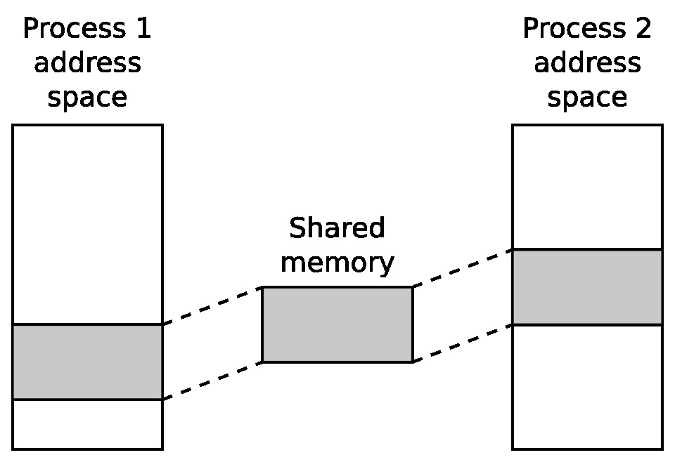

# Chương 10. Tìm hiểu process và thread

Trong các chương trước, chúng ta đã xét nhiều khía cạnh tạo nền tảng embedded Linux. Giờ là lúc bắt đầu xem cách sử dụng nền tảng để tạo thiết bị hoạt động được. Trong chương này, tôi bàn về hệ quả của Linux process model và cách nó bao hàm chương trình multi-threaded. Tôi sẽ xem ưu, nhược điểm của process single-threaded và multi-threaded. Tôi cũng xem scheduling và phân biệt scheduling policy timeshare với real-time.

Dù các chủ đề này không riêng cho embedded computing, người thiết kế thiết bị embedded cần có cái nhìn tổng quan. Có nhiều tài liệu tham khảo tốt, một số được dẫn ở cuối chương, nhưng nhìn chung chúng không xét trường hợp sử dụng embedded. Vì vậy, tôi tập trung khái niệm và quyết định thiết kế thay vì function call và code.

## Process hay thread?

Nhiều developer embedded quen real-time operating system (RTOS) thấy Unix process model cồng kềnh. Ngược lại, họ thấy tương đồng giữa RTOS task và Linux thread, có xu hướng chuyển thiết kế hiện có bằng mapping one-to-one từ RTOS task sang thread. Nhiều lần tôi thấy thiết kế triển khai toàn ứng dụng bằng một process chứa từ 40 thread trở lên. Tôi muốn dành thời gian xét liệu đây có phải ý tưởng tốt. Bắt đầu với vài định nghĩa. Process là memory address space và một thread thực thi, như sơ đồ sau. Address space riêng cho process, nên thread chạy trong process khác không thể truy cập. Sự tách biệt memory do memory management subsystem trong kernel tạo ra; nó giữ memory page mapping cho mỗi process và re-programs memory management unit ở mỗi context switch. Tôi sẽ mô tả chi tiết trong Chương 11, Quản lý memory. Một phần address space được map vào file chứa code và static data mà chương trình đang chạy:


Khi chạy, chương trình cấp phát tài nguyên như stack space, heap memory, tham chiếu file, v.v. Khi process kết thúc, hệ thống thu hồi tài nguyên: giải phóng toàn bộ memory và đóng mọi file descriptor.

Process có thể giao tiếp bằng inter process communication (IPC), như local socket. Tôi sẽ nói về IPC sau.

Thread là một thread thực thi bên trong process. Mọi process bắt đầu với một thread chạy hàm `main()`, gọi là main thread. Có thể tạo thread bổ sung bằng hàm POSIX thread `pthread_create(3)`, khiến các thread bổ sung thực thi trong cùng address space như sơ đồ sau. Trong cùng process, chúng chia sẻ tài nguyên. Chúng có thể đọc ghi cùng memory, dùng cùng file descriptor, nên giao tiếp giữa thread dễ dàng, miễn là xử lý vấn đề synchronization và locking:


Dựa trên các chi tiết ngắn gọn này, có thể hình dung hai thiết kế cực đoan cho hệ thống giả định có 40 RTOS task được port sang Linux.

Bạn có thể map task sang process, có 40 chương trình riêng giao tiếp qua IPC, ví dụ message gửi qua socket. Bạn giảm mạnh vấn đề memory corruption vì main thread chạy trong mỗi process được bảo vệ khỏi các thread khác, và giảm resource leakage vì mỗi process được dọn sau khi thoát. Tuy nhiên, message interface giữa process khá phức tạp; khi nhóm process hợp tác chặt chẽ, số message có thể lớn và thành giới hạn hiệu năng. Hơn nữa, bất kỳ process nào trong 40 process có thể kết thúc, có lẽ do lỗi gây crash, để 39 process còn lại tiếp tục. Mỗi process phải xử lý trường hợp hàng xóm không còn chạy và phục hồi êm thấm.

Ở cực kia, có thể map task sang thread và triển khai hệ thống bằng một process chứa 40 thread. Hợp tác dễ hơn nhiều vì chung address space và file descriptor. Overhead gửi message giảm hoặc mất hẳn; context switch giữa thread nhanh hơn giữa process. Nhược điểm là một task có thể làm hỏng heap hay stack của task khác. Nếu bất kỳ thread nào gặp lỗi nghiêm trọng, cả process kết thúc, kéo theo mọi thread. Cuối cùng, debug process multi-threaded phức tạp có thể là ác mộng.

Kết luận bạn nên rút ra là cả hai thiết kế đều chưa lý tưởng và có một cách tốt hơn. Nhưng trước khi đến phần đó, tôi sẽ tìm hiểu sâu hơn một chút về API và hành vi của process và thread.

## Process

Process giữ môi trường cho thread chạy: memory mapping, file descriptor, user ID, group ID và nhiều thứ khác. Process đầu là `init`, do kernel tạo trong lúc boot, PID bằng một. Sau đó, process được tạo bằng nhân bản trong thao tác gọi là forking.

### Tạo process mới

Function `POSIX` để tạo process là `fork(2)`. Đây là một function khác thường vì mỗi lời gọi thành công có hai lần trả về: một trong process thực hiện lời gọi, gọi là parent, và một trong process vừa được tạo, gọi là child, như sơ đồ sau:


Ngay sau lời gọi, child là bản sao chính xác của parent, có cùng stack, heap, file descriptor và thực thi cùng dòng code, dòng ngay sau `fork(2)`. Cách duy nhất để lập trình viên phân biệt là xem return value của fork: zero cho child và lớn hơn zero cho parent. Thực tế giá trị trả về trong parent là PID của child process mới tạo. Có khả năng thứ ba là giá trị âm, nghĩa là fork thất bại và vẫn chỉ có một process.

Dù ban đầu hai process giống nhau, chúng có address space riêng. Thay đổi variable ở bên này không được bên kia thấy. Bên dưới, kernel không sao chép vật lý memory của parent, thao tác vốn khá chậm và tốn memory không cần thiết. Thay vào đó, memory được chia sẻ nhưng đánh dấu bằng flag copy-on-write (CoW). Nếu parent hoặc child sửa memory, kernel sao chép trước rồi ghi vào bản sao. Cách này có lợi là fork hiệu quả nhưng vẫn giữ tách biệt logic giữa address space. Tôi sẽ bàn CoW trong Chương 11, Quản lý memory.

### Kết thúc process

Process có thể tự nguyện dừng bằng hàm `exit(3)` hoặc bị buộc dừng khi nhận signal không được xử lý. Riêng signal `SIGKILL` không thể xử lý nên luôn giết process. Trong mọi trường hợp, kết thúc process dừng mọi thread, đóng mọi file descriptor và giải phóng toàn bộ memory. Hệ thống gửi signal `SIGCHLD` cho parent để báo sự kiện.

Process có return value gồm đối số `exit(3)` nếu kết thúc bình thường, hoặc signal number nếu bị giết. Công dụng chính là trong shell script: cho phép kiểm tra kết quả trả về chương trình. Theo quy ước, `0` là thành công, giá trị khác là một loại thất bại.

Parent có thể thu return value bằng hàm `wait(2)` hoặc `waitpid(2)`. Điều này gây vấn đề: có độ trễ giữa child kết thúc và parent thu return value. Trong khoảng đó, return value phải lưu ở đâu đó và PID của process đã chết không thể tái sử dụng. Process trạng thái này là `zombie`, trạng thái Z trong ps hay top. Miễn là parent gọi `wait(2)` hoặc `waitpid(2)` mỗi khi được báo child kết thúc (qua signal `SIGCHLD`, xem Linux System Programming của Robert Love, O'Reilly Media, hoặc The Linux Programming Interface của Michael Kerrisk, No Starch Press, để biết xử lý signal), zombie tồn tại quá ngắn để hiện trong danh sách process. Chúng thành vấn đề nếu parent không thu return value, vì bạn sẽ không tạo thêm process được nữa.

Đây là ví dụ đơn giản về tạo và kết thúc process:

```
#include <stdio.h>
#include <stdlib.h>
#include <unistd.h>
#include <sys/types.h>
#include <sys/wait.h>
int main(void)
{
  int pid;
  int status;
  pid = fork();
  if (pid == 0) {
    printf("I am the child, PID %d\n", getpid());
    sleep(10);
    exit(42);
  } else if (pid > 0) {
    printf("I am the parent, PID %d\n", getpid());
    wait(&status);
    printf("Child terminated, status %d\n",
    WEXITSTATUS(status));
  } else
    perror("fork:");
  return 0;
}
```

Hàm `wait(2)` block đến khi child process thoát và lưu exit status. Khi chạy, bạn thấy nội dung tương tự:

```
I am the parent, PID 13851
I am the child, PID 13852
Child terminated with status 42
```

Child process kế thừa phần lớn thuộc tính parent, gồm user ID và group ID (UID, GID), mọi file descriptor đang mở, signal handling và đặc tính scheduling.

### Chạy chương trình khác

Hàm `fork` sao chép chương trình đang chạy, nhưng không chạy chương trình khác. Để làm vậy, cần một trong các hàm `exec`:

```
int execl(const char *path, const char *arg, ...);
int execlp(const char *file, const char *arg, ...);
int execle(const char *path, const char *arg,
           ..., char * const envp[]);
int execv(const char *path, char *const argv[]);
int execvp(const char *file, char *const argv[]);
int execvpe(const char *file, char *const argv[],
           char *const envp[]);
```

Mỗi hàm nhận path tới program file cần nạp và chạy. Nếu thành công, kernel loại bỏ mọi tài nguyên process hiện tại, gồm memory và file descriptor, rồi cấp phát memory cho chương trình mới được nạp. Khi thread gọi `exec*` trả về, nó không trở về dòng code sau lời gọi mà đến hàm `main()` của chương trình mới. Đây là ví dụ command launcher: hỏi lệnh, ví dụ `/bin/ls`, rồi fork và thực thi chuỗi bạn nhập:

```
#include <stdio.h>
#include <stdlib.h>
#include <string.h>
#include <unistd.h>
#include <sys/types.h>
#include <sys/wait.h>
int main(int argc, char *argv[])
{
  char command_str[128];
  int pid;
  int child_status;
  int wait_for = 1;
  while (1) {
    printf("sh> ");
    scanf("%s", command_str);
    pid = fork();
    if (pid == 0) {
      /* child */
      printf("cmd '%s'\n", command_str);
      execl(command_str, command_str, (char *)NULL);
      /* We should not return from execl, so only get
      to this line if it failed */
      perror("exec");
      exit(1);
    }
    if (wait_for) {
      waitpid(pid, &child_status, 0);
      printf("Done, status %d\n", child_status);
    }
  }
  return 0;
}
```

Có vẻ lạ khi một hàm nhân bản process hiện có, hàm khác loại bỏ tài nguyên và nạp chương trình khác vào memory, nhất là fork thường gần như lập tức được theo sau bằng `exec`. Phần lớn operating system kết hợp hai hành động trong một lời gọi.

Tuy nhiên, cách này có những ưu điểm rõ ràng. Chẳng hạn, nó giúp triển khai redirection và pipe trong shell rất dễ dàng. Giả sử bạn muốn lấy danh sách nội dung một directory, trình tự sự kiện sẽ như sau:

1\. Bạn gõ `ls` ở shell prompt. 2. Shell fork bản sao chính nó. 3. Child exec `/bin/ls`. 4. Chương trình `ls` in danh sách directory ra `stdout` (file descriptor 1)

được nối với terminal. Bạn thấy danh sách directory.

5\. Chương trình `ls` kết thúc và shell lấy lại quyền điều khiển.

Bây giờ, giả sử bạn muốn ghi danh sách nội dung directory vào một file bằng cách redirect output với ký tự `>`. Trình tự lúc này như sau:

1\. Bạn gõ `ls > listing.txt`. 2. Shell fork bản sao chính nó.

3\. Child mở và truncate file `listing.txt`, dùng `dup2(2)` sao chép file descriptor của file đè lên file descriptor 1 (`stdout`).

4\. Child exec `/bin/ls`. 5. Chương trình in danh sách như trước, nhưng lần này ghi vào

`listing.txt`.

6\. Chương trình `ls` kết thúc và shell lấy lại quyền điều khiển.

Lưu ý bước ba có cơ hội sửa environment của child process trước khi thực thi chương trình. Chương trình `ls` không cần biết đang ghi vào file thay vì terminal. Thay cho file, `stdout` có thể nối với pipe để chương trình `ls`, vẫn không đổi, gửi output tới chương trình khác. Đây là phần triết lý Unix kết hợp nhiều thành phần nhỏ, mỗi thành phần làm tốt một việc, như mô tả trong The Art of Unix Programming của Eric Steven Raymond, Addison Wesley; (23 tháng 9 năm 2003) ISBN 978-0131429017, đặc biệt phần Pipes, Redirection, and Filters.

### Daemon

Chúng ta đã gặp daemon ở một số phần trước. Daemon là một process chạy ở background, thuộc sở hữu của process `init`, `PID1`, và không kết nối với controlling terminal. Các bước tạo daemon như sau:

1\. Gọi `fork()` tạo process mới, sau đó parent phải thoát,

tạo orphan được re-parented cho `init.`

2\. Child process gọi `setsid(2)`, tạo session và process

group mới mà nó là thành viên duy nhất. Chi tiết chính xác không quan trọng ở đây; có thể coi đây là cách cách ly process khỏi controlling terminal.

3\. Đổi working directory về root.

4\. Đóng mọi file descriptor và redirect `stdin`, `stdout`, `sterr` (descriptor 0, 1, 2) tới `/dev/null` để không có input và mọi output bị ẩn.

May thay, mọi bước trên có thể thực hiện bằng một function call, `daemon(3)`.

### Giao tiếp Inter-process

Mỗi process là hòn đảo memory. Có hai cách truyền thông tin từ process này sang process khác. Thứ nhất, sao chép từ address space này sang address space kia. Thứ hai, tạo vùng memory cả hai truy cập được để chia sẻ dữ liệu.

Cách đầu tiên thường được kết hợp với queue hoặc buffer để có một chuỗi message truyền giữa các process. Điều này đòi hỏi copy message hai lần: trước tiên vào vùng lưu tạm, sau đó đến đích. Một số ví dụ là socket, pipe và POSIX message queue.

Cách thứ hai không chỉ cần phương thức tạo memory được map vào hai (hoặc nhiều) address space cùng lúc, mà còn cần phương tiện đồng bộ truy cập memory, ví dụ semaphore hoặc mutex. POSIX có hàm cho tất cả những việc này.

Có tập API cũ hơn gọi là System V IPC, cung cấp message queue, shared memory và semaphore, nhưng kém linh hoạt hơn bản POSIX tương đương nên tôi không mô tả ở đây. Man page `svipc(7)` tổng quan các khả năng; có thêm chi tiết trong The Linux Programming Interface của Michael Kerrisk, No Starch Press, và Unix Network Programming, Volume 2, của W. Richard Stevens.

Protocol Message-based thường dễ lập trình, debug hơn shared memory, nhưng chậm nếu message lớn.

#### IPC Message-based

Có một số lựa chọn mà tôi sẽ tóm tắt dưới đây. Các attribute phân biệt chúng là:

- Luồng message là uni- hay bi-directorial.

- Luồng dữ liệu là byte stream không có message boundary, hay message rời rạc giữ nguyên boundary. Trường hợp sau, kích thước tối đa message quan trọng.

- Message có được gắn priority không.

Bảng sau tổng hợp các thuộc tính cho FIFO, socket và message queue:

| Thuộc tính | FIFO | Unix socket: stream | Unix socket: datagram | POSIX message queue |
|---|---|---|---|---|
| Message boundary | Byte stream | Byte stream | Rời rạc | Rời rạc |

| Thuộc tính | FIFO | Unix socket: stream | Unix socket: datagram | POSIX message queue |
|---|---|---|---|---|
| Uni/bi-directional | Uni | Bi | Uni | Uni |
| Message size tối đa | Không giới hạn | Không giới hạn | Trong khoảng 100 KiB đến 250 KiB | Mặc định: 8 KiB, tối đa tuyệt đối: 1 MiB |
| Priority level | Không | Không | Không | 0 đến 32767 |

##### Unix socket (hay local socket)

Unix socket đáp ứng phần lớn yêu cầu; cùng sự quen thuộc của socket API, đây là cơ chế phổ biến nhất, bỏ xa các cách khác.

Unix socket được tạo với address family `AF_UNIX` và bind vào path name. Quyền truy cập socket do access permission của socket file quyết định. Giống Internet socket, socket type có thể là `SOCK_STREAM` hoặc `SOCK_DGRAM`; loại đầu cung cấp byte stream bi-directional, loại sau cung cấp message rời rạc giữ nguyên boundary. Unix socket datagram đáng tin cậy, nghĩa là không bị bỏ hay đảo thứ tự. Kích thước datagram tối đa là system-dependent, có trong `/proc/sys/net/core/wmem_max`, thường 100 KiB hoặc hơn.

Unix socket không có cơ chế chỉ priority của message.

##### FIFO và named pipe

FIFO và named pipe chỉ là hai tên cho cùng một thứ. Chúng mở rộng anonymous pipe dùng giao tiếp parent và child, được dùng triển khai piping trong shell.

FIFO là loại file đặc biệt, tạo bằng lệnh `mkfifo(1)`. Như Unix socket, file access permission quyết định ai đọc ghi được. Chúng là uni-directional, có một reader và thường một writer, dù có thể nhiều writer. Dữ liệu thuần byte stream nhưng bảo đảm atomicity cho message nhỏ hơn buffer đi kèm pipe. Nghĩa là lần ghi nhỏ hơn kích thước này không bị chia thành nhiều lần ghi nhỏ, nên reader đọc cả message một lần, miễn buffer phía reader đủ lớn. FIFO buffer mặc định 64 KiB trên kernel hiện đại, có thể tăng bằng `fcntl(2)` với `F_SETPIPE_SZ` đến giá trị trong `/proc/sys/fs/pipe-max-size`, thường 1 MiB.

Không có khái niệm priority.

##### POSIX message queue

Message queue được định danh bằng tên phải bắt đầu bằng dấu gạch chéo `/` và chỉ chứa một ký tự `/`: message queue thực sự được giữ trong pseudo filesystem loại `mqueue`. Tạo queue và lấy tham chiếu tới queue hiện có bằng `mq_open(3)`, trả về file. Mỗi message có priority, được đọc theo priority rồi thứ tự tuổi. Message có thể dài đến `/proc/sys/kernel/msgmax` byte. Mặc định 8 KiB, nhưng có thể đặt bất kỳ kích thước từ 128 byte đến 1 MiB bằng ghi giá trị vào `/proc/sys/kernel/msgmax` byte. Mỗi message có priority. Chúng được đọc theo priority rồi thứ tự tuổi. Vì tham chiếu là file descriptor, có thể dùng `select(2)`, `poll(2)` và hàm tương tự chờ hoạt động trên queue.

Xem Linux man page mq\_overview(7).

#### Tổng hợp IPC message-based

Unix socket được dùng nhiều nhất vì cung cấp mọi thứ cần, có lẽ trừ message priority. Chúng được triển khai trên phần lớn operating system, nên cho tính portable tối đa.

FIFO ít dùng hơn, chủ yếu vì thiếu tương đương datagram. Ngược lại, API rất đơn giản, là các file call `open(2)`, `close(2)`, `read(2)`, `write(2)` thông thường.

Message queue ít dùng nhất trong nhóm. Code path trong kernel không được tối ưu như lời gọi socket (network) và FIFO (filesystem).

Còn có abstraction cấp cao hơn, đặc biệt dbus, đang chuyển từ Linux chủ đạo sang thiết bị embedded. Bên dưới Dbus dùng Unix socket và shared memory.

#### IPC shared memory-based

Chia sẻ memory loại bỏ nhu cầu copy dữ liệu giữa các address space, nhưng đặt ra vấn đề đồng bộ hóa việc truy cập vùng memory đó. Đồng bộ hóa giữa các process thường được thực hiện bằng semaphore.

##### POSIX shared memory

Để chia sẻ memory giữa process, đầu tiên tạo vùng memory mới rồi map vào address space của mỗi process muốn truy cập, như sơ đồ:



POSIX shared memory theo mô hình đã gặp với message queue. Segment được định danh bằng tên bắt đầu ký tự `/` và có đúng một ký tự đó. Hàm `shm_open(3)` nhận tên và trả file descriptor. Nếu chưa tồn tại và có flag `O_CREAT`, segment mới được tạo. Ban đầu kích thước zero. Dùng `ftruncate(2)` (tên dễ gây hiểu nhầm) để mở rộng đến kích thước mong muốn.

Có descriptor cho shared memory rồi, map vào address space của process bằng `mmap(2)` để thread trong các process khác nhau truy cập được memory.

Đây là ví dụ:

```
#include <stdio.h>
#include <stdlib.h>
#include <string.h>
#include <unistd.h>
#include <sys/mman.h>
#include <sys/stat.h>  /* For mode constants */
#include <fcntl.h>
#include <sys/types.h>
#include <errno.h>
#include <semaphore.h>
#define SHM_SEGMENT_SIZE 65536
#define SHM_SEGMENT_NAME "/demo-shm"
#define SEMA_NAME "/demo-sem"

static sem_t *demo_sem;
/*
 * If the shared memory segment does not exist already, create it
 * Returns a pointer to the segment or NULL if there is an error
 */

static void *get_shared_memory(void)
{
  int shm_fd;
  struct shared_data *shm_p;
  /* Attempt to create the shared memory segment */
  shm_fd = shm_open(SHM_SEGMENT_NAME, O_CREAT | O_EXCL | O_RDWR,
    0666);

  if (shm_fd > 0) {
    /* succeeded: expand it to the desired size (Note: dont't do
    "this every time because ftruncate fills it with zeros) */
    printf ("Creating shared memory and setting size=%d\n",
    SHM_SEGMENT_SIZE);

    if (ftruncate(shm_fd, SHM_SEGMENT_SIZE) < 0) {
      perror("ftruncate");
      exit(1);
    }
    /* Create a semaphore as well */
    demo_sem = sem_open(SEMA_NAME, O_RDWR | O_CREAT, 0666, 1);

    if (demo_sem == SEM_FAILED)
      perror("sem_open failed\n");
  }
  else if (shm_fd == -1 && errno == EEXIST) {
    /* Already exists: open again without O_CREAT */
    shm_fd = shm_open(SHM_SEGMENT_NAME, O_RDWR, 0);
    demo_sem = sem_open(SEMA_NAME, O_RDWR);

    if (demo_sem == SEM_FAILED)
      perror("sem_open failed\n");
  }

  if (shm_fd == -1) {
    perror("shm_open " SHM_SEGMENT_NAME);
    exit(1);
  }
  /* Map the shared memory */
  shm_p = mmap(NULL, SHM_SEGMENT_SIZE, PROT_READ | PROT_WRITE,
    MAP_SHARED, shm_fd, 0);

  if (shm_p == NULL) {
    perror("mmap");
    exit(1);
  }
  return shm_p;
}
int main(int argc, char *argv[])
{
  char *shm_p;
  printf("%s PID=%d\n", argv[0], getpid());
  shm_p = get_shared_memory();

  while (1) {
    printf("Press enter to see the current contents of shm\n");
    getchar();
    sem_wait(demo_sem);
    printf("%s\n", shm_p);
    /* Write our signature to the shared memory */
    sprintf(shm_p, "Hello from process %d\n", getpid());
    sem_post(demo_sem);
  }
  return 0;
}
```

Memory trong Linux được lấy từ filesystem `tmpfs` mount ở `/dev/shm` hoặc `/run/shm`.

## Thread

Giờ là lúc xem process multi-threaded. Giao diện lập trình thread là POSIX threads API, lần đầu định nghĩa trong chuẩn IEEE POSIX 1003.1c (1995), thường gọi Pthreads. Nó được triển khai như phần bổ sung C library, `libpthread.so`. Trong khoảng 15 năm qua có hai phiên bản Pthreads, Linux Threads và Native POSIX Thread Library (NPTL). Phiên bản sau tuân thủ đặc tả tốt hơn nhiều, nhất là xử lý signal và process ID. Nay nó khá áp đảo, nhưng có thể gặp phiên bản uClibc cũ dùng Linux Threads.

### Tạo thread mới

Hàm tạo thread là `pthread_create(3)`:

```
int pthread_create(pthread_t *thread, const pthread_attr_t *attr,
  void *(*start_routine) (void *), void *arg);
```

Hàm tạo thread thực thi mới bắt đầu tại hàm `start_routine`, đặt descriptor vào `pthread_t` được `thread` trỏ đến. Nó kế thừa scheduling parameter của thread gọi, nhưng có thể ghi đè bằng cách truyền pointer tới thread attribute trong `attr`. Thread bắt đầu thực thi ngay.

`pthread_t` là cách chính tham chiếu thread bên trong chương trình, nhưng cũng có thể thấy thread từ ngoài bằng lệnh như `ps -eLf`:

```
UID    PID  PPID   LWP  C  NLWP  STIME        TTY           TIME CMD
...
chris  6072  5648  6072  0   3    21:18  pts/0 00:00:00 ./thread-demo
chris  6072  5648  6073  0   3    21:18  pts/0 00:00:00 ./thread-demo
```

Chương trình `thread-demo` có hai thread. Cột `PID` và `PPID` cho biết chúng cùng process và cùng parent như dự kiến. Tuy nhiên, cột `LWP` đáng chú ý. `LWP` viết tắt Light Weight Process, trong ngữ cảnh này là tên khác cho thread. Các số trong cột còn gọi Thread ID hay TID. Với main thread, TID giống PID, nhưng với thread khác, nó khác và lớn hơn. Một số hàm chấp nhận TID nơi tài liệu nói phải truyền PID, nhưng lưu ý hành vi này riêng Linux, không portable. Đây là code `thread-demo`:

```
#include <stdio.h>
#include <unistd.h>
#include <pthread.h>
#include <sys/syscall.h>

static void *thread_fn(void *arg)
{
  printf("New thread started, PID %d TID %d\n",
  getpid(), (pid_t)syscall(SYS_gettid));
  sleep(10);
  printf("New thread terminating\n");
  return NULL;
}
int main(int argc, char *argv[])
{
  pthread_t t;
  printf("Main thread, PID %d TID %d\n",
  getpid(), (pid_t)syscall(SYS_gettid));
  pthread_create(&t, NULL, thread_fn, NULL);
  pthread_join(t, NULL);
  return 0;
}
```

Man page `getttid(2)` giải thích phải gọi Linux `syscall` trực tiếp vì không có C library wrapper, như minh họa.

Có giới hạn tổng số thread mà kernel có thể scheduling. Giới hạn thay đổi theo kích thước hệ thống, từ khoảng 1.000 trên thiết bị nhỏ đến hàng chục nghìn trên embedded device lớn hơn. Số thực tế có trong `/proc/sys/kernel/threads-max`. Đạt giới hạn này, `fork()` và `pthread_create()` thất bại.

### Kết thúc thread

Thread kết thúc khi:

- Đến cuối `start_routine`

- Gọi `pthread_exit(3)`

- Bị thread khác hủy bằng `pthread_cancel(3)`

- Process chứa thread kết thúc, ví dụ thread gọi `exit(3)` hoặc process nhận signal không được xử lý, mask hay bỏ qua

Lưu ý nếu chương trình nhiều thread gọi `fork(2)`, chỉ thread gọi tồn tại trong child process mới. Fork không nhân bản mọi thread.

Thread có return value là void pointer. Thread này có thể chờ thread khác kết thúc và thu return value bằng `pthread_join(2)`. Có ví dụ trong code `thread-demo` nhắc ở phần trước. Điều này gây vấn đề rất giống zombie giữa process: tài nguyên thread, ví dụ stack, chưa thể giải phóng cho đến khi thread khác join nó. Nếu thread không được join, chương trình có resource leak.

### Biên dịch chương trình có thread

Hỗ trợ POSIX thread thuộc C library, trong library `libpthread.so`. Tuy nhiên, build chương trình có thread cần hơn việc link library: cách compiler tạo code phải thay đổi để bảo đảm một số global variable, như `errno`, có một instance mỗi thread thay vì một cho cả process.

Khi build threaded program, phải thêm switch `–pthread` ở cả giai đoạn compile và link.

### Giao tiếp Inter-thread

Ưu điểm lớn của thread là chia sẻ address space nên chia sẻ được memory variable. Đây cũng là nhược điểm lớn vì cần synchronization để giữ data consistency, tương tự memory segment chia sẻ giữa process nhưng với lưu ý rằng thread chia sẻ toàn bộ memory. Thread có thể tạo private memory bằng thread local storage (TLS).

Interface `pthreads` cung cấp những thành phần cơ bản cần thiết để đồng bộ hóa: mutex và condition variable. Nếu muốn cấu trúc phức tạp hơn, bạn phải tự xây dựng chúng.

Lưu ý mọi phương thức IPC mô tả trước đó hoạt động tốt như nhau giữa các thread trong cùng process.

### Mutual exclusion

Để viết chương trình vững chắc, cần bảo vệ mỗi shared resource bằng mutex lock và bảo đảm mọi code path đọc ghi resource đều lock mutex trước. Áp dụng nhất quán quy tắc này giải quyết phần lớn vấn đề. Những vấn đề còn lại liên quan hành vi nền tảng mutex. Tôi liệt kê ngắn gọn, không đi sâu:

- Deadlock: Xảy ra khi mutex bị lock vĩnh viễn. Tình huống kinh điển là deadly embrace: hai thread, mỗi thread cần hai mutex, đã lock một nhưng chưa lock được mutex kia. Mỗi bên block chờ lock bên kia giữ, nên mãi giữ nguyên. Quy tắc đơn giản tránh deadly embrace là luôn lock mutex cùng thứ tự. Giải pháp khác dùng timeout và back off period.

- Priority inversion: Độ trễ chờ mutex có thể khiến thread real-time lỡ deadline. Trường hợp cụ thể priority inversion xảy ra khi thread priority cao block chờ mutex do thread priority thấp lock. Nếu thread priority thấp bị thread priority trung gian preempt, thread priority cao phải chờ khoảng thời gian không có giới hạn. Có mutex protocol tên priority inheritance và priority ceiling giải quyết vấn đề, đổi lại overhead xử lý kernel lớn hơn cho mỗi lock, unlock call.

- Hiệu năng kém: Mutex thêm overhead tối thiểu nếu phần lớn thời gian thread không phải block trên nó. Nhưng nếu thiết kế có resource nhiều thread cần, contention ratio trở nên đáng kể. Đây thường là vấn đề thiết kế, có thể giải quyết bằng locking chi tiết hơn hoặc thuật toán khác.

### Condition thay đổi

Các thread phối hợp với nhau cần có cách thông báo cho nhau rằng một điều gì đó đã thay đổi và cần được xử lý. Điều đó được gọi là condition, và thông báo được gửi qua một condition variable, `condvar`.

Condition đơn giản là một điều mà bạn có thể kiểm tra để nhận kết quả `true` hoặc `false`. Ví dụ đơn giản là buffer không chứa item nào hoặc chứa một số item. Một thread lấy item ra khỏi buffer và sleep khi buffer rỗng. Thread khác đặt item vào buffer rồi thông báo cho thread kia rằng nó đã làm như vậy, vì condition mà thread kia đang chờ đã thay đổi. Nếu đang sleep, thread đó cần thức dậy để thực hiện công việc. Điểm phức tạp duy nhất là condition, theo định nghĩa, là một shared resource nên phải được mutex bảo vệ. Sau đây là một ví dụ đơn giản theo quan hệ producer-consumer được mô tả trong phần trước:

```
pthread_cond_t cv = PTHREAD_COND_INITIALIZER;
pthread_mutex_t mutx = PTHREAD_MUTEX_INITIALIZER;

void *consumer(void *arg)
{
  while (1) {
    pthread_mutex_lock(&mutx);
    while (buffer_empty(data))
      pthread_cond_wait(&cv, &mutx);
    /* Got data: take from buffer */
    pthread_mutex_unlock(&mutx);
    /* Process data item */
  }
  return NULL;
}

void *producer(void *arg)
{
  while (1) {
    /* Produce an item of data */
    pthread_mutex_lock(&mutx);
    add_data(data);
    pthread_mutex_unlock(&mutx);
    pthread_cond_signal(&cv);
  }
  return NULL;
}
```

Lưu ý khi consumer thread block trên `condvar`, nó vẫn giữ mutex đã lock, có vẻ sẽ deadlock khi producer thread thử cập nhật condition lần sau. Để tránh, `pthread_condwait(3)` unlock mutex sau khi thread block, rồi lock lại trước khi đánh thức và trả về từ wait.

### Chia bài toán

Đã trình bày cơ bản process, thread và cách giao tiếp, giờ là lúc xem làm gì được với chúng.

Đây là một số quy tắc tôi dùng khi xây dựng hệ thống:

- Quy tắc 1: Giữ các task có nhiều tương tác cùng nhau. Giảm overhead bằng giữ các thread inter-operating chặt chẽ trong cùng process.

- Quy tắc 2: Đừng bỏ mọi thread vào một giỏ. Ngược lại, cố giữ thành phần ít tương tác trong process riêng, vì khả năng chống lỗi và tính module.

- Quy tắc 3: Đừng trộn thread quan trọng với non-critical trong cùng process. Đây là mở rộng quy tắc 2: phần quan trọng, có thể là chương trình điều khiển máy, phải đơn giản nhất có thể và được viết chặt chẽ hơn phần khác. Nó phải tiếp tục được ngay cả khi process khác thất bại. Nếu có thread real-time, theo định nghĩa chúng phải quan trọng và nên nằm trong process riêng.

- Quy tắc 4: Thread không nên quá thân mật. Một cám dỗ khi viết chương trình multi-threaded là trộn code và variable giữa thread vì chúng cùng chương trình và dễ làm. Đừng giữ thread có tính module với tương tác well-defined.

- Quy tắc 5: Đừng nghĩ thread miễn phí. Rất dễ tạo thêm thread nhưng có chi phí, đặc biệt synchronization bổ sung cần để phối hợp hoạt động.

- Quy tắc 6: Thread có thể làm việc song song. Thread có thể chạy đồng thời trên processor multi-core, cho throughput cao hơn. Nếu có công việc tính toán lớn, có thể tạo một thread mỗi core và tận dụng tối đa hardware. Có library hỗ trợ như OpenMP. Có lẽ không nên tự viết từ đầu thuật toán parallel programming.

Thiết kế Android là minh họa tốt. Mỗi ứng dụng là Linux process riêng, giúp module hóa memory management, nhưng đặc biệt bảo đảm một app crash không ảnh hưởng cả hệ thống. Process model cũng dùng cho access control: process chỉ truy cập file và resource mà UID, GID cho phép. Mỗi process có nhóm thread. Một thread quản lý, cập nhật user interface, một xử lý signal từ operating system, một số quản lý dynamic memory allocation và giải phóng Java object, cùng worker pool ít nhất hai thread nhận message từ phần khác của hệ thống qua Binder protocol.

Tóm lại, process cho khả năng chống lỗi vì mỗi process có memory space được bảo vệ; khi kết thúc, mọi resource gồm memory và file descriptor được giải phóng, giảm resource leak. Ngược lại, thread chia sẻ resource nên dễ giao tiếp qua shared variable, hợp tác qua chia sẻ truy cập file và resource khác. Thread cho parallelism qua worker pool và abstraction khác, hữu ích trên processor multi-core.

## Scheduling

Chủ đề lớn thứ hai trong chương là scheduling. Linux scheduler có queue các thread sẵn sàng chạy; nhiệm vụ của nó là scheduling lên CPU khi có CPU rảnh. Mỗi thread có scheduling policy timeshared hoặc real-time. Thread timeshared có niceness value tăng hoặc giảm phần CPU time được hưởng. Thread real-time có priority để thread priority cao preempt thread thấp. Scheduler làm việc với thread, không phải process. Mỗi thread được scheduling bất kể chạy trong process nào.

Scheduler chạy khi:

- Thread block bằng `sleep()` hoặc blocking I/O call

- Thread timeshare dùng hết time slice

- Interrupt khiến thread được unblock, ví dụ vì I/O hoàn tất

Để biết nền tảng Linux scheduler, tôi khuyên đọc chương process scheduling trong Linux Kernel Development, ấn bản 3, của Robert Love, Addison-Wesley Professional; (2 tháng 7 năm 2010) ISBN-10: 0672329468.

### Công bằng và tính xác định

Tôi đã nhóm scheduling policy thành timeshare và real-time. Timeshare policy dựa nguyên tắc công bằng, thiết kế để mỗi thread được phần processor time công bằng và không thread nào độc chiếm hệ thống. Nếu thread chạy quá lâu, nó bị đưa về cuối queue để thread khác có lượt. Đồng thời, fairness policy cần điều chỉnh cho thread làm nhiều việc và cho resource hoàn thành công việc. Timeshare scheduling tốt nhờ tự điều chỉnh cho nhiều workload.

Ngược lại, với chương trình real-time, công bằng không giúp ích. Bạn muốn policy deterministic, cung cấp ít nhất bảo đảm tối thiểu thread real-time được scheduling đúng lúc để không lỡ deadline. Nghĩa là thread real-time phải preempt thread timeshare. Thread Real-time còn có static priority để scheduler chọn khi nhiều thread cần chạy cùng lúc. Linux real-time scheduler triển khai thuật toán khá chuẩn, chạy thread real-time priority cao nhất. Phần lớn RTOS scheduler cũng viết theo cách này.

Hai loại thread cùng tồn tại được. Thread cần scheduling deterministic được scheduling trước, thời gian còn lại chia cho thread timeshare.

### Timeshare policy

Timeshare policy thiết kế vì công bằng. Từ Linux 2.6.23, scheduler được dùng là Completely Fair Scheduler (CFS). Nó không dùng timeslice theo nghĩa thông thường. Thay vào đó, nó tính tổng cập nhật liên tục thời gian thread lẽ ra được chạy nếu có phần CPU time công bằng, rồi cân với thời gian thực tế đã chạy. Nếu vượt phần được hưởng và có thread timeshare khác chờ, scheduler tạm dừng thread và chạy thread đang chờ.

Timeshare policy gồm:

- `SCHED_NORMAL` (còn gọi `SCHED_OTHER`): Policy mặc định. Đại đa số thread Linux dùng policy này.

- `SCHED_BATCH`: Tương tự `SCHED_NORMAL`, trừ thread được scheduling với granularity lớn hơn: chạy lâu hơn nhưng chờ lâu hơn đến lần scheduling tiếp. Mục đích là giảm context switch cho background processing (batch job), nhờ đó giảm CPU cache churn.

- `SCHED_IDLE`: Chỉ chạy khi không có thread thuộc policy nào khác sẵn sàng. Đây là priority thấp nhất có thể.

Có hai cặp hàm lấy và đặt policy, priority của thread. Cặp đầu nhận PID làm tham số và tác động main thread trong process:

```
struct sched_param {
  ...
  int sched_priority;
  ...
};
int sched_setscheduler(pid_t pid, int policy,
const struct sched_param *param);
int sched_getscheduler(pid_t pid);
```

Cặp thứ hai thao tác trên `pthread_t`, vì vậy có thể thay đổi parameter của các thread khác trong một process:

```
pthread_setschedparam(pthread_t thread, int policy,
  const struct sched_param *param);
pthread_getschedparam(pthread_t thread, int *policy,
  struct sched_param *param);
```

#### Niceness

Một số timeshare thread quan trọng hơn những thread khác. Bạn có thể biểu thị điều này bằng giá trị `nice`, nhân phần CPU mà thread được hưởng với một scaling factor. Tên này bắt nguồn từ function call `nice(2)`, vốn đã có trong Unix từ những ngày đầu. Một thread trở nên `nice` bằng cách giảm tải mà nó đặt lên hệ thống, hoặc đi theo hướng ngược lại bằng cách tăng tải. Giá trị nằm trong khoảng từ 19, rất nice, đến -20, rất không nice. Giá trị mặc định là 0, tức nice ở mức trung bình, hay so-so.

Có thể đổi giá trị `nice` cho thread `SCHED_NORMAL` và `SCHED_BATCH`. Để giảm niceness, tăng CPU load, cần capability `CAP_SYS_NICE`, có cho root user.

Gần như mọi tài liệu hàm và lệnh đổi giá trị `nice` (`nice(2)` cùng lệnh `nice`, `renice`) đều nói theo process. Tuy nhiên, thực sự liên quan thread. Như phần trước, có thể dùng TID thay PID để đổi giá trị `nice` của từng thread. Một bất nhất khác trong mô tả chuẩn `nice`: giá trị `nice` được gọi là priority của thread (đôi khi nhầm thành process). Tôi cho rằng điều này gây hiểu lầm và lẫn với real-time priority, vốn hoàn toàn khác.

### Policy Real-time

Policy Real-time hướng tới tính xác định. Scheduler real-time luôn chạy thread real-time priority cao nhất sẵn sàng. Thread Real-time luôn preempt thread timeshare. Về bản chất, chọn policy real-time thay timeshare nghĩa là bạn có hiểu biết nội bộ về scheduling dự kiến của thread và muốn ghi đè giả định built-in của scheduler.

Có hai real-time policy:

- `SCHED_FIFO`: Thuật toán run to completion, nghĩa là khi thread bắt đầu chạy, tiếp tục đến khi bị thread real-time priority cao hơn preempt, hoặc block trong system call, hoặc kết thúc (hoàn thành).

- `SCHED_RR`: Thuật toán round robin luân phiên giữa thread cùng priority nếu vượt time slice, mặc định 100 ms. Từ Linux 3.9, có thể điều khiển giá trị `timeslice` qua `/proc/sys/kernel/sched_rr_timeslice_ms`. Ngoài điều này, hành vi giống `SCHED_FIFO`.

Mỗi thread real-time có priority từ 1 đến 99, với 99 cao nhất. Để gán real-time policy cho thread, cần `CAP_SYS_NICE`, mặc định chỉ cấp cho root user.

Một vấn đề của real-time scheduling, cả trong Linux lẫn các hệ thống khác, là một thread trở thành compute bound, thường do bug khiến nó lặp vô hạn. Thread này ngăn các real-time thread có priority thấp hơn cũng như toàn bộ timeshare thread được chạy. Hệ thống trở nên thất thường và có thể treo hoàn toàn. Có một vài cách để phòng tránh khả năng này.

Thứ nhất, từ Linux 2.6.25, scheduler mặc định dành 5% CPU time cho thread không real-time, nên ngay cả thread real-time chạy mất kiểm soát cũng không thể dừng hoàn toàn hệ thống. Cấu hình qua hai kernel control:

- `/proc/sys/kernel/sched_rt_period_us`

- `/proc/sys/kernel/sched_rt_runtime_us`

Giá trị mặc định lần lượt 1.000.000 (1 giây) và 950.000 (950 ms), nghĩa là mỗi giây dành 50ms cho xử lý không real-time. Nếu muốn thread real-time dùng được 100%, đặt `sched_rt_runtime_us` thành `-1`.

Lựa chọn thứ hai là dùng watchdog hardware hoặc software giám sát thực thi thread chủ chốt và hành động khi chúng bắt đầu lỡ deadline.

### Chọn policy

Thực tế timeshare policy đáp ứng phần lớn computing workload. Thread I/O bound dành nhiều thời gian block nên luôn có phần thời gian được hưởng còn dư. Khi unblock, chúng gần như được scheduling ngay. Trong khi đó, thread CPU-bound tự nhiên chiếm CPU cycle còn lại. Có thể dùng nice dương cho thread ít quan trọng và âm cho thread quan trọng.

Dĩ nhiên, đây chỉ là hành vi trung bình; không có gì bảo đảm rằng điều này luôn đúng. Nếu cần hành vi có tính deterministic cao hơn, bạn phải dùng real-time policy. Những đặc điểm phân biệt một thread real-time là:

- Có deadline phải tạo output trước thời điểm đó

- Lỡ deadline làm giảm hiệu quả hệ thống

- Có tính event-driven

- Không compute bound

Ví dụ task real-time gồm servo controller cánh tay robot kinh điển, xử lý multimedia và xử lý communication.

### Chọn priority real-time

Chọn priority real-time hoạt động với mọi workload dự kiến khó khăn, là lý do tốt để tránh real-time policy ngay từ đầu.

Quy trình chọn priority được dùng rộng nhất là Rate Monotonic Analysis (RMA), theo bài báo năm 1973 của Liu và Layland. Nó áp dụng hệ thống real-time có periodic thread, một lớp rất quan trọng. Mỗi thread có period và utilization, là tỷ lệ period mà thread thực thi. Mục tiêu cân tải để mọi thread hoàn thành execution phase trước period tiếp. RMA nói có thể đạt được nếu:

- Priority cao nhất dành cho thread có period ngắn nhất

- Tổng utilization nhỏ hơn 69%

Tổng utilization là tổng mọi utilization riêng. Phương pháp còn giả định tương tác giữa thread hoặc thời gian block trên mutex và tương tự là không đáng kể.

## Đọc thêm

Các tài nguyên sau cung cấp thêm thông tin về chủ đề trong chương:

- The Art of Unix Programming, by Eric Steven Raymond, Addison Wesley; (23 Sept. 2003) ISBN 978-0131429017

- Linux System Programming, 2nd edition, by Robert Love, O'Reilly Media; (8 Jun. 2013) ISBN-10: 1449339530

- Linux Kernel Development, 3rd edition by Robert Love, Addison-Wesley Professional; (July 2, 2010) ISBN-10: 0672329468

- The Linux Programming Interface, by Michael Kerrisk, No Starch Press; (October 2010) ISBN 978-1-59327-220-3

- UNIX Network Programming: v. 2: Interprocess Communications, 2nd Edition, by W. Richard Stevens, Prentice Hall; (25 Aug. 1998) ISBN-10: 0132974290

- Programming with POSIX Threads, by Butenhof, David R, Addison-Wesley, Professional

- Scheduling Algorithm for multiprogramming in a Hard-Real-Time Environment, by C. L. Liu and James W. Layland, Journal of ACM, 1973, vol 20, no 1, pp. 46-61

## Tổng kết

Di sản Unix lâu đời tích hợp vào Linux và C library đi kèm cung cấp gần như mọi thứ cần để viết ứng dụng embedded ổn định, chống lỗi tốt. Vấn đề là mỗi công việc có ít nhất hai cách đạt mục tiêu.

Trong chương này, tôi tập trung hai khía cạnh thiết kế hệ thống: chia thành process riêng, mỗi process có một hoặc nhiều thread hoàn thành việc, và scheduling những thread đó. Hy vọng tôi đã làm sáng tỏ phần nào, cung cấp nền tảng để bạn nghiên cứu sâu tất cả.

Trong chương tiếp, tôi xem khía cạnh quan trọng khác của thiết kế hệ thống, memory management.
