# *Chương 10*: Cập nhật phần mềm ngoài thực địa (Updating Software in the Field)

Trong các chương trước, chúng ta đã thảo luận nhiều cách khác nhau để build phần mềm cho một thiết bị Linux và cả cách tạo system image cho nhiều loại mass storage. Khi đi vào sản xuất, bạn chỉ cần sao chép system image vào flash memory, và nó sẵn sàng để triển khai. Bây giờ, tôi muốn xem xét vòng đời của thiết bị sau lần xuất xưởng đầu tiên.

Khi chúng ta bước vào kỷ nguyên *Internet of Things*, các thiết bị chúng ta tạo ra rất có khả năng được kết nối với nhau qua internet. Đồng thời, phần mềm đang trở nên phức tạp hơn theo cấp số nhân. Nhiều phần mềm hơn nghĩa là nhiều bug hơn. Kết nối internet có nghĩa là những bug đó có thể bị khai thác từ xa. Do đó, chúng ta có một yêu cầu chung là có khả năng cập nhật phần mềm *ngoài thực địa*. Tuy nhiên, cập nhật phần mềm mang lại nhiều lợi ích hơn là sửa bug. Chúng mở ra cánh cửa để gia tăng giá trị cho phần cứng sẵn có bằng cách cải thiện hiệu năng hệ thống theo thời gian hoặc kích hoạt tính năng.

Trong chương này, chúng ta sẽ đề cập các chủ đề sau:

- Bản cập nhật bắt nguồn từ đâu?
- Cập nhật cái gì
- Những điều cơ bản về cập nhật phần mềm
- Các loại cơ chế cập nhật
- Cập nhật OTA
- Dùng Mender cho cập nhật cục bộ
- Dùng Mender cho cập nhật OTA
- Dùng balena cho cập nhật cục bộ

## Yêu cầu kỹ thuật

Để làm theo các ví dụ, hãy bảo đảm bạn có những thứ sau:

- Một hệ thống host Linux-based có ít nhất 60 GB dung lượng đĩa trống
- Bản phát hành Yocto 3.1 (Dunfell) LTS
- Etcher cho Linux
- Một đầu đọc thẻ microSD và thẻ
- Một Raspberry Pi 4
- Một nguồn điện USB-C 5V 3A
- Một router Wi-Fi

Yocto là bắt buộc cho các mục *Dùng Mender cho cập nhật cục bộ* và *Dùng Mender cho cập nhật OTA* của chương này.

Lẽ ra bạn đã build bản phát hành Yocto 3.1 (Dunfell) LTS cho [*Chương 6*](ch06_selecting_a_build_system.vi.md), *Chọn build system*. Nếu chưa, hãy tham khảo các mục *Compatible Linux Distribution* và *Build Host Packages* của hướng dẫn *Yocto Project Quick Build* ([https://www.yoctoproject.org/docs/current/brief-yoctoprojectqs/brief-yoctoprojectqs.html](https://www.yoctoproject.org/docs/current/brief-yoctoprojectqs/brief-yoctoprojectqs.html)) trước khi build Yocto trên host Linux theo hướng dẫn trong [*Chương 6*](ch06_selecting_a_build_system.vi.md).

Toàn bộ code cho chương này có thể được tìm thấy trong thư mục `Chapter10` của repository GitHub của sách: [https://github.com/PacktPublishing/Mastering-Embedded-Linux-Programming-Third-Edition](https://github.com/PacktPublishing/Mastering-Embedded-Linux-Programming-Third-Edition).

## Bản cập nhật bắt nguồn từ đâu?

Có nhiều cách tiếp cận cập nhật phần mềm. Nói chung, tôi phân loại chúng như sau:

- Cập nhật cục bộ, thường được thực hiện bởi một kỹ thuật viên mang bản cập nhật trên một phương tiện di động như ổ flash USB hay thẻ SD và phải truy cập từng hệ thống riêng lẻ
- Cập nhật từ xa, khi bản cập nhật được người dùng hoặc kỹ thuật viên khởi tạo tại chỗ, nhưng được tải về từ một server từ xa
- Cập nhật **Over-the-air** (**OTA**), khi bản cập nhật được đẩy và quản lý hoàn toàn từ xa, không cần bất kỳ input tại chỗ nào

Tôi sẽ bắt đầu bằng việc mô tả một số cách tiếp cận cập nhật phần mềm, rồi tôi sẽ đưa ra một ví dụ dùng Mender ([https://mender.io](https://mender.io)).

## Cập nhật cái gì

Các thiết bị embedded Linux rất đa dạng về thiết kế và hiện thực. Tuy nhiên, tất cả chúng đều có các thành phần cơ bản sau:

- Bootloader
- Kernel
- Root filesystem
- Application hệ thống
- Dữ liệu Device-specific

Một số thành phần khó cập nhật hơn các thành phần khác, như được tóm tắt trong sơ đồ này:

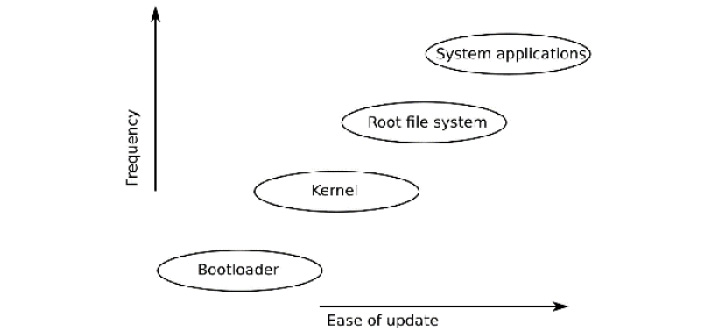

*Hình 10.1 – Các thành phần của một bản cập nhật*

Hãy lần lượt xem từng thành phần.

### Bootloader

Bootloader là đoạn code đầu tiên chạy khi processor được cấp điện. Cách processor tìm bootloader rất device-specific, nhưng trong hầu hết trường hợp, chỉ có một vị trí như vậy, và vì vậy chỉ có thể có một bootloader. Nếu không có bản dự phòng, cập nhật bootloader là rủi ro: điều gì xảy ra nếu hệ thống mất điện giữa chừng? Do đó, hầu hết các giải pháp cập nhật để yên bootloader. Đây không phải vấn đề lớn, vì bootloader chỉ chạy trong một thời gian ngắn lúc power-on và thường không phải là nguồn lớn của các bug runtime.

### Kernel

Linux kernel là một thành phần then chốt chắc chắn sẽ cần cập nhật theo thời gian.

Kernel có vài phần:

- Một binary image được bootloader nạp, thường được lưu trong root filesystem.
- Nhiều thiết bị cũng có một **Device Tree Binary** (**DTB**) mô tả phần cứng cho kernel, và vì vậy phải được cập nhật song song. DTB thường được lưu cạnh kernel binary.
- Có thể có các kernel module trong root filesystem.

Kernel và DTB có thể được lưu trong root filesystem, miễn là bootloader có khả năng đọc định dạng filesystem đó, hoặc chúng có thể nằm trong một partition chuyên dụng. Trong cả hai trường hợp, có thể và an toàn hơn khi có các bản sao dự phòng.

### Root filesystem

Root filesystem chứa các thư viện hệ thống, tiện ích và script thiết yếu cần để hệ thống hoạt động. Rất đáng mong muốn khi có thể thay thế và nâng cấp tất cả những thứ này. Cơ chế phụ thuộc vào hiện thực của filesystem.

Các định dạng phổ biến cho root file system nhúng như sau:

- Ramdisk, được nạp từ flash memory thô hoặc một disk image lúc boot. Để cập nhật nó, bạn chỉ cần ghi đè ramdisk image và reboot.
- Các filesystem nén Read-only, chẳng hạn `squashfs`, được lưu trong một partition flash. Vì các loại filesystem này không hiện thực chức năng ghi, cách duy nhất để cập nhật chúng là ghi một filesystem image hoàn chỉnh vào partition.
- Các loại filesystem thông thường: Với flash memory thô, các định dạng JFFS2 và UBIFS là phổ biến, và với managed flash memory, chẳng hạn eMMC và thẻ SD, định dạng nhiều khả năng là ext4 hoặc F2FS. Vì chúng ghi được lúc runtime, có thể cập nhật chúng từng file một.

### Application hệ thống

Application hệ thống là payload chính của thiết bị; chúng hiện thực chức năng chính của thiết bị. Vì vậy, chúng nhiều khả năng được cập nhật thường xuyên để sửa bug và thêm tính năng. Chúng có thể được gói chung với root filesystem, nhưng cũng phổ biến khi chúng được đặt trong một filesystem riêng để việc cập nhật dễ hơn và để duy trì sự tách biệt giữa các file hệ thống, thường là open source, và các file application, thường là proprietary.

### Dữ liệu Device-specific

Đây là tập hợp các file bị sửa đổi lúc runtime và bao gồm các thiết lập cấu hình, log, dữ liệu user-supplied và những thứ tương tự. Chúng không thường xuyên cần được cập nhật, nhưng chúng cần được giữ lại trong một lần cập nhật. Dữ liệu như vậy cần được lưu trong một partition riêng.

### Các thành phần cần được cập nhật

Tóm lại, một bản cập nhật có thể bao gồm các phiên bản mới của kernel, root filesystem và application hệ thống. Thiết bị sẽ có các partition khác không nên bị một bản cập nhật động tới, như trường hợp dữ liệu runtime của thiết bị.

Cái giá của việc cập nhật phần mềm thất bại có thể là thảm họa. Cập nhật phần mềm an toàn cũng là mối quan tâm lớn trong cả môi trường internet doanh nghiệp lẫn gia đình. Trước khi có thể xuất xưởng bất kỳ phần cứng nào, chúng ta cần có khả năng cập nhật phần mềm một cách tự tin.

## Những điều cơ bản về cập nhật phần mềm

Thoạt nhìn, cập nhật phần mềm có vẻ là một nhiệm vụ đơn giản: bạn chỉ cần ghi đè một số file bằng các bản mới. Nhưng rồi sự đào tạo kỹ sư của bạn bắt đầu phát huy khi bạn nhận ra tất cả những thứ có thể trục trặc. Điều gì xảy ra nếu mất điện trong lúc cập nhật? Điều gì xảy ra nếu một bug, không thấy được khi test bản cập nhật, làm một tỷ lệ thiết bị không boot được? Điều gì xảy ra nếu một bên thứ ba gửi một bản cập nhật giả biến thiết bị của bạn thành một phần của một botnet? Tối thiểu, cơ chế cập nhật phần mềm phải:

- Bền vững, để một bản cập nhật không làm thiết bị trở nên không dùng được
- Fail-safe, để có một chế độ dự phòng nếu mọi thứ khác đều thất bại
- An toàn, để ngăn thiết bị bị chiếm quyền bởi những người cài các bản cập nhật trái phép

Nói cách khác, chúng ta cần một hệ thống không bị ảnh hưởng bởi định luật Murphy, định luật nói rằng nếu một thứ có thể trục trặc, thì cuối cùng nó sẽ trục trặc. Tuy nhiên, một số vấn đề này là non-trivial. Triển khai phần mềm lên một thiết bị ngoài thực địa khác với triển khai phần mềm lên cloud. Các hệ thống embedded Linux cần phát hiện và phản ứng với các sự cố như kernel panic hay boot loop mà không cần bất kỳ sự can thiệp nào của con người.

### Làm cho bản cập nhật bền vững

Bạn có thể nghĩ rằng vấn đề cập nhật các hệ thống Linux đã được giải quyết từ lâu − tất cả chúng ta đều có Linux desktop mà chúng ta cập nhật thường xuyên (đúng không?). Ngoài ra, có vô số Linux server chạy trong các data center cũng được cập nhật tương tự. Tuy nhiên, có một khác biệt giữa server và thiết bị. Cái trước hoạt động trong một môi trường được bảo vệ. Nó khó có khả năng bị mất điện hay mất kết nối mạng đột ngột. Trong trường hợp hiếm hoi một bản cập nhật thất bại, luôn có thể truy cập vào server và dùng các cơ chế bên ngoài để cài lại.

Mặt khác, các thiết bị thường được triển khai tại những địa điểm xa với nguồn điện chập chờn và kết nối mạng kém, khiến khả năng một bản cập nhật bị gián đoạn cao hơn nhiều. Rồi hãy xét rằng có thể rất tốn kém để tiếp cận một thiết bị nhằm khắc phục một bản cập nhật thất bại nếu, chẳng hạn, thiết bị là một trạm quan trắc môi trường trên đỉnh núi hay đang điều khiển các van của một giếng dầu dưới đáy biển. Do đó, việc thiết bị nhúng có một cơ chế cập nhật bền vững không dẫn tới hệ thống trở nên không dùng được là quan trọng hơn nhiều.

Từ khóa ở đây là **atomicity**. Toàn bộ bản cập nhật phải atomic: không được có giai đoạn nào mà một phần hệ thống được cập nhật còn các phần khác thì không. Phải có một thay đổi duy nhất, không thể gián đoạn đối với hệ thống để chuyển sang phiên bản phần mềm mới.

Điều này loại khỏi danh sách cân nhắc cơ chế cập nhật hiển nhiên nhất: đơn giản là cập nhật từng file riêng lẻ, chẳng hạn bằng cách giải nén một archive đè lên các phần của filesystem. Đơn giản là không có cách nào bảo đảm sẽ có một tập file nhất quán nếu hệ thống bị reset trong lúc cập nhật. Ngay cả việc dùng một package manager như `apt`, `yum` hay `zypper` cũng không giúp được gì. Nếu bạn nhìn vào bên trong tất cả các package manager này, bạn sẽ thấy chúng thực sự hoạt động bằng cách giải nén một archive đè lên filesystem và chạy các script để cấu hình package cả trước và sau khi cập nhật. Package manager ổn với thế giới được bảo vệ của data center, hay thậm chí desktop của bạn, nhưng không phải cho một thiết bị.

Để đạt được atomicity, bản cập nhật phải được cài song song với hệ thống đang chạy, rồi bật một công tắc để chuyển từ cái cũ sang cái mới. Trong các mục sau, chúng ta sẽ mô tả hai cách tiếp cận khác nhau để đạt được atomicity. Cách thứ nhất là có hai bản sao của root filesystem và các thành phần chính khác. Một bản đang live, trong khi bản kia có thể nhận cập nhật. Khi cập nhật hoàn tất, công tắc được bật để khi reboot, bootloader chọn bản sao đã cập nhật. Cách này được gọi là **symmetric image update**, hay **A/B image update**. Một biến thể của chủ đề này là dùng một hệ điều hành **recovery mode** đặc biệt chịu trách nhiệm cập nhật hệ điều hành chính. Việc bảo đảm atomicity được chia sẻ giữa bootloader và hệ điều hành recovery. Cách này được gọi là **asymmetric image update**. Đây là cách tiếp cận được dùng trong Android trước phiên bản Nougat 7.x.

Cách tiếp cận thứ hai là có hai hoặc nhiều bản sao của root filesystem trong các thư mục con khác nhau của system partition, rồi dùng `chroot(8)` lúc boot để chọn một trong số chúng. Khi Linux đang chạy, update client có thể cài bản cập nhật vào root filesystem kia, rồi khi mọi thứ hoàn tất và đã được kiểm tra, nó có thể bật công tắc và reboot. Cách này được gọi là **atomic file update** và được minh họa bởi **OSTree**.

### Làm cho bản cập nhật fail-safe

Vấn đề tiếp theo cần xét là phục hồi từ một bản cập nhật đã được cài đúng nhưng chứa code khiến hệ thống không boot được. Lý tưởng nhất, chúng ta muốn hệ thống phát hiện trường hợp này và quay về một image hoạt động trước đó.

Có vài failure mode có thể dẫn tới một hệ thống non-operational. Cái đầu tiên là kernel panic, gây ra, chẳng hạn, bởi một bug trong một kernel device driver, hoặc không thể chạy chương trình `init`. Một chỗ hợp lý để bắt đầu là cấu hình kernel để reboot một số giây sau khi panic. Bạn có thể làm điều này hoặc khi build kernel bằng cách đặt `CONFIG_PANIC_TIMEOUT` hoặc bằng cách đặt kernel command line thành panic. Chẳng hạn, để reboot 5 giây sau một panic, bạn sẽ thêm `panic=5` vào kernel command line.

Bạn có thể muốn đi xa hơn và cấu hình kernel để panic khi gặp Oops. Nhớ rằng một Oops được tạo ra khi kernel gặp một lỗi nghiêm trọng. Trong một số trường hợp, nó sẽ có thể phục hồi từ lỗi, trong các trường hợp khác thì không, nhưng trong mọi trường hợp, có gì đó đã trục trặc và hệ thống không hoạt động như lẽ ra phải thế. Để enable panic khi Oops trong cấu hình kernel, đặt `CONFIG_PANIC_ON_OOPS=y` hoặc, trên kernel command line, `oops=panic`.

Failure mode thứ hai xảy ra khi kernel khởi chạy `init` thành công nhưng vì lý do nào đó, application chính không chạy được. Với trường hợp này, bạn cần một watchdog. Một **watchdog** là một timer phần cứng hoặc phần mềm khởi động lại hệ thống nếu timer không được reset trước khi hết hạn. Nếu bạn đang dùng `systemd`, bạn có thể dùng chức năng watchdog built-in, mà tôi sẽ mô tả trong [*Chương 13*](ch13_starting_up_the_init_program.vi.md), *Khởi động – Chương trình init*. Nếu không, bạn có thể muốn enable hỗ trợ watchdog được tích hợp sẵn trong Linux, như được mô tả trong source code kernel ở `Documentation/watchdog`.

Cả hai lỗi đều dẫn tới **boot loop**: hoặc kernel panic hoặc watchdog timeout khiến hệ thống reboot. Nếu vấn đề dai dẳng, hệ thống sẽ reboot liên tục. Để thoát khỏi boot loop, chúng ta cần một ít code trong bootloader để phát hiện trường hợp này và quay về phiên bản trước đó, phiên bản đã biết là tốt. Một cách tiếp cận điển hình là dùng một **boot count** được bootloader tăng lên mỗi lần boot, và được reset về không trong user space một khi hệ thống đã chạy ổn. Nếu hệ thống rơi vào boot loop, bộ đếm không được reset và vì vậy tiếp tục tăng. Sau đó, bootloader được cấu hình để thực hiện hành động khắc phục nếu bộ đếm vượt quá một ngưỡng.

Trong U-Boot, việc này được xử lý bởi ba biến:

- `bootcount`: Biến này được tăng mỗi lần processor boot.
- `bootlimit`: Nếu `bootcount` vượt quá `bootlimit`, U-Boot chạy các lệnh trong `altbootcmd` thay vì `bootcmd`.
- `altbootcmd`: Biến này chứa các lệnh boot thay thế, chẳng hạn để roll back về một phiên bản phần mềm trước đó hoặc để khởi động hệ điều hành recovery-mode.

Để điều này hoạt động, phải có cách để một chương trình user space reset boot count. Chúng ta có thể làm điều đó bằng các tiện ích U-Boot cho phép truy cập U-Boot environment lúc runtime:

- `fw_printenv`: In giá trị của một biến U-Boot
- `fw_setenv`: Đặt giá trị của một biến U-Boot

Hai lệnh này cần biết U-Boot environment block được lưu ở đâu, và có một file cấu hình cho việc đó ở `/etc/fw_env.config`. Chẳng hạn, nếu U-Boot environment được lưu tại offset `0x800000` tính từ đầu bộ nhớ eMMC, với một bản sao dự phòng tại `0x1000000`, thì cấu hình sẽ trông như thế này:

```
# cat /etc/fw_env.config
/dev/mmcblk0 0x800000 0x40000
/dev/mmcblk0 0x1000000 0x40000
```

Còn một điều cuối cùng cần đề cập trong mục này. Tăng boot count mỗi lần boot rồi reset nó khi application bắt đầu chạy dẫn tới các lần ghi không cần thiết vào environment block, làm mòn flash memory và làm chậm việc khởi tạo hệ thống. Để tránh phải làm điều này ở mọi lần reboot, U-Boot có thêm một biến tên `upgrade_available`. Nếu `upgrade_available` là `0`, thì `bootcount` không được tăng. `upgrade_available` được đặt thành `1` sau khi một bản cập nhật đã được cài để cơ chế bảo vệ boot count chỉ được dùng khi cần.

### Làm cho bản cập nhật an toàn

Vấn đề cuối cùng liên quan tới khả năng lạm dụng chính cơ chế cập nhật. Ý định chính của bạn khi hiện thực một cơ chế cập nhật là cung cấp một phương pháp tự động hoặc semi-automated đáng tin cậy để cài các security patch và tính năng mới. Tuy nhiên, người khác có thể dùng cùng cơ chế đó để cài các phiên bản phần mềm trái phép và vì vậy *hijack* thiết bị. Chúng ta cần xem làm sao bảo đảm điều này không thể xảy ra.

Lỗ hổng lớn nhất là một bản cập nhật từ xa giả mạo. Để ngăn điều này, chúng ta cần xác thực update server trước khi bắt đầu tải về. Chúng ta cũng cần một kênh truyền an toàn, chẳng hạn HTTPS, để chống việc can thiệp vào luồng tải về. Tôi sẽ quay lại điều này khi mô tả cập nhật OTA ở phần sau.

Cũng có vấn đề về tính xác thực của các bản cập nhật được cung cấp tại chỗ. Một cách để phát hiện một bản cập nhật giả là dùng một giao thức secure boot trong bootloader. Nếu kernel image được ký tại nhà máy bằng một khóa số, bootloader có thể kiểm tra khóa trước khi nạp kernel và từ chối nạp nếu các khóa không khớp. Miễn là các khóa được nhà sản xuất giữ bí mật, sẽ không thể nạp một kernel không được phép. U-Boot hiện thực một cơ chế như vậy, được mô tả trong source code U-Boot ở `doc/uImage.FIT/verified-boot.txt`.

> **Lưu ý quan trọng**
>
> Secure boot: tốt hay xấu?
>
> Nếu tôi đã mua một thiết bị có tính năng cập nhật phần mềm, thì tôi đang tin tưởng nhà cung cấp thiết bị đó sẽ đưa ra các bản cập nhật hữu ích. Tôi chắc chắn không muốn một bên thứ ba độc hại cài phần mềm mà tôi không biết. Nhưng tôi có nên được phép tự cài phần mềm không? Nếu tôi sở hữu hoàn toàn thiết bị, chẳng phải tôi nên có quyền sửa đổi nó, bao gồm cả việc nạp phần mềm mới sao? Hãy nhớ lại set-top box TiVo, thứ cuối cùng đã dẫn tới việc ra đời license GPL v3. Cũng hãy nhớ router Wi-Fi Linksys WRT54G: khi việc truy cập phần cứng trở nên dễ dàng, nó đã sinh ra cả một ngành công nghiệp mới, bao gồm project OpenWrt. Xem, chẳng hạn, [https://www.wi-fiplanet.com/tutorials/article.php/3562391](https://www.wi-fiplanet.com/tutorials/article.php/3562391) để biết thêm chi tiết. Đây là một vấn đề phức tạp nằm ở giao lộ giữa tự do và kiểm soát. Theo ý kiến của tôi, một số nhà sản xuất thiết bị dùng bảo mật làm cái cớ để bảo vệ phần mềm của họ, đôi khi kém chất lượng.

Giờ chúng ta đã biết những gì là cần thiết, làm sao để cập nhật phần mềm trên các hệ thống embedded Linux?

## Các loại cơ chế cập nhật

Trong mục này, tôi sẽ mô tả ba cách tiếp cận áp dụng cập nhật phần mềm: symmetric, hay A/B, image update; asymmetric image update, còn được gọi là *recovery mode update*; và cuối cùng, atomic file update.

### Symmetric image update

Trong sơ đồ này, có hai bản sao của hệ điều hành, mỗi bản gồm Linux kernel, root filesystem và application hệ thống. Chúng được gắn nhãn A và B trong sơ đồ sau:

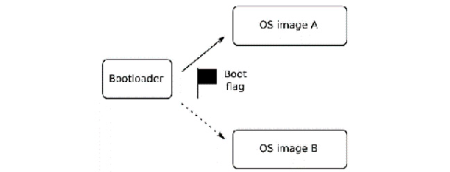

*Hình 10.2 – symmetric image update*

Symmetric image update hoạt động như sau:

1. Bootloader có một flag cho biết nó nên nạp image nào. Ban đầu, flag được đặt là A, nên bootloader nạp OS image A.
2. Để cài một bản cập nhật, updater application, là một phần của hệ điều hành, ghi đè OS image B.
3. Khi hoàn tất, updater đổi boot flag thành B và reboot.
4. Giờ bootloader sẽ nạp hệ điều hành mới.
5. Khi một bản cập nhật tiếp theo được cài, updater ghi đè image A và đổi boot flag thành A, và cứ thế bạn ping-pong giữa hai bản sao.
6. Nếu một bản cập nhật thất bại trước khi boot flag được đổi, bootloader tiếp tục nạp hệ điều hành tốt.

Có vài project open source hiện thực symmetric image update. Một là client **Mender** hoạt động ở chế độ standalone, mà tôi sẽ mô tả sau, trong mục *Dùng Mender cho cập nhật cục bộ*. Một cái khác là **SWUpdate** ([https://github.com/sbabic/swupdate](https://github.com/sbabic/swupdate)). SWUpdate có thể nhận nhiều image update trong một package định dạng CPIO rồi triển khai các bản cập nhật đó tới các phần khác nhau của hệ thống. Nó cho phép bạn viết plugin bằng ngôn ngữ Lua để xử lý tùy biến. Nó hỗ trợ filesystem cho flash memory thô được truy cập dưới dạng partition flash MTD, cho bộ lưu trữ được tổ chức thành UBI volume, và cho bộ lưu trữ SD/eMMC với disk partition table. Ví dụ thứ ba là **RAUC**, **Robust Auto-Update Controller**, ([https://github.com/rauc/rauc](https://github.com/rauc/rauc)). Nó cũng hỗ trợ bộ lưu trữ flash thô, UBI volume và thiết bị SD/eMMC. Các image có thể được ký và kiểm chứng bằng khóa OpenSSL. Ví dụ thứ tư là **fwup** ([https://github.com/fwup-home/fwup](https://github.com/fwup-home/fwup)) của Frank Hunleth, người đóng góp long-time cho Buildroot.

Sơ đồ này có một số nhược điểm. Một là do cập nhật toàn bộ filesystem image, kích thước của update package lớn, điều có thể gây áp lực lên hạ tầng mạng kết nối các thiết bị. Điều này có thể được giảm nhẹ bằng cách chỉ gửi các block filesystem đã thay đổi thông qua việc thực hiện một `diff` nhị phân giữa filesystem mới và phiên bản trước. Phiên bản thương mại của Mender có hỗ trợ các delta update như vậy và delta update vẫn còn là tính năng beta trong RAUC và fwup tại thời điểm viết sách.

Nhược điểm thứ hai là cần giữ không gian lưu trữ cho một bản sao dự phòng của root filesystem và các thành phần khác. Nếu root filesystem là thành phần lớn nhất, nó gần như gấp đôi lượng flash memory bạn cần lắp. Chính vì lý do này mà sơ đồ asymmetric update được dùng, mà tôi sẽ mô tả tiếp theo.

### Asymmetric image update

Bạn có thể giảm yêu cầu lưu trữ bằng cách giữ một hệ điều hành recovery tối thiểu thuần túy để cập nhật hệ điều hành chính, như được thể hiện ở đây:

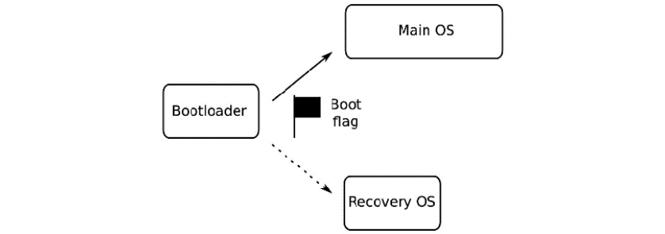

*Hình 10.3 – Asymmetric image update*

Để cài một asymmetric update, hãy làm như sau:

1. Đặt boot flag trỏ tới recovery OS và reboot.
2. Khi recovery OS đang chạy, nó có thể stream bản cập nhật tới image hệ điều hành chính.
3. Nếu cập nhật bị gián đoạn, bootloader sẽ lại boot vào recovery OS, và recovery OS có thể tiếp tục cập nhật.
4. Chỉ khi cập nhật hoàn tất và đã được kiểm chứng thì recovery OS mới xóa boot flag và reboot lần nữa, lần này nạp hệ điều hành chính mới.
5. Phương án dự phòng trong trường hợp một bản cập nhật đúng nhưng có bug là đưa hệ thống trở lại recovery mode, nơi có thể thử các hành động khắc phục, có thể bằng cách yêu cầu một phiên bản cập nhật trước đó.

Recovery OS thường nhỏ hơn nhiều so với hệ điều hành chính, có lẽ chỉ vài megabyte, nên overhead lưu trữ không lớn. Cũng đáng chú ý, đây là sơ đồ đã được Android áp dụng trước bản phát hành Nougat. Với các hiện thực open source của asymmetric image update, bạn có thể xem xét SWUpdate hoặc RAUC, cả hai đều đã được tôi đề cập ở mục trước.

Một nhược điểm lớn của sơ đồ này là trong khi recovery OS đang chạy, thiết bị không hoạt động. Một sơ đồ như vậy cũng không cho phép cập nhật chính recovery OS. Việc đó sẽ đòi hỏi thứ gì đó như A/B image update, do đó phá hỏng toàn bộ mục đích.

### Atomic file update

Một cách tiếp cận khác là có các bản sao dự phòng của một root filesystem nằm trong nhiều thư mục của một filesystem duy nhất rồi dùng lệnh `chroot(8)` để chọn một trong số chúng lúc boot. Điều này cho phép một cây thư mục được cập nhật trong khi cây khác được mount làm thư mục `root`. Hơn nữa, thay vì tạo bản sao của các file không thay đổi giữa các phiên bản root filesystem, bạn có thể dùng link. Điều đó sẽ tiết kiệm nhiều dung lượng đĩa và giảm lượng dữ liệu cần tải về trong một update package. Đây là những ý tưởng cơ bản đằng sau atomic file update.

> **Lưu ý quan trọng**
>
> Lệnh `chroot` chạy một chương trình trong một thư mục có sẵn. Chương trình coi thư mục này là thư mục `root` của nó, và vì vậy không thể truy cập bất kỳ file hay thư mục nào ở mức cao hơn. Nó thường được dùng để chạy một chương trình trong một môi trường bị giới hạn, đôi khi được gọi là **chroot jail**.

Project OSTree ([https://ostree.readthedocs.org/en/latest/](https://ostree.readthedocs.org/en/latest/)), giờ được đổi tên thành **libOSTree**, là hiện thực phổ biến nhất của ý tưởng này. OSTree bắt đầu khoảng năm 2011 như một phương tiện triển khai bản cập nhật tới các lập trình viên GNOME desktop, và để cải thiện việc test continuous integration của họ ([https://wiki.gnome.org/Projects/GnomeContinuous](https://wiki.gnome.org/Projects/GnomeContinuous)). Kể từ đó nó đã được chấp nhận làm giải pháp cập nhật cho thiết bị nhúng. Nó là một trong các phương pháp cập nhật có sẵn trong **Automotive Grade Linux** (**AGL**), và nó có sẵn trong Yocto Project thông qua layer `meta-update`, được hỗ trợ bởi **Advanced Telematic Systems** (**ATS**).

Với OSTree, các file được lưu trên target trong thư mục `/ostree/repo/objects`. Chúng được đặt tên sao cho nhiều phiên bản của cùng một file có thể tồn tại trong repository. Sau đó, một tập file cho trước được link vào một thư mục deployment, có tên chẳng hạn như `/ostree/deploy/os/29ff9…/`. Việc này được gọi là *checking out*, vì nó có vài điểm tương đồng với cách một branch được check out từ một repository Git. Mỗi thư mục deploy chứa các file tạo nên một root filesystem. Có thể có bất kỳ số lượng nào, nhưng mặc định, chỉ có hai. Chẳng hạn, đây là hai thư mục `deploy`, mỗi thư mục có các link trỏ ngược vào thư mục `repo`:

```
/ostree/repo/objects/...
/ostree/deploy/os/a3c83.../
 /usr/bin/bash
 /usr/bin/echo
/ostree/deploy/os/29ff9.../
 /usr/bin/bash
 /usr/bin/echo
```

Để boot từ một thư mục OSTree:

1. Bootloader boot kernel với một `initramfs`, truyền trên kernel command line đường dẫn của deployment cần dùng:

   ```
   bootargs=ostree=/ostree/deploy/os/deploy/29ff9...
   ```

2. `initramfs` chứa một chương trình `init`, `ostree-init`, chương trình này đọc command line và thực thi `chroot` tới đường dẫn được cho.

3. Khi một bản cập nhật hệ thống được cài, các file đã thay đổi được install agent của OSTree tải vào thư mục `repo`.

4. Khi hoàn tất, một thư mục `deploy` mới được tạo, với các link tới tập file sẽ tạo nên root filesystem mới. Một số trong đó sẽ là file mới, một số sẽ giống như trước.

5. Cuối cùng, install agent của OSTree sẽ đổi boot flag của bootloader để ở lần reboot tiếp theo, nó sẽ `chroot` tới thư mục `deploy` mới.

6. Bootloader hiện thực việc kiểm tra boot count và quay về root trước đó nếu phát hiện một boot loop.

Dù một lập trình viên có thể vận hành updater hoặc cài client thủ công trên một thiết bị target, cuối cùng, các bản cập nhật phần mềm cần diễn ra tự động qua mạng không dây.

## Cập nhật OTA

Cập nhật **over-the-air** (**OTA**) có nghĩa là có khả năng đẩy phần mềm tới một thiết bị hoặc nhóm thiết bị qua mạng, thường không cần bất kỳ tương tác nào của người dùng cuối với thiết bị. Để điều này xảy ra, chúng ta cần một server trung tâm để điều khiển quá trình cập nhật và một giao thức để tải bản cập nhật xuống update client. Trong một hiện thực điển hình, client thỉnh thoảng poll update server để kiểm tra xem có bản cập nhật nào đang chờ không. Khoảng thời gian polling cần đủ dài để lưu lượng poll không chiếm một phần đáng kể băng thông mạng, nhưng đủ ngắn để các bản cập nhật có thể được chuyển tới kịp thời. Một khoảng từ hàng chục phút tới vài giờ thường là một sự thỏa hiệp tốt. Các poll message từ thiết bị chứa một loại định danh duy nhất nào đó, chẳng hạn số serial hoặc địa chỉ MAC, và phiên bản phần mềm hiện tại. Từ đó, update server có thể thấy có cần cập nhật hay không. Các poll message cũng có thể chứa các thông tin trạng thái khác, chẳng hạn uptime, các tham số môi trường, hoặc bất cứ thứ gì hữu ích cho việc quản lý tập trung các thiết bị.

Update server thường được liên kết với một hệ thống quản lý sẽ gán các phiên bản phần mềm mới cho các nhóm thiết bị khác nhau dưới sự kiểm soát của nó. Nếu số lượng thiết bị lớn, nó có thể gửi bản cập nhật theo từng đợt để tránh làm quá tải mạng. Sẽ có một dạng hiển thị trạng thái nào đó, nơi trạng thái hiện tại của các thiết bị có thể được hiển thị, và các vấn đề được làm nổi bật.

Tất nhiên, cơ chế cập nhật phải an toàn để các bản cập nhật giả không thể được gửi tới các thiết bị đầu cuối. Điều này liên quan tới việc client và server có khả năng xác thực lẫn nhau bằng cách trao đổi certificate. Sau đó client có thể xác minh rằng các package tải về được ký bằng khóa được mong đợi.

Đây là ba ví dụ về các project open source bạn có thể dùng cho cập nhật OTA:

- Mender ở chế độ managed
- balena
- Eclipse hawkBit ([https://github.com/eclipse/hawkbit](https://github.com/eclipse/hawkbit)) kết hợp với một updater client như SWUpdate hoặc RAUC

Chúng ta sẽ đi qua chi tiết hai project đầu tiên, bắt đầu với **Mender**.

## Dùng Mender cho cập nhật cục bộ

Lý thuyết vậy là đủ. Trong hai mục tiếp theo của chương này, tôi muốn minh họa các nguyên tắc tôi đã nói tới giờ hoạt động thế nào trong thực tế. Với các ví dụ này, tôi sẽ dùng Mender. Mender dùng cơ chế symmetric A/B image update, với phương án dự phòng trong trường hợp cập nhật thất bại. Nó có thể hoạt động ở *chế độ standalone* cho cập nhật cục bộ, hoặc ở *chế độ managed* cho cập nhật OTA. Tôi sẽ bắt đầu với chế độ standalone.

Mender được viết và hỗ trợ bởi mender.io ([https://mender.io](https://mender.io)). Có nhiều thông tin hơn về phần mềm trong mục tài liệu của website. Tôi sẽ không đi sâu vào cấu hình phần mềm ở đây vì mục tiêu của tôi là minh họa các nguyên tắc của cập nhật phần mềm. Hãy bắt đầu với Mender client.

### Build Mender client

Mender client có sẵn dưới dạng một Yocto meta layer. Các ví dụ này dùng bản phát hành Dunfell của Yocto Project, cũng là bản chúng ta đã dùng trong [*Chương 6*](ch06_selecting_a_build_system.vi.md), *Chọn build system*.

Bắt đầu bằng cách fetch layer `meta-mender` như sau:

```
$ git clone -b dunfell git://github.com/mendersoftware/meta-mender
```

Bạn cần điều hướng lên một cấp phía trên thư mục `poky` trước khi clone layer `meta-mender` để hai thư mục nằm cạnh nhau ở cùng một cấp.

Mender client yêu cầu một số thay đổi trong cấu hình U-Boot để xử lý các biến boot flag và boot count. Layer Mender client gốc có các sub-layers cho các hiện thực mẫu của việc tích hợp U-Boot này mà chúng ta có thể dùng ngay, chẳng hạn `meta-mender-qemu` và `meta-mender-raspberrypi`. Chúng ta sẽ dùng QEMU.

Bước tiếp theo là tạo một thư mục build và thêm các layer cho cấu hình này:

```
$ source poky/oe-init-build-env build-mender-qemu
$ bitbake-layers add-layer ../meta-openembedded/meta-oe
$ bitbake-layers add-layer ../meta-mender/meta-mender-core
$ bitbake-layers add-layer ../meta-mender/meta-mender-demo
$ bitbake-layers add-layer ../meta-mender/meta-mender-qemu
```

Sau đó, chúng ta cần thiết lập môi trường bằng cách thêm một số thiết lập vào `conf/local.conf`:

```
1 MENDER_ARTIFACT_NAME = "release-1"
2 INHERIT += "mender-full"
3 MACHINE = "vexpress-qemu"
4 INIT_MANAGER = "systemd"
5 IMAGE_FSTYPES = "ext4"
```

Dòng `2` include một BitBake class, tên `mender-full`, chịu trách nhiệm xử lý đặc biệt image cần để tạo định dạng A/B image. Dòng `3` chọn một machine tên `vexpress-qemu`, dùng QEMU để giả lập một board Arm Versatile Express, thay vì Versatile PB là mặc định trong Yocto Project. Dòng `4` chọn `systemd` làm daemon `init` thay cho System V `init` mặc định. Tôi mô tả các daemon `init` chi tiết hơn trong [*Chương 13*](ch13_starting_up_the_init_program.vi.md), *Khởi động – Chương trình init*. Dòng `5` khiến các root filesystem image được tạo ở định dạng `ext4`.

Giờ chúng ta có thể build một image:

```
$ bitbake core-image-full-cmdline
```

Như thường lệ, kết quả build nằm trong `tmp/deploy/images/vexpress-qemu`. Bạn sẽ để ý một số thứ mới ở đây so với các bản build Yocto Project chúng ta đã làm trước đây. Có một file tên `core-image-full-cmdline-vexpress-qemu-grub-[timestamp].mender`, và một file có tên tương tự khác kết thúc bằng `.uefiimg`. File `.mender` cần cho tiểu mục tiếp theo: *Cài một bản cập nhật*. File `.uefiimg` được tạo bằng một công cụ của Yocto Project gọi là `wic`. Output là một image chứa partition table và sẵn sàng để được sao chép trực tiếp vào thẻ SD hoặc chip eMMC.

Chúng ta có thể chạy target QEMU bằng script do layer Mender cung cấp, script này trước tiên sẽ boot U-Boot rồi nạp Linux kernel:

```
$ ../meta-mender/meta-mender-qemu/scripts/mender-qemu
[…]
[  OK  ] Started Mender OTA update service.
[  OK  ] Started Mender Connect service.
[  OK  ] Started NFS status monitor for NFSv2/3 locking..
[  OK  ] Started Respond to IPv6 Node Information Queries.
[  OK  ] Started Network Router Discovery Daemon.
[  OK  ] Reached target Multi-User System.
         Starting Update UTMP about System Runlevel Changes...
Poky (Yocto Project Reference Distro) 3.1.6 vexpress-qemu ttyAMA0
vexpress-qemu login:
```

Nếu thay vì login prompt bạn thấy một lỗi như:

```
mender-qemu: 117: qemu-system-arm: not found
```

Thì hãy cài `qemu-system-arm` trên hệ thống của bạn và chạy lại script:

```
$ sudo apt install qemu-system-arm
```

Đăng nhập với tư cách `root` không có mật khẩu. Nhìn vào layout của các partition trên target, chúng ta có thể thấy thế này:

```
# fdisk -l /dev/mmcblk0
Disk /dev/mmcblk0: 608 MiB, 637534208 bytes, 1245184 sectors
Units: sectors of 1 * 512 = 512 bytes
Sector size (logical/physical): 512 bytes / 512 bytes
I/O size (minimum/optimal): 512 bytes / 512 bytes
Disklabel type: gpt
Disk identifier: 15F2C2E6-D574-4A14-A5F4-4D571185EE9D
Device          Start     End Sectors  Size Type
/dev/mmcblk0p1  16384   49151   32768   16M EFI System
/dev/mmcblk0p2  49152  507903  458752  224M Linux filesystem
/dev/mmcblk0p3 507904  966655  458752  224M Linux filesystem
/dev/mmcblk0p4 966656 1245150  278495  136M Linux filesystem
```

Tổng cộng có bốn partition:

- **Partition 1**: Partition này chứa các file boot của U-Boot.
- **Partition 2 và 3**: Các partition này chứa các root filesystem A/B: ở giai đoạn này, chúng giống hệt nhau.
- **Partition 4**: Đây chỉ là một extension partition chứa các partition còn lại.

Chạy lệnh `mount` cho thấy partition thứ hai đang được dùng làm root filesystem, để partition thứ ba nhận bản cập nhật:

```
# mount
/dev/mmcblk0p2 on / type ext4 (rw,relatime)
[…]
```

Với Mender client giờ đã có trên board, chúng ta có thể bắt đầu cài bản cập nhật.

## Cài một bản cập nhật

Bây giờ chúng ta muốn thay đổi root filesystem rồi cài nó như một bản cập nhật:

1. Mở một shell khác và quay lại thư mục build đang làm việc:

   ```
   $ source poky/oe-init-build-env build-mender-qemu
   ```

2. Tạo một bản sao của image chúng ta vừa build. Đây sẽ là live image mà chúng ta sẽ cập nhật:

   ```
   $ cd tmp/deploy/images/vexpress-qemu
   $ cp core-image-full-cmdline-vexpress-qemu-grub.uefiimg \
   core-image-live-vexpress-qemu-grub.uefiimg
   $ cd -
   ```

   Nếu không làm điều này, script QEMU sẽ chỉ nạp image mới nhất do BitBake tạo ra, bao gồm cả bản cập nhật, điều làm hỏng mục đích của bài minh họa.

3. Tiếp theo, đổi hostname của target, thứ sẽ dễ thấy khi bản cập nhật được cài. Để làm điều này, sửa `conf/local.conf` và thêm dòng này:

   ```
   hostname_pn-base-files = "vexpress-qemu-release2"
   ```

4. Giờ chúng ta có thể build image theo cùng cách như trước:

   ```
   $ bitbake core-image-full-cmdline
   ```

   Lần này chúng ta không quan tâm tới file `.uefiimg`, file chứa một image mới hoàn chỉnh. Thay vào đó, chúng ta chỉ muốn lấy root filesystem mới, nằm trong `core-image-full-cmdline-vexpress-qemu-grub.mender`. File `.mender` ở định dạng mà Mender client nhận ra. Định dạng file `.mender` gồm thông tin phiên bản, một header, và root filesystem image được gộp lại trong một archive `.tar` nén.

5. Bước tiếp theo là triển khai artifact mới tới target, khởi tạo bản cập nhật tại chỗ trên thiết bị, nhưng nhận bản cập nhật từ một server. Dừng emulator bạn đã khởi động trong phiên terminal trước bằng cách nhập *Ctrl* + *A* rồi *x* để kết thúc nó. Sau đó boot QEMU lần nữa với image vừa sao chép:

   ```
   $ ../meta-mender/meta-mender-qemu/scripts/mender-qemu \
   core-image-live
   ```

6. Kiểm tra mạng đã được cấu hình, với QEMU tại `10.0.2.15`, và host tại `10.0.2.2`:

   ```
   # ping 10.0.2.2
   PING 10.0.2.2 (10.0.2.2) 56(84) bytes of data.
   64 bytes from 10.0.2.2: icmp_seq=1 ttl=255 time=0.286 ms
   ^C
   --- 10.0.2.2 ping statistics ---
   1 packets transmitted, 1 received, 0% packet loss, time 0ms
   rtt min/avg/max/mdev = 0.286/0.286/0.286/0.000 ms
   ```

7. Bây giờ, trong một phiên terminal khác, khởi động một web server trên host có thể phục vụ bản cập nhật:

   ```
   $ cd tmp/deploy/images/vexpress-qemu
   $ python3 -m http.server
   Serving HTTP on 0.0.0.0 port 8000 (http://0.0.0.0:8000/) ...
   ```

   Nó đang lắng nghe trên port `8000`. Khi bạn dùng xong web server, gõ *Ctrl* + *C* để kết thúc nó.

8. Quay lại target, chạy lệnh này để lấy bản cập nhật:

   ```
   # mender --log-level info install \
   > http://10.0.2.2:8000/core-image-full-cmdline-vexpress-qemu-grub.mender
   INFO[0751] Wrote 234881024/234881024 bytes to the inactive partition
   INFO[0751] Enabling partition with new image installed to be a boot candidate: 3
   ```

   Bản cập nhật đã được ghi vào partition thứ ba, `/dev/mmcblk0p3`, trong khi root filesystem của chúng ta vẫn nằm trên partition 2, `mmcblk0p2`.

9. Reboot QEMU bằng cách nhập *reboot* từ command line QEMU. Lưu ý rằng giờ root filesystem được mount trên partition 3, và hostname đã thay đổi:

   ```
   # mount
   /dev/mmcblk0p3 on / type ext4 (rw,relatime)
   […]
   # hostname
   vexpress-qemu-release2
   ```

   Thành công!

10. Còn một việc nữa cần làm. Chúng ta cần xét vấn đề boot loop. Dùng `fw_printenv` để xem các biến U-Boot, chúng ta thấy như sau:

    ```
    # fw_printenv upgrade_available
    upgrade_available=1
    # fw_printenv bootcount
    bootcount=1
    ```

Nếu hệ thống reboot mà không xóa `bootcount`, U-Boot sẽ phát hiện điều đó và quay về bản cài đặt trước đó.

Hãy test hành vi fallback của U-Boot:

1. Reboot target ngay lập tức.

2. Khi target lên lại, chúng ta thấy U-Boot đã quay về bản cài đặt trước đó:

   ```
   # mount
   /dev/mmcblk0p2 on / type ext4 (rw,relatime)
   […]
   # hostname
   vexpress-qemu
   ```

3. Bây giờ, hãy lặp lại quy trình cập nhật:

   ```
   # mender --log-level info install \
   > http://10.0.2.2:8000/core-image-full-cmdline-vexpress-qemu-grub.mender
   # reboot
   ```

4. Nhưng lần này, sau khi reboot, hãy `commit` thay đổi:

   ```
   # mender commit
   […]
   # fw_printenv upgrade_available
   upgrade_available=0
   # fw_printenv bootcount
   bootcount=1
   ```

5. Khi `upgrade_available` đã được xóa, U-Boot sẽ không còn kiểm tra `bootcount` nữa, và vì vậy thiết bị sẽ tiếp tục mount root filesystem đã cập nhật này. Khi một bản cập nhật tiếp theo được nạp, Mender client sẽ xóa `bootcount` và đặt lại `upgrade_available`.

Ví dụ này dùng Mender client từ command line để khởi tạo một bản cập nhật tại chỗ. Bản thân bản cập nhật đến từ một server nhưng cũng hoàn toàn có thể được cung cấp trên một ổ flash USB hay thẻ SD. Thay cho Mender, chúng ta có thể đã dùng các image update client khác đã đề cập: SWUpdate hoặc RAUC. Mỗi cái có ưu điểm riêng, nhưng kỹ thuật cơ bản là như nhau.

Giai đoạn tiếp theo là xem cập nhật OTA hoạt động thế nào trong thực tế.

## Dùng Mender cho cập nhật OTA

Một lần nữa, chúng ta sẽ dùng Mender client trên thiết bị, nhưng lần này vận hành nó ở *chế độ managed*, và ngoài ra, chúng ta sẽ cấu hình một server để triển khai bản cập nhật sao cho không cần tương tác tại chỗ nào. Mender cung cấp một server open source cho việc này. Để xem tài liệu về cách thiết lập demo server này, xem [https://docs.mender.io/2.4/getting-started/on-premise-installation](https://docs.mender.io/2.4/getting-started/on-premise-installation).

Việc cài đặt yêu cầu cài Docker Engine phiên bản 19.03 trở lên. Tham khảo website Docker tại [https://docs.docker.com/engine/installation](https://docs.docker.com/engine/installation). Nó cũng yêu cầu Docker Compose phiên bản 1.25 trở lên như được mô tả ở đây: [https://docs.docker.com/compose/install/](https://docs.docker.com/compose/install/).

Để kiểm tra phiên bản Docker và Docker Compose bạn có trên hệ thống, dùng các lệnh này:

```
$ docker --version
Docker version 19.03.8, build afacb8b7f0
$ docker-compose --version
docker-compose version 1.25.0, build unknown
```

Mender server cũng yêu cầu một JSON parser command-line tên `jq`:

```
$ sudo apt install jq
```

Khi cả ba đã được cài, hãy cài môi trường tích hợp Mender như sau:

```
$ curl -L \
https://github.com/mendersoftware/integration/archive/2.5.1.tar.gz | tar xz
$ cd integration-2.5.1
$ ./demo up
Starting the Mender demo environment...
[…]
Creating a new user...
****************************************
Username: mender-demo@example.com
Login password: D53444451DB6
****************************************
Please keep the password available, it will not be cached by the login script.
Mender demo server ready and running in the background. Copy credentials above and log in at https://localhost
Press Enter to show the logs.
Press Ctrl-C to stop the backend and quit.
```

Khi bạn chạy script `./demo up`, bạn sẽ thấy nó tải về vài trăm megabyte Docker image, việc này có thể mất một lúc, tùy tốc độ kết nối internet của bạn. Sau một lúc, bạn sẽ thấy nó tạo một demo user và mật khẩu mới. Điều này có nghĩa là server đã chạy ổn.

Với web interface của Mender giờ đang chạy trên https://localhost/, hãy trỏ một trình duyệt web tới URL đó và chấp nhận cảnh báo certificate bật lên. Cảnh báo xuất hiện vì web service đang dùng một certificate self-signed mà trình duyệt không nhận ra. Nhập username và mật khẩu do Mender server tạo ra vào trang đăng nhập.

Giờ chúng ta cần thay đổi cấu hình của target để nó sẽ poll server cục bộ của chúng ta để lấy bản cập nhật. Với bài minh họa này, chúng ta ánh xạ các URL server `docker.mender.io` và `s3.docker.mender.io` tới địa chỉ `localhost` bằng cách nối thêm một dòng vào file `hosts`. Để thực hiện thay đổi này với Yocto Project, hãy làm như sau:

1. Đầu tiên, điều hướng tới một cấp phía trên thư mục nơi bạn đã clone Yocto.

2. Tiếp theo, tạo một layer với một file append vào recipe tạo file `hosts`, tức là `recipes-core/base-files/base-files_3.0.14.bbappend`. Đã có sẵn một layer phù hợp trong `MELP/Chapter10/meta-ota` mà bạn có thể sao chép:

   ```
   $ cp -a melp3/Chapter10/meta-ota .
   ```

3. Source thư mục build đang làm việc:

   ```
   $ source poky/oe-init-build-env build-mender-qemu
   ```

4. Thêm layer `meta-ota`:

   ```
   $ bitbake-layers add-layer ../meta-ota
   ```

   Cấu trúc layer của bạn giờ nên chứa tám layer bao gồm `meta-oe`, `meta-mender-core`, `meta-mender-demo`, `meta-mender-qemu` và `meta-ota`.

5. Build image mới bằng lệnh sau:

   ```
   $ bitbake core-image-full-cmdline
   ```

6. Sau đó tạo một bản sao. Đây sẽ trở thành live image của chúng ta cho mục này:

   ```
   $ cd tmp/deploy/images/vexpress-qemu
   $ cp core-image-full-cmdline-vexpress-qemu-grub.uefiimg \
   core-image-live-ota-vexpress-qemu-grub.uefiimg
   $ cd -
   ```

7. Boot live image:

   ```
   $ ../meta-mender/meta-mender-qemu/scripts/mender-qemu \
   core-image-live-ota
   ```

   Sau vài giây, bạn sẽ thấy một thiết bị mới xuất hiện trên **Dashboard** của web interface. Điều này xảy ra nhanh như vậy vì, cho mục đích minh họa hệ thống, Mender client đã được cấu hình để poll server mỗi 5 giây. Trong sản xuất, một khoảng polling dài hơn nhiều sẽ được dùng: 30 phút là gợi ý.

8. Xem khoảng polling này được cấu hình thế nào bằng cách nhìn vào file `/etc/mender/mender.conf` trên target:

   ```
   # cat /etc/mender/mender.conf
   {
       "InventoryPollIntervalSeconds": 5,
       "RetryPollIntervalSeconds": 30,
       "ServerURL": "https://docker.mender.io",
       "TenantToken": "dummy",
       "UpdatePollIntervalSeconds": 5
   }
   ```

   Hãy để ý cả URL server ở trong đó.

9. Quay lại web UI, click vào dấu tick màu xanh lá để cho phép thiết bị mới:

   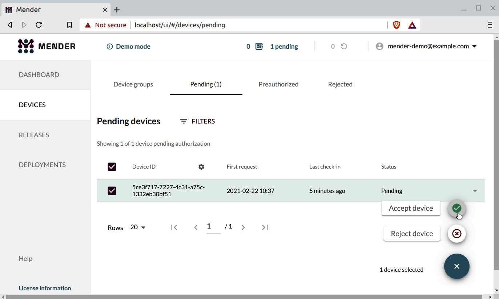

   *Hình 10.4 – Chấp nhận thiết bị*

10. Sau đó click vào mục của thiết bị để xem chi tiết.

Giờ chúng ta có thể một lần nữa tạo một bản cập nhật và triển khai nó – lần này là OTA:

1. Cập nhật dòng sau trong `conf/local.conf` như được thể hiện:

   ```
   MENDER_ARTIFACT_NAME = "OTA-update1"
   ```

2. Build image lần nữa:

   ```
   $ bitbake core-image-full-cmdline
   ```

   Việc này sẽ tạo ra một file `core-image-full-cmdline-vexpress-qemu-grub.mender` mới trong `tmp/deploy/images/vexpress-qemu`.

3. Import file này vào web interface bằng cách mở tab **Releases** và click vào nút **Upload** màu tím ở góc lower-left.

4. Duyệt tìm file `core-image-full-cmdline-vexpress-qemu-grub.mender` trong `tmp/deploy/images/vexpress-qemu` và upload nó:

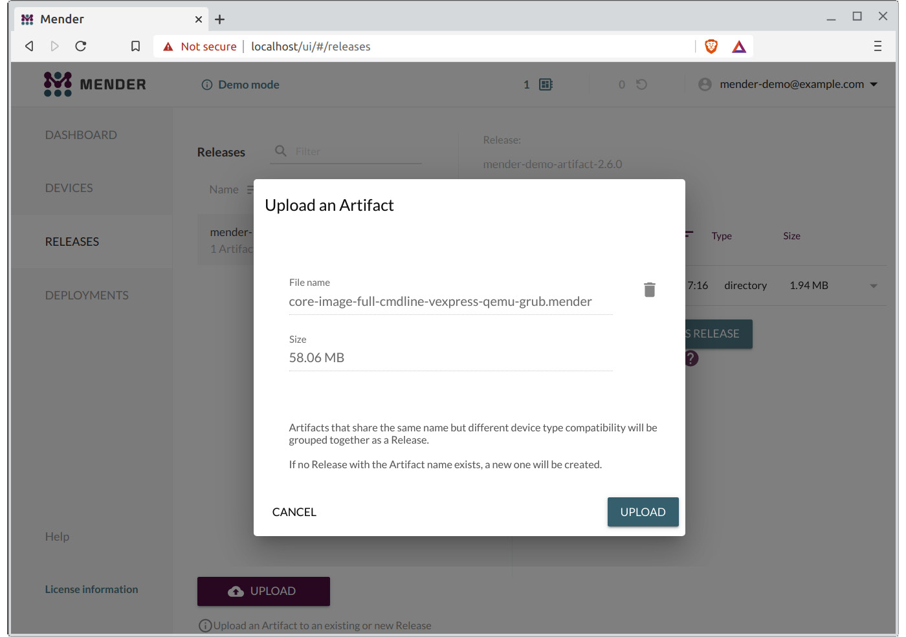

*Hình 10.5 – Upload một Artifact*

Mender server sẽ sao chép file vào data store của server, và một artifact mới tên **OTA-update1** sẽ xuất hiện dưới **Releases**.

Để triển khai bản cập nhật tới thiết bị QEMU của chúng ta, hãy làm như sau:

1. Click vào tab **Devices** và chọn thiết bị.

2. Click vào tùy chọn **Create a Deployment for this Device** ở góc dưới bên phải của thông tin thiết bị.

3. Chọn artifact **OTA-update1** từ trang **Releases** và click vào nút **Create Deployment with this Release**:

   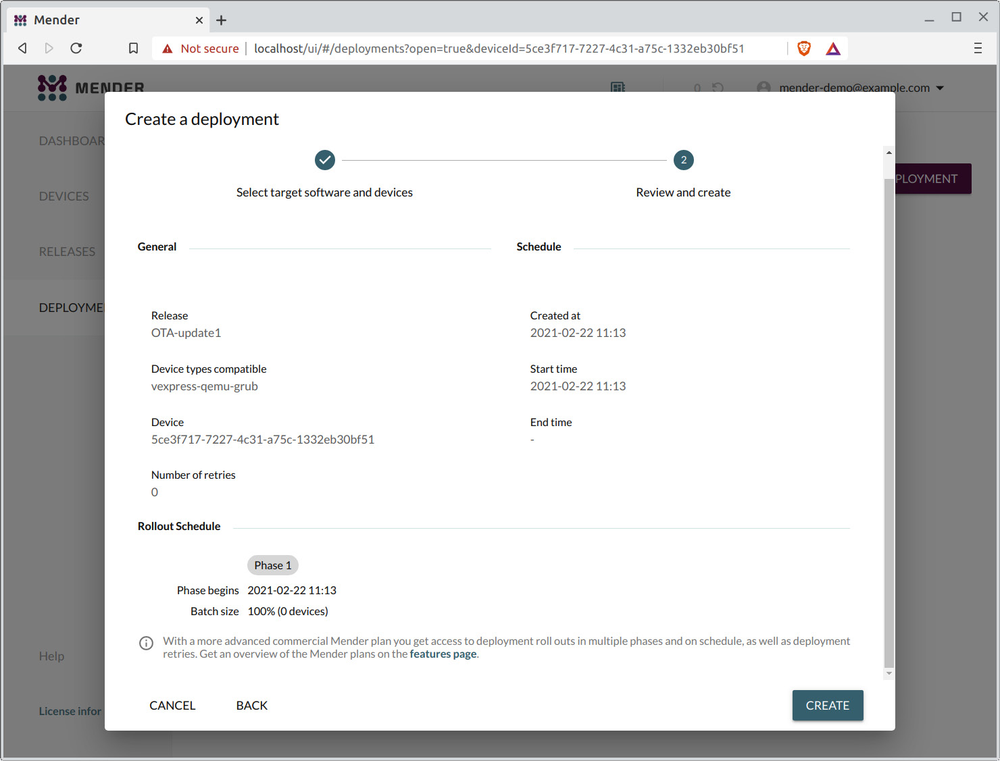

   *Hình 10.6 – Tạo một deployment*

4. Click vào nút **Next** trong bước **Select target software and devices** của **Create a deployment**.

5. Click vào nút **Create** trong bước **Review and create** của **Create a deployment** để bắt đầu deployment.

6. Deployment sẽ nhanh chóng chuyển từ **Pending** sang **In progress**:

   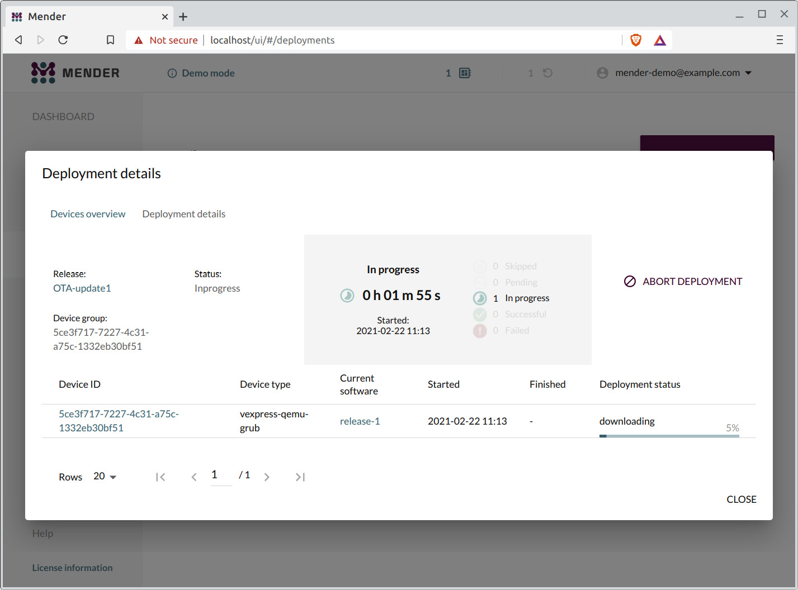

   *Hình 10.7 – Đang tiến hành*

7. Sau khoảng 13 phút, Mender client sẽ đã ghi bản cập nhật vào filesystem image dự phòng, rồi QEMU sẽ reboot và commit bản cập nhật. Web UI sau đó sẽ báo **Finished**, và giờ client đang chạy **OTA-update1**:

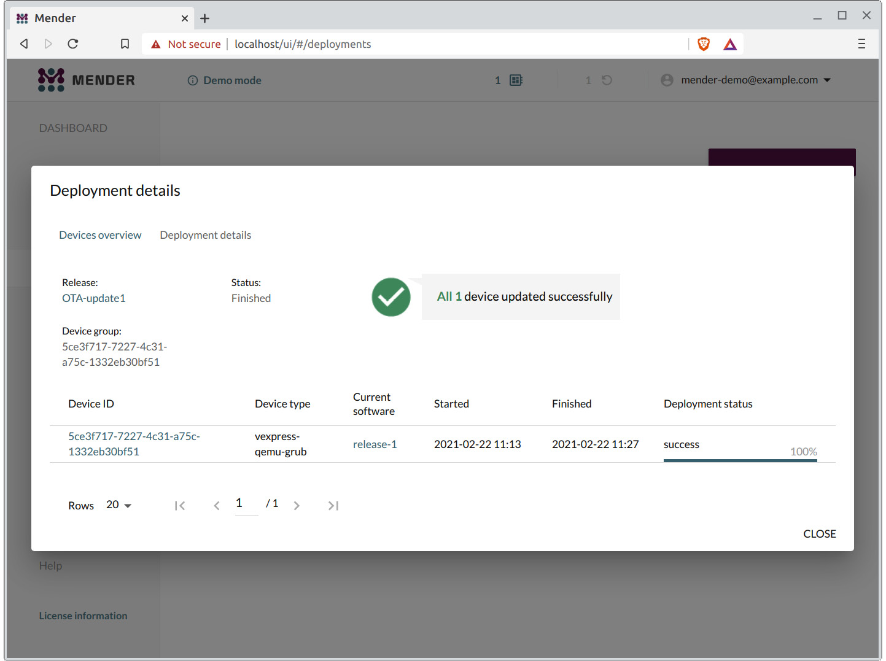

*Hình 10.8 – Thiết bị được cập nhật thành công*

Mender gọn gàng và được dùng trong nhiều sản phẩm thương mại, nhưng đôi khi chúng ta chỉ muốn triển khai một project phần mềm tới một nhóm nhỏ dev board phổ biến càng nhanh càng tốt.

> **Mẹo**
>
> Sau vài lần thử nghiệm với Mender server, bạn có thể muốn xóa trạng thái và bắt đầu lại từ đầu. Bạn có thể làm điều đó bằng hai lệnh này, nhập trong thư mục `integration2.5.1/`:
>
> `./demo down`
>
> `./demo up`

Phát triển application nhanh là lĩnh vực mà **balena** tỏa sáng. Chúng ta sẽ dành phần còn lại của chương này dùng balena để triển khai một application Python đơn giản tới một Raspberry Pi 4.

## Dùng balena cho cập nhật cục bộ

Balena dùng Docker container để triển khai các bản cập nhật phần mềm. Các thiết bị chạy balenaOS, một bản phân phối Linux Yocto-based đi kèm balenaEngine, container engine Docker-compatible của balena. Cập nhật OTA diễn ra tự động thông qua các release được đẩy từ balenaCloud, một dịch vụ hosted để quản lý các nhóm thiết bị. Balena cũng có thể hoạt động ở *chế độ local* để các bản cập nhật bắt nguồn từ một server chạy trên máy host cục bộ thay vì cloud. Chúng ta sẽ giữ chế độ local cho các bài tập sau.

Balena được viết và hỗ trợ bởi balena.io ([https://balena.io](https://balena.io)). Có nhiều thông tin hơn về phần mềm trong mục *Reference* của *Docs* trực tuyến tại [balena.io](http://balena.io). Chúng ta sẽ không đào sâu vào cách balena hoạt động vì mục tiêu của chúng ta là triển khai và tự động cập nhật phần mềm trên một nhóm nhỏ thiết bị để phát triển nhanh.

Balena cung cấp các balenaOS image dựng sẵn cho các dev board phổ biến như Raspberry Pi 4 và BeagleBone Black. Tải các image này cần một tài khoản balenaCloud.

### Tạo tài khoản

Việc đầu tiên bạn cần làm ngay cả khi chỉ định hoạt động ở chế độ local là đăng ký một tài khoản balenaCloud. Bạn làm điều này bằng cách truy cập [https://dashboard.balena-cloud.com/signup](https://dashboard.balena-cloud.com/signup) và nhập địa chỉ email và mật khẩu, như được thể hiện:

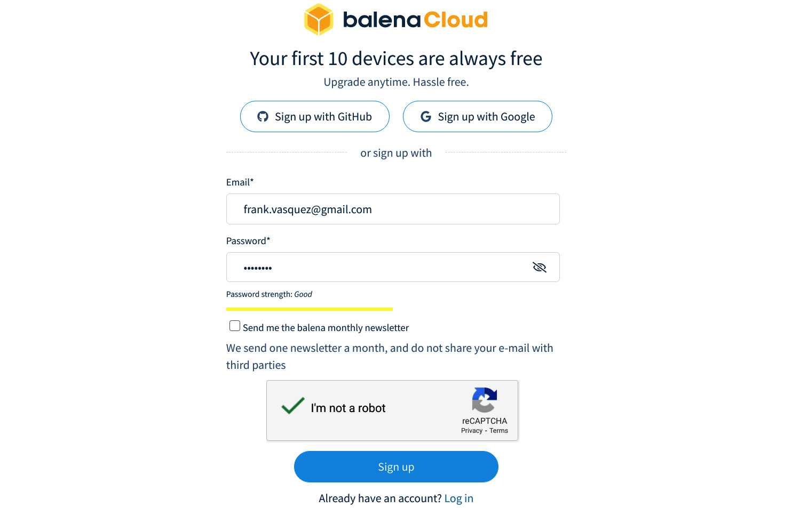

*Hình 10.9 – Đăng ký balenaCloud*

Click nút **Sign up** để gửi form và khi xử lý xong, bạn sẽ được nhắc nhập thông tin profile. Bạn có thể chọn bỏ qua form này, khi đó bạn sẽ vào dashboard balenaCloud dưới tài khoản mới của mình.

Nếu bạn đăng xuất hoặc phiên làm việc hết hạn, bạn có thể đăng nhập lại vào dashboard bằng cách điều hướng tới [https://dashboard.balena-cloud.com/login](https://dashboard.balena-cloud.com/login) và nhập địa chỉ email và mật khẩu bạn đã đăng ký.

### Tạo application

Trước khi có thể thêm một Raspberry Pi 4 vào tài khoản balenaCloud, trước hết chúng ta cần tạo một application.

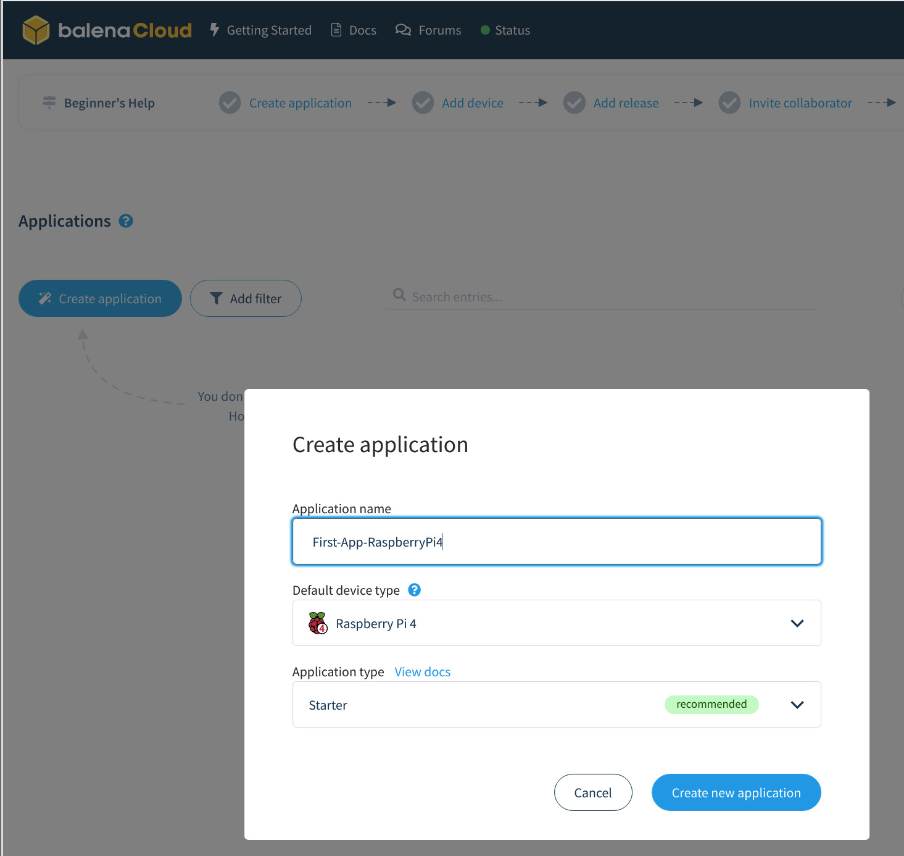

*Hình 10.10 – Tạo application*

Đây là các bước để tạo một application cho Raspberry Pi 4 trên balenaCloud:

1. Đăng nhập vào dashboard balenaCloud bằng địa chỉ email và mật khẩu của bạn.
2. Click vào nút **Create application** ở góc upper-left, dưới **Applications**, để mở hộp thoại **Create application**.
3. Nhập tên cho application mới và chọn **Raspberry Pi 4** cho **Default device type**.
4. Click vào nút **Create new application** trong hộp thoại **Create application** để gửi form.

**Application type** mặc định là **Starter**, phù hợp cho các bài tập này. Application mới của bạn sẽ xuất hiện trong dashboard balenaCloud dưới **Applications**.

### Thêm thiết bị

Giờ chúng ta đã có một application trên balenaCloud, hãy thêm một Raspberry Pi 4 vào nó:

1. Đăng nhập vào dashboard balenaCloud bằng địa chỉ email và mật khẩu của bạn.

2. Click vào application mới chúng ta đã tạo.

3. Click vào nút **Add device** từ trang **Devices**:

   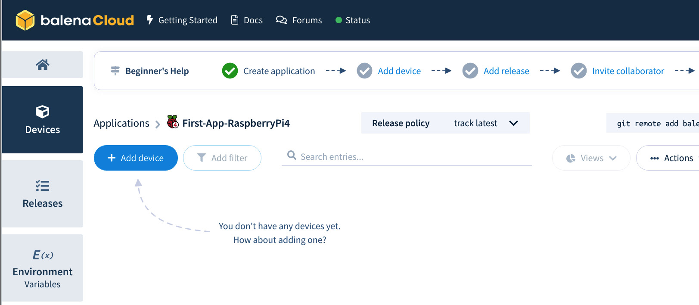

   *Hình 10.11 – Thêm thiết bị*

4. Click vào nút sẽ mở hộp thoại **Add new device**.

5. Bảo đảm **Raspberry Pi 4** là loại thiết bị được chọn. Tùy chọn đó lẽ ra đã được chọn sẵn vì bạn đã tạo application với **Raspberry Pi 4** làm **Default device type**.

6. Bảo đảm **balenaOS** là OS được chọn.

7. Bảo đảm phiên bản balenaOS được chọn là mới nhất. Tùy chọn đó lẽ ra đã được chọn sẵn vì **Add new device** mặc định chọn phiên bản balenaOS mới nhất có sẵn, phiên bản mà nó đánh dấu là **recommended**.

8. Chọn **Development** làm edition của balenaOS. Cần một development image để enable chế độ local nhằm test và xử lý sự cố tốt hơn.

9. Chọn **Wifi + Ethernet** cho **Network Connection**. Bạn có thể chọn **Ethernet only** nhưng auto-connecting tới Wi-Fi là một tính năng rất tiện lợi.

10. Nhập SSID và passphrase của router Wi-Fi vào các trường tương ứng. Thay `RT-AC66U_B1_38_2G` trong ảnh chụp màn hình sau bằng SSID của router Wi-Fi của bạn:

    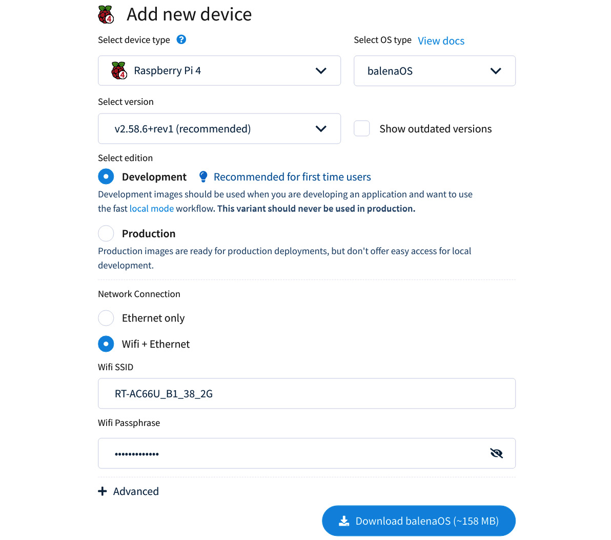

    *Hình 10.12 – Thêm thiết bị mới*

11. Click nút **Download balenaOS**.

12. Lưu file image đã nén vào máy host.

Giờ chúng ta có một microSD card image có thể dùng để provision bất kỳ số lượng Raspberry Pi 4 nào cho nhóm thiết bị test của application.

Các bước provision một Raspberry Pi 4 từ máy host giờ hẳn đã quen thuộc với bạn. Tìm file balenaOS `img.zip` bạn đã tải về từ balenaCloud và dùng Etcher để ghi nó vào thẻ microSD. Cắm thẻ microSD vào Raspberry Pi 4 và cấp điện cho nó qua cổng USB-C.

Sẽ mất một hai phút để Raspberry Pi 4 xuất hiện trên trang **Devices** của dashboard balenaCloud:

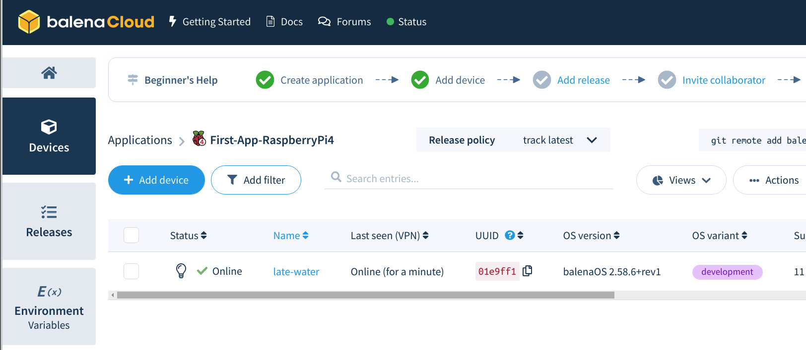

*Hình 10.13 – Devices*

Giờ chúng ta đã kết nối một Raspberry Pi 4 với một application balena, chúng ta cần enable chế độ local để có thể triển khai cập nhật OTA tới nó từ một máy host gần đó thay vì cloud:

1. Click vào Raspberry Pi 4 target từ trang **Devices** của dashboard balenaCloud. Thiết bị của tôi tên **late-water**. Thiết bị của bạn sẽ có tên khác.
2. Click vào mũi tên xuống cạnh bóng đèn trên dashboard thiết bị cho Raspberry Pi 4 của bạn.
3. Chọn **Enable local mode** từ menu drop-down:

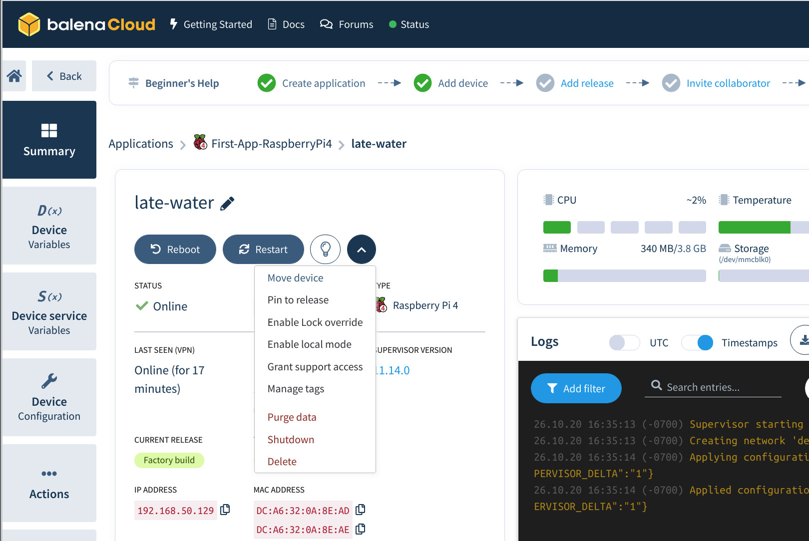

*Hình 10.14 – Enable local mode*

Khi chế độ local đã được enable, các panel **Logs** và **Terminal** không còn có sẵn trong dashboard thiết bị. Trạng thái của thiết bị đổi từ **Online (for N minutes)** thành **Online (local mode)**.

Với chế độ local giờ đã được enable trên thiết bị target, chúng ta gần như sẵn sàng triển khai code tới nó. Trước khi làm được điều đó, chúng ta cần cài balena CLI.

### Cài CLI

Đây là hướng dẫn cài balena CLI trên một máy host Linux:

1. Mở một trình duyệt web và điều hướng tới trang release mới nhất của balena CLI tại [https://github.com/balena-io/balena-cli/releases/latest](https://github.com/balena-io/balena-cli/releases/latest).

2. Click vào file ZIP mới nhất cho Linux để tải về. Tìm tên file có dạng `balena-cli-vX.Y.Z-linux-x64-standalone.zip`, thay các số phiên bản major, minor và patch vào `X`, `Y` và `Z`.

3. Giải nén nội dung file zip vào thư mục home của bạn:

   ```
   $ cd ~
   $ unzip Downloads/balena-cli-v12.25.4-linux-x64-standalone.zip
   ```

   Nội dung được giải nén nằm trong thư mục `balena-cli`.

4. Thêm thư mục `balena-cli` vào biến môi trường `PATH`:

   ```
   $ export PATH=$PATH:~/balena-cli
   ```

   Thêm một dòng như thế này vào file `.bashrc` trong thư mục home nếu bạn muốn các thay đổi này đối với biến `PATH` được giữ lại.

5. Kiểm tra việc cài đặt đã thành công:

   ```
   $ balena version
   12.25.4
   ```

   Phiên bản mới nhất của balena CLI tại thời điểm viết sách là 12.25.4.

Giờ chúng ta đã có một balena CLI hoạt động, hãy quét mạng cục bộ để tìm Raspberry Pi 4 chúng ta đã provision:

```
$ sudo env "PATH=$PATH" balena scan
Reporting scan results
-
  host:          01e9ff1.local
  address:       192.168.50.129
  dockerInfo:
    Containers:        1
    ContainersRunning: 1
    ContainersPaused:  0
    ContainersStopped: 0
    Images:            2
    Driver:            overlay2
    SystemTime:        2020-10-26T23:44:44.37360414Z
    KernelVersion:     5.4.58
    OperatingSystem:   balenaOS 2.58.6+rev1
    Architecture:      aarch64
  dockerVersion:
    Version:    19.03.13-dev
    ApiVersion: 1.40
```

Hãy để ý hostname `01e9ff1.local` và địa chỉ IP `192.168.50.129` trong output quét. Hostname và địa chỉ IP của Raspberry Pi 4 của bạn sẽ khác. Hãy ghi lại hai thông tin này vì chúng ta sẽ cần chúng cho các bài tập còn lại.

### Push một project

Hãy push một project Python tới Raspberry Pi qua mạng cục bộ:

1. Clone một project cho một web server Python "Hello World!" đơn giản:

   ```
   $ git clone https://github.com/balena-io-examples/balena-python-hello-world.git
   ```

2. Điều hướng vào thư mục project:

   ```
   $ cd balena-python-hello-world
   ```

3. Push code tới Raspberry Pi 4 của bạn:

   ```
   $ balena push 01e9ff1.local
   ```

   Thay đối số `01e9ff1.local` bằng hostname của thiết bị của bạn.

4. Đợi Docker image build và khởi động xong và để application chạy ở foreground để nó ghi log ra `stdout`.

5. Gửi một request tới web server tại [https://192.168.50.129](https://192.168.50.129) từ một trình duyệt web. Thay `192.168.50.129` bằng địa chỉ IP của thiết bị của bạn.

Web server chạy trên Raspberry Pi 4 sẽ phản hồi bằng "Hello World!" và một dòng như sau sẽ xuất hiện trong live output từ `balena push`:

```
[Logs]    [10/26/2020, 5:26:35 PM] [main] 192.168.50.146 - - [27/Oct/2020 00:26:35] "GET / HTTP/1.1" 200 -
```

Địa chỉ IP trong mục log sẽ là địa chỉ của máy mà từ đó bạn gửi web request. Một mục log mới sẽ xuất hiện mỗi khi bạn refresh trang web. Để ngừng theo dõi log và quay lại shell, nhập *Ctrl* + *C*. Container sẽ tiếp tục chạy trên thiết bị target và web server "Hello World!" sẽ tiếp tục phục vụ request.

Chúng ta có thể bắt đầu lại việc theo dõi log bất cứ lúc nào bằng lệnh sau:

```
$ balena logs 01e9ff1.local
```

Thay đối số `01e9ff1.local` bằng hostname của thiết bị của bạn.

Source code của web server đơn giản này có thể được tìm thấy trong một file tên `main.py` trong thư mục project:

```
tree
.
├── Dockerfile.template
├── img
│   ├── enable-public-URLs.png
│   └── log-output.png
├── README.md
├── requirements.txt
└── src
    └── main.py
```

Giờ hãy sửa nhẹ source code project và triển khai lại:

1. Mở `src/main.py` trong editor yêu thích của bạn.

2. Thay `'Hello World!'` bằng `'Hello from Pi 4!'` và lưu thay đổi. Output `git diff` sau ghi lại các thay đổi:

   ```
   $ git diff
   diff --git a/src/main.py b/src/main.py
   index 940b2df..26321a1 100644
   --- a/src/main.py
   +++ b/src/main.py
   @@ -3,7 +3,7 @@ app = Flask(__name__)

    @app.route('/')
    def hello_world():
   -    return 'Hello World!'
   +    return 'Hello from Pi 4!'

    if __name__ == '__main__':
        app.run(host='0.0.0.0', port=80)
   ```

3. Push code mới tới Raspberry Pi 4 của bạn:

   ```
   $ balena push 01e9ff1.local
   ```

   Thay đối số `01e9ff1.local` bằng hostname của thiết bị của bạn.

4. Đợi Docker image cập nhật. Lần này quá trình sẽ nhanh hơn nhiều nhờ một tính năng caching thông minh gọi là **Livepush** chỉ có ở chế độ local.

5. Gửi một request tới web server tại [https://192.168.50.129](https://192.168.50.129) từ một trình duyệt web. Thay `192.168.50.129` bằng địa chỉ IP của thiết bị của bạn.

Web server chạy trên Raspberry Pi 4 sẽ phản hồi bằng "Hello from Pi 4!"

Chúng ta có thể SSH vào một thiết bị target cục bộ bằng địa chỉ IP:

```
$ balena ssh 192.168.50.129
Last login: Tue Oct 27 00:32:04 2020 from 192.168.50.146
root@01e9ff1:~#
```

Thay `192.168.50.129` bằng địa chỉ IP của thiết bị của bạn. Điều này không đặc biệt hữu ích vì application đang chạy bên trong một Docker container.

Để SSH vào container nơi web server Python đang chạy và quan sát nó đang làm gì, chúng ta cần đưa tên service vào lệnh `balena ssh`:

```
$ balena ssh 192.168.50.129 main
root@01e9ff1:/usr/src/app# ls
Dockerfile  Dockerfile.template  README.md  requirements.txt  src
root@01e9ff1:/usr/src/app# ps -ef
UID        PID  PPID  C STIME TTY          TIME CMD
root         1     0  0 00:26 pts/0    00:00:01 /usr/local/bin/python -u src/main.py
root        30     1  0 00:26 ?        00:00:00 /lib/systemd/systemd-udevd --daemon
root        80     0  2 00:48 pts/1    00:00:00 /bin/bash
root        88    80  0 00:48 pts/1    00:00:00 ps -ef
#
```

Tên service cho starter application này là `main` như thấy trong output live log.

Xin chúc mừng! Bạn đã tạo thành công một balenaOS image và môi trường phát triển trên host mà bạn và nhóm của mình có thể dùng để lặp lại trên code project và nhanh chóng triển khai lại tới một thiết bị target. Đây không phải là kỳ công nhỏ. Push các thay đổi code dưới dạng một Docker container là một workflow phát triển phổ biến mà các kỹ sư full-stack rất quen thuộc. Với balena, giờ họ có thể dùng các kỹ thuật quen thuộc để phát triển application embedded Linux trên phần cứng thật.

## Tóm tắt

Có khả năng cập nhật phần mềm trên các thiết bị ngoài thực địa tối thiểu cũng là một thuộc tính hữu ích, và nếu thiết bị được kết nối internet, nó trở thành điều bắt buộc tuyệt đối. Tuy vậy, quá thường xuyên nó lại là một tính năng bị để tới phần cuối của project, với giả định rằng đó không phải là một vấn đề khó giải quyết. Trong chương này, tôi hy vọng đã minh họa được các vấn đề gắn liền với việc thiết kế một cơ chế cập nhật hiệu quả và bền vững, và cũng cho thấy có vài lựa chọn open source sẵn có. Bạn không phải phát minh lại bánh xe nữa.

Cách tiếp cận được dùng thường xuyên nhất, và cũng là cách được test real-world nhiều nhất, là symmetric image (A/B) update, hoặc người anh em của nó, asymmetric (recovery) image update. Ở đây, bạn có lựa chọn SWUpdate, RAUC, Mender và fwup. Một cải tiến gần đây hơn là atomic file update, dưới dạng OSTree. Cách này có các đặc tính tốt trong việc giảm lượng dữ liệu cần tải về và lượng lưu trữ dự phòng cần lắp trên target. Cuối cùng, cùng với sự phổ biến của Docker là mong muốn có các bản cập nhật phần mềm được container hóa. Đây là cách tiếp cận balena chọn.

Khá phổ biến khi triển khai cập nhật ở quy mô nhỏ bằng cách đến từng địa điểm và áp dụng bản cập nhật từ một USB memory stick hay thẻ SD. Nhưng, nếu bạn muốn triển khai tới các địa điểm xa, hoặc triển khai ở quy mô lớn, sẽ cần một lựa chọn cập nhật **over-the-air** (**OTA**).

Chương tiếp theo mô tả cách bạn điều khiển các thành phần phần cứng của hệ thống thông qua việc dùng device driver, cả theo nghĩa thông thường là các driver thuộc kernel, lẫn mức độ mà bạn có thể điều khiển phần cứng từ user space.
