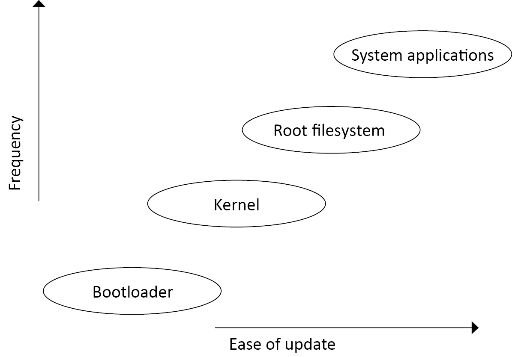
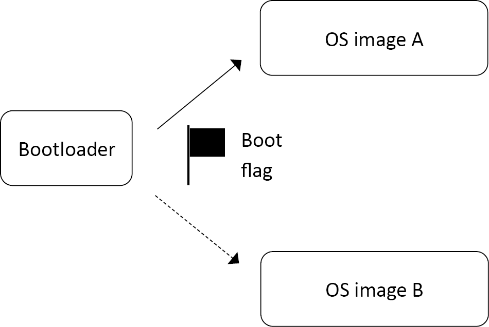
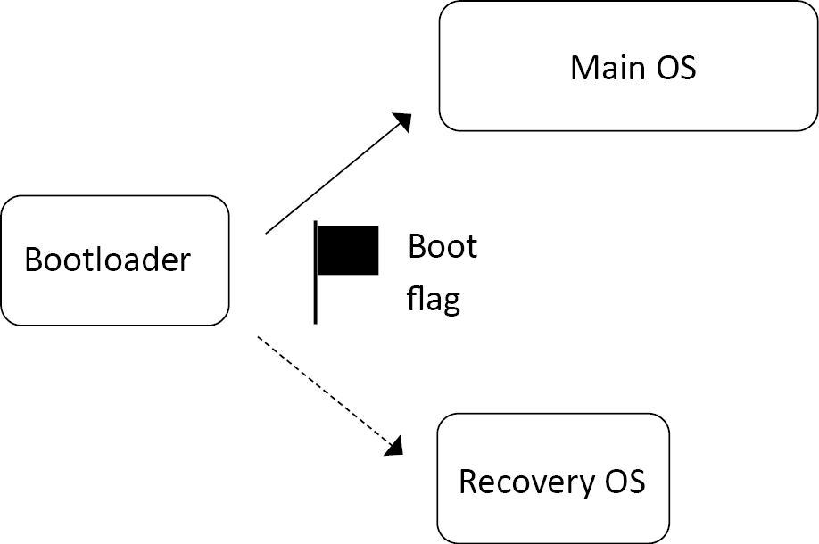
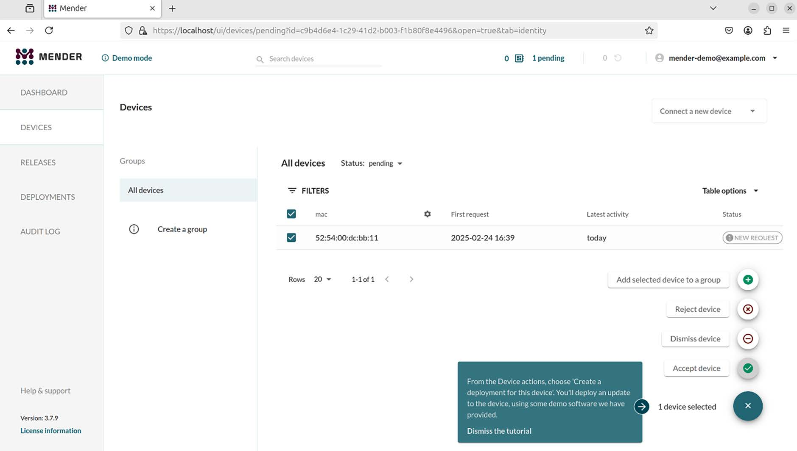
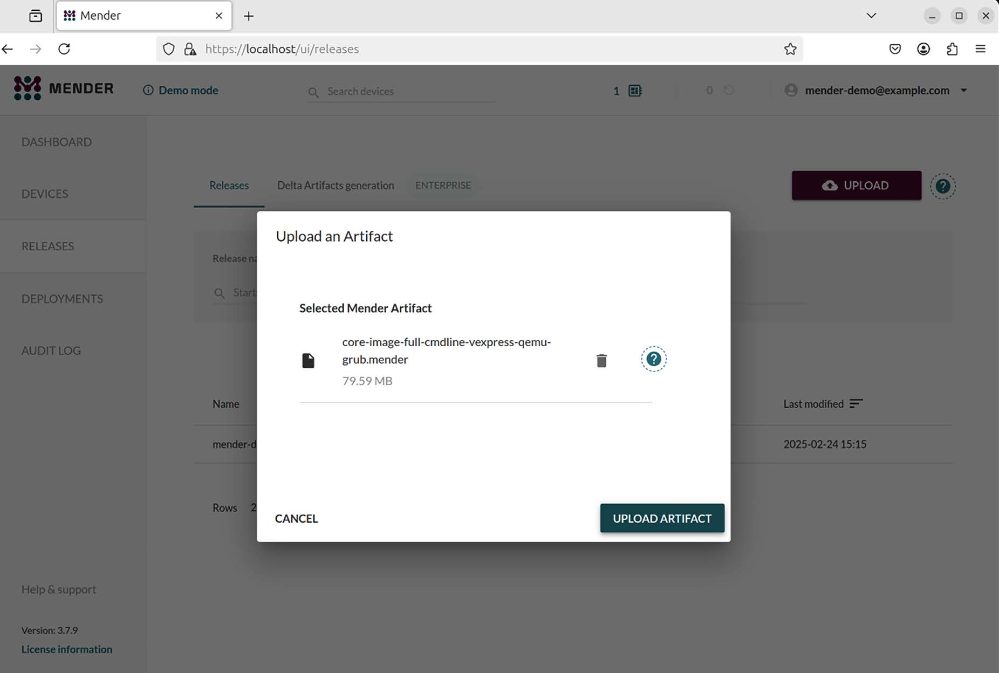
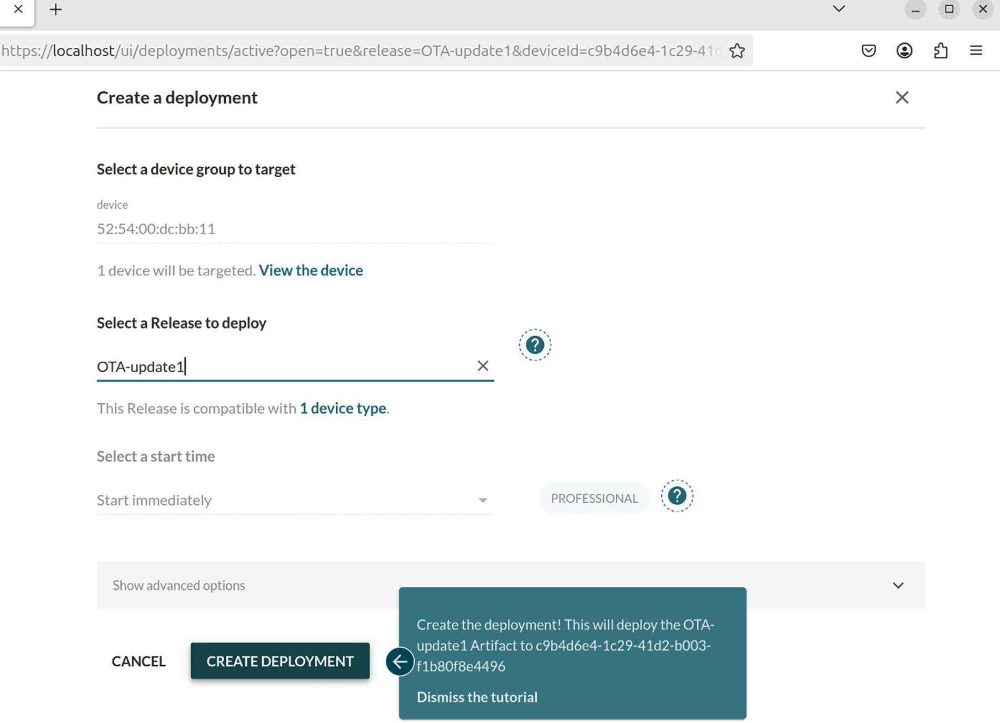
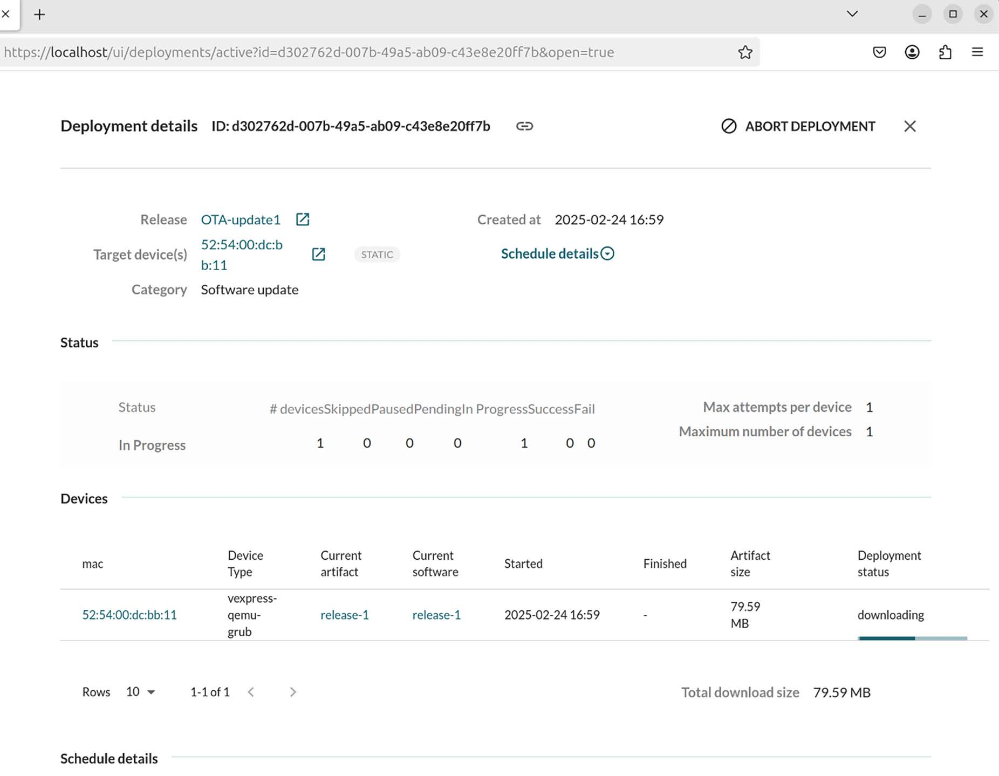

# Chương 10: Cập nhật phần mềm ngoài thực địa (Updating Software in the Field)

Trong các chương trước, chúng ta đã bàn về nhiều cách build phần mềm cho một thiết bị Linux và cách tạo system image cho nhiều loại bộ lưu trữ dung lượng lớn. Khi đi vào sản xuất, bạn chỉ cần copy system image vào bộ nhớ flash và nó đã sẵn sàng để triển khai. Giờ tôi muốn xem xét vòng đời của thiết bị sau lần xuất xưởng đầu tiên.

Khi bước vào kỷ nguyên Internet of Things, các thiết bị chúng ta tạo ra rất có khả năng được kết nối internet. Đồng thời, phần mềm đang trở nên phức tạp hơn theo cấp số nhân. Nhiều phần mềm hơn nghĩa là nhiều bug hơn. Kết nối internet nghĩa là các bug đó có thể bị khai thác từ xa. Do đó, chúng ta có một yêu cầu chung là phải có khả năng cập nhật phần mềm ngoài thực địa. Khi nói “ngoài thực địa,” chúng ta muốn nói “bên ngoài nhà máy.” Cập nhật phần mềm mang lại nhiều lợi ích hơn là sửa bug. Chúng mở ra cánh cửa gia tăng giá trị cho phần cứng hiện có bằng cách bật các tính năng mới và cải thiện hiệu năng hệ thống theo thời gian.

Trong chương này, chúng ta sẽ đề cập các chủ đề sau:

- Các bản cập nhật đến từ đâu?

- Cập nhật những gì

- Cơ bản về cập nhật phần mềm

- Các loại cơ chế cập nhật

- Cập nhật OTA

- Dùng Mender cho cập nhật cục bộ

- Dùng Mender cho cập nhật OTA

## Yêu cầu kỹ thuật

Để làm theo các ví dụ, hãy bảo đảm bạn có những thứ sau:

- Một hệ thống host Ubuntu 24.04 hoặc bản LTS mới hơn với ít nhất 90 GB dung lượng đĩa trống

- Bản phát hành LTS Yocto 5.0 (scarthgap)

Bạn đã build bản phát hành LTS 5.0 (scarthgap) của Yocto trong Chương 6. Nếu chưa, hãy tham khảo các mục Compatible Linux Distributions và Build Host Packages của Yocto Project Quick Build guide (`https://docs.yoctoproject.org/brief-yoctoprojectqs/)` trước khi build Yocto trên host Linux theo các hướng dẫn trong Chương 6.

Code dùng trong chương này có trong thư mục của chương trong GitHub repository của cuốn sách: `https://github.com/PacktPublishing/Mastering-Embedded-Linux-Development/tree/main/Chapter10`.

## Các bản cập nhật đến từ đâu?

Có nhiều cách tiếp cận cập nhật phần mềm. Nhìn chung, tôi phân loại chúng như sau:

- Cập nhật cục bộ: Được thực hiện bởi một kỹ thuật viên mang bản cập nhật trên một phương tiện di động như ổ flash USB hoặc thẻ SD và phải truy cập từng hệ thống riêng lẻ.

- Cập nhật từ xa: Được khởi động bởi người dùng hoặc kỹ thuật viên tại chỗ, nhưng được tải về từ một server từ xa.

- Cập nhật Over-the-air (OTA): Được đẩy và quản lý hoàn toàn từ xa mà không cần bất kỳ thao tác tại chỗ nào.

Tôi sẽ bắt đầu bằng việc mô tả một số cách tiếp cận cập nhật phần mềm, sau đó tôi sẽ đưa ra một ví dụ dùng Mender.

## Cập nhật những gì

Các thiết bị embedded Linux rất đa dạng về thiết kế và triển khai. Tuy nhiên, tất cả chúng đều có các thành phần cơ bản sau:

- Bootloader

- Kernel

- Root filesystem

- Ứng dụng hệ thống

- Dữ liệu Device-specific

Một số thành phần khó cập nhật hơn các thành phần khác, như được tóm tắt trong sơ đồ này:



Hình 10.1 – Các thành phần của một bản cập nhật

Hãy lần lượt xem từng thành phần.

### Bootloader

Bootloader là đoạn code đầu tiên chạy khi bộ xử lý được cấp nguồn. Cách bộ xử lý tìm bootloader rất device-specific, nhưng trong hầu hết các trường hợp, chỉ có một vị trí như vậy, vì vậy chỉ có thể có một bootloader. Nếu không có bản dự phòng, việc cập nhật bootloader là rủi ro: điều gì xảy ra nếu hệ thống mất điện giữa chừng? Do đó, hầu hết các giải pháp cập nhật để yên bootloader. Đây không phải là vấn đề lớn, vì bootloader chỉ chạy trong thời gian ngắn lúc power-on và thường không phải là nguồn bug runtime lớn.

### Kernel

Linux kernel là một thành phần quan trọng chắc chắn sẽ cần được cập nhật thỉnh thoảng.

Kernel có nhiều phần:

- Một binary image được bootloader nạp, thường được lưu trong root filesystem.

- Nhiều thiết bị cũng có một device tree binary (DTB) mô tả phần cứng cho kernel, và vì vậy phải được cập nhật song song. DTB thường được lưu cùng kernel binary.

- Có thể có các kernel module trong root filesystem.

Kernel và DTB có thể được lưu trong root filesystem nếu bootloader đọc được định dạng filesystem, hoặc có thể nằm trong một phân vùng riêng. Trong cả hai trường hợp, có các bản sao dự phòng là khả thi và an toàn hơn.

### Root filesystem

Root filesystem chứa các thư viện hệ thống, tiện ích và script thiết yếu cần để hệ thống hoạt động. Rất mong muốn có thể thay thế và nâng cấp tất cả những thứ này. Cơ chế phụ thuộc vào bản triển khai filesystem.

Các định dạng phổ biến cho root filesystem nhúng như sau:

- RAM disk: Được nạp từ bộ nhớ flash thô hoặc một disk image lúc boot. Để cập nhật nó, chỉ cần ghi đè RAM disk image và reboot.

- Filesystem nén Read-only (squashfs): Được lưu trong một phân vùng flash. Vì các filesystem này không có chức năng ghi, cách duy nhất để cập nhật chúng là ghi toàn bộ một filesystem image vào phân vùng.

- Các loại filesystem thông thường: Định dạng JFFS2 và UBIFS phổ biến cho bộ nhớ flash thô. Với bộ nhớ managed flash như eMMC và thẻ SD, định dạng nhiều khả năng là ext4 hoặc F2FS. Vì chúng ghi được lúc runtime, có thể cập nhật chúng từng file một.

### Ứng dụng hệ thống

Các ứng dụng hệ thống là phần tải chính của thiết bị; chúng triển khai chức năng chính của nó. Vì vậy, chúng có khả năng được cập nhật thường xuyên để sửa bug và thêm tính năng. Chúng có thể được đóng gói cùng root filesystem, nhưng cũng phổ biến là chúng được đặt trong một filesystem riêng để việc cập nhật dễ hơn và để giữ sự tách biệt giữa các file hệ thống, thường là open source, và các file ứng dụng, thường là độc quyền.

### Dữ liệu Device-specific

Đây là tập hợp các file bị sửa đổi lúc runtime. Dữ liệu Device-specific bao gồm thiết lập cấu hình, log, dữ liệu user-supplied và các file tương tự. Chúng không thường cần được cập nhật, nhưng chúng cần được giữ lại trong quá trình cập nhật. Dữ liệu như vậy cần được lưu trong một phân vùng riêng.

### Các thành phần cần được cập nhật

Tóm lại, một bản cập nhật có thể bao gồm các phiên bản mới của kernel, root filesystem và ứng dụng hệ thống. Thiết bị sẽ có các phân vùng khác không nên bị bản cập nhật động tới, như trường hợp dữ liệu runtime của thiết bị.

Cái giá của việc cập nhật phần mềm thất bại có thể là thảm khốc. Cập nhật phần mềm an toàn cũng là một mối quan tâm lớn trong cả môi trường internet doanh nghiệp lẫn gia đình. Trước khi có thể xuất xưởng bất kỳ phần cứng nào, chúng ta cần có khả năng cập nhật phần mềm một cách tự tin.

## Cơ bản về cập nhật phần mềm

Cập nhật phần mềm thoạt nhìn có vẻ là một task đơn giản: bạn chỉ cần ghi đè một số file bằng các bản sao mới. Nhưng rồi sự rèn luyện kỹ sư trong bạn trỗi dậy khi bạn bắt đầu nhận ra tất cả những điều có thể sai. Điều gì xảy ra nếu mất điện trong quá trình cập nhật? Điều gì xảy ra nếu một bug bị bỏ sót khi kiểm thử bản cập nhật khiến một tỷ lệ thiết bị không boot được? Điều gì xảy ra nếu một bên thứ ba gửi một bản cập nhật giả biến thiết bị của bạn thành một phần của botnet? Ít nhất, cơ chế cập nhật phần mềm phải:

- Bền vững để một bản cập nhật không làm thiết bị không dùng được.

- Fail-safe để có một chế độ dự phòng nếu mọi thứ khác đều thất bại.

- An toàn để ngăn thiết bị bị chiếm quyền bởi những người cài đặt các bản cập nhật trái phép.

Nói cách khác, chúng ta cần một hệ thống không bị ảnh hưởng bởi định luật Murphy. Định luật Murphy nói rằng nếu một điều gì đó có thể sai, thì rốt cuộc nó sẽ sai. Một số vấn đề này là non-trivial. Triển khai phần mềm lên một thiết bị ngoài thực địa khác với triển khai phần mềm lên cloud. Các hệ thống embedded Linux cần phát hiện và phản ứng với các sự cố như kernel panic hay boot loop mà không cần bất kỳ sự can thiệp nào của con người.

### Làm cho cập nhật bền vững

Có thể bạn nghĩ rằng vấn đề cập nhật hệ thống Linux đã được giải quyết từ lâu − tất cả chúng ta đều có Linux desktop mà chúng ta cập nhật thường xuyên (đúng không?). Ngoài ra, có vô số Linux server chạy trong các trung tâm dữ liệu cũng được cập nhật tương tự. Tuy nhiên, có một khác biệt giữa server và thiết bị. Server hoạt động trong một môi trường được bảo vệ. Nó hiếm khi bị mất điện đột ngột hoặc mất kết nối mạng. Trong trường hợp hiếm hoi một bản cập nhật thất bại, luôn có thể truy cập server và dùng các cơ chế bên ngoài để lặp lại việc cài đặt.

Mặt khác, các thiết bị thường được triển khai ở những địa điểm xa với nguồn điện chập chờn và kết nối mạng kém, khiến khả năng một bản cập nhật bị gián đoạn cao hơn nhiều. Vì vậy, hãy cân nhắc rằng việc tiếp cận một thiết bị để khắc phục một bản cập nhật thất bại có thể rất tốn kém. Chẳng hạn, nếu thiết bị là một trạm quan trắc môi trường trên đỉnh núi hoặc điều khiển van của một giếng dầu dưới đáy biển thì sao? Do đó, việc các thiết bị nhúng có một cơ chế cập nhật bền vững, không khiến hệ thống trở nên không dùng được, quan trọng hơn nhiều.

Từ khóa ở đây là tính nguyên tử (atomicity). Để có tính nguyên tử, không được có giai đoạn nào của bản cập nhật mà chỉ một phần hệ thống được cập nhật. Phải có một thay đổi duy nhất, không thể bị gián đoạn đối với hệ thống, chuyển sang phiên bản phần mềm mới.

Điều này loại khỏi danh sách cân nhắc cơ chế cập nhật hiển nhiên nhất: đơn giản là cập nhật từng file bằng cách giải nén một archive đè lên các phần của filesystem. Đơn giản là không có cách nào bảo đảm sẽ có một tập file nhất quán nếu hệ thống bị reset trong quá trình cập nhật. Ngay cả dùng một package manager như `apt`, `dnf` hay `pacman` cũng không giúp được. Nếu xem bên trong tất cả các package manager này, bạn sẽ thấy chúng quả thực hoạt động bằng cách giải nén một archive đè lên filesystem và chạy các script để cấu hình package cả trước lẫn sau khi cập nhật. Package manager ổn cho thế giới được bảo vệ của trung tâm dữ liệu, hay thậm chí desktop của bạn, nhưng không phải cho một thiết bị.

Để đạt tính nguyên tử, bản cập nhật phải được cài đặt song song với hệ thống đang chạy, rồi một công tắc được bật để chuyển từ cũ sang mới. Trong các phần sau, chúng ta sẽ mô tả hai cách tiếp cận khác nhau để đạt tính nguyên tử. Cách thứ nhất là có hai bản sao của root filesystem và các thành phần chính khác. Một bản đang hoạt động, trong khi bản kia có thể nhận cập nhật. Khi cập nhật hoàn tất, công tắc được bật để khi reboot, bootloader chọn bản đã được cập nhật. Cách này được gọi là symmetric image update hay A/B image update. Một biến thể của chủ đề này là dùng một hệ điều hành chế độ recovery đặc biệt chịu trách nhiệm cập nhật hệ điều hành chính. Việc bảo đảm tính nguyên tử được chia sẻ giữa bootloader và hệ điều hành recovery. Cách này được gọi là asymmetric image update. Đó là cách tiếp cận mà Android dùng trước phiên bản Nougat 7.x. Cách thứ hai là có hai hoặc nhiều bản sao của root filesystem trong các thư mục con khác nhau của phân vùng hệ thống, rồi dùng `chroot(8)` lúc boot để chọn một trong số chúng. Khi Linux đã chạy, update client có thể cài đặt cập nhật vào root filesystem kia, rồi khi mọi thứ hoàn tất và đã được kiểm tra, nó có thể bật công tắc và reboot. Cách này được gọi là atomic file update và OSTree là ví dụ tiêu biểu.

### Làm cho cập nhật fail-safe

Vấn đề tiếp theo cần xét là phục hồi từ một bản cập nhật được cài đặt đúng nhưng chứa code khiến hệ thống không boot được. Lý tưởng nhất, chúng ta muốn hệ thống phát hiện trường hợp này và quay lại một image đang hoạt động trước đó.

Có nhiều failure mode có thể dẫn đến một hệ thống non-operational. Trường hợp thứ nhất là kernel panic, thường do một bug trong kernel device driver hoặc do không thể chạy chương trình `init`. Một điểm khởi đầu hợp lý là cấu hình kernel để reboot sau một số giây kể từ khi panic.

Bạn có thể làm điều này khi build kernel bằng cách đặt `CONFIG_PANIC_TIMEOUT` hoặc bằng cách đặt kernel command line thành `panic`. Ví dụ, để reboot 5 giây sau một panic, bạn sẽ thêm `panic=5` vào kernel command line.

Bạn có thể muốn đi xa hơn và cấu hình kernel để `panic` khi có Oops. Hãy nhớ rằng Oops được tạo ra khi kernel gặp một lỗi nghiêm trọng. Trong một số trường hợp, nó sẽ có thể phục hồi từ lỗi, trong các trường hợp khác thì không. Nhưng trong mọi trường hợp, đã có điều gì đó sai và hệ thống không hoạt động như nó nên làm. Để bật panic khi Oops trong cấu hình kernel, hãy đặt `CONFIG_PANIC_ON_OOPS=y` hoặc, trên kernel command line, `oops=panic`.

Failure mode thứ hai xảy ra khi kernel khởi chạy `init` thành công nhưng vì lý do nào đó ứng dụng chính không chạy được. Với trường hợp này, bạn cần một watchdog. Watchdog là một timer phần cứng hoặc phần mềm khởi động lại hệ thống nếu timer không được reset trước khi hết hạn. Nếu dùng `systemd`, bạn có thể dùng chức năng watchdog built-in, mà tôi sẽ mô tả trong Chương 13. Nếu không, bạn có thể muốn bật hỗ trợ watchdog được tích hợp trong Linux như được mô tả trong `Documentation/watchdog` từ source code kernel.

Cả hai lỗi đều dẫn đến boot loop: hoặc kernel panic hoặc watchdog timeout khiến hệ thống reboot. Nếu vấn đề kéo dài, hệ thống sẽ reboot liên tục. Để thoát khỏi boot loop, chúng ta cần một ít code trong bootloader để phát hiện trường hợp này và quay lại phiên bản tốt đã biết trước đó. Một cách tiếp cận điển hình là dùng một boot count được bootloader tăng mỗi lần boot và được reset về không trong user space khi hệ thống đã chạy. Nếu hệ thống rơi vào boot loop, bộ đếm không được reset và vì vậy tiếp tục tăng. Bootloader sau đó được cấu hình để thực hiện hành động khắc phục nếu bộ đếm vượt quá một ngưỡng.

Trong U-Boot, việc này được xử lý bởi ba biến:

- `bootcount`: Được tăng mỗi lần bộ xử lý boot.

- `bootlimit`: Nếu `bootcount` vượt quá `bootlimit`, U-Boot chạy các lệnh trong `altbootcmd` thay vì `bootcmd`.

- `altbootcmd`: Chứa các lệnh boot thay thế, ví dụ, để quay lại một phiên bản phần mềm trước đó hoặc để khởi động hệ điều hành recovery-mode.

Để việc này hoạt động, phải có một cách để một chương trình user-space reset boot count. Chúng ta có thể làm điều đó bằng các tiện ích U-Boot cho phép truy cập environment U-Boot lúc runtime:

- `fw_printenv`: In giá trị của một biến U-Boot

- `fw_setenv`: Đặt giá trị của một biến U-Boot

Hai lệnh này cần biết environment block của U-Boot được lưu ở đâu, và có một file cấu hình cho việc đó trong `/etc/fw_env.config`. Ví dụ, nếu environment U-Boot được lưu tại offset `0x800000` tính từ đầu bộ nhớ eMMC với một bản sao dự phòng tại `0x1000000`, thì cấu hình sẽ trông như sau:

```
# cat /etc/fw_env.config
/dev/mmcblk0 0x800000 0x40000
/dev/mmcblk0 0x1000000 0x40000
```

Còn một điều cuối cùng cần đề cập trong phần này. Tăng boot count mỗi lần boot rồi reset nó khi ứng dụng khởi động dẫn đến các lần ghi không cần thiết vào environment block, làm hao mòn bộ nhớ flash. Để ngăn điều này xảy ra ở mọi lần reboot, U-Boot có thêm một biến tên là `upgrade_available`. Nếu `upgrade_available` là `0`, thì `bootcount` không được tăng vì không có bản nâng cấp chưa được kiểm chứng nào cần phòng ngừa. `upgrade_available` được đặt thành `1` sau khi một bản cập nhật đã được cài đặt để cơ chế bảo vệ boot count chỉ được bật khi cần.

### Làm cho cập nhật an toàn

Vấn đề cuối cùng liên quan đến khả năng lạm dụng chính cơ chế cập nhật. Mục đích chính của bạn khi triển khai một cơ chế cập nhật là cung cấp một phương pháp tự động hoặc semi-automated đáng tin cậy để cài đặt các bản vá bảo mật và tính năng mới. Tuy nhiên, người khác có thể dùng chính cơ chế đó để cài đặt các phiên bản phần mềm trái phép và chiếm quyền thiết bị. Chúng ta cần bảo đảm điều này không xảy ra.

Lỗ hổng lớn nhất là một bản cập nhật từ xa giả. Để ngăn điều này, chúng ta cần xác thực update server trước khi bắt đầu tải về. Chúng ta cũng cần một kênh truyền an toàn, như HTTPS, để phòng việc giả mạo luồng tải về. Checksum cung cấp tuyến phòng thủ thứ hai. Một checksum được tạo cho mỗi bản cập nhật và được công bố trên server. Bản cập nhật chỉ được áp dụng nếu checksum khớp với bản tải về. Tôi sẽ quay lại chủ đề xác thực server khi mô tả cập nhật OTA.

Còn có câu hỏi về tính xác thực của image. Một cách phát hiện bản cập nhật giả là dùng giao thức Secure Boot trong bootloader. Nếu kernel image được ký tại nhà máy bằng một khóa số, bootloader có thể kiểm tra chữ ký trước khi nạp kernel và từ chối nạp nếu kiểm tra thất bại. Miễn là các khóa được nhà sản xuất giữ bí mật, sẽ không thể nạp một kernel không được ủy quyền. U-Boot triển khai một cơ chế như vậy, được mô tả trong tài liệu trực tuyến tại `https://docs.u-boot.org/en/latest/usage/fit/verified-boot.html.`

LƯU Ý QUAN TRỌNG

Secure Boot: tốt hay xấu?

Nếu tôi đã mua một thiết bị có tính năng cập nhật phần mềm, thì tôi đang tin tưởng nhà cung cấp thiết bị đó sẽ cung cấp các bản cập nhật hữu ích. Tôi chắc chắn không muốn một bên thứ ba độc hại cài đặt phần mềm mà tôi không biết. Nhưng liệu tôi có nên được phép tự cài đặt phần mềm không? Nếu tôi sở hữu hoàn toàn thiết bị, chẳng lẽ tôi không có quyền sửa đổi nó, kể cả nạp phần mềm mới? Hãy nhớ lại set-top box TiVo, thứ cuối cùng dẫn đến việc ra đời license GPL v3. Hãy nhớ router Wi-Fi Linksys WRT54G. Khi việc truy cập phần cứng trở nên dễ dàng, nó đã sinh ra cả một ngành công nghiệp mới, bao gồm project OpenWrt. Đây là một vấn đề phức tạp nằm ở giao lộ giữa tự do và kiểm soát. Theo ý kiến của tôi, một số nhà sản xuất thiết bị dùng bảo mật làm cái cớ để bảo vệ phần mềm (đôi khi cẩu thả) của họ.

Cập nhật phần mềm có thể có vẻ tầm thường nhưng một bản cập nhật tồi có thể gây thiệt hại thảm khốc cho doanh nghiệp của bạn. Sự cố CrowdStrike vào tháng Bảy năm 2024 là một ví dụ hoàn hảo. Vì lý do đó, điều quan trọng là triển khai các bản cập nhật từng bước bằng các kỹ thuật an toàn như blue-green deployment. Bằng cách đó, nếu có điều gì đó không ổn, bạn có thể rollback một bản phát hành phần mềm mà không ảnh hưởng đến nhiều người dùng. Giờ chúng ta đã biết những gì cần thiết, làm thế nào để cập nhật phần mềm trên các hệ thống embedded Linux?

## Các loại cơ chế cập nhật

Trong phần này, tôi sẽ mô tả ba cách tiếp cận để áp dụng cập nhật phần mềm: symmetric hay A/B image update; asymmetric image update, còn được gọi là recovery mode update; và cuối cùng, atomic file update.

### Symmetric image update

Trong lược đồ này, có hai bản sao của hệ điều hành, mỗi bản gồm Linux kernel, root filesystem và ứng dụng hệ thống. Chúng được gắn nhãn A và B trong sơ đồ sau:



Hình 10.2 – Symmetric image update

Symmetric image update hoạt động như sau:

1\. Bootloader có một flag cho biết nó nên nạp image nào. Ban đầu, flag được đặt thành A, vì vậy bootloader nạp OS image A.

2\. Để cài đặt một bản cập nhật, ứng dụng updater, một phần của hệ điều hành, ghi đè OS image B.

3\. Khi hoàn tất, updater đổi boot flag thành B và reboot.

4\. Giờ bootloader sẽ nạp hệ điều hành mới.

5\. Khi một bản cập nhật tiếp theo được cài đặt, updater ghi đè image A và đổi boot flag thành A, như vậy bạn ping-pong giữa hai bản sao.

6\. Nếu một bản cập nhật thất bại trước khi boot flag được đổi, bootloader tiếp tục nạp hệ điều hành tốt.

Có nhiều project open-source triển khai symmetric image update. Một là Mender client hoạt động ở chế độ standalone, mà tôi sẽ mô tả trong phần Dùng Mender cho cập nhật cục bộ. Một project khác là SWUpdate (`https://github.com/sbabic/swupdate`), có thể nhận nhiều image update trong một package định dạng CPIO rồi triển khai các bản cập nhật đó tới các phần khác nhau của hệ thống. Nó cho phép bạn viết plugin bằng ngôn ngữ Lua để xử lý tùy chỉnh.

SWUpdate cũng hỗ trợ filesystem cho bộ nhớ flash thô được truy cập dưới dạng phân vùng flash MTD, cho bộ lưu trữ được tổ chức thành UBI volume, và cho bộ lưu trữ SD/eMMC có bảng phân vùng đĩa. Ví dụ thứ ba là RAUC, Robust Auto-Update Controller (`https://github.com/rauc/rauc`). Nó cũng hỗ trợ bộ lưu trữ flash thô, UBI volume và thiết bị SD/eMMC. Các image có thể được ký và kiểm chứng bằng khóa OpenSSL. Ví dụ thứ tư là fwup (`https://github.com/fwup-home/fwup`) của Frank Hunleth, người đóng góp long-time cho Buildroot.

Có một số nhược điểm với lược đồ này. Một là vì cập nhật toàn bộ một filesystem image, kích thước package cập nhật lớn, điều có thể gây áp lực lên hạ tầng mạng kết nối các thiết bị. Điều này có thể được giảm nhẹ bằng cách chỉ gửi các block filesystem đã thay đổi, thông qua việc thực hiện một `diff` binary giữa filesystem mới và phiên bản trước. SWUpdate, RAUC và fwup đều hỗ trợ các delta update như vậy. Phiên bản thương mại của Mender cũng vậy.

Nhược điểm thứ hai là cần dành không gian lưu trữ cho một bản sao dự phòng của root filesystem và các thành phần khác. Nếu root filesystem là thành phần lớn nhất, nó gần như làm tăng gấp đôi lượng bộ nhớ flash bạn cần để chứa cả hai bản sao. Chính vì lý do này mà lược đồ asymmetric update được dùng.

### Asymmetric image update

Bạn có thể giảm yêu cầu lưu trữ bằng cách giữ một hệ điều hành recovery tối thiểu chỉ để cập nhật hệ điều hành chính như được thể hiện ở đây:



Hình 10.3 – Asymmetric image update

Để cài đặt một asymmetric update, hãy làm như sau:

1\. Đặt boot flag trỏ tới recovery OS và reboot.

2\. Khi recovery OS đang chạy, nó có thể stream các bản cập nhật tới image hệ điều hành chính.

3\. Nếu bản cập nhật bị gián đoạn, bootloader sẽ lại boot vào recovery OS, và recovery OS có thể tiếp tục bản cập nhật.

4\. Chỉ khi bản cập nhật hoàn tất và đã được kiểm chứng, recovery OS mới xóa boot flag và reboot lần nữa—lần này nạp hệ điều hành chính mới.

5\. Phương án dự phòng trong trường hợp một bản cập nhật đúng nhưng có bug là đưa hệ thống trở lại chế độ recovery, chế độ này có thể thử các hành động khắc phục, có thể bằng cách yêu cầu một phiên bản cập nhật trước đó.

Recovery OS thường nhỏ hơn nhiều so với hệ điều hành chính, có thể chỉ vài megabyte, vì vậy overhead lưu trữ không lớn. Như một điều đáng chú ý, đây là lược đồ mà Android dùng trước bản phát hành Nougat. Với các bản triển khai open-source của asymmetric image update, hãy cân nhắc SWUpdate hoặc RAUC.

Một nhược điểm lớn của lược đồ này là trong khi recovery OS đang chạy, thiết bị không hoạt động. Lược đồ như vậy cũng không cho phép cập nhật chính recovery OS. Điều đó sẽ cần một thứ như A/B image update, như vậy làm mất hẳn mục đích ban đầu.

### Atomic file update

Một cách tiếp cận khác là có các bản sao dự phòng của một root filesystem nằm trong nhiều thư mục của một filesystem duy nhất rồi dùng lệnh `chroot(8)` để chọn một trong số chúng lúc boot. Điều này cho phép một cây thư mục được cập nhật trong khi cây khác được mount làm thư mục root. Hơn nữa, thay vì tạo bản sao của các file không thay đổi giữa các phiên bản root filesystem, bạn có thể dùng link. Điều đó sẽ tiết kiệm rất nhiều dung lượng đĩa và giảm lượng dữ liệu cần tải về trong một package cập nhật. Đây là những ý tưởng cơ bản đằng sau atomic file update.

LƯU Ý QUAN TRỌNG

Lệnh `chroot` chạy một chương trình trong một thư mục có sẵn. Chương trình thấy thư mục này là thư mục root của nó và vì vậy không thể truy cập bất kỳ file hoặc thư mục nào ở cấp cao hơn. Nó thường được dùng để chạy một chương trình trong một môi trường bị hạn chế, đôi khi được gọi là chroot jail.

Project libostree (`https://github.com/ostreedev/ostree`), trước đây là OSTree, là bản triển khai phổ biến nhất của ý tưởng này. OSTree bắt đầu khoảng năm 2011 như một cách triển khai cập nhật tới các developer GNOME desktop và cải thiện việc kiểm thử continuous integration của họ.

Kể từ đó, nó đã được áp dụng như một giải pháp cập nhật cho các thiết bị nhúng. Nó là một trong các phương pháp cập nhật có trong Automotive Grade Linux (AGL), và có trong The Yocto Project thông qua layer `meta-updater`, được Advanced Telematic Systems (ATS) hỗ trợ.

Với OSTree, các file được lưu trên target trong thư mục `/ostree/repo/objects`. Chúng được đặt tên sao cho nhiều phiên bản của cùng một file có thể tồn tại trong repository. Sau đó, một tập file cho trước được link vào một thư mục deployment có tên như `/ostree/deploy/os/29ff9…/`. Việc này được gọi là checkout vì nó có một số điểm tương đồng với cách một branch được checkout từ một Git repository. Mỗi thư mục deployment chứa các file tạo nên một root filesystem. Có thể có bất kỳ số lượng thư mục nào, nhưng theo mặc định chỉ có hai. Ví dụ, đây là hai thư mục `deploy`, mỗi thư mục có các link trỏ ngược vào thư mục `repo`:

```
/ostree/repo/objects/...
/ostree/deploy/os/a3c83.../
 /usr/bin/bash
 /usr/bin/echo
/ostree/deploy/os/29ff9.../
 /usr/bin/bash
 /usr/bin/echo
```

Để boot từ một thư mục OSTree:

1\. Bootloader boot kernel với một `initramfs`, truyền trên kernel command line đường dẫn của deployment cần dùng:

```
bootargs=ostree=/ostree/deploy/os/deploy/29ff9...
```

2\. `initramfs` chứa một chương trình `init` tên là `ostree-init`, chương trình này đọc command line và thực thi `chroot` tới đường dẫn đã cho.

3\. Khi một bản cập nhật hệ thống được cài đặt, các file đã thay đổi được OSTree install agent tải về thư mục `repo`.

4\. Khi hoàn tất, một thư mục `deploy` mới được tạo với các link tới tập file sẽ tạo nên root filesystem mới. Một số trong đó sẽ là file mới. Một số sẽ giống như trước.

5\. Cuối cùng, OSTree install agent sẽ đổi boot flag của bootloader để ở lần reboot tiếp theo, nó sẽ `chroot` tới thư mục `deploy` mới.

6\. Bootloader triển khai việc kiểm tra boot count và quay về root trước đó nếu phát hiện boot loop.

Mặc dù một developer có thể vận hành updater hoặc cài đặt client thủ công trên một thiết bị target, rốt cuộc các bản cập nhật phần mềm cần diễn ra tự động OTA.

## Cập nhật OTA

Cập nhật OTA có nghĩa là có khả năng đẩy phần mềm tới một thiết bị hoặc một nhóm thiết bị qua mạng, thường không cần bất kỳ tương tác nào của người dùng cuối với thiết bị. Để điều này xảy ra, chúng ta cần một server trung tâm để điều khiển quá trình cập nhật và một giao thức để tải bản cập nhật về update client. Trong một bản triển khai điển hình, client thỉnh thoảng poll update server để kiểm tra xem có bản cập nhật nào đang chờ không. Khoảng thời gian poll cần đủ dài để lưu lượng poll không chiếm một phần đáng kể băng thông mạng, nhưng đủ ngắn để các bản cập nhật có thể được giao kịp thời. Khoảng từ hàng chục phút đến vài giờ thường là một sự thỏa hiệp tốt. Các thông điệp poll từ thiết bị chứa một loại định danh duy nhất nào đó, như số serial hoặc địa chỉ MAC, và phiên bản phần mềm hiện tại. Từ đó, update server có thể biết liệu có cần cập nhật không. Các thông điệp poll cũng có thể chứa thông tin trạng thái khác như uptime, các tham số môi trường, hoặc bất cứ thứ gì hữu ích cho việc quản lý tập trung các thiết bị.

Update server thường được liên kết với một hệ thống quản lý sẽ gán các phiên bản phần mềm mới cho các nhóm thiết bị khác nhau dưới sự kiểm soát của nó. Nếu số lượng thiết bị lớn, nó có thể gửi các bản cập nhật theo từng đợt để tránh quá tải mạng. Sẽ có một dạng màn hình trạng thái nào đó, nơi trạng thái hiện tại của các thiết bị có thể được hiển thị và các vấn đề được làm nổi bật.

Tất nhiên, cơ chế cập nhật phải an toàn để các bản cập nhật giả không thể được gửi tới các thiết bị cuối. Điều này đòi hỏi client và server có khả năng xác thực lẫn nhau bằng cách trao đổi certificate. Sau đó, client có thể kiểm chứng rằng các package được tải về đã được ký bằng khóa đúng như mong đợi.

Sau đây là ba ví dụ về các project open-source mà bạn có thể dùng cho cập nhật OTA:

- Mender ở chế độ managed

- balena

- Eclipse hawkBit (`https://github.com/eclipse/hawkbit`) kết hợp với một updater client như SWUpdate hoặc RAUC

Chúng ta sẽ đi qua Mender một cách chi tiết.

## Dùng Mender cho cập nhật cục bộ

Lý thuyết như vậy là đủ. Trong các phần còn lại của chương này, tôi sẽ minh họa cách các nguyên tắc này hoạt động trong thực tế. Tập ví dụ đầu tiên liên quan đến Mender. Mender dùng cơ chế symmetric A/B image update với phương án dự phòng trong trường hợp cập nhật thất bại. Nó có thể hoạt động ở chế độ standalone cho cập nhật cục bộ hoặc ở chế độ managed cho cập nhật OTA. Tôi sẽ bắt đầu với chế độ standalone.

Mender được viết và hỗ trợ bởi Northern.tech. Có nhiều thông tin hơn về phần mềm trong mục Documentation của website (`https://mender.io`). Tôi sẽ không đi sâu vào cấu hình phần mềm ở đây vì mục đích của tôi là minh họa các nguyên tắc cập nhật phần mềm. Hãy bắt đầu với Mender client.

### Build Mender client

Mender client có sẵn dưới dạng một Yocto meta layer. Các ví dụ này dùng bản phát hành scarthgap của The Yocto Project, cùng phiên bản mà chúng ta đã dùng trong Chương 6.

Bắt đầu bằng việc fetch layer `meta-mender` như sau:

```
$ git clone -b scarthgap https://github.com/mendersoftware/meta-mender
```

Bạn nên đi tới thư mục ở cấp trên thư mục `poky` một bậc trước khi clone layer `meta-mender` để hai thư mục nằm cạnh nhau ở cùng một cấp.

Mender client cần một số thay đổi đối với cấu hình U-Boot để xử lý boot flag và các biến boot count. Layer Mender client gốc có các sub-layers chứa các bản triển khai mẫu của việc tích hợp U-Boot này mà chúng ta có thể dùng ngay, như `meta-mender-qemu` và `meta-mender-raspberrypi`. Chúng ta sẽ dùng QEMU.

Bước tiếp theo là tạo một thư mục build và thêm các layer cho cấu hình này:

```
$ source poky/oe-init-build-env build-mender-qemu
$ bitbake-layers add-layer ../meta-openembedded/meta-oe
$ bitbake-layers add-layer ../meta-mender/meta-mender-core
$ bitbake-layers add-layer ../meta-mender/meta-mender-demo
$ bitbake-layers add-layer ../meta-mender/meta-mender-qemu
```

Sau đó, chúng ta cần thiết lập môi trường bằng cách thêm một số thiết lập vào `conf/local.conf`:

```
1 MENDER_ARTIFACT_NAME = "release-1"
2 INHERIT += "mender-full"
3 MACHINE = "vexpress-qemu"
4 INIT_MANAGER = "systemd"
5 IMAGE_FSTYPES = "ext4"
```

Bỏ các số dòng (1 đến 5) khỏi `conf/local.conf`. Dòng 2 include một class BitBake tên là `mender-full`, chịu trách nhiệm xử lý đặc biệt cho image cần thiết để tạo định dạng image A/B. Dòng 3 chọn một machine tên là `vexpress-qemu`, dùng QEMU để emulate một board Arm Versatile Express thay vì Versatile PB vốn là mặc định của The Yocto Project. Dòng 4 chọn `systemd` làm daemon i`nit` thay cho `init` System V mặc định. Tôi mô tả các daemon `init` chi tiết hơn trong Chương 13. Dòng 5 khiến các root filesystem image được tạo ở định dạng `ext4`.

Giờ chúng ta có thể build một image:

```
$ bitbake core-image-full-cmdline
```

Như thường lệ, kết quả của việc build nằm trong `tmp/deploy/images/vexpress-qemu`. Bạn sẽ thấy một số thứ mới ở đây so với các lần build The Yocto Project mà chúng ta đã làm trước đây. Có một file tên là `core-image-full-cmdline-vexpress-qemu-grub-<timestamp>.mender` và một file có tên tương tự kết thúc bằng `.uefiimg`. File `.mender` cần cho mục tiếp theo: Cài đặt một bản cập nhật bằng Mender. File `.uefiimg` được tạo bằng một công cụ của The Yocto Project được gọi là `wic`. Output là một image chứa một bảng phân vùng và sẵn sàng để copy trực tiếp lên thẻ SD hoặc chip eMMC.

Chúng ta có thể chạy target QEMU bằng script do layer Mender cung cấp, script này sẽ boot U-Boot trước rồi nạp Linux kernel:

```
$ ../meta-mender/meta-mender-qemu/scripts/mender-qemu
<…>
[  OK  ] Started Boot script to demo Mender OTA updates.
[  OK  ] Started Periodic Command Scheduler.
         Starting D-Bus System Message Bus...
[  OK  ] Started Getty on tty1.
         Starting IPv6 Packet Filtering Framework...
         Starting IPv4 Packet Filtering Framework...
         Starting Mender-configure device configuration...
[  OK  ] Started Serial Getty on ttyAMA0.
<…>
[  OK  ] Finished Wait for Network to be Configured.
[  OK  ] Started Time & Date Service.
[  OK  ] Finished Mender-configure device configuration.

Poky (Yocto Project Reference Distro) 5.0.7 vexpress-qemu ttyAMA0

vexpress-qemu login:
```

Nếu, thay vì dấu nhắc đăng nhập, bạn thấy một lỗi như sau:

```
mender-qemu: 117: qemu-system-arm: not found
```

Hãy cài đặt `qemu-system-arm` trên hệ thống và chạy lại script:

```
$ sudo apt install qemu-system-arm
```

Đăng nhập bằng `root` không có mật khẩu. Nhìn vào bố cục các phân vùng trên target, chúng ta có thể thấy:

```
# fdisk -l /dev/mmcblk0
Disk /dev/mmcblk0: 1 GiB, 1073741824 bytes, 2097152 sectors
Units: sectors of 1 * 512 = 512 bytes
Sector size (logical/physical): 512 bytes / 512 bytes
I/O size (minimum/optimal): 512 bytes / 512 bytes
Disklabel type: gpt
Disk identifier: 00000000-0000-0000-0000-00004D9B9EF0

Device           Start     End Sectors  Size Type
/dev/mmcblk0p1   16384   49151   32768   16M EFI System
/dev/mmcblk0p2   49152  933887  884736  432M Linux filesystem
/dev/mmcblk0p3  933888 1818623  884736  432M Linux filesystem
/dev/mmcblk0p4 1818624 2097118  278495  136M Linux filesystem
```

Có tất cả bốn phân vùng:

- Phân vùng 1 chứa các file boot U-Boot.

- Phân vùng 2 và 3 chứa các root filesystem A/B (giống hệt nhau ở giai đoạn này).

- Phân vùng 4 chỉ là một phân vùng mở rộng chứa phần không gian còn lại.

Chạy lệnh `mount` cho thấy phân vùng thứ hai đang được dùng làm root filesystem, để phân vùng thứ ba nhận cập nhật:

```
# mount | head -1
/dev/mmcblk0p2 on / type ext4 (rw,relatime)
```

Với Mender client giờ đã có trên thiết bị, chúng ta có thể bắt đầu cài đặt cập nhật.

### Cài đặt một bản cập nhật bằng Mender

Giờ chúng ta muốn thực hiện một thay đổi đối với root filesystem rồi cài đặt nó dưới dạng một bản cập nhật:

1\. Mở một shell khác và đưa mình trở lại thư mục build đang làm việc:

```
$ source poky/oe-init-build-env build-mender-qemu
```

2\. Tạo một bản sao của image chúng ta vừa build. Đây sẽ là image đang chạy mà chúng ta sẽ cập nhật:

```
$ cd tmp/deploy/images/vexpress-qemu
$ cp core-image-full-cmdline-vexpress-qemu-grub.uefiimg \
core-image-live-vexpress-qemu-grub.uefiimg
$ cd -
```

   Nếu không làm điều này, script QEMU sẽ chỉ nạp image mới nhất do BitBake tạo ra, bao gồm cả các bản cập nhật, điều làm mất ý nghĩa của bài minh họa.

3\. Tiếp theo, đổi hostname của target, điều sẽ dễ thấy khi bản cập nhật được cài đặt. Để làm điều này, hãy sửa `conf/local.conf` và thêm dòng này:

```
hostname:pn-base-files = "vexpress-qemu-release2"
```

4\. Giờ chúng ta có thể build image theo cùng cách như trước:

```
$ bitbake core-image-full-cmdline
```

   Lần này chúng ta không quan tâm đến file `.uefiimg`, chứa một image hoàn toàn mới. Thay vào đó, chúng ta chỉ muốn lấy root filesystem mới, nằm trong `core-image-full-cmdline-vexpress-qemu-grub.mender`. File `.mender` ở một định dạng được Mender client recognizessssd. Định dạng file `.mender` gồm thông tin phiên bản, một header và root filesystem image được đóng gói cùng nhau trong một archive .`tar` đã nén.

5\. Bước tiếp theo là triển khai artifact mới lên target, khởi động cập nhật tại chỗ trên thiết bị nhưng nhận bản cập nhật từ một server. Hãy dừng emulator bạn đã khởi động trong phiên Terminal trước bằng cách nhấn Ctrl + A rồi x để kết thúc nó. Bước bổ sung này bảo đảm QEMU boot với image trước đó thay vì image mới nhất. Để boot QEMU với image trước đó:

```
$ ../meta-mender/meta-mender-qemu/scripts/mender-qemu \
core-image-live
```

6\. Kiểm tra rằng mạng đã được cấu hình với QEMU tại `10.0.2.15` và host tại `10.0.2.2`:

```
# ping 10.0.2.2
PING 10.0.2.2 (10.0.2.2) 56(84) bytes of data.
64 bytes from 10.0.2.2: icmp_seq=1 ttl=255 time=0.842 ms
^C
--- 10.0.2.2 ping statistics ---
1 packets transmitted, 1 received, 0% packet loss, time 0ms
rtt min/avg/max/mdev = 0.842/0.842/0.842/0.000 ms
```

7\. Giờ, trong một phiên Terminal khác, khởi động một web server trên host có thể cung cấp bản cập nhật:

```
$ cd tmp/deploy/images/vexpress-qemu
$ python3 -m http.server
Serving HTTP on 0.0.0.0 port 8000 (http://0.0.0.0:8000/) ...
```

8\. Nó đang lắng nghe trên cổng `8000`. Khi dùng xong web server, hãy nhấn Ctrl + C để kết thúc nó.

9\. Quay lại target, chạy lệnh này để lấy bản cập nhật:

```
# mender-update --log-level info install \
> http://10.0.2.2:8000/core-image-full-cmdline-vexpress-qemu-grub.
mender
Installing artifact...
100%
<…>
Installed, but not committed.
Use 'commit' to update, or 'rollback' to roll back the update.
At least one payload requested a reboot of the device it updated.
```

   Bản cập nhật đã được ghi vào phân vùng thứ ba (`/dev/mmcblk0p3`) trong khi root filesystem của chúng ta vẫn ở phân vùng thứ hai (`/dev`/`mmcblk0p2`).

10\. Reboot QEMU bằng cách nhập `reboot` từ command line của QEMU. Lưu ý rằng giờ root filesystem được mount trên phân vùng 3 và hostname đã thay đổi:

```
# mount
/dev/mmcblk0p3 on / type ext4 (rw,relatime)
<…>
# hostname
vexpress-qemu-release2
```

   Thành công!

11\. Còn một việc nữa cần làm. Chúng ta cần xem xét vấn đề boot loop. Hãy dùng `grub-mender-grubenv-print` để xem các biến U-Boot liên quan:

```
# grub-mender-grubenv-print upgrade_available
upgrade_available=1
# grub-mender-grubenv-print bootcount
bootcount=1
```

Nếu hệ thống reboot mà không xóa `bootcount`, U-Boot sẽ phát hiện điều đó và quay về bản cài đặt trước đó.

Hãy kiểm thử hành vi dự phòng của U-Boot:

1\. Reboot target QEMU ngay lập tức.

   Khi target khởi động lại, chúng ta thấy U-Boot đã quay về bản cài đặt trước đó:

```
# mount
/dev/mmcblk0p2 on / type ext4 (rw,relatime)
<…>
# hostname
vexpress-qemu
```

2\. Giờ hãy lặp lại quy trình cập nhật:

```
# mender-update rollback
Rolled back.
# mender-update --log-level info install \
> http://10.0.2.2:8000/core-image-full-cmdline-vexpress-qemu-grub.
mender
# reboot
```

3\. Lần này, sau khi reboot, hãy commit thay đổi:

```
# mender-update commit
Committed.
# grub-mender-grubenv-print upgrade_available
upgrade_available=0
# grub-mender-grubenv-print bootcount
bootcount=1
```

   Khi `upgrade_available` đã được xóa, U-Boot sẽ không còn kiểm tra `bootcount`, và vì vậy thiết bị sẽ tiếp tục mount root filesystem đã cập nhật này. Khi một bản cập nhật tiếp theo được nạp, Mender client sẽ xóa `bootcount` và đặt lại `upgrade_available`.

Ví dụ này dùng Mender client từ command line để khởi động một bản cập nhật tại chỗ. Bản cập nhật đến từ một server nhưng cũng có thể dễ dàng được cung cấp trên một ổ flash USB hoặc thẻ SD. Thay cho Mender, chúng ta có thể dùng một trong các image update client khác đã nhắc đến: SWUpdate, RAUC hoặc fwup. Mỗi cái đều có ưu điểm riêng, nhưng kỹ thuật cơ bản là như nhau.

## Dùng Mender cho cập nhật OTA

Một lần nữa, chúng ta sẽ dùng Mender client trên thiết bị, nhưng lần này vận hành nó ở chế độ managed. Ngoài ra, chúng ta sẽ cấu hình một server để triển khai bản cập nhật để không cần tương tác tại chỗ. Mender cung cấp một server open-source cho việc này. Để xem tài liệu về cách thiết lập demo server này, hãy xem `https://docs.mender.io/2.4/getting-started/on-premise-installation`.

Việc cài đặt cần Docker Engine phiên bản 19.03 trở lên. Nó cũng cần Docker Compose phiên bản 1.25 trở lên. Hãy tham khảo website Docker tại `https://docs.docker.com/engine/install/` và `https://docs.docker.com/compose/install/` cho từng thứ.

Để kiểm tra phiên bản Docker và Docker Compose bạn có trên hệ thống, hãy dùng các lệnh sau:

```
$ docker --version
Docker version 26.1.3, build 26.1.3-0ubuntu1~24.04.1
$ docker-compose --version
docker-compose version 1.29.2, build unknown
```

Docker Compose bắt đầu được đi kèm với Docker vào năm 2022. Nếu lệnh thứ hai thất bại, hãy thử gọi Docker Compose không có dấu gạch nối:

```
$ docker compose
```

Mender server cũng cần một bộ parse JSON command-line tên là `jq`:

```
$ sudo apt install jq
```

Khi cả ba đã được cài đặt, hãy cài đặt môi trường tích hợp Mender như sau:

```
$ git clone -b \
3.7.9 https://github.com/mendersoftware/integration.git integration-3.7.9
$ cd integration-3.7.9
$ ./demo up
Starting the Mender demo environment...
<…>
Creating a new user...
****************************************

Username: mender-demo@example.com
Login password: F26E0B14587A

****************************************
Please keep the password available, it will not be cached by the login
script.
Mender demo server ready and running in the background. Copy credentials
above and log in at https://localhost
Press Enter to show the logs.
Press Ctrl-C to stop the backend and quit.
```

Khi chạy `./demo up`, bạn sẽ thấy script tải về vài trăm megabyte Docker image, việc này có thể mất một lúc tùy theo tốc độ kết nối internet của bạn. Sau một lúc, bạn sẽ thấy nó tạo một demo user và mật khẩu mới. Điều này có nghĩa là server đã chạy.

Với giao diện web Mender giờ đang chạy tại `https://localhost/`, hãy mở trình duyệt web tới URL đó và chấp nhận cảnh báo certificate hiện ra. Cảnh báo xuất hiện vì dịch vụ web đang dùng một certificate self-signed mà trình duyệt không nhận ra. Hãy nhập username và mật khẩu do Mender server tạo ra vào trang đăng nhập.

Giờ chúng ta cần thay đổi cấu hình của target để nó poll server cục bộ của chúng ta để lấy cập nhật. Với bài minh họa này, chúng ta ánh xạ các URL server `docker.mender.io` và `s3.docker.mender.io` tới địa chỉ localhost `10.0.2.2` bằng cách nối thêm một dòng vào file `hosts`. Để thực hiện thay đổi này với The Yocto Project, hãy làm như sau:

1\. Đầu tiên, đi tới thư mục ở cấp trên thư mục nơi bạn đã clone Yocto một bậc.

2\. Tiếp theo, tạo một layer với một file append vào recipe tạo file `hosts`, tức là `recipes-core/base-files/base-files_%.bbappend`.

3\. Đã có sẵn một layer phù hợp trong `MELD/Chapter10/meta-ota` mà bạn có thể copy:

```
$ cp -a MELD/Chapter10/meta-ota .
```

4\. Source thư mục build đang làm việc:

```
$ source poky/oe-init-build-env build-mender-qemu
```

5\. Thêm layer `meta-ota`:

```
$ bitbake-layers add-layer ../meta-ota
```

   Cấu trúc layer của bạn giờ sẽ chứa tám layer, bao gồm `meta-oe`, `meta-mender-core`, `meta-mender-demo`, `meta-mender-qemu` và `meta-ota`.

6\. Build image mới bằng lệnh sau:

```
$ bitbake core-image-full-cmdline
```

7\. Sau đó, tạo một bản sao. Đây sẽ là image đang chạy của phiên này:

```
$ cd tmp/deploy/images/vexpress-qemu
$ cp core-image-full-cmdline-vexpress-qemu-grub.uefiimg \
core-image-live-ota-vexpress-qemu-grub.uefiimg
$ cd -
```

8\. Dừng mọi emulator bạn có thể đã khởi động bằng cách nhấn Ctrl + A rồi x trong phiên Terminal đó.

9\. Boot image đang chạy:

```
$ ../meta-mender/meta-mender-qemu/scripts/mender-qemu \
core-image-live-ota
```

10\. Sau vài giây, bạn sẽ thấy một thiết bị mới xuất hiện trên dashboard của giao diện web. Điều này xảy ra nhanh như vậy vì Mender client đã được cấu hình để poll server mỗi 5 giây nhằm mục đích minh họa hệ thống. Một khoảng poll dài hơn nhiều sẽ được dùng trong sản xuất—30 phút là khuyến nghị.

11\. Hãy xem khoảng poll này được cấu hình như thế nào bằng cách xem file `/etc/mender/mender.conf` trên target:

```
# cat /etc/mender/mender.conf
{
 "InventoryPollIntervalSeconds": 5,
 "RetryPollIntervalSeconds": 30,
 "ServerURL": "https://docker.mender.io",
 "TenantToken": "dummy",
 "UpdatePollIntervalSeconds": 5
}
```

   Hãy để ý cả URL server trong đó.

12\. Quay lại UI web, nhấn vào dấu tích xanh để ủy quyền cho thiết bị mới:



Hình 10.4 – Chấp nhận thiết bị

13\. Sau đó, nhấn vào mục của thiết bị để xem chi tiết.

Một lần nữa, chúng ta có thể tạo một bản cập nhật và triển khai nó – lần này là OTA:

1\. Cập nhật dòng sau trong `conf/local.conf`:

```
MENDER_ARTIFACT_NAME = "OTA-update1"
```

2\. Build image một lần nữa:

```
$ bitbake core-image-full-cmdline
```

   Lệnh này sẽ tạo ra một file `core-image-full-cmdline-vexpress-qemu-grub.mender` mới trong `tmp/deploy/images/vexpress-qemu`.

3\. Import file này vào giao diện web bằng cách mở tab Releases và nhấn nút Upload màu tím.

4\. Duyệt tìm file `core-image-full-cmdline-vexpress-qemu-grub.mender` trong `tmp/deploy/images/vexpress-qemu` và upload nó:



Hình 10.5 – Upload một Artifact

Mender server sẽ copy file vào data store của server, và một artifact mới với tên OTA-update1 sẽ xuất hiện dưới Releases.

Để triển khai bản cập nhật tới thiết bị QEMU, hãy làm như sau:

1\. Nhấn vào tab Devices và chọn thiết bị.

2\. Nhấn vào tùy chọn Create deployment for this device ở góc dưới bên phải phần thông tin thiết bị.

3\. Chọn artifact OTA-update1 và nhấn nút CREATE DEPLOYMENT:



Hình 10.6 – Tạo một deployment

   Deployment sẽ nhanh chóng chuyển từ Pending sang In Progress.

4\. Nhấn nút View details.



Hình 10.7 – In Progress

5\. Sau khoảng 13 phút, Mender client sẽ ghi xong bản cập nhật vào filesystem image dự phòng. Lúc đó, QEMU sẽ reboot và commit bản cập nhật. UI web sẽ báo Finished và giờ client đang chạy OTA-update1.

Mender rất gọn gàng và được dùng trong nhiều sản phẩm thương mại, nhưng đôi khi chúng ta chỉ muốn triển khai một project phần mềm lên một nhóm nhỏ các dev board phổ biến càng nhanh càng tốt.

MẸO

Sau vài lần thử nghiệm với Mender server, bạn có thể muốn xóa trạng thái và bắt đầu lại từ đầu. Bạn có thể làm điều đó bằng hai lệnh này từ thư mục `integration-3.7.9`:

```
./demo down
./demo up
```

Container là cách nhanh nhất để triển khai phần mềm lên các thiết bị edge. Chúng ta sẽ quay lại các bản cập nhật phần mềm containerized trong Chương 16.

## Dùng SWUpdate cho cập nhật cục bộ

Giống như Mender, SWUpdate dùng cơ chế symmetric A/B image update với phương án dự phòng trong trường hợp cập nhật thất bại. SWUpdate có thể nhận nhiều image update trong một package định dạng CPIO rồi triển khai các bản cập nhật đó tới các phần khác nhau của hệ thống. Nó cho phép bạn viết plugin bằng ngôn ngữ Lua để xử lý tùy chỉnh. Lua là một ngôn ngữ script mạnh mẽ, dễ nhúng vào ứng dụng. SWUpdate là một giải pháp client-only, vì vậy khác với Mender, không có gói hosting doanh nghiệp tương ứng cần trả phí. Thay vào đó, bạn tự triển khai OTA server bằng một thứ như hawkBit.

Project SWUpdate (`https://github.com/sbabic/swupdate`) được khởi đầu và vẫn được bảo trì bởi Stefano Babic, một nhân viên của DENX Software Engineering, cũng chính là những người đứng sau U-Boot. Có tài liệu phong phú (`https://sbabic.github.io/swupdate/`), bắt đầu với các động cơ cho cập nhật bền vững và fail-safe, tiếp theo là các giải thích rõ ràng về nhiều chiến lược cập nhật khác nhau.

## Tóm tắt

Có khả năng cập nhật phần mềm trên các thiết bị ngoài thực địa ít nhất cũng là một thuộc tính hữu ích. Nếu thiết bị được kết nối internet, thì cập nhật phần mềm ngoài thực địa là điều tuyệt đối bắt buộc. Vậy mà quá thường xuyên, đó là một tính năng bị để đến phần cuối của project, với giả định rằng nó không phải là một vấn đề khó giải quyết. Trong chương này, tôi hy vọng đã minh họa được các vấn đề khác nhau liên quan đến việc thiết kế một cơ chế cập nhật hiệu quả và bền vững. Cũng có nhiều lựa chọn open-source có sẵn. Bạn không phải phát minh lại bánh xe nữa.

Hai cách tiếp cận được dùng nhiều nhất là symmetric image (A/B) update hoặc người anh em của nó, asymmetric (recovery) image update. Ở đây, bạn có lựa chọn SWUpdate, RAUC, Mender và fwup. Một cải tiến gần đây hơn là atomic file update dưới dạng OSTree. Atomic file update giảm lượng dữ liệu cần tải về và lượng bộ lưu trữ dự phòng cần có trên target. Cuối cùng, với sự phổ biến của Docker là mong muốn cập nhật phần mềm containerized. Đây là cách tiếp cận mà balena dùng.

Việc triển khai cập nhật ở quy mô nhỏ bằng cách đến từng địa điểm và áp dụng bản cập nhật từ một USB memory stick hoặc thẻ SD là khá phổ biến. Tuy nhiên, nếu bạn muốn triển khai đến các địa điểm xa, hoặc triển khai ở quy mô lớn, sẽ cần một lựa chọn cập nhật OTA.

Chương tiếp theo mô tả cách bạn điều khiển các thành phần phần cứng của hệ thống bằng device driver, cả theo nghĩa thông thường của các driver là một phần của kernel lẫn mức độ mà bạn có thể điều khiển phần cứng từ user space.
