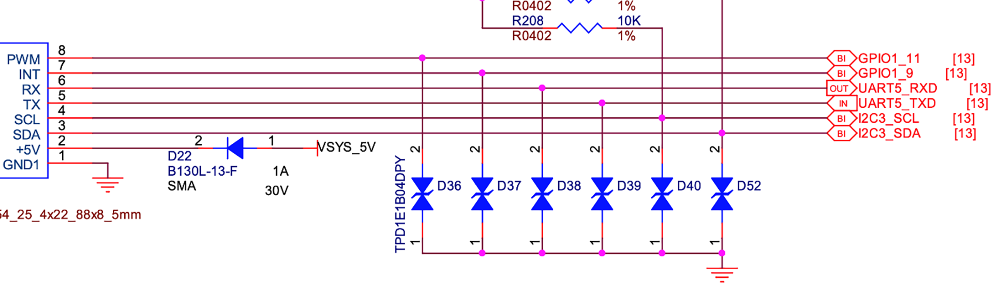
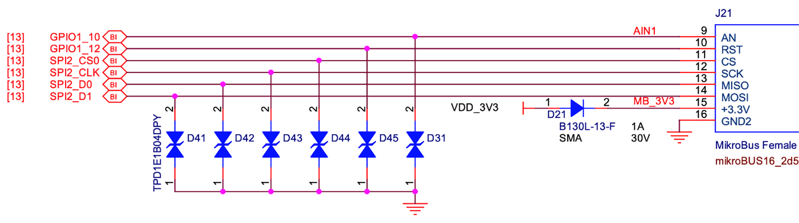
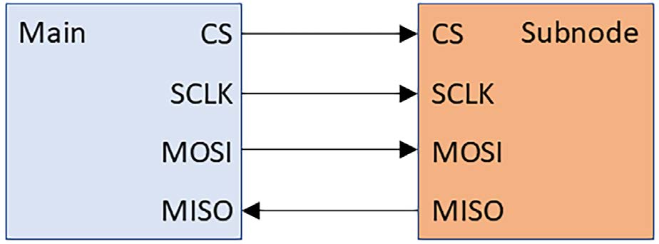

# Chương 12: Làm prototype với Add-On board (Prototyping with Add-On Boards)

Việc bring-up board tùy chỉnh là việc mà các kỹ sư embedded Linux được gọi đến để làm hết lần này đến lần khác. Giả sử một nhà sản xuất điện tử tiêu dùng muốn tạo một thiết bị mới và thiết bị đó cần chạy Linux. Quá trình lắp ráp image Linux bắt đầu trước khi phần cứng sẵn sàng và được thực hiện với các prototype ghép lại từ SBC và add-on board. Khi một proof of concept đã được kiểm chứng, một lô PCB prototype đầu tiên được chế tạo với các thiết bị ngoại vi trên board. Không có trải nghiệm nào thỏa mãn hơn việc thấy một board tùy chỉnh boot vào Linux lần đầu tiên.

BeaglePlay độc nhất trong số các SBC ở chỗ nó có một socket mikroBUS để mở rộng thiết bị ngoại vi plug and play nhanh chóng. Có một add-on board MikroE Click cho gần như mọi thiết bị ngoại vi phần cứng mà bạn có thể nghĩ đến. Trong chương này, chúng ta sẽ tích hợp một bộ thu GNSS, một module cảm biến môi trường và một màn hình OLED với BeaglePlay. Tận dụng mikroBUS loại bỏ nhu cầu đọc sơ đồ mạch và đi dây trên breadboard, để bạn dành ít thời gian xử lý sự cố phần cứng hơn và nhiều thời gian viết code ứng dụng hơn.

Làm prototype nhanh với phần cứng thật đòi hỏi nhiều lần thử và sai. Với một bản phân phối Debian Linux đầy đủ trong tay, chúng ta có thể dùng các công cụ chính thống như `git`, `pip3` và `python3` để phát triển phần mềm trực tiếp trên BeaglePlay.

Trong chương này, chúng ta sẽ đề cập các chủ đề sau:

- Ánh xạ sơ đồ mạch sang chân

- Làm prototype với add-on board

- Kiểm thử thiết bị ngoại vi phần cứng

## Yêu cầu kỹ thuật

Để làm theo các ví dụ, hãy bảo đảm bạn có những thứ sau:

- Một hệ thống host Ubuntu 24.04 hoặc bản LTS mới hơn

- Một đầu đọc thẻ microSD và thẻ

- balenaEtcher cho Linux

- Một BeaglePlay

- Một bộ nguồn USB-C 5V có khả năng cấp 3A

- Một cáp serial USB to TTL với mức logic 3.3V

- Một cáp Ethernet và router có cổng trống để kết nối mạng

- Một add-on board MikroE-5764 GNSS 7 Click

- Một ăng-ten GNSS chủ động gắn ngoài

- Một add-on board MikroE-5546 Environment Click

- Một add-on board MikroE-5545 OLED C Click

Code dùng trong chương này có trong thư mục của chương trong GitHub repository của cuốn sách: `https://github.com/PacktPublishing/Mastering-Embedded-Linux-Development/tree/main/Chapter12`.

## Ánh xạ sơ đồ mạch sang chân

Vì Bill Of Materials (BOM), file thiết kế PCB và sơ đồ mạch của BeaglePlay đều là open source, bất kỳ ai cũng có thể sản xuất BeaglePlay như một phần của sản phẩm tiêu dùng của họ. Vì BeaglePlay được dành cho phát triển, nó chứa nhiều linh kiện có thể không cần cho sản xuất, như cổng Ethernet, cổng USB và khe microSD. Là một dev board, BeaglePlay cũng có thể thiếu một hoặc nhiều thiết bị ngoại vi cần cho ứng dụng của bạn như cảm biến, modem LTE hoặc màn hình OLED.

BeaglePlay được xây dựng quanh AM6254 của Texas Instruments, một SoC 64-bit quad-core Arm Cortex-A53 với Programmable Real-Time Unit (PRU) và vi điều khiển M4. Giống như Raspberry Pi 4, BeaglePlay có Wi-Fi và Bluetooth built-in. Khác với các SBC khác, nó còn có một radio lập trình được, có khả năng truyền thông không dây low-power ở sub-GHz và 2.4 GHz. Mặc dù BeaglePlay cực kỳ linh hoạt, đến một lúc nào đó bạn có thể muốn thiết kế PCB tùy chỉnh của riêng mình quanh AM6254 để giảm giá thành sản phẩm hoàn chỉnh.

Trong Chương 11, chúng ta đã xem một ví dụ về cách gắn một Ethernet adapter với một device driver Linux. Việc gắn thiết bị ngoại vi được thực hiện bằng device tree source hoặc các struct C được gọi là platform data. Qua nhiều năm, device tree source đã trở thành cách được ưu tiên để gắn với device driver Linux, đặc biệt trên SoC Arm. Giống như với U-Boot, compile device tree source thành DTB cũng là một phần của quá trình build Linux kernel.

Nếu bạn cần truyền nhiều gói tin từ một mạng cục bộ tới và từ cloud, thì chạy Linux là một lựa chọn hợp lý vì nó có một network stack TCP/IP cực kỳ trưởng thành. CPU Arm Cortex-A53 của BeaglePlay đáp ứng các yêu cầu (đủ RAM có thể đánh địa chỉ và một memory management unit) để chạy Linux chính thống. Điều này có nghĩa là sản phẩm của bạn có thể hưởng lợi từ các bản sửa lỗi bảo mật và bug đã được thực hiện với Linux kernel.

Giờ chúng ta đã chọn được SBC, hãy xem sơ đồ mạch của BeaglePlay.

### Đọc sơ đồ mạch

BeaglePlay có một socket mikroBUS cũng như các đầu nối Grove và QWIIC cho add-on board. Trong ba chuẩn, mikroBUS là chuẩn duy nhất có các cổng truyền thông UART, I2C và SPI cũng như chức năng Analog to Digital Converter (ADC), Pulse Width Modulation (PWM) và GPIO. Hãy cân nhắc các lựa chọn mở rộng I/O khi chọn một SBC để phát triển. Nhiều lựa chọn hơn nghĩa là nhiều module ngoại vi hơn để chọn khi làm prototype.

Khi được lựa chọn, tôi thường chọn SPI thay vì UART và I2C cho sản xuất. UART khan hiếm trên nhiều SoC và được dành cho những thứ như Bluetooth và/hoặc serial console. Driver và phần cứng I2C có thể có các bug nghiêm trọng. Một số kernel driver I2C được hiện thực kém đến mức bus bị treo khi có quá nhiều thiết bị ngoại vi được nối giao tiếp cùng lúc. Những lần khác, bug nằm trong phần cứng. Các I2C controller trong các SoC Broadcom như chip trong Raspberry Pi 4 nổi tiếng là trục trặc khi các thiết bị ngoại vi cố thực hiện clock stretching. Clock stretching là khi một thiết bị I2C subnode tạm thời làm chậm hoặc dừng clock của bus.

Mỗi socket mikroBUS gồm hai cặp header cái 1x8. Chúng ta có thể tìm thấy cả hai dải header ở trang 22 của sơ đồ mạch BeaglePlay (`https://github.com/beagleboard/beagleplay/blob/main/BeaglePlay_sch.pdf`).

Đây là dải header bên phải của socket mikroBUS trên BeaglePlay:



Hình 12.1 – Socket mikroBUS (dải header bên phải)

Chân 1 được nối đất và chân 2 xuất 5V. Các chân 3 (I2C3\_SDA) và 4 (I2C3\_CL) được nối với bus I2C3 của BeaglePlay. Các chân 5 (UART5\_TXD) và 6 (UART5\_RXD) được nối với UART5 trên BeaglePlay. Các chân 7 (GPIO1\_9) và 8 (GPIO1\_11) là GPIO, với chân 7 đóng vai trò ngắt và chân 8 hoạt động như PWM.

Đây là dải header bên trái của socket mikroBUS trên BeaglePlay:



Hình 12.2 – Socket mikroBUS (dải header bên trái)

Các chân 9 (GPIO1\_10) và 10 (GPIO1\_12) là GPIO, với chân 9 đóng vai trò input analog và chân 10 hoạt động như reset. Các chân 11 (SPI2\_CS0), 12 (SPI2\_CLK), 13 (SPI2\_D0) và 14 (SPI2\_D1) được nối với bus SPI2 của BeaglePlay. Cuối cùng, chân 15 xuất 3.3V, và chân 16 được nối đất.

Lưu ý rằng bus SPI2 có các đường CS0, CLK, D0 và D1. CS là viết tắt của chip select. Vì mỗi bus SPI là một giao diện main-subnode, kéo một đường tín hiệu CS xuống thấp thường chọn thiết bị ngoại vi nào trên bus để truyền tới. Loại logic âm này được gọi là active low. CLK là viết tắt của clock và luôn được tạo bởi bus main, trong trường hợp này là AM6254. Dữ liệu truyền trên bus SPI được đồng bộ với tín hiệu CLK này. SPI hỗ trợ tần số clock cao hơn nhiều so với I2C. Đường dữ liệu D0 tương ứng với main in, subnode out (MISO).

Đường dữ liệu D1 tương ứng với main out, subnode in (MOSI). SPI là một giao diện full-duplex, nghĩa là cả main và subnode được chọn đều có thể gửi dữ liệu cùng lúc.

Đây là một sơ đồ khối cho thấy hướng của cả bốn tín hiệu SPI:



Hình 12.3 – Các tín hiệu SPI

Giờ hãy bật mikroBUS trên BeaglePlay. Cách nhanh nhất để làm điều này là cài đặt một image Debian dựng sẵn từ BeagleBoard.org.

### Cài đặt Debian trên BeaglePlay

`BeagleBoard.org` cung cấp các image Debian cho các dev board khác nhau của họ. Debian là một bản phân phối Linux phổ biến bao gồm một tập package phần mềm open source đầy đủ. Đó là một nỗ lực khổng lồ, với những người đóng góp từ khắp nơi trên thế giới. Build Debian cho các BeagleBoard khác nhau là điều không theo thông lệ theo tiêu chuẩn embedded Linux vì quá trình này không dựa vào cross-compilation. Thay vì cố tự build Debian cho BeaglePlay, chỉ cần tải một image hoàn chỉnh trực tiếp từ BeagleBoard.org.

Để tải và giải nén image eMMC flasher Debian Bookworm minimal cho BeaglePlay, hãy dùng lệnh sau::

```
$ wget https://files.beagle.cc/file/beagleboard-public-2021/images/
beagleplay-emmc-flasher-debian-12.7-minimal-arm64-2024-09-04-8gb.img.xz
$ xz -d beagleplay-emmc-flasher-debian-12.7-minimal-arm64-2024-09-04-8gb.
img.xz
```

Nếu link trên bị hỏng, hãy truy cập `https://beagleboard.org/distros` để có danh sách hiện tại các image Debian có sẵn để tải về. `BeagleBoard.org` có thể quyết định xóa link tới các image Debian khi các image đó cũ đi. Bảo trì Long-term các bản phát hành Debian tốn kém và labor-intensive.

Tại thời điểm viết, 12.7 là image Debian mới nhất cho các board BeaglePlay AM6254-based. Số phiên bản chính 12 cho biết 12.7 là một bản phát hành Bookworm LTS của Debian. Vì Debian 12.0 ban đầu được phát hành vào ngày 10 tháng Sáu năm 2023, Bookworm sẽ nhận cập nhật trong tối đa 5 năm kể từ ngày đó.

LƯU Ý QUAN TRỌNG

Nếu có thể, hãy tải phiên bản 12.7 (còn được gọi là Bookworm) thay vì image Debian mới nhất từ `BeagleBoard.org` cho các bài tập trong chương này. Bootloader, kernel, DTB và các công cụ command-line của BeaglePlay liên tục thay đổi, vì vậy các hướng dẫn sau có thể không hoạt động với một bản phát hành Debian mới hơn.

Giờ bạn đã có một image Debian flasher cho BeaglePlay, hãy ghi nó lên thẻ microSD:

1\. Cắm một thẻ microSD vào máy host Linux.

2\. Khởi chạy balenaEtcher.

3\. Nhấn Flash from file trong Etcher.

4\. Tìm file `img` mà bạn đã tải từ BeagleBoard.org và mở nó.

5\. Nhấn Select target trong Etcher.

6\. Chọn thẻ microSD mà bạn đã cắm vào ở bước 1.

7\. Nhấn Flash trong Etcher để ghi image.

8\. Đẩy thẻ microSD ra khi Etcher flash xong.

Tiếp theo, boot image flasher từ thẻ microSD và flash Debian lên eMMC của BeaglePlay. Trước khi tiếp tục, hãy bảo đảm cáp serial USB to TTL của bạn có mức logic 3.3 V. Đầu nối UART three-pin nằm ngay cạnh đầu nối USB-C trên BeaglePlay. Đừng nối dây đỏ thứ tư nào từ cáp. Dây đỏ thường là dây nguồn, không cần thiết trong trường hợp này và có thể làm hỏng board.

Để copy image Debian từ thẻ microSD sang eMMC của BeaglePlay:

1\. Rút BeaglePlay khỏi nguồn USB-C.

2\. Cắm đầu USB của cáp serial vào máy host.

3\. Nối dây TX từ cáp serial vào chân RX trên BeaglePlay.

4\. Nối dây RX từ cáp serial vào chân TX trên BeaglePlay.

5\. Nối dây GND (đen) từ cáp serial vào chân GND trên BeaglePlay.

6\. Khởi động một chương trình terminal phù hợp như `gtkterm`, `minicom` hoặc `picocom`, và gắn nó vào cổng ở tốc độ 115,200 bit mỗi giây (bps), không có flow control. `gtkterm` có lẽ là dễ thiết lập và sử dụng nhất:

```
$ sudo gtkterm -p /dev/ttyUSB0 -s 115200
```

7\. Cắm thẻ microSD vào BeaglePlay.

8\. Nhấn và giữ nút USR trên BeaglePlay.

9\. Cấp nguồn cho BeaglePlay qua cổng USB-C.

10\. Thả nút USR khi BeaglePlay bắt đầu boot từ thẻ microSD.

11\. Chờ dấu nhắc sau:

```
BeaglePlay microSD (extlinux.conf) (swap enabled)
1:      microSD disable BCFSERIAL
2:      copy microSD to eMMC (default)
3:      microSD (debug)
4:      microSD
Enter choice: 2
```

12\. Nhập `2`.

Việc copy image mất vài phút. Tiến trình được báo cáo trên serial console. Nếu output trên serial console bị rối hoặc không có output, hãy đổi chỗ các dây nối vào chân RX và TX trên BeaglePlay. Khi eMMC flash xong, hãy tắt nguồn BeaglePlay và rút thẻ microSD. Cấp nguồn cho BeaglePlay qua cổng USB-C. Cắm một cáp Ethernet từ BeaglePlay vào một cổng trống trên router. Khi đèn Ethernet onboard bắt đầu nhấp nháy, BeaglePlay sẽ online. Truy cập internet cho phép chúng ta cài đặt package và fetch code từ các Git repo bên trong Debian.

Để SSH vào BeaglePlay từ host Linux:

```
$ ssh debian@beaglebone.local
```

Nhập `temppwd` tại dấu nhắc mật khẩu của người dùng `debian`. Đổi mật khẩu khi được nhắc. SSH và đăng nhập lại bằng mật khẩu mới khi kết nối bị đóng.

Giờ Debian đã chạy trên target, hãy hạ cấp Linux kernel xuống một phiên bản có mikroBUS driver cần thiết.

## Làm prototype với add-on board

ClickID là giải pháp plug and play của MikroE cho các add-on board MikroE Click. ClickID cho phép Linux tự động nhận diện một add-on board Click và chỉ thị mikroBUS driver nạp đúng interface driver (UART, I2C, SPI, ADC hoặc PWM) để giao tiếp với thiết bị ngoại vi. Tất cả thông tin về một thiết bị ngoại vi nằm trên một chip EEPROM được hàn ở góc dưới bên phải của add-on board. Linux giao tiếp với EEPROM này qua 1-Wire lúc khởi động để thực hiện quá trình plug and play. Không phải add-on board Click nào cũng có EEPROM này, vì vậy chỉ một số hỗ trợ ClickID.

Debian tự động nâng cấp package, bao gồm cả Linux kernel, mà không hỏi người dùng. Điều này gây vấn đề vì chúng ta sẽ dùng một kernel Linux 5.10 cũ hơn để giao tiếp với các add-on board MikroE Click.

Để tắt auto-upgrades trong Debian:

```
debian@BeagleBone:~$ sudo apt remove unattended-upgrades
```

Để hạ cấp Linux kernel từ 6.6 xuống 5.10:

```
debian@BeagleBone:~$ sudo apt update
debian@BeagleBone:~$ sudo apt install bbb.io-kernel-5.10-ti-k3-am62
debian@BeagleBone:~$ sudo apt remove bbb.io-kernel-6.6-ti
debian@BeagleBone:~$ sudo shutdown -r now
```

SSH trở lại BeaglePlay khi nó đã online trở lại.

Để xác nhận rằng Linux kernel trên BeaglePlay đã được build với mikroBUS driver cần thiết:

```
debian@BeagleBone:~$ dmesg | grep mikrobus
[    1.952311] mikrobus:mikrobus_port_register: registering port
mikrobus-0
[    1.952373] mikrobus mikrobus-0: mikrobus port 0 eeprom empty probing
default eeprom
```

Mỗi EEPROM ClickID có một phần manifest chứa thông tin cụ thể của board như sơ đồ chân, giao diện hoặc driver Linux. Ngay cả khi add-on board Click của bạn không có ClickID, có thể đã có sẵn một manifest cho nó.

Để cài đặt các manifest mới nhất trên BeaglePlay:

```
debian@BeagleBone:~$ sudo apt update
debian@BeagleBone:~$ sudo apt install bbb.io-clickid-manifests
```

Để xem danh sách đầy đủ các file manifest đã được cài đặt trên BeaglePlay:

```
debian@BeagleBone:~$ ls /lib/firmware/mikrobus/
```

Để nạp một manifest với mikroBUS driver, hãy ghi manifest đó vào mục `mikrobus-0/new_device`:

```
debian@BeagleBone:~$ sudo su root
# cd /lib/firmware/mikrobus
# cat GNSS-7-CLICK.mnfb > /sys/bus/mikrobus/devices/mikrobus-0/new_device
# exit
```

Manifest không được giữ lại, vì vậy bạn phải nạp lại nó mỗi lần reboot BeaglePlay.

Ngay cả khi không tìm thấy manifest cho add-on board Click của mình, bạn vẫn chưa hết cách. BeagleBoard.org đã tạo một công cụ Python đơn giản để tạo các manifest Click add-on mới gọi là Manifesto (`https://github.com/beagleboard/manifesto`).

LƯU Ý QUAN TRỌNG

Nạp manifest GNSS Click 7 thủ công như được thể hiện là hoàn toàn không cần thiết vì GNSS Click 7 có sẵn một EEPROM ClickID.

Nhiều add-on board Click xuất hiện dưới dạng thiết bị Linux Industrial I/O (IIO). Công cụ `iio_info` có thể được dùng để khám phá các thiết bị IIO driver-enabled.

Để cài đặt công cụ `iio_info`:

```
debian@BeaglePlay:~$ sudo apt install libiio-utils
```

Có các script kiểm thử thiết bị ngoại vi trong code repository của cuốn sách. Debian có sẵn Git, vì vậy bạn có thể clone repository của cuốn sách để lấy code:

```
debian@BeagleBone:~$ cd ~
debian@BeagleBone:~$ git clone https://github.com/PacktPublishing/
Mastering-Embedded-Linux-Development MELD
```

Giờ chúng ta đã sẵn sàng kiểm thử từng add-on board Click.

## Kiểm thử thiết bị ngoại vi phần cứng

Chúng ta sẽ tích hợp ba thiết bị ngoại vi vào BeaglePlay: một bộ thu GNSS u-blox NEO-M9N, một cảm biến môi trường Bosch BME680 và một màn hình OLED Shenzhen Boxing World Technology PSP27801. Có ba chương trình kiểm thử dưới Chapter12 trong code repository của cuốn sách. Chương trình `parse_nmea.py` kiểm thử NEO-M9N; chương trình `sensors.py` kiểm thử BME680; và chương trình `display.py` kiểm thử PSP27801. Mặc dù có thể xếp chồng nhiều add-on board Click trên một socket mikroBUS duy nhất, chúng ta sẽ kiểm thử từng thiết bị ngoại vi riêng lẻ, mỗi lần một cái.

### Gắn add-on board GNSS Click 7

Các bộ thu Global Navigation Satellite System (GNSS) gửi dữ liệu National Marine Electronics Association (NMEA) qua UART (cổng serial), I2C hoặc SPI. Nhiều công cụ GNSS user space như `gpsd` chỉ hoạt động với các module được nối qua cổng serial.

Hãy tải data sheet của dòng NEO-M9N từ trang sản phẩm của u-blox tại `https://www.u-blox.com/en/product/neo-m9n-module`. Nhảy tới phần mô tả SPI. Nó nói rằng SPI bị tắt theo mặc định vì các chân của nó dùng chung với các giao diện UART và I2C. Để bật SPI trên NEO-M9N, chúng ta phải nối chân D\_SEL với GND. Kéo D\_SEL xuống chuyển hai chân UART và hai chân 12C thành bốn chân SPI. Điều này giải thích vì sao add-on board GNSS 7 Click mặc định hoạt động qua I2C và UART. Để chọn truyền thông SPI trên GNSS 7 Click, bạn cần cắm một jumper.

Để gắn add-on board GNSS Click 7 vào BeaglePlay:

1\. Rút BeaglePlay khỏi nguồn USB-C.

2\. Cắm add-on board GNSS Click 7 vào socket mikroBUS trên BeaglePlay.

3\. Vặn ăng-ten GNSS chủ động gắn ngoài vào đầu nối SMA của GNSS.

4\. Cấp nguồn cho BeaglePlay qua cổng USB-C.

5\. Nối lại cáp Ethernet từ BeaglePlay vào một cổng trống trên router nếu đã ngắt.

SSH trở lại BeaglePlay khi nó đã online trở lại.

Để xác nhận rằng add-on board GNSS Click 7 đã được gắn và nhận diện đúng:

```
debian@BeagleBone:~$ dmesg | grep mikrobus
[    1.969019] mikrobus:mikrobus_port_register: registering port
mikrobus-0
[    1.969093] mikrobus mikrobus-0: mikrobus port 0 eeprom empty probing
default eeprom
[    2.734524] mikrobus_manifest:mikrobus_manifest_attach_device: parsed
device 1, driver=neo-8, protocol=4, reg=0
[    2.739995] mikrobus_manifest:mikrobus_manifest_attach_device: device
1, number of properties=1
[    2.740005] mikrobus_manifest:mikrobus_manifest_parse:  GNSS 7 Click
manifest parsed with 1 devices
[    2.740073] mikrobus mikrobus-0: registering device : neo-8
```

Nếu output từ `dmesg` trông như ở trên, thì bạn đã gắn thành công add-on board vào BeaglePlay.

Để xem thiết bị GNSS vừa gắn:

```
debian@BeagleBone:~$ ls /sys/class/gnss/gnss0/
dev  device  power  subsystem  type  uevent
```

Điều này có nghĩa là một thiết bị GNSS giờ đã sẵn sàng để dùng tại `/dev/gnss0`.

### Nhận các thông điệp NMEA

Cuối cùng, chúng ta sẽ cài đặt chương trình kiểm thử Python và chạy nó trên target. Chương trình này đơn giản xuất luồng thông điệp trực tiếp từ module GNSS ra console.

NMEA là một định dạng thông điệp dữ liệu được hầu hết các bộ thu GNSS hỗ trợ. NEO-M9N xuất các câu NMEA theo mặc định. Các câu này là văn bản ASCII bắt đầu bằng ký tự `$` theo sau là các trường comma-separated. Điều đầu tiên chúng ta muốn làm là đọc luồng câu NMEA từ NEO-M9N ra khỏi giao diện `/dev/gnss0`. Các thông điệp NMEA thô không phải lúc nào cũng dễ đọc, vì vậy chúng ta sẽ dùng một parser để thêm các chú thích hữu ích cho các trường dữ liệu.

Để stream input ASCII từ module GNSS ra `stdout`:

```
debian@BeagleBone:~$ sudo cat /dev/gnss0
$GNRMC,201929.00,A,3723.40927,N,12204.29313,W,0.159,,181224,,,A,V*04
$GNVTG,,T,,M,0.159,N,0.294,K,A*3F
$GNGGA,201929.00,3723.40927,N,12204.29313,W,1,09,1.16,43.4,M,-30.0,M,,*41
$GNGSA,A,3,30,08,14,07,20,,,,,,,,2.10,1.16,1.75,1*0C
$GNGSA,A,3,,,,,,,,,,,,,2.10,1.16,1.75,2*04
$GNGSA,A,3,03,,,,,,,,,,,,2.10,1.16,1.75,3*06
$GNGSA,A,3,36,20,19,,,,,,,,,,2.10,1.16,1.75,4*0D
$GPGSV,3,1,11,04,13,142,,07,63,045,35,08,36,068,25,09,39,150,,1*61
$GPGSV,3,2,11,13,11,316,07,14,46,233,21,17,04,184,,20,19,269,19,1*62
$GPGSV,3,3,11,22,25,228,32,27,13,041,,30,60,318,28,1*5D
$GLGSV,1,1,00,1*78
$GAGSV,1,1,04,02,22,228,23,03,60,310,30,05,63,148,,16,77,040,33,7*76
$GBGSV,1,1,03,19,47,204,31,20,10,168,25,36,62,293,35,1*4E
$GNGLL,3723.40927,N,12204.29313,W,201929.00,A,A*66
<…>
```

Bạn sẽ thấy một loạt câu NMEA mỗi giây một lần. Nhấn Ctrl + C để hủy luồng và quay lại dấu nhắc command-line.

Một script parser NMEA có trong GitHub repo. Script `parse_nmea.py` đó phụ thuộc vào thư viện `pynmea2`.

Để cài đặt `pynmea2` trên BeaglePlay:

```
debian@BeagleBone:~$ sudo apt install python3.11-venv
debian@BeagleBone:~$ python3 -m venv gnss-click
debian@BeagleBone:~$ source gnss-click/bin/activate
(gnss-click) $ pip3 install pynmea2
```

Để pipe output từ `/dev/gnss0` vào parser NMEA:

```
(gnss-click) $ cd ~/MELD/Chapter12
(gnss-click) $ sudo cat /dev/gnss0 | ./parse_nmea.py
```

Output NMEA đã được parse trông như sau:

```
<RMC(timestamp=datetime.time(20, 33, 31, tzinfo=datetime.timezone.utc),
status='A', lat='3723.40678', lat_dir='N', lon='12204.28976', lon_dir='W',
spd_over_grnd=0.389, true_course=None, datestamp=datetime.date(2024,
12, 18), mag_variation='', mag_var_dir='', mode_indicator='A', nav_
status='V')>
<VTG(true_track=None, true_track_sym='T', mag_track=None, mag_track_
sym='M', spd_over_grnd_kts=Decimal('0.389'), spd_over_grnd_kts_sym='N',
spd_over_grnd_kmph=0.72, spd_over_grnd_kmph_sym='K', faa_mode='A')>
<GGA(timestamp=datetime.time(20, 33, 31, tzinfo=datetime.timezone.utc),
lat='3723.40678', lat_dir='N', lon='12204.28976', lon_dir='W', gps_qual=1,
num_sats='11', horizontal_dil='1.10', altitude=50.1, altitude_units='M',
geo_sep='-30.0', geo_sep_units='M', age_gps_data='', ref_station_id='')>
<…>
```

Đừng nản lòng nếu module GNSS của bạn không thấy vệ tinh nào hoặc không xác định được vị trí cố định. Điều này có thể do nhiều lý do, như chọn sai ăng-ten GNSS hoặc không có tầm nhìn thông thoáng lên bầu trời. RF rất phức tạp và mục tiêu của chương này chỉ là chứng minh chúng ta có thể làm cho việc truyền thông với module GNSS hoạt động. Giờ chúng ta có thể thử nghiệm với các ăng-ten GNSS khác và nhiều tính năng nâng cao hơn của NEO-M9N, như giao thức thông điệp UBX phong phú hơn nhiều.

Với dữ liệu NMEA giờ đang stream ra terminal, project đầu tiên của chúng ta đã hoàn thành. Chúng ta đã kiểm chứng thành công rằng AM6254 có thể giao tiếp với NEO-M9N qua sự kết hợp giữa I2C và UART.

### Gắn add-on board Environment Click

Cảm biến môi trường BME680 đo nhiệt độ, độ ẩm tương đối, áp suất và khí. Nó giao tiếp với SoC AM6254 qua SPI hoặc I2C từ add-on board Environment Click. Giống như GNSS 7 Click, Environment Click mặc định dùng I2C. Để chọn truyền thông SPI trên Environment Click, bạn cần cắm một jumper.

Để gắn add-on board Environment Click vào BeaglePlay:

1\. Rút BeaglePay khỏi nguồn USB-C.

2\. Cắm add-on board Environment Click vào socket mikroBUS trên BeaglePlay.

3\. Cấp nguồn cho BeaglePlay qua cổng USB-C.

4\. Nối lại cáp Ethernet từ BeaglePlay vào một cổng trống trên router nếu đã ngắt.

SSH trở lại BeaglePlay khi nó đã online trở lại.

Để xác nhận rằng add-on board Environment Click đã được gắn và nhận diện đúng:

```
debian@BeagleBone:~$ dmesg | grep mikrobus
[    1.962765] mikrobus:mikrobus_port_register: registering port
mikrobus-0
[    1.962829] mikrobus mikrobus-0: mikrobus port 0 eeprom empty probing
default eeprom
[    2.413200] mikrobus_manifest:mikrobus_manifest_attach_device: parsed
device 1, driver=bme680, protocol=3, reg=77
[    2.413212] mikrobus_manifest:mikrobus_manifest_parse:  Environment
Click manifest parsed with 1 devices
[    2.413281] mikrobus mikrobus-0: registering device : bme680
```

Nếu output từ `dmesg` trông như ở trên, thì bạn đã gắn thành công add-on board vào BeaglePlay.

Để xem cảm biến môi trường vừa gắn:

```
debian@BeagleBone:~$ iio_info
Library version: 0.24 (git tag: v0.24)
Compiled with backends: local xml ip usb
IIO context created with local backend.
Backend version: 0.24 (git tag: v0.24)
Backend description string: Linux BeagleBone 5.10.168-ti-arm64-r118
#1bookworm SMP Thu Feb 6 01:00:48 UTC 2025 aarch64
IIO context has 2 attributes:
        local,kernel: 5.10.168-ti-arm64-r118
        uri: local:
IIO context has 2 devices:
        iio:device0: bme680
                4 channels found:
                        temp:  (input)
                        2 channel-specific attributes found:
                                attr  0: input value: 25020
                                attr  1: oversampling_ratio value: 8
                        pressure:  (input)
                        2 channel-specific attributes found:
                                attr  0: input value: 1014.370000000
                                attr  1: oversampling_ratio value: 4
                        resistance:  (input)
                        1 channel-specific attributes found:
                                attr  0: input value: 1183
                        humidityrelative:  (input)
                        2 channel-specific attributes found:
                                attr  0: input value: 42.810000000
                                attr  1: oversampling_ratio value: 2
                1 device-specific attributes found:
                                attr  0: oversampling_ratio_available
value: 1 2 4 8 16
                No trigger on this device
<…>
```

Lưu ý rằng `bme680` xuất hiện dưới dạng `iio:device0`.

### Đọc giá trị cảm biến

Giống như các thiết bị Linux IIO khác, giá trị các thanh ghi của BME680 có thể được truy cập từ `sysfs`.

Để đọc các giá trị độ ẩm, áp suất, khí và nhiệt độ từ BME680:

```
$ cd /sys/bus/iio/devices/iio\:device0
$ cat in_humidityrelative_input
41.074000000
$ cat in_pressure_input
1014.350000000
$ cat in_resistance_input
3966
$ cat in_temp_input
24540
```

Một script để liên tục poll cả bốn kênh có trong GitHub repo. Script `sensors.py` đó không có dependency nào ngoài thư viện chuẩn Python.

Để chạy script:

```
$ cd ~/MELD/Chapter12
$ ./sensors.py
```

Với các giá trị cảm biến giờ đang stream ra terminal, project thứ hai của chúng ta đã hoàn thành. Chúng ta đã kiểm chứng thành công rằng AM6254 có thể giao tiếp với BME680 qua I2C.

### Gắn add-on board OLED C Click

OLED C Click đi kèm một controller Solomon Systech SSD1351 để điều khiển màn hình OLED PSP27801. Bạn ghi vào buffer hiển thị SRAM 128x128 pixel bên trong SSD1351 qua SPI. SSD1351 hỗ trợ hai chế độ màu: 65K (6:5:6) và 262K (6:6:6). Một bộ ba (r:g:b) cho biết bao nhiêu bit được dùng để biểu diễn từng thành phần RGB của một pixel. PSP27801 có độ phân giải 96x96 pixel, thấp hơn đáng kể so với buffer hiển thị của SD1351.

Để gắn add-on board OLED C Click vào BeaglePlay:

1\. Rút BeaglePay khỏi nguồn USB-C.

2\. Cắm add-on board OLED C Click vào socket mikroBUS trên BeaglePlay.

3\. Cấp nguồn cho BeaglePlay qua cổng USB-C.

4\. Nối lại cáp Ethernet từ BeaglePlay vào một cổng trống trên router nếu đã ngắt.

SSH trở lại BeaglePlay khi nó đã online trở lại.

Để xác nhận rằng add-on board OLED C Click đã được gắn và nhận diện đúng:

```
debian@BeagleBone:~$ dmesg | grep mikrobus
[    1.946050] mikrobus:mikrobus_port_register: registering port
mikrobus-0
[    1.946117] mikrobus mikrobus-0: mikrobus port 0 eeprom empty probing
default eeprom
[    3.553403] mikrobus_manifest:mikrobus_manifest_attach_device: parsed
device 1, driver=fb_ssd1351, protocol=11, reg=0
[    3.553416] mikrobus_manifest:mikrobus_manifest_attach_device: device
1, number of properties=7
[    3.553430] mikrobus_manifest:mikrobus_manifest_attach_device: device
1, number of gpio resource=2
[    3.553437] mikrobus_manifest:mikrobus_manifest_parse:  OLEDC Click
manifest parsed with 1 devices
[    3.553513] mikrobus mikrobus-0: registering device : fb_ssd1351
[    3.553520] mikrobus mikrobus-0:  adding lookup table : spi1.0
```

Nếu output từ `dmesg` trông như ở trên, thì bạn đã gắn thành công add-on board vào BeaglePlay.

Để xem màn hình OLED vừa gắn:

```
$ ls /sys/class/graphics/fb0
bits_per_pixel  console  dev     mode   pan     state      uevent
bl_curve        coursor  device  modes  power   stride     virtual_size
blank           debug    gamma   name   rotate  subsystem
$ cd /sys/class/graphics/fb0
$ cat name
fb_ssd1351
$ cat bits_per_pixel
16
$ cat virtual_size
128,128
```

Trình bày SSD1351 dưới dạng một Linux framebuffer đơn giản hóa rất nhiều cách chúng ta tương tác với màn hình OLED. Bạn không cần link một thư viện mikroSDK và xử lý C API vụng về của nó. Chỉ cần ghi trực tiếp vào thiết bị `fb0` theo bất kỳ cách nào bạn thích.

### Hiển thị một animation

Một script kiểm thử cho màn hình OLED có trong GitHub repo. Script `display.py` đó phụ thuộc vào các thư viện `luma.core` và `numpy`:

Để cài đặt `luma.core` và `numpy` trên BeaglePlay:

```
debian@BeagleBone:~$ python3 -m venv ./oledc-click
debian@BeagleBone:~$ source ./oledc-click/bin/activate
(oledc-click) $ pip install luma.core numpy
```

Để chạy script kiểm thử:

```
(oledc-click) $ cd ~/MELD/Chapter12
(oledc-click) $ ./display.py
```

Một animation liên tục gồm một hình vuông đỏ, một xanh lá và một xanh dương xuất hiện trên màn hình OLED. Khi ba hình vuông di chuyển về phía nhau, chúng chồng lên nhau tạo thành một hình vuông trắng ở giữa. Các hình vuông sau đó tách ra và di chuyển về vị trí ban đầu để animation lặp lại.

Project thứ ba và cuối cùng của chúng ta giờ đã xong. Chúng ta đã kiểm chứng thành công rằng AM6254 có thể hiển thị hình ảnh chuyển động trên PSP27801 qua SPI.

## Tóm tắt

Trong chương này, chúng ta đã học cách tích hợp thiết bị ngoại vi với một SoC. Để làm điều đó, trước tiên chúng ta phải thu thập kiến thức từ sơ đồ mạch và data sheet. Không có phần cứng hoàn chỉnh trong tay, chúng ta cũng phải chọn và cắm các add-on board. Cuối cùng, chúng ta đã viết các chương trình kiểm thử đơn giản bằng Python và chạy chúng để kiểm chứng chức năng của thiết bị ngoại vi. Giờ chúng ta đã có phần cứng hoạt động, chúng ta có thể bắt đầu phát triển ứng dụng nhúng.

Hai chương tiếp theo hoàn toàn nói về việc khởi động hệ thống và các lựa chọn khác nhau bạn có cho chương trình `init`, từ `init` BusyBox đơn giản đến các hệ thống phức tạp hơn như `init` System V và `systemd`. Lựa chọn chương trình `init` có thể có tác động lớn đến trải nghiệm người dùng của sản phẩm, cả về thời gian boot lẫn khả năng chịu lỗi.

## Tìm hiểu thêm

- Introduction to SPI Interface, của Piyu Dhaker – `https://www.analog.com/en/analog-dialogue/articles/introduction-to-spi-interface.html`

- Soldering is Easy, của Mitch Altman, Andie Nordgren và Jeff Keyzer – `https://mightyohm.com/blog/2011/04/soldering-is-easy-comic-book`
