# *Chương 12*: Làm prototype với breakout board (Prototyping with Breakout Boards)

Việc bring-up board tùy biến là việc các kỹ sư embedded Linux được giao làm hết lần này tới lần khác. Một nhà sản xuất điện tử tiêu dùng muốn build một thiết bị mới và, thường thì, thiết bị đó cần chạy Linux. Quá trình lắp ráp Linux image thường bắt đầu trước khi phần cứng sẵn sàng, và được thực hiện bằng các prototype được nối dây từ các dev board và breakout board. Các chân I/O ngoại vi cần được mux vào các binding của device tree để truyền thông hoạt động. Chỉ khi đó nhiệm vụ viết code middleware cho một application mới có thể bắt đầu.

Mục tiêu của chúng ta trong chương này là thêm một module GPS u-blox vào BeagleBone Black. Việc này đòi hỏi đọc schematic và data sheet để có thể tạo ra các sửa đổi cần thiết cho device tree source bằng công cụ **SysConfig** của Texas Instruments. Tiếp theo, chúng ta sẽ nối dây một SparkFun GPS Breakout board tới BeagleBone Black và đo các chân SPI đã kết nối bằng một logic analyzer. Cuối cùng, chúng ta sẽ biên dịch và chạy code test trên BeagleBone Black để có thể nhận các câu NMEA từ module GPS ZOE-M8Q qua SPI.

Làm prototype nhanh với phần cứng thật đòi hỏi nhiều thử và sai. Trong chương này, chúng ta sẽ có kinh nghiệm hands-on với việc hàn và lắp ráp một test bench để nghiên cứu và debug tín hiệu số. Chúng ta cũng sẽ xem lại device tree source, nhưng lần này, chúng ta sẽ đặc biệt chú ý tới các cấu hình pin control và cách tận dụng chúng để enable các ngoại vi bên ngoài hoặc onboard. Với một bản phân phối Debian Linux đầy đủ trong tay, chúng ta có thể dùng các công cụ như `git`, `gcc`, `pip3` và `python3` để phát triển phần mềm trực tiếp trên BeagleBone Black.

Trong chương này, chúng ta sẽ đề cập các chủ đề sau:

- Ánh xạ schematic sang device tree source
- Làm prototype với breakout board
- Đo tín hiệu SPI bằng logic analyzer
- Nhận message NMEA qua SPI

Hãy bắt đầu!

## Yêu cầu kỹ thuật

Để làm theo các ví dụ trong chương này, hãy bảo đảm bạn có những thứ sau:

- Một hệ thống host Linux-based
- Bản phát hành Buildroot 2020.02.9 LTS
- Etcher cho Linux
- Một đầu đọc thẻ microSD và thẻ
- Một cáp serial USB to TTL 3.3V
- Một BeagleBone Black
- Một nguồn điện DC 5V 1A
- Một cáp Ethernet và port để kết nối mạng
- Một SparkFun Breakout model GPS-15193
- Một hàng (12 chân trở lên) header thẳng bẻ được
- Một bộ mỏ hàn
- Sáu dây jumper đực-cái (male to female)
- Một ăng-ten GNSS U.FL

Lẽ ra bạn đã cài bản phát hành 2020.02.9 của Buildroot trong [*Chương 6*](ch06_selecting_a_build_system.vi.md), *Chọn build system*. Nếu chưa, hãy tham khảo mục *System requirements* của *The Buildroot user manual* ([https://buildroot.org/downloads/manual/manual.html](https://buildroot.org/downloads/manual/manual.html)) trước khi cài Buildroot trên host Linux theo hướng dẫn trong [*Chương 6*](ch06_selecting_a_build_system.vi.md).

Một **logic analyzer** giúp xử lý sự cố và hiểu truyền thông SPI. Tôi sẽ dùng Saleae Logic 8 cho mục đích minh họa. Tôi biết các sản phẩm Saleae đắt đến mức khó mua ($399 trở lên), nên nếu bạn chưa sở hữu một logic analyzer Saleae, bạn vẫn có thể đi hết chương này mà không cần nó. Có các lựa chọn low-speed rẻ hơn ([http://dangerousprototypes.com/docs/Bus_Pirate](http://dangerousprototypes.com/docs/Bus_Pirate)) đủ cho việc debug SPI và I2C, nhưng tôi sẽ không đề cập chúng trong cuốn sách này.

Toàn bộ code cho chương này có thể được tìm thấy trong thư mục `Chapter12` của repository GitHub của sách: [https://github.com/PacktPublishing/Mastering-Embedded-Linux-Programming-Third-Edition](https://github.com/PacktPublishing/Mastering-Embedded-Linux-Programming-Third-Edition).

## Ánh xạ schematic sang device tree source

Vì **Bill Of Materials** (**BOM**), các file thiết kế PCB và schematic của BeagleBone Black đều là open source, bất kỳ ai cũng có thể sản xuất BeagleBone Black như một phần của sản phẩm tiêu dùng của mình. Vì BeagleBone Black được dự định cho phát triển, nó chứa vài component có thể không cần cho sản xuất, chẳng hạn cáp Ethernet, cổng USB và khe microSD. Là một dev board, BeagleBone Black cũng có thể thiếu một hoặc nhiều ngoại vi cần cho application của bạn như cảm biến, modem LTE hay màn hình OLED.

BeagleBone Black được xây dựng quanh AM335x của Texas Instruments, một SoC ARM Cortex-A8 32-bit lõi đơn với hai **Programmable Real-Time Units** (**PRU**). Có một biến thể Wireless đắt hơn của BeagleBone Black do Octavo Systems sản xuất, thay Ethernet bằng một module Wi-Fi và Bluetooth. BeagleBone Black Wireless cũng là phần cứng open source, nhưng đến một lúc nào đó, bạn có thể muốn thiết kế PCB tùy biến của riêng mình quanh AM335x. Thiết kế một board con (gọi là *"cape"*) cho BeagleBone Black cũng là một lựa chọn.

Với mục đích của chúng ta, chúng ta sẽ tích hợp một module GPS u-blox ZOE-M8Q vào một thiết bị nối mạng. Nếu bạn cần truyền nhiều packet từ một mạng cục bộ tới và từ cloud, thì chạy Linux là một lựa chọn hợp lý vì nó có một network stack TCP/IP cực kỳ trưởng thành. CPU ARM Cortex-A8 của BeagleBone Black đáp ứng các yêu cầu (đủ RAM có thể định địa chỉ và một memory management unit) để chạy Linux chính thống. Điều này có nghĩa là sản phẩm của chúng ta có thể hưởng lợi từ các bản sửa lỗi bảo mật và bug đã được thực hiện cho Linux kernel.

Trong [*Chương 11*](ch11_interfacing_with_device_drivers.vi.md), *Giao tiếp với device driver*, chúng ta đã xem một ví dụ về cách bind một Ethernet adapter với một Linux device driver. Bind ngoại vi được thực hiện bằng device tree source hoặc các struct C gọi là platform data. Qua nhiều năm, dùng device tree source đã trở thành phương tiện được ưa chuộng để bind với Linux device driver, đặc biệt trên các SoC ARM. Vì những lý do này, các ví dụ trong chương này chỉ liên quan tới device tree source. Giống U-Boot, biên dịch device tree source thành DTB cũng là một phần của quá trình build Linux kernel.

Trước khi có thể bắt đầu sửa device tree source, chúng ta cần làm quen với schematic của BeagleBone Black và SparkFun ZOE-M8Q GPS Breakout.

### Đọc schematic và data sheet

BeagleBone Black có 2 x 46 pin expansion header cho I/O. Các header này bao gồm các cổng truyền thông UART, I2C và SPI, ngoài vô số GPIO. Hầu hết module GPS, bao gồm cả module của chúng ta, có thể gửi dữ liệu NMEA qua serial UART hoặc I2C. Dù nhiều công cụ GPS user space, chẳng hạn `gpsd`, chỉ hoạt động với các module kết nối qua serial, tôi đã chọn một module GPS có giao diện SPI cho project này. BeagleBone Black có hai bus SPI có sẵn. Chúng ta chỉ cần một trong các bus SPI này để kết nối u-blox ZOE-M8Q.

Tôi chọn SPI thay vì UART và I2C vì hai lý do: UART khan hiếm trên nhiều SoC và cần cho những thứ như Bluetooth và/hoặc serial console; driver và phần cứng I2C có thể có các bug nghiêm trọng. Một số I2C kernel driver được hiện thực tệ đến mức bus bị khóa khi có quá nhiều ngoại vi kết nối cùng nói chuyện. Các I2C controller trong SoC Broadcom, chẳng hạn trong Raspberry Pi 4, nổi tiếng là bị trục trặc khi ngoại vi cố thực hiện clock stretching.

Đây là sơ đồ các chân trên expansion header P9 của BeagleBone Black:

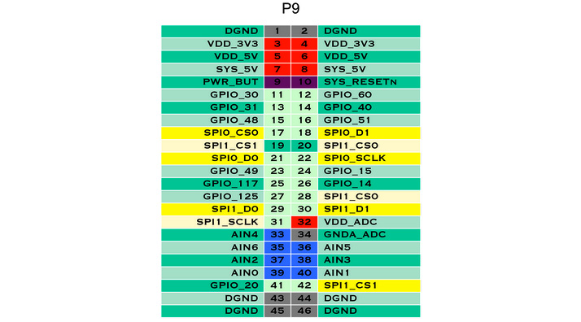

*Hình 12.1 – Các cổng SPI trên expansion header P9*

Các chân 17, 18, 21 và 22 được gán cho bus SPI0. Các chân 19, 20, 28, 29, 30, 31 và 42 được gán cho bus SPI1. Hãy để ý rằng các chân 42 và 28 lặp lại chức năng của các chân 19 và 20 cho SPI1. Chúng ta chỉ có thể dùng một chân cho SPI1_CS1 và SPI1_CS0. Mọi chân lặp lại nên được disable hoặc dùng vào mục đích khác. Ngoài ra, hãy để ý rằng SPI1 có các chân CS0 và CS1, trong khi SPI0 chỉ có chân CS0. **CS** là viết tắt của **chip select**. Vì mỗi bus SPI là một giao diện master-slave, kéo một đường tín hiệu CS xuống low thường chọn ngoại vi nào sẽ được truyền tới trên bus. Kiểu logic âm này được gọi là *"active low"*.

Đây là sơ đồ khối của bus SPI1 của BeagleBone Black với hai ngoại vi được gắn:

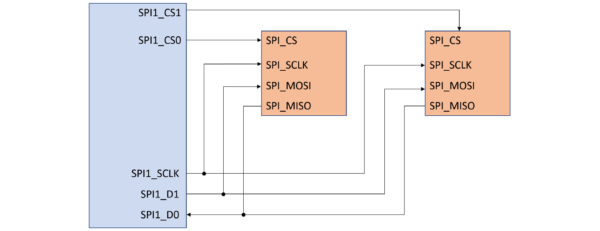

*Hình 12.2 – Bus SPI1*

Nếu xem schematic của Beagle Bone Black ([https://github.com/beagleboard/beaglebone-black/blob/master/BBB_SCH.pdf](https://github.com/beagleboard/beaglebone-black/blob/master/BBB_SCH.pdf)), chúng ta sẽ thấy bốn chân (28 tới 31) trên expansion header P9 được gắn nhãn cho SPI1:

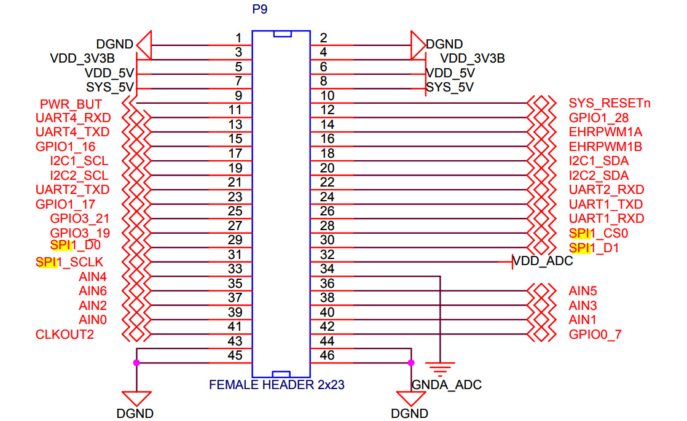

*Hình 12.3 – Schematic expansion header P9*

Các chân SPI1 thừa (19, 20 và 42) và tất cả các chân SPI0 (17, 18, 21 và 22) đã được dùng vào mục đích khác cho I2C1, I2C2 và UART2 trên schematic. Ánh xạ thay thế này là kết quả của các cấu hình pin mux được định nghĩa trong các file device tree source. Để định tuyến các đường tín hiệu SPI còn thiếu từ AM335x tới các chân đích tương ứng trên expansion header, các cấu hình pin mux phù hợp phải được áp dụng. Pin muxing có thể được làm lúc runtime để làm prototype nhưng nên chuyển sang lúc biên dịch trước khi phần cứng hoàn chỉnh về tới.

Ngoài CS0, bạn sẽ để ý rằng bus SPI0 cũng có các đường SCLK, D0 và D1. **SCLK** là viết tắt của **SPI clock** và luôn được tạo ra bởi bus master, trong trường hợp này là AM335x. Dữ liệu truyền qua bus SPI được đồng bộ với tín hiệu SCLK này. SPI hỗ trợ tần số clock cao hơn nhiều so với I2C. Đường dữ liệu D0 tương ứng với **master in, slave out** (**MISO**). Đường dữ liệu D1 tương ứng với **master out, slave in** (**MOSI**). Dù cả D0 và D1 đều có thể được gán cho MISO hoặc MOSI bằng phần mềm, chúng ta sẽ giữ các ánh xạ mặc định này. SPI là một giao diện **full-duplex**, nghĩa là cả master và slave được chọn có thể gửi dữ liệu cùng lúc.

Đây là sơ đồ khối cho thấy hướng của cả bốn tín hiệu SPI:


*Hình 12.4 – Các tín hiệu SPI*

Bây giờ, hãy chuyển sự chú ý từ BeagleBone Black sang ZOE-M8Q. Chúng ta sẽ bắt đầu với data sheet dòng ZOE-M8, có thể được tải về từ trang sản phẩm của u-blox tại [https://www.u-blox.com/en/product/zoe-m8-series](https://www.u-blox.com/en/product/zoe-m8-series). Nhảy tới mục mô tả SPI. Nó nói rằng SPI bị disable mặc định vì các chân của nó được dùng chung với các giao diện UART và DDC. Để enable SPI trên ZOE-M8Q, chúng ta phải nối chân D_SEL xuống ground. Kéo D_SEL xuống chuyển hai chân UART và hai chân DDC thành bốn chân SPI.

Tìm schematic của SparkFun ZOE-M8Q GPS Breakout bằng cách chọn tab "**Documents**" từ trang sản phẩm tại [https://www.sparkfun.com/products/15193](https://www.sparkfun.com/products/15193). Tìm chân D_SEL cho thấy nó nằm ở phía left-hand của jumper có nhãn JP1. Đóng jumper sẽ nối D_SEL với GND, nhờ đó enable SPI:

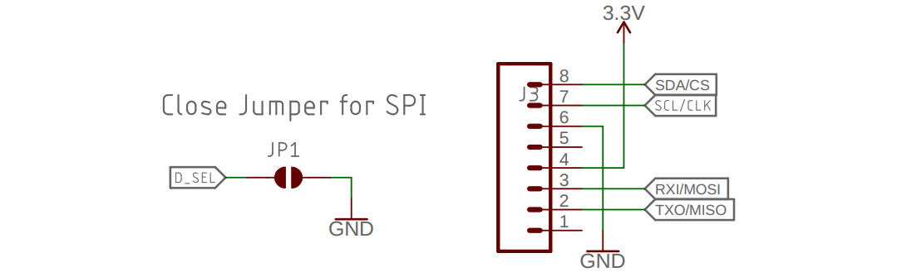

*Hình 12.5 – Jumper D_SEL và các connector SPI trên GPS breakout*

Các connector cho các chân CS, CLK, MOSI và MISO được co-located với 3.3V và GND. Đóng jumper và gắn header vào sáu chân sẽ đòi hỏi một ít việc hàn.

Luôn kiểm tra thông số định mức của chân khi kết nối các chip hoặc module với nhau. Jumper JP2 trên GPS Breakout nối các chân SCL/CLK và SDA/CS tới các điện trở pull up 2.2kΩ. Data sheet AM335x nói rằng các chân output này là driver 6mA, nên enable các pull up nội yếu của chúng thêm 100µA dòng pull up. ZOE-M8Q có một pull up 11kΩ trên cùng các chân, thêm 300µA ở 3.3V. Các pull up I2C 2.2kΩ trên GPS Breakout thêm 1.5mA nữa với tổng cộng 1.9mA dòng pull up, mức này ổn.

Quay lại *Hình 12.1*, hãy để ý rằng BeagleBone Black cấp 3.3V từ các chân 3 và 4 của expansion header P9. Các chân 1 và 2 và 43 tới 46 được nối với GND. Ngoài việc kết nối bốn đường SPI trên GPS Breakout tới các chân 17, 18, 21 và 22, chúng ta cũng sẽ nối dây 3.3V và GND của module GPS tới các chân 3 và 43 trên expansion header P9 của BeagleBone Black.

Giờ chúng ta đã có chút ý niệm về cách kết nối ZOE-M8Q, hãy enable bus SPI0 trên Linux, đang chạy trên BeagleBone Black. Cách nhanh nhất để làm điều này là cài một Debian image dựng sẵn từ [BeagleBoard.org](http://BeagleBoard.org).

### Cài Debian trên BeagleBone Black

[BeagleBoard.org](http://BeagleBoard.org) cung cấp Debian image cho các dev board khác nhau của họ. Debian là một bản phân phối Linux phổ biến bao gồm một tập toàn diện các package phần mềm open source. Đó là một nỗ lực khổng lồ với những người đóng góp từ khắp nơi trên thế giới. Build Debian cho các BeagleBoard khác nhau là khác thường theo tiêu chuẩn embedded Linux vì quá trình này không dựa vào cross-compilation. Thay vì cố tự build Debian cho BeagleBone Black, chỉ cần tải về một image hoàn chỉnh trực tiếp từ [BeagleBoard.org](http://BeagleBoard.org).

Để tải về microSD card image Debian Buster IoT cho BeagleBone Black, chạy lệnh sau:

```
$ wget https://debian.BeagleBoard.org/images/bone-debian-10.3-iot-armhf-2020-04-06-4gb.img.xz
```

10.3 là Debian image mới nhất cho các board BeagleBone AM335x-based tại thời điểm viết sách. Major version number 10 cho biết 10.3 là một bản phát hành Buster LTS của Debian. Vì Debian 10.0 ban đầu được phát hành vào ngày 6 tháng Bảy năm 2019, nó sẽ nhận cập nhật trong tối đa 5 năm kể từ ngày đó.

> **Lưu ý quan trọng**
>
> Nếu có thể, hãy tải phiên bản 10.3 (còn được gọi là Buster) thay vì Debian image mới nhất từ [BeagleBoard.org](http://BeagleBoard.org) cho các bài tập trong chương này. Bootloader, kernel, DTB và các công cụ command-line của BeagleBone liên tục thay đổi, nên các hướng dẫn có thể không hoạt động với một bản phát hành Debian mới hơn.

Giờ chúng ta đã có một Debian image cho BeagleBone Black, hãy ghi nó ra thẻ microSD và boot nó. Tìm file `bone-debian-10.3-iot-armhf-2020-04-06-4gb.img.xz` bạn đã tải về từ [BeagleBoard.org](http://BeagleBoard.org) từ Etcher và ghi nó ra thẻ microSD. Cắm thẻ microSD vào BeagleBone Black và cấp điện bằng nguồn 5V. Tiếp theo, cắm cáp Ethernet từ BeagleBone Black vào một port trống trên router của bạn bằng một cáp Ethernet. Khi đèn Ethernet onboard bắt đầu nhấp nháy, BeagleBone Black của bạn sẽ online. Truy cập internet cho phép chúng ta cài package và fetch code từ các Git repo từ bên trong Debian.

Để `ssh` vào BeagleBone Black từ host Linux, dùng code sau:

```
$ ssh debian@beaglebone.local
```

Nhập `temppwd` ở dấu nhắc mật khẩu của user `debian`.

> **Lưu ý quan trọng**
>
> Nhiều BeagleBone Black được cài sẵn Debian trên flash onboard, nên chúng vẫn sẽ boot, ngay cả khi không cắm thẻ microSD. Nếu message `BeagleBoard.org Debian Buster IoT Image 2020-04-06` được hiển thị trước dấu nhắc mật khẩu, thì BeagleBone Black đã boot từ Debian image 10.3 trên microSD. Nếu một message về bản phát hành Debian khác được hiển thị trước dấu nhắc mật khẩu, thì hãy kiểm tra xem thẻ microSD đã được cắm đúng hay chưa.

Giờ chúng ta đã ở trên BeagleBone Black, hãy xem có những giao diện SPI nào.

### Enable spidev

Linux đi kèm một user space API cung cấp truy cập `read()` và `write()` tới các thiết bị SPI. User space API này được gọi là `spidev` và có trong Debian Buster image cho BeagleBone Black. Chúng ta có thể xác nhận điều này bằng cách tìm kernel module `spidev`:

```
debian@beaglebone:~$ lsmod | grep spi
spidev                 20480  0
```

Bây giờ, liệt kê các địa chỉ ngoại vi SPI có sẵn:

```
$ ls /dev/spidev*
/dev/spidev0.0  /dev/spidev0.1  /dev/spidev1.0  /dev/spidev1.1
```

Các node `/dev/spidev0.0` và `/dev/spidev0.1` nằm trên bus SPI0, trong khi các node `/dev/spidev1.0` và `/dev/spidev1.1` nằm trên bus SPI1. Chúng ta chỉ cần bus SPI0 cho project này.

U-Boot nạp các overlay lên trên device tree cho BeagleBone Black. Chúng ta có thể chọn device tree overlay nào cần nạp bằng cách sửa file cấu hình `uEnv.txt` của U-Boot:

```
$ cat /boot/uEnv.txt
#Docs: http://elinux.org/Beagleboard:U-boot_partitioning_layout_2.0
uname_r=4.19.94-ti-r42
.
.
.
###U-Boot Overlays###
###Documentation: http://elinux.org/Beagleboard:BeagleBoneBlack_Debian#U-Boot_Overlays
###Master Enable
enable_uboot_overlays=1
###
.
.
.
###Disable auto loading of virtual capes (emmc/video/wireless/adc)
#disable_uboot_overlay_emmc=1
#disable_uboot_overlay_video=1
#disable_uboot_overlay_audio=1
#disable_uboot_overlay_wireless=1
#disable_uboot_overlay_adc=1
.
.
.
###Cape Universal Enable
enable_uboot_cape_universal=1
```

Hãy xác nhận rằng các biến môi trường `enable_uboot_overlays` và `enable_uboot_cape_universal` đều được đặt thành `1`. Một dấu `#` ở đầu nghĩa là mọi thứ sau ký tự đó trong dòng bị comment out. Vì lý do này, U-Boot bỏ qua tất cả các statement `disable_uboot_overlay_<device>=1` được thể hiện trong code trên. File cấu hình này được áp dụng cho environment của U-Boot, nên mọi thay đổi được lưu vào `/boot/uEnv.txt` cần reboot để có hiệu lực.

> **Lưu ý quan trọng**
>
> Audio overlay xung đột với bus SPI1 trên BeagleBone Black. Bỏ comment `disable_uboot_overlay_audio=1` trong `/boot/uEnv.txt` nếu bạn muốn enable truyền thông qua SPI1.

Để liệt kê các device tree overlay mà U-Boot đã nạp, dùng các lệnh sau:

```
$ cd /opt/scripts/tools
$ sudo ./version.sh | grep UBOOT
UBOOT: Booted Device-Tree:[am335x-boneblack-uboot-univ.dts]
UBOOT: Loaded Overlay:[AM335X-PRU-RPROC-4-19-TI-00A0]
UBOOT: Loaded Overlay:[BB-ADC-00A0]
UBOOT: Loaded Overlay:[BB-BONE-eMMC1-01-00A0]
UBOOT: Loaded Overlay:[BB-NHDMI-TDA998x-00A0]
```

Tính năng cape universal ([https://github.com/cdsteinkuehler/beaglebone-universal-io](https://github.com/cdsteinkuehler/beaglebone-universal-io)) là độc nhất của phiên bản Debian cho AM3358. Nó cung cấp truy cập tới gần như tất cả I/O phần cứng của BeagleBone Black mà chúng ta không phải sửa device tree source hay build lại kernel. Các cấu hình pin mux khác nhau được kích hoạt lúc runtime bằng công cụ command-line `config-pin`.

Để xem tất cả các pingroup có sẵn, dùng code sau:

```
$ cat /sys/kernel/debug/pinctrl/*pinmux*/pingroups
```

Để chỉ xem các pingroup SPI, dùng code sau:

```
$ cat /sys/kernel/debug/pinctrl/*pinmux*/pingroups | grep spi
group: pinmux_P9_19_spi_cs_pin
group: pinmux_P9_20_spi_cs_pin
group: pinmux_P9_17_spi_cs_pin
group: pinmux_P9_18_spi_pin
group: pinmux_P9_21_spi_pin
group: pinmux_P9_22_spi_sclk_pin
group: pinmux_P9_30_spi_pin
group: pinmux_P9_42_spi_cs_pin
group: pinmux_P9_42_spi_sclk_pin
```

Gán chỉ một chân cho một pingroup là điều bất thường. Thông thường, tất cả các chân SPI (CS, SCLK, D0 và D1) của một bus được mux cùng nhau trong cùng một pingroup. Chúng ta có thể xác nhận quan hệ chân với nhóm one-to-one kỳ lạ này bằng cách xem device tree source, nằm trong thư mục `/opt/source/dtb-4.19-ti/src/arm` trên Debian image.

File `am335x-boneblack-uboot-univ.dts` trong thư mục source đó chứa các include sau:

```
#include "am33xx.dtsi"
#include "am335x-bone-common.dtsi"
#include "am335x-bone-common-univ.dtsi"
```

File `.dts` đó, cùng với ba file `.dtsi` được include, định nghĩa device tree source. Công cụ `dtc` biên dịch bốn source file này thành một file `am335x-boneblack-uboot-univ.dtb`. U-Boot cũng nạp các device tree overlay lên trên device tree cape universal này. Các device tree overlay này có phần mở rộng file là `.dtbo`.

Đây là định nghĩa pingroup cho `pinmux_P9_17_spi_cs_pin`:

```
P9_17_spi_cs_pin: pinmux_P9_17_spi_cs_pin { pinctrl-single,pins = <
     AM33XX_IOPAD(0x095c, PIN_OUTPUT_PULLUP | INPUT_EN | MUX_MODE0) >; };
```

Nhóm `pinmux_P9_17_spi_cs_pin` cấu hình chân 17 trên expansion header P9 hoạt động như một chân CS cho bus SPI0.

Đây là định nghĩa `P9_17_pinmux`, nơi `pinmux_P9_17_spi_cs_pin` được tham chiếu:

```
/* P9_17 (ZCZ ball A16) */
P9_17_pinmux {
     compatible = "bone-pinmux-helper";
     status = "okay";
     pinctrl-names = "default", "gpio", "gpio_pu", "gpio_pd", "gpio_input", "spi_cs", "i2c", "pwm", "pru_uart";
     pinctrl-0 = <&P9_17_default_pin>;
     pinctrl-1 = <&P9_17_gpio_pin>;
     pinctrl-2 = <&P9_17_gpio_pu_pin>;
     pinctrl-3 = <&P9_17_gpio_pd_pin>;
     pinctrl-4 = <&P9_17_gpio_input_pin>;
     pinctrl-5 = <&P9_17_spi_cs_pin>;
     pinctrl-6 = <&P9_17_i2c_pin>;
     pinctrl-7 = <&P9_17_pwm_pin>;
     pinctrl-8 = <&P9_17_pru_uart_pin>;
};
```

Hãy để ý rằng nhóm `pinmux_P9_17_spi_cs_pin` là một trong chín cách khác nhau mà `P9_17_pinmux` có thể được cấu hình. Vì `spi_cs` không phải cấu hình mặc định cho chân đó, bus SPI0 ban đầu bị disable.

Để enable `/dev/spidev0.0`, chạy các lệnh `config-pin` sau:

```
$ config-pin p9.17 spi_cs
Current mode for P9_17 is:     spi_cs
$ config-pin p9.18 spi
Current mode for P9_18 is:     spi
$ config-pin p9.21 spi
Current mode for P9_21 is:     spi
$ config-pin p9.22 spi_sclk
Current mode for P9_22 is:     spi_sclk
```

Chạy lại các lệnh `config-pin` và thêm prefix `sudo` nếu bạn gặp lỗi quyền. Nhập `temppwd` làm `password` cho user `debian`. Có một script `config-spi0.sh` chứa bốn lệnh `config-pin` này dưới `MELP/Chapter12` trong archive code của sách.

Debian có cài sẵn Git, nên bạn có thể clone repository của sách để fetch archive:

```
$ git clone https://github.com/PacktPublishing/Mastering-Embedded-Linux-Programming-Third-Edition.git MELP
```

Để enable `/dev/spidev0.0` khi boot BeagleBone Black, dùng lệnh sau:

```
$ MELP/Chapter12/config-spi0.sh
```

Mật khẩu `sudo` giống với mật khẩu ở dấu nhắc đăng nhập `debian`.

Linux kernel source đi kèm một chương trình `spidev_test`. Tôi đã đưa vào archive code của sách một bản sao của source file `spidev_test.c` này, mà tôi lấy từ [https://github.com/rm-hull/spidev-test](https://github.com/rm-hull/spidev-test), dưới `MELP/Chapter12/spidev-test`.

Để biên dịch chương trình `spidev_test`, dùng các lệnh sau:

```
$ cd MELP/Chapter12/spidev-test
$ gcc spidev_test.c -o spidev_test
```

Bây giờ, chạy chương trình `spidev_test`:

```
$ ./spidev_test -v
spi mode: 0x0
bits per word: 8
max speed: 500000 Hz (500 KHz)
TX | FF FF FF FF FF FF 40 00 00 00 00 95 FF FF FF FF FF FF FF FF FF FF FF FF FF FF FF FF FF FF F0 0D  | ......@....?..................?.
RX | 00 00 00 00 00 00 00 00 00 00 00 00 00 00 00 00 00 00 00 00 00 00 00 00 00 00 00 00 00 00 00 00  | ................................
```

Flag `-v` là viết tắt của `--verbose` và hiển thị nội dung của TX buffer. Phiên bản chương trình `spidev_test` này mặc định dùng device `/dev/spidev0.0`, nên không cần truyền đối số `--device` để chọn bus SPI0. Bản chất full-duplex của SPI có nghĩa là bus master nhận dữ liệu trong khi truyền. Trong trường hợp này, RX buffer chứa toàn số không, ngụ ý rằng không nhận được dữ liệu nào. Thực ra, không có gì bảo đảm rằng bất kỳ dữ liệu nào trong TX buffer đã thực sự được gửi.

Dùng một dây jumper để nối chân 18 (SPI0_D1) với chân 21 (SPI0_D0) trên expansion header P9 của BeagleBone Black, như được thể hiện ở đây:

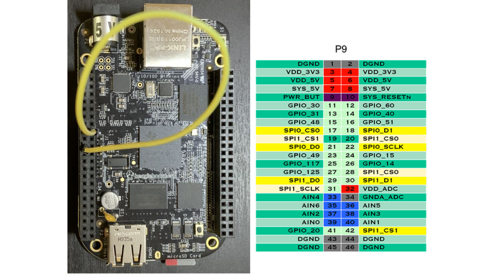

*Hình 12.6 – Loopback SPI0*

Sơ đồ của expansion header P9 được định hướng sao cho header nằm ở phía left-hand của BeagleBone Black khi cổng USB ở dưới cùng. Dây jumper từ SPI0_D1 tới SPI0_D0 tạo thành một kết nối loopback bằng cách đưa MOSI (master out) vào MISO (master in).

> **Lưu ý quan trọng**
>
> Đừng quên chạy lại script `config-spi0.sh` sau khi reboot hoặc tắt bật nguồn BeagleBone Black để re-enable giao diện `/dev/spidev0.0`.

Chạy lại chương trình `spidev_test` với kết nối loopback đã có:

```
$ ./spidev_test -v
spi mode: 0x0
bits per word: 8
max speed: 500000 Hz (500 KHz)
TX | FF FF FF FF FF FF 40 00 00 00 00 95 FF FF FF FF FF FF FF FF FF FF FF FF FF FF FF FF FF FF F0 0D  | ......@.......................
RX | FF FF FF FF FF FF 40 00 00 00 00 95 FF FF FF FF FF FF FF FF FF FF FF FF FF FF FF FF FF FF F0 0D  | ......@.......................
```

Nội dung của RX buffer giờ sẽ khớp với nội dung của TX buffer. Chúng ta đã xác minh rằng giao diện `/dev/spidev0.0` hoạt động đầy đủ. Để biết thêm về pin muxing lúc runtime, bao gồm nguồn gốc của device tree và overlay của BeagleBone Black, tôi khuyên đọc [https://cdn-learn.adafruit.com/downloads/pdf/introduction-to-the-beaglebone-black-device-tree.pdf](https://cdn-learn.adafruit.com/downloads/pdf/introduction-to-the-beaglebone-black-device-tree.pdf).

### Tùy biến device tree

Device tree cape universal của `BeagleBoard.org` rất tốt để làm prototype, nhưng một công cụ như `config-pin` không phù hợp cho sản xuất. Khi xuất xưởng một thiết bị tiêu dùng, chúng ta biết có những ngoại vi nào. Không nên có việc khám phá phần cứng nào trong quá trình boot ngoài việc đọc model và revision number từ một EEPROM. Sau đó U-Boot có thể quyết định device tree và overlay nào cần nạp dựa trên đó. Giống việc chọn kernel module, nội dung của device tree là các quyết định tốt nhất nên được đưa ra lúc biên dịch, không phải lúc runtime.

Cuối cùng, chúng ta sẽ cần tùy biến device tree source cho board AM335x tùy biến của mình. Hầu hết các nhà cung cấp SoC, bao gồm Texas Instruments, cung cấp các công cụ pin mux tương tác để tạo device tree source. Chúng ta sẽ dùng công cụ SysConfig trực tuyến của Texas Instruments để thêm một giao diện `spidev` vào board Nova. Chúng ta đã tùy biến device tree cho Nova hồi mục *Port Linux sang một board mới* của [*Chương 4*](ch04_configuring_and_building_the_kernel.vi.md), *Cấu hình và build kernel*, và lần nữa trong [*Chương 6*](ch06_selecting_a_build_system.vi.md), *Chọn build system,* khi học cách tạo một BSP tùy biến cho Buildroot. Lần này, chúng ta sẽ thêm vào file `am335x-boneblack.dts` thay vì chỉ sao chép nguyên văn.

Truy cập [https://dev.ti.com](https://dev.ti.com) và tạo một tài khoản nếu bạn chưa có. Bạn sẽ cần một tài khoản myTI để truy cập công cụ SysConfig trực tuyến.

Để tạo một tài khoản myTI, làm theo các bước sau:

1. Click nút **Login / Register** ở góc top-right của trang chủ.
2. Điền form **New user**.
3. Click nút **Create account**.

Để khởi chạy công cụ SysConfig, làm theo các bước sau:

1. Click nút **Login / Register** ở góc top-right của trang chủ.
2. Đăng nhập bằng cách nhập địa chỉ email và mật khẩu dưới **Existing myTI user**.
3. Click vào nút SysConfig **Launch** dưới **Cloud tools**.

Nút **Launch** sẽ đưa bạn tới trang bắt đầu của SysConfig tại [https://dev.ti.com/sysconfig/#/start](https://dev.ti.com/sysconfig/#/start), bạn có thể bookmark trang này để truy cập nhanh hơn. SysConfig cho phép chúng ta lưu các thiết kế đang làm lên cloud để có thể xem lại sau.

Để tạo một cấu hình pinmux SPI0 cho AM335x, làm theo các bước sau:

1. Chọn **AM335x** từ menu **Device** dưới **Start a new Design**.

2. Giữ nguyên as-is các lựa chọn mặc định của menu **Part** và **Package** là **Default** và **ZCE** cho AM335x.

3. Click nút **Start**.

4. Chọn **SPI** từ sidebar bên trái.

5. Click nút **ADD** để thêm một SPI vào thiết kế:

   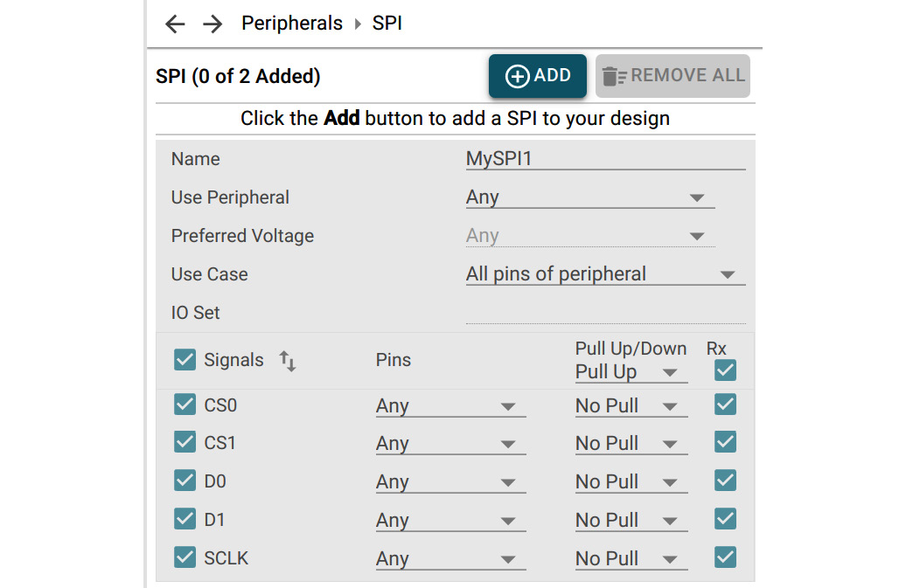

   *Hình 12.7 – Thêm một ngoại vi SPI*

6. Đổi tên **MySP1** thành `SPI0` bằng cách gõ nó vào trường **Name**.

7. Chọn **SPI0** từ menu **Use Peripheral**:

   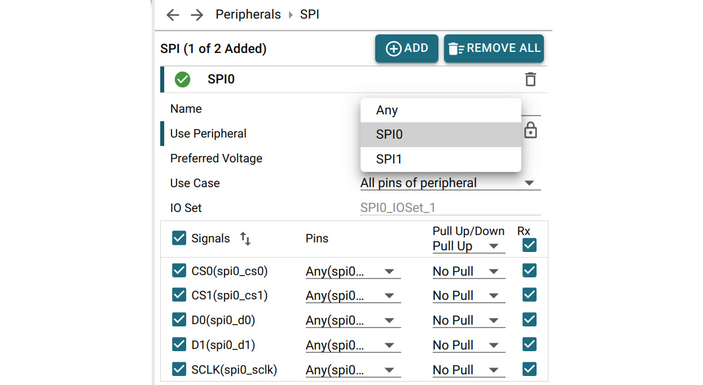

   *Hình 12.8 – Chọn SPI0*

8. Chọn **Master SPI with 1 chip select** từ menu **Use Case**:

   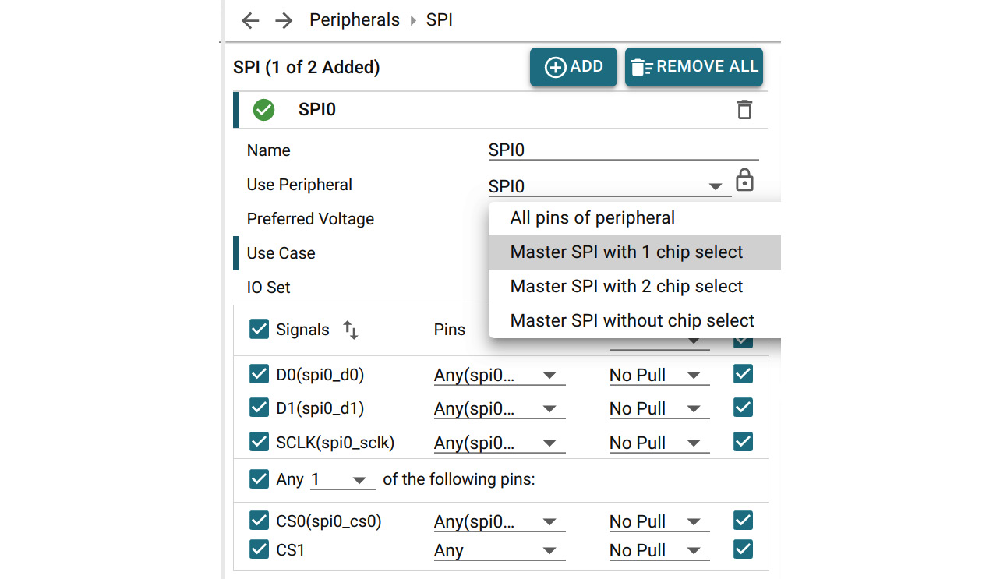

   *Hình 12.9 – Master SPI với 1 chip select*

9. Bỏ chọn checkbox **CS1** để gỡ mục đó.

10. Click vào `devicetree.dtsi` dưới **Generated Files** để xem device tree source.

11. Chọn **Pull Up** từ menu **Pull Up/Down** cho **Signals**:

    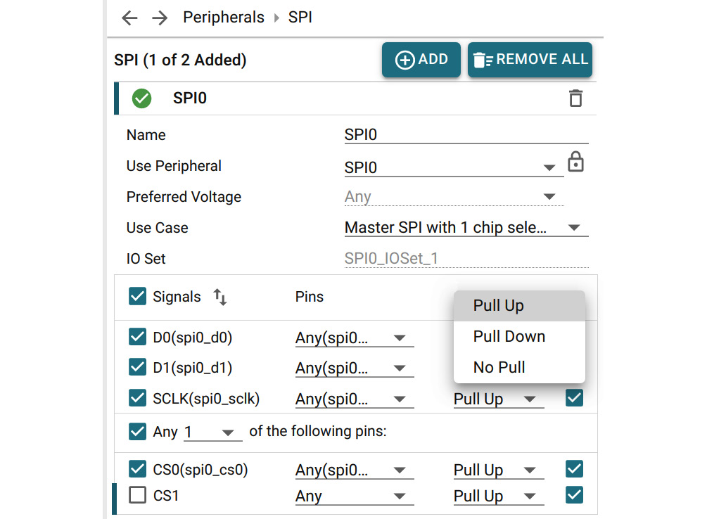

    *Hình 12.10 – Pull up các tín hiệu*

    Hãy để ý việc này đã làm gì với device tree source được hiển thị. Tất cả các instance của `PIN_INPUT` đã được thay bằng `PIN_INPUT_PULLUP`.

12. Bỏ chọn các checkbox **Rx** cho **D1**, **SCLK** và **CS0** vì các chân đó là output từ AM335x master, không phải input:

    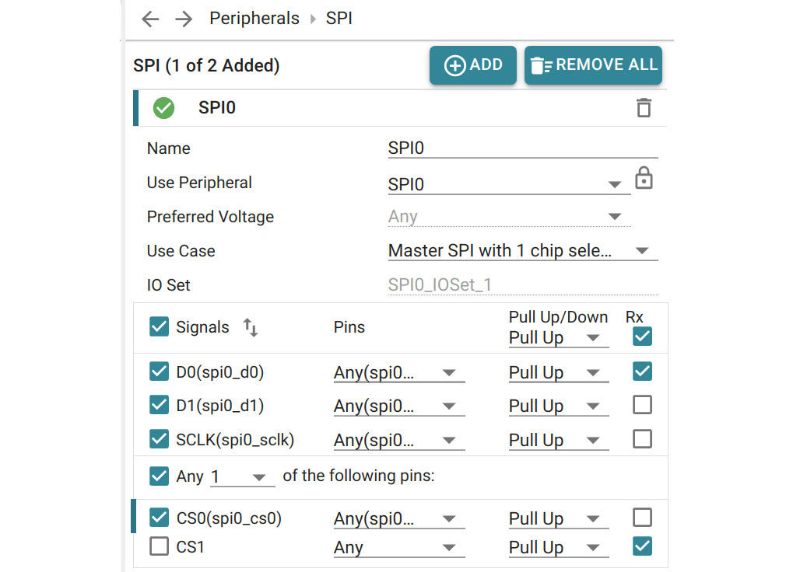

    *Hình 12.11 – Bỏ chọn các ô Rx*

    Chân `D0` tương ứng với MISO (master in, slave out), nên giữ `Rx` được chọn cho chân đó. Các chân `spi0_sclk`, `spi0_d1` và `spi0_cs0` giờ sẽ được cấu hình là `PIN_OUTPUT_PULLUP` trong device tree source. Nhớ rằng tín hiệu SPI CS thường là active low, nên cần một pullup để giữ đường đó không bị thả nổi.

13. Click vào biểu tượng đĩa mềm cho `devicetree.dtsi` để lưu file device tree source vào máy của bạn.

14. Click **Save As** từ menu **File** ở góc top-left để lưu thiết kế.

15. Đặt cho file thiết kế một tên mô tả như `nova.syscfg` và click **SAVE**.

16. Nội dung của file `.dtsi` bạn đã lưu vào máy sẽ trông như thế này:

```
&am33xx_pinmux {
      spi0_pins_default: spi0_pins_default {
           pinctrl-single,pins = <
                AM33XX_IOPAD(0x950, PIN_OUTPUT_PULLUP | MUX_MODE0) /* (A18) spi0_sclk.spi0_sclk */
                AM33XX_IOPAD(0x954, PIN_INPUT_PULLUP | MUX_MODE0) /* (B18) spi0_d0.spi0_d0 */
                AM33XX_IOPAD(0x958, PIN_OUTPUT_PULLUP | MUX_MODE0) /* (B17) spi0_d1.spi0_d1 */
                AM33XX_IOPAD(0x95c, PIN_OUTPUT_PULLUP | MUX_MODE0) /* (A17) spi0_cs0.spi0_cs0 */
           >;
      };
      […]
};
```

Tôi đã bỏ các thiết lập sleep pin tùy chọn vì chúng ta sẽ không cần chúng. Nếu so sánh các địa chỉ chân hệ thập lục phân được thể hiện trong code trên với địa chỉ của cùng các chân SPI0 đó trong `am335x-bone-common-univ.dtsi`, chúng ta sẽ thấy chúng khớp chính xác.

Các chân SPI0 trong `am335x-bone-common-univ.dtsi` đều được cấu hình như sau:

```
AM33XX_IOPAD(0x095x, PIN_OUTPUT_PULLUP | INPUT_EN | MUX_MODE0)
```

Việc dùng bitmask `INPUT_EN` gợi ý rằng cả bốn chân SPI0 trong device tree cape universal đều được cấu hình là input, cũng như output, trong khi thực tế chỉ `spi0_d0` tại `0x954` cần hoạt động như một input.

Bitmask `INPUT_EN` là một trong nhiều macro được định nghĩa trong header file `/opt/source/dtb-4.19-ti/include/dt-bindings/pinctrl/am33xx.h`, có thể được tìm thấy trên Debian Buster IoT image:

```
#define PULL_DISABLE            (1 << 3)
#define INPUT_EN                (1 << 5)
[…]
#define PIN_OUTPUT              (PULL_DISABLE)
#define PIN_OUTPUT_PULLUP       (PULL_UP)
#define PIN_OUTPUT_PULLDOWN     0
#define PIN_INPUT               (INPUT_EN | PULL_DISABLE)
#define PIN_INPUT_PULLUP        (INPUT_EN | PULL_UP)
#define PIN_INPUT_PULLDOWN      (INPUT_EN)
```

Thêm các macro device tree source của TI được định nghĩa trong header file `/opt/source/dtb-4.19-ti/include/dt-bindings/pinctrl/omap.h`:

```
#define OMAP_IOPAD_OFFSET(pa, offset)   (((pa) & 0xffff) - (offset))
[…]
#define AM33XX_IOPAD(pa, val)           OMAP_IOPAD_OFFSET((pa), 0x0800) (val)
```

Giờ chúng ta đã mux đúng các chân SPI0, hãy sao chép và dán device tree source đã tạo vào file `nova.dts`. Khi pingroup `spi0_pins_default` mới này đã được định nghĩa, chúng ta có thể gắn pingroup đó với device node `spi0` bằng cách override nó, như sau:

```
&spi0 {
     status = "okay";
     pinctrl-names = "default";
     pinctrl-0 = <&spi0_pins_default>;
     […]
}
```

Ký hiệu `&` trước tên device node có nghĩa là chúng ta đang tham chiếu tới, và qua đó sửa đổi, một node có sẵn trong device tree thay vì định nghĩa một node mới.

Tôi đã đưa file `nova.dts` hoàn chỉnh vào archive code của sách, trong thư mục `MELP/Chapter12/buildroot/board/melp/nova`.

Để build một Linux image tùy biến với device tree này cho board Nova, làm theo các bước sau:

1. Sao chép `MELP/Chapter12/buildroot` đè lên bản cài Buildroot của bạn:

   ```
   $ cp -a MELP/Chapter12/buildroot/* buildroot
   ```

   Việc này sẽ hoặc thêm một file `nova_defconfig` và thư mục `board/melp/nova` hoặc thay thế các file và thư mục từ `MELP/Chapter06/buildroot`.

2. `cd` tới thư mục nơi bạn đã cài Buildroot:

   ```
   $ cd buildroot
   ```

3. Xóa tất cả các build artifact trước đó:

   ```
   $ make clean
   ```

4. Chuẩn bị build một image cho board Nova:

   ```
   $ make nova_defconfig
   ```

5. Build image:

   ```
   $ make
   ```

Khi build xong, image được ghi vào một file tên `output/images/sdcard.img`. Dùng Etcher để ghi image đó ra thẻ microSD. Xem mục *Nhắm tới phần cứng thật* của *Giới thiệu Buildroot* trong [*Chương 6*](ch06_selecting_a_build_system.vi.md), *Chọn build system*, để biết cách làm điều này. Khi Etcher flash xong, cắm microSD vào BeagleBone Black. Không có SSH daemon nào đi kèm root filesystem, nên bạn sẽ cần gắn một cáp serial để đăng nhập.

Để đăng nhập vào BeagleBone Black qua serial console, làm theo các bước sau:

1. Cắm cáp serial USB to TTL 3.3V từ host Linux tới header J1 trên BeagleBone Black. Bảo đảm dây đen ở đầu FTDI của cáp được nối với chân 1 trên J1. Một serial port sẽ xuất hiện trên host Linux dưới dạng `/dev/ttyUSB0`.

2. Khởi động một chương trình terminal phù hợp, chẳng hạn `gtkterm`, `minicom` hoặc `picocom`, và gắn nó vào port ở tốc độ `115200` **bits per second (bps)** không có flow control. `gtkterm` có lẽ là dễ thiết lập và dùng nhất:

   ```
   $ gtkterm -p /dev/ttyUSB0 -s 115200
   ```

3. Cấp điện cho BeagleBone Black qua barrel connector 5V. Bạn sẽ thấy output U-Boot, output kernel log, và cuối cùng là một login prompt trên serial console.

4. Đăng nhập với tư cách `root` không có mật khẩu.

Cuộn lên hoặc nhập `dmesg` để xem các kernel message trong lúc boot. Các kernel message như sau xác nhận rằng giao diện `spidev0.0` đã được probe thành công qua binding chúng ta định nghĩa trong `nova.dts`:

```
[    1.368869] omap2_mcspi 48030000.spi: registered master spi0
[    1.369813] spi spi0.0: setup: speed 16000000, sample trailing edge, clk normal
[    1.369876] spi spi0.0: setup mode 1, 8 bits/w, 16000000 Hz max --> 0
[    1.372589] omap2_mcspi 48030000.spi: registered child spi0.0
```

Package `spi-tools` được đưa vào root filesystem cho mục đích test. Package gồm các công cụ command-line `spi-config` và `spi-pipe`.

Đây là cách dùng của `spi-config`:

```
# spi-config -h
usage: spi-config options...
  options:
    -d --device=<dev>  use the given spi-dev character device.
    -q --query         print the current configuration.
    -m --mode=[0-3]    use the selected spi mode:
             0: low idle level, sample on leading edge,
             1: low idle level, sample on trailing edge,
             2: high idle level, sample on leading edge,
             3: high idle level, sample on trailing edge.
    -l --lsb={0,1}     LSB first (1) or MSB first (0).
    -b --bits=[7...]   bits per word.
    -s --speed=<int>   set the speed in Hz.
    -r --spirdy={0,1}  consider SPI_RDY signal (1) or ignore it (0).
    -w --wait          block keeping the file descriptor open to avoid speed reset.
    -h --help          this screen.
    -v --version       display the version number.
```

Và đây là cách dùng của `spi-pipe`:

```
# spi-pipe -h
usage: spi-pipe options...
  options:
    -d --device=<dev>    use the given spi-dev character device.
    -s --speed=<speed>   Maximum SPI clock rate (in Hz).
    -b --blocksize=<int> transfer block size in byte.
    -n --number=<int>    number of blocks to transfer (-1 = infinite).
    -h --help            this screen.
    -v --version         display the version number.
```

Tôi sẽ không dùng `spi-tools` trong chương này, mà dựa vào `spidev-test` và một phiên bản sửa đổi của chính chương trình đó mà tôi gọi là `spidev-read`.

Giờ chúng ta đã đi xa với device tree source hết mức mà cuốn sách này sẽ đi. Dù DTS cực kỳ linh hoạt, nó cũng có thể rất gây bực bội. Trình biên dịch `dtc` không thông minh lắm, nên nhiều việc debug device tree source diễn ra lúc runtime bằng `modprobe` và `dmesg`. Quên một pullup hoặc cấu hình nhầm một input thành output khi pin muxing có thể đủ để ngăn một thiết bị được probe. Các module Wi-Fi/Bluetooth có giao diện SDIO đặc biệt khó bring up.

Khi SPI đã xong, giờ là lúc làm quen gần gũi với module GPS. Chúng ta sẽ quay lại chủ đề giao diện `spidev` chung khi đã nối dây xong SparkFun ZOE-M8Q GPS Breakout.

## Làm prototype với breakout board

Giờ chúng ta đã có SPI hoạt động trên BeagleBone Black, hãy chuyển sự chú ý trở lại module GPS. Trước khi có thể nối dây SparkFun ZOE-M8Q GPS Breakout, chúng ta cần hàn một chút. Hàn đòi hỏi không gian bàn làm việc, vật liệu và một khoản đầu tư thời gian đáng kể.

Để thực hiện việc hàn cho project này, bạn sẽ cần các vật dụng sau:

- Một mỏ hàn (chỉnh được nhiệt độ) với đầu hình nón
- Một trong những thứ sau: một tấm silicone anti-slip đặt taplo ô tô, một tấm silicone nướng bánh, hoặc một viên gạch men
- Dây hàn lõi nhựa thông loại mảnh (cỡ 0.031-inch)
- Một giá đỡ mỏ hàn
- Một miếng bọt biển ướt
- Một kìm cắt dây
- Kính bảo hộ
- Một dụng cụ Helping Hands, cùng với một kính lúp và một đèn LED
- Một dao X-Acto #2 với lưỡi #2 hoặc dao #1 với lưỡi #11

Những thứ sau có thì tốt nhưng không bắt buộc:

- Một tấm lót hàn silicone cách nhiệt
- Dây hút thiếc (solder wick)
- Một miếng bọt biển đồng thau
- Sticky tack hoặc một loại chất dính putty-like tương tự
- Bộ dụng cụ nha khoa
- Kìm mũi nhọn
- Nhíp

Hầu hết các vật dụng này được bán kèm trong SparkFun Beginner Tool Kit, nhưng có thể mua ở nơi khác với giá thấp hơn. Nếu bạn mới làm quen với hàn, tôi cũng khuyên kiếm một vài PCB phế liệu để luyện tập trước khi thao tác trên ZOE-M8Q. Các lỗ trên SparkFun GPS Breakout nhỏ và đòi hỏi một bàn tay vững vàng, tinh tế. Một dụng cụ Helping Hands với kính lúp và kẹp cá sấu giúp ích rất nhiều. Một ít sticky tack cũng có thể giữ breakout board cố định trên một bề mặt cứng, phẳng trong khi bạn hàn. Khi xong, dùng dao X-Acto để cạo đi mọi sticky tack thừa trên hoặc gần các điểm tiếp xúc.

Ngay cả khi bạn mới làm quen với điện tử, tôi khuyến khích bạn mạnh dạn học hàn. Có thể mất vài ngày bực bội trước khi bạn quen tay, nhưng sự thỏa mãn khi tự build mạch của mình rất xứng đáng. Tôi khuyên đọc cuốn truyện tranh miễn phí *Soldering is Easy* của MightyOhm, do Mitch Altman và Andie Nordgren thực hiện, để bắt đầu.

Đây là một số mẹo hàn hữu ích của riêng tôi. Lau đầu mỏ hàn bằng một miếng bọt biển đồng thau giữ nó không bị oxy hóa gây phiền toái. Dùng dao X-Acto để cạo đi mọi giọt thiếc lạc khỏi PCB. Dùng mỏ hàn nóng để làm chảy và nghịch một ít thiếc trên tấm silicone để làm quen với các tính chất của nó. Cuối cùng, luôn đeo kính bảo hộ khi làm việc với thiếc nóng để không có giọt nào bắn vào mắt.

### Đóng jumper SPI

Chúng ta đã xác định chân D_SEL trên schematic SparkFun GPS Breakout nằm ở phía left-hand của một jumper tên JP1. Nối chân D_SEL với GND ở phía right-hand của jumper chuyển ZOE-M8Q từ chế độ I2C sang chế độ SPI. Hai pad jumper SPI đã có sẵn một ít thiếc trên đó. Chúng ta cần làm nóng các pad để có thể di chuyển thiếc đó.

Lật breakout board lại để thấy các jumper. Hãy để ý rằng jumper JP1 được gắn nhãn SPI ở giữa bên trái của board:

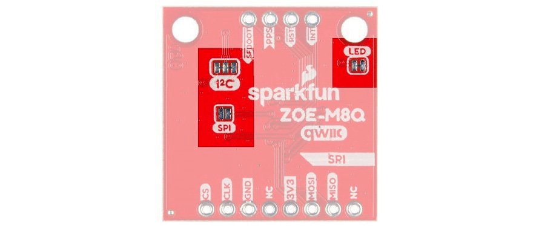

*Hình 12.12 – Các jumper*

Để đóng jumper SPI, hãy làm như sau:

1. Cắm điện và làm nóng mỏ hàn tới 600 °F.
2. Giữ GPS Breakout cố định bằng kẹp cá sấu từ Helping Hands.
3. Đặt kính lúp và đèn LED của Helping Hands sao cho bạn có thể thấy rõ jumper SPI.
4. Đặt đầu mỏ hàn lên các pad trái và phải của jumper SPI cho đến khi thiếc chảy, tạo thành một cầu nối giữa hai pad.
5. Cứ thoải mái thêm thiếc nếu cần.
6. Dùng đầu mỏ hàn để làm chảy và nhấc đi mọi thiếc thừa khỏi các pad jumper.

Cần rất ít thiếc để đóng jumper. Nếu thiếc bắt đầu bốc khói, hãy giảm nhiệt độ mỏ hàn. Khi jumper SPI đã được đóng, truyền thông serial và I2C bị disable trên ZOE-M8Q. Các nhãn chân FTDI và I2C ở mặt trên của breakout board không còn áp dụng. Hãy dùng các nhãn chân SPI ở mặt dưới của board.

> **Mẹo**
>
> Dùng mặt bên của đầu mỏ hàn (còn được gọi là "the sweet spot"), không phải chóp đầu mỏ hàn, để có kết quả tốt nhất.

Chúng ta không cần lặp lại quy trình hàn này cho JP2 vì các pad của jumper đó đã được nối sẵn. JP2 có một pad riêng cho mỗi điện trở pull up I2C 2.2kΩ. Hãy để ý rằng JP2 nằm ngay phía trên JP1 và được gắn nhãn I2C trên breakout board.

Giờ jumper SPI đã được đóng, hãy gắn ăng-ten GNSS.

### Gắn ăng-ten GNSS

Một ăng-ten GNSS bằng gốm hoặc loại dán Molex giúp ZOE-M8Q có được GPS fix. Các connector U.FL rất dễ hỏng và cần được thao tác cẩn thận. Đặt breakout board nằm phẳng trên một bề mặt cứng và dùng kính lúp để bảo đảm ăng-ten được đặt đúng vị trí.

Để gắn ăng-ten GNSS vào connector U.FL, làm theo các bước sau:

1. Căn cáp sao cho connector cái và đầu cáp nằm đều trên bề mặt của connector đực trên board.
2. Đặt nhẹ ngón tay lên trên các connector chồng nhau để bảo đảm connector cái không bị chênh vênh.
3. Kiểm tra hai connector chồng nhau từ phía trên để bảo đảm chúng nằm chính giữa trên nhau.
4. Dùng phần giữa ngón tay ấn mạnh xuống chính giữa connector, cho đến khi bạn cảm thấy hai connector khớp vào nhau.

Giờ ăng-ten đã được gắn, chúng ta sẵn sàng gắn header SPI.

### Gắn header SPI

Chúng ta sẽ dùng sáu dây jumper đực-cái (male to female) để kết nối SparkFun GPS Breakout với BeagleBone Black. Đầu đực của các dây jumper cắm vào expansion header P9 trên BeagleBone Black. Đầu cái cắm vào một hàng header thẳng bẻ được mà chúng ta sẽ hàn lên breakout board. Hàn Through-hole với các chân header đã cắm sẵn có thể khó, vì các chân để lại ít chỗ trong lỗ cho thiếc và đầu mỏ hàn lọt vào. Đó là lý do tôi khuyên dùng thiếc cỡ mảnh (0.031 inch hoặc nhỏ hơn) cho project này.

Nếu bạn chưa có kinh nghiệm thao tác với các linh kiện điện tử nhỏ, trước tiên bạn nên luyện hàn một số header thẳng bẻ được lên một PCB phế liệu. Một chút chuẩn bị thêm có thể giúp bạn tránh làm hỏng và phải thay module GPS ZOE-M8Q đắt tiền. Một mối hàn đúng nên chảy bao quanh chân header và lấp đầy lỗ, tạo thành một gò volcano-shaped. Mối hàn cần chạm vào vòng kim loại quanh lỗ. Mọi khe hở giữa chân và vòng kim loại nhiều khả năng sẽ dẫn đến tiếp xúc kém.

Để chuẩn bị SparkFun GPS Breakout cho việc gắn header SPI, làm theo các bước sau:

1. Bẻ ra một hàng tám chân header.
2. Bẻ ra một hàng bốn chân header.
3. Cắm hàng tám chân qua các lỗ SPI ở mặt dưới của breakout board.
4. Cắm hàng bốn chân qua các lỗ đối diện hàng SPI ở mặt dưới của breakout board. Header này chỉ có tác dụng giữ board ổn định trong khi bạn hàn.
5. Giữ GPS Breakout cố định bằng kẹp cá sấu từ Helping Hands.
6. Đặt kính lúp và đèn LED của Helping Hands sao cho bạn có thể thấy rõ hàng tám lỗ FTDI và I2C ở mặt trên của breakout board.
7. Cắm điện và làm nóng mỏ hàn tới 600 tới 650 °F với thiếc lead-based hoặc 650 tới 700 °F với thiếc lead-free.

Thực hiện các bước sau cho sáu lỗ ở mặt trên của breakout board có nhãn SDA, SCL, GND, 3V3, RXI và TXO:

1. Bôi một viên thiếc rất nhỏ lên đầu mỏ hàn nóng để giúp chuẩn bị mối hàn.
2. Làm nóng chân header và mép vòng kim loại quanh lỗ bằng cách chạm đầu mỏ hàn vào chúng.
3. Với đầu mỏ hàn vẫn giữ nguyên chỗ, đưa thiếc vào mối hàn cho đến khi lỗ được lấp đầy.
4. Kéo thiếc đã chảy lên từ từ bằng đầu mỏ hàn để tạo thành một gò.
5. Cạo đi mọi giọt thiếc lạc bằng dao X-Acto và dùng dây hút thiếc để loại bỏ mọi cầu thiếc vô tình giữa các lỗ.
6. Lau sạch mọi lớp oxy hóa màu đen hình thành trên đầu mỏ hàn bằng bọt biển ướt hoặc bọt biển đồng thau.

Lặp lại các bước này cho đến khi cả sáu chân đã được hàn vào lỗ. Khi xong, mặt trên của breakout board sẽ trông như thế này:

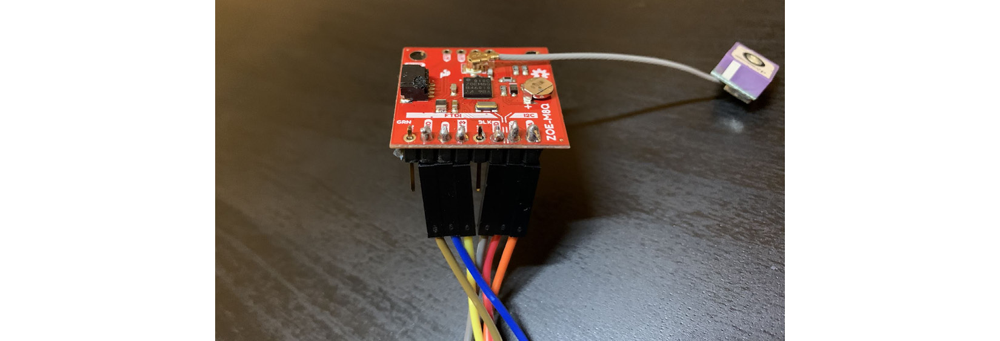

*Hình 12.13 – Các mối hàn*

Lưu ý rằng các dây jumper đã được gắn trong ảnh này, dù chúng ta chưa tới bước đó. Hai lỗ có nhãn NC trong hàng tám không cần hàn vì chúng không được nối với gì.

### Nối các dây jumper SPI

Lật breakout board để mặt dưới lại hiện ra. Làm vậy, chúng ta có thể gắn các dây jumper. Dùng dây đen hoặc xám cho GND và dây đỏ hoặc cam cho 3V3 để tránh nhầm lẫn chúng và làm hỏng breakout board. Dùng các màu khác nhau cho các dây còn lại cũng giúp chúng ta không nhầm lẫn các đường SPI.

Đây là hình dạng đầu cái của sáu dây jumper của tôi khi được cắm vào các chân header ở mặt dưới của breakout board:

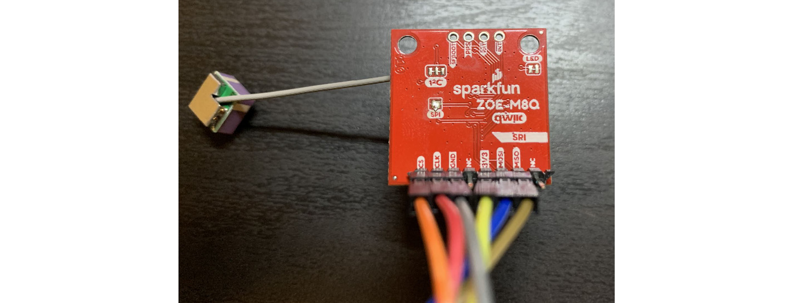

*Hình 12.14 – Đầu cái của các dây jumper SPI*

Để nối đầu đực của các dây jumper SPI tới expansion header P9 trên BeagleBone Black, làm theo các bước sau:

1. Ngắt nguồn khỏi BeagleBone Black.
2. Nối dây GND từ GPS tới chân 1 trên P9.
3. Nối dây CS từ GPS tới chân 17 trên P9.
4. Nối dây CLK từ GPS tới chân 22 trên P9.
5. Nối dây 3V3 từ GPS tới chân 3 trên P9.
6. Nối dây MOSI từ GPS tới chân 18 trên P9.
7. Nối dây MISO từ GPS tới chân 21 trên P9.

Theo quy tắc chung, tốt nhất là nối dây GND trước bất kỳ dây nào khác. Điều này bảo vệ các đường I/O của BeagleBone khỏi mọi phóng tĩnh điện có thể đã tích tụ trên GPS Breakout.

Đầu đực của sáu dây jumper sẽ trông như thế này khi được nối:

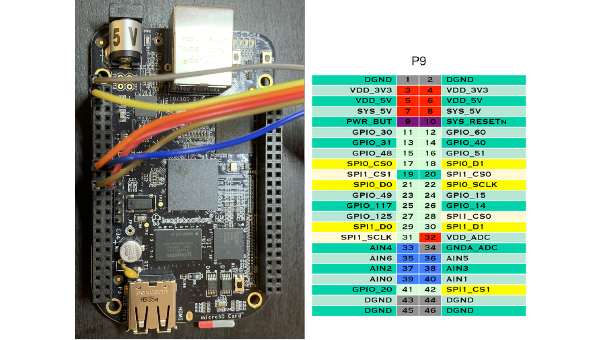

*Hình 12.15 – Đầu đực của các dây jumper SPI*

Trong trường hợp của tôi, dây xám nối với chân 1 là GND và dây vàng nối với chân 3 là 3V3. Dây xanh dương nối với chân 18 là MOSI trên GPS Breakout của tôi. Hãy cẩn thận đừng cắm dây 3V3 vào một trong các chân VDD_5V nằm ngay dưới các chân VDD_3V3 trên P9, vì bạn có thể phá hủy breakout board.

Để enable bus SPI0 trên BeagleBone Black và cấp điện cho GPS Breakout, làm theo các bước sau:

1. Cắm thẻ microSD Debian Buster IoT vào BeagleBone Black.

2. Cấp điện cho BeagleBone Black bằng cách nối nguồn 5V.

3. Kết nối BeagleBone Black với internet bằng cách cắm board vào một port trên router bằng cáp Ethernet.

4. SSH vào BeagleBone Black với tư cách `debian`:

   ```
   $ ssh debian@beaglebone.local
   ```

5. Mật khẩu là `temppwd`.

6. Điều hướng tới thư mục cho chương này, có thể được tìm thấy trong archive của sách:

   ```
   $ cd MELP/Chapter12
   ```

7. Enable giao diện `/dev/spidev0.0`:

   ```
   $ sudo ./config-spi0.sh
   ```

Điều hướng tới thư mục source `spidev-test` và chạy chương trình `spidev_test` back-to-back vài lần:

```
debian@beaglebone:~$ cd MELP/Chapter12/spidev-test
$ ./spidev_test
$ ./spidev_test
```

Nhấn phím *up arrow* giúp chúng ta khỏi phải gõ lại lệnh trước đó. Ở lần thử thứ hai, bạn sẽ thấy một chuỗi NMEA bắt đầu bằng `$GNRMC` trong RX buffer:

```
$ ./spidev_test
spi mode: 0x0
bits per word: 8
max speed: 500000 Hz (500 KHz)
RX | 24 47 4E 52 4D 43 2C 2C 56 2C 2C 2C 2C 2C 2C 2C 2C 2C 2C 4E 2A 34 44 0D 0A 24 47 4E 56 54 47 2C  | $GNRMC,,V,,,,,,,,,,N*4D..$GNVTG,
```

Nếu bạn thấy một câu NMEA trong RX buffer như câu được thể hiện ở đây, thì mọi thứ đã diễn ra đúng kế hoạch. Xin chúc mừng! Các phần khó nhất của project này giờ đã qua. Phần còn lại "chỉ là phần mềm", như chúng ta thích nói trong ngành.

Nếu `spidev_test` không nhận được câu NMEA nào ([https://en.wikipedia.org/wiki/NMEA_0183](https://en.wikipedia.org/wiki/NMEA_0183)) từ module GPS, đây là một số câu hỏi chúng ta nên tự hỏi:

1. Device tree cape universal đã được nạp chưa?

   Chạy script `version.sh` dưới `/opt/scripts/tools` với `sudo` để kiểm tra điều này.

2. Chúng ta đã chạy script `config-spi0` mà không có lỗi chưa?

   Chạy lại `config-spi0` với `sudo` nếu bạn gặp lỗi quyền. Mọi lỗi `No such file or directory` sau đó ngụ ý rằng U-Boot đã không nạp được cape universal tree.

3. LED nguồn trên breakout board có sáng màu đỏ không?

   Nếu không, thì 3V3 chưa được nối, nên GPS Breakout không được cấp điện. Nếu bạn có đồng hồ vạn năng, thì bạn có thể dùng nó để xác định liệu GPS Breakout có thực sự nhận 3.3 V từ BeagleBone Black hay không.

4. Dây jumper GND từ GPS Breakout có được nối với chân 1 hoặc 2 trên P9 không?

   GPS Breakout sẽ không hoạt động nếu không được nối đất đúng cách.

5. Có dây jumper nào bị lỏng ở đầu nào không?

   Cả bốn dây còn lại (CS, SCLK, MISO và MOSI) đều thiết yếu cho một giao diện SPI hoạt động.

6. Các dây jumper MOSI và MISO có bị tráo ở đầu nào không?

   Giống việc tráo các đường TX và RX trên một UART, lỗi này nổi tiếng là dễ mắc. Mã màu cho các dây jumper giúp ích nhưng dán nhãn tên chúng bằng băng dính còn tốt hơn.

7. Các dây jumper CS và SCLK có bị tráo ở đầu nào không?

   Chọn các màu khác biệt cho các dây jumper giúp chúng ta tránh những lỗi như thế này.

Nếu câu trả lời cho tất cả các câu hỏi này đều ổn, thì giờ chúng ta sẵn sàng gắn logic analyzer. Nếu bạn không có logic analyzer, thì tôi đề nghị bạn kiểm tra lại jumper JP1 và cả sáu mối hàn. Bảo đảm các pad jumper JP1 được nối đúng cách. Lấp đầy mọi khe hở giữa các chân header và vòng kim loại bao quanh chúng. Loại bỏ mọi thiếc thừa có thể làm chập hai chân kề nhau. Thêm thiếc vào các mối hàn có thể đang thiếu. Khi bạn hài lòng với việc sửa lại này, hãy nối lại các dây jumper và thử lại bài tập này. Với chút may mắn, kết quả lần này sẽ tốt hơn hoặc khác đi.

Hoàn thành thành công bài tập này kết thúc toàn bộ việc hàn và nối dây cần cho project này. Nếu bạn nóng lòng muốn thấy sản phẩm hoàn chỉnh hoạt động, bạn có thể bỏ qua mục tiếp theo và nhảy thẳng tới mục *Nhận message NMEA qua SPI*. Khi đã có dữ liệu NMEA truyền từ module GPS tới một cửa sổ terminal, chúng ta có thể tiếp tục từ chỗ đã dừng ở đây và học tiếp về tín hiệu SPI và logic số.

## Đo tín hiệu SPI bằng logic analyzer

Ngay cả khi bạn đã thành công nhận NMEA từ module GPS, bạn nên gắn một logic analyzer như Saleae Logic 8 nếu có. Đo các tín hiệu SPI giúp chúng ta hiểu giao thức SPI hoạt động thế nào và đóng vai trò một công cụ hỗ trợ debug mạnh mẽ khi có trục trặc. Trong mục này, chúng ta sẽ dùng một Saleae Logic 8 để lấy mẫu các tín hiệu SPI giữa BeagleBone Black và ZOE-M8Q. Nếu có gì đó sai rõ ràng với bất kỳ tín hiệu nào trong bốn tín hiệu SPI, thì logic analyzer sẽ làm lỗi đó lộ rõ ngay.

Saleae Logic 8 yêu cầu một máy tính xách tay hoặc máy để bàn có cổng USB 2.0. Phần mềm Saleae Logic 1 có sẵn cho Linux, Mac OS X và Windows. Có một script `installdriver.sh` đi kèm phiên bản Linux của Logic, cấp quyền cho phần mềm truy cập thiết bị. Tìm script đó trong thư mục `Drivers` của bản cài Logic và chạy nó từ command line để bạn không cần khởi chạy Logic với `sudo` mỗi lần. Tạo một shortcut tới file thực thi `Logic` trong thư mục cài đặt và đặt nó trên desktop hoặc thanh khởi chạy để truy cập nhanh hơn.

Khi phần mềm Logic 1 đã được cài trên hệ thống, hãy kết nối tới thiết bị bằng cáp USB high-speed đi kèm. Khởi chạy application `Logic` và đợi một lát để phần mềm kết nối và cấu hình thiết bị. Khi cửa sổ Logic báo `Connected` ở phía trên, thì chúng ta sẵn sàng bắt đầu nối dây test bench. Ấn ngón cái xuống đầu rộng của mỗi kẹp test để duỗi các móc kẹp ra và thả ra để kẹp lấy chân. Dùng kính lúp để đọc các nhãn cạnh các through-holes và bảo đảm các kẹp test được quấn chặt quanh các chân tương ứng.

Để lắp ráp một test bench SPI với Saleae Logic 8, làm theo các bước sau:

1. Nối bó cáp nine-pin với logic analyzer. Căn bó cáp sao cho dây xám chỉ vào ký hiệu ground và dây đen chỉ vào số **1** ở mặt dưới của logic analyzer, như được thể hiện ở đây:

   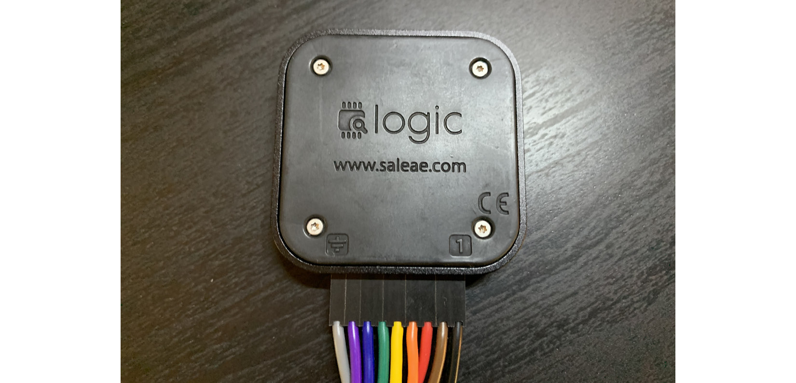

   *Hình 12.16 – Saleae Logic 8*

2. Gắn kẹp test vào đầu các dây xám, cam, đỏ, nâu và đen. Mỗi kẹp test có hai chân kim loại có thể cắm vào connector ở đầu một dây. Chỉ nối một trong các chân này với một dây. Các dây đen, nâu, đỏ và cam tương ứng với bốn kênh đầu tiên trong logic analyzer. Dây xám luôn nối với GND.

3. Ngắt BeagleBone Black khỏi nguồn 5V để nó tắt.

4. Rút đầu cái của tất cả các dây jumper trừ 3V3 khỏi các chân header chúng ta đã hàn lên GPS Breakout.

5. Kẹp chân CS trên GPS Breakout bằng kẹp trên dây cam.

6. Kẹp chân SCLK trên GPS Breakout bằng kẹp trên dây đỏ.

7. Kẹp chân GND trên GPS Breakout bằng kẹp trên dây xám.

8. Bỏ qua các chân NC và 3V3 vì chúng ta không đo các chân đó.

9. Kẹp chân MOSI trên GPS Breakout bằng kẹp trên dây đen.

10. Kẹp chân MISO trên GPS Breakout bằng kẹp trên dây nâu.

11. Nối lại đầu cái của các dây jumper vào các chân header chúng ta đã hàn lên GPS Breakout. Nếu các dây jumper đã được nối, thì chỉ cần trượt đầu cái lên trên chân header một chút và gắn kẹp test. Ấn đầu cái xuống chân để chúng không dễ tuột ra. Bộ lắp ráp hoàn chỉnh sẽ trông đại loại như thế này:

    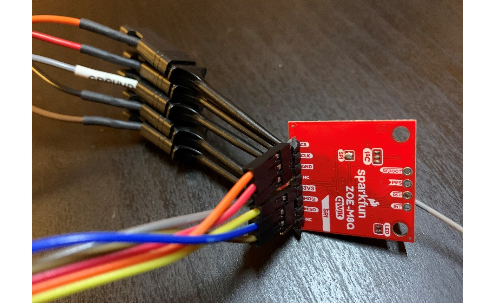

    *Hình 12.17 – Các kẹp test được gắn để đo*

    Trong trường hợp của tôi, dây jumper vàng là 3V3, nên không gắn kẹp test nào vào nó. Dây jumper xanh dương là MOSI, được đo bằng dây đen từ logic analyzer.

12. Nối lại BeagleBone Black với nguồn 5V. GPS Breakout sẽ được cấp điện và LED nguồn onboard sẽ sáng màu đỏ.

Để cấu hình Logic 8 sao cho nó lấy mẫu trên bốn kênh SPI, làm theo các bước sau:

1. Khởi chạy application Logic và đợi nó kết nối với logic analyzer qua cổng USB.

2. Click vào dấu `+` trong pane `Analyzers` để thêm một analyzer:

   

   *Hình 12.18 – Add Analyzer*

3. Chọn `SPI` từ menu pop-up `Add Analyzer`.

4. Click nút `Save` trong hộp thoại `Analyzer Settings`:

   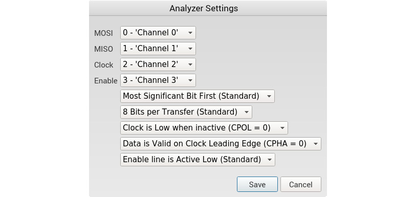

   *Hình 12.19 – Analyzer Settings*

   `CPOL` và `CPHA` là viết tắt của clock polarity và clock phase. CPOL bằng 0 nghĩa là clock ở mức low khi không hoạt động, trong khi CPOL bằng 1 nghĩa là clock ở mức high khi không hoạt động. CPHA bằng 0 nghĩa là dữ liệu hợp lệ ở cạnh đầu của clock, trong khi CPHA bằng 1 nghĩa là dữ liệu hợp lệ ở cạnh sau của clock. Có bốn chế độ SPI: mode 0 (CPOL = 0, CPHA = 0), mode 1 (CPOL = 0, CPHA = 1), mode 2 (CPOL = 1, CPHA = 0) và mode 3 (CPOL = 1, CPHA = 1). ZOE-M8Q mặc định dùng SPI mode 0.

5. Click vào nút bánh răng cạnh `Channel 4` trên sidebar bên trái để mở menu pop-up `Channel Settings`:

   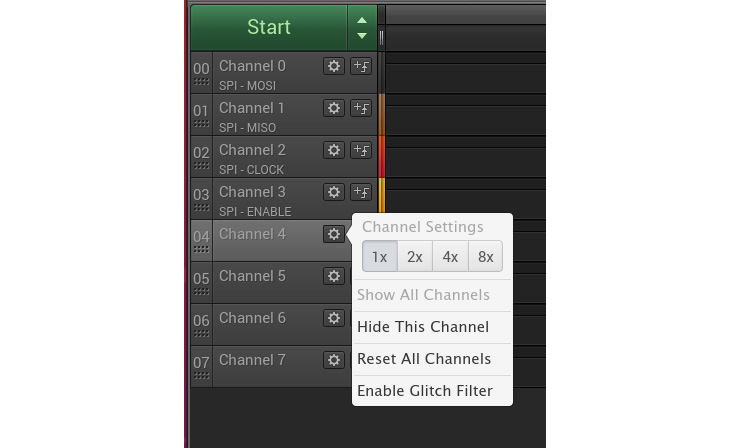

   *Hình 12.20 – Hide This Channel*

6. Chọn `Hide This Channel` từ menu `Channel Settings`.

7. Lặp lại *bước 5* và *6* cho Channels 5, 6 và 7 để chỉ Channels 0 tới 3 hiển thị.

8. Click vào nút bánh răng cạnh Channel 0 (MOSI) trên sidebar bên trái để mở menu pop-up `Channel Settings`.

9. Chọn `4x` từ menu `Channel Settings`:

   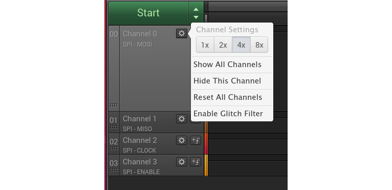

   *Hình 12.21 – Phóng to kênh*

10. Lặp lại *bước 8* và *9* cho Channels 1 tới 3 (MISO, CLOCK và ENABLE) để làm các đồ thị tín hiệu đó lớn hơn.

11. Click vào nút bên phải nút bánh răng của Channel 3 (ENABLE) trên sidebar bên trái để mở menu pop-up `Trigger Settings`. ENABLE tương ứng với SPI CS, nên chúng ta muốn việc lấy mẫu bắt đầu khi nhận được một sự kiện từ kênh đó.

12. Chọn biểu tượng cạnh xuống làm trigger từ menu `Trigger Settings`:

    **

    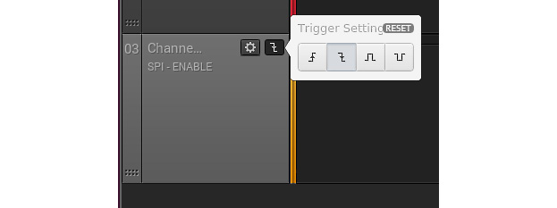

    *Hình 12.22 – Chọn trigger cạnh xuống*

13. Click vào biểu tượng mũi tên lên/xuống trên nút `Start` ở góc top-left để đặt tốc độ và thời lượng lấy mẫu.

14. Giảm tốc độ xuống `2 MS/s` và đặt thời lượng thành `50 Milliseconds`:

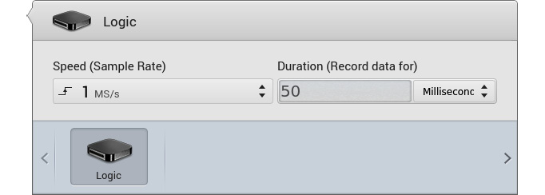

*Hình 12.23 – Giảm tốc độ và thời lượng*

Theo kinh nghiệm, tốc độ lấy mẫu nên ít nhất nhanh gấp bốn lần băng thông. Theo thước đo này, một cổng SPI 1 MHz cần tốc độ lấy mẫu tối thiểu 4 MS/s. Vì `spidev_test` đặt tốc độ cổng SPI là 500 kHz, nên tốc độ lấy mẫu 2 MS/s sẽ vừa đủ để theo kịp. Lấy mẫu thiếu dẫn tới một tín hiệu CLOCK không đều. Các cổng SPI trên BeagleBone Black có thể hoạt động nhanh tới 16 MHz. Thực tế, 16 MHz là tốc độ mặc định của `spi0.0` trong `nova.dts` tùy biến của chúng ta, như `dmesg` cho thấy.

Để bắt một lần truyền SPI từ BeagleBone Black, nhấn nút `Start` ở góc top-left. Nếu tín hiệu CS hoạt động đúng, việc bắt của bạn sẽ không bắt đầu cho đến khi bạn chạy chương trình `spidev_test`.

Khi thực thi `spidev_test` từ terminal `debian@beaglebone`, việc lấy mẫu sẽ được kích hoạt và một đồ thị tương tự như sau sẽ xuất hiện trong cửa sổ `Logic`:

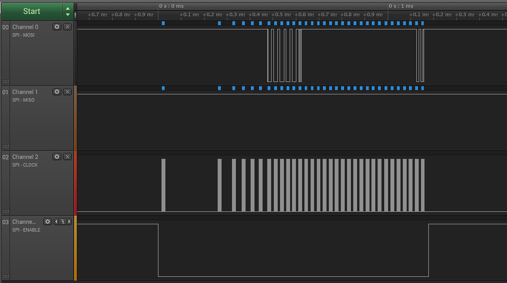

*Hình 12.24 – Lần truyền spidev_test*

Dùng con lăn chuột để phóng to và thu nhỏ bất kỳ đoạn thú vị nào của các đồ thị tín hiệu. Hãy để ý rằng đồ thị ENABLE trên Channel 3 hạ xuống low mỗi khi BeagleBone Black gửi dữ liệu trên Channel 0 (MOSI). Tín hiệu CS cho SPI thường là **active low**, nên đồ thị ENABLE nhảy lên high khi không có dữ liệu nào được truyền. Nếu đồ thị ENABLE giữ ở high, thì không có thêm dữ liệu nào được gửi tới module GPS vì ngoại vi đó không bao giờ được enable trên bus SPI.

Đây là cận cảnh một đoạn thú vị của đồ thị MOSI trên Channel 0:

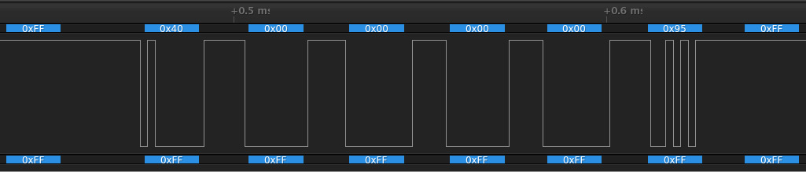

*Hình 12.25 – Đoạn MOSI*

Hãy để ý rằng chuỗi byte `0x40 0x00 0x00 0x00 0x00 0x95` được ghi lại khớp với nội dung của TX buffer mặc định của `spidev_test`. Nếu bạn thấy chuỗi byte này trên Channel 1 thay vào đó, thì các dây MOSI và MISO có thể bị tráo ở đâu đó trong mạch của bạn.

Đây là phần đuôi của lần truyền SPI:

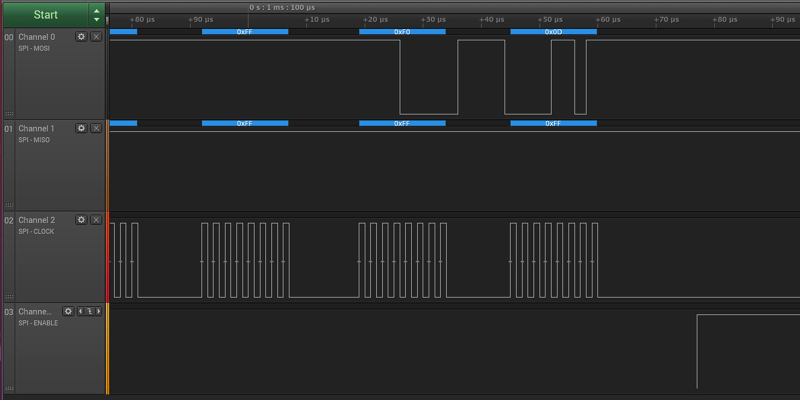

*Hình 12.26 – Kết thúc lần truyền spidev_test*

Hãy để ý rằng hai byte cuối trên Channel 0 (MOSI) của đoạn này là 0xF0 và 0x0D, giống như trong TX buffer mặc định. Ngoài ra, hãy để ý rằng tín hiệu CLOCK trên Channel 2 dao động một số chu kỳ đều đặn mỗi khi một byte được truyền. Nếu tín hiệu CLOCK trông không đều, thì hoặc dữ liệu đang được gửi bị rơi hoặc bị méo, hoặc tốc độ lấy mẫu của bạn không đủ nhanh. Đồ thị tín hiệu cho Channel 1 (MISO) giữ ở high suốt phiên này vì không nhận được message NMEA nào từ module GPS ở lần truyền SPI đầu tiên.

Nếu tín hiệu trên Channel 3 (ENABLE) dừng ở trạng thái logic 0, điều này gợi ý rằng chân đang được đo đã được mux mà không đặt bit `PULL_UP`. Bit `PULL_UP` hoạt động như một điện trở pull up giữ đường ở high khi tín hiệu CS không hoạt động, do đó có thuật ngữ "active low". Nếu bạn thấy thứ trông giống tín hiệu CLOCK trên một kênh khác kênh 2, thì hoặc chúng ta đã đo nhầm chân hoặc đã tráo SCLK với một dây khác ở đâu đó. Nếu các đồ thị tín hiệu khớp với các hình trong ba hình vừa rồi, thì chúng ta đã thành công xác minh rằng SPI đang hoạt động như dự định.

Giờ chúng ta có thêm một công cụ mạnh mẽ khác trong kho vũ khí nhúng. Ngoài SPI, Logic 8 cũng có thể được dùng để đo và phân tích tín hiệu I2C. Chúng ta sẽ dùng nó lần nữa trong mục tiếp theo để xem xét các message NMEA nhận được từ module GPS.

## Nhận message NMEA qua SPI

NMEA là một định dạng data message được hầu hết bộ thu GPS hỗ trợ. ZOE-M8Q xuất các câu NMEA theo mặc định. Các câu này là văn bản ASCII, bắt đầu bằng ký tự `$`, theo sau là các trường comma-separated. Các message NMEA thô không phải lúc nào cũng dễ đọc, nên chúng ta sẽ dùng một parser để thêm các chú thích hữu ích cho các trường dữ liệu.

Điều chúng ta muốn làm là đọc dòng câu NMEA từ ZOE-M8Q ra khỏi giao diện `/dev/spidev0.0`. Vì SPI là full-duplex, điều này cũng có nghĩa là ghi vào `/dev/spidev0.0`, dù chúng ta có thể đơn giản ghi cùng một giá trị 0xFF lặp đi lặp lại. Có một chương trình tên `spi-pipe` được thiết kế để làm loại việc này. Nó là một phần của package `spi-tools`, cùng với `spi-config`. Thay vì dựa vào `spi-pipe`, tôi chọn sửa `spidev-test` để nó stream input ASCII từ module GPS ra stdout. Source cho chương trình `spidev-read` của tôi có thể được tìm thấy trong archive code của sách, trong thư mục `MELP/Chapter12/spidev-read`.

Để biên dịch chương trình `spidev_read`, dùng các lệnh sau:

```
debian@beaglebone:~$ cd MELP/Chapter12/spidev-read
$ gcc spidev_read.c -o spidev_read
```

Bây giờ, chạy chương trình `spidev_read`:

```
$ ./spidev_read
spi mode: 0x0
bits per word: 8
max speed: 500000 Hz (500 KHz)
$GNRMC,,V,,,,,,,,,,N*4D
$GNVTG,,,,,,,,,N*2E
$GNGGA,,,,,,0,00,99.99,,,,,,*56
$GNGSA,A,1,,,,,,,,,,,,,99.99,99.99,99.99*2E
$GNGSA,A,1,,,,,,,,,,,,,99.99,99.99,99.99*2E
$GPGSV,1,1,00*79
$GLGSV,1,1,00*65
$GNGLL,,,,,,V,N*7A
[…]
^C
```

Bạn sẽ thấy một loạt câu NMEA mỗi giây một lần. Nhấn *Ctrl + C* để hủy stream và quay lại command-line prompt.

Hãy bắt các lần truyền SPI này bằng Logic 8:

1. Click vào biểu tượng mũi tên lên/xuống trên nút `Start` ở góc top-left để đổi thời lượng lấy mẫu.
2. Đặt thời lượng mới thành `3` giây.
3. Click nút `Start` ở góc top-left.
4. Chạy lại chương trình `spidev_read`.

Phần mềm Logic sẽ ngừng bắt sau 3 giây và một đồ thị tương tự như sau sẽ xuất hiện trong cửa sổ `Logic`:

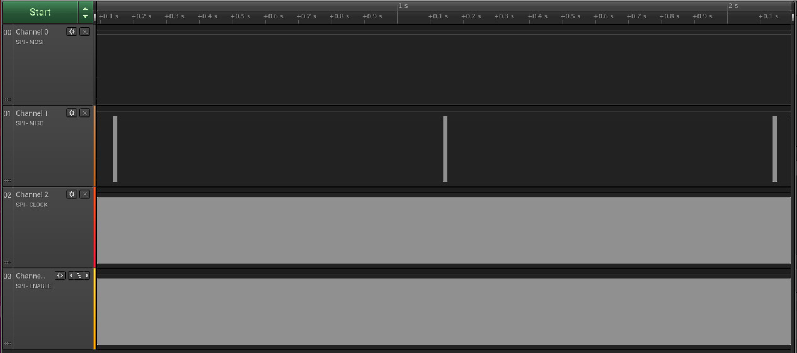

*Hình 12.27 – Các lần truyền spidev_read*

Chúng ta có thể thấy rõ ba loạt câu NMEA trên Channel 1 (MISO) cách nhau chính xác 1 giây.

Phóng to để xem kỹ hơn một trong các câu NMEA này:

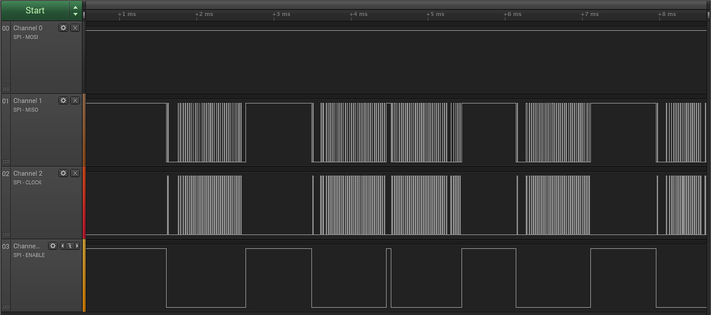

*Hình 12.28 – Đoạn câu NMEA*

Hãy để ý rằng dữ liệu trên kênh MISO giờ trùng với các lần hạ xuống của tín hiệu ENABLE và các dao động trên tín hiệu CLOCK. Chương trình `spidev_read` chỉ ghi các byte `0xFF` ra MOSI, nên không có hoạt động nào trên Channel 0.

Tôi đã đưa vào một script NMEA parser viết bằng Python, cùng với source code `spidev_read`. Script `parse_nmea.py` đó phụ thuộc vào thư viện `pynmea2`.

Để cài `pynmea2` trên BeagleBone Black, dùng lệnh sau:

```
$ pip3 install pynmea2
Looking in indexes: https://pypi.org/simple, https://www.piwheels.org/simple
Collecting pynmea2
  Downloading https://files.pythonhosted.org/packages/88/5f/a3d09471582e710b4871e41b0b7792be836d6396a2630dee4c6ef44830e5/pynmea2-1.15.0-py3-none-any.whl
Installing collected packages: pynmea2
Successfully installed pynmea2-1.15.0
```

Để pipe output của `spidev_read` vào NMEA parser, dùng lệnh sau:

```
$ cd MELP/Chapter12/spidev-read
$ ./spidev_read | ./parse_nmea.py
```

Output NMEA đã parse trông như sau:

```
<RMC(timestamp=None, status='V', lat='', lat_dir='', lon='', lon_dir='', spd_over_grnd=None, true_course=None, datestamp=None, mag_variation='', mag_var_dir='') data=['N']>
<VTG(true_track=None, true_track_sym='', mag_track=None, mag_track_sym='', spd_over_grnd_kts=None, spd_over_grnd_kts_sym='', spd_over_grnd_kmph=None, spd_over_grnd_kmph_sym='', faa_mode='N')>
<GGA(timestamp=None, lat='', lat_dir='', lon='', lon_dir='', gps_qual=0, num_sats='00', horizontal_dil='99.99', altitude=None, altitude_units='', geo_sep='', geo_sep_units='', age_gps_data='', ref_station_id='')>
<GSA(mode='A', mode_fix_type='1', sv_id01='', sv_id02='', sv_id03='', sv_id04='', sv_id05='', sv_id06='', sv_id07='', sv_id08='', sv_id09='', sv_id10='', sv_id11='', sv_id12='', pdop='99.99', hdop='99.99', vdop='99.99')>
<GSA(mode='A', mode_fix_type='1', sv_id01='', sv_id02='', sv_id03='', sv_id04='', sv_id05='', sv_id06='', sv_id07='', sv_id08='', sv_id09='', sv_id10='', sv_id11='', sv_id12='', pdop='99.99', hdop='99.99', vdop='99.99')>
<GSV(num_messages='1', msg_num='1', num_sv_in_view='00')>
<GSV(num_messages='1', msg_num='1', num_sv_in_view='00')>
<GLL(lat='', lat_dir='', lon='', lon_dir='', timestamp=None, status='V', faa_mode='N')>
[…]
```

Module GPS của tôi không thể thấy vệ tinh nào hay có được vị trí cố định. Điều này có thể do nhiều lý do, chẳng hạn chọn sai ăng-ten GPS hoặc không có line-of-sight thông thoáng lên bầu trời. Nếu bạn gặp các thất bại tương tự, điều đó không sao. RF rất phức tạp và mục tiêu của chương này chỉ là chứng minh chúng ta có thể làm truyền thông SPI với module GPS hoạt động. Giờ chúng ta đã làm được điều đó, chúng ta có thể bắt đầu thử nghiệm với các ăng-ten GPS thay thế và nhiều tính năng nâng cao hơn của ZOE-M8Q, chẳng hạn hỗ trợ giao thức message UBX phong phú hơn nhiều.

Với dữ liệu NMEA giờ đang truyền ra terminal, project của chúng ta đã hoàn tất. Chúng ta đã thành công xác minh rằng BeagleBone Black có thể giao tiếp với ZOE-M8Q qua SPI. Nếu bạn đã bỏ qua mục *Đo tín hiệu SPI bằng logic analyzer*, giờ là lúc tốt để quay lại bài tập đó. Giống I2C, SPI được hầu hết SoC hỗ trợ, nên đáng để làm quen, đặc biệt nếu application của bạn cần các ngoại vi high-speed.

## Tóm tắt

Trong chương này, chúng ta đã học cách tích hợp một ngoại vi với một SoC phổ biến. Để làm điều đó, chúng ta đã phải mux các chân và sửa device tree source bằng kiến thức thu được từ data sheet và schematic. Không có phần cứng hoàn chỉnh trong tay, chúng ta đã phải dựa vào một breakout board và hàn một chút để linh kiện có thể được nối dây với một dev board. Cuối cùng, chúng ta đã học cách dùng logic analyzer để xác minh và xử lý sự cố tín hiệu điện. Giờ chúng ta đã có phần cứng hoạt động, chúng ta có thể bắt đầu phát triển application nhúng của mình.

Hai chương tiếp theo hoàn toàn nói về khởi động hệ thống và các lựa chọn khác nhau bạn có cho chương trình `init`, từ `init` BusyBox đơn giản tới các hệ thống phức tạp hơn như System V `init`, `systemd` và `runit` của BusyBox. Lựa chọn chương trình `init` của bạn có thể có ảnh hưởng lớn tới trải nghiệm người dùng của sản phẩm, cả về thời gian boot lẫn khả năng chịu lỗi.

## Đọc thêm

Các tài liệu sau cung cấp thêm thông tin về các chủ đề đã được giới thiệu trong chương này:

- *Introduction to SPI Interface*, của Piyu Dhaker: [https://www.analog.com/en/analog-dialogue/articles/introduction-to-spi-interface.html](https://www.analog.com/en/analog-dialogue/articles/introduction-to-spi-interface.html)
- *Soldering is Easy*, của Mitch Altman, Andie Nordgren và Jeff Keyzer: [https://mightyohm.com/blog/2011/04/soldering-is-easy-comic-book](https://mightyohm.com/blog/2011/04/soldering-is-easy-comic-book)
- *SparkFun GPS Breakout (ZOE-M8Q and SAM-M8Q) Hookup Guide*, của Elias the Sparkiest: [https://learn.sparkfun.com/tutorials/sparkfun-gps-breakout-zoe-m8q-and-sam-m8q-hookup-guide](https://learn.sparkfun.com/tutorials/sparkfun-gps-breakout-zoe-m8q-and-sam-m8q-hookup-guide)
