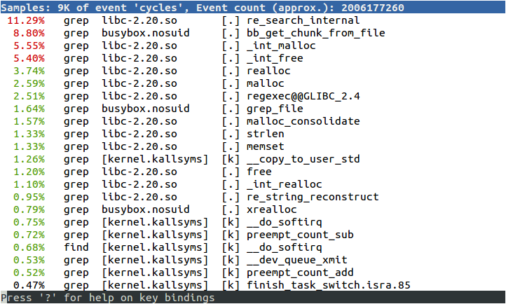
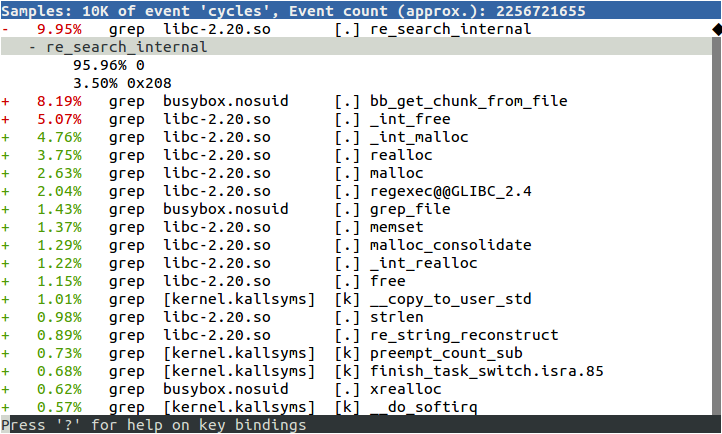
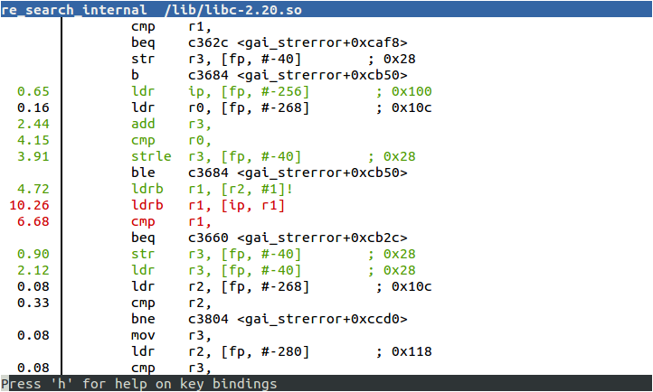
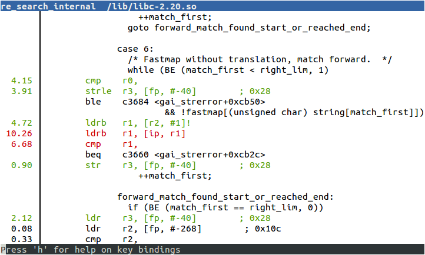
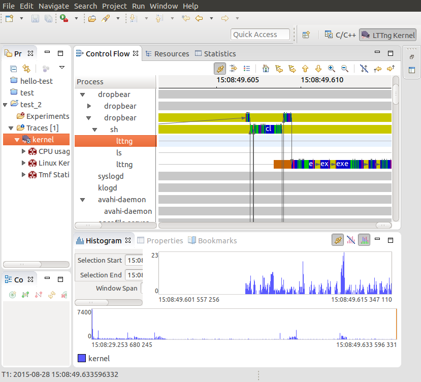

# Chương 13. Profiling và tracing

Debug tương tác bằng source level debugger, như chương trước, giúp hiểu cách chương trình hoạt động, nhưng giới hạn góc nhìn vào phần code nhỏ. Trong chương này, tôi xem bức tranh lớn hơn để biết hệ thống có hoạt động như dự kiến không.

Lập trình viên và người thiết kế hệ thống nổi tiếng là đoán kém vị trí bottleneck. Vì vậy, nếu hệ thống có vấn đề hiệu năng, nên bắt đầu xem toàn hệ thống rồi đi sâu dần bằng công cụ tinh vi hơn. Trong chương này tôi bắt đầu bằng lệnh well-known `top` để có tổng quan. Thường vấn đề được khoanh vùng vào một chương trình, có thể phân tích bằng Linux profiler `perf`. Nếu vấn đề không cục bộ như vậy và muốn bức tranh rộng hơn, `perf` cũng làm được. Để chẩn đoán vấn đề liên quan kernel, tôi mô tả công cụ trace `Ftrace` và `LTTng` như phương tiện thu thập thông tin chi tiết.

Tôi cũng trình bày Valgrind; nhờ môi trường thực thi sandbox, nó giám sát chương trình và báo về code khi chạy. Cuối chương là mô tả công cụ trace đơn giản `strace`, cho thấy thực thi chương trình bằng trace các system call.

## Hiệu ứng người quan sát

Trước khi đi vào công cụ, hãy nói về điều công cụ cho thấy. Như nhiều lĩnh vực, đo một thuộc tính ảnh hưởng chính quan sát đó. Đo dòng điện trong dây cần đo sụt áp qua điện trở nhỏ. Nhưng chính điện trở ảnh hưởng dòng điện. Profiling cũng vậy: mọi quan sát hệ thống tốn CPU cycle, tài nguyên không còn dành cho ứng dụng. Công cụ đo còn làm xáo trộn caching, chiếm memory space và ghi disk, tất cả khiến tình hình tệ hơn. Không có phép đo không overhead. Tôi thường nghe kỹ sư nói kết quả profiling hoàn toàn gây hiểu lầm. Thường vì họ đo trên thứ gần với tình huống thực tế. Luôn cố đo trên target, dùng release build phần mềm, data set hợp lệ và ít service bổ sung nhất có thể.

### Symbol table và compile flag

Chúng ta gặp vấn đề ngay. Dù cần quan sát hệ thống ở trạng thái tự nhiên, công cụ thường cần thông tin bổ sung để hiểu sự kiện.

Một số công cụ cần tùy chọn kernel đặc biệt, cụ thể trong các công cụ phần giới thiệu là `perf`, `Ftrace`, `LTTng`. Vì vậy, có lẽ bạn phải build và triển khai kernel mới cho kiểm thử.

Debug symbol rất hữu ích để chuyển raw program address thành tên hàm và dòng code. Triển khai executable có debug symbol không đổi thực thi code, nhưng yêu cầu có bản binary và kernel được biên dịch với `debug`, ít nhất cho thành phần muốn profile. Một số công cụ hoạt động tốt nhất nếu cài chúng trên target system, ví dụ `perf`. Kỹ thuật giống debug thông thường đã bàn trong Chương 12, Debug bằng GDB.

Nếu muốn công cụ tạo call graph, có thể phải biên dịch có bật stack frame. Nếu muốn gắn địa chỉ với dòng code chính xác, có thể cần mức optimization thấp hơn.

Cuối cùng, một số công cụ cần chèn instrumentation vào chương trình để capture sample, nên phải biên dịch lại thành phần đó. Áp dụng cho `gprof` với ứng dụng, `Ftrace` và `LTTng` với kernel.

Lưu ý càng thay đổi hệ thống đang quan sát, càng khó liên hệ phép đo với production system.

Tốt nhất theo cách wait-and-see, chỉ thay đổi khi nhu cầu rõ ràng, nhớ rằng mỗi lần làm vậy bạn đổi thứ đang đo.

## Bắt đầu profile

Khi xem toàn hệ thống, điểm khởi đầu tốt là công cụ đơn giản như `top`, cho tổng quan rất nhanh. Nó cho biết memory đang dùng, process nào ăn CPU cycle, phân bố trên các core và theo thời gian.

Nếu `top` cho thấy một ứng dụng dùng hết CPU cycle ở user space, có thể profile ứng dụng bằng `perf`.

Nếu từ hai process có CPU usage cao, có lẽ có thứ nối chúng với nhau, như data communication. Nếu nhiều cycle dành cho system call hoặc xử lý interrupt, có thể có vấn đề cấu hình kernel hay device driver. Cả hai trường hợp nên bắt đầu profile toàn hệ thống, cũng bằng `perf`.

Nếu muốn biết thêm về kernel và trình tự sự kiện, dùng `Ftrace` hoặc `LTTng`.

Có vấn đề khác `top` không giúp được. Nếu có code multi-threaded bị treo, hoặc data corruption ngẫu nhiên, Valgrind cùng Helgrind plug-in có thể hữu ích. Memory leak cũng thuộc nhóm này: tôi đã trình bày chẩn đoán memory-related trong Chương 11, Quản lý memory.

## Profiling bằng top

`top` là công cụ đơn giản không cần tùy chọn kernel đặc biệt hay symbol table. Có bản cơ bản trong BusyBox, bản nhiều chức năng hơn trong package `procps`, có trong Yocto Project và Buildroot. Cũng có thể cân nhắc `htop`, chức năng tương tự `top` nhưng giao diện đẹp hơn (theo một số người).

Đầu tiên tập trung dòng tổng hợp của `top`, là dòng thứ hai nếu dùng BusyBox, thứ ba nếu dùng `procps` `top`. Ví dụ với BusyBox `top`:

```
Mem: 57044K used, 446172K free, 40K shrd, 3352K buff, 34452K cached
CPU:  58% usr   4% sys   0% nic   0% idle  37% io   0% irq   0% sirq
Load average: 0.24 0.06 0.02 2/51 105
  PID  PPID USER     STAT   VSZ %VSZ %CPU COMMAND
  105   104 root     R    27912   6%  61% ffmpeg -i track2.wav
  [...]
```

Dòng tổng hợp cho tỷ lệ phần trăm thời gian chạy trong các trạng thái như bảng:

| procps | Busybox |  |
|---|---|---|
| `us` | `usr` | Chương trình user space có nice value mặc định |
| `sy` | `sys` | Kernel code |
| `ni` | `nic` | Chương trình user space có nice value non-default |
| `id` | `idle` | Idle |
| `wa` | `io` | I/O wait |
| `hi` | `irq` | Hardware interrupt |
| `si` | `sirq` | Software interrupt |
| `st` | `--` | Steal time: Chỉ liên quan môi trường ảo hóa |

Trong ví dụ trên, gần như toàn thời gian (58%) dành cho user mode, một ít (4%) cho system mode, nên đây là hệ thống CPU-bound ở user space. Dòng đầu sau tổng hợp cho biết chỉ một ứng dụng chịu trách nhiệm: `ffmpeg`. Mọi nỗ lực giảm CPU usage nên hướng vào đó.

Đây là ví dụ khác:

```
Mem: 13128K used, 490088K free, 40K shrd, 0K buff, 2788K cached
CPU:   0% usr  99% sys   0% nic   0% idle   0% io   0% irq   0% sirq
Load average: 0.41 0.11 0.04 2/46 97
  PID  PPID USER     STAT   VSZ %VSZ %CPU COMMAND
   92    82 root     R     2152   0% 100% cat /dev/urandom
  [...]
```

Hệ thống này dành gần như toàn thời gian ở kernel space do `cat` đọc `/dev/urandom`. Trong trường hợp nhân tạo này, profile riêng `cat` không giúp, nhưng profile kernel function do `cat` gọi có thể giúp.

View mặc định `top` chỉ hiện process, nên CPU usage là tổng mọi thread trong process. Nhấn H xem từng thread. Tương tự, nó cộng thời gian mọi CPU. Nếu dùng `procps top`, nhấn phím 1 để xem tổng hợp mỗi CPU.

Giả sử có một user space process chiếm phần lớn thời gian, hãy xem cách profile nó.

### Profiler của người nghèo

Có thể profile ứng dụng chỉ bằng GDB, dừng ở khoảng bất kỳ và xem đang làm gì. Đây là profiler của người nghèo, dễ thiết lập và là một cách thu thập profile data.

Quy trình đơn giản được giải thích ở đây:

1\. Attach process bằng `gdbserver` (debug từ xa) hoặc gbd (cho

debug trực tiếp). Process dừng.

2\. Quan sát hàm nơi dừng. Có thể dùng lệnh `backtrace GDB`

để xem call stack.

3\. Gõ `continue` để chương trình tiếp tục. 4. Sau một lúc, gõ Ctrl + C để dừng lại rồi quay bước 2.

Lặp bước 2 đến 4 vài lần, nhanh chóng biết nó đang lặp hay có tiến triển; lặp đủ thường xuyên sẽ hình dung được hotspot trong code.

Có cả website dành cho ý tưởng tại `http://poormansprofiler.org`, cùng script giúp dễ hơn. Tôi đã dùng kỹ thuật nhiều lần qua các năm với nhiều operating system, debugger.

Đây là ví dụ statistical profiling, lấy mẫu trạng thái chương trình định kỳ. Sau một số sample, bắt đầu biết xác suất thống kê hàm được thực thi. Đáng ngạc nhiên là cần rất ít sample. Statistical profiler khác gồm `perf record`, `OProfile`, `gprof`.

Sampling bằng debugger mang tính xâm lấn vì chương trình dừng trong khoảng đáng kể khi thu sample. Công cụ khác làm được với overhead thấp hơn nhiều.

Giờ tôi xem cách dùng `perf` cho statistical profiling.

## Giới thiệu perf

`perf` viết tắt Linux performance event counter subsystem, `perf_events`, cũng là tên công cụ command-line tương tác với `perf_events`. Cả hai thuộc kernel từ Linux 2.6.31. Có nhiều thông tin hữu ích trong Linux source tree tại `tools/perf/Documentation`, cũng như `https://perf.wiki.kernel.org`. Động lực ban đầu phát triển `perf` là cung cấp cách thống nhất truy cập register performance measurement unit (PMU), thành phần của phần lớn processor core hiện đại. Khi API được định nghĩa và tích hợp Linux, mở rộng bao phủ các loại performance counter khác là hợp lý.

Cốt lõi `perf` là tập event counter với rule về khi nào chủ động thu dữ liệu. Bằng đặt rule, có thể capture dữ liệu toàn hệ thống, riêng kernel, hoặc một process cùng child, trên mọi CPU hay chỉ một. Rất linh hoạt. Chỉ công cụ này, có thể bắt đầu nhìn toàn hệ thống rồi thu hẹp vào device driver có vẻ gây vấn đề, ứng dụng chạy chậm, hoặc library function dường như thực thi lâu hơn dự kiến.

Code công cụ command-line `perf` thuộc kernel, ở thư mục `tools/perf`. Công cụ và kernel subsystem phát triển hand-in-hand, nghĩa là phải cùng phiên bản kernel. `perf` làm được nhiều. Trong chương, tôi chỉ xét vai trò profiler. Để biết khả năng khác, đọc man page `perf` và tài liệu đoạn trước.

### Cấu hình kernel cho perf

Cần kernel cấu hình cho `perf_events` và lệnh `perf` cross compile để chạy target. Cấu hình kernel liên quan là `CONFIG_PERF_EVENTS`, trong menu General setup \| Kernel Performance Events And Counters.

Nếu muốn profile bằng tracepoint — sẽ bàn thêm sau — bật cả tùy chọn phần `Ftrace`. Nhân tiện, nên bật `CONFIG_DEBUG_INFO`.

Lệnh `perf` có nhiều dependency khiến cross compile khá rối. Tuy nhiên, cả Yocto Project và Buildroot đều có target package.

Cũng cần debug symbol trên target cho binary muốn profile, nếu không `perf` không resolve được địa chỉ thành symbol có nghĩa. Lý tưởng là có debug symbol cả hệ thống gồm kernel. Với kernel, nhớ debug symbol ở file `vmlinux`.

### Build perf bằng Yocto Project

Nếu dùng kernel linux-yocto chuẩn, `perf_events` đã bật, không cần làm thêm.

Để build công cụ `perf`, có thể thêm rõ vào dependency target image, hoặc thêm feature tools-profile, đồng thời đưa vào `gprof`. Như đã nói, có lẽ muốn debug symbol trên target image và kernel image `vmlinux`. Tổng cộng, đây là thứ cần trong `conf/local.conf`:

```
EXTRA_IMAGE_FEATURES = "debug-tweaks dbg-pkgs tools-profile"
IMAGE_INSTALL_append = " kernel-vmlinux"
```

### Build perf bằng Buildroot

Nhiều cấu hình kernel Buildroot không có `perf_events`, nên trước tiên kiểm tra kernel gồm các tùy chọn phần trước.

Để cross compile perf, chạy Buildroot `menuconfig`, chọn:

- `BR2_LINUX_KERNEL_TOOL_PERF` trong Kernel \| Linux Kernel Tools. Để build package có debug symbol và cài unstripped trên target, chọn hai thiết lập sau.

- `BR2_ENABLE_DEBUG` trong menu Build options \| build packages with debugging symbols.

- `BR2_STRIP = none` trong menu Build options \| strip command for binaries on target.

Sau đó chạy `make clean`, rồi `make`.

Build xong mọi thứ, phải sao chép `vmlinux` vào target image thủ công.

### Profiling bằng perf

Có thể dùng `perf` lấy mẫu trạng thái chương trình bằng một event counter, tích lũy sample theo thời gian để tạo profile. Đây là ví dụ khác statistical profiling. Event counter mặc định là cycles, generic hardware counter được map vào PMU register biểu diễn số cycle ở core clock frequency. Tạo profile bằng `perf` có hai bước: lệnh `perf record` capture sample và ghi file `perf.data` (mặc định), rồi `perf report` phân tích kết quả. Cả hai chạy trên target. Sample thu được lọc theo process và child của lệnh chỉ định. Đây là ví dụ profile shell script tìm chuỗi `linux`:

```
# perf record sh -c "find /usr/share | xargs grep linux >
/dev/null"
[ perf record: Woken up 2 times to write data ]
[ perf record: Captured and wrote 0.368 MB perf.data (~16057
samples) ]
# ls -l perf.data
-rw-------    1 root     root      387360 Aug 25  2015 perf.data
```

Giờ hiển thị kết quả từ `perf.data` bằng lệnh `perf report`. Có ba giao diện chọn trên command line:

- `--stdio`: Giao diện thuần text, không tương tác. Phải khởi chạy `perf report` và annotate cho mỗi view trace.

- `--tui`: Giao diện menu text-based đơn giản, cho chuyển giữa màn hình.

- `--gtk`: Giao diện đồ họa, còn lại hoạt động giống `--tui`.

Mặc định là TUI, như ví dụ:



`perf` ghi được kernel function thực thi thay mặt process vì thu sample trong kernel space.

Danh sách xếp hàm hoạt động nhiều nhất trước. Trong ví dụ, mọi sample trừ một được capture khi `grep` chạy. Một số trong library `libc-2.20`, một số trong chương trình `busybox.nosuid`, một số trong kernel. Có symbol name cho program và library function vì mọi binary cài trên target có debug information; kernel symbol được đọc từ `/boot/vmlinux`. Nếu `vmlinux` ở nơi khác, thêm `-k <path>` vào lệnh `perf report`. Thay vì lưu sample trong `perf.data`, có thể lưu file khác bằng `perf record -o <file name>`, phân tích bằng `perf report -i <file name>`.

Mặc định, `perf record` lấy mẫu tần số 1000Hz bằng cycles counter.

Tần số 1000Hz có thể cao hơn thực cần, gây observer effect. Thử tốc độ thấp hơn: theo kinh nghiệm tôi, 100Hz đủ phần lớn trường hợp. Đặt sample frequency bằng tùy chọn `-F`.

### Call graph

Điều này vẫn chưa thật dễ: hàm đầu danh sách phần lớn là memory operation cấp thấp, khá chắc đã tối ưu. Sẽ tốt nếu lùi lại xem hàm được gọi từ đâu. Làm được bằng capture backtrace mỗi sample, với tùy chọn `-g` cho `perf record`. Giờ `perf report` hiện dấu cộng (+) nơi hàm thuộc call chain. Có thể mở rộng trace xem hàm thấp hơn trong chain:



Tạo call graph dựa khả năng lấy call frame từ stack, giống yêu cầu backtrace GDB. Thông tin unwind stack được mã hóa trong debug information executable, nhưng không phải mọi tổ hợp kiến trúc và toolchain đều làm được.

### perf annotate

Đã biết cần xem hàm nào, sẽ tốt nếu đi vào xem code và hit count mỗi instruction. Đó là việc `perf annotate` làm, bằng gọi `objdump` cài trên target. Chỉ cần dùng `perf annotate` thay `perf report`.

`perf annotate` cần symbol table cho executable và vmlinux. Đây là ví dụ hàm được chú giải:



Nếu muốn source code xen kẽ assembler, có thể sao chép phần liên quan lên target. Nếu dùng Yocto Project và build với extra image feature `dbg-pkgs`, hoặc cài riêng package `-dbg`, source đã được cài trong `/usr/src/debug`. Nếu không, có thể xem debug information để biết vị trí source code:

```
$ arm-buildroot-linux-gnueabi-objdump --dwarf lib/libc-2.19.so  |
grep DW_AT_comp_dir
  <3f>   DW_AT_comp_dir : /home/chris/buildroot/output/build/host-
gcc-initial-4.8.3/build/arm-buildroot-linux-gnueabi/libgcc
```

Path trên target phải giống hệt path thấy trong `DW_AT_comp_dir`.

Đây là ví dụ chú giải với source và assembler code:



## Profiler khác: OProfile và gprof

Hai statistical profiler này có trước `perf`. Cả hai là tập con chức năng `perf`, nhưng vẫn khá phổ biến. Tôi chỉ nhắc ngắn gọn.

OProfile là kernel profiler bắt đầu năm 2002. Ban đầu có kernel sampling code riêng, nhưng bản gần đây dùng hạ tầng `perf_events` cho việc đó. Thêm thông tin tại `http://oprofile.sourceforge.net`. OProfile gồm thành phần kernel-space, user space daemon và lệnh phân tích.

OProfile cần bật hai tùy chọn kernel:

- `CONFIG_PROFILING` trong General setup \| Profiling support

- `CONFIG_OPROFILE` trong General setup \| OProfile system profiling

Nếu dùng Yocto Project, thành phần user-space được cài như phần image feature `tools-profile`. Nếu dùng Buildroot, package bật bằng `BR2_PACKAGE_OPROFILE`.

Thu sample bằng lệnh:

```
# operf <program>
```

Chờ ứng dụng kết thúc hoặc nhấn Ctrl + C để dừng profiling. Profile data lưu trong `<cur-dir>/oprofile_data/samples/current`.

Dùng `opreport` tạo tổng hợp profile. Có nhiều tùy chọn được mô tả trong OProfile manual.

`gprof` thuộc GNU toolchain, là một trong công cụ profiling code open source sớm nhất. Nó kết hợp instrumentation compile-time và sampling, dùng sample rate 100 Hz. Ưu điểm là không cần kernel hỗ trợ.

Để chuẩn bị chương trình profile bằng `gprof`, thêm `-pg` vào compile và link flag, chèn code thu thông tin call tree vào phần mở đầu hàm. Khi chạy, sample được thu và lưu buffer; buffer được ghi file `gmon.out` khi chương trình kết thúc.

Dùng lệnh `gprof` đọc sample từ `gmon.out` và debug information từ bản sao chương trình. Ví dụ muốn profile BusyBox applet `grep`, rebuild BusyBox với tùy chọn `-pg`, chạy lệnh rồi xem kết quả:

```
# busybox grep "linux" *
# ls -l gmon.out
-rw-r--r-- 1 root root   473 Nov 24 14:07 gmon.out
```

Sau đó phân tích sample đã capture trên target hoặc host bằng:

```
# gprof busybox
Flat profile:

Each sample counts as 0.01 seconds.
 no time accumulated

  %   cumulative   self              self     total
 time   seconds   seconds    calls  Ts/call  Ts/call  name
 0.00     0.00     0.00      688     0.00     0.00  xrealloc
 0.00     0.00     0.00      345     0.00     0.00  bb_get_chunk_from_file
 0.00     0.00     0.00      345     0.00     0.00  xmalloc_fgetline
 0.00     0.00     0.00       6      0.00     0.00  fclose_if_not_stdin
 0.00     0.00     0.00       6      0.00     0.00  fopen_for_read
 0.00     0.00     0.00       6      0.00     0.00  grep_file
[...]
    Call graph

granularity: each sample hit covers 2 byte(s) no time propagated

index  % time    self  children    called     name
                 0.00    0.00      688/688  bb_get_chunk_from_file [2]
[1]      0.0     0.00    0.00      688         xrealloc [1]
----------------------------------------------------------
                 0.00    0.00      345/345  xmalloc_fgetline [3]
[2]      0.0     0.00    0.00      345      bb_get_chunk_from_file [2]
                 0.00    0.00      688/688  xrealloc [1]
---------------------------------------------------------
                 0.00    0.00      345/345  grep_file [6]
[3]      0.0     0.00    0.00     345       xmalloc_fgetline [3]
                 0.00    0.00     345/345   bb_get_chunk_from_file
[2]
--------------------------------------------------------
                 0.00    0.00       6/6     grep_main [12]
[4]      0.0     0.00    0.00       6       fclose_if_not_stdin
[4]
[...]
```

Lưu ý execution time đều zero vì phần lớn thời gian trong system call, không được `gprof` trace.

`gprof` không capture sample từ thread khác ngoài main thread của process multi-threaded, cũng không lấy mẫu kernel space; tất cả giới hạn tính hữu ích.

## Tracing sự kiện

Các công cụ đã xem đều dùng statistical sampling. Thường bạn muốn biết thêm thứ tự sự kiện để thấy và liên hệ chúng. Function tracing gồm chèn instrumentation vào code bằng trace point capture thông tin sự kiện, có thể gồm một số hoặc tất cả:

- Timestamp

- Context, như PID hiện tại

- Tham số hàm và return value

- Callstack

Nó xâm lấn hơn statistical profiling và có thể tạo lượng dữ liệu lớn. Điều sau giảm được bằng filter lúc capture sample và sau đó khi xem trace.

Tôi trình bày hai công cụ trace: kernel function tracer `Ftrace` và `LTTng`.

## Giới thiệu Ftrace

Kernel function tracer `Ftrace` phát triển từ công việc Steven Rostedt và nhiều người khác khi tìm nguyên nhân latency cao. `Ftrace` xuất hiện Linux 2.6.27, được phát triển tích cực từ đó. Có một số tài liệu kernel tracing trong source kernel tại `Documentation/trace`.

`Ftrace` gồm nhiều tracer ghi log các hoạt động kernel. Ở đây, tôi nói về tracer `function`, `function_graph` và event tracepoint. Trong Chương 14, Lập trình Real-time, tôi quay lại Ftrace và dùng nó hiển thị latency real-time.

Tracer `function` chèn instrumentation mỗi kernel function để ghi và gắn timestamp cho lời gọi. Chi tiết thú vị là nó biên dịch kernel với switch `-pg` để chèn instrumentation, nhưng sự giống gprof dừng ở đó. Tracer `function_graph` đi xa hơn, ghi cả entry và exit hàm để tạo call graph. Tính năng event tracepoint còn ghi tham số gắn với lời gọi.

`Ftrace` có giao diện rất embedded-friendly, hoàn toàn qua virtual file trong filesystem `debugfs`, nghĩa là không phải cài công cụ nào trên target để hoạt động. Tuy nhiên, vẫn có giao diện khác nếu thích: `trace-cmd` là công cụ command-line ghi và xem trace, có trong Buildroot (`BR2_PACKAGE_TRACE_CMD`) và Yocto Project (`trace-cmd`). Có graphical trace viewer tên KernelShark dạng package cho Yocto Project.

### Chuẩn bị dùng Ftrace

`Ftrace` và các tùy chọn được cấu hình trong menu kernel. Tối thiểu cần:

- `CONFIG_FUNCTION_TRACER` trong menu Kernel hacking \| Tracers \| Kernel Function Tracer

Vì lý do sẽ rõ sau, nên bật cả tùy chọn:

- `CONFIG_FUNCTION_GRAPH_TRACER` trong menu Kernel hacking \| Tracers \| Kernel Function Graph Tracer

- `CONFIG_DYNAMIC_FTRACE` trong menu Kernel hacking \| Tracers \| enable/ disable function tracing dynamically

Vì tất cả nằm trong kernel, không cần cấu hình user space.

Dùng Ftrace: Trước khi dùng `Ftrace,` phải mount filesystem `debugfs`, theo quy ước ở thư mục `/sys/kernel/debug`:

```
# mount –t debugfs none /sys/kernel/debug
```

Mọi control của `Ftrace` nằm trong thư mục `/sys/kernel/debug/tracing`; thậm chí có `HOWTO` nhỏ trong file `README`.

Đây là danh sách tracer có trong kernel:

```
# cat /sys/kernel/debug/tracing/available_tracers
blk function_graph function nop
```

Tracer đang hoạt động hiển thị qua `current_tracer`, ban đầu là null tracer `nop`.

Để capture trace, chọn tracer bằng ghi tên một `available_tracers` vào `current_tracer`, rồi bật tracing trong khoảng ngắn như sau:

```
# echo function > /sys/kernel/debug/tracing/current_tracer
# echo 1 > /sys/kernel/debug/tracing/tracing_on
# sleep 1
# echo 0 > /sys/kernel/debug/tracing/tracing_on
```

Trong một giây đó, trace buffer sẽ đầy chi tiết mọi hàm kernel gọi. Định dạng trace buffer là plain text, mô tả trong `Documentation/trace/ftrace.txt`. Đọc trace buffer từ file `trace`:

```
# cat /sys/kernel/debug/tracing/trace
# tracer: function
#
# entries-in-buffer/entries-written: 40051/40051   #P:1
#
#                              _-----=> irqs-off
#                             / _----=> need-resched
#                            | / _---=> hardirq/softirq
#                            || / _--=> preempt-depth
#                            ||| /     delay
#           TASK-PID   CPU#  ||||    TIMESTAMP  FUNCTION
#              | |       |   ||||       |         |
              sh-361   [000] ...1   992.990646: mutex_unlock <-
rb_simple_write
              sh-361   [000] ...1   992.990658: __fsnotify_parent
<-vfs_write
              sh-361   [000] ...1   992.990661: fsnotify <-
vfs_write
              sh-361   [000] ...1   992.990663: __srcu_read_lock
<-fsnotify
              sh-361   [000] ...1   992.990666: preempt_count_add
<-__srcu_read_lock
              sh-361   [000] ...2   992.990668: preempt_count_sub
<-__srcu_read_lock
              sh-361   [000] ...1   992.990670: __srcu_read_unlock
<-fsnotify
              sh-361   [000] ...1   992.990672: __sb_end_write <-
vfs_write
              sh-361   [000] ...1   992.990674: preempt_count_add
<-__sb_end_write
[...]
```

Có thể capture rất nhiều data point chỉ trong một giây.

Như profiler, khó hiểu danh sách hàm phẳng như vậy. Nếu chọn tracer `function_graph`, Ftrace capture call graph như sau:

```
# tracer: function_graph
#
# CPU  DURATION            FUNCTION CALLS
#|     |   |               |   |   |   |
 0) + 63.167 us   |              } /* cpdma_ctlr_int_ctrl */
 0) + 73.417 us   |            } /* cpsw_intr_disable */
 0)               |            disable_irq_nosync() {
 0)               |              __disable_irq_nosync() {
 0)               |                __irq_get_desc_lock() {
 0)   0.541 us    |                  irq_to_desc();
 0)   0.500 us    |                  preempt_count_add();
 0) + 16.000 us   |                }
 0)               |                __disable_irq() {
 0)   0.500 us    |                  irq_disable();
 0)   8.208 us    |                }
 0)               |                __irq_put_desc_unlock() {
 0)   0.459 us    |                  preempt_count_sub();
 0)   8.000 us    |                }
 0) + 55.625 us   |              }
 0) + 63.375 us   |            }
```

Giờ thấy các function call lồng nhau, giới hạn bằng ngoặc `{` và `}`. Ở ngoặc đóng, có số đo thời gian trong hàm, chú giải dấu cộng `+` nếu hơn `10 µs`, dấu chấm than `!` nếu hơn `100 µs`.

Thường chỉ quan tâm hoạt động kernel do một process hay thread gây ra; khi đó giới hạn trace cho một thread bằng ghi thread ID vào `set_ftrace_pid`.

### Dynamic Ftrace và trace filter

Bật `CONFIG_DYNAMIC_FTRACE` cho Ftrace sửa function `trace` site tại runtime, có vài lợi ích. Thứ nhất, kích hoạt xử lý build-time bổ sung với trace function probe, cho Ftrace subsystem định vị khi boot và ghi đè bằng NOP instruction, giảm overhead function trace code gần như bằng không. Sau đó có thể bật Ftrace trong kernel production hoặc gần production mà không ảnh hưởng hiệu năng.

Ưu điểm thứ hai là có thể bật chọn lọc function `trace sites` thay vì trace mọi thứ. Danh sách hàm nằm trong `available_filter_functions`, có hàng chục nghìn hàm. Bật function trace khi cần bằng sao chép tên từ `available_filter_functions` vào `set_ftrace_filter`, rồi ngừng trace hàm bằng ghi tên vào `set_ftrace_notrace`. Có thể dùng wildcard và thêm tên vào danh sách. Ví dụ giả sử quan tâm xử lý `tcp`:

```
# cd /sys/kernel/debug/tracing
# echo "tcp*" > set_ftrace_filter
# echo function > current_tracer
# echo 1 > tracing_on
```

Chạy một số kiểm thử rồi xem trace:

```
# cat trace
# tracer: function
#
# entries-in-buffer/entries-written: 590/590   #P:1
#
#                              _-----=> irqs-off
#                             / _----=> need-resched
#                            | / _---=> hardirq/softirq
#                            || / _--=> preempt-depth
#                            ||| /     delay
#           TASK-PID   CPU#  ||||    TIMESTAMP  FUNCTION
#              | |       |   ||||       |         |
        dropbear-375   [000] ...1 48545.022235: tcp_poll <-sock_poll
        dropbear-375   [000] ...1 48545.022372: tcp_poll <-sock_poll
        dropbear-375   [000] ...1 48545.022393: tcp_sendmsg <-
          inet_sendmsg
        dropbear-375   [000] ...1 48545.022398: tcp_send_mss <-
          tcp_sendmsg
        dropbear-375   [000] ...1 48545.022400: tcp_current_mss <-
          tcp_send_mss
[...]
```

`set_ ftrace_filter` còn chứa được command, ví dụ bắt đầu, dừng tracing khi hàm nhất định thực thi. Không đủ chỗ đi sâu, nhưng nếu muốn biết thêm, đọc phần Filter commands trong `Documentation/trace/ftrace.txt`.

### Trace event

Tracer function và `function_graph` ở phần trước chỉ ghi thời điểm hàm thực thi. Tính năng trace event còn ghi tham số lời gọi, khiến trace dễ đọc và nhiều thông tin hơn. Ví dụ, thay vì chỉ ghi hàm `kmalloc` được gọi, trace event ghi số byte yêu cầu và pointer trả về. Trace event dùng trong perf, LTTng cũng như Ftrace, nhưng việc phát triển trace events subsystem được thúc đẩy bởi LTTng. Developer kernel phải nỗ lực tạo trace event vì mỗi event khác nhau. Chúng được định nghĩa trong source code bằng macro `TRACE_EVENT`: nay có hơn một nghìn. Xem danh sách event có tại runtime trong `/sys/kernel/debug/tracing/available_events`. Tên dạng `subsystem:function`, ví dụ `kmem:kmalloc`. Mỗi event cũng biểu diễn bằng thư mục con `tracing/events/[subsystem]/[function]`, như minh họa:

```
# ls events/kmem/kmalloc
enable   filter   format   id   trigger
```

Các file gồm:

- `enable`: Ghi `1` vào file để bật event.

- `filter`: Biểu thức phải đánh giá true để event được trace.

- `format`: Định dạng event và tham số.

- `id`: Định danh bằng số.

- `trigger`: Command thực thi khi event xảy ra, dùng cú pháp phần Filter commands trong `Documentation/trace/ftrace.txt`. Tôi sẽ chỉ ví dụ đơn giản với `kmalloc` và `kfree`.

Event tracing không phụ thuộc function tracer, nên bắt đầu chọn tracer `nop`:

```
# echo nop > current_tracer
```

Tiếp theo, chọn event cần trace bằng bật riêng từng event:

```
# echo 1 > events/kmem/kmalloc/enable
# echo 1 > events/kmem/kfree/enable
```

Cũng có thể ghi tên event vào `set_event` như sau:

```
# echo "kmem:kmalloc kmem:kfree" > set_event
```

Giờ khi đọc trace, thấy hàm và tham số:

```
# tracer: nop
#
# entries-in-buffer/entries-written: 359/359   #P:1
#
#                              _-----=> irqs-off
#                             / _----=> need-resched
#                            | / _---=> hardirq/softirq
#                            || / _--=> preempt-depth
#                            ||| /     delay
#           TASK-PID   CPU#  ||||    TIMESTAMP  FUNCTION
#              | |       |   ||||       |         |
             cat-382   [000] ...1  2935.586706: kmalloc:
call_site=c0554644 ptr=de515a00 bytes_req=384 bytes_alloc=512
gfp_flags=GFP_ATOMIC|GFP_NOWARN|GFP_NOMEMALLOC
             cat-382   [000] ...1  2935.586718: kfree:
call_site=c059c2d8 ptr=  (null)
```

Chính các trace event đó xuất hiện trong perf dưới dạng tracepoint event.

## Dùng LTTng

Linux Trace Toolkit do Karim Yaghmour bắt đầu để trace hoạt động kernel, là một trong công cụ trace sớm nhất phổ biến cho Linux kernel. Sau đó Mathieu Desnoyers tiếp nhận ý tưởng và re-implemented thành công cụ trace thế hệ tiếp theo, LTTng. Sau đó nó mở rộng bao phủ user space trace bên cạnh kernel. Website dự án tại `http://lttng.org/`, có user manual toàn diện.

LTTng gồm ba thành phần:

- Core session manager

- Kernel tracer triển khai bằng nhóm kernel module

- User space tracer triển khai bằng library

Ngoài ra, cần trace viewer như Babeltrace (`http://www.efficios.com/babeltrace`) hoặc Eclipse Trace Compaas plug-in để hiển thị, lọc raw trace data trên host hay target.

LTTng cần kernel cấu hình `CONFIG_TRACEPOINTS`, được bật khi chọn Kernel hacking \| Tracers \| Kernel Function Tracer.

Mô tả sau nói về LTTng phiên bản 2.5; bản khác có thể khác.

### LTTng và Yocto Project

Cần thêm các package vào target dependency, ví dụ trong `conf/local.conf`:

```
IMAGE_INSTALL_append = " lttng-tools lttng-modules lttng-ust"
```

Nếu muốn chạy Babeltrace trên target, thêm cả package `babeltrace`.

### LTTng và Buildroot

Cần bật:

- `BR2_PACKAGE_LTTNG_MODULES` trong menu Target packages \| Debugging, profiling and benchmark \| lttng-modules.

- `BR2_PACKAGE_LTTNG_TOOLS` trong menu Target packages \| Debugging, profiling and benchmark \| lttng-tools.

Để tracing user space, bật:

- `BR2_PACKAGE_LTTNG_LIBUST` trong menu Target packages \| Libraries \| Other, bật lttng-libust.

Có package tên `lttng-babletrace` cho target. Buildroot tự build `babeltrace` cho host và đặt trong `output/host/usr/bin/babeltrace`.

### Dùng LTTng cho kernel tracing

LTTng dùng được tập event `ftrace` đã mô tả làm trace point tiềm năng. Ban đầu chúng bị tắt.

Giao diện control LTTng là lệnh `lttng`. Liệt kê kernel probe bằng:

```
# lttng list --kernel
Kernel events:
-------------
      writeback_nothread (loglevel: TRACE_EMERG (0)) (type:
tracepoint)
      writeback_queue (loglevel: TRACE_EMERG (0)) (type:
tracepoint)
      writeback_exec (loglevel: TRACE_EMERG (0)) (type:
tracepoint)
[...]
```

Trace được capture trong context của session, trong ví dụ tên `test`:

```
# lttng create test
Session test created.
Traces will be written in /home/root/lttng-traces/test-20150824-
140942
# lttng list
Available tracing sessions:
  1) test (/home/root/lttng-traces/test-20150824-140942)
[inactive]
```

Giờ bật vài event trong session hiện tại. Có thể bật mọi kernel tracepoint bằng tùy chọn `--all`, nhưng nhớ cảnh báo tạo quá nhiều trace data. Bắt đầu bằng vài trace event scheduler-related:

```
# lttng enable-event --kernel sched_switch,sched_process_fork
```

Kiểm tra mọi thứ đã thiết lập:

```
# lttng list test
Tracing session test: [inactive]
    Trace path: /home/root/lttng-traces/test-20150824-140942
    Live timer interval (usec): 0

=== Domain: Kernel ===

Channels:
-------------
- channel0: [enabled]

    Attributes:
      overwrite mode: 0
      subbufers size: 26214
      number of subbufers: 4
      switch timer interval: 0
      read timer interval: 200000
      trace file count: 0
      trace file size (bytes): 0
      output: splice()

    Events:
      sched_process_fork (loglevel: TRACE_EMERG (0)) (type:
tracepoint) [enabled]
      sched_switch (loglevel: TRACE_EMERG (0)) (type: tracepoint)
[enabled]
```

Giờ bắt đầu tracing:

```
# lttng start
```

Chạy test load rồi dừng tracing:

```
# lttng stop
```

Trace session được ghi vào session directory, `lttng-traces/<session>/kernel`.

Dùng Babeltrace viewer dump raw trace data dạng text; ở đây tôi chạy trên host computer:

```
$ babeltrace  lttng-traces/test-20150824-140942/kernel
```

Output quá dài để vừa trang, nên tôi để lại bài tập cho bạn đọc capture và hiển thị trace theo cách này. Text output từ eBabeltrace có ưu điểm dễ tìm chuỗi bằng grep và lệnh tương tự.

Lựa chọn tốt cho graphical trace viewer là Trace Compass plug-in cho Eclipse, nay thuộc bộ Eclipse IDE for C/C++ Developers. Như thường lệ, import trace data vào Eclipse khá lắt nhắt. Ngắn gọn, cần theo các bước:

1\. Mở tracing perspective. 2. Tạo project mới bằng File \| New \| Tracing project. 3. Nhập tên project, nhấn Finish. 4. Right-click tùy chọn New Project trong menu Project Explorer và

chọn Import.

5\. Mở rộng Tracing, chọn Trace Import. 6. Duyệt đến thư mục chứa trace (ví dụ `test-20150824-`

`140942`), đánh dấu ô chỉ sub-directories muốn (có thể kernel), nhấn Finish.

7\. Giờ mở rộng project, bên trong mở rộng Traces\[1\], rồi bên trong,

double-click kernel.

8\. Bạn sẽ thấy trace data như ảnh chụp màn hình sau:



Trong ảnh trên, tôi phóng to control flow view để cho thấy chuyển trạng thái giữa `dropbear` và shell, cùng một số hoạt động daemon `lttng`.

## Dùng Valgrind profile ứng dụng

Tôi đã giới thiệu Valgrind trong Chương 11, Quản lý memory, để nhận diện vấn đề memory bằng memcheck. Valgrind còn công cụ hữu ích cho application profiling. Hai công cụ xem ở đây là Callgrind và Helgrind. Vì chạy code trong sandbox, Valgrind kiểm tra được code khi chạy và báo hành vi nhất định, điều native tracer, profiler không làm được.

## Callgrind

Callgrind là profiler tạo call-graph, còn thu thông tin processor cache hit rate và branch prediction. Chỉ hữu ích nếu bottleneck là CPU-bound. Không hữu ích nếu có I/O nặng hay nhiều process. Valgrind không cần cấu hình kernel nhưng cần debug symbol. Có target package trong Yocto Project và Buildroot (`BR2_PACKAGE_VALGRIND`).

Chạy Callgrind trong Valgrind trên target như sau:

```
# valgrind --tool=callgrind <program>
```

Tạo file `callgrind.out.<PID>`, có thể sao chép về host phân tích bằng `callgrind_annotate`.

Mặc định capture dữ liệu mọi thread trong một file. Thêm tùy chọn `--separate-threads=yes` khi capture, sẽ có profile mỗi thread trong file tên `callgrind.out.<PID>-<thread id>`, ví dụ `callgrind.out.122-01`, `callgrind.out.122-02`, v.v.

Callgrind có thể mô phỏng processor L1/L2 cache và báo cache miss. Capture trace với tùy chọn `--simulate-cache=yes`. L2 miss tốn hơn L1 miss nhiều, nên chú ý code có D2mr hoặc D2mw count cao.

## Helgrind

Đây là thread error detector phát hiện synchronization error trong chương trình C, C++, Fortran có POSIX thread.

Helgrind phát hiện ba lớp lỗi. Thứ nhất, dùng API sai. Ví dụ unlock mutex đã unlock, unlock mutex do thread khác lock, không kiểm tra return value một số hàm Pthread. Thứ hai, giám sát thứ tự thread lấy lock, phát hiện deadlock tiềm năng từ chu trình lock. Cuối cùng, phát hiện data race khi hai thread truy cập shared memory location mà không có lock hay synchronization phù hợp bảo đảm truy cập single-threaded.

Dùng Helgrind đơn giản, chỉ cần lệnh:

```
# valgrind --tool=helgrind <program>
```

Nó in vấn đề và vấn đề tiềm năng khi tìm thấy. Có thể chuyển thông báo vào file bằng thêm `--log-file=<filename>`.

## Dùng strace hiển thị system call

Tôi bắt đầu chương bằng công cụ đơn giản, phổ biến `top`, và kết thúc với công cụ khác: `strace`. Đây là tracer rất đơn giản capture system call của chương trình và tùy chọn cả child. Có thể dùng để:

- Biết chương trình thực hiện system call nào.

- Tìm system call thất bại cùng error code. Hữu ích khi chương trình không khởi động nhưng không in lỗi hoặc thông báo quá chung. `strace` cho syscall thất bại.

- Tìm file chương trình mở.

- Biết chương trình đang chạy gọi syscall nào, ví dụ xem có kẹt trong vòng lặp không.

Có nhiều ví dụ trực tuyến, chỉ cần tìm mẹo `strace`. Ai cũng có câu chuyện ưa thích riêng, ví dụ `http://chadfowler.com/blog/2014/01/26/the-magic-of-strace`

`strace` dùng hàm `ptrace(2)` để hook lời gọi từ user space đến kernel. Muốn biết thêm cách `ptrace` hoạt động, man page chi tiết và dễ đọc đáng ngạc nhiên.

Cách đơn giản nhất lấy trace là chạy lệnh cùng `strace` như sau (listing được sửa để rõ hơn):

```
# strace ./helloworld
execve("./helloworld", ["./helloworld"], [/* 14 vars */]) = 0
brk(0)                                  = 0x11000
uname({sys="Linux", node="beaglebone", ...}) = 0
mmap2(NULL, 4096, PROT_READ|PROT_WRITE, MAP_PRIVATE|MAP_ANONYMOUS, -
1, 0) = 0xb6f40000
access("/etc/ld.so.preload", R_OK)      = -1 ENOENT (No such file or
directory)
open("/etc/ld.so.cache", O_RDONLY|O_CLOEXEC) = 3
fstat64(3, {st_mode=S_IFREG|0644, st_size=8100, ...}) = 0
mmap2(NULL, 8100, PROT_READ, MAP_PRIVATE, 3, 0) = 0xb6f3e000
close(3)                                = 0
open("/lib/tls/v7l/neon/vfp/libc.so.6", O_RDONLY|O_CLOEXEC) = -1
ENOENT (No such file or directory)
[...]
open("/lib/libc.so.6", O_RDONLY|O_CLOEXEC) = 3
read(3,
"\177ELF\1\1\1\0\0\0\0\0\0\0\0\0\3\0(\0\1\0\0\0$`\1\0004\0\0\0"...,
512) = 512
fstat64(3, {st_mode=S_IFREG|0755, st_size=1291884, ...}) = 0
mmap2(NULL, 1328520, PROT_READ|PROT_EXEC, MAP_PRIVATE|MAP_DENYWRITE,
3, 0) = 0xb6df9000
mprotect(0xb6f30000, 32768, PROT_NONE)  = 0
mmap2(0xb6f38000, 12288, PROT_READ|PROT_WRITE,
MAP_PRIVATE|MAP_FIXED|MAP_DENYWRITE, 3, 0x137000) = 0xb6f38000
mmap2(0xb6f3b000, 9608, PROT_READ|PROT_WRITE,
MAP_PRIVATE|MAP_FIXED|MAP_ANONYMOUS, -1, 0) = 0xb6f3b000
close(3)
[...]
write(1, "Hello, world!\n", 14Hello, world!
)         = 14
exit_group(0)                           = ?
+++ exited with 0 +++
```

Phần lớn trace thể hiện cách runtime environment tạo ra. Đặc biệt, thấy library loader tìm `libc.so.6`, cuối cùng thấy trong `/lib`. Cuối cùng chạy hàm `main()` của chương trình, in thông báo và thoát.

Muốn `strace` theo mọi child process hoặc thread do process gốc tạo, thêm tùy chọn `-f`.

Nếu dùng `strace` trace chương trình tạo thread, gần như chắc cần tùy chọn `-f`. Tốt hơn, dùng `-ff` và `-o <file name>` để output mỗi child process hoặc thread ghi file riêng tên `<filename>.<PID | TID>`.

Cách dùng phổ biến `strace` là tìm file chương trình thử mở lúc startup. Giới hạn system call được trace bằng tùy chọn `-e`, ghi trace vào file thay `stdout` bằng tùy chọn `-o`:

```
# strace -e open -o ssh-strace.txt ssh localhost
```

Cho thấy library và file cấu hình `ssh` mở khi thiết lập kết nối.

Thậm chí dùng `strace` làm profile tool cơ bản: dùng tùy chọn `-c`, tích lũy thời gian trong system call, in tổng hợp như sau:

```
# strace -c grep linux /usr/lib/* > /dev/null
% time     seconds  usecs/call     calls    errors syscall
------ ----------- ----------- --------- --------- ----------
 78.68    0.012825         1       11098      18    read
 11.03    0.001798         1        3551            write
 10.02    0.001634         8         216      15    open
  0.26    0.000043         0         202            fstat64
  0.00    0.000000         0         201            close
  0.00    0.000000         0          1             execve
  0.00    0.000000         0          1       1     access
  0.00    0.000000         0          3             brk
  0.00    0.000000         0         199            munmap
  0.00    0.000000         0          1             uname
  0.00    0.000000         0          5             mprotect
  0.00    0.000000         0         207            mmap2
  0.00    0.000000         0         15       15    stat64
  0.00    0.000000         0          1             getuid32
  0.00    0.000000         0          1             set_tls
------ ----------- ----------- --------- --------- -----------
100.00    0.016300                 15702      49 total
```

## Tổng kết

Không ai có thể phàn nàn Linux thiếu lựa chọn profile và trace. Chương này cung cấp tổng quan một số lựa chọn phổ biến nhất.

Khi hệ thống không hoạt động tốt như muốn, bắt đầu bằng `top`, cố nhận diện vấn đề. Nếu chỉ một ứng dụng, dùng `perf record/report` profile, nhớ cần cấu hình kernel bật `perf` và debug symbol cho binary, kernel. OProfile thay thế `perf record`, cho thông tin tương tự. Thẳng thắn thì `gprof` lỗi thời, nhưng có ưu điểm không cần kernel hỗ trợ. Nếu vấn đề không cục bộ, dùng `perf` (hoặc OProfile) xem system-wide.

`Ftrace` phát huy khi có câu hỏi cụ thể về hành vi kernel. Tracer `function`, `function_graph` cho chi tiết quan hệ, thứ tự function call. Event tracer cho lấy thêm thông tin hàm, gồm tham số, return value. LTTng có vai trò tương tự, dùng event trace mechanism, thêm ring buffer tốc độ cao để lấy lượng dữ liệu lớn từ kernel. Valgrind có ưu điểm riêng là chạy code trong sandbox, báo lỗi khó tìm bằng cách khác. Với Callgrind, tạo call graph và báo processor cache usage; với Helgrind, báo vấn đề thread-related. Cuối cùng đừng quên `strace`. Đây là công cụ dự phòng tốt để biết chương trình gọi system call nào, từ theo dõi file open call tìm file path name đến kiểm tra system wake up và signal đến.

Suốt quá trình, nhận thức và cố tránh observer effect: bảo đảm phép đo có giá trị với production system. Trong chương tiếp, tôi tiếp tục chủ đề bằng latency tracer giúp định lượng hiệu năng real-time của target system.
