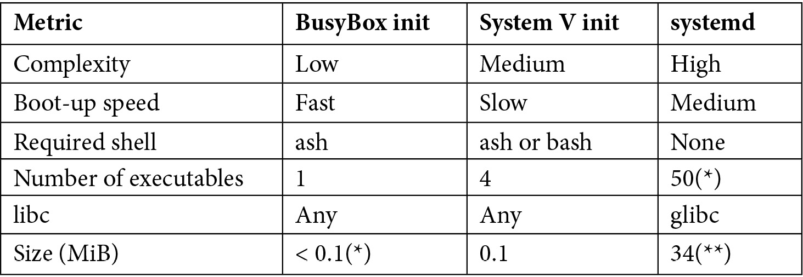

# *Chương 13*: Khởi động – Chương trình init (Starting Up – The init Program)

Chúng ta đã xem kernel boot như thế nào tới điểm nó khởi chạy chương trình đầu tiên, `init`, trong [*Chương 4*](ch04_configuring_and_building_the_kernel.vi.md), *Cấu hình và build kernel*. Trong [*Chương 5*](ch05_building_a_root_filesystem.vi.md), *Xây dựng root filesystem*, và [*Chương 6*](ch06_selecting_a_build_system.vi.md), *Chọn build system*, chúng ta đã xem việc tạo các root filesystem với độ phức tạp khác nhau, tất cả đều chứa một chương trình `init`. Bây giờ, đã đến lúc xem chương trình `init` chi tiết hơn và khám phá vì sao nó lại quan trọng đối với phần còn lại của hệ thống đến vậy.

Có nhiều hiện thực khả dĩ của `init`. Tôi sẽ mô tả ba hiện thực chính trong chương này: BusyBox `init`, System V `init` và `systemd`. Với mỗi hiện thực, tôi sẽ đưa ra một cái nhìn tổng quan về cách nó hoạt động và loại hệ thống mà nó phù hợp nhất. Một phần của việc này là cân bằng trade-off giữa kích thước, độ phức tạp và tính linh hoạt. Chúng ta sẽ học cách khởi chạy một daemon bằng cả BusyBox `init` lẫn System V `init`. Chúng ta cũng sẽ học cách thêm một service vào `systemd` để làm điều tương tự.

Trong chương này, chúng ta sẽ đề cập các chủ đề sau:

- Sau khi kernel đã boot
- Giới thiệu các chương trình `init`
- BusyBox `init`
- System V `init`
- `systemd`

## Yêu cầu kỹ thuật

Để làm theo các ví dụ, hãy bảo đảm bạn có những thứ sau:

- Một hệ thống host Linux-based
- Bản phát hành Buildroot 2020.02.9 LTS
- Bản phát hành Yocto 3.1 (Dunfell) LTS

Lẽ ra bạn đã cài bản phát hành 2020.02.9 LTS của Buildroot cho [*Chương 6*](ch06_selecting_a_build_system.vi.md), *Chọn build system*. Nếu chưa, hãy tham khảo mục *System requirements* của *The Buildroot user manual* ([https://buildroot.org/downloads/manual/manual.html](https://buildroot.org/downloads/manual/manual.html)) trước khi cài Buildroot trên host Linux theo hướng dẫn trong [*Chương 6*](ch06_selecting_a_build_system.vi.md).

Lẽ ra bạn đã build bản phát hành Yocto 3.1 (Dunfell) LTS cho [*Chương 6*](ch06_selecting_a_build_system.vi.md), *Chọn build system*. Nếu chưa, hãy tham khảo các mục *Compatible Linux Distribution* và *Build Host Packages* của hướng dẫn *Yocto Project Quick Build* ([https://www.yoctoproject.org/docs/current/brief-yoctoprojectqs/brief-yoctoprojectqs.html](https://www.yoctoproject.org/docs/current/brief-yoctoprojectqs/brief-yoctoprojectqs.html)) trước khi build Yocto trên host Linux theo hướng dẫn trong [*Chương 6*](ch06_selecting_a_build_system.vi.md).

Toàn bộ code cho chương này có thể được tìm thấy trong thư mục `Chapter13` của repository GitHub của sách: [https://github.com/PacktPublishing/Mastering-Embedded-Linux-Programming-Third-Edition](https://github.com/PacktPublishing/Mastering-Embedded-Linux-Programming-Third-Edition).

## Sau khi kernel đã boot

Chúng ta đã thấy trong [*Chương 4*](ch04_configuring_and_building_the_kernel.vi.md), *Cấu hình và build kernel*, cách code bootstrap của kernel tìm một root filesystem, hoặc `initramfs` hoặc một filesystem được chỉ định bởi `root=` trên kernel command line, rồi thực thi một chương trình mà, theo mặc định, là `/init` với `initramfs` và `/sbin/init` với một filesystem thông thường. Chương trình `init` có đặc quyền `root`, và vì nó là process đầu tiên chạy, nó có **process ID** (**PID**) là `1`. Nếu, vì lý do nào đó, `init` không thể được khởi động, kernel sẽ panic.

Chương trình `init` là tổ tiên của tất cả các process khác, như được thể hiện ở đây bằng lệnh `pstree` chạy trên một hệ thống embedded Linux đơn giản:

```
# pstree -gn
init(1)-+-syslogd(63)
        |-klogd(66)
        |-dropbear(99)
        `-sh(100)---pstree(109)
```

Công việc của chương trình `init` là nắm quyền điều khiển quá trình boot trong user space và làm cho nó chạy. Nó có thể đơn giản như một lệnh `shell` chạy một shell script—có một ví dụ về điều này ở đầu [*Chương 5*](ch05_building_a_root_filesystem.vi.md), *Xây dựng root filesystem*—nhưng trong đa số trường hợp, bạn sẽ dùng một daemon `init` chuyên dụng để thực hiện các nhiệm vụ sau:

- Trong lúc boot, sau khi kernel chuyển giao quyền điều khiển, chương trình `init` khởi động các chương trình daemon khác và cấu hình các tham số hệ thống cùng những thứ khác cần để đưa hệ thống vào trạng thái hoạt động.
- Tùy chọn, nó khởi chạy một login daemon, chẳng hạn `getty`, trên các terminal cho phép login shell.
- Nó nhận nuôi các process trở thành mồ côi do process cha trực tiếp của chúng kết thúc và không còn process nào khác trong thread group.
- Nó phản ứng với việc bất kỳ process con trực tiếp nào của `init` kết thúc bằng cách bắt signal `SIGCHLD` và thu giá trị trả về để ngăn chúng trở thành zombie process. Tôi sẽ nói thêm về zombie trong [*Chương 17*](ch17_learning_about_processes_and_threads.vi.md), *Tìm hiểu về process và thread*.
- Tùy chọn, nó khởi động lại các daemon đã kết thúc.
- Nó xử lý việc tắt hệ thống.

Nói cách khác, `init` quản lý vòng đời của hệ thống từ lúc khởi động tới lúc tắt. Có một trường phái cho rằng `init` ở vị trí tốt để xử lý các sự kiện runtime khác, chẳng hạn phần cứng mới và việc nạp và gỡ module. Đây là điều `systemd` làm.

## Giới thiệu các chương trình init

Ba chương trình `init` mà bạn có khả năng gặp nhất trong các thiết bị nhúng là BusyBox `init`, System V `init` và `systemd`. Buildroot có các tùy chọn để build cả ba với BusyBox `init` là mặc định. Yocto Project cho phép bạn dễ dàng chọn giữa System V `init` và `systemd` với System V `init` là mặc định. Dù bản phân phối Poky-tiny của Yocto đi kèm BusyBox `init`, hầu hết các distribution layer khác thì không.

Bảng sau đưa ra một số chỉ số để so sánh ba chương trình:



(*) BusyBox `init` là một phần của file thực thi duy nhất của BusyBox, được tối ưu cho kích thước trên đĩa.

(**) Dựa trên cấu hình Buildroot của `systemd`.

Nói chung, tính linh hoạt và độ phức tạp tăng lên khi bạn đi từ BusyBox `init` tới `systemd`.

## BusyBox init

**BusyBox** có một chương trình `init` tối giản dùng một file cấu hình, `/etc/inittab`, để định nghĩa các quy tắc khởi động chương trình lúc boot và dừng chúng lúc tắt máy. Thông thường, công việc thực tế được làm bởi các shell script, theo quy ước được đặt trong thư mục `/etc/init.d`.

`init` bắt đầu bằng việc đọc `/etc/inittab`. File này chứa một danh sách các chương trình cần chạy, mỗi dòng một chương trình, với định dạng sau:

```
<id>::<action>:<program>
```

Vai trò của các tham số này như sau:

- `id`: Đây là controlling terminal cho lệnh.
- `action`: Tham số này bao gồm các điều kiện để chạy lệnh này, như được thể hiện trong danh sách sau.
- `program`: Đây là chương trình cần chạy.

Các action như sau:

- `sysinit`: Chạy chương trình khi `init` khởi động, trước bất kỳ loại action nào khác.
- `respawn`: Chạy chương trình và khởi động lại nó nếu nó kết thúc. Nó thường được dùng để chạy một chương trình như một daemon.
- `askfirst`: Giống `respawn`, nhưng nó in message `Please press Enter to activate this console` ra console, và nó chạy chương trình sau khi *Enter* được nhấn. Nó được dùng để khởi động một shell tương tác trên một terminal mà không hỏi username hay mật khẩu.
- `once`: Chạy chương trình một lần nhưng không cố khởi động lại nó nếu nó kết thúc.
- `wait`: Chạy chương trình và chờ nó hoàn tất.
- `restart`: Chạy chương trình khi `init` nhận signal `SIGHUP`, cho biết nó nên nạp lại file `inittab`.
- `ctrlaltdel`: Chạy chương trình khi `init` nhận signal `SIGINT`, thường là kết quả của việc nhấn *Ctrl* + *Alt* + *Del* trên console.
- `shutdown`: Chạy chương trình khi `init` tắt.

Đây là một ví dụ nhỏ mount `proc` và `sysfs` và chạy một shell trên một serial interface:

```
null::sysinit:/bin/mount -t proc proc /proc
null::sysinit:/bin/mount -t sysfs sysfs /sys
console::askfirst:-/bin/sh
```

Với các project đơn giản mà bạn muốn khởi chạy một số ít daemon, và có lẽ khởi động một login shell trên một serial terminal, việc viết script thủ công là dễ dàng. Điều này phù hợp nếu bạn đang tạo một embedded Linux kiểu **roll your own** (**RYO**). Tuy nhiên, bạn sẽ thấy các script `init` viết tay nhanh chóng trở nên không bảo trì được khi số thứ cần cấu hình tăng lên. Chúng không mô-đun lắm và vì vậy cần được cập nhật mỗi khi một component mới được thêm hoặc gỡ bỏ.

### Các init script của Buildroot

Buildroot đã tận dụng hiệu quả BusyBox `init` trong nhiều năm. Buildroot có hai script trong `/etc/init.d/` tên `rcS` và `rcK`. Script đầu tiên chạy lúc boot và duyệt qua tất cả các script trong `/etc/init.d/` có tên bắt đầu bằng chữ `S` hoa theo sau là hai chữ số, và chạy chúng theo thứ tự số. Đây là các start script. Script `rcK` được chạy lúc tắt máy và duyệt qua tất cả các script bắt đầu bằng chữ `K` hoa theo sau là hai chữ số và chạy chúng theo thứ tự số. Đây là các kill script.

Với cơ chế này, các package Buildroot dễ dàng cung cấp start script và kill script của riêng chúng, dùng số two-digit để áp đặt thứ tự chạy, và nhờ đó hệ thống trở nên mở rộng được. Nếu bạn đang dùng Buildroot, điều này là trong suốt. Nếu không, bạn có thể dùng nó làm mô hình để viết các script BusyBox `init` của riêng mình.

Giống BusyBox `init`, System V `init` dựa vào các shell script bên trong `/etc/init.d` và một file cấu hình `/etc/inittab`. Dù hai hệ thống `init` này tương tự nhau ở nhiều mặt, System V `init` có nhiều tính năng hơn và một lịch sử dài hơn nhiều.

## System V init

Chương trình `init` này được lấy cảm hứng từ chương trình của Unix System V và vì vậy có nguồn gốc từ thời mid-1980s. Phiên bản thường gặp nhất trong các bản phân phối Linux ban đầu được viết bởi Miquel van Smoorenburg. Cho đến gần đây, nó là daemon `init` cho gần như tất cả các bản phân phối desktop và server cùng khá nhiều hệ thống nhúng. Tuy nhiên, trong những năm gần đây, nó đã bị thay thế bởi `systemd`, mà tôi sẽ mô tả ở mục tiếp theo.

Daemon BusyBox `init` tôi vừa mô tả chỉ là một phiên bản trimmed-down của System V `init`. So với BusyBox `init`, System V `init` có hai ưu điểm:

- Thứ nhất, các boot script được viết theo một định dạng well-known, mô-đun, giúp dễ dàng thêm package mới lúc build hoặc lúc runtime.
- Thứ hai, nó có khái niệm **runlevel**, cho phép một tập chương trình được khởi động hoặc dừng trong một lần khi chuyển từ runlevel này sang runlevel khác.

Có tám runlevel, đánh số từ `0` tới `6`, cộng thêm `S`:

- `S`: Chạy các tác vụ khởi động
- `0`: Dừng hệ thống
- `1` tới `5`: Có sẵn cho mục đích chung
- `6`: Reboot hệ thống

Các mức `1` tới `5` có thể được dùng tùy ý bạn. Trên các bản phân phối Linux desktop, chúng theo quy ước được gán như sau:

- `1`: Single user
- `2`: Multi-user không có cấu hình mạng
- `3`: Multi-user có cấu hình mạng
- `4`: Không dùng
- `5`: Multi-user với đăng nhập đồ họa

Chương trình `init` khởi động runlevel mặc định được cho bởi dòng `initdefault` trong `/etc/inittab` như sau:

```
id:3:initdefault:
```

Bạn có thể đổi runlevel lúc runtime bằng lệnh `telinit [runlevel]`, lệnh này gửi một message tới `init`. Bạn có thể tìm runlevel hiện tại và runlevel trước đó bằng lệnh `runlevel`. Đây là một ví dụ:

```
# runlevel
N 5
# telinit 3
INIT: Switching to runlevel: 3
# runlevel
5 3
```

Ban đầu, output từ lệnh `runlevel` là `N 5`, cho biết không có runlevel trước đó, vì runlevel chưa thay đổi kể từ khi boot và runlevel hiện tại là `5`. Sau khi đổi runlevel, output là `5 3`, cho thấy đã có một chuyển đổi từ `5` sang `3`.

Các lệnh `halt` và `reboot` lần lượt chuyển sang runlevel `0` và `6`. Bạn có thể override runlevel mặc định bằng cách cho một runlevel khác trên kernel command line dưới dạng một chữ số từ `0` tới `6`. Chẳng hạn, để buộc runlevel là single user, bạn sẽ nối thêm `1` vào kernel command line, và nó sẽ trông đại loại như thế này:

```
console=ttyAMA0 root=/dev/mmcblk1p2 1
```

Mỗi runlevel có một số script dừng các thứ, gọi là kill script, và một nhóm khác khởi động các thứ, gọi là start script. Khi vào một runlevel mới, `init` trước tiên chạy các kill script trong mức mới, rồi tới các start script trong mức mới. Các daemon đang chạy mà không có start script lẫn kill script trong runlevel mới sẽ được gửi một signal `SIGTERM`. Nói cách khác, hành động mặc định khi chuyển runlevel là kết thúc các daemon trừ khi được chỉ thị khác.

Thật ra, runlevel không được dùng nhiều lắm trong embedded Linux: hầu hết thiết bị chỉ đơn giản boot vào runlevel mặc định và ở yên đó. Tôi có cảm giác điều này một phần là do hầu hết mọi người không biết về chúng.

> **Mẹo**
>
> Runlevel là một cách đơn giản và tiện lợi để chuyển giữa các chế độ, chẳng hạn từ chế độ sản xuất sang chế độ bảo trì.

System V `init` là một tùy chọn trong Buildroot và Yocto Project. Trong cả hai trường hợp, các script `init` đã được loại bỏ mọi đặc thù của shell `bash`, nên chúng sẽ hoạt động với shell `ash` của BusyBox. Tuy nhiên, Buildroot hơi ăn gian bằng cách thay chương trình BusyBox `init` bằng System V `init` và thêm một `inittab` bắt chước hành vi của BusyBox. Buildroot không hiện thực runlevel, ngoại trừ việc chuyển sang mức `0` hoặc `6` sẽ dừng hoặc reboot hệ thống.

Tiếp theo, hãy xem một số chi tiết. Các ví dụ sau được lấy từ bản phát hành Yocto Project 3.1. Các bản phân phối khác có thể hiện thực các script `init` hơi khác.

### inittab

Chương trình `init` bắt đầu bằng việc đọc `/etc/inittab`, chứa các mục định nghĩa điều gì xảy ra ở mỗi runlevel. Định dạng là một phiên bản mở rộng của `inittab` BusyBox mà tôi đã mô tả ở mục trước, điều không đáng ngạc nhiên vì ngay từ đầu BusyBox đã mượn nó từ System V.

Định dạng của mỗi dòng trong `inittab` như sau:

```
id:runlevels:action:process
```

Các trường được thể hiện ở đây:

- `id`: Một định danh duy nhất dài tối đa bốn ký tự.
- `runlevels`: Các runlevel mà mục này nên được thực thi. Trường này để trống trong `inittab` của BusyBox.
- `action`: Một trong các keyword được cho trong đoạn sau.
- `process`: Lệnh cần chạy.

Các action giống với BusyBox `init`: `sysinit`, `respawn`, `once`, `wait`, `restart`, `ctrlaltdel` và `shutdown`. Tuy nhiên, System V `init` không có `askfirst`, action đặc thù của BusyBox.

Làm ví dụ, đây là `inittab` hoàn chỉnh được Yocto Project cung cấp cho target `core-image-minimal` trên machine `qemuarm`:

```
# /etc/inittab: init(8) configuration.
# $Id: inittab,v 1.91 2002/01/25 13:35:21 miquels Exp $
# The default runlevel.
id:5:initdefault:
# Boot-time system configuration/initialization script.
# This is run first except when booting in emergency (-b) mode.
si::sysinit:/etc/init.d/rcS
# What to do in single-user mode.
~~:S:wait:/sbin/sulogin
# /etc/init.d executes the S and K scripts upon change
# of runlevel.
#
# Runlevel 0 is halt.
# Runlevel 1 is single-user.
# Runlevels 2-5 are multi-user.
# Runlevel 6 is reboot.
l0:0:wait:/etc/init.d/rc 0
l1:1:wait:/etc/init.d/rc 1
l2:2:wait:/etc/init.d/rc 2
l3:3:wait:/etc/init.d/rc 3
l4:4:wait:/etc/init.d/rc 4
l5:5:wait:/etc/init.d/rc 5
l6:6:wait:/etc/init.d/rc 6
# Normally not reached, but fallthrough in case of emergency.
z6:6:respawn:/sbin/sulogin
AMA0:12345:respawn:/sbin/getty 115200 ttyAMA0
# /sbin/getty invocations for the runlevels
#
# The "id" field MUST be the same as the last
# characters of the device (after "tty").
#
# Format:
# <id>:<runlevels>:<action>:<process>
#
1:2345:respawn:/sbin/getty 38400 tty1
```

Mục đầu tiên, `id:5:initdefault`, đặt `runlevel` mặc định là `5`. Mục tiếp theo, `si::sysinit:/etc/init.d/rcS`, chạy script `rcS` lúc boot. Sẽ có thêm về điều này sau. Xa hơn một chút, có một nhóm sáu mục bắt đầu bằng `l0:0:wait:/etc/init.d/rc 0`. Chúng chạy script `/etc/init.d/rc` mỗi khi có thay đổi runlevel. Script này chịu trách nhiệm xử lý các start script và kill script.

Gần cuối `inittab`, có một mục chạy một daemon `getty` để tạo login prompt trên `/dev/ttyAMA0` khi vào các runlevel `1` tới `5`, nhờ đó cho phép bạn đăng nhập và có một shell tương tác:

```
AMA0:12345:respawn:/sbin/getty 115200 ttyAMA0
```

Device `ttyAMA0` là serial console trên board Arm Versatile mà chúng ta đang giả lập bằng QEMU; nó sẽ khác với các development board khác. Cũng có một mục để chạy `getty` trên `tty1`, được kích hoạt khi vào các runlevel `2` tới `5`. Đây là một virtual console, thường được ánh xạ tới một màn hình đồ họa nếu bạn đã build kernel với `CONFIG_FRAMEBUFFER_CONSOLE` hoặc `VGA_CONSOLE`. Các bản phân phối Linux desktop thường sinh ra sáu daemon `getty` trên các virtual terminal `1` tới `6`, mà bạn có thể chọn bằng tổ hợp phím *Ctrl* + *Alt* + *F1* tới *Ctrl* + *Alt* + *F6*, với virtual terminal `7` được dành riêng cho màn hình đồ họa. Ubuntu và Arch Linux là các ngoại lệ đáng chú ý vì chúng dùng virtual terminal `1` cho đồ họa. Virtual terminal hiếm khi được dùng trên thiết bị nhúng.

Script `/etc/init.d/rcS` được mục `sysinit` chạy làm không nhiều hơn việc vào runlevel `S`:

```
#!/bin/sh
[…]
exec /etc/init.d/rc S
```

Do đó, runlevel đầu tiên được vào là `S`, tiếp theo là runlevel mặc định `5`. Lưu ý rằng runlevel `S` không được ghi lại và không bao giờ được lệnh `runlevel` hiển thị như một runlevel trước đó.

### Các script init.d

Mỗi component cần phản ứng với thay đổi runlevel có một script trong `/etc/init.d` để thực hiện thay đổi. Script nên nhận hai tham số: `start` và `stop`. Tôi sẽ đưa ra một ví dụ về điều này sau.

Script runlevel-handling, `/etc/init.d/rc`, nhận runlevel mà nó đang chuyển sang làm tham số. Với mỗi runlevel, có một thư mục tên `rc<runlevel>.d`:

```
# ls -d /etc/rc*
/etc/rc0.d /etc/rc2.d /etc/rc4.d /etc/rc6.d
/etc/rc1.d /etc/rc3.d /etc/rc5.d /etc/rcS.d
```

Ở đó bạn sẽ tìm thấy một tập script bắt đầu bằng chữ `S` hoa theo sau là hai chữ số, và bạn cũng có thể tìm thấy các script bắt đầu bằng chữ `K` hoa. Đây lần lượt là các start script và kill script. Đây là một ví dụ về các script cho runlevel `5`:

```
# ls /etc/rc5.d
S01networking S20hwclock.sh S99rmnologin.sh S99stop-bootlogd
S15mountnfs.sh S20syslog
```

Đây thực ra là các symbolic link trỏ ngược về script phù hợp trong `init.d`. Script `rc` chạy tất cả các script bắt đầu bằng `K` trước, thêm tham số `stop`, rồi chạy những script bắt đầu bằng `S`, thêm tham số `start`. Một lần nữa, mã two-digit có mặt để áp đặt thứ tự chạy của các script.

### Thêm một daemon mới

Hãy tưởng tượng bạn có một chương trình tên `simpleserver` được viết như một Unix daemon truyền thống; nói cách khác, nó fork và chạy ở background. Code cho một chương trình như vậy nằm trong `MELP/Chapter13/simpleserver`. Bạn sẽ cần một script `init.d` như thế này, bạn sẽ tìm thấy nó trong `MELP/Chapter13/simpleserver-sysvinit`:

```
#! /bin/sh

case "$1" in
      start)
           echo "Starting simpelserver"
           start-stop-daemon -S -n simpleserver -a /usr/bin/simpleserver
           ;;
     stop)
           echo "Stopping simpleserver"
           start-stop-daemon -K -n simpleserver
           ;;
     *)
           echo "Usage: $0 {start|stop}"
           exit 1
esac

exit 0
```

`start-stop-daemon` là một helper function giúp việc thao tác các background process như thế này dễ hơn. Ban đầu nó đến từ package trình cài đặt Debian, `dpkg`, nhưng hầu hết hệ thống nhúng dùng phiên bản từ BusyBox. Nó khởi động daemon với tham số `-S`, bảo đảm không bao giờ có nhiều hơn một instance chạy tại bất kỳ thời điểm nào. Để dừng một daemon, bạn dùng tham số `-K`, khiến nó gửi một signal, mặc định là `SIGTERM`, để báo cho daemon biết đã đến lúc kết thúc.

Để làm cho `simpleserver` hoạt động, sao chép script vào thư mục đích tên `/etc/init.d/simpleserver` và làm cho nó thực thi được. Sau đó, thêm link từ mỗi runlevel mà bạn muốn chạy chương trình này; trong trường hợp này, chỉ runlevel mặc định `5`:

```
# cd /etc/init.d/rc5.d
# ln -s ../init.d/simpleserver S99simpleserver
```

Số `99` nghĩa là đây sẽ là một trong những chương trình cuối cùng được khởi động. Hãy nhớ rằng có thể có các link khác bắt đầu bằng `S99`, khi đó script `rc` sẽ chỉ chạy chúng theo thứ tự từ vựng.

Trong thiết bị nhúng, hiếm khi phải bận tâm quá nhiều về các thao tác tắt máy, nhưng nếu có gì đó cần làm, hãy thêm kill link vào các mức `0` và `6`:

```
# cd /etc/init.d/rc0.d
# ln -s ../init.d/simpleserver K01simpleserver
# cd /etc/init.d/rc6.d
# ln -s ../init.d/simpleserver K01simpleserver
```

Chúng ta có thể bỏ qua runlevel và thứ tự để test và debug các script `init.d` nhanh hơn.

### Khởi động và dừng service

Bạn có thể tương tác với các script trong `/etc/init.d` bằng cách gọi chúng trực tiếp. Đây là một ví dụ dùng script `syslog`, điều khiển các daemon `syslogd` và `klogd`:

```
# /etc/init.d/syslog --help
Usage: syslog { start | stop | restart }
# /etc/init.d/syslog stop
Stopping syslogd/klogd: stopped syslogd (pid 198)
stopped klogd (pid 201)
done
# /etc/init.d/syslog start
Starting syslogd/klogd: done
```

Tất cả các script đều hiện thực `start` và `stop`, và chúng cũng nên hiện thực `help`. Một số hiện thực cả `status`, cho bạn biết service có đang chạy hay không. Các bản phân phối chính thống vẫn dùng System V `init` có một lệnh tên `service` để khởi động và dừng service, che giấu chi tiết của việc gọi trực tiếp các script.

System V `init` là một daemon `init` đơn giản đã phục vụ các quản trị viên Linux hàng thập kỷ. Dù runlevel mang lại mức độ tinh vi cao hơn BusyBox `init`, System V `init` vẫn thiếu khả năng giám sát service và khởi động lại chúng nếu cần. Khi System V `init` bắt đầu lộ tuổi tác, hầu hết các bản phân phối Linux phổ biến đã chuyển sang `systemd`.

## systemd

`systemd`, [https://www.freedesktop.org/wiki/Software/systemd/](https://www.freedesktop.org/wiki/Software/systemd/), tự định nghĩa mình là một *system and service manager*. Project được Lennart Poettering và Kay Sievers khởi xướng năm 2010 để tạo một bộ công cụ tích hợp quản lý hệ thống Linux xoay quanh một daemon `init`. Nó cũng bao gồm quản lý thiết bị (`udev`) và logging, cùng những thứ khác. `systemd` là state of the art và vẫn đang tiến hóa nhanh. Nó phổ biến trên các bản phân phối Linux desktop và server và cũng đang trở nên phổ biến trên các hệ thống embedded Linux, đặc biệt trên các thiết bị phức tạp hơn. Vậy, nó tốt hơn System V `init` cho hệ thống nhúng như thế nào?

- Cấu hình đơn giản và logic hơn (một khi bạn hiểu nó). Thay vì các shell script đôi khi rối rắm của System V `init`, `systemd` có các file cấu hình unit được viết theo một định dạng well-defined.
- Có các phụ thuộc tường minh giữa các service, thay vì một mã two-digit chỉ đặt trình tự chạy các script.
- Dễ đặt quyền và giới hạn tài nguyên cho mỗi service, điều quan trọng cho bảo mật.
- Nó có thể giám sát service và khởi động lại chúng nếu cần.
- Các service được khởi động song song, có khả năng giảm thời gian boot.

Một mô tả đầy đủ về `systemd` vừa không khả thi vừa không phù hợp ở đây. Giống System V `init`, tôi sẽ tập trung vào các use case nhúng với các ví dụ dựa trên cấu hình được tạo bởi bản phát hành Yocto Project 3.1, với `systemd` phiên bản `244`. Tôi sẽ đưa ra một tổng quan nhanh, rồi cho bạn thấy một số ví dụ cụ thể.

### Build systemd với Yocto Project và Buildroot

Daemon `init` mặc định trong Yocto Project là System V. Để chọn `systemd`, thêm dòng này vào `conf/local.conf`:

```
INIT_MANAGER = "systemd"
```

Buildroot dùng BusyBox `init` theo mặc định. Bạn có thể chọn `systemd` qua `menuconfig` bằng cách tìm trong menu **System configuration** | **Init system**. Bạn cũng sẽ phải cấu hình toolchain dùng `glibc` cho C library, vì `systemd` không hỗ trợ `uClibc-ng` hay `musl`. Ngoài ra, có các hạn chế về phiên bản và cấu hình của kernel. Có một danh sách đầy đủ các phụ thuộc thư viện và kernel trong file `README` ở top level của source code `systemd`.

### Giới thiệu target, service và unit

Trước khi mô tả cách `systemd` hoạt động, tôi cần giới thiệu ba khái niệm then chốt sau:

- **unit**: Một file cấu hình mô tả một target, một service và vài thứ khác. Unit là các file văn bản chứa thuộc tính và giá trị.
- **service**: Một daemon có thể được khởi động và dừng, rất giống một service của System V `init`.
- **target**: Một nhóm service, tương tự, nhưng tổng quát hơn, một runlevel của System V `init`. Có một target mặc định là nhóm service được khởi động lúc boot.

Bạn có thể thay đổi trạng thái và tìm hiểu điều gì đang diễn ra bằng lệnh `systemctl`.

#### Unit

Mục cấu hình cơ bản là unit file. Unit file được tìm thấy ở ba nơi khác nhau:

- `/etc/systemd/system`: Cấu hình cục bộ
- `/run/systemd/system`: Cấu hình runtime
- `/lib/systemd/system`: Cấu hình Distribution-wide

Khi tìm một unit, `systemd` tìm trong các thư mục theo thứ tự đó, dừng ngay khi tìm thấy kết quả khớp, và cho phép bạn override hành vi của một unit distribution-wide bằng cách đặt một unit cùng tên trong `/etc/systemd/system`. Bạn có thể disable hoàn toàn một unit bằng cách tạo một file cục bộ rỗng hoặc được link tới `/dev/null`.

Tất cả unit file đều bắt đầu bằng một section được đánh dấu `[Unit]`, chứa thông tin cơ bản và các phụ thuộc. Làm ví dụ, đây là section `Unit` của service D-Bus, `/lib/systemd/system/dbus.service`:

```
[Unit]
Description=D-Bus System Message Bus
Documentation=man:dbus-daemon(1)
Requires=dbus.socket
```

Ngoài mô tả và một tham chiếu tới tài liệu, có một phụ thuộc vào unit `dbus.socket` được biểu diễn qua keyword `Requires`. Điều này bảo `systemd` tạo một socket cục bộ khi service D-Bus được khởi động.

Các phụ thuộc trong section `Unit` được biểu diễn qua các keyword `Requires`, `Wants` và `Conflicts`:

- `Requires`: Một danh sách các unit mà unit này phụ thuộc vào, được khởi động khi unit này được khởi động.
- `Wants`: Một dạng yếu hơn của `Requires`; các unit được liệt kê được khởi động nhưng unit hiện tại không bị dừng nếu bất kỳ unit nào trong đó thất bại.
- `Conflicts`: Một phụ thuộc phủ định; các unit được liệt kê bị dừng khi unit này được khởi động và, ngược lại, nếu một trong số chúng được khởi động, unit này bị dừng.

Ba keyword này định nghĩa các **outgoing dependency**. Chúng được dùng chủ yếu để tạo phụ thuộc giữa các target. Có một tập phụ thuộc khác gọi là **incoming dependency**, được dùng để tạo liên kết giữa *service* và *target*. Nói cách khác, outgoing dependency được dùng để tạo danh sách các target cần được khởi động khi hệ thống chuyển từ trạng thái này sang trạng thái khác, và incoming dependency được dùng để xác định các service nên được khởi động hoặc dừng ở bất kỳ trạng thái cụ thể nào. Incoming dependency được tạo bởi keyword `WantedBy`, mà tôi sẽ mô tả trong mục sắp tới về *Thêm service của riêng bạn*.

Xử lý các phụ thuộc tạo ra một danh sách các unit nên được khởi động hoặc dừng. Các keyword `Before` và `After` xác định thứ tự chúng được khởi động. Thứ tự dừng chỉ đơn giản là đảo ngược thứ tự khởi động:

- `Before`: Khởi động unit này trước các unit được liệt kê.
- `After`: Khởi động unit này sau các unit được liệt kê.

Trong ví dụ sau, directive `After` bảo đảm web server được khởi động sau khi network subsystem được khởi động:

```
[Unit]
Description=Lighttpd Web Server
After=network.target
```

Khi không có directive `Before` hay `After`, các unit sẽ được khởi động hoặc dừng song song không theo thứ tự cụ thể nào.

#### Service

Một **service** là một daemon có thể được khởi động và dừng, tương đương với một service của System V `init`. Một service là một loại unit file có tên kết thúc bằng `.service`, chẳng hạn `lighttpd.service`.

Một service unit có một section `[Service]` mô tả nó nên được chạy như thế nào. Đây là section liên quan từ `lighttpd.service`:

```
[Service]
ExecStart=/usr/sbin/lighttpd -f /etc/lighttpd/lighttpd.conf -D
ExecReload=/bin/kill -HUP $MAINPID
```

Đây là các lệnh cần chạy khi khởi động service và khởi động lại nó. Có nhiều điểm cấu hình hơn nữa bạn có thể thêm ở đây, nên hãy tham khảo manual page của `systemd.service(5)`.

#### Target

Một **target** là một loại unit khác nhóm các service (hoặc các loại unit khác). Một target là một metaservice theo nghĩa đó và cũng đóng vai trò một điểm đồng bộ. Một target chỉ có các phụ thuộc. Target có tên kết thúc bằng `.target`, chẳng hạn `multi-user.target`. Một target là một trạng thái mong muốn đóng cùng vai trò như các runlevel của System V `init`. Chẳng hạn, đây là unit hoàn chỉnh cho `multi-user.target`:

```
[Unit]
Description=Multi-User System
Documentation=man:systemd.special(7)
Requires=basic.target
Conflicts=rescue.service rescue.target
After=basic.target rescue.service rescue.target
AllowIsolate=yes
```

Điều này nói rằng basic target phải được khởi động trước multi-user target. Nó cũng nói rằng vì nó xung đột với rescue target, khởi động rescue target sẽ khiến multi-user target bị dừng trước.

### systemd boot hệ thống như thế nào

Bây giờ, chúng ta có thể xem `systemd` hiện thực bootstrap như thế nào. `systemd` được kernel chạy do `/sbin/init` được symbolic link tới `/lib/systemd/systemd`. Nó chạy target mặc định, `default.target`, luôn là một link tới target mong muốn, chẳng hạn `multi-user.target` cho đăng nhập văn bản hoặc `graphical.target` cho môi trường đồ họa. Chẳng hạn, nếu target mặc định là `multi-user.target`, bạn sẽ tìm thấy symbolic link này:

```
/etc/systemd/system/default.target -> /lib/systemd/system/multi-user.target
```

Target mặc định có thể được override bằng cách truyền `system.unit=<new target>` trên kernel command line. Bạn có thể dùng `systemctl` để tìm target mặc định, như được thể hiện ở đây:

```
# systemctl get-default
multi-user.target
```

Khởi động một target như `multi-user.target` tạo một cây phụ thuộc đưa hệ thống vào trạng thái hoạt động. Trong một hệ thống điển hình, `multi-user.target` phụ thuộc vào `basic.target`, target này phụ thuộc vào `sysinit.target`, target này phụ thuộc vào các service cần được khởi động sớm. Bạn có thể in một đồ thị văn bản bằng `systemctl list-dependencies`.

Bạn cũng có thể liệt kê tất cả các service và trạng thái hiện tại của chúng bằng lệnh sau:

```
# systemctl list-units --type service
```

Bạn có thể làm tương tự cho target bằng lệnh sau:

```
# systemctl list-units --type target
```

Giờ chúng ta đã thấy cây phụ thuộc của hệ thống, làm sao chèn thêm một service vào cây này?

### Thêm service của riêng bạn

Dùng cùng ví dụ `simpleserver` như trước, đây là một service unit, bạn sẽ tìm thấy nó trong `MELP/Chapter13/simpleserver-systemd`:

```
[Unit]
Description=Simple server
[Service]
Type=forking
ExecStart=/usr/bin/simpleserver
[Install]
WantedBy=multi-user.target
```

Section `[Unit]` chỉ chứa một mô tả để nó hiển thị đúng khi được liệt kê bằng `systemctl` và các lệnh khác. Không có phụ thuộc nào; như tôi đã nói, nó rất đơn giản.

Section `[Service]` trỏ tới file thực thi và có một flag cho biết nó fork. Nếu nó còn đơn giản hơn và chạy ở foreground, `systemd` sẽ làm việc daemon hóa cho chúng ta và `Type=forking` sẽ không cần thiết.

Section `[Install]` tạo một incoming dependency vào `multi-user.target` để server của chúng ta được khởi động khi hệ thống vào chế độ multi-user.

Khi unit đã được lưu trong `/etc/systemd/system/simpleserver.service`, bạn có thể khởi động và dừng nó bằng các lệnh `systemctl start simpleserver` và `systemctl stop simpleserver`. Bạn cũng có thể dùng `systemctl` để tìm trạng thái hiện tại của nó:

```
# systemctl status simpleserver
simpleserver.service - Simple server
  Loaded: loaded (/etc/systemd/system/simpleserver.service; disabled)
  Active: active (running) since Thu 1970-01-01 02:20:50 UTC; 8s ago
Main PID: 180 (simpleserver)
  CGroup: /system.slice/simpleserver.service
          └─180 /usr/bin/simpleserver -n
Jan 01 02:20:50 qemuarm systemd[1]: Started Simple server.
```

Tại thời điểm này, nó sẽ chỉ khởi động và dừng theo lệnh, như được thể hiện ở đây. Để làm cho nó bền vững, bạn cần thêm một phụ thuộc vĩnh viễn vào một target. Đây là mục đích của section `[Install]` trong unit; nó nói rằng khi service này được enable, nó sẽ trở thành phụ thuộc của `multi-user.target`, và vì vậy sẽ được khởi động lúc boot. Bạn enable nó bằng `systemctl enable`, như thế này:

```
# systemctl enable simpleserver
Created symlink from /etc/systemd/system/multiuser.target.wants/simpleserver.service to /etc/systemd/system/simpleserver.service.
```

Bây giờ, bạn có thể thấy các service thêm phụ thuộc như thế nào mà không phải liên tục sửa các target unit file. Một target có thể có một thư mục tên `<target_name>.target.wants`, có thể chứa link tới các service. Điều này hoàn toàn giống với việc thêm unit phụ thuộc vào danh sách `[Wants]` trong target. Trong trường hợp này, bạn sẽ thấy link này đã được tạo:

```
/etc/systemd/system/multi-user.target.wants/simpleserver.service -> /etc/systemd/system/simpleserver.service
```

Nếu đây là một service quan trọng, bạn có thể muốn khởi động lại nó nếu nó thất bại. Bạn có thể làm điều đó bằng cách thêm flag này vào section `[Service]`:

```
Restart=on-abort
```

Các tùy chọn khác cho `Restart` là `on-success`, `on-failure`, `on-abnormal`, `on-watchdog`, `on-abort` hoặc `always`.

### Thêm watchdog

Watchdog là một yêu cầu phổ biến trong thiết bị nhúng: bạn cần thực hiện hành động nếu một service then chốt ngừng hoạt động, thường bằng cách reset hệ thống. Trên hầu hết SoC nhúng, có một hardware watchdog, có thể được truy cập qua device node `/dev/watchdog`. **Watchdog** được khởi tạo với một timeout lúc boot, rồi phải được reset trong khoảng thời gian đó, nếu không watchdog sẽ bị kích hoạt, và hệ thống sẽ reboot. Giao diện với watchdog driver được mô tả trong source kernel ở `Documentation/watchdog` và code của các driver nằm trong `drivers/watchdog`.

Một vấn đề nảy sinh nếu có hai hoặc nhiều service then chốt cần được một watchdog bảo vệ. `systemd` có một tính năng hữu ích phân phối watchdog giữa nhiều service.

`systemd` có thể được cấu hình để mong đợi một lời gọi `keepalive` đều đặn từ một service và thực hiện hành động nếu không nhận được, tạo ra một software watchdog per-service. Để điều này hoạt động, bạn phải thêm code vào daemon để gửi các message `keepalive`. Nó cần kiểm tra một giá trị non-zero trong biến môi trường `WATCHDOG_USEC`, rồi gọi `sd_notify(false, "WATCHDOG=1")` trong khoảng thời gian này (nên dùng chu kỳ bằng một nửa watchdog timeout). Có các ví dụ trong source code `systemd`.

Để enable watchdog trong service unit, thêm thứ gì đó như thế này vào section `[Service]`:

```
WatchdogSec=30s
Restart=on-watchdog
StartLimitInterval=5min
StartLimitBurst=4
StartLimitAction=reboot-force
```

Trong ví dụ này, service mong đợi một lời gọi `keepalive` mỗi 30 giây. Nếu nó không được gửi tới, service sẽ được khởi động lại, nhưng nếu nó bị khởi động lại hơn bốn lần trong 5 phút, `systemd` sẽ buộc reboot ngay lập tức. Một lần nữa, có mô tả đầy đủ về các thiết lập này trong manual page `systemd.service(5)`.

Một watchdog như thế này lo cho từng service riêng lẻ, nhưng điều gì xảy ra nếu chính `systemd` thất bại, kernel crash, hoặc phần cứng bị treo? Trong những trường hợp đó, chúng ta cần bảo `systemd` dùng watchdog driver: chỉ cần thêm `RuntimeWatchdogSec=NN` vào `/etc/systemd/system.conf.systemd`, thiết lập này sẽ reset watchdog trong khoảng thời gian đó, và vì vậy hệ thống sẽ reset nếu `systemd` thất bại vì lý do nào đó.

### Ý nghĩa đối với embedded Linux

`systemd` có nhiều tính năng hữu ích trong embedded Linux, bao gồm nhiều tính năng tôi chưa đề cập trong mô tả ngắn gọn này, chẳng hạn kiểm soát tài nguyên bằng slice (được mô tả trong các manual page cho `systemd.slice(5)` và `systemd.resource-control(5)`), quản lý thiết bị (`udev(7)`), và các cơ chế ghi log hệ thống (`journald(5)`).

Bạn phải cân bằng điều đó với kích thước của nó: ngay cả với một bản build tối thiểu chỉ gồm các component lõi, `systemd`, `udevd` và `journald`, nó đã gần tới 10 MiB dung lượng lưu trữ, bao gồm cả các shared library.

Bạn cũng phải nhớ rằng việc phát triển `systemd` bám sát kernel và `glibc`, nên nó sẽ không hoạt động trên một kernel và `glibc` cũ hơn bản phát hành của `systemd` quá một hai năm.

## Tóm tắt

Mọi thiết bị Linux đều cần một chương trình `init` dạng nào đó. Nếu bạn đang thiết kế một hệ thống chỉ phải khởi chạy một số ít daemon lúc khởi động và giữ khá tĩnh sau đó, thì BusyBox `init` là đủ cho nhu cầu của bạn. Nó thường là một lựa chọn tốt nếu bạn đang dùng Buildroot làm build system.

Mặt khác, nếu bạn có một hệ thống có các phụ thuộc phức tạp giữa các service lúc boot hoặc lúc runtime, và bạn có không gian lưu trữ, thì `systemd` sẽ là lựa chọn tốt nhất. Ngay cả khi không có sự phức tạp, `systemd` có một số tính năng hữu ích trong cách nó xử lý watchdog, remote logging, v.v., nên bạn chắc chắn nên cân nhắc nghiêm túc.

Trong khi đó, System V `init` vẫn tồn tại. Nó được hiểu rõ, và đã có sẵn các script `init` cho mọi component quan trọng với chúng ta. Nó vẫn là `init` mặc định cho bản phân phối tham chiếu của Yocto Project (Poky).

Về mặt giảm thời gian boot, `systemd` nhanh hơn System V `init` với khối lượng công việc tương tự. Tuy nhiên, nếu bạn đang tìm một lần boot rất nhanh, không cái nào đánh bại BusyBox `init` đơn giản với các boot script tối giản.

Trong chương tiếp theo, chúng ta sẽ xem kỹ một hệ thống `init` lesser-known rất phù hợp cho các hệ thống embedded Linux. BusyBox `runit` mang lại sức mạnh và tính linh hoạt của `systemd` mà không có thêm độ phức tạp và overhead. Nếu Buildroot là build system bạn chọn và BusyBox `init` không đáp ứng nhu cầu của bạn, thì có nhiều lý do tốt để cân nhắc BusyBox `runit` thay thế. Chúng ta sẽ học những lý do đó là gì và có thêm kinh nghiệm hands-on với Buildroot trong quá trình đó.

## Đọc thêm

- *systemd System and Service Manager* (Trình quản lý hệ thống và service systemd): [https://www.freedesktop.org/wiki/Software/systemd/](https://www.freedesktop.org/wiki/Software/systemd/)

  Có nhiều link hữu ích ở cuối trang tại URL trên.
