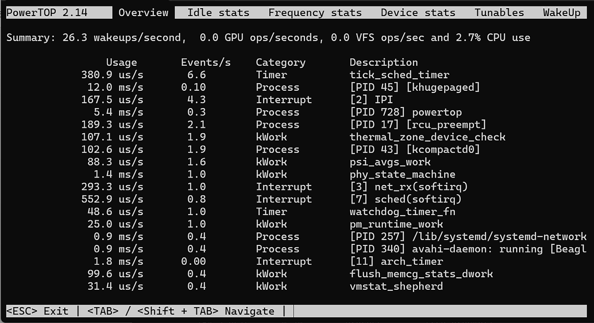

# Chương 14: Quản lý điện năng (Managing Power)

Đối với các thiết bị hoạt động bằng pin, quản lý điện năng là cực kỳ quan trọng. Bất cứ điều gì chúng ta có thể làm để giảm mức sử dụng điện sẽ tăng thời lượng pin. Ngay cả với các thiết bị chạy bằng điện lưới, giảm mức sử dụng điện cũng hạ chi phí năng lượng và giảm nhu cầu làm mát. Trong chương này, tôi sẽ giới thiệu bốn nguyên tắc quản lý điện năng:

- Đừng vội nếu bạn không cần phải vội.

- Đừng xấu hổ khi rảnh rỗi.

- Tắt những thứ bạn không dùng.

- Ngủ khi không còn việc gì khác để làm.

Nói theo thuật ngữ kỹ thuật hơn, hệ thống quản lý điện năng nên giảm tần số clock của CPU. Trong các khoảng thời gian rỗi, nó nên chọn trạng thái ngủ sâu nhất có thể; nó nên giảm tải bằng cách tắt nguồn các thiết bị ngoại vi không dùng; và nó nên đưa toàn bộ hệ thống vào trạng thái suspend trong khi bảo đảm các chuyển đổi trạng thái điện năng diễn ra nhanh chóng.

Linux có các tính năng giải quyết từng điểm này. Tôi sẽ lần lượt mô tả từng tính năng với các ví dụ và lời khuyên về cách áp dụng chúng cho một hệ thống nhúng.

Một số thuật ngữ, như C-states và P-states, được lấy từ đặc tả Advanced Configuration and Power Interface (ACPI). Tôi sẽ mô tả chúng khi gặp đến. Tham chiếu đầy đủ tới đặc tả được đưa ra trong phần Further study.

Trong chương này, chúng ta sẽ đề cập các chủ đề sau:

- Đo mức sử dụng điện năng

- Điều chỉnh tần số clock

- Chọn trạng thái idle tốt nhất

- Tắt nguồn thiết bị ngoại vi

- Đưa hệ thống vào trạng thái ngủ

## Yêu cầu kỹ thuật

Để làm theo các ví dụ, hãy bảo đảm bạn có những thứ sau:

- Một hệ thống host Ubuntu 24.04 hoặc bản LTS mới hơn

- Một đầu đọc thẻ microSD và thẻ

- balenaEtcher cho Linux

- Một cáp Ethernet và router có cổng trống để kết nối mạng

- Một cáp serial USB-to-TTL với mức logic 3.3 V

- BeaglePlay

- Một bộ nguồn USB-C 5 V có khả năng cấp 3 A

Code dùng trong chương này có trong thư mục của chương trong GitHub repository của cuốn sách: `https://github.com/PacktPublishing/Mastering-Embedded-Linux-Development`.

## Đo mức sử dụng điện năng

Với các ví dụ trong chương này, chúng ta cần dùng phần cứng thật thay vì ảo. Điều này có nghĩa là chúng ta cần một BeaglePlay có quản lý điện năng hoạt động. Firmware cần thiết cho Power Management Integrated Circuit (PMIC) của BeaglePlay có thể có trong layer `meta-ti` nhưng tôi đã không tìm hiểu điều đó. Thay vào đó, chúng ta sẽ dùng một image Debian pre-built.

Quy trình cài đặt Debian trên BeaglePlay giống như trong Chương 12. Hãy xem lại phần Installing Debian on BeaglePlay và flash eMMC với Debian Bookworm nếu bạn chưa làm. Tháo mọi thẻ microSD khỏi BeaglePlay và boot từ eMMC. SSH tới `beaglebone.local` và đăng nhập với người dùng `debian`.

Xác nhận rằng đúng phiên bản Debian đang chạy:

```
debian@BeagleBone:~$ cat /etc/os-release
PRETTY_NAME="Debian GNU/Linux 12 (bookworm)"
NAME="Debian GNU/Linux"
VERSION_ID="12"
VERSION="12 (bookworm)"
VERSION_CODENAME=bookworm
ID=debian
HOME_URL="https://www.debian.org/"
SUPPORT_URL="https://www.debian.org/support"
BUG_REPORT_URL="https://bugs.debian.org/"
```

Giờ hãy kiểm tra xem quản lý điện năng có hoạt động không:

```
debian@BeagleBone:~$ cat /sys/power/state
freeze mem disk
```

Nếu bạn thấy cả ba trạng thái, thì mọi thứ đang hoạt động tốt. Nếu bạn chỉ thấy `freeze`, thì subsystem quản lý điện năng không hoạt động. Hãy quay lại và double-check các bước trước.

Giờ chúng ta có thể chuyển sang đo mức sử dụng điện năng. Có hai cách tiếp cận: bên ngoài và bên trong. Để đo điện năng từ bên ngoài, chúng ta cần một ampe kế để đo dòng điện và một vôn kế để đo điện áp, rồi nhân hai giá trị với nhau để có công suất. Bạn có thể dùng các đồng hồ cơ bản cho ra một số đọc mà bạn ghi lại, hoặc chúng có thể tinh vi hơn nhiều và tích hợp data logging để bạn có thể thấy sự thay đổi điện năng khi tải dao động theo từng mili giây. Cho mục đích của chương này, tôi đã cấp nguồn cho BeaglePlay từ cổng USB-C và dùng một bộ đo điện USB-C rẻ tiền loại chỉ vài đô la.

Cách tiếp cận còn lại là dùng các hệ thống giám sát được tích hợp sẵn trong Linux. Bạn sẽ thấy rằng rất nhiều thông tin được báo cáo cho bạn qua `sysfs`. Còn có một chương trình rất hữu ích gọi là PowerTOP, thu thập thông tin từ nhiều nguồn khác nhau và trình bày ở một chỗ duy nhất. PowerTOP là một package cho cả The Yocto Project và Buildroot. Nó cũng có sẵn để cài đặt trên Debian.

Để cài đặt PowerTOP trên BeaglePlay từ Debian Bookworm, hãy chạy lệnh sau:

```
debian@BeagleBone:~$ sudo apt update
<…>
debian@BeagleBone:~$ sudo apt install powertop
[sudo] password for debian:
Reading package lists... Done
Building dependency tree... Done
Reading state information... Done
Suggested packages:
  cpufrequtils laptop-mode-tools
The following NEW packages will be installed:
  powertop
0 upgraded, 1 newly installed, 0 to remove and 39 not upgraded.
Need to get 183 kB of archives.
After this operation, 649 kB of additional disk space will be used.
Get:1 http://deb.debian.org/debian bookworm/main arm64 powertop arm64
2.14-1+b2 [183 kB]
Fetched 183 kB in 0s (1279 kB/s)
Selecting previously unselected package powertop.
(Reading database ... 72376 files and directories currently installed.)
Preparing to unpack .../powertop_2.14-1+b2_arm64.deb ...
Unpacking powertop (2.14-1+b2) ...
Setting up powertop (2.14-1+b2) ...
```

Đừng quên cắm BeaglePlay vào Ethernet trước khi cập nhật danh sách package có sẵn và cài đặt PowerTOP.

Đây là một ví dụ PowerTOP chạy trên BeaglePlay:



Hình 14.1 – Tổng quan PowerTOP

Trong ảnh chụp màn hình này, chúng ta có thể thấy hệ thống đang yên tĩnh, chỉ dùng 2.7% CPU. Tôi sẽ cho thấy các ví dụ thú vị hơn ở phần sau trong các tiểu mục Using CPUFreq và CPUIdle driver của chương này.

Giờ chúng ta đã có cách đo mức tiêu thụ điện năng, hãy xem một trong những núm vặn lớn nhất để quản lý điện năng trong một hệ thống embedded Linux: tần số clock.

## Điều chỉnh tần số clock

Nếu chạy một kilômét tốn nhiều năng lượng hơn đi bộ, thì có lẽ chạy CPU ở tần số thấp hơn có thể tiết kiệm năng lượng. Hãy cùng xem.

Mức tiêu thụ điện năng của một CPU khi thực thi code là tổng của một thành phần tĩnh, chủ yếu do dòng rò của gate gây ra, và một thành phần động, do việc chuyển mạch của gate gây ra:

P<sub>cpu</sub> = P<sub>static</sub> + P<sub>dyn</sub>

Thành phần điện năng động phụ thuộc vào tổng điện dung của các cổng logic được chuyển mạch, tần số clock và bình phương của điện áp:

P<sub>dyn</sub> = CFV<sub>2</sub>

Bản thân việc thay đổi tần số không tiết kiệm năng lượng vì cùng một số chu kỳ CPU cần được hoàn thành cho một tác vụ nhất định. Nếu chúng ta giảm tần số đi một nửa trong khi giữ điện áp không đổi, thì sẽ mất gấp đôi thời gian để hoàn thành tác vụ, dù tổng lượng năng lượng tiêu tốn là như nhau. Thực tế, giảm tần số có thể còn làm tăng ngân sách điện năng vì CPU mất nhiều thời gian hơn để vào trạng thái idle. Điều này đặc biệt đúng khi không có tác vụ cạnh tranh nào khác để chạy, và trạng thái idle của CPU cực kỳ tiết kiệm năng lượng. Vì vậy, trong các điều kiện này, tốt nhất là dùng tần số cao nhất có thể để CPU có thể quay về idle nhanh chóng. Điều này được gọi là race to idle.

LƯU Ý QUAN TRỌNG

Có một động cơ khác để giảm tần số: quản lý nhiệt. Có thể cần thiết phải hoạt động ở tần số thấp hơn chỉ để giữ nhiệt độ của package trong giới hạn. Nhưng đó không phải là trọng tâm của chúng ta ở đây.

Do đó, nếu muốn giảm mức tiêu thụ điện năng, chúng ta phải có khả năng thay đổi điện áp mà lõi CPU hoạt động. Nhưng với bất kỳ điện áp nào, luôn có một tần số tối đa mà vượt quá nó thì việc chuyển mạch của các gate trở nên không tin cậy. Tần số cao hơn cần điện áp cao hơn, và vì vậy cả hai cần được điều chỉnh cùng nhau. Nhiều SoC hiện thực một tính năng như vậy. Nó được gọi là Dynamic Voltage and Frequency Scaling (DVFS). Các nhà sản xuất tính toán các tổ hợp tối ưu của tần số lõi và điện áp. Mỗi tổ hợp được gọi là một Operating Performance Point (OPP). Đặc tả ACPI gọi chúng là P-states, với `P0` là OPP có tần số cao nhất. Mặc dù một OPP là tổ hợp của một tần số và một điện áp, nó thường được gọi chỉ bằng thành phần tần số.

Cần một kernel driver để chuyển đổi giữa các P-states. Tiếp theo, chúng ta sẽ xem driver đó và các governor điều khiển nó.

### CPUFreq driver

Linux có một thành phần tên là CPUFreq quản lý việc chuyển đổi giữa các OPP. Nó là một phần của board support cho package của từng SoC. CPUFreq gồm các driver thực hiện chuyển đổi từ OPP này sang OPP khác và một tập governor hiện thực chính sách khi nào thì chuyển. Nó được điều khiển theo từng CPU qua thư mục `/sys/devices/system/cpu/cpuN/cpufreq`, với `N` là số hiệu CPU. Trong đó, chúng ta tìm thấy một số file, những file thú vị nhất là:

- `cpuinfo_cur_freq`, `cpuinfo_max_freq` và `cpuinfo_min_freq`: Đây là các tần số hiện tại của CPU này, cùng với tần số tối đa và tối thiểu tính bằng KHz.

- `cpuinfo_transition_latency`: Đây là thời gian tính bằng nano giây để chuyển từ OPP này sang OPP khác. Nếu giá trị không xác định, nó được đặt là `-1`.

- `scaling_available_frequencies`: Đây là danh sách các tần số OPP có sẵn trên CPU này.

- `scaling_available_governors`: Đây là danh sách các governor có sẵn trên CPU này.

- `scaling_governor`: Đây là CPUFreq governor đang được sử dụng.

- `scaling_min_freq` và `scaling_max_freq`: Đây là dải tần số có sẵn cho governor tính bằng KHz.

- `scaling_setspeed`: Đây là một file cho phép bạn đặt tần số thủ công khi governor là `userspace`, mà tôi sẽ mô tả ở cuối tiểu mục này.

Governor đặt chính sách để thay đổi OPP. Nó có thể đặt tần số trong giới hạn từ `scaling_min_freq` đến `scaling_max_freq`. Các governor có tên là:

- `performance`: Governor này luôn chọn tần số cao nhất.

- `powersave`: Governor này luôn chọn tần số thấp nhất.

- `userspace`: Đây là governor mà tần số được đặt bởi một chương trình user-space.

- `ondemand`: Governor này thay đổi tần số dựa trên mức sử dụng CPU. Nếu CPU rỗi dưới 20% thời gian, nó đặt tần số ở mức tối đa. Nếu CPU rỗi hơn 30% thời gian, nó hạ tần số khi thời gian rỗi tăng lên.

- `conservative`: Governor này giống `ondemand` ngoại trừ việc nó chuyển lên các tần số cao hơn theo từng bước 5% thay vì nhảy ngay lên mức tối đa.

- `schedutil`: Governor này nhắm tới việc tích hợp tốt hơn với Linux scheduler.

Governor mặc định khi Debian Bookworm khởi động là `performance`:

```
$ cd /sys/devices/system/cpu/cpu0/cpufreq
$ cat scaling_governor
performance
```

TI Linux kernel cho BeaglePlay chỉ đi kèm hai governor built-in:

```
$ cat scaling_available_governors
performance schedutil
```

Các governor khác có thể được nạp động bằng `cpupower` hoặc `modprobe`:

```
debian@BeagleBone:~$ sudo modprobe cpufreq_userspace
```

Để cài đặt `cpupower` trên BeaglePlay từ Debian Bookworm, hãy chạy lệnh sau:

```
debian@BeagleBone:~$ sudo apt install linux-cpupower
Reading package lists... Done
Building dependency tree... Done
Reading state information... Done
The following additional packages will be installed:
  libcpupower1
The following NEW packages will be installed:
  libcpupower1 linux-cpupower
0 upgraded, 2 newly installed, 0 to remove and 39 not upgraded.
Need to get 1953 kB of archives.
After this operation, 2174 kB of additional disk space will be used.
Do you want to continue? [Y/n] Y
Get:1 http://deb.debian.org/debian bookworm-updates/main arm64
libcpupower1 arm64 6.1.124-1 [960 kB]
Get:2 http://deb.debian.org/debian bookworm-updates/main arm64 linux-
cpupower arm64 6.1.124-1 [992 kB]
Fetched 1953 kB in 0s (8989 kB/s)
Selecting previously unselected package libcpupower1.
(Reading database ... 72409 files and directories currently installed.)
Preparing to unpack .../libcpupower1_6.1.124-1_arm64.deb ...
Unpacking libcpupower1 (6.1.124-1) ...
Selecting previously unselected package linux-cpupower.
Preparing to unpack .../linux-cpupower_6.1.124-1_arm64.deb ...
Unpacking linux-cpupower (6.1.124-1) ...
Setting up libcpupower1 (6.1.124-1) ...
Setting up linux-cpupower (6.1.124-1) ...
Processing triggers for libc-bin (2.36-9+deb12u9) ...
```

Để chuyển sang governor `ondemand`, hãy chạy lệnh sau:

```
debian@BeagleBone:~$ sudo cpupower frequency-set -g ondemand
Setting cpu: 0
Setting cpu: 1
Setting cpu: 2
Setting cpu: 3
```

Các tham số mà governor `ondemand` dùng để quyết định khi nào đổi OPP có thể được tìm thấy và đặt trong `/sys/devices/system/cpu/cpufreq/ondemand/`.

Cả hai governor `ondemand` và `conservative` đều tính đến công sức cần thiết để thay đổi tần số và điện áp. Giá trị CPUFreq này là `cpuinfo_transition_latency`. Phép tính này chỉ áp dụng cho các thread có scheduling policy thông thường. Nếu một thread đang được lập lịch real time, cả hai governor sẽ ngay lập tức chọn OPP cao nhất để thread có thể đáp ứng deadline lập lịch của nó.

Governor `userspace` cho phép logic chọn OPP được thực hiện bởi một daemon user-space. Các ví dụ bao gồm `cpudyn` và `powernowd`, mặc dù cả hai đều hướng tới laptop x86- based thay vì thiết bị nhúng.

Giờ chúng ta đã biết các chi tiết runtime về CPUFreq driver nằm ở đâu, hãy xem cách định nghĩa các OPP lúc compile.

### Sử dụng CPUFreq

Nhìn vào BeaglePlay, chúng ta thấy rằng các OPP được viết trong device tree. Đây là một đoạn trích từ `k3`-`am625.dtsi`:

```
a53_opp_table: opp-table {
     compatible = "operating-points-v2-ti-cpu";
     opp-shared;
     syscon = <&wkup_conf>;

     opp-200000000 {
            opp-hz = /bits/ 64 <200000000>;
            opp-supported-hw = <0x01 0x0007>;
            clock-latency-ns = <6000000>;
 };

     opp-400000000 {
            opp-hz = /bits/ 64 <400000000>;
            opp-supported-hw = <0x01 0x0007>;
            clock-latency-ns = <6000000>;
 };

     opp-600000000 {
            opp-hz = /bits/ 64 <600000000>;
            opp-supported-hw = <0x01 0x0007>;
            clock-latency-ns = <6000000>;
 };

     opp-800000000 {
            opp-hz = /bits/ 64 <800000000>;
            opp-supported-hw = <0x01 0x0007>;
            clock-latency-ns = <6000000>;
 };

     opp-1000000000 {
            opp-hz = /bits/ 64 <1000000000>;
            opp-supported-hw = <0x01 0x0006>;
            clock-latency-ns = <6000000>;
 };

     opp-1250000000 {
            opp-hz = /bits/ 64 <1250000000>;
            opp-supported-hw = <0x01 0x0004>;
            clock-latency-ns = <6000000>;
            opp-suspend;
 };
};
```

Chúng ta có thể xác nhận rằng đây là các OPP đang được dùng lúc runtime bằng cách xem các tần số có sẵn:

```
$ cd /sys/devices/system/cpu/cpu0/cpufreq
$ cat scaling_available_frequencies
200000 400000 600000 800000 1000000 1250000 1400000
```

Chọn governor `userspace`:

```
debian@BeagleBone:~$ sudo cpupower frequency-set -g userspace
Setting cpu: 0
Setting cpu: 1
Setting cpu: 2
Setting cpu: 3
```

Liệt kê các bước tần số có sẵn:

```
debian@BeagleBone:~$ sudo cpupower frequency-info
analyzing CPU 0:
  driver: cpufreq-dt
  CPUs which run at the same hardware frequency: 0 1 2 3
  CPUs which need to have their frequency coordinated by software: 0 1 2 3
  maximum transition latency: 6.00 ms
  hardware limits: 200 MHz - 1.40 GHz
  available frequency steps:  200 MHz, 400 MHz, 600 MHz, 800 MHz, 1000
MHz, 1.25 GHz, 1.40 GHz
  available cpufreq governors: ondemand userspace performance schedutil
  current policy: frequency should be within 200 MHz and 1.40 GHz.
                  The governor "userspace" may decide which speed to use
                  within this range.
  current CPU frequency: 1.25 GHz (asserted by call to hardware)
```

Giờ chúng ta có thể đo điện năng tiêu thụ ở mỗi OPP bằng một bộ đo điện USB-C. Các phép đo này không chính xác lắm, vì vậy đừng quá coi trọng chúng.

Đặt tần số bằng cách ghi vào `scaling_setspeed`:

```
# echo 200000 > /sys/devices/system/cpu/cpufreq/policy0/scaling_setspeed
```

Build và chạy chương trình `MELD/Chapter14/do-work` trên BeaglePlay:

```
$ cd MELD/Chapter15/do-work
$ make
$ ./do-work -l 80828
```

Nếu chúng ta chạy tải không đổi này trong khi thay đổi tần số, thì chúng ta quan sát được như sau:

| Tần số (MHz) | Mức sử dụng CPU (%) | Điện năng (mW) |
|---|---|---|
| 200 | 88 | 1,160 |
| 400 | 44 | 1,160 |
| 600 | 29 | 1,160 |
| 800 | 22 | 1,210 |
| 1,000 | 18 | 1,210 |
| 1,250 | 14 | 1,210 |
| 1,400 | 13 | 1,210 |

Bảng 14.1 – Điện năng tiêu thụ ở các tần số khác nhau

Điều này cho thấy tiết kiệm điện năng khoảng 4% ở các tần số thấp hơn.

Trong hầu hết các trường hợp, governor `ondemand` là governor tốt nhất để dùng vì nó chuyển giữa các OPP dựa trên tải CPU. Để chọn một governor cụ thể, bạn có thể hoặc cấu hình kernel với một governor mặc định như `CPU_FREQ_DEFAULT_GOV_ONDEMAND`, hoặc dùng một script `init` để đổi governor lúc boot. Xem `MELD/Chapter14/cpufrequtils` để có ví dụ về cách Debian làm điều này với SysVinit.

Để biết thêm thông tin về CPUFreq driver, hãy xem các file trong thư mục `Documentation/cpu-freq` của cây source Linux kernel.

Trong phần này, chúng ta quan tâm đến điện năng dùng khi CPU bận. Trong phần tiếp theo, chúng ta sẽ xem cách tiết kiệm điện khi CPU rỗi.

## Chọn trạng thái idle tốt nhất

Khi một bộ xử lý không còn việc gì để làm, nó thực thi một lệnh halt và vào trạng thái idle. Khi idle, CPU dùng ít điện hơn. Nó thoát khỏi trạng thái idle khi một sự kiện như hardware interrupt xảy ra. Hầu hết các CPU có nhiều trạng thái idle với mức dùng điện khác nhau. Thường có một trade-off giữa mức dùng điện và độ trễ, tức khoảng thời gian cần để thoát khỏi trạng thái đó. Trong đặc tả ACPI, chúng được gọi là C-states.

Ở các C-states sâu hơn, nhiều mạch điện hơn bị tắt với cái giá là mất một phần trạng thái, vì vậy mất nhiều thời gian hơn để quay lại hoạt động bình thường. Ví dụ, ở một số C-states, cache của CPU có thể bị tắt nguồn, và vì vậy khi CPU chạy lại, nó có thể phải nạp lại một số thông tin từ bộ nhớ chính. Việc này tốn kém, vì vậy bạn chỉ muốn làm điều này nếu có nhiều khả năng CPU sẽ ở lại trạng thái này một thời gian. Số lượng trạng thái khác nhau giữa các hệ thống. Mỗi trạng thái mất một khoảng thời gian để phục hồi từ ngủ sang hoạt động hoàn toàn.

Chìa khóa để chọn đúng trạng thái idle là có ý niệm tốt về việc CPU sẽ không hoạt động trong bao lâu. Dự đoán tương lai luôn khó, nhưng có một số thứ có thể giúp ích. Một là tải CPU hiện tại: nếu bây giờ nó cao, nó có khả năng tiếp tục cao trong tương lai trước mắt, vì vậy một giấc ngủ sâu sẽ không có lợi. Ngay cả khi tải thấp, cũng nên xem liệu có sự kiện timer nào sắp hết hạn không. Nếu không có tải và không có timer, thì một trạng thái idle sâu hơn là hợp lý.

Phần của Linux chọn trạng thái idle tốt nhất là CPUIdle driver. Có khá nhiều thông tin về nó trong file `Documentation/driver-api/pm/cpuidle.rst` bên trong cây source Linux kernel.

### CPUIdle driver

Giống như subsystem CPUFreq, CPUIdle gồm một driver là một phần của BSP và một governor xác định chính sách. Khác với CPUFreq, governor không thể thay đổi lúc runtime và không có giao diện cho các governor user-space. Không có hỗ trợ CPUIdle trong Debian Bookworm cho BeaglePlay tại thời điểm viết, vì vậy tôi chỉ có thể mô tả nó ở đây.

CPUIdle trình bày thông tin về từng trạng thái idle trong thư mục `/sys/devices/system/cpu/cpu0/cpuidle`. Bên trong thư mục đó, có một thư mục con cho mỗi trạng thái ngủ tên từ `state0` đến `stateN`. `state0` là giấc ngủ nhẹ nhất và `stateN` là sâu nhất. Lưu ý rằng cách đánh số không khớp với cách đánh số của C-states và CPUIdle không có trạng thái tương đương với `C0` (đang chạy). Mỗi trạng thái có các file sau:

- `desc`: Một mô tả ngắn về trạng thái

- `disable`: Một tùy chọn để vô hiệu hóa trạng thái này bằng cách ghi `1` vào file này

- `latency`: Thời gian tính bằng micro giây mà lõi CPU cần để tiếp tục hoạt động bình thường khi thoát khỏi trạng thái này

- `name`: Tên của trạng thái này

- `power`: Điện năng tính bằng milliwatt tiêu thụ khi ở trạng thái idle này

- `time`: Tổng thời gian tính bằng micro giây đã ở trạng thái idle này

- `usage`: Số lần trạng thái này đã được vào

CPUIdle có hai governor:

- `ladder`: Hạ hoặc nâng các trạng thái idle, mỗi lần một bậc, tùy theo thời gian đã ở trong khoảng idle gần nhất. Nó hoạt động tốt với timer tick đều đặn nhưng không tốt với dynamic tick.

- `menu`: Chọn một trạng thái idle dựa trên thời gian idle dự kiến. Nó hoạt động tốt với các hệ thống dynamic tick.

Bạn nên chọn cái này hoặc cái kia tùy theo cấu hình `NO_HZ` của bạn, mà tôi sẽ mô tả ở cuối phần này.

Một lần nữa, tương tác của người dùng là qua filesystem `sysfs`. Trong thư mục `/sys/devices/system/cpu/cpuidle`, bạn sẽ tìm thấy hai file:

- `current_driver`: Đây là tên của CPUIdle driver.

- `current_governor_ro`: Đây là tên của governor.

Các file này cho biết driver nào và governor nào đang được dùng.

Ngay cả khi CPU hoàn toàn idle, hầu hết các hệ thống Linux vẫn được cấu hình để thức dậy định kỳ khi nhận một system timer interrupt. Để tiết kiệm điện hơn nữa, chúng ta cần cấu hình Linux kernel cho hoạt động tickless.

### Hoạt động tickless

Một chủ đề liên quan là tùy chọn tickless, hay `NO_HZ`. Nếu hệ thống thực sự idle, nguồn ngắt có khả năng nhất sẽ là system timer, được lập trình để tạo một time tick đều đặn với tốc độ `HZ` lần mỗi giây, trong đó `HZ` thường là `100`. Về mặt lịch sử, Linux dùng timer tick làm time base chính để đo các timeout.

Thế nhưng rõ ràng là lãng phí khi đánh thức CPU để xử lý một timer interrupt nếu không có sự kiện timer nào được đăng ký cho thời điểm đó. Tùy chọn cấu hình kernel dynamic tick, `CONFIG_NO_HZ_IDLE`, xem xét hàng đợi timer ở cuối routine xử lý timer và lập lịch lần ngắt tiếp theo vào thời điểm của sự kiện kế tiếp. Điều này tránh các lần thức dậy không cần thiết và cho phép CPU idle trong thời gian dài. Trong bất kỳ ứng dụng power-sensitive nào, kernel nên được cấu hình với tùy chọn này được bật.

Mặc dù CPU tiêu thụ phần lớn điện năng trong một hệ thống embedded Linux, có những thành phần khác của hệ thống cũng có thể được tắt nguồn để tiết kiệm năng lượng.

## Tắt nguồn thiết bị ngoại vi

Phần thảo luận cho đến giờ là về CPU và cách giảm mức tiêu thụ điện khi chúng đang chạy hoặc idle. Giờ là lúc tập trung vào các phần khác của hệ thống và xem liệu chúng ta có thể tiết kiệm điện ở đây không.

Trong Linux kernel, việc này được quản lý bởi hệ thống runtime power management, gọi tắt là runtime pm. Nó hoạt động với các driver hỗ trợ runtime pm bằng cách tắt những driver không được dùng và đánh thức chúng lại khi cần đến lần tiếp theo.

Nó mang tính động và nên trong suốt đối với user space. Việc quyết định cách tắt nguồn phần cứng là tùy device driver. Thông thường, runtime pm bao gồm việc tắt clock tới subsystem, còn được gọi là clock gating, và tắt mạch lõi khi có thể.

Runtime power management được trình bày qua một giao diện `sysfs`. Mỗi thiết bị có một thư mục con tên `power`, nơi bạn sẽ tìm thấy các file sau:

- `control`: File này cho phép user space xác định liệu runtime pm có được dùng trên thiết bị này không. Nếu nó được đặt là `auto`, thì runtime pm được bật, nhưng bằng cách đặt nó là `on`, thiết bị luôn bật và không dùng runtime pm.

- `runtime_enabled`: File này báo cáo runtime pm là `enabled` hay `disabled`, hoặc, nếu `control` là `on`, nó báo cáo `forbidden`.

- `runtime_status`: File này báo cáo trạng thái hiện tại của thiết bị. Nó có thể là `active`, `suspended` hoặc `unsupported`.

- `autosuspend_delay_ms`: Đây là thời gian trước khi thiết bị bị suspend. `-1` nghĩa là chờ mãi mãi. Một số driver hiện thực điều này nếu việc suspend phần cứng thiết bị có chi phí đáng kể vì nó ngăn các chu kỳ suspend/resume nhanh liên tiếp.

Lấy một ví dụ cụ thể, hãy xem MMC driver trên BeaglePlay:

```
# cd /sys/devices/platform/bus@f0000/fa00000.mmc/mmc_host/mmc1/power
# grep "" *
async:enabled
grep: autosuspend_delay_ms: Input/output error
control:auto
runtime_active_kids:0
runtime_active_time:0
runtime_enabled:disabled
runtime_status:unsupported
runtime_suspended_time:0
runtime_usage:0
```

Vậy, runtime pm bị vô hiệu hóa, thiết bị hiện ở trạng thái unsupported, và chúng ta không thể xác định độ trễ sẽ là bao nhiêu khi nó bị suspend lại.

Để biết thêm thông tin về runtime pm, hãy xem trong source code Linux kernel tại `Documentation/power/runtime_pm.rst`.

Giờ chúng ta đã biết runtime pm là gì và nó làm gì, hãy xem nó hoạt động thực tế.

## Đưa hệ thống vào trạng thái ngủ

Còn một kỹ thuật quản lý điện năng nữa cần xem xét: đưa toàn bộ hệ thống vào chế độ ngủ với kỳ vọng rằng nó sẽ không được dùng lại trong một thời gian. Trong Linux kernel, điều này được gọi là system sleep. Nó thường do người dùng khởi xướng (user-initiated): người dùng quyết định rằng thiết bị nên được tắt một thời gian. Ví dụ, tôi gập nắp laptop và cho nó vào túi khi đến giờ về nhà. Phần lớn sự hỗ trợ cho system sleep trong Linux đến từ sự hỗ trợ cho laptop. Trong thế giới laptop, thường có hai lựa chọn:

- Suspend

- Hibernate

Lựa chọn đầu tiên, còn được gọi là suspend to RAM, tắt mọi thứ trừ bộ nhớ hệ thống, vì vậy máy vẫn tiêu thụ một chút điện. Khi hệ thống thức dậy, bộ nhớ giữ lại toàn bộ trạng thái trước đó, và laptop của tôi hoạt động trở lại trong vòng vài giây.

Nếu tôi chọn tùy chọn hibernate, nội dung của bộ nhớ được lưu vào ổ cứng. Hệ thống hoàn toàn không tiêu thụ điện, và vì vậy nó có thể ở trạng thái này vô thời hạn. Khi thức dậy, mất một khoảng thời gian để khôi phục bộ nhớ từ đĩa. Hibernate rất hiếm khi được dùng trong các hệ thống nhúng, chủ yếu vì bộ nhớ flash có xu hướng khá chậm khi đọc/ghi, nhưng cũng vì nó làm gián đoạn luồng công việc.

Để biết thêm thông tin, hãy xem thư mục `Documentation/power` trong cây source kernel.

Các tùy chọn suspend to RAM và hibernate ánh xạ tới hai trong bốn trạng thái ngủ được Linux hỗ trợ. Tiếp theo, chúng ta sẽ xem hai loại system sleep này và các power state ACPI còn lại.

### Power state

Trong đặc tả ACPI, các trạng thái ngủ được gọi là S-states. Linux hỗ trợ bốn trạng thái ngủ (freeze, standby, mem và disk), được trình bày trong danh sách sau cùng với S-state ACPI tương ứng (\[`S0`\], `S1`, `S3` và `S4`):

- `freeze` (\[S0\]): Trạng thái này dừng (đóng băng) mọi hoạt động trong user space trong khi CPU và bộ nhớ tiếp tục hoạt động bình thường.

  Mức tiết kiệm điện đến từ thực tế là không có code user-space nào đang chạy. ACPI không có trạng thái tương đương nên S0 là cái gần nhất. S0 là trạng thái của một hệ thống đang chạy.

- `standby` (S1): Trạng thái này giống `freeze` ngoại trừ việc, ngoài ra, nó đưa tất cả CPU offline trừ boot CPU.

- `mem` (S3): Trạng thái này tắt nguồn hệ thống và đặt bộ nhớ vào chế độ self-refresh. Còn được gọi là suspend to RAM.

- `disk` (S4): Trạng thái này lưu bộ nhớ vào ổ cứng và tắt nguồn hệ thống. Còn được gọi là suspend to disk.

Không phải hệ thống nào cũng hỗ trợ tất cả các trạng thái. Để biết trạng thái nào có sẵn, hãy đọc file `/sys/power/state` như sau:

```
debian@BeaglePlay:~$ cat /sys/power/state
freeze mem disk
```

Để vào một trong các trạng thái system sleep, chỉ cần ghi trạng thái mong muốn vào `/sys/power/state`.

Đối với các thiết bị nhúng, nhu cầu phổ biến nhất là suspend to RAM bằng tùy chọn `mem`. Ví dụ, tôi có thể suspend BeaglePlay như sau:

```
# echo mem > /sys/power/state
```

Thiết bị tắt nguồn trong chưa đầy một giây và sau đó mức dùng điện giảm xuống 10 milliwatt, theo đo đạc của chiếc đồng hồ vạn năng cơ bản của tôi. Nhưng làm sao để đánh thức nó lại? Đó là chủ đề tiếp theo.

### Sự kiện wakeup

Trước khi suspend một thiết bị, bạn phải có cách nào đó để đánh thức nó lại. Kernel cố gắng giúp bạn ở đây. Nếu không có ít nhất một nguồn wakeup, hệ thống sẽ từ chối suspend và sẽ trả về thông điệp sau:

```
No sources enabled to wake-up! Sleep abort.
```

Tất nhiên, điều này có nghĩa là một số phần của hệ thống phải tiếp tục được cấp nguồn ngay cả trong giấc ngủ sâu nhất. Việc này thường liên quan đến power management IC (PMIC) và real-time clock (RTC), và có thể thêm các giao diện như GPIO, UART, Ethernet và Wi-Fi.

Các sự kiện wakeup được điều khiển qua `sysfs`. Mỗi thiết bị trong `/sys/device` có một thư mục con tên `power` chứa một file `wakeup` với một trong các chuỗi sau:

- `enabled`: Nghĩa là thiết bị này sẽ tạo sự kiện wakeup

- `disabled`: Nghĩa là thiết bị này sẽ không tạo sự kiện wakeup

- (rỗng): Nghĩa là thiết bị này không có khả năng tạo sự kiện wakeup

Để lấy danh sách các thiết bị có thể tạo wakeup, hãy tìm tất cả các thiết bị mà `wakeup` chứa `enabled` hoặc `disabled`:

```
$ find /sys/devices/ -name wakeup | xargs grep "abled"
```

Chúng ta đã thấy cách đưa một thiết bị vào trạng thái ngủ và rồi đánh thức nó bằng một sự kiện từ một giao diện ngoại vi như UART. Nếu chúng ta muốn một thiết bị tự thức dậy mà không cần bất kỳ tương tác bên ngoài nào thì sao? Đây là lúc RTC phát huy tác dụng.

### Wakeup hẹn giờ từ real-time clock

BeaglePlay có một RTC có thể tạo alarm interrupt tối đa 24 giờ trong tương lai. Nếu vậy, thư mục `/sys/class/rtc/rtc1` sẽ tồn tại. Nó sẽ chứa file `wakealarm`. Ghi một số vào `wakealarm` sẽ khiến nó tạo một alarm sau số giây đó. Nếu bạn cũng bật sự kiện wakeup từ `rtc1`, RTC sẽ resume một thiết bị đang suspend.

Ví dụ, lệnh `rtcwake` sau đưa hệ thống vào `freeze` với RTC đánh thức nó sau 5 giây:

```
debian@BeagleBone:~$ sudo su –
root@BeagleBone:~# rtcwake -d /dev/rtc1 -m freeze -s 5
rtcwake: assuming RTC uses UTC ...
rtcwake: wakeup from "freeze" using /dev/rtc1 at Thu Jan  1 00:06:21 1970
```

Output `journalctl` tương ứng trông như sau:

```
Feb 08 01:21:53 BeagleBone kernel: PM: suspend entry (s2idle)
Feb 08 01:21:59 BeagleBone kernel: Filesystems sync: 0.000 seconds
Feb 08 01:21:59 BeagleBone kernel: Freezing user space processes
Feb 08 01:21:59 BeagleBone kernel: Freezing user space processes completed
(elapsed 0.001 seconds)
Feb 08 01:21:59 BeagleBone kernel: OOM killer disabled.
Feb 08 01:21:59 BeagleBone kernel: Freezing remaining freezable tasks
Feb 08 01:21:59 BeagleBone kernel: Freezing remaining freezable tasks
completed (elapsed 0.001 seconds)
Feb 08 01:21:59 BeagleBone kernel: printk: Suspending console(s) (use no_
console_suspend to debug)
Feb 08 01:21:59 BeagleBone kernel: wlcore: down
Feb 08 01:21:59 BeagleBone kernel: wlcore: down
Feb 08 01:21:59 BeagleBone kernel: am65-cpsw-nuss 8000000.ethernet eth0:
Link is Down
Feb 08 01:21:59 BeagleBone kernel: ti-sci 44043000.system-controller: ti_
sci_resume: wakeup source: 0xFF
Feb 08 01:21:59 BeagleBone kernel: am65-cpsw-nuss 8000000.ethernet: set
new flow-id-base 19
Feb 08 01:21:59 BeagleBone kernel: am65-cpsw-nuss 8000000.ethernet eth0:
PHY [8000f00.mdio:00] driver [RTL8211F-VD Gigabit Ethernet]>
Feb 08 01:21:59 BeagleBone kernel: am65-cpsw-nuss 8000000.ethernet eth0:
configuring for phy/rgmii-rxid link mode
Feb 08 01:21:59 BeagleBone kernel: wlcore: using inverted interrupt logic:
2
Feb 08 01:21:59 BeagleBone kernel: wlcore: PHY firmware version: Rev
8.2.0.0.243
Feb 08 01:21:59 BeagleBone kernel: wlcore: firmware booted (Rev
8.9.0.0.83)
Feb 08 01:21:59 BeagleBone kernel: OOM killer enabled.
Feb 08 01:21:59 BeagleBone kernel: Restarting tasks ... done.
Feb 08 01:21:59 BeagleBone kernel: PM: suspend exit
```

Nút Power trên BeaglePlay cũng là một nguồn wakeup, vì vậy bạn có thể dùng nó để resume từ `freeze` khi không có serial console. Hãy bảo đảm nhấn nút Power chứ không phải nút Reset ngay cạnh nó; nếu không, board sẽ reboot.

Đến đây kết thúc phần trình bày của chúng ta về bốn chế độ system sleep của Linux. Chúng ta đã học cách suspend một thiết bị vào power state `mem` hoặc `freeze` rồi đánh thức nó qua một sự kiện từ RTC hoặc nút Power. Mặc dù runtime pm trong Linux được tạo ra chủ yếu cho laptop, chúng ta có thể tận dụng sự hỗ trợ này cho các hệ thống nhúng cũng chạy bằng pin.

## Tóm tắt

Linux có các chức năng quản lý điện năng tinh vi. Trong chương này, tôi đã mô tả bốn thành phần chính:

- CPUFreq thay đổi OPP của từng lõi bộ xử lý để giảm điện năng trên những lõi đang bận nhưng còn dư băng thông, qua đó cho phép chúng ta hạ tần số xuống. OPP được gọi là P-states trong đặc tả ACPI.

- CPUIdle chọn các trạng thái idle sâu hơn khi CPU được dự kiến sẽ không bị đánh thức trong một thời gian. Trạng thái idle được gọi là C-states trong đặc tả ACPI.

- Runtime pm sẽ tắt các thiết bị ngoại vi không cần thiết.

- Các chế độ system sleep sẽ đưa toàn bộ hệ thống vào trạng thái low-power. Chúng thường do người dùng cuối điều khiển, ví dụ, bằng cách nhấn nút standby. Các trạng thái system sleep được gọi là S-states trong đặc tả ACPI.

Phần lớn việc quản lý điện năng được BSP làm cho bạn. Nhiệm vụ chính của bạn là bảo đảm nó được cấu hình đúng cho các trường hợp sử dụng dự định. Chỉ thành phần cuối cùng, chọn một trạng thái system sleep, đòi hỏi bạn viết một ít code cho phép người dùng cuối vào và thoát khỏi trạng thái đó.

Phần tiếp theo của cuốn sách nói về việc viết ứng dụng nhúng. Chúng ta sẽ bắt đầu với đóng gói và triển khai code Python rồi khám phá các kỹ thuật container hóa.

## Tìm hiểu thêm

- Advanced Configuration and Power Interface Specification, UEFI Forum, Inc. – `https://uefi.org/sites/default/files/resources/ACPI_Spec_6_5_Aug29.pdf`

## Tham gia cộng đồng của chúng tôi trên Discord

Tham gia không gian Discord của cộng đồng chúng tôi để thảo luận với các tác giả và những độc giả khác: `https://packt.link/embeddedsystems`
