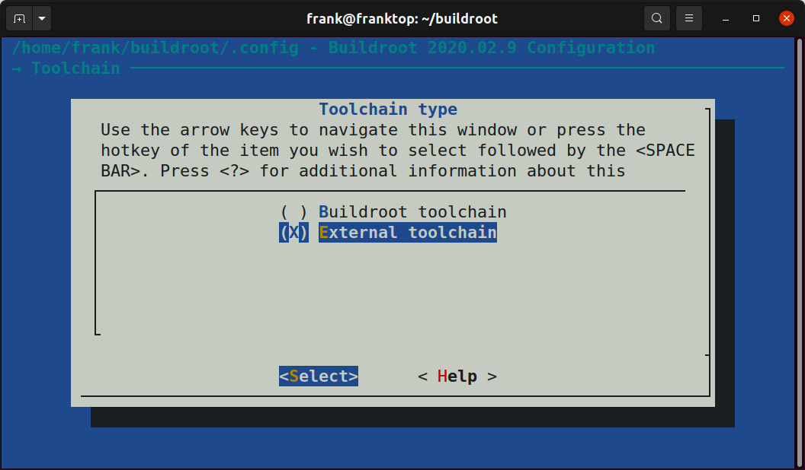
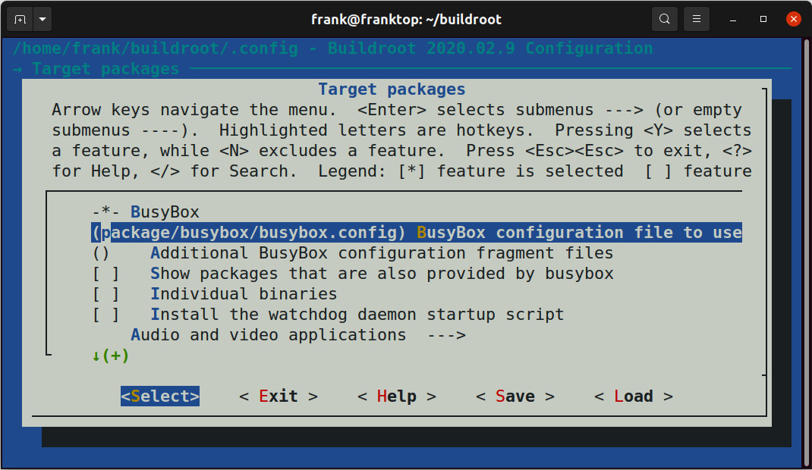
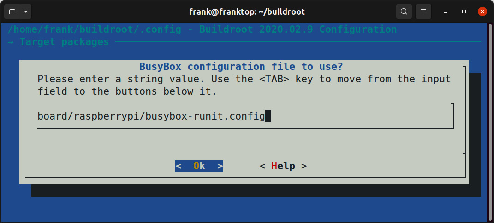
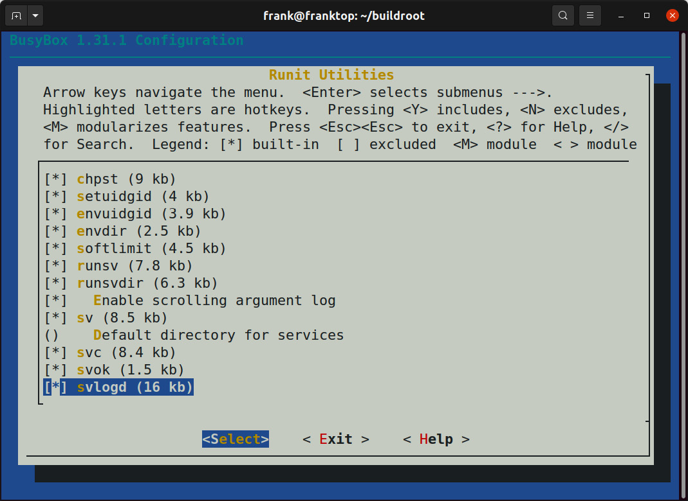
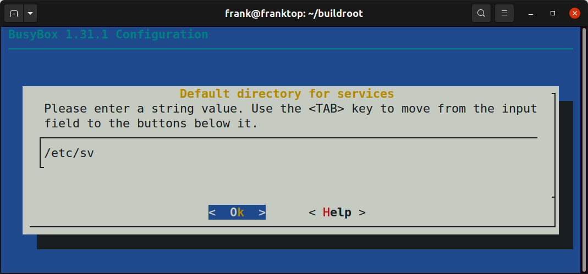

# *Chương 14*: Bắt đầu với BusyBox runit (Starting with BusyBox runit)

Trong chương trước, chúng ta đã xem chương trình System V `init` cổ điển và `systemd` state-of-the-art. Chúng ta cũng đã đề cập qua chương trình `init` tối giản của BusyBox. Bây giờ, đã đến lúc xem hiện thực chương trình `runit` của BusyBox. BusyBox `runit` đạt được sự cân bằng hợp lý giữa sự đơn giản của System V `init` và tính linh hoạt của `systemd`. Vì lý do này, phiên bản đầy đủ của `runit` được dùng trong các bản phân phối Linux hiện đại phổ biến như Void. Dù `systemd` có thể thống trị cloud, nó thường là quá mức cần thiết với nhiều hệ thống embedded Linux. BusyBox `runit` cung cấp các tính năng nâng cao như service supervision và ghi log riêng cho service mà không có độ phức tạp và overhead của `systemd`.

Trong chương này, tôi sẽ chỉ cho bạn cách chia hệ thống thành các service BusyBox `runit` riêng biệt, mỗi service có thư mục và script `run` riêng. Tiếp theo, chúng ta sẽ xem các script `check` có thể được dùng để buộc một số service chờ các service khác khởi động như thế nào. Sau đó, chúng ta sẽ thêm việc ghi log riêng cho một service và học cách cấu hình log rotation. Cuối cùng, chúng ta kết thúc bằng một ví dụ về một service gửi signal tới một service khác bằng cách ghi vào một named pipe. Khác với System V `init`, các service BusyBox `runit` khởi động đồng thời thay vì tuần tự, điều có thể tăng tốc thời gian boot đáng kể. Lựa chọn chương trình `init` của bạn có ảnh hưởng rõ rệt tới hành vi và trải nghiệm người dùng của sản phẩm.

Trong chương này, chúng ta sẽ đề cập các chủ đề sau:

- Lấy BusyBox `runit`
- Tạo thư mục và file service
- Service supervision
- Phụ thuộc vào các service khác
- Ghi log riêng cho service
- Gửi signal tới một service

## Yêu cầu kỹ thuật

Để làm theo các ví dụ, hãy bảo đảm bạn có những thứ sau:

- Một hệ thống host Linux-based
- Etcher cho Linux
- Một đầu đọc thẻ microSD và thẻ
- Một cáp serial USB to TTL 3.3V
- Một Raspberry Pi 4
- Một nguồn điện USB-C 5V 3A

Lẽ ra bạn đã cài bản phát hành 2020.02.9 LTS của Buildroot cho [*Chương 6*](ch06_selecting_a_build_system.vi.md), *Chọn build system*. Nếu chưa, hãy tham khảo mục *System requirements* của *The Buildroot user manual* ([https://buildroot.org/downloads/manual/manual.html](https://buildroot.org/downloads/manual/manual.html)) trước khi cài Buildroot trên host Linux theo hướng dẫn trong [*Chương 6*](ch06_selecting_a_build_system.vi.md).

Toàn bộ code cho chương này có thể được tìm thấy trong thư mục `Chapter14` của repository GitHub của sách: [https://github.com/PacktPublishing/Mastering-Embedded-Linux-Programming-Third-Edition](https://github.com/PacktPublishing/Mastering-Embedded-Linux-Programming-Third-Edition).

## Lấy BusyBox runit

Để chuẩn bị hệ thống cho chương này, chúng ta cần làm như sau:

1. Điều hướng tới thư mục nơi bạn đã clone Buildroot cho [*Chương 6*](ch06_selecting_a_build_system.vi.md), *Chọn build system*:

   ```
   $ cd buildroot
   ```

2. Kiểm tra xem `runit` có được BusyBox cung cấp không:

   ```
   $ grep Runit package/busybox/busybox.config
   # Runit Utilities
   ```

   BusyBox `runit` vẫn là một tùy chọn có sẵn trong bản phát hành Buildroot 2020.02.9 LTS tại thời điểm viết sách. Hãy quay về tag đó nếu bạn không còn tìm thấy BusyBox `runit` trong một bản phát hành sau này.

3. Hủy mọi thay đổi và xóa mọi file hoặc thư mục không được theo dõi:

   ```
   $ make clean
   $ git checkout .
   $ git clean –-force -d
   ```

   Lưu ý rằng `git clean --force` sẽ xóa patch U-Boot của Nova và mọi file khác mà chúng ta đã thêm vào Buildroot trong các bài tập trước.

4. Tạo một branch mới tên `busybox-runit` để lưu công việc của bạn:

   ```
   $ git checkout -b busybox-runit
   ```

5. Thêm BusyBox `runit` vào một cấu hình mặc định cho Raspberry Pi 4:

   ```
   $ cd configs
   $ cp raspberrypi4_64_defconfig rpi4_runit_defconfig
   $ cd ..
   $ cp package/busybox/busybox.config \
   board/raspberrypi/busybox-runit.config
   $ make rpi4_runit_defconfig
   $ make menuconfig
   ```

6. Từ menu chính, đi sâu vào submenu **Toolchain** | **Toolchain type** và chọn **External toolchain**:

   

   *Hình 14.1 – Chọn External toolchain*

7. Lùi ra một cấp và đi sâu vào submenu **Toolchain**. Chọn toolchain **Linaro AArch64**, rồi lùi ra thêm một cấp để quay về menu chính:

   

   *Hình 14.2 – Chọn toolchain Linaro AArch64*

8. BusyBox lẽ ra đã được chọn làm hệ thống `init` nhưng bạn có thể xác nhận điều đó bằng cách điều hướng tới submenu **System configuration** | **Init system** và quan sát thấy **BusyBox** được chọn thay vì **systemV** hay **systemd**. Lùi ra khỏi submenu **Init system** lên menu chính.

9. Từ menu chính, đi sâu vào trường văn bản **Target packages** | **BusyBox configuration file to use?** dưới **BusyBox**:

   

   *Hình 14.3 – Chọn một file cấu hình BusyBox để dùng*

10. Thay giá trị chuỗi `package/busybox/busybox.config` trong trường văn bản đó bằng `board/raspberrypi/busybox-runit.config`:

    

    *Hình 14.4 – BusyBox configuration file to use?*

11. Thoát khỏi `menuconfig` và chọn **Yes** nếu được hỏi có lưu cấu hình mới không. Buildroot lưu cấu hình mới vào một file tên `.config` theo mặc định.

12. Cập nhật `configs/rpi4_runit_defconfig` với vị trí mới của cấu hình BusyBox:

    ```
    $ make savedefconfig
    ```

13. Giờ hãy bắt đầu cấu hình BusyBox cho `runit`:

    ```
    $ make busybox-menuconfig
    ```

14. Khi đã ở trong `busybox-menuconfig`, bạn sẽ để ý một submenu tên **Runit Utilities**. Đi sâu vào submenu đó và chọn tất cả các tùy chọn trên trang menu đó. Các tiện ích `chpst`, `setuidgid`, `envuidgid`, `envdir` và `softlimit` là các công cụ command-line thường được các script `run` của service tham chiếu, nên tốt nhất là đưa vào tất cả. Các tiện ích `svc` và `svok` là di sản từ `daemontools` nên bạn có thể chọn bỏ chúng nếu muốn:

    

    *Hình 14.5 – Runit Utilities*

15. Từ submenu **Runit Utilities**, đi sâu vào trường văn bản **Default directory for services**.

16. Nhập `/etc/sv` vào trường văn bản **Default directory for services**:

    

    *Hình 14.6 – Thư mục mặc định cho service*

17. Thoát khỏi `busybox-menuconfig` và chọn **Yes** khi được hỏi có lưu cấu hình mới không. Giống tùy chọn `menuconfig`, `busybox-menuconfig` chỉ lưu cấu hình BusyBox mới vào một file `.config` trong một thư mục output. Theo mặc định, thư mục output của BusyBox là `output/build/busybox-1.31.1` trong phiên bản 2020.02.9 LTS của Buildroot.

18. Lưu các thay đổi vào `board/raspberrypi/busybox-runit.config`:

    ```
    $ make busybox-update-config
    ```

19. BusyBox có một file `inittab` cho chương trình `init` của nó trong thư mục `package/busybox` của Buildroot. File cấu hình này chỉ thị BusyBox `init` khởi động user space bằng cách mount các filesystem khác nhau và link các file descriptor tới các device node `stdin`, `stdout` và `stderr`. Để BusyBox `init` chuyển quyền điều khiển cho BusyBox `runit`, chúng ta cần thay các dòng sau trong `package/busybox/inittab`:

    ```
    # now run any rc scripts
    ::sysinit:/etc/init.d/rcS
    ```

    Các dòng này cần được thay bằng các dòng tương đương của BusyBox `runit`:

    ```
    # now switch over to runit
    null::respawn:runsvdir /etc/sv
    ```

20. Chúng ta cũng cần xóa các dòng sau khỏi `inittab` của BusyBox:

    ```
    # Stuff to do before rebooting
    ::shutdown:/etc/init.d/rcK
    ```

    Không cần dòng thay thế nào cho lệnh `::shutdown` bị xóa vì BusyBox `runit` tự động kết thúc các process mà nó giám sát trước khi reboot.

Giờ bạn đã có các file mới `configs/rpi4_runit_defconfig` và `board/raspberrypi/busybox-runit.config` cũng như một file `package/busybox/inittab` đã sửa đổi mà bạn có thể dùng để enable BusyBox `runit` trên một Linux image tùy biến cho Raspberry Pi 4. Hãy commit ba file đó vào Git để công việc của bạn không bị mất.

Để build image tùy biến, dùng các lệnh sau:

```
$ make rpi4_runit_defconfig
$ make
```

Khi build hoàn tất, một image bootable được ghi vào file `output/images/sdcard.img`. Flash image này lên thẻ microSD bằng Etcher, cắm nó vào Raspberry Pi 4 và cấp điện. Hệ thống sẽ không làm gì nhiều ngoài boot vì chưa có service nào trong `/etc/sv` để `runsvdir` khởi động.

Để thử nghiệm với BusyBox `runit`, gắn một cáp serial vào Raspberry Pi 4 và đăng nhập với tư cách `root` không có mật khẩu. Chúng ta chưa thêm `connman` vào image này nên hãy nhập `/sbin/ifup -a` để bật giao diện Ethernet:

```
# /sbin/ifup -a
[  187.076662] bcmgenet: Skipping UMAC reset
[  187.151919] bcmgenet fd580000.genet: configuring instance for external RGMII (no delay)
udhcpc: started, v1.31.1
udhcpc: sending discover
[  188.191465] bcmgenet fd580000.genet eth0: Link is Down
udhcpc: sending discover
[  192.287490] bcmgenet fd580000.genet eth0: Link is Up - 1Gbps/Full - flow control rx/tx
udhcpc: sending discover
udhcpc: sending select for 192.168.1.130
udhcpc: lease of 192.168.1.130 obtained, lease time 86400
deleting routers
adding dns 192.168.1.254
```

Chúng ta sẽ xem xét cấu trúc và layout của các thư mục service `runit` trong mục tiếp theo.

## Tạo thư mục và file service

`runit` là một bản hiện thực lại của bộ công cụ process supervision `daemontools`. Nó được Gerrit Pape tạo ra để thay thế System V `init` và các cơ chế `init` Unix khác. Tại thời điểm viết sách, hai nguồn thông tin tốt nhất về `runit` là website của Pape ([http://smarden.org/runit/](http://smarden.org/runit/)) và tài liệu trực tuyến của Void Linux.

Hiện thực `runit` của BusyBox khác với `runit` chuẩn chủ yếu ở khía cạnh self-documentation. Chẳng hạn, `sv --help` không hề nhắc tới các tùy chọn `start` và `check` của tiện ích `sv`, những tùy chọn thực ra được hiện thực của BusyBox hỗ trợ. Source code của BusyBox `runit` có thể được tìm thấy trong thư mục `output/build/busybox-1.31.1/runit` của BusyBox. Bạn cũng có thể duyệt phiên bản mới nhất của source code BusyBox `runit` trực tuyến tại [https://git.busybox.net/busybox/tree/runit](https://git.busybox.net/busybox/tree/runit). Nếu có bug nào trong, hay tính năng nào thiếu trong, hiện thực `runit` của BusyBox, bạn có thể sửa hoặc thêm chúng bằng cách patch package `busybox` của Buildroot.

Bản phân phối Arch Linux hỗ trợ dùng BusyBox `runit` song song với `systemd` để giám sát process đơn giản. Bạn có thể đọc thêm về cách làm điều đó trên Arch Linux Wiki. BusyBox mặc định dùng `init` và các bước thay BusyBox `init` bằng `runit` không được ghi tài liệu. Vì những lý do này, thay vì thay BusyBox `init` bằng `runit`, tôi sẽ chỉ cho bạn cách dùng BusyBox `runit` để thêm service supervision vào BusyBox `init`.

### Layout thư mục service

Sau đây là một trích dẫn từ tài liệu gốc (giờ đã deprecated) của bản phân phối Void Linux về `runit`:

> "Một thư mục service chỉ cần một file, một file thực thi tên `run` được kỳ vọng sẽ `exec` một process ở foreground."

Ngoài script `run` bắt buộc, một thư mục service `runit` cũng có thể chứa một script `finish`, một script `check` và một file `conf`. Một script `finish` được chạy khi service tắt hoặc process dừng. Script `run` source một file `conf` để đặt mọi biến môi trường trước khi chúng được dùng bên trong `run`.

Thư mục `/etc/sv`, giống thư mục `/etc/init.d` của BusyBox `init`, theo quy ước là nơi lưu các service `runit`. Đây là danh sách các script BusyBox `init` cho một hệ thống embedded Linux đơn giản:

```
$ ls output/target/etc/init.d
S01syslogd  S02sysctl   S21haveged  S45connman  S50sshd  rcS
S02klogd    S20urandom  S30dbus     S49ntp      rcK
```

Buildroot cung cấp các script BusyBox `init` này như một phần của package cho các daemon khác nhau. Trong trường hợp BusyBox `runit`, chúng ta phải tự tạo các start script này.

Đây là danh sách các service BusyBox `runit` cho cùng hệ thống đó:

```
$ ls -D output/target/etc/sv
bluetoothd  dbus   haveged  ntpd  syslogd
connmand    dcron  klogd    sshd  watchdog
```

Mỗi service BusyBox `runit` có thư mục riêng với một script `run` thực thi được bên trong. Các script BusyBox `init` cũng có trên target image sẽ không chạy lúc khởi động vì chúng ta đã xóa `::sysinit:/etc/init.d/rcS` khỏi `inittab`. Khác với các script `init`, các script `run` cần chạy ở foreground chứ không phải background để hoạt động với `runit`.

Bản phân phối Void Linux là một kho báu các file service `runit`. Đây là một script `run` của Void cho `sshd`:

```
#!/bin/sh
# Will generate host keys if they don't already exist
ssh-keygen -A >/dev/null 2>&1
[ -r conf ] && . ./conf
exec /usr/sbin/sshd -D $OPTS 2>&1
```

Tiện ích `runsvdir` khởi động và giám sát tập hợp các service được định nghĩa dưới thư mục `/etc/sv`. Vì lý do đó, script `run` cho `sshd` cần được cài thành `/etc/sv/sshd/run` để `runsvdir` có thể tìm thấy nó lúc khởi động. Nó cũng phải được làm cho thực thi được nếu không BusyBox `runit` sẽ không thể khởi động nó.

Hãy so sánh nội dung của `/etc/sv/sshd/run` với đoạn trích này từ `/etc/init.d/S50sshd` của Buildroot:

```
start() {
      # Create any missing keys
      /usr/bin/ssh-keygen -A
      printf "Starting sshd: "
      /usr/sbin/sshd
      touch /var/lock/sshd
      echo "OK"
}
```

`sshd` chạy ở background theo mặc định. Tùy chọn `-D` buộc `sshd` chạy ở foreground. `runit` mong đợi bạn đặt `exec` trước các lệnh chạy ở foreground trong các script `run`. Lệnh `exec` thay chương trình hiện tại trong process hiện tại. Kết quả cuối cùng là process `./run` được khởi động từ `/etc/sv/sshd` trở thành process `/usr/sbin/sshd -D` mà không fork:

```
# ps aux | grep "[s]shd"
  201 root     runsv sshd
  209 root     /usr/sbin/sshd -D
```

Hãy để ý rằng script `run` của `sshd` source một file `conf` cho biến môi trường `$OPTS`. Nếu không có file `conf` nào trong `/etc/sv/sshd`, thì `$OPTS` không được định nghĩa và rỗng, điều trong trường hợp này lại ổn. Giống hầu hết các service `runit`, `sshd` không cần script `finish` để giải phóng tài nguyên nào trước khi hệ thống tắt hoặc reboot.

### Cấu hình service

Các script `init` mà Buildroot đưa vào các package của nó là script BusyBox `init`. Các script `init` này cần được port sang BusyBox `runit` và cài vào các thư mục khác nhau dưới `output/target/etc/sv`. Thay vì patch từng package riêng lẻ, tôi thấy dễ hơn khi gói tất cả file service trong một `rootfs` overlay hoặc umbrella package bên ngoài cây Buildroot. Buildroot cho phép các tùy biến out-of-tree thông qua biến `make` `BR2_EXTERNAL`, trỏ tới một thư mục chứa các tùy biến.

Cách phổ biến nhất để đưa Buildroot vào một cây `br2-external` là nhúng nó ở top level của một Git repo dưới dạng một submodule:

```
$ cat .gitmodules
[submodule "buildroot"]
     path = buildroot
     url = git://git.buildroot.net/buildroot
     ignore = dirty
     branch = 15a05e6d5a875759d217d61b3c7b31ec87ea4eb5
```

Nhúng Buildroot dưới dạng submodule đơn giản hóa việc bảo trì mọi package bạn thêm hoặc patch bạn áp lên Buildroot. Submodule được ghim vào một tag để mọi tùy biến out-of-tree giữ ổn định cho đến khi Buildroot được nâng cấp có chủ đích. Hãy để ý rằng commit hash cho submodule `buildroot` ở trên được ghim vào tag `2020.02.9` của bản phát hành Buildroot LTS đó:

```
$ cd buildroot
$ git show --summary
commit 15a05e6d5a875759d217d61b3c7b31ec87ea4eb5 (HEAD -> busybox-runit, tag: 2020.02.9)
Author: Peter Korsgaard <peter@korsgaard.com>
Date:   Sun Dec 27 17:55:12 2020 +0100
    Update for 2020.02.9

    Signed-off-by: Peter Korsgaard <peter@korsgaard.com>
```

Để chạy `make` khi `buildroot` là một thư mục con của thư mục cha `BR2_EXTERNAL`, chúng ta cần truyền thêm một số đối số:

```
$ make -C $(pwd)/buildroot BR2_EXTERNAL=$(pwd) O=$(pwd)/output
```

Đây là cấu trúc thư mục Buildroot khuyến nghị cho một cây `br2-external`:

```
+-- board/
|   +-- <company>/
|       +-- <boardname>/
|           +-- linux.config
|           +-- busybox.config
|           +-- <other configuration files>
|           +-- post_build.sh
|           +-- post_image.sh
|           +-- rootfs_overlay/
|           |   +-- etc/
|           |   +-- <some file>
|           +-- patches/
|               +-- foo/
|               |   +-- <some patch>
|               +-- libbar/
|                   +-- <some other patches>
+-- configs/
|   +-- <boardname>_defconfig
+-- package/
|   +-- <company>/
|       +-- package1/
|       |    +-- Config.in
|       |    +-- package1.mk
|       +-- package2/
|           +-- Config.in
|           +-- package2.mk
+-- Config.in
+-- external.mk
+-- external.desc
```

Hãy để ý nơi các file `rpi4_runit_defconfig` và `busybox-runit.config` tùy biến mà bạn đã tạo trong mục trước sẽ được chèn vào cây này. Theo hướng dẫn của Buildroot, hai config đó được cho là các file board-specific. `<boardname>_defconfig` có prefix là tên board mà image đang được cấu hình cho. `busybox.config` nằm trong một thư mục `board/<company>/<boardname>` tương ứng. Cũng hãy để ý rằng thư mục `rootfs_overlay/etc` nơi `inittab` BusyBox tùy biến của bạn sẽ được đặt cũng là board-specific.

Vì tất cả các file cấu hình service cho BusyBox `runit` nằm trong `/etc/sv`, có vẻ hợp lý khi commit tất cả chúng vào một `rootfs` overlay board-specific. Theo kinh nghiệm của tôi, giải pháp này nhanh chóng trở nên quá cứng nhắc. Thường thì cần cấu hình nhiều hơn một image cho cùng một board. Chẳng hạn, một thiết bị tiêu dùng có thể có các image riêng cho phát triển, production và sản xuất. Mỗi image chứa các service khác nhau, nên cấu hình cần khác nhau giữa các image. Vì những lý do này, cấu hình service tốt nhất nên được làm ở mức package, không phải mức board. Tôi dùng các umbrella package out-of-tree (một package cho mỗi loại image) để cấu hình service cho BusyBox `runit`.

Ở top-level, một cây `br2-external` phải chứa các file `external.desc`, `external.mk` và `Config.in`. Một file `external.desc` chứa một số metadata cơ bản mô tả cây `br2-external`:

```
$ cat external.desc
name: ACME
desc: Acme's external Buildroot tree
```

Buildroot đặt biến `BR2_EXTERNAL_<name>_PATH` thành đường dẫn tuyệt đối của cây `br2-external` để biến đó có thể được tham chiếu trong Kconfig và makefile. Trường `desc` là một mô tả tùy chọn được cung cấp dưới dạng biến `BR2_EXTERNAL_<name>_DESC`. Thay `<name>` bằng `ACME` theo `external.desc` này. Một file `external.mk` thường chỉ chứa một dòng duy nhất tham chiếu biến `BR2_EXTERNAL_<name>_PATH` được định nghĩa trong `external.desc`:

```
$ cat external.mk
include $(sort $(wildcard $(BR2_EXTERNAL_ACME_PATH)/package/acme/*/*.mk))
```

Dòng `include` đó cho Buildroot biết nơi tìm các file `.mk` của external package. Vị trí của các file `Config.in` tương ứng cho các external package được định nghĩa trong file `Config.in` top-level của cây `br2-external`:

```
$ cat Config.in
source "$BR2_EXTERNAL_ACME_PATH/package/acme/development/Config.in"
source "$BR2_EXTERNAL_ACME_PATH/package/acme/manufacturing/Config.in"
source "$BR2_EXTERNAL_ACME_PATH/package/acme/production/Config.in"
```

Buildroot đọc file `Config.in` của cây `br2-external` và thêm các package recipe chứa trong đó vào menu cấu hình top-level. Hãy điền phần còn lại của cấu trúc cây `br2-external` của Buildroot với các umbrella package `development`, `manufacturing` và `production`:

```
├── configs
│   ├── supergizmo_development_defconfig
│   ├── supergizmo_manufacturing_defconfig
│   └── supergizmo_production_defconfig
└── package
    └── acme
        ├── development
        │   ├── Config.in
        │   ├── development.mk
        │   ├── haveged_run
        │   ├── inittab
        │   ├── ntpd.etc.conf
        │   ├── sshd_config
        │   ├── sshd_run
        │   └── user-tables.txt
        ├── manufacturing
        │   ├── apply-squash-update
        │   ├── Config.in
        │   ├── haveged_run
        │   ├── inittab
        │   ├── manufacturing.mk
        │   ├── mfg-profile
        │   ├── sshd_config
        │   ├── sshd_run
        │   ├── test-button
        │   ├── test-fan
        │   ├── test-gps
        │   ├── test-led
        │   └── user-tables.txt
        └── production
            ├── Config.in
            ├── dcron-root
            ├── download-apply-update
            ├── inittab
            ├── ntpd.etc.conf
            ├── ota.acme.systems.crt
            ├── production.mk
            └── user-tables.txt
```

Nếu so sánh cây thư mục này với cây trước đó của Buildroot, bạn có thể thấy `<boardname>` đã được thay bằng `supergizmo` và `<company>` đã được thay bằng `acme`. Bạn có thể nghĩ về một umbrella package như một image overlay nằm trên một base image chung nào đó. Bằng cách đó, cả ba image có thể dùng chung U-Boot, kernel và driver để các thay đổi của chúng chỉ áp dụng cho user space.

Hãy cân nhắc những package nào cần được đưa vào development image của một thiết bị để nó hiệu quả. Tối thiểu, các lập trình viên mong đợi có thể `ssh` vào thiết bị, thực thi lệnh với `sudo` và sửa các file onboard bằng `vim`. Ngoài ra, họ muốn có thể trace, debug và profile chương trình của mình bằng các công cụ như `strace`, `gdb` và `perf`. Không phần mềm nào trong số đó thuộc về production image của thiết bị vì lý do bảo mật.

`Config.in` cho umbrella package `development` chọn các package chỉ nên được triển khai lên phần cứng tiền sản xuất của lập trình viên in-house:

```
$ cat package/acme/development/Config.in
config BR2_PACKAGE_DEVELOPMENT
     bool "development"
     select BR2_PACKAGE_HAVEGED
     select BR2_PACKAGE_OPENSSH
     select BR2_PACKAGE_SUDO
     select BR2_PACKAGE_TMUX
     select BR2_PACKAGE_VIM
     select BR2_PACKAGE_STRACE
     select BR2_PACKAGE_LINUX_TOOLS_PERF
     select BR2_PACKAGE_GDB
     select BR2_PACKAGE_GDB_SERVER
     select BR2_PACKAGE_GDB_DEBUGGER
     select BR2_PACKAGE_GDB_TUI
     help
       The development image overlay for Acme's SuperGizmo.
```

Các script service và file cấu hình khác nhau được ghi vào thư mục `output/target` trong bước install của quá trình build package. Đây là đoạn trích liên quan từ `package/acme/development/development.mk`:

```
define DEVELOPMENT_INSTALL_TARGET_CMDS
     $(INSTALL) -D -m 0644 $(@D)/inittab $(TARGET_DIR)/etc/inittab
     $(INSTALL) -D -m 0755 $(@D)/haveged_run $(TARGET_DIR)/etc/sv/haveged/run
     $(INSTALL) -D -m 0755 $(@D)/sshd_run $(TARGET_DIR)/etc/sv/sshd/run
     $(INSTALL) -D -m 0644 $(@D)/sshd_config $(TARGET_DIR)/etc/ssh/sshd_config
endef
```

Các file `<package>.mk` của Buildroot chứa các section `<package>_BUILD_CMDS` và `<package>_INSTALL_TARGET_CMDS`. Umbrella package này tên `development` nên macro install cho nó được định nghĩa là `DEVELOPMENT_INSTALL_TARGET_CMDS`. Prefix `<package>` cần khớp với hậu tố `<package>` trong dòng `config BR2_<package>` của file `Config.in` của package, nếu không tên macro sẽ dẫn tới lỗi build package.

Các script `haveged/run` và `sshd/run` được cài vào thư mục `/etc/sv` trên target. `inittab` tùy biến cần để khởi động `runsvdir` được cài vào `/etc` trên target. Trừ khi các file này được cài đúng chỗ với quyền dự định, BusyBox `runit` không thể khởi động các service `haveged` hay `sshd`.

`haveged` là một bộ sinh số ngẫu nhiên bằng phần mềm nhằm giảm nhẹ các tình trạng low-entropy trong device `/dev/random` của Linux. Tình trạng Low-entropy có thể chặn `sshd` khởi động vì giao thức SSH phụ thuộc nhiều vào số ngẫu nhiên. Một số SoC mới hơn có thể chưa có hỗ trợ kernel cho các bộ sinh số ngẫu nhiên phần cứng của chúng. Nếu không chạy thêm `haveged` trên các hệ thống này, `sshd` có thể mất vài phút để bắt đầu chấp nhận kết nối sau khi boot.

Chạy `haveged` dưới BusyBox `runit` khá đơn giản:

```
$ cat package/acme/development/haveged_run
#!/bin/sh
exec /usr/sbin/haveged -w 1024 -r 0 -F
```

Các umbrella package `production` và `manufacturing` chồng các tập package và service khác nhau lên image. Image `production` bao gồm các công cụ để tải về và áp dụng cập nhật phần mềm. Image `manufacturing` bao gồm các công cụ mà kỹ thuật viên nhà máy sẽ dùng để provision và test phần cứng. BusyBox `runit` cũng rất phù hợp cho cả hai use case đó.

`Config.in` cho umbrella package `production` chọn các package cần cho việc cập nhật phần mềm over-the-air định kỳ:

```
$ cat package/acme/production/Config.in
config BR2_PACKAGE_PRODUCTION
     bool "production"
     select BR2_PACKAGE_DCRON
     select BR2_PACKAGE_LIBCURL
     select BR2_PACKAGE_LIBCURL_CURL
     select BR2_PACKAGE_LIBCURL_VERBOSE
     select BR2_PACKAGE_JQ
     help
       The production image overlay for Acme's SuperGizmo.
```

Các bản cập nhật OTA bắt buộc thường không được mong muốn trong môi trường phát triển và sản xuất, nên các package này được loại khỏi các image đó. Image `production` bao gồm một script `download-apply-update` dùng `curl` để truy vấn một OTA server xem có bản cập nhật phần mềm mới không. Một SSL certificate công khai cũng được đưa vào onboard để `curl` có thể xác minh tính xác thực của OTA server. Daemon `dcron` được cấu hình để chạy `download-apply-update` mỗi 10 tới 20 phút với một ít nhiễu ngẫu nhiên để tránh hiệu ứng đàn đông đổ xô. Nếu có bản cập nhật mới hơn, script sau đó tải image về, xác minh và áp dụng nó lên thẻ microSD trước khi reboot. Đây là đoạn trích liên quan từ `package/acme/production/production.mk`:

```
define PRODUCTION_INSTALL_TARGET_CMDS
     $(INSTALL) -D -m 0644 $(@D)/inittab $(TARGET_DIR)/etc/inittab
     $(INSTALL) -D -m 0644 $(@D)/dcron-root $(TARGET_DIR)/etc/cron.d/root
     $(INSTALL) -D -m 0775 $(@D)/download-apply-update $(TARGET_DIR)/usr/sbin/download-apply-update
     $(INSTALL) -D -m 0644 $(@D)/ota.acme.com.crt $(TARGET_DIR)/etc/ssl/certs/ota.acme.com.crt
     $(INSTALL) -D -m 0644 $(@D)/ntpd.etc.conf $(TARGET_DIR)/etc/ntp.conf
endef
```

Để build image `production`, hãy `cd` tới gốc của cây `br2-external` và chạy các lệnh sau:

```
$ make clean
$ make supergizmo_production_defconfig
$ make
```

Các bước build image `development` và `manufacturing` cho Acme SuperGizmo chỉ khác nhau ở lựa chọn `defconfig`. Ba defconfig gần như giống hệt nhau trừ dòng cuối cùng, là `BR2_PACKAGE_DEVELOPMENT=y`, `BR2_PACKAGE_PRODUCTION=y` hoặc `BR2_PACKAGE_MANUFACTURING=y` tùy lựa chọn image. Ba umbrella package được dự định là loại trừ lẫn nhau nên đừng chọn nhiều hơn một umbrella package để đưa vào cùng một image, nếu không bạn nhiều khả năng sẽ gặp kết quả không mong muốn.

## Service supervision

Một khi chúng ta đã tạo các thư mục service với script `run` dưới `/etc/sv` và bảo đảm BusyBox `init` khởi động `runsvdir`, BusyBox `runit` lo hết phần còn lại. Điều đó bao gồm khởi động, dừng, giám sát và khởi động lại tất cả các service dưới sự kiểm soát của nó. Tiện ích `runsvdir` khởi động một process `runsv` cho mỗi thư mục service và khởi động lại một process `runsv` nếu nó kết thúc. Vì các script `run` chạy daemon tương ứng ở foreground, `runsv` mong đợi `run` block để khi `run` thoát, `runsv` sẽ tự động khởi động lại nó.

Service auto-restart là đáng mong muốn trong lúc khởi động hệ thống vì các script `run` có thể crash. Điều này đặc biệt đúng dưới BusyBox `runit`, nơi các service khởi động gần như đồng thời thay vì lần lượt. Chẳng hạn, một service có thể khởi động thất bại khi một service phụ thuộc hay tài nguyên hệ thống thiết yếu (chẳng hạn một GPIO hay device driver) chưa có sẵn. Trong mục tiếp theo, tôi sẽ chỉ cho bạn cách biểu diễn phụ thuộc giữa các service để trình tự khởi động hệ thống vẫn tất định.

Đây là các process `runsv` đang chạy trên hệ thống embedded Linux đơn giản của chúng ta:

```
# ps aux | grep "[r]unsv"
  177 root     runsvdir /etc/sv
  179 root     runsv ntpd
  180 root     runsv haveged
  181 root     runsv syslogd
  182 root     runsv dcron
  185 root     runsv dbus
  187 root     runsv bluetoothd
  192 root     runsv watchdog
  195 root     runsv connmand
  199 root     runsv sshd
  202 root     runsv klogd
```

Hãy để ý rằng lệnh `runsvdir /etc/sv` trong `inittab` không thực thi cho đến PID 177. Process có PID 1 là `/sbin/init`, chỉ là một symbolic link trỏ tới `/bin/busybox`. Các PID 2 tới 176 (không hiển thị) đều là kernel thread và system service nên lệnh của chúng xuất hiện trong ngoặc vuông khi được `ps` hiển thị. Ngoặc vuông nghĩa là một process không có command line thực sự gắn với nó. Vì `connmand` và `bluetoothd` đều phụ thuộc D-Bus để khởi động, `runsv` có thể đã khởi động lại một trong hai service nhiều lần trước khi D-Bus chạy ổn:

```
# pstree -a
init
  |-getty -L 115200 ttyS0
  |-hciattach /dev/ttyAMA0 bcm43xx 921600 flow - 60:81:f9:b0:8a:02
  |-runsvdir /etc/sv
  |   |-runsv ntpd
  |   |   `-ntpd -u ntp -c /etc/ntp.conf -U 60 -g -n
  |   |       `-{ntpd}
  |   |-runsv haveged
  |   |   `-haveged -w 1024 -r 0 -F
  |   |-runsv syslogd
  |   |   `-syslogd -n -O /var/data/log/messages -b 99 -s 1000
  |   |-runsv dcron
  |   |-runsv dbus
  |   |   `-dbus-daemon --system --nofork --nopidfile --syslog-only
  |   |-runsv bluetoothd
  |   |   `-bluetoothd -E --noplugin=* -n
  |   |-runsv watchdog
  |   |   `-watchdog -T 10 -F /dev/watchdog
  |   |-runsv connmand
  |   |   `-connmand -n
  |   |-runsv sshd
  |   |   `-sshd -D
  |   `-runsv klogd
  |       `-klogd -n
  `-wpa_supplicant -u
```

Một số service cần kết nối internet trước khi có thể khởi động. Điều này có thể làm chậm việc khởi động service vài giây do bản chất bất đồng bộ của DHCP. Vì `connmand` quản lý tất cả các network interface trên hệ thống này, các service này đến lượt chúng phụ thuộc vào `connmand`. Nếu địa chỉ IP của thiết bị thay đổi do chuyển giữa các mạng hoặc gia hạn DHCP lease, nhiều service trong số này có thể cần được khởi động lại. May mắn là BusyBox `runit` cung cấp một cách để khởi động lại service dễ dàng từ command line.

### Điều khiển service

BusyBox `runit` cung cấp một công cụ command-line `sv` để quản lý và kiểm tra service:

```
# sv --help
BusyBox v1.31.1 () multi-call binary.
Usage: sv [-v] [-w SEC] CMD SERVICE_DIR...
Control services monitored by runsv supervisor.
Commands (only first character is enough):
status: query service status
up: if service isn't running, start it. If service stops, restart it
once: like 'up', but if service stops, don't restart it
down: send TERM and CONT signals. If ./run exits, start ./finish
     if it exists. After it stops, don't restart service
exit: send TERM and CONT signals to service and log service. If they exit,
     runsv exits too
pause, cont, hup, alarm, interrupt, quit, 1, 2, term, kill: send
STOP, CONT, HUP, ALRM, INT, QUIT, USR1, USR2, TERM, KILL signal to service
```

Help message của `sv` giải thích các lệnh `up`, `once`, `down` và `exit` làm gì. Nó cũng minh họa cách các lệnh `pause`, `cont`, `hup`, `alarm`, `interrupt`, `quit`, `1`, `2`, `term` và `kill` ánh xạ trực tiếp tới các POSIX signal. Hãy để ý rằng ký tự đầu tiên của mỗi lệnh là đủ để gọi nó.

Hãy thử nghiệm với các lệnh `sv` khác nhau dùng `ntpd` làm service đích. Thời gian trạng thái của bạn sẽ khác của tôi tùy bạn chờ bao lâu giữa các lệnh:

1. Khởi động lại service `ntpd`:

   ```
   # sv t /etc/sv/ntpd
   # sv s /etc/sv/ntpd
   run: /etc/sv/ntpd: (pid 1669) 6s
   ```

   Lệnh `sv t` khởi động lại một service và lệnh `sv s` lấy trạng thái của nó. `t` là viết tắt của `term` nên `sv t` gửi cho service signal `TERM` trước khi khởi động lại nó. Message trạng thái nói rằng `ntpd` đã chạy được 6 giây kể từ khi khởi động lại.

2. Giờ hãy xem điều gì xảy ra với trạng thái khi chúng ta dùng `sv d` để dừng service `ntpd`:

   ```
   # sv d /etc/sv/ntpd
   # sv s /etc/sv/ntpd
   down: /etc/sv/ntpd: 7s, normally up
   ```

   Lần này, message trạng thái nói rằng `ntpd` đã down được 7 giây kể từ khi bị dừng.

3. Khởi động lại service `ntpd`:

   ```
   # sv u /etc/sv/ntpd
   # sv s /etc/sv/ntpd
   run: /etc/sv/ntpd: (pid 2756) 5s
   ```

   Message trạng thái giờ nói rằng `ntpd` đã chạy được 5 giây kể từ khi khởi động. Hãy để ý rằng PID cao hơn trước vì hệ thống đã chạy một thời gian kể từ khi `ntpd` được khởi động lại.

4. Khởi động `ntpd` kiểu one-off:

   ```
   # sv o /etc/sv/ntpd
   # sv s /etc/sv/ntpd
   run: /etc/sv/ntpd: (pid 3795) 3s, want down
   ```

   Lệnh `sv o` giống `sv u` ngoại trừ việc service đích không khởi động lại nếu nó dừng. Bạn có thể xác nhận điều đó bằng cách gửi một signal `KILL` tới service `ntpd` bằng `sv k /etc/sv/ntpd` và quan sát thấy service `ntpd` down và ở trạng thái down.

Đây là dạng dài của các lệnh `sv` mà chúng ta đã đề cập:

```
# sv term /etc/sv/ntpd
# sv status /etc/sv/ntpd
# sv down /etc/sv/ntpd
# sv up /etc/sv/ntpd
# sv once /etc/sv/ntpd
```

Nếu một service cần xử lý lỗi hay signal có điều kiện, bạn có thể định nghĩa logic đó bên trong một script `finish`. Script `finish` của service là tùy chọn và thực thi mỗi khi `run` thoát. Một script `finish` nhận hai đối số: `$1`, một exit code từ `run`, và `$2`, byte thấp nhất của exit status được xác định bởi system call `waitpid`. Exit code từ `run` là 0 khi `run` thoát bình thường và -1 khi `run` thoát bất thường. Byte trạng thái là 0 khi `run` thoát bình thường và là số signal khi `run` bị một signal kết thúc. Nếu `runsv` không thể khởi động `run`, thì exit code là 1 và byte trạng thái là 0.

Một service phát hiện thay đổi địa chỉ IP có thể khởi động lại các network service bằng cách gọi ra shell `sv t`. Điều này tương tự với những gì `ifplugd` làm, ngoại trừ việc `ifplugd` kích hoạt theo trạng thái link Ethernet thay vì thay đổi địa chỉ IP. Một service như vậy có thể đơn giản như một shell script gồm một vòng lặp `while` duy nhất liên tục poll tất cả các network interface. Bạn cũng có thể chạy các lệnh `sv` từ một script `run` hoặc `finish` như một cách giao tiếp giữa các service. Tôi sẽ chỉ cho bạn cách làm điều đó trong mục tiếp theo.

## Phụ thuộc vào các service khác

Tôi đã đề cập một số service như `connmand` và `bluetoothd` cần D-Bus như thế nào. D-Bus là một message system bus cho phép truyền thông liên process kiểu publish-subscribe. Package Buildroot cho D-Bus cung cấp một `dbus-daemon` hệ thống và một thư viện tham chiếu `libdbus`. Thư viện `libdbus` hiện thực D-Bus C API low-level nhưng các binding higher-level tới `libdbus` tồn tại cho các ngôn ngữ khác như Python. Một số ngôn ngữ cũng cung cấp các hiện thực thay thế của giao thức D-Bus không hề phụ thuộc vào `libdbus`. Các service D-Bus như `connmand` và `bluetoothd` mong đợi `dbus-daemon` hệ thống đã chạy trước khi chúng có thể khởi động.

### Phụ thuộc khởi động

Tài liệu chính thức của `runit` khuyến nghị dùng `sv start` để biểu diễn phụ thuộc vào các service khác dưới sự kiểm soát của `runit`. Để bảo đảm D-Bus có sẵn trước khi `connmand` khởi động, bạn nên định nghĩa `/etc/sv/connmand/run` của mình tương ứng:

```
#!/bin/sh
/bin/sv start /etc/sv/dbus > /dev/null || exit 1
exec /usr/sbin/connmand -n
```

`sv start /etc/sv/dbus` cố khởi động `dbus-daemon` hệ thống nếu nó chưa chạy. Lệnh `sv start` giống `sv up` ngoại trừ việc nó sẽ chờ service khởi động trong tối đa bao nhiêu giây được chỉ định bởi đối số `-w` hoặc biến môi trường `SVWAIT`. Thời gian chờ tối đa mặc định khi không có đối số `-w` hay biến môi trường `SVWAIT` nào được định nghĩa là 7 giây. Nếu service đã up, nó trả về exit code 0 cho thành công. Exit code 1 cho biết thất bại, khiến `/etc/sv/connmand/run` thoát sớm mà không khởi động `connmand`. Process `runsv` giám sát `connmand` sẽ tiếp tục cố khởi động service cho đến khi cuối cùng thành công.

Đây là `/etc/sv/dbus/run` tương ứng của chúng ta, mà tôi đã dựa trên bản của Void:

```
#!/bin/sh
[ ! -d /var/run/dbus ] && /bin/install -m755 -g 22 -o 22 -d /var/run/dbus
[ -d /tmp/dbus ] || /bin/mkdir -p /tmp/dbus
exec /bin/dbus-daemon --system --nofork --nopidfile --syslog-only
```

Hãy so sánh điều đó với đoạn trích sau từ `/etc/init.d/S30dbus` của Buildroot:

```
# Create needed directories.
[ -d /var/run/dbus ] || mkdir -p /var/run/dbus
[ -d /var/lock/subsys ] || mkdir -p /var/lock/subsys
[ -d /tmp/dbus ] || mkdir -p /tmp/dbus
RETVAL = 0
start() {
    printf "Starting system message bus: "
    dbus-uuidgen --ensure
    dbus-daemon --system
    RETVAL=$?
    echo "done"
    [ $RETVAL -eq 0 ] && touch /var/lock/subsys/dbus-daemon
}
stop() {
    printf "Stopping system message bus: "
    ## we don't want to kill all the per-user $processname, we want
    ## to use the pid file *only*; because we use the fake nonexistent
    ## program name "$servicename" that should be safe-ish
    killall dbus-daemon
    RETVAL=$?
    echo "done"
    if [ $RETVAL -eq 0 ]; then
        rm -f /var/lock/subsys/dbus-daemon
        rm -f /var/run/messagebus.pid
    fi
}
```

Hãy để ý phiên bản script service D-Bus của Buildroot phức tạp hơn nhiều đến mức nào. Vì `runit` chạy `dbus-daemon` ở foreground, không cần các file `lock` hay `pid` và tất cả thủ tục rườm rà gắn với chúng. Bạn có thể cho rằng function `stop()` ở trên sẽ là một script `finish` tốt, ngoại trừ việc trong trường hợp `runit`, không có `dbus-daemon` nào để kill hay file `pid` hay `lock` nào để xóa. Các script `finish` của service là tùy chọn trong `runit` nên chúng chỉ nên được dành cho công việc có ý nghĩa.

### Phụ thuộc khởi động tùy biến

Nếu tồn tại một `check` trong thư mục `/etc/sv/dbus`, `sv` chạy script này để kiểm tra service có sẵn hay không. Một service được coi là có sẵn nếu `check` thoát với 0. Cơ chế `check` cho phép bạn biểu diễn thêm các hậu điều kiện để một service được coi là có sẵn ngoài việc có một process đang chạy. Chẳng hạn, chỉ vì `connmand` đã khởi động không có nghĩa là kết nối internet nhất thiết đã được thiết lập. Các script `check` bảo đảm một service hoàn thành những gì nó được dự định làm trước khi các service khác có thể khởi động.

Để kiểm tra Wi-Fi đã lên hay chưa, bạn có thể định nghĩa `check` sau:

```
#!/bin/sh
WIFI_STATE=$(cat /sys/class/net/wlan0/operstate)
"$WIFI_STATE" = "up" || exit 1
exit 0
```

Bằng cách cài script trên vào `/etc/sv/connmand/check`, bạn biến Wi-Fi thành một yêu cầu để service `connmand` khởi động. Bằng cách đó, khi bạn chạy `sv start /etc/sv/connmand`, lệnh chỉ trả về exit code 0 nếu giao diện Wi-Fi đã lên, ngay cả khi `connmand` đang chạy.

Bạn có thể thực thi các script `check` mà không khởi động service bằng lệnh `sv check`. Giống `sv start`, nếu `check` tồn tại trong thư mục service, `sv` chạy script này để xác định service có sẵn hay không. Một service được coi là có sẵn nếu `check` thoát với 0. `sv` sẽ chờ tối đa 7 giây để `check` trả về exit code 0. Khác với `sv start`, nếu `check` trả về exit code khác không, `sv` không cố khởi động service.

### Kết hợp tất cả lại

Chúng ta đã thấy các cơ chế `sv start` và `check` cho phép biểu diễn phụ thuộc khởi động giữa các service như thế nào. Kết hợp các tính năng này với script `finish` cho phép chúng ta xây dựng các process supervision tree. Chẳng hạn, một service đóng vai trò process cha có thể gọi `sv down` để hạ các service con phụ thuộc của nó khi nó dừng. Mức tùy biến nâng cao này là điều tôi tin làm BusyBox `runit` mạnh mẽ đến vậy. Bạn có thể điều chỉnh hệ thống để hoạt động đúng như bạn muốn chỉ bằng các shell script đơn giản, well-defined. Để học thêm về supervision tree, tôi khuyên đọc tài liệu về khả năng chịu lỗi của Erlang.

## Ghi log riêng cho service

Một dedicated service logger chỉ ghi log output đến từ một daemon duy nhất. Ghi log riêng là điều tốt vì dữ liệu chẩn đoán cho các service khác nhau được phân bố trên các file log riêng biệt. Các file log nguyên khối được tạo bởi các system logger tập trung như `syslogd` thường khó gỡ rối. Cả hai dạng ghi log đều có mục đích của chúng: ghi log riêng vượt trội về khả năng đọc và ghi log tập trung cung cấp bối cảnh. Mỗi service của bạn có thể có logger riêng và vẫn ghi vào `syslog` nên bạn không phải hy sinh cái nào.

### Nó hoạt động như thế nào?

Vì các script `run` của service chạy ở foreground, thêm một dedicated logger vào service chỉ liên quan tới việc chuyển hướng standard output từ `run` của service sang một file log. Bạn enable việc ghi log riêng cho service bằng cách tạo một thư mục con `log` bên trong thư mục service đích với một script `run` khác bên trong. Script `run` bổ sung này dành cho logger của service, không phải bản thân service. Khi thư mục `log` này tồn tại, một pipe được mở từ output của process `run` trong thư mục service tới input của process `run` trong thư mục `log`.

Đây là một layout thư mục service khả dĩ cho `sshd`:

```
# tree etc/sv/sshd
etc/sv/sshd
|-- finish
|-- log
|   `-- run
`-- run
```

Chính xác hơn, khi process `runsv` của BusyBox `runit` gặp layout thư mục service này, nó làm vài việc ngoài việc khởi động `sshd/run` và `sshd/finish` nếu và khi cần thiết:

1. Tạo một pipe
2. Chuyển hướng standard out từ `run` và `finish` sang pipe
3. Chuyển sang thư mục `log`
4. Khởi động `log/run`
5. Chuyển hướng standard input của `log/run` để đọc từ pipe

`runsv` khởi động và giám sát `sshd/log/run` giống hệt như nó khởi động và giám sát `sshd/run`. Một khi bạn thêm logger cho `sshd`, bạn sẽ để ý rằng `sv d /etc/sv/sshd` chỉ dừng `sshd`. Để dừng logger, bạn phải nhập `sv d /etc/sv/sshd/log` trừ khi bạn thêm lệnh đó vào script `/etc/sv/sshd/finish`.

### Thêm việc ghi log riêng cho một service

BusyBox `runit` cung cấp một logging daemon `svlogd` để dùng trong các script `log/run` của bạn:

```
# svlogd --help
BusyBox v1.31.1 () multi-call binary.
Usage: svlogd [-tttv] [-r C] [-R CHARS] [-l MATCHLEN] [-b BUFLEN] DIR...
Read log data from stdin and write to rotated log files in DIRs
-r C       Replace non-printable characters with C
-R CHARS   Also replace CHARS with C (default _)
-t         Timestamp with @tai64n
-tt        Timestamp with yyyy-mm-dd_hh:mm:ss.sssss
-ttt       Timestamp with yyyy-mm-ddThh:mm:ss.sssss
-v         Verbose
```

Hãy để ý rằng `svlogd` yêu cầu một hoặc nhiều đường dẫn thư mục output `DIR` làm đối số.

Để thêm việc ghi log riêng cho một service BusyBox `runit` có sẵn, hãy làm như sau:

1. Tạo một thư mục con `log` bên trong thư mục service.
2. Tạo một script `run` bên trong thư mục con `log`.
3. Làm cho script `run` đó thực thi được.
4. Dùng `exec` để chạy `svlogd` bên trong `run`.

Đây là một script `/etc/sv/sshd/log/run` từ Void:

```
#!/bin/sh
[ -d /var/log/sshd ] || mkdir -p /var/log/sshd
exec chpst -u root:adm svlogd -t /var/log/sshd
```

Vì `svlogd` sẽ ghi các file log `sshd` vào `/var/log/sshd`, trước tiên chúng ta cần tạo thư mục đó nếu nó chưa tồn tại. Để các file log `sshd` được lưu bền, bạn có thể cần sửa `inittab` để mount `/var` vào một partition flash ghi được lúc boot trước khi khởi động `runsvdir`. Phần `chpst -u root:adm` của `exec` bảo đảm `svlogd` chạy với đặc quyền và quyền của user `root` và group `adm`.

Tùy chọn `-t` thêm prefix là một timestamp TAI64N-formatted vào mỗi dòng ghi vào file log. Dù timestamp TAI64N chính xác, chúng không phải là human-readable nhất. Các tùy chọn timestamp khác mà `svlogd` cung cấp là `-tt` và `-ttt`. Một số daemon tự ghi timestamp của chúng ra standard out. Để tránh ghi các dòng có timestamp kép gây khó hiểu, chỉ cần bỏ `-t` hay bất kỳ biến thể nào của nó khỏi lệnh `svlogd` trong `log/run`.

Bạn có thể bị cám dỗ thêm một dedicated logger cho các service `klogd` và `syslogd`. Hãy cưỡng lại cám dỗ đó. `klogd` và `syslogd` là các logging daemon system-wide và cả hai đều rất giỏi việc của chúng. Thực sự không có lý do gì để ghi log những gì một logger đang làm trừ khi nó đang trục trặc và bạn cần debug nó. Nếu bạn phát triển một service ghi log ra cả `stdout` và `syslog`, hãy bảo đảm loại bỏ timestamp khỏi nội dung message `syslog`. Giao thức `syslog` có một trường `timestamp` để bạn nhúng timestamp.

Mỗi dedicated logger chạy trong process riêng biệt của nó. Overhead phụ thêm cần để hỗ trợ các process logger bổ sung này là điều cần cân nhắc khi thiết kế hệ thống nhúng. Nếu bạn định dùng BusyBox `runit` để giám sát nhiều service trên một hệ thống resource-constrained, hãy chọn lọc những service nào cần thêm ghi log riêng, nếu không khả năng phản hồi có thể bị ảnh hưởng.

### Log rotation

`svlogd` tự động rotate các file log với mặc định là 10 file log, mỗi file có kích thước tối đa 1 triệu byte. Nhớ rằng các file log được rotate này được ghi ra một hoặc nhiều thư mục output `DIR` được truyền vào `svlogd` làm đối số. Tất nhiên, các thiết lập rotation này có thể cấu hình được, nhưng trước khi đi vào điều đó, hãy để tôi giải thích log rotation hoạt động thế nào.

Giả sử `svlogd` bằng cách nào đó biết về hai giá trị tên `NUM` và `SIZE`. `NUM` là số file log cần giữ lại. `SIZE` là kích thước tối đa của một file log. `svlogd` nối các log message vào một file log tên `current`. Khi kích thước của `current` đạt `SIZE` byte, thì `svlogd` rotate `current`.

Để rotate file `current`, `svlogd` sẽ làm như sau:

1. Đóng file log `current`.
2. Làm cho `current` thành read-only.
3. Đổi tên `current` thành `@<timestamp>.s`.
4. Tạo một file log `current` mới và bắt đầu ghi vào nó.
5. Đếm số file log hiện có ngoài `current`.
6. Xóa file log cũ nhất nếu `count` bằng hoặc vượt quá `NUM`.

`<timestamp>` được dùng để đổi tên file log `current` đang được rotate ra là timestamp tại thời điểm rotate file, không phải lúc tạo.

Bây giờ hãy xem các mô tả của `SIZE`, `NUM` và `PATTERN` ở đây:

```
# svlogd --help
BusyBox v1.31.1 () multi-call binary.
[Usage not shown]
DIR/config file modifies behavior:
sSIZE - when to rotate logs (default 1000000, 0 disables)
nNUM - number of files to retain
!PROG - process rotated log with PROG
+,-PATTERN - (de)select line for logging
E,ePATTERN - (de)select line for stderr
```

Các thiết lập này được đọc từ một file `DIR/config` nếu nó tồn tại. Hãy để ý rằng `SIZE` bằng 0 sẽ disable log rotation và không phải là mặc định. Đây là một file `DIR/config` khiến `svlogd` giữ tối đa 100 file log, mỗi file có kích thước tối đa 9,999,999 byte, tổng cộng khoảng 1 GB log được rotate ghi vào một thư mục output:

```
s9999999
n100
```

Nếu nhiều thư mục output `DIR` được truyền cho `svlogd`, thì `svlogd` ghi log vào tất cả chúng. Vì sao bạn lại muốn ghi cùng các message vào nhiều hơn một thư mục? Câu trả lời là bạn *không* ghi cùng các message vào nhiều thư mục. Vì mỗi thư mục output có file `config` riêng, bạn dùng pattern matching để chọn message nào được ghi vào thư mục output nào.

Giả sử `PATTERN` có độ dài `N`, nếu một dòng trong `DIR/config` bắt đầu bằng `+`, `-`, `E` hoặc `e`, `svlogd` so khớp `N` ký tự đầu tiên của mỗi log message với `PATTERN` tương ứng. Các prefix `+` và `-` áp dụng cho `current` và các prefix `E` và `e` áp dụng cho standard error. `+PATTERN` chọn và `-PATTERN` lọc bỏ các dòng khớp để ghi log vào `current`. `EPATTERN` chọn và `ePATTERN` lọc bỏ các dòng khớp để cảnh báo ra standard error.

## Gửi signal tới một service

Trước đó, trong mục *Điều khiển service*, tôi đã cho thấy công cụ command-line `sv` có thể được dùng để điều khiển một service như thế nào. Sau đó, tôi đã minh họa các lệnh `sv start` và `sv down` có thể được dùng bên trong script `run` và `finish` để giao tiếp giữa các service như thế nào. Có thể bạn đã đoán rằng `runsv` đang gửi các POSIX signal tới các process `run` mà nó giám sát khi một lệnh `sv` thực thi. Nhưng điều bạn có thể chưa biết là công cụ `sv` điều khiển process `runsv` đích của nó qua một named pipe. Các named pipe `supervise/control` và tùy chọn `log/supervise/control` được mở để các process khác có thể gửi lệnh tới `runsv`. Gửi signal tới một service rất dễ với các lệnh `sv`, nhưng nếu muốn, bạn có thể bỏ qua hoàn toàn `sv` và ghi các ký tự điều khiển trực tiếp vào (các) pipe `control`.

Layout thư mục runtime của một service không có ghi log riêng trông như thế này:

```
# tree /etc/sv/syslogd
/etc/sv/syslogd
|-- run
`-- supervise
    |-- control
    |-- lock
    |-- ok
    |-- pid
    |-- stat
    `-- status
```

File `control` dưới `/etc/sv/syslogd` là named pipe của service. Các file `pid` và `stat` chứa PID đang chạy và giá trị trạng thái (`run` hoặc `down`) của service. Thư mục con `supervise` và toàn bộ nội dung của nó được `runsv syslogd` tạo và điền khi hệ thống khởi động. Nếu một service có một dedicated logger, `runsv` cũng sẽ tạo một thư mục con `supervise` cho nó.

Các ký tự điều khiển sau (`t`, `d`, `u` và `o`) ánh xạ trực tiếp tới dạng ngắn của các lệnh `sv` (`term`, `down`, `up` và `once`) mà chúng ta đã gặp:

- `t` `term`: Gửi cho process một signal `TERM` trước khi khởi động lại service.
- `d` `down`: Gửi cho process một signal `TERM` theo sau là một signal `CONT` và không khởi động lại nó.
- `u` `up`: Khởi động một service và khởi động lại nó nếu process thoát.
- `o` `once`: Cố khởi động một service trong tối đa 7 giây và không khởi động lại nó sau đó.
- `1`: Gửi cho process một signal `USR1`.
- `2`: Gửi cho process một signal `USR2`.

Các ký tự điều khiển `1` và `2` đặc biệt đáng chú ý vì chúng tương ứng với các signal user-defined. Việc phản ứng thế nào với các signal `USR1` và `USR2` là do service ở đầu nhận quyết định. Nếu bạn là lập trình viên được giao mở rộng một service, bạn có thể làm điều đó bằng cách hiện thực các signal handler. Hai signal user-defined có vẻ không nhiều để làm việc, nhưng nếu bạn kết hợp các sự kiện riêng biệt này với các cập nhật ghi vào (các) file cấu hình, bạn có thể đạt được nhiều điều. Các signal User-defined có thêm ưu điểm là không cần dừng hay kết thúc một process đang chạy như các signal `STOP`, `TERM` và `KILL`.

## Tóm tắt

Chương này là một chuyến đi sâu vào một hệ thống `init` lesser-known mà tôi cảm thấy phần lớn bị đánh giá thấp. Giống `systemd`, BusyBox `runit` có thể áp đặt các phụ thuộc phức tạp giữa các service cả trong lúc boot lẫn lúc runtime. Chỉ là nó làm điều đó theo một cách đơn giản hơn nhiều và, tôi cho rằng, Unix-like hơn `systemd`. Thêm vào đó, không gì đánh bại BusyBox `runit` khi nói tới thời gian boot. Nếu bạn đã dùng Buildroot làm build system, thì tôi rất khuyến khích bạn cân nhắc BusyBox `runit` làm hệ thống `init` cho thiết bị của mình.

Chúng ta đã đi qua rất nhiều nội dung trong cuộc khám phá. Đầu tiên, bạn đã học cách đưa BusyBox `runit` lên thiết bị và khởi động nó bằng Buildroot. Sau đó tôi đã chỉ cho bạn cách lắp ráp và cấu hình các service với nhau theo những cách khác nhau bằng các umbrella package out-of-tree. Tiếp theo, chúng ta đã thử nghiệm với một process supervision tree đang chạy trước khi đi sâu vào phụ thuộc service và các cách biểu diễn chúng. Sau đó, tôi đã chỉ cho bạn cách thêm một dedicated logger và cấu hình log rotation cho một service. Cuối cùng, tôi đã mô tả cách các service có thể ghi vào các named pipe có sẵn như một cách gửi signal cho nhau.

Trong chương tiếp theo, tôi sẽ chuyển sự chú ý sang quản lý điện năng của các hệ thống Linux với mục tiêu chỉ ra cách giảm tiêu thụ năng lượng. Điều này sẽ đặc biệt hữu ích nếu bạn đang thiết kế các thiết bị chạy bằng pin.

## Đọc thêm

Đây là các tài liệu khác nhau được đề cập trong chương:

- *The Buildroot user manual* (Hướng dẫn sử dụng Buildroot): [http://nightly.buildroot.org/manual.html#customize](http://nightly.buildroot.org/manual.html#customize)
- *runit documentation* (Tài liệu runit) của Gerrit Pape: [http://smarden.org/runit/](http://smarden.org/runit/)
- *Void Handbook* (Sổ tay Void): [https://docs.voidlinux.org/config/services](https://docs.voidlinux.org/config/services)
- *Adopting Erlang* của Tristan Sloughter, Fred Hebert và Evan Vigil-McClanahan: [https://adoptingerlang.org/docs/development/supervision_trees](https://adoptingerlang.org/docs/development/supervision_trees)
