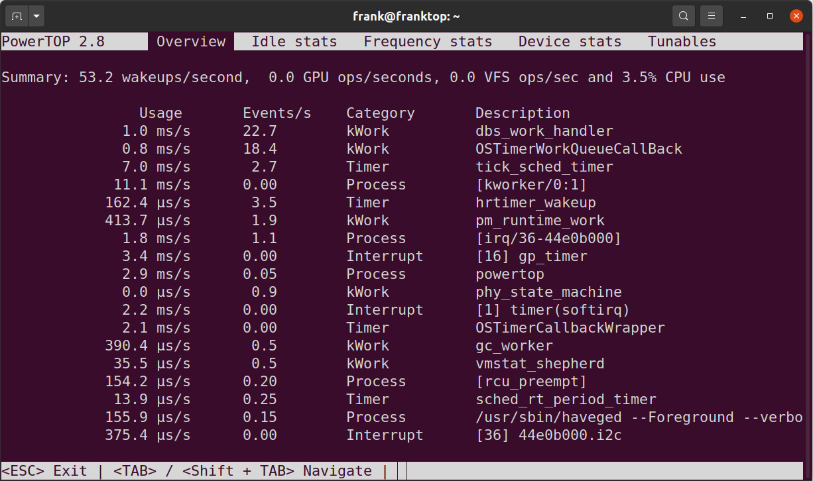
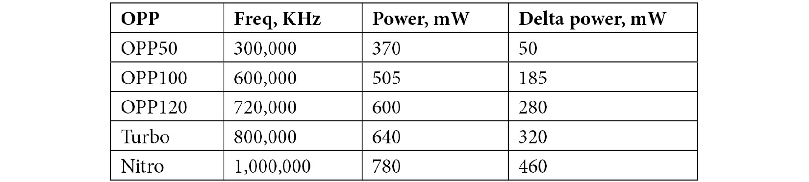
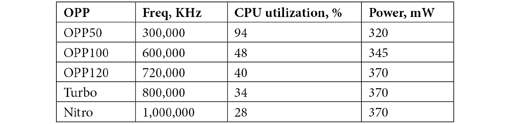
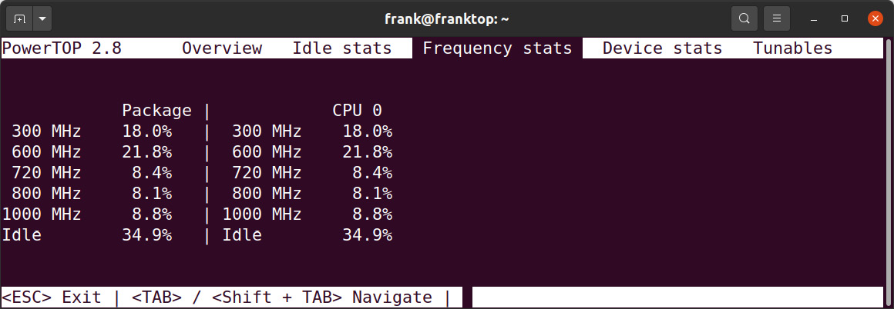
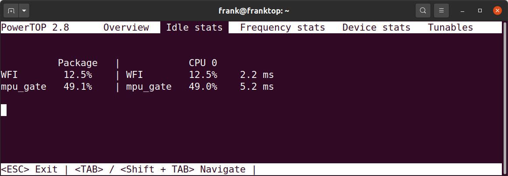

# *Chương 15*: Quản lý điện năng (Managing Power)

Với các thiết bị chạy bằng pin, quản lý điện năng là then chốt: bất cứ điều gì chúng ta có thể làm để giảm tiêu thụ điện sẽ tăng thời lượng pin. Ngay cả với các thiết bị chạy bằng điện lưới, giảm tiêu thụ điện cũng có lợi ích là giảm nhu cầu làm mát và chi phí năng lượng. Trong chương này, tôi sẽ giới thiệu bốn nguyên tắc quản lý điện năng:

- Đừng vội nếu không cần.
- Đừng ngại ngồi không.
- Tắt những thứ bạn không dùng.
- Ngủ khi không còn gì khác để làm.

Diễn đạt bằng các thuật ngữ kỹ thuật hơn, các nguyên tắc này có nghĩa là hệ thống quản lý điện năng nên cố gắng giảm tần số clock của CPU. Trong các khoảng idle, nó nên chọn trạng thái ngủ sâu nhất có thể; nó nên giảm tải bằng cách tắt nguồn các ngoại vi không dùng và nó nên có khả năng đưa toàn bộ hệ thống vào trạng thái suspend trong khi bảo đảm các chuyển đổi trạng thái nguồn diễn ra nhanh.

Linux có các tính năng giải quyết từng điểm này. Tôi sẽ lần lượt mô tả từng tính năng, với các ví dụ và lời khuyên về cách áp dụng chúng cho một hệ thống nhúng để sử dụng điện năng tối ưu.

Một số thuật ngữ về quản lý điện năng hệ thống được lấy từ specification **Advanced Configuration and Power Interface** (**ACPI**): các thuật ngữ như **C-states** và **P-states**. Tôi sẽ mô tả chúng khi gặp tới. Tham chiếu đầy đủ tới specification được cho trong mục *Đọc thêm*.

Trong chương này, chúng ta sẽ đề cập cụ thể các chủ đề sau:

- Đo mức tiêu thụ điện
- Điều chỉnh tần số clock
- Chọn trạng thái idle tốt nhất
- Tắt nguồn ngoại vi
- Đưa hệ thống vào trạng thái ngủ

## Yêu cầu kỹ thuật

Để làm theo các ví dụ, hãy bảo đảm bạn có những thứ sau:

- Một hệ thống Linux-based
- Etcher cho Linux
- Một đầu đọc thẻ microSD và thẻ
- Một cáp serial USB to TTL 3.3V
- Một BeagleBone Black
- Một nguồn điện DC 5V 1A
- Một cáp Ethernet và port để kết nối mạng

Toàn bộ code cho chương này có thể được tìm thấy trong thư mục `Chapter15` của repository GitHub của sách: [https://github.com/PacktPublishing/Mastering-Embedded-Linux-Programming-Third-Edition](https://github.com/PacktPublishing/Mastering-Embedded-Linux-Programming-Third-Edition).

## Đo mức tiêu thụ điện

Với các ví dụ trong chương này, chúng ta cần dùng phần cứng thật thay vì ảo. Điều này có nghĩa là chúng ta cần một BeagleBone Black có quản lý điện năng hoạt động. Đáng tiếc, BSP cho BeagleBone đi kèm layer `meta-yocto-bsp` không bao gồm firmware cần thiết cho **Power Management IC** (**PMIC**), nên chúng ta sẽ dùng một Debian image pre-built thay thế. Firmware còn thiếu có thể có trong layer `meta-ti`, nhưng tôi chưa tìm hiểu điều đó. Quy trình cài Debian trên BeagleBone Black giống như những gì chúng ta đã đề cập trong [*Chương 12*](ch12_prototyping_with_breakout_boards.vi.md), *Làm prototype với breakout board*, ngoại trừ phiên bản Debian.

Để tải về microSD card image Debian Stretch IoT cho BeagleBone Black, chạy lệnh sau:

```
$ wget https://debian.beagleboard.org/images/bone-debian-9.9-iot-armhf-2019-08-03-4gb.img.xz
```

10.3 (còn gọi là Buster) là Debian image mới nhất cho các BeagleBone AM335x-based tại thời điểm viết sách. Chúng ta sẽ dùng Debian 9.9 cho các bài tập trong chương này vì Linux kernel đi kèm Debian 10.3 thiếu một số tính năng quản lý điện năng. Khi Debian Stretch IoT image đã tải về xong, hãy dùng Etcher để ghi nó ra thẻ microSD.

> **Lưu ý quan trọng**
>
> Nếu có thể, hãy tải phiên bản 9.9 (còn gọi là Stretch) của Debian thay vì Debian image mới nhất từ `BeagleBoard.org` cho các bài tập trong chương này. Driver CPUIdle bị thiếu trong phiên bản 10.3 của Debian nên các CPUIdle governor `menu` và `ladder` không có trong phiên bản đó của bản phân phối. Nếu phiên bản 9.9 không còn có sẵn hoặc không còn được hỗ trợ, thì hãy tải về và thử một phiên bản Debian mới hơn 10.3 từ `BeagleBoard.org`.

Bây giờ, khi board BeagleBone chưa cấp điện, cắm thẻ microSD vào đầu đọc. Cắm cáp serial. Một serial port sẽ xuất hiện trên PC dưới dạng `/dev/ttyUSB0`. Khởi động một chương trình terminal phù hợp, chẳng hạn `gtkterm`, `minicom` hoặc `picocom`, và gắn vào port ở tốc độ `115200` bps (bits per second) không có flow control. `gtkterm` có lẽ là dễ thiết lập và dùng nhất:

```
$ gtkterm -p /dev/ttyUSB0 -s 115200
```

Nếu bạn gặp lỗi quyền, thì có thể bạn cần thêm mình vào group `dialout` và reboot để dùng port này.

Nhấn và giữ nút Boot Switch (gần khe microSD nhất) trên BeagleBone Black, cấp điện cho board bằng connector nguồn 5V bên ngoài, và thả nút sau khoảng 5 giây. Bạn sẽ thấy output U-Boot, output kernel log, và cuối cùng là một login prompt trên serial console:

```
Debian GNU/Linux 9 beaglebone ttyS0
BeagleBoard.org Debian Image 2019-08-03
Support/FAQ: http://elinux.org/Beagleboard:BeagleBoneBlack_Debian
default username:password is [debian:temppwd]
beaglebone login: debian
Password:
```

Đăng nhập với tư cách user `debian`. Mật khẩu là `temppwd` như được thể hiện trong ảnh chụp màn hình trên.

> **Lưu ý quan trọng**
>
> Nhiều BeagleBone Black được cài sẵn Debian trên flash onboard nên chúng vẫn sẽ boot ngay cả khi không cắm thẻ microSD. Nếu message `BeagleBoard.org Debian Image 2019-08-03` được hiển thị trước dấu nhắc mật khẩu, thì BeagleBone Black có lẽ đã boot từ Debian image 9.9 trên microSD. Nếu một message về bản phát hành Debian khác được hiển thị trước dấu nhắc mật khẩu, thì hãy kiểm tra xem thẻ microSD đã được cắm đúng hay chưa.

Để kiểm tra phiên bản Debian nào đang chạy, chạy lệnh sau:

```
debian@beaglebone:~$ cat /etc/os-release
PRETTY_NAME="Debian GNU/Linux 9 (stretch)"
NAME="Debian GNU/Linux"
VERSION_ID="9"
VERSION="9 (stretch)"
ID=debian
HOME_URL="https://www.debian.org/"
SUPPORT_URL="https://www.debian.org/support"
BUG_REPORT_URL="https://bugs.debian.org/"
```

Bây giờ hãy kiểm tra quản lý điện năng có hoạt động không:

```
debian@beaglebone:~$ cat /sys/power/state
freeze standby mem disk
```

Nếu bạn thấy cả bốn trạng thái, mọi thứ đang hoạt động tốt. Nếu bạn chỉ thấy `freeze`, subsystem quản lý điện năng không hoạt động. Hãy quay lại và double-check các bước trước.

Giờ chúng ta có thể chuyển sang đo mức tiêu thụ điện. Có hai cách tiếp cận: *bên ngoài* và *bên trong*. Đo điện năng từ bên ngoài, từ ngoài hệ thống, chúng ta chỉ cần một ampe kế để đo dòng điện và một vôn kế để đo điện áp, rồi nhân hai giá trị với nhau để có công suất. Bạn có thể dùng các đồng hồ cơ bản cho ra số đọc, mà sau đó bạn ghi lại. Hoặc chúng có thể tinh vi hơn nhiều và kết hợp ghi dữ liệu để bạn có thể thấy sự thay đổi công suất khi tải thay đổi theo từng mili giây. Cho mục đích của chương này, tôi đã cấp điện cho BeagleBone từ cổng Mini USB và dùng một thiết bị đo công suất USB rẻ tiền loại giá vài đô la.

Cách tiếp cận còn lại là dùng các hệ thống giám sát được tích hợp sẵn trong Linux. Bạn sẽ thấy rất nhiều thông tin được báo cáo cho bạn qua `sysfs`. Cũng có một chương trình rất hữu ích gọi là **PowerTOP**, thu thập thông tin từ nhiều nguồn khác nhau và trình bày ở một nơi duy nhất. PowerTOP là một package cho cả Yocto Project và Buildroot. Nó cũng có sẵn để cài trên Debian.

Để cài PowerTop trên BeagleBone Black từ Debian Stretch IoT, chạy lệnh sau:

```
debian@beaglebone:~$ sudo apt update
[…]
debian@beaglebone:~$ sudo apt install powertop
Reading package lists... Done
Building dependency tree
Reading state information... Done
Suggested packages:
  laptop-mode-tools
The following NEW packages will be installed:
  powertop
0 upgraded, 1 newly installed, 0 to remove and 151 not upgraded.
Need to get 177 kB of archives.
After this operation, 441 kB of additional disk space will be used.
Get:1 http://deb.debian.org/debian stretch/main armhf powertop armhf 2.8-1+b1 [177 kB]
Fetched 177 kB in 0s (526 kB/s)
```

Đừng quên cắm BeagleBone Black vào Ethernet và cập nhật danh sách package có sẵn trước khi cài PowerTOP.

Đây là một ví dụ về PowerTOP chạy trên BeagleBone Black:



*Hình 15.1 – Tổng quan PowerTOP*

Trong ảnh chụp màn hình này, chúng ta có thể thấy hệ thống đang yên tĩnh, với chỉ `3.5%` mức sử dụng CPU. Tôi sẽ đưa ra các ví dụ thú vị hơn sau, trong các tiểu mục *Dùng CPUFreq* và *Driver CPUIdle* của chương này.

Giờ chúng ta đã có cách đo mức tiêu thụ điện, hãy xem một trong những núm vặn lớn nhất mà chúng ta có để quản lý điện năng trong một hệ thống embedded Linux: tần số clock.

## Điều chỉnh tần số clock

Chạy một kilômét tốn nhiều năng lượng hơn đi bộ. Tương tự, có lẽ chạy CPU ở tần số thấp hơn có thể tiết kiệm năng lượng. Hãy cùng xem.

Công suất tiêu thụ của một CPU khi thực thi code là tổng của một thành phần tĩnh, gây ra bởi dòng rò cổng, cùng những thứ khác, và một thành phần động, gây ra bởi sự chuyển mạch của các cổng:

*P**cpu* = *P**static* + *P**dyn*

Thành phần công suất động phụ thuộc vào tổng điện dung của các cổng logic được chuyển mạch, tần số clock và bình phương điện áp:

*P**dyn* = *CfV**2*

Từ đây, chúng ta có thể thấy rằng tự bản thân việc thay đổi tần số sẽ không tiết kiệm được điện năng nào vì cùng một số chu kỳ CPU phải được hoàn thành để thực thi một subroutine cho trước. Nếu chúng ta giảm tần số đi một nửa, sẽ mất gấp đôi thời gian để hoàn thành phép tính, nhưng tổng công suất tiêu thụ do thành phần công suất động sẽ như nhau. Thực tế, giảm tần số có thể thực sự làm tăng ngân sách điện năng vì CPU mất lâu hơn để vào trạng thái idle. Vì vậy, trong những điều kiện này, tốt nhất là dùng tần số cao nhất có thể để CPU có thể nhanh chóng quay về idle. Điều này được gọi là **race to idle**.

> **Lưu ý quan trọng**
>
> Có một động lực khác để giảm tần số: **thermal management**. Có thể cần thiết phải hoạt động ở tần số thấp hơn chỉ để giữ nhiệt độ của package trong giới hạn. Nhưng đó không phải trọng tâm của chúng ta ở đây.

Vì vậy, nếu muốn tiết kiệm điện, chúng ta phải có khả năng thay đổi điện áp mà lõi CPU hoạt động. Nhưng với bất kỳ điện áp cho trước nào, có một tần số tối đa mà vượt quá nó thì việc chuyển mạch của các cổng trở nên không đáng tin cậy. Tần số cao hơn cần điện áp cao hơn, và vì vậy cả hai cần được điều chỉnh cùng nhau. Nhiều SoC hiện thực một tính năng như vậy: nó được gọi là **Dynamic Voltage and Frequency Scaling**, hay **DVFS**. Các nhà sản xuất tính toán các tổ hợp tối ưu giữa tần số và điện áp lõi. Mỗi tổ hợp được gọi là **Operating Performance Point**, hay **OPP**. Specification ACPI gọi chúng là **P-states**, với `P0` là OPP có tần số cao nhất. Dù một OPP là tổ hợp của một tần số và một điện áp, nó thường được gọi chỉ bằng thành phần tần số.

Cần một kernel driver để chuyển giữa các P-states. Tiếp theo, chúng ta sẽ xem driver đó và các governor điều khiển nó.

### Driver CPUFreq

Linux có một component tên **CPUFreq** quản lý các chuyển đổi giữa các OPP. Nó là một phần của board support package cho mỗi SoC. CPUFreq gồm các driver trong `drivers/cpufreq/`, thực hiện việc chuyển từ OPP này sang OPP khác, và một tập governor hiện thực chính sách khi nào thì chuyển. Nó được điều khiển per-CPU qua thư mục `/sys/devices/system/cpu/cpuN/cpufreq`, với `N` là số CPU. Trong đó, chúng ta tìm thấy một số file, thú vị nhất là các file sau:

- `cpuinfo_cur_freq`, `cpuinfo_max_freq` và `cpuinfo_min_freq`: Tần số hiện tại của CPU này, cùng với tần số tối đa và tối thiểu, đo bằng KHz.
- `cpuinfo_transition_latency`: Thời gian, tính bằng nano giây, để chuyển từ OPP này sang OPP khác. Nếu giá trị không xác định, nó được đặt là `-1`.
- `scaling_available_frequencies`: Danh sách các tần số OPP có sẵn trên CPU này.
- `scaling_available_governors`: Danh sách các governor có sẵn trên CPU này.
- `scaling_governor`: CPUFreq governor hiện đang được dùng.
- `scaling_max_freq` và `scaling_min_freq`: Dải tần số có sẵn cho governor, tính bằng KHz.
- `scaling_setspeed`: Một file cho phép bạn đặt tần số thủ công khi governor là `userspace`, mà tôi sẽ mô tả ở cuối tiểu mục này.

Governor đặt chính sách thay đổi OPP. Nó có thể đặt tần số trong giới hạn `scaling_min_freq` và `scaling_max_freq`. Các governor có tên như sau:

- `powersave`: Luôn chọn tần số thấp nhất.
- `performance`: Luôn chọn tần số cao nhất.
- `ondemand`: Thay đổi tần số dựa trên mức sử dụng CPU. Nếu CPU idle ít hơn 20% thời gian, nó đặt tần số ở mức tối đa; nếu nó idle hơn 30% thời gian, nó giảm tần số đi 5%.
- `conservative`: Giống `ondemand`, nhưng chuyển lên tần số cao hơn theo các bước 5% thay vì nhảy ngay lên mức tối đa.
- `userspace`: Tần số được đặt bởi một chương trình user space.

Governor mặc định khi Debian khởi động là `performance`:

```
$ cd /sys/devices/system/cpu/cpu0/cpufreq
$ cat scaling_governor
performance
```

Để chuyển sang governor `ondemand`, là governor chúng ta nên dùng cho các bài tập trong chương này, chạy lệnh sau:

```
$ sudo cpupower frequency-set -g ondemand
[sudo] password for debian:
Setting cpu: 0
```

Nhập `temppwd` khi được hỏi mật khẩu.

Các tham số mà governor `ondemand` dùng để quyết định khi nào thay đổi OPP có thể được xem và sửa qua `/sys/devices/system/cpu/cpufreq/ondemand/`. Cả hai governor `ondemand` và `conservative` đều tính đến công sức cần để thay đổi tần số và điện áp. Tham số này nằm trong `cpuinfo_transition_latency`. Các tính toán này dành cho các thread có chính sách lập lịch thông thường; nếu thread đang được lập lịch real time, cả hai sẽ ngay lập tức chọn OPP cao nhất để thread có thể đáp ứng deadline lập lịch của nó.

Governor `userspace` cho phép logic chọn OPP được thực hiện bởi một daemon user space. Các ví dụ bao gồm `cpudyn` và `powernowd`, dù cả hai đều hướng tới laptop x86-based thay vì thiết bị nhúng.

Giờ chúng ta đã biết các chi tiết runtime về driver CPUFreq nằm ở đâu, hãy xem cách định nghĩa các OPP lúc biên dịch.

### Dùng CPUFreq

Nhìn vào BeagleBone Black, chúng ta thấy các OPP được viết trong device tree. Đây là một đoạn trích từ `am33xx.dtsi`:

```
cpu0_opp_table: opp-table {
     compatible = "operating-points-v2-ti-cpu";
     syscon = <&scm_conf>;
     […]
     opp50-300000000 {
           opp-hz = /bits/ 64 <300000000>;
           opp-microvolt = <950000 931000 969000>;
           opp-supported-hw = <0x06 0x0010>;
           opp-suspend;
     };
     […]
     opp100-600000000 {
           opp-hz = /bits/ 64 <600000000>;
           opp-microvolt = <1100000 1078000 1122000>;
           opp-supported-hw = <0x06 0x0040>;
     };
     […]
     opp120-720000000 {
           opp-hz = /bits/ 64 <720000000>;
           opp-microvolt = <1200000 1176000 1224000>;
           opp-supported-hw = <0x06 0x0080>;
     };
     […]
     oppturbo-800000000 {
           opp-hz = /bits/ 64 <800000000>;
           opp-microvolt = <1260000 1234800 1285200>;
           opp-supported-hw = <0x06 0x0100>;
     };
     oppnitro-1000000000 {
           opp-hz = /bits/ 64 <1000000000>;
           opp-microvolt = <1325000 1298500 1351500>;
           opp-supported-hw = <0x04 0x0200>;
     };
};
```

Chúng ta có thể xác nhận đây là các OPP đang được dùng lúc runtime bằng cách xem các tần số có sẵn:

```
$ cd /sys/devices/system/cpu/cpu0/cpufreq
$ cat scaling_available_frequencies
300000 600000 720000 800000 1000000
```

Bằng cách chọn governor `userspace`, chúng ta có thể đặt tần số bằng cách ghi vào `scaling_setspeed`, và nhờ đó có thể đo công suất tiêu thụ ở mỗi OPP. Các phép đo này không chính xác lắm, nên đừng quá coi trọng chúng.

Đầu tiên, với một hệ thống idle, kết quả là 70mA @ 4.6V = 320 mW. Giá trị này độc lập với tần số, đúng như chúng ta mong đợi vì đây là thành phần tĩnh của công suất tiêu thụ của hệ thống cụ thể này.

Bây giờ, tôi muốn biết công suất tối đa tiêu thụ ở mỗi OPP bằng cách chạy một tải compute-bound như thế này:

```
# dd if=/dev/urandom of=/dev/null bs=1
```

Kết quả được thể hiện trong bảng sau, với **Delta power** là mức tiêu thụ điện thêm vào so với hệ thống idle:



Các phép đo này cho thấy công suất tối đa ở các OPP khác nhau. Nhưng đây không phải một bài test công bằng vì CPU đang chạy ở 100%, và vì vậy nó thực thi nhiều lệnh hơn ở tần số cao hơn. Nếu chúng ta giữ tải không đổi nhưng thay đổi tần số, thì chúng ta thấy như sau:



Điều này cho thấy một mức tiết kiệm điện rõ rệt ở tần số thấp nhất, vào khoảng 15%.

Dùng PowerTOP, chúng ta có thể thấy phần trăm thời gian ở mỗi OPP. Ảnh chụp màn hình sau cho thấy BeagleBone Black chạy một tải nhẹ dùng governor `ondemand`:



*Hình 15.2 – Thống kê Frequency của PowerTOP*

Trong hầu hết trường hợp, governor `ondemand` là governor tốt nhất để dùng. Để chọn một governor cụ thể, bạn có thể cấu hình kernel với một governor mặc định, chẳng hạn `CPU_FREQ_DEFAULT_GOV_ONDEMAND`, hoặc bạn có thể dùng một boot script để đổi governor lúc boot. Có một script System V `init` ví dụ trong `MELP/Chapter15/cpufrequtils` lấy từ Debian.

Để biết thêm thông tin về driver CPUFreq, hãy xem các file trong thư mục `Documentation/cpu-freq` của cây source Linux kernel.

Trong mục này, chúng ta quan tâm tới điện năng được dùng khi CPU bận. Trong mục tiếp theo, chúng ta sẽ xem cách tiết kiệm điện khi CPU idle.

## Chọn trạng thái idle tốt nhất

Khi một processor không còn việc gì để làm, nó thực thi một **halt instruction** và vào trạng thái idle. Khi idle, CPU dùng ít điện hơn. Nó thoát trạng thái idle khi một sự kiện như hardware interrupt xảy ra. Hầu hết CPU có nhiều trạng thái idle dùng lượng điện khác nhau. Thông thường, có một trade-off giữa mức tiêu thụ điện và latency, hay khoảng thời gian, cần để thoát khỏi trạng thái. Trong specification ACPI, chúng được gọi là **C-states**.

Trong các C-states sâu hơn, nhiều mạch hơn bị tắt với cái giá là mất một số trạng thái, và vì vậy mất lâu hơn để quay lại hoạt động bình thường. Chẳng hạn, trong một số C-states, CPU cache có thể bị tắt nguồn, và vì vậy khi CPU chạy lại, nó có thể phải nạp lại một số thông tin từ bộ nhớ chính. Điều này tốn kém, và vì vậy bạn chỉ muốn làm điều này nếu có khả năng cao là CPU sẽ ở trạng thái này một thời gian. Số trạng thái khác nhau tùy hệ thống. Mỗi trạng thái mất một khoảng thời gian để phục hồi từ ngủ sang hoạt động đầy đủ.

Chìa khóa để chọn đúng trạng thái idle là có ý niệm tốt về việc CPU sẽ ở trạng thái tĩnh lặng bao lâu. Dự đoán tương lai luôn khó, nhưng có một số thứ có thể giúp. Một là tải CPU hiện tại: nếu bây giờ nó cao, nhiều khả năng nó sẽ tiếp tục như vậy trong tương lai gần, nên một giấc ngủ sâu sẽ không có lợi. Ngay cả khi tải thấp, cũng đáng xem có timer event nào sắp hết hạn không. Nếu không có tải và không có timer, thì một trạng thái idle sâu hơn là hợp lý.

Phần của Linux chọn trạng thái idle tốt nhất là driver CPUIdle. Có nhiều thông tin về nó trong thư mục `Documentation/cpuidle` bên trong cây source Linux kernel.

### Driver CPUIdle

Giống subsystem CPUFreq, **CPUIdle** gồm một driver là một phần của BSP và một governor xác định chính sách. Tuy nhiên, khác với CPUFreq, governor không thể được đổi lúc runtime và không có giao diện cho governor user space.

CPUIdle đưa ra thông tin về mỗi trạng thái idle trong thư mục `/sys/devices/system/cpu/cpu0/cpuidle`, trong đó có một thư mục con cho mỗi trạng thái ngủ, tên `state0` tới `stateN`. `state0` là trạng thái ngủ nhẹ nhất và `stateN` là sâu nhất. Lưu ý rằng cách đánh số không khớp với các C-states và CPUIdle không có trạng thái tương đương với `C0` (đang chạy). Với mỗi trạng thái, có các file sau:

- `desc`: Một mô tả ngắn về trạng thái
- `disable`: Một tùy chọn để disable trạng thái này bằng cách ghi `1` vào file này
- `latency`: Thời gian lõi CPU cần để tiếp tục hoạt động bình thường khi thoát trạng thái này, tính bằng micro giây
- `name`: Tên của trạng thái này
- `power`: Công suất tiêu thụ khi ở trạng thái idle này, tính bằng milliwatt
- `time`: Tổng thời gian ở trạng thái idle này, tính bằng micro giây
- `usage`: Số lần trạng thái này đã được vào

Trong trường hợp SoC AM335x trên BeagleBone Black, có hai trạng thái idle. Đây là trạng thái đầu tiên:

```
$ cd /sys/devices/system/cpu/cpu0/cpuidle
$ grep "" state0/*
state0/desc:ARM WFI
state0/disable:0
state0/latency:1
state0/name:WFI
state0/power:4294967295
state0/residency:1
state0/time:1023898
state0/usage:1426
```

Trạng thái này tên `WFI`, ám chỉ lệnh halt của ARM, **Wait For Interrupt**. Latency là `1` micro giây vì nó chỉ là một lệnh halt, và công suất tiêu thụ được cho là `-1`, nghĩa là ngân sách điện năng không được biết (ít nhất là với CPUIdle). Bây giờ, đây là trạng thái thứ hai:

```
$ cd /sys/devices/system/cpu/cpu0/cpuidle
$ grep "" state1/*
state1/desc:mpu_gate
state1/disable:0
state1/latency:130
state1/name:mpu_gate
state1/power:0
state1/residency:300
state1/time:139156260
state1/usage:7560
```

Trạng thái này tên `mpu_gate`. Nó có latency cao hơn là `130` micro giây. Các trạng thái idle có thể được hardcode trong driver CPUIdle hoặc được trình bày trong device tree. Đây là một đoạn trích từ `am33xx.dtsi`:

```
cpus {
     cpu@0 {
           compatible = "arm,cortex-a8";
           enable-method = "ti,am3352";
           device_type = "cpu";
           reg = <0>;
.
.
.
           cpu-idle-states = <&mpu_gate>;
     };
     idle-states {
           mpu_gate: mpu_gate {
                compatible = "arm,idle-state";
                entry-latency-us = <40>;
                exit-latency-us = <90>;
                min-residency-us = <300>;
                ti,idle-wkup-m3;
           };
      };
}
```

CPUIdle có hai governor:

- `ladder`: Governor này bước xuống hoặc lên các trạng thái idle, mỗi lần một bước, tùy thời gian ở khoảng idle trước. Nó hoạt động tốt với timer tick đều đặn nhưng không tốt với dynamic tick.
- `menu`: Governor này chọn một trạng thái idle dựa trên thời gian idle dự kiến. Nó hoạt động tốt với các hệ thống dynamic tick.

Bạn nên chọn cái này hoặc cái kia tùy theo cấu hình `NO_HZ` của bạn, mà tôi sẽ mô tả ở cuối mục này.

Một lần nữa, tương tác của người dùng là qua filesystem `sysfs`. Trong thư mục `/sys/devices/system/cpu/cpuidle`, bạn sẽ tìm thấy hai file:

- `current_driver`: Đây là tên của driver `cpuidle`.
- `current_governor_ro`: Đây là tên của governor.

Các file này cho thấy driver nào và governor nào đang được dùng. Các trạng thái idle có thể được hiển thị trong PowerTOP ở tab `Idle stats`. Ảnh chụp màn hình sau cho thấy một BeagleBone Black dùng governor `menu`:



*Hình 15.3 – Thống kê Idle của PowerTOP*

Điều này cho thấy khi hệ thống idle, nó chủ yếu đi vào trạng thái idle `mpu_gate` sâu hơn, đúng như chúng ta muốn.

Ngay cả khi CPU hoàn toàn idle, hầu hết hệ thống Linux vẫn được cấu hình để thức dậy định kỳ khi nhận một system timer interrupt. Để tiết kiệm thêm điện, chúng ta cần cấu hình Linux kernel cho hoạt động tickless.

### Hoạt động tickless

Một chủ đề liên quan là tùy chọn tickless, hay `NO_HZ`. Nếu hệ thống thực sự idle, nguồn ngắt có khả năng nhất sẽ là system timer, được lập trình để tạo một time tick đều đặn với tốc độ HZ lần mỗi giây, trong đó HZ thường là 100. Về mặt lịch sử, Linux dùng timer tick làm cơ sở thời gian chính để đo timeout.

Tuy vậy, rõ ràng là lãng phí khi đánh thức CPU để xử lý một timer interrupt nếu không có timer event nào được đăng ký cho thời điểm cụ thể đó. Tùy chọn cấu hình kernel dynamic tick, `CONFIG_NO_HZ_IDLE`, xem timer queue ở cuối routine xử lý timer và lập lịch lần ngắt tiếp theo vào thời điểm của sự kiện tiếp theo, tránh các wake-ups không cần thiết và cho phép CPU idle trong thời gian dài. Trong bất kỳ application power-sensitive nào, kernel nên được cấu hình với tùy chọn này được enable.

Dù CPU tiêu thụ phần lớn điện năng trong một hệ thống embedded Linux, có các component khác của hệ thống cũng có thể được tắt nguồn để tiết kiệm năng lượng.

## Tắt nguồn ngoại vi

Cuộc thảo luận cho đến giờ là về CPU và cách giảm tiêu thụ điện khi chúng đang chạy hoặc idle. Giờ là lúc tập trung vào các phần khác của hệ thống, tức các ngoại vi, và xem liệu có thể tiết kiệm điện ở đây không.

Trong Linux kernel, việc này được quản lý bởi **runtime power management system** hay gọi tắt là **runtime pm**. Nó làm việc với các driver hỗ trợ runtime pm, tắt những driver không được dùng và đánh thức chúng lại khi cần tới lần sau. Nó là động và nên trong suốt với user space. Việc hiện thực quản lý phần cứng là việc của device driver, nhưng thường nó sẽ bao gồm tắt clock tới subsystem, còn gọi là clock gating, và tắt mạch lõi khi có thể.

Runtime power management được đưa ra qua một giao diện `sysfs`. Mỗi thiết bị có một thư mục con tên `power`, trong đó bạn sẽ tìm thấy các file sau:

- `control`: File này cho phép user space xác định runtime pm có được dùng trên thiết bị này không. Nếu nó được đặt là `auto`, thì runtime pm được enable, nhưng nếu đặt là `on`, thiết bị luôn bật và không dùng runtime pm.
- `runtime_enabled`: File này báo runtime pm là `enabled`, `disabled`, hoặc, nếu `control` là `on`, nó báo `forbidden`.
- `runtime_status`: File này báo trạng thái hiện tại của thiết bị. Nó có thể là `active`, `suspended` hoặc `unsupported`.
- `autosuspend_delay_ms`: Đây là thời gian trước khi thiết bị bị suspend. `-1` nghĩa là chờ mãi mãi. Một số driver hiện thực điều này nếu việc suspend phần cứng thiết bị có chi phí đáng kể vì nó ngăn các chu kỳ suspend/resume nhanh.

Để đưa ra một ví dụ cụ thể, tôi sẽ xem driver MMC trên BeagleBone Black:

```
$ cd /sys/devices/platform/ocp/481d8000.mmc/mmc_host/mmc1/mmc1:0001/power
$ grep "" *
async:enabled
autosuspend_delay_ms:3000
control:auto
runtime_active_kids:0
runtime_active_time:14464
runtime_enabled:enabled
runtime_status:suspended
runtime_suspended_time:121208
runtime_usage:0
```

Vậy, runtime pm được enable, thiết bị hiện đang bị suspend, và có độ trễ `3000` mili giây sau lần dùng cuối trước khi nó bị suspend lại. Giờ tôi đọc một block từ thiết bị và xem nó có thay đổi không:

```
$ sudo dd if=/dev/mmcblk1p3 of=/dev/null count=1
1+0 records in
1+0 records out
512 bytes copied, 0.00629126 s, 81.4 kB/s
$ grep "" *
async:enabled
autosuspend_delay_ms:3000
control:auto
runtime_active_kids:0
runtime_active_time:17120
runtime_enabled:enabled
runtime_status:active
runtime_suspended_time:178520
runtime_usage:0
```

Giờ driver MMC đang active và công suất tới board đã tăng từ 320 mW lên 500 mW. Nếu tôi lặp lại sau 3 giây, nó lại bị suspend, và công suất đã quay về 320 mW.

Để biết thêm thông tin về runtime pm, hãy xem trong source code Linux kernel ở `Documentation/power/runtime_pm.txt`.

Giờ chúng ta đã biết runtime pm là gì và nó làm gì, hãy xem nó hoạt động.

## Đưa hệ thống vào trạng thái ngủ

Còn một kỹ thuật quản lý điện năng nữa cần xét: đưa toàn bộ hệ thống vào chế độ ngủ với kỳ vọng nó sẽ không được dùng lại trong một thời gian. Trong Linux kernel, điều này được gọi là **system sleep**. Nó thường là user-initiated: người dùng quyết định thiết bị nên được tắt một thời gian. Chẳng hạn, tôi gập nắp laptop và cho nó vào túi khi đến giờ về nhà. Phần lớn hỗ trợ system sleep trong Linux đến từ hỗ trợ cho laptop. Trong thế giới laptop, thường có hai lựa chọn:

- Suspend
- Hibernate

Lựa chọn đầu tiên, còn gọi là **suspend to RAM**, tắt mọi thứ ngoại trừ bộ nhớ hệ thống, nên máy vẫn tiêu thụ một ít điện. Khi hệ thống thức dậy, bộ nhớ vẫn giữ toàn bộ trạng thái trước đó, và laptop của tôi hoạt động lại trong vài giây.

Nếu tôi chọn tùy chọn **hibernate**, nội dung bộ nhớ được lưu vào ổ cứng. Hệ thống không tiêu thụ điện chút nào, và vì vậy nó có thể ở trạng thái này vô thời hạn, nhưng khi wake-up, nó mất một khoảng thời gian để khôi phục bộ nhớ từ đĩa. Hibernate rất hiếm khi được dùng trong hệ thống nhúng, chủ yếu vì bộ lưu trữ flash thường khá chậm khi đọc/ghi, nhưng cũng vì nó gây gián đoạn luồng công việc.

Để biết thêm thông tin, hãy xem source code kernel trong thư mục `Documentation/power`.

Các tùy chọn suspend-to-RAM và hibernate ánh xạ tới hai trong bốn trạng thái ngủ được Linux hỗ trợ. Tiếp theo, chúng ta sẽ xem hai loại system sleep này và các trạng thái nguồn ACPI còn lại.

### Các trạng thái nguồn

Trong specification ACPI, các trạng thái ngủ được gọi là **S-states**. Linux hỗ trợ bốn trạng thái ngủ (`freeze`, `standby`, `mem` và `disk`), được thể hiện trong danh sách sau cùng với S-state ACPI tương ứng ([S0], S1, S3, S4):

- `freeze` ([S0]): Dừng (đóng băng) mọi hoạt động trong user space, nhưng ngoài ra CPU và bộ nhớ vẫn hoạt động bình thường.

  Việc power-saving đến từ thực tế là không có code user space nào đang chạy. ACPI không có trạng thái tương đương nên S0 là gần nhất. S0 là trạng thái của một hệ thống đang chạy.

- `standby` (S1): Giống `freeze`, nhưng thêm vào đó đưa tất cả CPU offline trừ boot CPU.

- `mem` (S3): Tắt nguồn hệ thống và đưa bộ nhớ vào chế độ self-refresh. Còn được gọi là **suspend to RAM**.

- `disk` (S4): Lưu bộ nhớ vào ổ cứng và tắt nguồn. Còn được gọi là **suspend to disk**.

Không phải hệ thống nào cũng hỗ trợ tất cả các trạng thái. Để tìm xem trạng thái nào có sẵn, đọc file `/sys/power/state` như sau:

```
# cat /sys/power/state
freeze standby mem disk
```

Để vào một trong các trạng thái system sleep, bạn chỉ cần ghi trạng thái mong muốn vào `/sys/power/state`.

Với thiết bị nhúng, nhu cầu phổ biến nhất là suspend to RAM bằng tùy chọn `mem`. Chẳng hạn, tôi có thể suspend BeagleBone Black như thế này:

```
# echo mem > /sys/power/state
[ 1646.158274] PM: Syncing filesystems ...done.
[ 1646.178387] Freezing user space processes ... (elapsed 0.001 seconds) done.
[ 1646.188098] Freezing remaining freezable tasks ... (elapsed 0.001 seconds) done.
[ 1646.197017] Suspending console(s) (use no_console_suspend to debug)
[ 1646.338657] PM: suspend of devices complete after 134.322 msecs
[ 1646.343428] PM: late suspend of devices complete after 4.716 msecs
[ 1646.348234] PM: noirq suspend of devices complete after 4.755 msecs
[ 1646.348251] Disabling non-boot CPUs ...
[ 1646.348264] PM: Successfully put all powerdomains to target state
```

Thiết bị tắt nguồn trong chưa tới một giây và sau đó mức tiêu thụ điện giảm xuống dưới 10 milliwatt, là giới hạn đo của đồng hồ vạn năng đơn giản của tôi. Nhưng làm sao để đánh thức nó lại? Đó là chủ đề tiếp theo.

### Wakeup event

Trước khi suspend một thiết bị, bạn phải có một phương pháp đánh thức nó lại. Kernel cố giúp bạn ở đây: nếu không có ít nhất một wakeup source, hệ thống sẽ từ chối suspend với message sau:

```
No sources enabled to wake-up! Sleep abort.
```

Tất nhiên, điều này có nghĩa là một số phần của hệ thống phải vẫn được cấp điện ngay cả trong lúc ngủ sâu nhất. Điều này thường liên quan tới **Power Management IC** (**PMIC**), **real-time clock** (**RTC**), và có thể thêm cả các giao diện như GPIO, UART và Ethernet.

Wakeup event được điều khiển qua `sysfs`. Mỗi thiết bị trong `/sys/device` có một thư mục con tên `power` chứa một file `wakeup` sẽ chứa một trong các chuỗi sau:

- `enabled`: Thiết bị này sẽ tạo wakeup event.
- `disabled`: Thiết bị này sẽ không tạo wakeup event.
- (rỗng): Thiết bị này không có khả năng tạo wakeup event.

Để có danh sách các thiết bị có thể tạo wakeup, chúng ta có thể tìm tất cả các thiết bị mà `wakeup` chứa `enabled` hoặc `disabled`:

```
$ find /sys/devices/ -name wakeup | xargs grep "abled"
```

Trong trường hợp BeagleBone Black, các UART là wakeup source, nên nhấn một phím trên console sẽ đánh thức BeagleBone:

```
[ 1646.348264] PM: Wakeup source UART
[ 1646.368482] PM: noirq resume of devices complete after 19.963 msecs
[ 1646.372482] PM: early resume of devices complete after 3.192 msecs
[ 1646.795109] net eth0: initializing cpsw version 1.12 (0)
[ 1646.798229] net eth0: phy found : id is : 0x7c0f1
[ 1646.798447] libphy: PHY 4a101000.mdio:01 not found
[ 1646.798469] net eth0: phy 4a101000.mdio:01 not found on slave 1
[ 1646.927874] PM: resume of devices complete after 555.337 msecs
[ 1647.003829] Restarting tasks ... done.
```

Chúng ta đã thấy cách đưa một thiết bị vào trạng thái ngủ rồi đánh thức nó bằng một sự kiện từ một giao diện ngoại vi như UART. Nếu chúng ta muốn một thiết bị tự thức dậy mà không cần tương tác bên ngoài thì sao? Đây là lúc RTC phát huy tác dụng.

### Wakeup hẹn giờ từ real-time clock

Hầu hết hệ thống có một RTC có thể tạo alarm interrupt tới tối đa 24 giờ trong tương lai. Nếu vậy, thư mục `/sys/class/rtc/rtc0` sẽ tồn tại. Nó nên chứa file `wakealarm`. Ghi một số vào `wakealarm` sẽ khiến nó tạo một alarm sau số giây đó. Nếu bạn cũng enable các event `wakeup` từ `rtc`, RTC sẽ resume một thiết bị đang bị suspend.

Chẳng hạn, lệnh `rtcwake` này sẽ đưa hệ thống vào `standby` với RTC đánh thức nó sau 5 giây:

```
$ sudo su –
# rtcwake -d /dev/rtc0 -m standby -s 5
  rtcwake: assuming RTC uses UTC ...
  rtcwake: wakeup from "standby" using /dev/rtc0 at Tue Dec  1 19:34:10 2020
[  187.345129] PM: suspend entry (shallow)
[  187.345148] PM: Syncing filesystems ... done.
[  187.346754] Freezing user space processes ... (elapsed 0.003 seconds) done.
[  187.350688] OOM killer disabled.
[  187.350789] Freezing remaining freezable tasks ... (elapsed 0.001 seconds) done.
[  187.352361] Suspending console(s) (use no_console_suspend to debug)
[  187.500906] Disabling non-boot CPUs ...
[  187.500941] pm33xx pm33xx: PM: Successfully put all powerdomains to target state
[  187.500941] PM: Wakeup source RTC Alarm
[  187.529729] net eth0: initializing cpsw version 1.12 (0)
[  187.605061] SMSC LAN8710/LAN8720 4a101000.mdio:00: attached PHY driver [SMSC LAN8710/LAN8720] (mii_bus:phy_addr=4a101000.mdio:00, irq=POLL)
[  187.731543] OOM killer enabled.
[  187.731563] Restarting tasks ... done.
[  187.756896] PM: suspend exit
```

Vì các UART cũng là một wakeup source, nhấn một phím trên console sẽ đánh thức BeagleBone Black trước khi `wakealarm` của RTC hết hạn:

```
[  255.698873] PM: suspend entry (shallow)
[  255.698894] PM: Syncing filesystems ... done.
[  255.701946] Freezing user space processes ... (elapsed 0.003 seconds) done.
[  255.705249] OOM killer disabled.
[  255.705256] Freezing remaining freezable tasks ... (elapsed 0.002 seconds) done.
[  255.707827] Suspending console(s) (use no_console_suspend to debug)
[  255.860823] Disabling non-boot CPUs ...
[  255.860857] pm33xx pm33xx: PM: Successfully put all powerdomains to target state
[  255.860857] PM: Wakeup source UART
[  255.888064] net eth0: initializing cpsw version 1.12 (0)
[  255.965045] SMSC LAN8710/LAN8720 4a101000.mdio:00: attached PHY driver [SMSC LAN8710/LAN8720] (mii_bus:phy_addr=4a101000.mdio:00, irq=POLL)
[  256.093684] OOM killer enabled.
[  256.093704] Restarting tasks ... done.
[  256.118453] PM: suspend exit
```

Nút Power trên BeagleBone Black cũng là một wakeup source nên bạn có thể dùng nó để resume từ `standby` khi không có serial console. Hãy chắc chắn nhấn nút Power chứ không phải nút Reset nằm ngay cạnh nó, nếu không board sẽ reboot.

Như vậy là kết thúc phần đề cập của chúng ta về bốn chế độ system sleep của Linux. Chúng ta đã học cách suspend một thiết bị vào trạng thái nguồn `mem` hoặc `standby` rồi đánh thức nó qua một sự kiện từ UART, RTC hoặc nút Power. Dù runtime pm trong Linux được tạo ra chủ yếu cho laptop, chúng ta có thể tận dụng hỗ trợ này cho các hệ thống nhúng cũng chạy bằng pin.

## Tóm tắt

Linux có các chức năng quản lý điện năng tinh vi. Tôi đã mô tả bốn component chính:

- **CPUFreq** thay đổi OPP của mỗi lõi processor để giảm điện trên các lõi đang bận nhưng còn dư băng thông, và nhờ đó cho phép cơ hội hạ tần số xuống. OPP được gọi là P-States trong specification ACPI.
- **CPUIdle** chọn các trạng thái idle sâu hơn khi CPU không được kỳ vọng sẽ bị đánh thức trong một thời gian. Trạng thái idle được gọi là C-States trong specification ACPI.
- **Runtime pm** sẽ tắt các ngoại vi không cần thiết.
- Các chế độ **System sleep** sẽ đưa toàn bộ hệ thống vào trạng thái tiêu thụ điện thấp. Chúng thường nằm dưới sự điều khiển của người dùng cuối, chẳng hạn bằng cách nhấn nút standby. Các trạng thái system sleep được gọi là S-States trong specification ACPI.

Phần lớn việc quản lý điện năng được BSP làm cho bạn. Nhiệm vụ chính của bạn là bảo đảm nó được cấu hình đúng cho các use case dự định. Chỉ component cuối cùng, chọn một trạng thái system sleep, đòi hỏi bạn viết một ít code cho phép người dùng cuối vào và thoát trạng thái đó.

Phần tiếp theo của cuốn sách là về viết application nhúng. Chúng ta sẽ bắt đầu với việc đóng gói và triển khai code Python và đào sâu hơn vào các kỹ thuật container hóa đã được giới thiệu trong [*Chương 10*](ch10_updating_software_in_the_field.vi.md), *Cập nhật phần mềm ngoài thực địa*, khi chúng ta đánh giá balena.

## Đọc thêm

- *Advanced Configuration and Power Interface Specification* (Specification về giao diện cấu hình và nguồn nâng cao), UEFI Forum, Inc.: [https://uefi.org/sites/default/files/resources/ACPI_Spec_6_4_Jan22.pdf](https://uefi.org/sites/default/files/resources/ACPI_Spec_6_4_Jan22.pdf)
