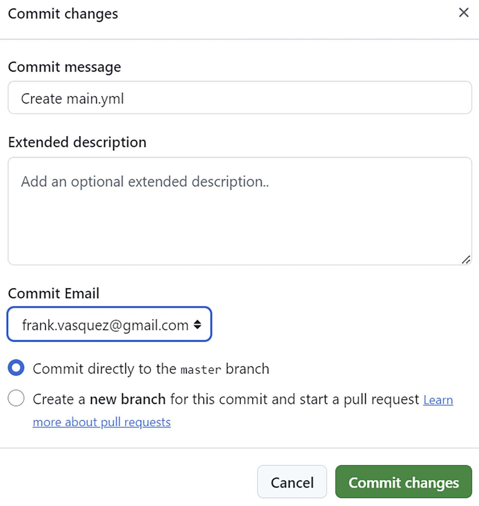
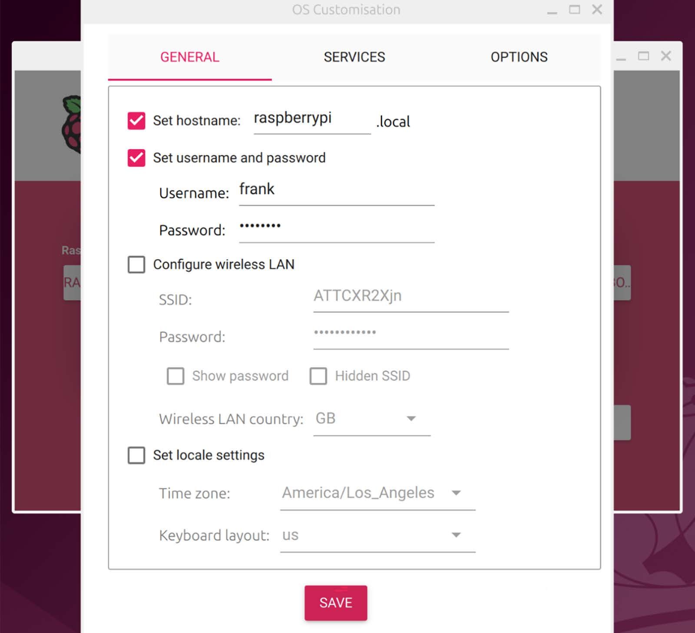
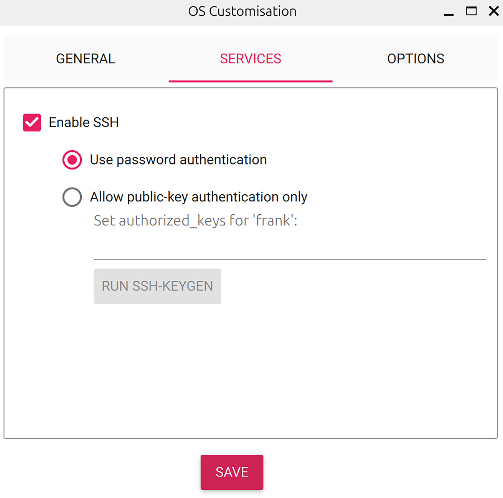
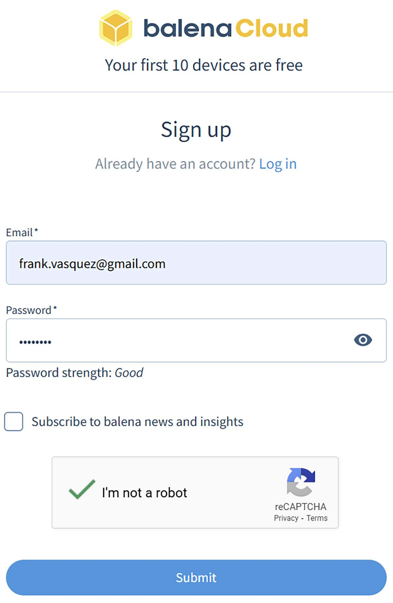
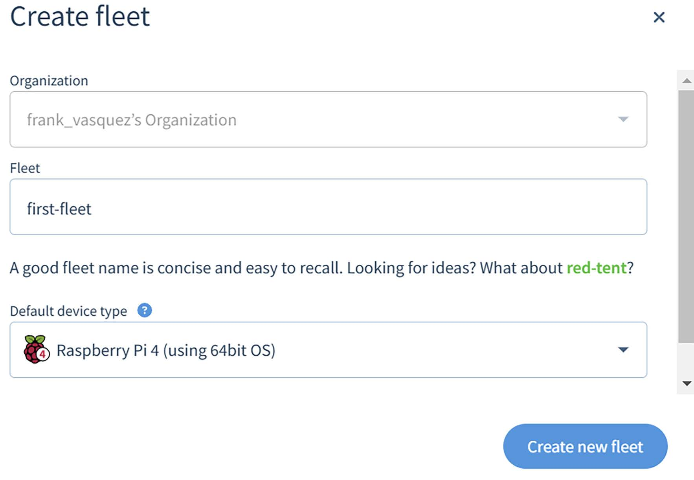
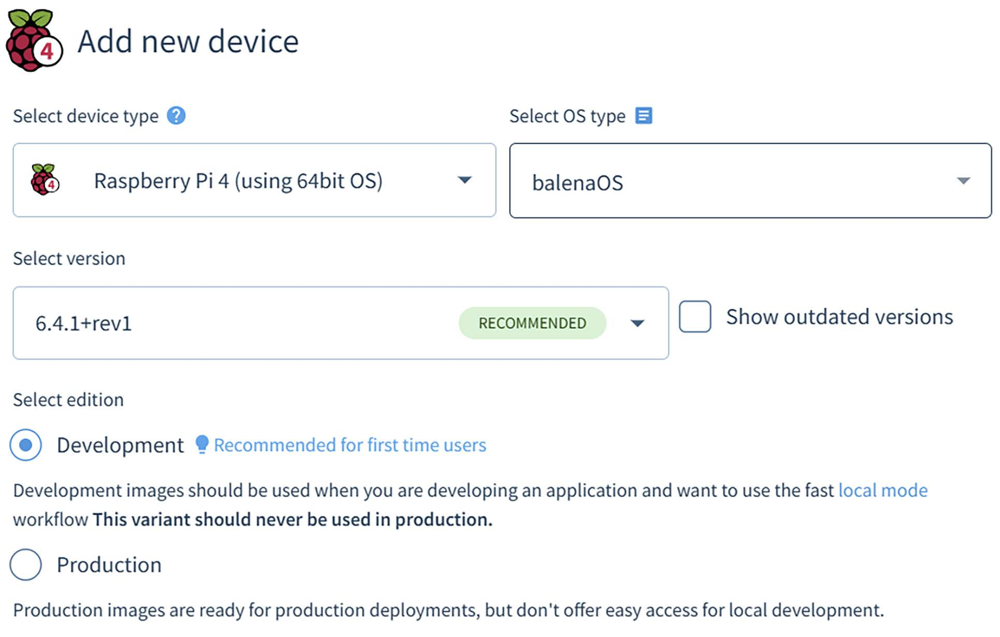
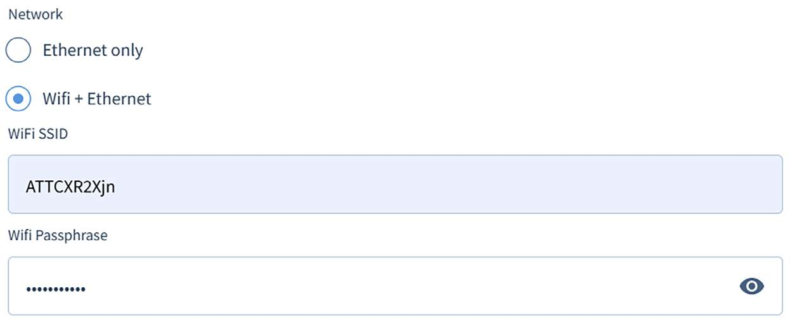
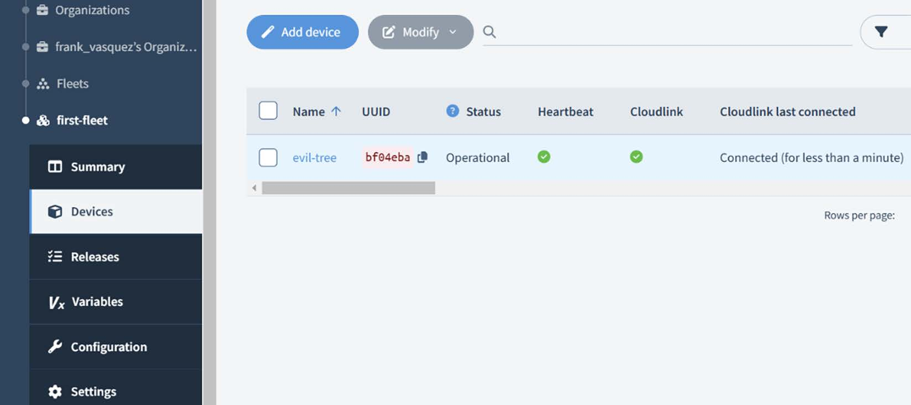
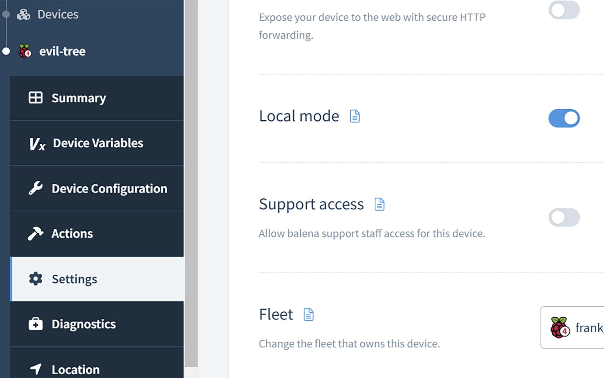

# Chương 16: Triển khai container image (Deploying Container Images)

Trong chương này, tôi sẽ giới thiệu các nguyên tắc của phong trào DevOps và minh họa cách áp dụng chúng cho embedded Linux. Đầu tiên, chúng ta sẽ học cách dùng Docker để gói một ứng dụng Python cùng với môi trường user-space của nó bên trong một container image. Tiếp theo, chúng ta sẽ thiết lập một pipeline continuous integration và continuous delivery (CI/CD) Docker-based cho một ứng dụng server Bluetooth viết bằng Python. Sau đó tôi sẽ minh họa cách nhanh chóng thêm Docker vào một image Yocto cho Raspberry Pi 4. Cuối cùng, chúng ta sẽ triển khai một bản cập nhật phần mềm container hóa tới một Raspberry Pi 4 đang chạy Docker.

Trong chương này, chúng ta sẽ đề cập các chủ đề sau:

- DevOps là gì?

- DevOps và embedded Linux

- Triển khai ứng dụng Python với Docker

- Thiết lập một pipeline CI/CD cho một ứng dụng Python

- Thêm Docker vào một image Yocto

- Cập nhật phần mềm với Docker

## Yêu cầu kỹ thuật

Để làm theo các ví dụ, hãy bảo đảm bạn có những thứ sau:

- Một hệ thống host Ubuntu 24.04 hoặc bản LTS mới hơn với ít nhất 90 GB dung lượng đĩa trống

- Một tài khoản người dùng có quyền admin hoặc sudo trên hệ thống host

- Bản phát hành Yocto 5.0 (Scarthgap) LTS

- Một đầu đọc thẻ microSD và thẻ

- `balenaEtcher` cho Linux

- Một cáp Ethernet và router có cổng trống để kết nối mạng

- Một Raspberry Pi 4

- Một bộ nguồn USB-C 5 V có khả năng cấp 3 A

Lẽ ra bạn đã build bản phát hành 5.0 (Scarthgap) LTS của Yocto trong Chương 6. Nếu chưa, hãy tham khảo các phần Compatible Linux Distribution và Build Host Packages của Yocto Project Quick Build guide (`https://docs.yoctoproject.org/brief-yoctoprojectqs/`) trước khi build Yocto trên host Linux theo hướng dẫn trong Chương 6.

Code dùng trong chương này có trong thư mục của chương trong GitHub repository của cuốn sách: `https://github.com/PacktPublishing/Mastering-Embedded-Linux-Development/tree/main/Chapter16`.

### Cài đặt Docker

Để cài đặt Docker trên Ubuntu 24.04 LTS:

1\. Cập nhật các package repository:

```
$ sudo apt update
```

2\. Cài đặt Docker:

```
$ sudo apt install docker.io
```

3\. Khởi động Docker daemon và cho phép nó khởi động lúc boot:

```
$ sudo systemctl enable --now docker
```

4\. Thêm chính bạn vào group `docker`:

```
$ sudo usermod -aG docker <username>
```

5\. Khởi động lại Docker daemon:

```
$ sudo systemctl restart docker
```

Thay `<username>` ở bước 4 bằng username của bạn. Tôi khuyên bạn tạo tài khoản người dùng Ubuntu của riêng mình thay vì dùng tài khoản người dùng `ubuntu` mặc định, vốn được dành cho các tác vụ quản trị.

## DevOps là gì?

Kể từ khi ra đời năm 2009, phong trào DevOps đã làm mưa làm gió trong ngành phần mềm. Patrick Debois đặt ra thuật ngữ DevOps sau khi xem bài trình bày 10 Deploys per Day tại Velocity Conference năm 2009. Patrick là một trong bốn co-authors của The DevOps Handbook cùng với Gene Kim, Jez Humble và John Willis. The DevOps Handbook được xuất bản lần đầu năm 2016 và hệ thống hóa các nguyên tắc của phong trào. Những ý tưởng này bắt nguồn từ các cộng đồng Lean manufacturing và phát triển phần mềm Agile. Các thực hành DevOps gắn chặt với các phương pháp luận Agile như Scrum và Kanban. Mục tiêu của tất cả các cách tiếp cận này luôn là đưa sản phẩm chất lượng đến khách hàng nhanh hơn.

DevOps cố gắng tích hợp các nhóm phát triển và vận hành trong một tổ chức. Về mặt lịch sử, những người vận hành phần mềm tại một công ty tách biệt với những người phát triển chính phần mềm đó. Đôi khi có một nhóm quản trị hệ thống (IT) chuyên trách, chịu trách nhiệm cấp phát server và triển khai các release phần mềm theo lịch. Sự tách biệt mối quan tâm này kết hợp với các đợt triển khai big bang chắc chắn dẫn đến chậm trễ kéo dài và sự cố ngừng dịch vụ. Mối quan hệ giữa phát triển và vận hành trở nên đối địch khi finger-pointing nổ ra giữa những thất bại. Ngược lại, DevOps khuyến khích hợp tác chặt chẽ, lặp nhanh và thử nghiệm. Sai lầm là cách chúng ta học hỏi.

### Continuous integration và continuous deployment

Hai khái niệm cốt lõi của Lean manufacturing là value stream và lead time gắn với nó. Triết lý Lean đến từ ngành công nghiệp ô tô, cụ thể là Toyota Production System. Nếu một value stream là một dây chuyền lắp ráp trong nhà máy, thì lead time là thời gian từ khi một yêu cầu của khách hàng được gửi đến khi nó được đáp ứng. Lead time là một trong các thước đo để đo hiệu suất của một value stream. Giảm lead time cho phép các nhà máy chế tạo ô tô nhanh hơn. Ý tưởng tương tự áp dụng cho phần mềm.

Trong phần mềm, chúng ta có thể nghĩ lead time là thời gian từ khi một yêu cầu tính năng được gửi đến khi tính năng hoàn thiện đó được triển khai lên production. Mỗi khi một nhà phát triển commit và push một thay đổi vào phần mềm, một bản build tự động được khởi chạy. Một bộ unit test được chạy trên code vừa thay đổi này như một phần của bản build tự động. Một thay đổi code chỉ có thể được merge vào branch chính nếu bản build thành công và bộ test vượt qua. Tất cả các kiểm tra này đều được viết script và thực hiện tự động. Việc build phần mềm và thực thi test càng mất nhiều thời gian, lead time càng dài.

Tích hợp code chỉ là một phần của value stream. Để mang lại giá trị cho khách hàng, phần mềm phải được triển khai lên production. Điều đó thường có nghĩa là gắn tag một release, khởi tạo các server trên cloud và cài đặt release mới lên các server đó. Có một số kỹ thuật để bảo đảm việc triển khai diễn ra suôn sẻ. Chạy integration test trước. Tung release dần dần trên toàn bộ dàn server. Roll back về một release trước đó trong trường hợp có một bản cập nhật phần mềm tồi. Năng suất tối đa của nhà phát triển chỉ có thể đạt được khi phần mềm được triển khai lên production nhiều lần mỗi ngày. Value stream chính là pipeline CI/CD.

### Infrastructure as code

Chúng ta cần nhiều hơn source code để build và triển khai hầu hết phần mềm. Ngày nay, phần lớn việc phát triển phần mềm hiện đại đều liên quan đến Docker. Một ứng dụng thường cần một Dockerfile, makefile và các shell script để build và đóng gói phần mềm cho release. Các mục này được gọi bởi một file YAML ở các giai đoạn khác nhau của pipeline CI/CD. Vì chúng không phải là một phần của phần mềm thực sự, chúng ta có thể không coi các mục này là code theo đúng nghĩa. Dù vậy, chúng nằm trong version control cùng với source code và cũng cần được review và bảo trì. Vì việc build và đóng gói phần mềm hoàn toàn được viết script, tác vụ này dễ dàng lặp lại.

Lượng YAML tăng lên trong quá trình triển khai. Các công cụ Cloud-native như Terraform và CloudFormation đều YAML-based. Chúng ta cấp phát hạ tầng cloud và triển khai các artifact release phần mềm lên đó bằng các công cụ này thông qua việc áp dụng các file YAML khai báo. Việc triển khai được điều khiển bởi cùng file YAML top-level được dùng cho việc build và đóng gói. Bằng cách đó, toàn bộ quy trình được tự động hóa từ đầu đến cuối. Dù trông không giống, các file YAML thực sự là code và nên tuân thủ cùng các tiêu chuẩn chất lượng như code được viết bằng các ngôn ngữ lập trình high-level như Python.

### Bảo mật là trách nhiệm chung

Khi time to market là tất cả, bảo mật bị xếp hàng thứ yếu. Giống như việc triển khai, bảo mật thường bị đẩy cho bộ phận vận hành. Các sự cố High-profile như lỗ hổng Log4j năm 2022 và backdoor `xz` năm 2024 cho thấy bảo mật quan trọng đến mức nào đối với hoạt động kinh doanh day-to-day. DevOps lập luận rằng bảo mật là mối quan tâm ở mọi giai đoạn phát triển, không phải là thứ tính đến sau cùng. Tài sản trí tuệ và dữ liệu khách hàng luôn được mã hóa. Các bí mật như key và passphrase được lưu trữ an toàn bên ngoài version control. Các best practice về bảo mật là trách nhiệm của mọi người và cần được thực thi ngay từ đầu.

### Monitoring và observability

Thu thập telemetry dưới dạng thống kê hệ thống, log và trace cho chúng ta khả năng nhìn thấy sức khỏe và hiệu năng của các ứng dụng. Một khi đã có telemetry, nó có thể được hiển thị trên một dashboard Grafana để phân tích. Bằng cách đó, chúng ta có thể phát hiện performance regression, rò rỉ tài nguyên và các vấn đề mang tính hệ thống khác trước khi chúng dẫn đến một sự cố ngừng dịch vụ tốn kém. Các thông tin Real-time kích hoạt việc phản ứng và giải quyết sự cố nhanh chóng. Quan trọng hơn, telemetry cho chúng ta phản hồi nhanh, không bị lọc về việc chúng ta đang làm tốt đến đâu với tư cách nhà phát triển để chúng ta có thể học hỏi và cải thiện.

### Cải tiến liên tục

Lean manufacturing đề cao lead time ngắn, thay đổi nhỏ và lặp nhanh. The Lean Startup của Eric Ries đã phổ biến khái niệm minimum viable product (MVP). Một MVP là một phiên bản của sản phẩm với vừa đủ chức năng để các khách hàng ban đầu có thể đưa ra phản hồi về sản phẩm đó. Phản hồi này được xem xét, và các cải tiến được đưa vào phiên bản tiếp theo liên tiếp nhanh chóng. Một pipeline CI/CD phần mềm cho ra MVP nhanh hơn một dây chuyền lắp ráp trong nhà máy.

Phản hồi liên tục khuyến khích các nhà phát triển phát hành những cải tiến nhỏ tăng dần với tần suất cao hơn. Cách tiếp cận MVP cho phép các nhóm thấy cái gì hiệu quả và cái gì không trước khi cam kết thêm thời gian và tài nguyên. Bằng cách này, có thể điều chỉnh để mang lại nhiều giá trị hơn cho người dùng. DevOps lập luận rằng tích hợp các thay đổi nhỏ sớm hơn mang lại kết quả tốt hơn. Điều này hoàn toàn trái ngược với việc để một nhà phát triển đơn độc miệt mài trên một feature branch long-lived mà không có bất kỳ phản hồi nào từ người dùng.

### Minh bạch

Sự hợp tác khó có thể xảy ra nếu văn hóa của một tổ chức không khuyến khích nó. Nỗi sợ hãi lan tràn trong các tổ chức rối loạn chức năng. Các cá nhân hành động một cách tính toán bằng cách giấu thông tin khỏi những người khác có thể hưởng lợi từ nó. Hành vi này dẫn đến các silo, nơi mọi giao tiếp diễn ra trong các cuộc họp và chat riêng theo nguyên tắc need-to-know. Sai lầm bị che giấu vì sợ bị trừng phạt (ví dụ, lãnh đạo "giết người đưa tin"). Tư duy DevOps là tư duy cởi mở. Thành công, thất bại và ý tưởng được chia sẻ khắp tổ chức để thúc đẩy các best practice. Nếu bạn đang gặp khó khăn với một tác vụ, hãy nhờ nhóm của bạn giúp đỡ.

## DevOps và Embedded Linux

Phần cứng thì khó. Layout PCB, sản xuất theo hợp đồng và các bản sửa đổi board tốn thời gian và tiền bạc. Rủi ro lớn hơn so với phần mềm. Lead time dài hơn, và sai lầm có thể là thảm họa. Embedded Linux tạo thành cầu nối giữa phần cứng và phần mềm.

Các kỹ sư embedded Linux làm việc chặt chẽ với các kỹ sư điện trong quá trình bring-up board, xử lý sự cố khi chúng phát sinh. Không hiếm khi phải nhờ một kỹ sư điện đi lại dây một linh kiện hoặc thêm một điện trở pull-up. Layout PCB cực kỳ phức tạp. Không ai hoàn hảo, vì vậy một board mới hiếm khi boot được ngay lần đầu.

Với rủi ro cao như vậy, có vẻ như các nguyên tắc DevOps không phù hợp với các sản phẩm phần cứng. Các xu hướng ngành như test-driven development (TDD) thường bị các nhà phát triển nhúng giàu kinh nghiệm gạt đi vì cho là phi thực tế. Kiểm thử tự động khó hơn khi làm việc với phần cứng thật nhưng không phải là không thể. Đầu tư thời gian và công sức vào việc thiết lập một pipeline CI/CD sẽ được đền đáp một khi các tính năng bắt đầu được hoàn thành liên tiếp nhanh chóng. Ban quản lý có thể đặt câu hỏi vì sao bạn làm quá nhiều việc về quy trình ngay từ đầu, nhưng họ sẽ đổi giọng khi các sản phẩm mới bắt đầu được giao trước thời hạn.

### Continuous integration và cross-compilation

Linux và phần lớn middleware chạy trên nó được viết chủ yếu bằng C. Điều này có nghĩa là nó phải được compile native cho instruction set architecture (ISA) của target. Trên cloud, ISA đó thường là x86-64 chạy trên CPU Intel hoặc AMD. Trên các thiết bị nhúng có khả năng chạy Linux, nó ngày càng là Arm 64-bit. Vì phần lớn hạ tầng cloud chạy trên CPU Intel và AMD, việc build phần mềm cho embedded Linux cần một toolchain cross-compiling. Tuy nhiên, cross-compilation không phải là trường hợp sử dụng phổ biến đối với các dịch vụ CI/CD cloud-based như GitHub Actions hay GitLab CI.

Buildroot và Yocto đều được thiết kế để cross-compile các image embedded Linux, nhưng chạy các công cụ này trên cloud có thể là một thách thức. Chúng cần rất nhiều dung lượng đĩa và thời gian build kéo dài là quá mức chấp nhận. Thời gian build có thể được cải thiện bằng cách dùng incremental build và caching thông minh (ví dụ, `sstate-cache` dùng chung của Yocto). Ngoài ra, bạn có thể dùng Docker kết hợp với QEMU để cross-compile các container image cho Arm 64-bit. Cách tiếp cận container hóa này hoạt động tuyệt vời cho user space nhưng việc giả lập kiến trúc target làm chậm việc compile.

### Kiểm thử tự động trên phần cứng thật

Một trong những thách thức lớn nhất khi phát hành phần cứng là hiện thực kiểm thử hardware-in-the-loop (HIL). Giống như cross-compilation, kiểm thử tự động có thể được thực hiện dễ dàng trên cloud với QEMU, nhưng không gì thay thế được việc kiểm thử phần mềm trên phần cứng dự định của nó. Khi an toàn là mối quan tâm, kiểm thử HIL là một nghĩa vụ, không phải một biện pháp phòng ngừa. Thách thức nằm ở cách tự động hóa nó. Đây là lý do kiểm thử HIL thường đòi hỏi nhiều công sức như viết code phần mềm.

Hình thức kiểm thử HIL hiệu quả nhất là mô phỏng thế giới thực. Phần cứng tương tác với thế giới thực thông qua cảm biến và cơ cấu chấp hành. Nó nhận input từ cảm biến và gửi output tới cơ cấu chấp hành qua các giao diện truyền thông như I2C, SPI và CAN. Chúng ta mô phỏng thế giới thực bằng cách mô hình hóa nó bằng phần mềm. Mô hình phần mềm này chạy trên một máy Linux riêng. Nó gửi và nhận thông điệp qua các giao diện truyền thông khác nhau giống như các cảm biến và cơ cấu chấp hành trong hệ thống thực. Ví dụ, để kiểm thử một bộ sạc EV, chúng ta sẽ nối một PCB trên bàn thử nghiệm với một pin giả chạy mô hình của chúng ta.

### Continuous delivery và cập nhật OTA

Khi một đợt triển khai thất bại trên cloud, chúng ta chỉ cần xóa các server có vấn đề và khởi tạo các instance mới. Chúng ta không cần lo làm brick server vì chúng ta luôn có thể bắt đầu lại từ đầu. Cấp phát lại server tương đối nhanh và dễ dàng trên cloud. Điều tương tự không thể nói về các thiết bị tiêu dùng ngoài thực địa. Nếu một thiết bị không thể boot, thì nó vô dụng. Tương tự, nếu một thiết bị kết nối đột nhiên bị mất kết nối internet, thì nó không thể nhận các bản cập nhật OTA quan trọng.

Cập nhật OTA là cách continuous delivery phần mềm diễn ra trong các hệ thống nhúng. Cập nhật OTA cần phải fail-safe trước sự cố mất điện bất ngờ. Một bản cập nhật OTA thất bại không được dẫn đến một flash image không hoàn chỉnh hoặc không xác định. Nếu không, thiết bị có thể trở nên không boot được. Buildroot và Yocto hỗ trợ các giải pháp cập nhật OTA fail-safe như Mender, RAUC và SWUpdate. Mặc dù các công cụ này sẽ cứu bạn khỏi việc làm brick cả dàn thiết bị, bạn vẫn nên kiểm thử kỹ lưỡng các release phần mềm trước khi tung ra toàn bộ. Không gì nhấn chìm một đợt ra mắt sản phẩm mới nhanh hơn một trải nghiệm người dùng tồi.

### Infrastructure as code và build system

Buildroot dựa vào makefile. Yocto gồm các recipe BitBake. Giống như các file YAML định nghĩa hạ tầng cloud của bạn, metadata build này cũng được coi là code và nên được giữ trong version control. Điều đó bao gồm các board defconfig và định nghĩa package cho Buildroot. Đối với Yocto, metadata build gồm các layer BSP và distro. Container hóa môi trường build embedded Linux bằng cách định nghĩa một Dockerfile cho nó cũng rất đáng giá. Điều này giúp dễ dàng dựng một pipeline CI/CD để build image cho thiết bị target của bạn. Nó cũng giúp người khác dễ tái tạo môi trường build của bạn để họ có thể phát triển cục bộ trên máy của mình.

### Bảo mật thiết bị biên

Internet đầy rẫy nguy hiểm. Botnet Mirai khét tiếng được khởi đầu bởi những đứa trẻ muốn đánh sập các server Minecraft của đối thủ. Ý tưởng này đã phát triển thành các cuộc tấn công distributed denial-of-service (DDoS) large-scale. Mirai chiếm quyền các thiết bị IoT tiêu dùng như webcam và router gia đình rồi chĩa chúng vào các website được chọn. Bảo mật quá trình boot và cập nhật OTA ngăn malware như Mirai chạy trên thiết bị của người dùng. Các cơ chế bảo mật quá trình boot và cập nhật OTA được mô tả trong Chương 10. Bảo mật là điều kiện tối thiểu ở biên vì một khi dàn thiết bị của bạn bị chiếm quyền, bạn không thể lấy lại nó.

Secure boot có nghĩa là một thiết bị sẽ chỉ boot từ một image đã được nhà sản xuất thiết bị ký bằng mật mã. Một bước xác minh chữ ký được chèn vào lúc boot để bảo đảm tính xác thực của image mới nhất được áp dụng bởi một bản cập nhật OTA. Người dùng cũng mong đợi mọi dữ liệu được mã hóa trên thiết bị của họ vì quyền riêng tư. Auto-unlocking một volume được mã hóa đòi hỏi một passphrase lúc khởi động. Mọi key hoặc passphrase mà thiết bị cần lúc runtime nên được lưu trữ an toàn bên trong một TPM hoặc secure element.

### Monitoring và observability của thiết bị biên

Thu thập telemetry từ các thiết bị tiêu dùng rất khó vì chúng được triển khai trong nhà và văn phòng của mọi người. Giống như mọi thiết bị khác kết nối internet, bất kỳ sản phẩm mới nào muốn stream telemetry lên cloud sẽ cần vượt qua firewall. Điều này thường đòi hỏi người dùng mở một cổng đi ra trên router Wi-Fi của họ. Người dùng có thể không đủ am hiểu về mạng hoặc phản đối việc này vì quyền riêng tư. Mặc dù có các giao thức IoT chuẩn cho telemetry như MQTT, chúng không phải lúc nào cũng phù hợp với mọi ứng dụng. Vẫn còn nhiều chỗ cho sự đổi mới trong lĩnh vực này bởi các startup như Golioth và Memfault.

Lý thuyết và lý lẽ thế là đủ. Hãy đưa các nguyên tắc này vào thực hành. Chúng ta sẽ bắt đầu bằng việc thực hiện một đợt triển khai phần mềm container hóa. Lẽ ra bạn đã cài đặt Docker trên host Linux theo hướng dẫn trong phần Getting Docker.

## Triển khai ứng dụng Python với Docker

Docker mang lại một cách khác để gói code Python cùng với phần mềm viết bằng các ngôn ngữ khác. Ý tưởng đằng sau Docker là thay vì đóng gói và cài đặt ứng dụng lên một môi trường server được cấu hình sẵn, bạn build và phát hành một container image chứa ứng dụng và tất cả runtime dependency của nó. Một container image giống một môi trường ảo hơn là một máy ảo. Một máy ảo là một system image hoàn chỉnh bao gồm một kernel và một hệ điều hành. Một container image là một môi trường user-space tối giản chỉ đi kèm các binary cần thiết để chạy ứng dụng của bạn.

Máy ảo chạy trên một hypervisor giả lập phần cứng. Container chạy trực tiếp trên hệ điều hành host. Khác với máy ảo, các container có thể dùng chung cùng một hệ điều hành và kernel mà không cần giả lập phần cứng. Thay vào đó, chúng dựa vào hai tính năng đặc biệt của Linux kernel để cô lập: namespace và cgroup. Docker không phát minh ra công nghệ container, nhưng họ là những người đầu tiên xây dựng công cụ giúp chúng dễ sử dụng. Lời bào chữa nhàm chán "chạy được trên máy tôi" không còn được chấp nhận nữa khi Docker khiến việc build và triển khai container image trở nên đơn giản đến vậy.

### Cấu trúc của một Dockerfile

Một Dockerfile mô tả nội dung của một Docker image. Mỗi Dockerfile chứa một tập các instruction chỉ định môi trường nào cần dùng và lệnh nào cần chạy. Thay vì viết một Dockerfile từ đầu, chúng ta sẽ dùng một Dockerfile có sẵn cho một project template. Dockerfile này tạo ra một Docker image cho một ứng dụng web Flask rất đơn giản mà bạn có thể mở rộng cho phù hợp với nhu cầu. Docker image được build trên nền Debian Bookworm. Ngoài Flask, Docker image còn bao gồm uWSGI và Nginx để có hiệu năng tốt hơn.

Bắt đầu bằng cách trỏ trình duyệt web tới project `uwsgi-nginx-flask-docker` trên GitHub (`https://github.com/tiangolo/uwsgi-nginx-flask-docker`). Sau đó, nhấn vào link tới Dockerfile `python-3.12` từ file `README.md`.

Giờ hãy xem dòng đầu tiên trong Dockerfile đó:

```
FROM tiangolo/uwsgi-nginx:python3.12
```

Lệnh `FROM` này báo cho Docker pull một image tên `uwsgi-nginx` từ namespace `tiangolo` với `python3.12` từ Docker Hub. Docker Hub là một registry công khai nơi mọi người công bố Docker image của họ để người khác lấy về và triển khai. Bạn có thể thiết lập image registry của riêng mình bằng một dịch vụ như AWS ECR hoặc Quay nếu muốn. Bạn sẽ cần chèn tên dịch vụ registry của mình vào trước namespace như sau:

```
FROM quay.io/my-org/my-app:my-tag
```

Nếu không, Docker mặc định lấy image từ Docker Hub. `FROM` giống như một câu lệnh `include` trong Dockerfile. Nó chèn nội dung của một Dockerfile khác vào Dockerfile của bạn để bạn có cái gì đó để build lên trên. Tôi thích nghĩ về cách tiếp cận này như việc xếp lớp image. Debian Bookworm là lớp nền, theo sau là Python 3.12, rồi uWSGI cộng Nginx, và cuối cùng là ứng dụng Flask của bạn. Bạn có thể tìm hiểu thêm về cách xếp lớp image hoạt động bằng cách đào sâu vào Dockerfile `python3.12` tại `https://hub.docker.com/r/tiangolo/uwsgi-nginx`.

Đây là dòng đáng chú ý tiếp theo trong Dockerfile:

```
RUN pip install --no-cache-dir -r /tmp/requirements.txt
```

Một instruction `RUN` chạy một lệnh. Docker thực thi các instruction `RUN` có trong Dockerfile một cách tuần tự để build Docker image kết quả. Nếu bạn xem file `requirements.txt` trong Git repo, bạn sẽ thấy rằng instruction `RUN` này cài đặt Flask vào thư mục `site-packages` của hệ thống. Chúng ta biết `pip` có sẵn vì base image `uwsgi-nginx` cũng bao gồm Python 3.12.

Hãy bỏ qua các biến môi trường của Nginx và đi thẳng đến việc copy:

```
COPY ./app /app
```

Dockerfile cụ thể này nằm bên trong một Git repo cùng với một số file và thư mục con khác. Instruction `COPY` copy một thư mục từ môi trường runtime Docker của host (thường là một bản Git clone của một repo) vào container đang được build.

File `python3.12.dockerfile` mà bạn đang xem nằm trong thư mục con `docker-images` của repo `tiangolo/uwsgi-nginx-flask-docker`. Bên trong thư mục `docker-images` đó là một thư mục con `app` chứa một ứng dụng web Flask Hello World. Instruction `COPY` này copy thư mục `app` từ repo ví dụ vào thư mục gốc của Docker image:

```
WORKDIR /app
```

Instruction `WORKDIR` báo cho Docker biết làm việc từ thư mục nào bên trong container. Trong ví dụ này, thư mục `/app` mà nó vừa copy trở thành thư mục làm việc. Nếu thư mục làm việc đích không tồn tại, thì `WORKDIR` sẽ tạo nó. Do đó mọi đường dẫn non-absolute xuất hiện sau đó trong Dockerfile này đều tương đối so với thư mục `/app`.

Giờ hãy xem một biến môi trường được đặt bên trong container như thế nào:

```
ENV PYTHONPATH=/app
```

`ENV` báo cho Docker rằng thứ theo sau là một định nghĩa biến môi trường. `PYTHONPATH` là một biến môi trường mở rộng thành một danh sách các đường dẫn colon-delimited, nơi Python interpreter tìm kiếm module và package.

Tiếp theo, hãy nhảy xuống vài dòng tới instruction `RUN` thứ hai:

```
RUN chmod +x /entrypoint.sh
```

Instruction `RUN` báo cho Docker chạy một lệnh từ shell. Trong trường hợp này, lệnh được chạy là `chmod`, lệnh thay đổi quyền của file. Ở đây, nó làm cho `/entrypoint.sh` thực thi được.

Dòng tiếp theo trong Dockerfile này là tùy chọn:

```
ENTRYPOINT ["/entrypoint.sh"]
```

`ENTRYPOINT` là instruction thú vị nhất trong Dockerfile này. Nó trình bày một file thực thi ra command line của Docker host khi khởi động container. Điều này cho phép bạn truyền đối số từ command line xuống file thực thi bên trong container. Bạn có thể thêm các đối số này sau `docker run` `<image>` trên command line. Nếu có nhiều hơn một instruction `ENTRYPOINT` trong một Dockerfile, thì chỉ `ENTRYPOINT` cuối cùng được thực thi.

Dòng cuối cùng trong Dockerfile là:

```
CMD ["/start.sh"]
```

Giống như các instruction `ENTRYPOINT`, các instruction `CMD` thực thi lúc container khởi động thay vì lúc build. Khi một instruction `ENTRYPOINT` được định nghĩa trong một Dockerfile, một instruction `CMD` định nghĩa các đối số mặc định được truyền cho `ENTRYPOINT` đó. Trong trường hợp này, đường dẫn `/start.sh` là đối số được truyền cho `/entrypoint.sh`. Dòng cuối cùng trong `/entrypoint.sh` thực thi `/start.sh`:

```
#! /usr/bin/env sh
set -e

# If there's a prestart.sh script in the /app directory, run it before
# starting
PRE_START_PATH=/app/prestart.sh
echo "Checking for script in $PRE_START_PATH"
if [ -f $PRE_START_PATH ] ; then
    echo "Running script $PRE_START_PATH"
    . $PRE_START_PATH
else
    echo "There is no script $PRE_START_PATH"
fi

# Start Supervisor, with Nginx and uWSGI
exec /usr/bin/supervisord
```

Script `/start.sh` đến từ base image `uwsgi-nginx`. `/start.sh` khởi động Nginx và uWSGI sau khi `/entrypoint.sh` đã cấu hình môi trường runtime của container cho chúng. Khi `CMD` được dùng kết hợp với `ENTRYPOINT`, các đối số mặc định do `CMD` đặt có thể bị ghi đè từ command line của Docker host.

Hầu hết các Dockerfile không có instruction `ENTRYPOINT`, vì vậy dòng cuối cùng của một Dockerfile thường là một instruction `CMD` chạy ở foreground thay vì các đối số mặc định. Bạn có thể dùng mẹo Dockerfile này để giữ một Docker container general-purpose chạy cho việc phát triển:

```
CMD tail -f /dev/null
```

Ngoại trừ `ENTRYPOINT` và `CMD`, tất cả các instruction trong Dockerfile `python-3.12` ví dụ này chỉ thực thi khi container đang được build.

### Build một Docker image

Trước khi có thể build một Docker image, chúng ta cần một Dockerfile. Có thể bạn đã có một số Docker image trên hệ thống.

Để xem danh sách các Docker image:

```
$ docker images
```

Giờ hãy lấy về và build Dockerfile mà chúng ta vừa mổ xẻ:

1\. Clone repo chứa Dockerfile:

```
$ git clone https://github.com/tiangolo/uwsgi-nginx-flask-docker.git
```

2\. Chuyển sang thư mục con `docker-images` bên trong repo:

```
$ cd uwsgi-nginx-flask-docker/docker-images
```

3\. Copy `python3.12.dockerfile` sang một file tên `Dockerfile`:

```
$ cp python3.12.dockerfile Dockerfile
```

4\. Build một image từ Dockerfile:

```
$ docker build -t my-image .
```

Khi image build xong, nó sẽ xuất hiện trong danh sách Docker image cục bộ của bạn:

```
$ docker images
```

my-image vừa được build sẽ xuất hiện trong danh sách.

### Chạy một Docker image

Giờ chúng ta đã có một Docker image được build mà chúng ta có thể chạy như một container.

Để lấy danh sách các container đang chạy trên hệ thống:

```
$ docker ps
```

Để chạy một container dựa trên `my-image`:

```
$ docker run -d --name my-container -p 80:80 my-image
```

Nếu lệnh trên thất bại vì cổng `80` đang bận, hãy thay cổng `80` bằng `8080`. Giờ hãy quan sát trạng thái của container đang chạy:

```
$ docker ps
```

Bạn sẽ thấy một container tên `my-container` dựa trên một image tên `my-image` trong danh sách. Tùy chọn `-p` trong lệnh `docker run` ánh xạ một cổng container tới một cổng host. Vậy, trong ví dụ này cổng container `80` ánh xạ tới cổng host `80`. Việc ánh xạ cổng này cho phép web server Flask chạy bên trong container phục vụ các HTTP request.

Để dừng `my-container`:

```
$ docker stop my-container
```

Giờ hãy kiểm tra lại trạng thái của container đang chạy:

```
$ docker ps
```

`my-container` sẽ không còn xuất hiện trong danh sách các container đang chạy. Container đã biến mất chưa? Chưa, nó chỉ bị dừng. Bạn vẫn có thể thấy `my-container` và trạng thái của nó bằng cách thêm tùy chọn `-a` vào lệnh `docker` `ps`:

```
$ docker ps -a
```

Chúng ta sẽ xem cách xóa các container không còn cần sau.

### Lấy về một Docker image

Trước đó trong phần này, tôi đã nhắc tới các image registry như Docker Hub, AWS ECR và Quay. Hóa ra, Docker image mà chúng ta đã build cục bộ từ một Git repo được clone đã được công bố trên Docker Hub. Lấy image build sẵn từ Docker Hub nhanh hơn nhiều so với tự build nó trên hệ thống của bạn. Các Docker image cho project có thể được tìm thấy tại `https://hub.docker.com/r/tiangolo/uwsgi-nginx-flask`.

Để pull cùng Docker image mà chúng ta đã build thành `my-image` từ Docker Hub:

```
$ docker pull tiangolo/uwsgi-nginx-flask:python3.12
```

Giờ hãy xem lại danh sách Docker image của bạn:

```
$ docker images
```

Bạn sẽ thấy một image `uwsgi-nginx-flask` mới trong danh sách.

Để chạy image vừa lấy về này:

```
$ docker run -d --name flask-container -p 80:80 tiangolo/uwsgi-nginx-
flask:python3.12
```

Bạn có thể thay tên image đầy đủ (`repo:tag`) trong lệnh `docker run` ở trên bằng image ID (hash) tương ứng từ `docker images` nếu không muốn gõ đầy đủ tên image.

### Công bố một Docker image

Để công bố một Docker image lên Docker Hub, trước tiên bạn phải có một tài khoản và đăng nhập vào đó. Bạn có thể tạo một tài khoản trên Docker Hub bằng cách vào website `https://hub.docker.com` và đăng ký. Khi đã có tài khoản, bạn có thể push một image có sẵn lên Docker Hub repository của mình:

1\. Đăng nhập vào image registry Docker Hub từ command line:

```
$ docker login
```

2\. Nhập username và mật khẩu Docker Hub khi được nhắc.

3\. Gắn tag cho một image có sẵn với một tên mới bắt đầu bằng tên repository của bạn:

```
$ docker tag my-image:latest <repository>/my-image:latest
```

4\. Thay `<repository>` trong lệnh trên bằng tên repository của bạn (giống với username) trên Docker Hub. Bạn cũng có thể thay `my-image:latest` bằng tên của một image có sẵn khác mà bạn muốn push.

5\. Push image lên image registry Docker Hub:

```
$ docker push <repository>/my-image:latest
```

6\. Một lần nữa, thực hiện các thay thế giống như bạn đã làm ở bước 3.

Các image được push lên Docker Hub mặc định là công khai. Để truy cập trang web của image vừa công bố, hãy vào `https://hub.docker.com/repository/docker/<repository>/my-image`. Thay `<repository>` trong URL trên bằng tên repository của bạn (giống với username) trên Docker Hub. Bạn cũng có thể thay `my-image:latest` bằng tên của image thực tế mà bạn đã push nếu khác. Nếu bạn nhấn vào tab Tags trên trang web đó, bạn sẽ thấy lệnh `docker pull` để lấy image đó.

### Dọn dẹp

Chúng ta biết rằng `docker images` liệt kê các image và `docker ps` liệt kê các container. Trước khi có thể xóa một Docker image, trước tiên chúng ta phải xóa mọi container tham chiếu tới nó. Để xóa một Docker container, trước tiên bạn cần biết tên hoặc ID của container:

1\. Tìm tên của Docker container đích:

```
$ docker ps -a
```

2\. Dừng container nếu nó đang chạy:

```
$ docker stop flask-container
```

3\. Xóa Docker container:

```
$ docker rm flask-container
```

Thay `flask-container` trong hai lệnh trên bằng tên hoặc ID container từ bước 1. Mọi container xuất hiện dưới `docker ps` cũng có một tên hoặc ID image gắn với nó. Khi đã xóa tất cả các container tham chiếu tới một image, bạn có thể xóa image đó.

Tên Docker image (`repo:tag`) có thể khá dài (ví dụ, `tiangolo/uwsgi-nginx-flask:python3.12`). Vì lý do đó, tôi thấy dễ hơn khi chỉ cần copy và paste ID (hash) của image khi xóa:

1\. Tìm ID của Docker image:

```
$ docker images
```

2\. Xóa Docker image:

```
$ docker rmi <image-ID>
```

Thay `<image-ID>` trong lệnh trên bằng image ID từ bước 1.

Nếu bạn chỉ đơn giản muốn xóa sạch tất cả các container và image mà bạn không còn dùng trên hệ thống:

```
$ docker system prune -a
```

`docker system prune` xóa tất cả các container đã dừng và dangling image.

Chúng ta đã thấy cách `pip` có thể được dùng để cài đặt các dependency của một ứng dụng Python. Bạn chỉ cần thêm một instruction `RUN` gọi `pip install` vào Dockerfile. Vì container là các môi trường sandbox, chúng mang lại nhiều lợi ích giống như môi trường ảo. Nhưng khác với các môi trường ảo `conda` và `venv`, Buildroot và Yocto đều hỗ trợ Docker container. Buildroot có các package `docker-engine` và `docker-cli`. Yocto có layer `meta-virtualization`. Nếu thiết bị của bạn cần cô lập vì xung đột package Python, thì bạn có thể đạt được điều đó với Docker.

Lệnh `docker run` cung cấp các tùy chọn để trình bày tài nguyên hệ điều hành cho container. Chỉ định một bind mount cho phép một file hoặc thư mục trên máy host được mount bên trong một container để đọc và ghi. Mặc định, các container không công bố cổng nào ra thế giới bên ngoài. Khi bạn chạy image `my-container`, bạn đã dùng tùy chọn `-p` để công bố cổng `80` từ container ra cổng `80` trên host. Tùy chọn `--device` thêm một device file của host dưới `/dev` vào một container không có đặc quyền. Nếu bạn muốn cấp quyền truy cập vào tất cả các thiết bị trên host, hãy dùng tùy chọn `--privileged`.

Điểm mạnh vượt trội của container là triển khai. Khả năng push một Docker image mà sau đó có thể dễ dàng được pull và chạy trên bất kỳ nền tảng cloud lớn nào đã cách mạng hóa phong trào DevOps. Docker cũng đang thâm nhập vào lĩnh vực embedded Linux nhờ các giải pháp cập nhật OTA như balena. Một trong những nhược điểm của Docker là dung lượng lưu trữ chiếm dụng và overhead bộ nhớ của runtime. Các binary Go hơi cồng kềnh, nhưng Docker chạy tốt trên các SBC Arm 64-bit quad-core như Raspberry Pi 4 và BeaglePlay. Nếu thiết bị target của bạn đủ mạnh, hãy chạy Docker trên nó. Nhóm phát triển phần mềm của bạn sẽ cảm ơn bạn.

LƯU Ý QUAN TRỌNG

Podman là một lựa chọn thay thế cho Docker mang lại một kiến trúc nhẹ hơn, không có daemon. Khác với Docker, Podman không đòi hỏi một service chạy liên tục ở chế độ nền, khiến nó resource-efficient hơn. Hỗ trợ của nó cho rootless container tăng cường bảo mật và sự tương thích với các chuẩn OCI bảo đảm tính linh hoạt.

## Thiết lập một pipeline CI/CD cho một ứng dụng Python

Docker không chỉ dùng để triển khai phần mềm lên cloud. Các dịch vụ CI/CD Cloud-based có thể build và công bố các container image Arm 64-bit để triển khai tới các thiết bị biên. Các bản cập nhật phần mềm container hóa ít gây gián đoạn hơn các bản cập nhật image A/B đầy đủ vì chúng không đòi hỏi reboot. Người dùng trở nên lo lắng khi thấy thiết bị của họ offline dù chỉ trong một khoảnh khắc.

Các bản cập nhật phần mềm container hóa cũng ít rủi ro hơn các bản cập nhật image A/B đầy đủ vì chúng không bao gồm Linux kernel. Một thiết bị biên có thể không boot được vì một bản cập nhật kernel tồi. Trừ khi có sẵn một cơ chế fail-safe, thiết bị thực chất đã bị brick. Các kernel module upstream rơi vào tình trạng xuống cấp khi phần cứng lỗi thời. Nâng cấp kernel đặc biệt nguy hiểm vì chúng có thể gây ra kernel panic.

Trong phần Building on top of an existing BSP của Chương 7, chúng ta đã thêm một custom layer cho một ứng dụng server Bluetooth viết bằng Python vào một image Yocto cho Raspberry Pi 4. Chúng ta có thể triển khai cùng ứng dụng đó tới một dàn Raspberry Pi 4 bằng Docker.

Source code của server Bluetooth viết bằng Python nằm trong một Git repo công khai (`https://github.com/fvasquez/gattd`). GitHub Actions có thể thử build và công bố một container image mỗi khi có một commit được push lên repo.

### Tạo một Dockerfile

Để chạy `gattd` bên trong một container, trước tiên chúng ta cần một Dockerfile. Vì `gattd` là một server GATT Bluetooth Low Energy (BLE), nó phụ thuộc vào việc phần cứng và phần mềm Bluetooth hoạt động có sẵn lúc runtime. May mắn thay, Raspberry Pi 4 có sẵn Bluetooth, vì vậy đã có sẵn hỗ trợ kernel vững chắc cho BLE. Container image `gattd` của chúng ta cần bao gồm software stack BlueZ để tận dụng tất cả sự hỗ trợ Bluetooth này. Đến lượt BlueZ lại đòi hỏi D-Bus, vì vậy nó cũng phải được đưa vào image của chúng ta. D-Bus là middleware message-based cho phép giao tiếp giữa nhiều process chạy trên cùng một máy tính. Chữ D trong D-Bus là viết tắt của desktop nhưng các server cũng dựa vào nó cho inter-process communication. D-Bus hỗ trợ cả nhắn tin request-response lẫn publish/subscribe và được tích hợp sâu vào `systemd`.

Vì `gattd` là một ứng dụng Python, Dockerfile không có bước compile. Bản phân phối Python không được Yocto compile. Nó là một phần của bản phân phối Linux bên dưới hoặc base layer được chỉ định ở đầu Dockerfile. Tôi chọn Ubuntu làm base layer vì các bản phát hành Ubuntu LTS được kiểm thử kỹ lưỡng trên phần cứng thật như Raspberry Pi 4.

Dựa vào Ubuntu cho user space loại bỏ nhu cầu tự build distro và thực hiện tất cả việc kiểm thử đi kèm. Tại sao phải chịu mọi rắc rối bảo trì một distro layer Linux khi Canonical đã làm điều đó cho bạn? Chọn Ubuntu tiết kiệm thời gian phát triển quý báu. Phần còn lại của nhóm phần mềm không cần làm quen với Yocto hay cài đặt eSDK. Ubuntu là một thực thể đã được biết rõ.

Đây là Dockerfile mà tôi đã commit vào cấp gốc của repo `gattd`:

```
# Dockerfile
FROM arm64v8/ubuntu:24.04
LABEL maintainer="fvasquez@gmail.com"
RUN apt update && apt-get install -y \
    bluez \
    dbus \
    python3-dbus \
    python3-gi

# Your app code, binaries, or other instructions
COPY . /app
WORKDIR /app

# Example app run
CMD ./entrypoint.sh
```

Docker Official Images (DOI) được host trên Docker Hub. Một trong những mục tiêu chính của chương trình DOI là công bố container image cho các kiến trúc khác ngoài amd64. Một trong các kiến trúc DOI hỗ trợ là arm64v8, là ISA của Raspberry Pi 4. Tổ chức `arm64v8` trên Docker Hub công bố và bảo trì rất nhiều container image thay mặt chương trình DOI. Chúng bao gồm các container image arm64v8 chính thức cho Debian, Ubuntu và Python. 24.04 là bản phát hành LTS mới nhất của Ubuntu khi tôi viết Dockerfile này.

Ứng dụng `gattd` chủ yếu dựa vào thư viện chuẩn Python. Các dependency package Python duy nhất khác là binding cho D-Bus và binding cho các thư viện GObject introspection. Hai package này không đáng để thêm một bước `pip install` vì đã có sẵn package Ubuntu cho cả hai. Khác với JavaScript, vốn có thư viện chuẩn rất hạn chế, Python đi kèm "batteries included", vì vậy ứng dụng của bạn có thể không cần package manager nào khác ngoài `apt`.

Hãy nhớ rằng instruction `COPY` copy các file source từ Git repo vào container đang được build. Tôi sẽ nói về script `entrypoint.sh` sau khi giải thích cách các container image được công bố cho `gattd`.

### Tạo một workflow GitHub Actions

GitHub Actions là dịch vụ CI/CD miễn phí do GitHub cung cấp. GitHub Actions có thể build một container image và công bố nó lên GitHub Container Registry (GHCR) mỗi khi một thay đổi được push lên repo `gattd`. GitHub Packages là dịch vụ host package phần mềm của GitHub cho các release phần mềm. GHCR là một phần của GitHub Packages nên không cần bước bổ sung nào để truy cập GHCR ngoài việc dùng một repo thuộc sở hữu của bạn hoặc tổ chức của bạn. Tôi sở hữu repo `gattd`, được tôi fork từ `https://github.com/Jumperr-labs/python-gatt-server`. Code Python được viết bởi Dan Shemesh và có từ năm 2017.

Giống như hầu hết các dịch vụ CI/CD, các workflow GitHub Actions được định nghĩa dưới dạng file YAML. File workflow mặc định có tên `main.yml`. Các thay đổi đối với file workflow được commit vào thư mục `.github/workflows` của repo. Vì các file này nằm trong version control cùng với source code mà chúng build và triển khai, các file workflow cấu thành infrastructure as code.

Đây là nội dung của file workflow `main.yml` mà tôi đã định nghĩa cho repo `gattd`:

```
name: Publish Docker Image to GHCR

on:
  push:
    branches: [ "master" ]

permissions:
  contents: read
  packages: write

jobs:
  build-and-push:
    runs-on: ubuntu-24.04-arm

    steps:
      # 1) Check out the code
      - name: Check out code
        uses: actions/checkout@v4

      # 2) Log in to GitHub Container Registry
      - name: Log in to GHCR
        uses: docker/login-action@v2
        with:
          registry: ghcr.io
          username: ${{ github.repository_owner }}
          password: ${{ secrets.GITHUB_TOKEN }}

      # 3) Build and Push the Docker image
      - name: Build and push Docker image
        uses: docker/build-push-action@v4
        with:
          context: .
          file: ./Dockerfile
          platforms: linux/arm64
          push: true
          tags: |
            ghcr.io/${{ github.repository_owner }}/${{ github.event.
repository.name }}:latest
```

File `main.yml` này cũng có trong thư mục `Chapter16` của Git repo của cuốn sách.

Một workflow three-step (ba bước) đơn giản là tất cả những gì cần để công bố một container image lên GHCR. Workflow được kích hoạt mỗi khi có một commit được push lên branch `master` của repo.

LƯU Ý QUAN TRỌNG

Hãy bảo đảm thay `master` bằng `main` trong danh sách `branches` của file `main.yml` khi tạo một workflow GitHub Actions cho một repo của riêng bạn. Nếu không, workflow sẽ thất bại nếu không có branch nào tên `master` tồn tại. Mặc dù `main` giờ là tên của branch mặc định trên GitHub, `master` vẫn là tên của branch mặc định trong Git khi bạn tạo một repository mới.

Một điểm đáng chú ý khác là `runs-on: ubuntu-24.04-arm`, chỉ thị GitHub Actions tận dụng các runner arm64-hosted cho workflow này. Điều này có nghĩa là mọi hosted runner mà GitHub khởi tạo cho workflow này sẽ chạy trên các lõi CPU Arm 64-bit thật, loại bỏ nhu cầu cross-compilation hay giả lập.

Bước 3 của workflow build và push container image được định nghĩa bởi Dockerfile của repo. Lưu ý rằng chỉ `linux/arm64` được chỉ định cho `platforms`. Phần tử `platforms` dùng để build các container image multi-platform bằng Docker `buildx`. Docker `buildx` tận dụng QEMU để compile container image cho các kiến trúc non-native, hay còn gọi là "platforms." Vì `gattd` nhắm tới Raspberry Pi 4, container image chỉ cần được build cho nền tảng native `linux/arm64`. Docker `buildx` đang được phát triển tích cực. Tìm hiểu thêm về plugin này và việc build các image multi-platform tại `https://github.com/docker/buildx`.

Để tạo một workflow GitHub Actions:

1\. Từ repo của bạn, nhấn vào biểu tượng Actions ở thanh trên cùng.

2\. Bên dưới Get started with GitHub Actions, nhấn Skip this and set up a workflow yourself.

3\. Dán nội dung của `main.yml` vào cửa sổ Edit.

4\. Nhấn nút Commit changes... màu xanh lá.

5\. Từ hộp thoại Commit changes, nhấn nút Commit changes màu xanh lá.



Hình 16.1 – Commit changes

Nhấn nút Commit changes màu xanh lá sẽ kích hoạt workflow GitHub Actions. GitHub sau đó khởi tạo một hosted runner để build Dockerfile của repo và push mọi container image kết quả lên GHCR. Nếu mọi thứ diễn ra như dự định, bạn sẽ thấy trạng thái Success cho commit và một dấu tích trắng bên trong một vòng tròn xanh lá cạnh job build-and-push. Workflow này mất 58 giây để hoàn thành lần đầu tiên tôi chạy nó và giờ được kích hoạt mỗi khi có một commit được push lên branch `master`.

### Pull và chạy image mới nhất

Docker cần dung lượng để ghi các container image mà nó pull về. Hầu hết các filesystem embedded Linux hoặc là read-only hoặc quá nhỏ để lưu các container image như `gattd:latest`. Đó là lý do bạn nên cài đặt một bản phân phối Linux general-purpose như Ubuntu Server lên Raspberry Pi 4 cho bài tập này. Cách dễ nhất để làm điều đó là dùng Raspberry Pi Imager chính thức có trên raspberrypi.org.

Trước tiên, hãy tải và cài đặt Raspberry Pi Imager lên host Linux. Hướng dẫn về cách làm điều đó có thể được tìm thấy trực tuyến tại raspberrypi.com.

Để tải và cài đặt Ubuntu Server lên thẻ microSD:

1\. Cắm một thẻ microSD vào máy host Linux.

2\. Khởi chạy Raspberry Pi Imager.

3\. Chọn Raspberry Pi 4 làm Raspberry Pi Device.

4\. Chọn Other general-purpose OS làm hệ điều hành.

5\. Từ menu Operating System, chọn Ubuntu.

6\. Sau đó chọn Ubuntu Server 24.04.1 LTS (64-bit) hoặc bản tương đương gần nhất có sẵn.

7\. Nhấn nút Edit Settings khi được hỏi Would you like to apply OS customization settings?

8\. Nhập username và mật khẩu trên trang GENERAL như hình:



Hình 16.2 – GENERAL

9\. Thay `frank` bằng username mong muốn của bạn.

10\. Đánh dấu Enable SSH trên trang SERVICES như hình:



Hình 16.3 – SERVICES

11\. Nhấn nút SAVE màu đỏ.

12\. Chọn thẻ microSD làm thiết bị lưu trữ.

13\. Ghi image Ubuntu Server lên thẻ microSD. Việc này mất vài phút vì Raspberry Pi Imager định dạng toàn bộ dung lượng có sẵn trên thẻ microSD.

14\. Đẩy thẻ microSD ra khi Raspberry Pi Imager ghi xong.

15\. Cắm thẻ microSD vào Raspberry Pi 4.

16\. Cấp nguồn cho Raspberry Pi 4 qua cổng USB-C.

Để SSH vào Raspberry Pi 4:

```
$ ssh <username>@raspberrypi.local
```

Thay `<username>` bằng username của tài khoản bạn đã tạo khi cài đặt Ubuntu Server. Đăng nhập bằng mật khẩu bạn đã tạo cho tài khoản đó khi được nhắc.

Để cài đặt và cấu hình Docker trên Raspberry Pi 4:

1\. Cập nhật metadata package:

```
$ sudo apt update
```

2\. Cài đặt Docker daemon:

```
$ sudo apt install docker.io
```

3\. Cấu hình hệ thống để khởi động Docker daemon khi bật nguồn:

```
$ sudo systemctl enable --now docker
```

4\. Thêm người dùng vào group `Docker`:

```
$ sudo usermod -aG docker <frank>
```

5\. Thay `<frank>` bằng username của tài khoản bạn đã tạo khi cài đặt Ubuntu Server.

6\. Khởi động lại Docker daemon:

```
$ sudo systemctl restart docker
```

7\. Đóng phiên làm việc:

```
$ exit
```

SSH lại vào Raspberry Pi 4.

Để pull container image `gattd` mới nhất từ GHCR:

```
frank@raspberrypi:~$ docker pull ghcr.io/fvasquez/gattd:latest
latest: Pulling from fvasquez/gattd
820619057a1c: Pull complete
84a50057c1f4: Pull complete
b6caffbfe56a: Pull complete
4f4fb700ef54: Pull complete
Digest:
sha256:85ad5878bda3a390fe33d7474d88c2e921f51a7df314351be9d2e00a4c3ba8f1
Status: Downloaded newer image for ghcr.io/fvasquez/gattd:latest
ghcr.io/fvasquez/gattd:latest
```

Để chạy container image `gattd` mới nhất:

```
frank@raspberrypi:~$ docker run --net=host --privileged -t ghcr.io/
fvasquez/gattd:latest
 * Starting system message bus dbus
[ OK ]
 * Starting bluetooth
[ OK ]
Waiting for services to start... done! (in 2 s)
/app/gatt_server_example.py:25: PyGIDeprecationWarning: GObject.MainLoop
is deprecated; use GLib.MainLoop instead
  mainloop = GObject.MainLoop()
checking adapter /org/bluez, keys: dict_keys([dbus.String('org.
freedesktop.DBus.Introspectable'), dbus.String('org.bluez.AgentManager1'),
dbus.String('org.bluez.ProfileManager1'), dbus.String('org.bluez.
HealthManager1')])
checking adapter /org/bluez/hci0, keys: dict_keys([dbus.String('org.
freedesktop.DBus.Introspectable'), dbus.String('org.bluez.Adapter1'),
dbus.String('org.freedesktop.DBus.Properties'), dbus.String('org.bluez.
BatteryProviderManager1'), dbus.String('org.bluez.GattManager1'), dbus.
String('org.bluez.Media1'), dbus.String('org.bluez.NetworkServer1'), dbus.
String('org.bluez.LEAdvertisingManager1')])
found adapter /org/bluez/hci0
returning adapter /org/bluez/hci0
adapter: /org/bluez/hci0
checking adapter /org/bluez, keys: dict_keys([dbus.String('org.
freedesktop.DBus.Introspectable'), dbus.String('org.bluez.AgentManager1'),
dbus.String('org.bluez.ProfileManager1'), dbus.String('org.bluez.
HealthManager1')])
checking adapter /org/bluez/hci0, keys: dict_keys([dbus.String('org.
freedesktop.DBus.Introspectable'), dbus.String('org.bluez.Adapter1'),
dbus.String('org.freedesktop.DBus.Properties'), dbus.String('org.bluez.
BatteryProviderManager1'), dbus.String('org.bluez.GattManager1'), dbus.
String('org.bluez.Media1'), dbus.String('org.bluez.NetworkServer1'), dbus.
String('org.bluez.LEAdvertisingManager1')])
found adapter /org/bluez/hci0
returning adapter /org/bluez/hci0
Registering GATT application...
GetManagedObjects
GetAll
returning props
GATT application registered
Advertisement registered
Battery level: 98
Battery level: 96
Battery level: 94
Battery level: 92
Battery level: 90
Battery level: 88
```

Đây là script `entrypoint.sh` thực thi khi container image `gattd` được chạy:

```
#!/bin/bash

# Start services
systemctl start dbus
systemctl start bluetooth

# Wait for services to start
msg="Waiting for services to start..."
time=0
echo -n $msg
while [[ "$(pidof start-stop-daemon)" != "" ]]; do
    sleep 1
    time=$((time + 1))
    echo -en "\r$msg $time s"
done
echo -e "\r$msg done! (in $time s)"

# Reset Bluetooth adapter by restarting it
hciconfig hci0 down
hciconfig hci0 up

# Start application
python3 /app/gatt_server_example.py
```

File `entrypoint.sh` này đến từ một bài blog trên Medium mà Thomas Huffert viết về cách chạy các ứng dụng Bluetooth container hóa với BlueZ. Một link tới bài viết gốc của anh ấy có trong phần Further study ở cuối chương.

## Thêm Docker vào một image Yocto

Chúng ta không cần cài đặt Ubuntu trên Raspberry Pi 4 để tận dụng Docker. Buildroot và Yocto đều có thể build Docker cho các target nhúng. Thêm Docker vào một image Yocto rất đơn giản. Chỉ cần thêm package vào một image có sẵn. Chúng ta sẽ tận dụng `rpi-test-image` từ phần Building on top of an existing BSP của Chương 7.

### Thêm layer meta-virtualization

Layer `meta-virtualization` của Yocto chứa các recipe để bật hỗ trợ cho công cụ cloud. Theo thời gian, trọng tâm của project đã chuyển từ các công nghệ ảo hóa như Xen, KVM và libvirt sang các công cụ container hóa phổ biến hơn. Bruce Ashfield đã dẫn dắt việc bảo trì `meta-virtualization` trong hơn một thập kỷ, làm việc không mệt mỏi để bắt kịp những đổi mới mới nhất trong cloud computing.

Có quá nhiều công cụ container hóa cạnh tranh để lựa chọn đến mức khó biết bắt đầu từ đâu. Layer `meta-virtualization` trung lập đối với lựa chọn container runtime, ở chỗ Docker, Podman, containerd và Kubernetes đều được hỗ trợ đầy đủ. Tôi đã có quyết định có chủ ý là tập trung vào Docker vì nó vẫn là công cụ phổ biến nhất để triển khai container image.

Các bài tập sau giả định bạn đã hoàn thành bài tập Building an existing BSP từ Chương 7 và thư mục nơi `poky` được clone nằm trong thư mục home của bạn.

Để thêm layer `meta-virtualization`:

1\. Trước tiên, di chuyển lên một cấp trên thư mục nơi bạn đã clone `poky`:

```
$ cd ~
```

2\. Tiếp theo, thiết lập môi trường làm việc BitBake:

```
$ source poky/oe-init-build-env build-rpi
```

3\. Việc này thiết lập một loạt biến môi trường và đưa bạn trở lại thư mục `build-rpi`, nơi trước đây bạn đã build `rpi-test-image`.

4\. Sau đó, thêm layer `meta-virtualization` vào image của bạn:

```
$ bitbake-layers layerindex-fetch --branch scarthgap --fetchdir ~
meta-virtualization
```

5\. Lệnh này sẽ clone layer `meta-virtualization` và tất cả các layer dependency của nó vào thư mục home của bạn.

6\. Xác nhận rằng tất cả các layer cần thiết đã được thêm vào image:

```
$ bitbake-layers show-layers
```

7\. Output của lệnh sẽ trông như sau:

```
layer                 path                                         priority
===========================================================================
core                  /home/frank/poky/meta                               5
yocto                 /home/frank/poky/meta-poky                          5
yoctobsp              /home/frank/poky/meta-yocto-bsp                     5
openembedded-layer    /home/frank/meta-openembedded/meta-oe               5
meta-python           /home/frank/meta-openembedded/meta-python           5
networking-layer      /home/frank/meta-openembedded/meta-networking       5
multimedia-layer      /home/frank/meta-openembedded/meta-multimedia       5
raspberrypi           /home/frank/meta-raspberrypi                        9
filesystems-layer     /home/frank/meta-openembedded/meta-filesystems      5
selinux               /home/frank/meta-selinux                            5
webserver             /home/frank/meta-openembedded/meta-webserver        5
virtualization-layer  /home/frank/meta-virtualization                     8
```

Nếu output của bạn thiếu các layer từ `meta-raspberrypi` trở lên, hãy quay lại Chương 7 và lặp lại bài tập Building an existing BSP trước khi thử lại việc thêm layer `meta-virtualization`.

### Cài đặt Docker

Layer `meta-virtualization` chứa các recipe cần để build và cài đặt Docker. Khi layer đã được thêm, chúng ta có thể thêm package `docker` vào một image Yocto. Có một số cách để đạt được mục tiêu này, bao gồm tạo một custom image recipe hoặc distro layer. Tôi chọn dựa vào `rpi-test-image` và sửa file `conf/local.conf` trong thư mục `build-rpi`. Tôi làm vậy chỉ vì sự tiện lợi. Thay đổi `conf/local.conf` là không thể bảo trì.

Docker daemon dựa vào các SSL certificate để xác minh tính xác thực của các image registry. SSL certificate có thời hạn cố định, vì vậy cần có thời gian chính xác ở một mức độ nào đó. Hầu hết các máy tính cập nhật đồng hồ hệ thống lúc khởi động theo thời gian nhận được từ internet qua Network Time Protocol (NTP). Vì vậy, bạn không chỉ cần cài đặt Docker trên target, mà còn cần cách nào đó để đồng bộ đồng hồ hệ thống trước khi có thể pull một container image.

Để cài đặt Docker trên `rpi-test-image`:

1\. Thêm dòng sau vào file `conf/local.conf`:

```
IMAGE_INSTALL:append = " ntp-utils docker"
```

2\. Thêm các dòng sau vào file `conf/local.conf`:

```
EXTRA_USERS_PARAMS = "\
    groupadd -r docker; \
    usermod -a -G docker root; \
"
```

3\. Build image:

```
$ bitbake rpi-test-image
```

4\. Bước 2 tạo một group tên `docker` và thêm người dùng `root` vào group đó. Điều này cho phép chúng ta chạy các lệnh Docker khi đăng nhập với `root`. `rpi-test-image` cho phép đăng nhập `root` qua SSH. Không cần mật khẩu. Image này chỉ dùng để minh họa.

Khi image build xong, sẽ có một file tên `rpi-test-image-raspberrypi4-64.rootfs.wic.bz2` trong thư mục `tmp/deploy/images/raspberrypi4-64`. Ghi image đó lên thẻ microSD bằng Etcher và boot nó trên Raspberry Pi 4:

1\. Cắm một thẻ microSD vào máy host.

2\. Khởi chạy Etcher.

3\. Nhấn Flash from file trong Etcher.

4\. Tìm image `wic.bz2` mà bạn đã build cho Raspberry Pi 4 và mở nó.

5\. Nhấn Select target trong Etcher.

6\. Chọn thẻ microSD mà bạn đã cắm vào ở bước 1.

7\. Nhấn Flash trong Etcher để ghi image.

8\. Đẩy thẻ microSD ra khi Etcher flash xong.

9\. Cắm thẻ microSD vào Raspberry Pi 4.

10\. Cấp nguồn cho Raspberry Pi 4 qua cổng USB-C.

Xác nhận rằng Pi 4 đã boot thành công bằng cách cắm nó vào Ethernet và quan sát các đèn hoạt động mạng nhấp nháy.

### Xác nhận Docker daemon đang chạy

Trong bài tập trước, chúng ta đã build một image có thể boot cho Raspberry Pi 4 bao gồm Docker. Giờ thiết bị đã boot và kết nối với mạng cục bộ qua Ethernet, hãy xác nhận Docker daemon đang chạy. Làm theo các bước sau:

1\. Image chúng ta đã build có hostname là `raspberrypi4-64`, vì vậy bạn sẽ có thể SSH vào thiết bị với `root`:

```
$ ssh root@raspberrypi4-64.local
```

2\. Nhập `yes` khi được hỏi bạn có muốn tiếp tục kết nối không. Bạn sẽ không bị nhắc nhập mật khẩu. Nếu không tìm thấy host nào tại `raspberrypi4-64.local`, hãy dùng một công cụ như `arp-scan` để tìm địa chỉ IP của Raspberry Pi 4 và SSH vào địa chỉ đó thay vì dùng hostname.

3\. Để liệt kê thông tin về phiên bản Docker đang chạy:

```
# docker info
Client:
 Version:    25.0.3
 Context:    default
 Debug Mode: false
<…>
WARNING: No memory limit support
WARNING: No swap limit support
WARNING: No kernel memory TCP limit support
WARNING: No oom kill disable support
```

4\. Để cập nhật đồng hồ hệ thống:

```
# ntpdate pool.ntp.org
14 Jan 04:22:49 ntpdate[783]: step time server 45.33.53.84 offset
+216229384.417735 sec
```

5\. Để pull và chạy một container image `hello-world`:

```
# docker run hello-world
Unable to find image 'hello-world:latest' locally
latest: Pulling from library/hello-world
478afc919002: Pull complete
Digest:
sha256:5b3cc85e16e3058003c13b7821318369dad01dac3dbb877aac3c28182255c724
Status: Downloaded newer image for hello-world:latest

Hello from Docker!
This message shows that your installation appears to be working
correctly.
```

Hầu hết các bản phân phối Linux hiện đại dựa vào `systemd-timesyncd` để tự động cập nhật đồng hồ hệ thống. Điều này loại bỏ nhu cầu cài đặt và chạy `ntp-utils`. Reference distro Poky của Yocto mặc định dùng SysVinit làm init system. Để tận dụng `systemd-timesyncd`, chúng ta cần chuyển từ SysVinit sang `systemd` cho việc khởi động. Nếu bạn muốn dùng systemd với Poky, hãy chọn `"poky-altcfg"` làm distro trong `conf/local.conf`.

Có nhiều lý do để chuyển từ `SysVinit` sang `systemd` hơn là chỉ đồng bộ thời gian. Vì được thiết kế cho việc giám sát process, `systemd` well-suited cho việc giám sát microservice. Một microservice thường được triển khai dưới dạng một container. Thật hợp lý khi dùng `systemd` cùng với Docker để khởi động, dừng và khởi động lại container trên một hệ thống Linux. Ngoài ra, bạn cũng có thể dùng Docker Compose để chạy các ứng dụng multi-container, nhưng điều đó đòi hỏi thêm một công cụ khác vào image Yocto.

## Cập nhật phần mềm với Docker

Balena dùng Docker container để triển khai các bản cập nhật phần mềm. Các thiết bị chạy balenaOS, một bản phân phối Linux Yocto-based đi kèm balenaEngine, container engine Docker-compatible của balena. Các bản cập nhật OTA diễn ra tự động thông qua các release được push từ balenaCloud, một dịch vụ được host để quản lý các dàn thiết bị. Balena cũng có thể hoạt động ở local mode để các bản cập nhật xuất phát từ một server chạy trên máy host cục bộ của bạn thay vì cloud. Chúng ta sẽ dùng local mode cho các bài tập sau.

Balena được viết và hỗ trợ bởi balena.io (`https://balena.io`). Giống như Mender, balenaCloud là một dịch vụ cập nhật OTA trả phí. Mười thiết bị đầu tiên của bạn được miễn phí, nhưng bạn phải chọn một gói thanh toán hàng tháng hoặc hàng năm cho bất kỳ thiết bị nào vượt quá số đó. Có nhiều thông tin hơn về phần mềm này trong phần Reference của tài liệu trực tuyến tại balena.io. Chúng ta sẽ không đào sâu vào cách balena hoạt động vì mục tiêu của chúng ta là triển khai và tự động cập nhật phần mềm trên một dàn thiết bị nhỏ để phát triển nhanh.

Balena cung cấp các image balenaOS build sẵn cho các dev board phổ biến như Raspberry Pi 4 và BeaglePlay. Tải các image này đòi hỏi một tài khoản balenaCloud.

### Tạo một tài khoản

Việc đầu tiên bạn cần làm, ngay cả khi chỉ định hoạt động ở local mode, là đăng ký một tài khoản balenaCloud. Bạn làm điều này bằng cách truy cập `https://dashboard.balenacloud.com/signup` và nhập địa chỉ email và mật khẩu, như hình:



Hình 16.4 – Đăng ký balenaCloud

Nhấn nút Submit để gửi biểu mẫu và khi nó xử lý xong, bạn sẽ được nhắc nhập thông tin hồ sơ. Bạn có thể chọn bỏ qua biểu mẫu này, lúc đó bạn sẽ vào dashboard balenaCloud dưới tài khoản mới của mình.

Nếu bạn đăng xuất hoặc phiên làm việc hết hạn, bạn có thể đăng nhập lại vào dashboard bằng cách truy cập `https://dashboard.balena-cloud.com/login` và nhập địa chỉ email và mật khẩu mà bạn đã đăng ký.

### Tạo một ứng dụng

Trước khi có thể thêm một Raspberry Pi 4 vào một tài khoản balenaCloud, trước tiên chúng ta cần tạo một fleet.



Hình 16.5 – Create fleet

Đây là các bước để tạo một fleet cho Raspberry Pi 4 trên balenaCloud:

1\. Đăng nhập vào dashboard balenaCloud bằng địa chỉ email và mật khẩu.

2\. Nhấn nút Create fleet ở góc upper-left, cạnh Fleets, để mở hộp thoại Create fleet.

3\. Nhập tên cho fleet mới và chọn Raspberry Pi 4 (using 64bit OS) cho Default device type.

4\. Nhấn nút Create new fleet trong hộp thoại Create fleet để gửi biểu mẫu.

Fleet mới của bạn sẽ xuất hiện trong dashboard balenaCloud trên trang Fleets.

### Thêm một thiết bị

Giờ chúng ta đã có một fleet trên balenaCloud, hãy thêm một Raspberry Pi 4 vào đó:

1\. Đăng nhập vào dashboard balenaCloud bằng địa chỉ email và mật khẩu.

2\. Nhấn vào fleet mới mà chúng ta đã tạo.

3\. Nhấn nút Add device từ trang Summary của fleet.

4\. Nhấn vào nút sẽ mở hộp thoại Add new device.

5\. Bảo đảm Raspberry Pi 4 (using 64bit OS) là device type được chọn. Tùy chọn đó lẽ ra đã được chọn sẵn vì bạn đã tạo ứng dụng với Raspberry Pi 4 (using 64bit OS) làm device type mặc định.

6\. Bảo đảm balenaOS là OS được chọn.

7\. Bảo đảm phiên bản balenaOS được chọn là mới nhất. Tùy chọn đó lẽ ra đã được chọn sẵn vì Add new device mặc định là phiên bản balenaOS mới nhất có sẵn, được đánh dấu là RECOMMENDED.

8\. Chọn Development làm edition của balenaOS. Cần một development image để bật local mode cho việc kiểm thử và xử lý sự cố tốt hơn.



Hình 16.6 – Add new device

9\. Chọn Wifi + Ethernet cho Network. Bạn có thể chọn chỉ Ethernet nhưng auto-connecting tới Wi-Fi là một tính năng rất tiện lợi.

10\. Nhập SSID và passphrase của router Wi-Fi vào các trường tương ứng. Thay ATTCXR2Xjn trong ảnh chụp màn hình sau bằng SSID của router Wi-Fi của bạn:



Hình 16.7 – Wifi + Ethernet

11\. Nhấn mũi tên xuống trên nút Flash.

12\. Lưu file image đã nén vào máy host.

Giờ chúng ta đã có một image thẻ microSD có thể dùng để cấp phát bất kỳ số lượng Raspberry Pi 4 nào cho dàn thiết bị kiểm thử.

Các bước cấp phát một Raspberry Pi 4 từ máy host giờ hẳn đã quen thuộc. Tìm file `img.zip` balenaOS mà bạn đã tải từ balenaCloud và dùng Etcher để ghi nó lên thẻ microSD. Cắm thẻ microSD vào Raspberry Pi 4 và cấp nguồn qua cổng USB-C.

Sẽ mất một hoặc hai phút để Raspberry Pi 4 xuất hiện trên trang Devices của dashboard balenaCloud:



Hình 16.8 – Devices

Giờ chúng ta đã kết nối một Raspberry Pi 4 với một ứng dụng balena, chúng ta cần bật local mode để có thể triển khai các bản cập nhật OTA tới nó từ một máy host gần đó thay vì cloud:

1\. Nhấn vào Raspberry Pi 4 đích từ trang Devices của dashboard balenaCloud. Thiết bị của tôi có tên evil-tree. Thiết bị của bạn sẽ có tên khác.

2\. Nhấn vào Settings cho Raspberry Pi 4 của bạn.

3\. Bật Local mode từ trang Settings:



Hình 16.9 – Bật local mode

Khi local mode được bật, panel Logs không còn có sẵn trên trang Summary của thiết bị.

Với local mode giờ đã được bật trên thiết bị target, chúng ta gần như đã sẵn sàng triển khai một ít code tới nó. Trước khi làm điều đó, chúng ta cần cài đặt balena CLI.

### Cài đặt CLI

Đây là hướng dẫn cài đặt balena CLI trên một máy host Linux:

1\. Mở trình duyệt web và truy cập trang release balena CLI mới nhất tại `https://github.com/balena-io/balena-cli/releases/latest`.

2\. Nhấn vào file ZIP mới nhất cho Linux để tải nó về. Tìm một tên file có dạng `balena-cli-vX.Y.Z-linux-x64-standalone.zip`, thay X, Y và Z bằng các số phiên bản major, minor và patch.

3\. Giải nén nội dung file ZIP vào thư mục home của bạn:

```
$ cd ~
$ unzip Downloads/balena-cli-v20.2.9-linux-x64-standalone.zip
```

4\. Nội dung được giải nén nằm trong một thư mục `balena-cli`.

5\. Thêm thư mục `balena-cli` vào biến môi trường `PATH`:

```
$ export PATH=$PATH:~/balena-cli
```

6\. Thêm một dòng như thế này vào file `.bashrc` trong thư mục home nếu bạn muốn các thay đổi này đối với biến `PATH` được giữ lại.

7\. Xác nhận rằng việc cài đặt đã thành công:

```
$ balena version
20.2.9
```

8\. Phiên bản mới nhất của balena CLI tại thời điểm viết là 20.2.9.

Giờ chúng ta đã có balena CLI hoạt động, hãy quét mạng cục bộ để tìm Raspberry Pi 4 mà chúng ta đã cấp phát:

```
$ sudo env "PATH=$PATH" balena device detect
Scanning for local balenaOS devices... Reporting scan results
-
  host:          bf04eba.local
  address:       192.168.1.183
  osVariant:     development
  dockerInfo:
    Containers:        1
    ContainersRunning: 1
    ContainersPaused:  0
    ContainersStopped: 0
    Images:            1
    Driver:            overlay2
    SystemTime:        2025-03-06T05:10:40.708637573Z
    KernelVersion:     6.1.77-v8
    OperatingSystem:   balenaOS 6.4.1+rev1
    Architecture:      aarch64
  dockerVersion:
    Version:    v20.10.43
    ApiVersion: 1.41
```

Lưu ý hostname `bf04eba.local` và địa chỉ IP `192.168.1.83` trong output quét. Hostname và địa chỉ IP của Raspberry Pi 4 của bạn sẽ khác. Hãy ghi lại hai thông tin này vì chúng ta sẽ cần chúng cho các bài tập còn lại.

### Push một project

Hãy push một project Python lên Raspberry Pi qua mạng cục bộ:

1\. Clone một project cho một web server Python "Hello World!" đơn giản:

```
$ git clone https://github.com/balena-io-examples/balena-python-
hello-world.git
```

2\. Di chuyển vào thư mục project:

```
$ cd balena-python-hello-world
```

3\. Push code lên Raspberry Pi 4:

```
$ balena push 192.168.1.183
```

4\. Thay đối số `192.168.1.183` bằng địa chỉ IP của thiết bị của bạn.

5\. Chờ Docker image build và khởi động xong và để ứng dụng chạy ở foreground để nó ghi log ra `stdout`.

6\. Gửi một request tới web server tại `http://192.168.1.183` từ trình duyệt web. Thay `192.168.1.183` bằng địa chỉ IP của thiết bị của bạn.

Web server chạy trên Raspberry Pi 4 sẽ hiển thị một trang chào với Welcome to balena và một dòng như sau sẽ xuất hiện trong output trực tiếp từ `balena push`:

```
[Logs]    [2025-03-06T05:16:46.546Z] [balena-hello-world] 192.168.1.177 -
- [06/Mar/2025 05:16:46] "GET / HTTP/1.1" 200 -
```

Địa chỉ IP trong mục log phải là địa chỉ của máy mà từ đó bạn gửi web request. Một mục log mới sẽ xuất hiện mỗi khi bạn làm mới trang web. Để dừng theo dõi log và quay về shell, hãy nhấn Ctrl + C. Container sẽ tiếp tục chạy trên thiết bị target và web server sẽ tiếp tục phục vụ request.

Chúng ta có thể bắt đầu lại việc theo dõi log bất cứ lúc nào bằng cách nhập lệnh sau:

```
$ balena device logs 192.168.1.183
```

Thay đối số `192.168.1.183` bằng địa chỉ IP của thiết bị của bạn.

HTML cho web server đơn giản này có thể được tìm thấy trong một file tên `index.html` bên trong thư mục project:

```
tree
.

├── balena.yml
├── CHANGELOG.md
├── docker-compose.yml
├── Dockerfile.template
├── license.md
├── logo.png
├── README.md
├── repo.yml
├── requirements.txt
├── src
│   └── app.py
├── VERSION
└── views
    ├── index.html
    └── public
        ├── bootstrap.min.css
        ├── confetti.js
        ├── favicon.ico
        ├── logo.svg
        └── main.css
```

Giờ hãy sửa đổi nhẹ source code của project và triển khai lại:

1\. Mở `views/index.html` trong trình soạn thảo yêu thích của bạn.

2\. Thay `Welcome to balena!` bằng `Welcome to banana!` và lưu thay đổi.

3\. Output `git diff` sau ghi lại các thay đổi:

```
$ git diff

diff --git a/views/index.html b/views/index.html
index c5fcddd..7796f5a 100644
--- a/views/index.html
+++ b/views/index.html
@@ -26,7 +26,7 @@
     <div class="container mt-5 mb-5 p-0 pb-5">

       <div class="row d-flex flex-column align-items-center">
-        <h1>Welcome to balena!</h1>
+        <h1>Welcome to banana!</h1>
         <p class="text-center pl-5 pr-5 pt-0 pb-0">Now that you've
deployed code to your device,<br /> explore the resources below to
continue on your journey!</p>
       </div>
```

4\. Push code mới lên Raspberry Pi 4:

```
$ balena push 192.168.1.183
```

5\. Thay đối số `192.168.1.183` bằng địa chỉ IP của thiết bị của bạn.

6\. Chờ Docker image cập nhật. Lần này quá trình sẽ nhanh hơn nhiều nhờ một tính năng caching thông minh gọi là Livepush, chỉ có ở local mode.

7\. Gửi một request tới web server tại `http://192.168.1.183` từ trình duyệt web. Thay `192.168.1.183` bằng địa chỉ IP của thiết bị của bạn.

Web server chạy trên Raspberry Pi 4 sẽ hiển thị Welcome to banana!

Chúng ta có thể SSH vào một thiết bị target cục bộ bằng địa chỉ IP:

```
$ balena device ssh 192.168.1.183

Last login: Thu Mar  6 05:59:21 2025 from 192.168.1.124
root@bf04eba:~#
```

Thay `192.168.1.183` bằng địa chỉ IP của thiết bị của bạn. Điều này không hữu ích lắm vì ứng dụng đang chạy bên trong một Docker container.

Để SSH vào container nơi web server Python đang chạy và quan sát nó đang làm gì, chúng ta cần đưa tên service vào lệnh `balena` `ssh`:

```
$ balena device ssh 192.168.1.183 balena-hello-world
root@6a4ef89e6f10:/usr/src/app# ls
CHANGELOG.md         VERSION             logo.png          views
Dockerfile           balena.yml          repo.yml
Dockerfile.template  docker-compose.yml  requirements.txt
README.md            license.md          src
```

Tên service của ứng dụng khởi đầu này là `balena-hello-world` như được thấy trong output log trực tiếp.

Xin chúc mừng! Bạn đã tạo thành công một image balenaOS và một môi trường phát triển trên host mà bạn và nhóm của mình có thể dùng để lặp trên code project và nhanh chóng triển khai lại tới một thiết bị target. Đây không phải là một thành tựu nhỏ. Push các thay đổi code dưới dạng một Docker container là một workflow phát triển phổ biến mà các kỹ sư full-stack rất quen thuộc. Với balena, giờ họ có thể dùng các kỹ thuật mà họ quen thuộc để phát triển ứng dụng embedded Linux trên phần cứng thật.

## Tóm tắt

Chúng ta đã hoàn thành rất nhiều thứ trong chương này. Giờ bạn đã biết cách tạo Dockerfile và workflow YAML cho các project phần mềm của mình. Các pipeline CI/CD dùng infrastructure as code này để tự động build và push các bản cập nhật phần mềm container hóa ra các thiết bị biên. Bạn cũng đã tận dụng container để phát triển cục bộ trên phần cứng thật trước khi push các thay đổi ra phần còn lại của thế giới. Các thực hành DevOps hiện đại như thế này cho phép các nhóm phần mềm tiến nhanh hơn mà không làm hỏng mọi thứ.

Trong chương tiếp theo, chúng ta sẽ xem xét chi tiết process model của Linux và mô tả process thực sự là gì, nó liên quan thế nào với thread, chúng hợp tác ra sao và chúng được lập lịch như thế nào. Hiểu những điều này là quan trọng nếu bạn muốn tạo một hệ thống nhúng vững chắc và dễ bảo trì.

## Tìm hiểu thêm

- The DevOps Handbook, Second Edition, của Gene Kim, Jez Humble, Patrick Debois và John Willis

- Docker Docs, Docker Inc. – `https://docs.docker.com/reference/cli/docker/`

- How to run containerized Bluetooth applications with BlueZ, của Thomas Huffert – `https://medium.com/omi-uulm/how-to-run-containerized-bluetooth-applications-with-bluez-dced9ab767f6`
