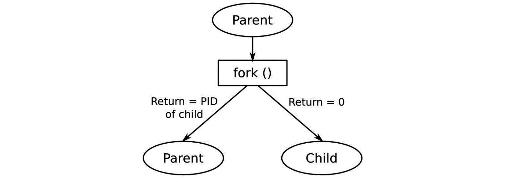
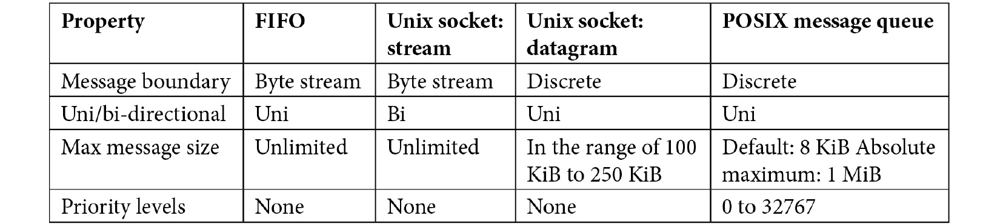
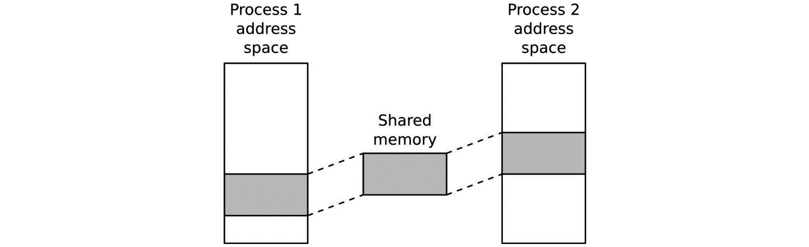

# *Chương 17*: Tìm hiểu về process và thread (Learning about Processes and Threads)

Trong các chương trước, chúng ta đã xem xét các khía cạnh khác nhau của việc tạo một nền tảng embedded Linux. Bây giờ, đã đến lúc bắt đầu xem bạn có thể dùng nền tảng đó để tạo một thiết bị hoạt động như thế nào. Trong chương này, tôi sẽ nói về các hệ quả của mô hình process của Linux và cách nó bao hàm các chương trình multithreaded. Tôi sẽ xem xét ưu và nhược điểm của việc dùng các process single-threaded và multithreaded, cũng như việc truyền message bất đồng bộ giữa các process và coroutine. Cuối cùng, tôi sẽ xem xét việc lập lịch và phân biệt giữa các chính sách lập lịch timeshare và real-time.

Dù các chủ đề này không đặc thù cho tính toán nhúng, điều quan trọng là người thiết kế bất kỳ thiết bị nhúng nào cũng cần có cái nhìn tổng quan về chúng. Có nhiều tài liệu tham khảo tốt về chủ đề này, một số tôi sẽ liệt kê ở cuối chương, nhưng nói chung, chúng không xét tới các use case nhúng. Vì vậy, tôi sẽ tập trung vào các khái niệm và quyết định thiết kế thay vì vào các lời gọi function và code.

Trong chương này, chúng ta sẽ đề cập các chủ đề sau:

- Process hay thread?
- Process
- Thread
- ZeroMQ
- Lập lịch

Hãy bắt đầu!

## Yêu cầu kỹ thuật

Để làm theo các ví dụ trong chương này, hãy bảo đảm phần mềm sau đã được cài trên hệ thống host Linux-based của bạn:

- Python: Python 3 interpreter và standard library
- Miniconda: Trình cài tối giản cho package manager và virtual environment manager `conda`

Xem mục về `conda` trong [*Chương 16*](ch16_packaging_python.vi.md), *Đóng gói Python*, để biết hướng dẫn cài Miniconda nếu bạn chưa cài. Trình biên dịch GCC C và GNU `make` cũng cần cho các bài tập của chương này, nhưng các công cụ này đã đi kèm hầu hết các bản phân phối Linux.

Toàn bộ code cho chương này có thể được tìm thấy trong thư mục `Chapter17` của repository GitHub của sách: [https://github.com/PacktPublishing/Mastering-Embedded-Linux-Programming-Third-Edition](https://github.com/PacktPublishing/Mastering-Embedded-Linux-Programming-Third-Edition).

## Process hay thread?

Nhiều lập trình viên nhúng quen với **real-time operating systems** (**RTOS**) cho rằng mô hình process của Unix cồng kềnh. Mặt khác, họ thấy sự tương đồng giữa một task RTOS và một thread Linux, và họ có xu hướng chuyển một thiết kế có sẵn bằng cách ánh xạ one-to-one các task RTOS sang thread. Tôi đã nhiều lần thấy các thiết kế trong đó toàn bộ application được hiện thực bằng một process chứa 40 thread trở lên. Tôi muốn dành chút thời gian xem xét liệu đây có phải là ý hay không. Hãy bắt đầu với một số định nghĩa.

Một **process** là một không gian địa chỉ bộ nhớ và một luồng thực thi, như được thể hiện trong sơ đồ sau. Không gian địa chỉ là riêng của process, nên các thread chạy trong các process khác không thể truy cập nó. **Memory separation** này được tạo ra bởi subsystem quản lý bộ nhớ trong kernel, subsystem này giữ một ánh xạ memory page cho mỗi process và lập trình lại memory management unit ở mỗi context switch. Tôi sẽ mô tả chi tiết cách điều này hoạt động trong [*Chương 18*](ch18_managing_memory.vi.md), *Quản lý bộ nhớ*. Một phần của không gian địa chỉ được ánh xạ tới một file chứa code và dữ liệu tĩnh mà chương trình đang chạy, như được thể hiện ở đây:


*Hình 17.1 – Process*

Khi chương trình chạy, nó sẽ cấp phát các tài nguyên như không gian stack, heap memory, tham chiếu tới file, v.v. Khi process kết thúc, các tài nguyên này được hệ thống thu hồi: toàn bộ bộ nhớ được giải phóng và tất cả các file descriptor được đóng.

Các process có thể giao tiếp với nhau bằng **inter-process communication** (**IPC**), chẳng hạn local socket. Tôi sẽ nói về IPC ở phần sau.

Một **thread** là một luồng thực thi bên trong một process. Mọi process đều bắt đầu với một thread chạy function `main()` và được gọi là main thread. Bạn có thể tạo thêm thread, chẳng hạn bằng function POSIX `pthread_create(3)`, dẫn tới nhiều thread thực thi trong cùng một không gian địa chỉ, như được thể hiện trong sơ đồ sau:


*Hình 17.2 – Nhiều thread*

Ở trong cùng một process, các thread chia sẻ tài nguyên với nhau. Chúng có thể đọc và ghi cùng vùng nhớ và dùng cùng các file descriptor. Giao tiếp giữa các thread rất dễ, miễn là bạn lo liệu các vấn đề đồng bộ và khóa.

Vậy, dựa trên các chi tiết ngắn gọn này, bạn có thể hình dung hai thiết kế cực đoan cho một hệ thống giả định với 40 task RTOS đang được port sang Linux.

Bạn có thể ánh xạ task sang process và có 40 chương trình riêng lẻ giao tiếp qua IPC, chẳng hạn với message được gửi qua socket. Bạn sẽ giảm đáng kể các vấn đề hỏng bộ nhớ vì main thread chạy trong mỗi process được bảo vệ khỏi các process khác, và bạn sẽ giảm rò rỉ tài nguyên vì mỗi process được dọn dẹp sau khi nó thoát. Tuy nhiên, giao diện message giữa các process khá phức tạp và, khi có sự hợp tác chặt chẽ giữa một nhóm process, số message có thể lớn và trở thành yếu tố giới hạn hiệu năng của hệ thống. Hơn nữa, bất kỳ process nào trong 40 process đó cũng có thể kết thúc, có lẽ vì một bug khiến nó crash, để 39 process còn lại tiếp tục. Mỗi process sẽ phải xử lý việc các process lân cận của nó không còn chạy và phục hồi một cách êm thấm.

Ở thái cực kia, bạn có thể ánh xạ task sang thread và hiện thực hệ thống như một process duy nhất chứa 40 thread. Sự hợp tác trở nên dễ hơn nhiều vì chúng dùng chung không gian địa chỉ và file descriptor. Overhead của việc gửi message được giảm hoặc loại bỏ, và context switch giữa các thread nhanh hơn giữa các process. Nhược điểm là bạn đã đưa vào khả năng một task làm hỏng heap hay stack của task khác. Nếu bất kỳ thread nào gặp một bug nghiêm trọng, toàn bộ process sẽ kết thúc, kéo theo tất cả các thread. Cuối cùng, debug một process multithreaded phức tạp có thể là một cơn ác mộng.

Kết luận bạn nên rút ra là không thiết kế nào lý tưởng và có một cách làm tốt hơn. Nhưng trước khi tới điểm đó, tôi sẽ đi sâu hơn một chút vào các API và hành vi của process và thread.

## Process

Một process nắm giữ môi trường mà trong đó các thread có thể chạy: nó nắm giữ các ánh xạ bộ nhớ, các file descriptor, user ID và group ID, và nhiều thứ khác. Process đầu tiên là process `init`, được kernel tạo trong lúc boot và có PID là một. Sau đó, các process được tạo bằng cách nhân bản trong một thao tác gọi là **forking**.

### Tạo một process mới

Function POSIX để tạo một process là `fork(2)`. Nó là một function kỳ lạ vì, với mỗi lời gọi thành công, có hai lần trả về: một trong process đã thực hiện lời gọi, gọi là **Parent**, và một trong process vừa được tạo, gọi là **Child**, như được thể hiện trong sơ đồ sau:



*Hình 17.3 – Forking*

Ngay sau lời gọi, child là bản sao chính xác của parent: nó có cùng stack, cùng heap, cùng các file descriptor, và nó thực thi cùng dòng code – dòng ngay sau `fork`. Cách duy nhất để lập trình viên phân biệt chúng là nhìn vào giá trị trả về của `fork`: nó bằng *không* với child và *lớn hơn không* với parent. Thực ra, giá trị trả về cho parent là PID của child process vừa được tạo. Có một khả năng thứ ba, đó là giá trị trả về âm, nghĩa là lời gọi `fork` thất bại và vẫn chỉ có một process.

Dù hai process hầu như giống hệt nhau, chúng ở trong các không gian địa chỉ riêng biệt. Các thay đổi được một process thực hiện trên một biến sẽ không được process kia thấy. Bên dưới, kernel không tạo một bản sao vật lý bộ nhớ của parent, việc vốn sẽ khá chậm và tiêu tốn bộ nhớ không cần thiết. Thay vào đó, bộ nhớ được dùng chung nhưng được đánh dấu bằng một flag **copy-on-write** (**CoW**). Nếu parent hoặc child sửa đổi vùng nhớ này, kernel tạo một bản sao rồi ghi vào bản sao đó. Điều này làm nó thành một function fork hiệu quả mà vẫn giữ được sự tách biệt logic của các không gian địa chỉ process. Tôi sẽ thảo luận về CoW trong [*Chương 18*](ch18_managing_memory.vi.md), *Quản lý bộ nhớ*.

Bây giờ, hãy học cách kết thúc một process.

### Kết thúc một process

Một process có thể bị dừng một cách tự nguyện bằng cách gọi function `exit(3)` hoặc, một cách không tự nguyện, bằng cách nhận một signal không được xử lý. Đặc biệt có một signal, `SIGKILL`, không thể được xử lý, nên nó sẽ luôn kill một process. Trong mọi trường hợp, kết thúc process sẽ dừng tất cả các thread, đóng tất cả các file descriptor và giải phóng toàn bộ bộ nhớ. Hệ thống gửi một signal, `SIGCHLD`, tới parent để nó biết điều này đã xảy ra.

Các process có một giá trị trả về gồm hoặc đối số truyền cho `exit`, nếu nó kết thúc bình thường, hoặc số signal nếu nó bị kill. Công dụng chính của điều này là trong shell script: nó cho phép bạn kiểm tra giá trị trả về từ một chương trình. Theo quy ước, `0` cho biết thành công và mọi giá trị khác cho biết một dạng thất bại nào đó.

Parent có thể thu giá trị trả về bằng các function `wait(2)` hoặc `waitpid(2)`. Điều này gây ra một vấn đề: sẽ có một khoảng trễ giữa lúc một child kết thúc và lúc parent của nó thu giá trị trả về. Trong khoảng thời gian đó, giá trị trả về phải được lưu ở đâu đó, và số PID của process giờ đã chết không thể được tái sử dụng. Một process ở trạng thái này được gọi là một **zombie**, được hiển thị là `state Z` trong các lệnh `ps` và `top`. Miễn là parent gọi `wait` hoặc `waitpid` mỗi khi nó được thông báo về việc một child kết thúc (bằng signal `SIGCHLD`; tham khảo *Linux System Programming*, của Robert Love và O'Reilly Media hoặc *The Linux Programming Interface*, của Michael Kerrisk, No Starch Press để biết chi tiết về xử lý signal), thì thông thường các zombie tồn tại trong thời gian quá ngắn để xuất hiện trong danh sách process. Chúng sẽ trở thành vấn đề nếu parent không thu giá trị trả về vì cuối cùng, sẽ không còn đủ tài nguyên để tạo thêm process nào.

Chương trình trong `MELP/Chapter17/fork-demo` minh họa việc tạo và kết thúc process:

```
#include <stdio.h>
#include <stdlib.h>
#include <unistd.h>
#include <sys/types.h>
#include <sys/wait.h>
int main(void)
{
      int pid;
      int status;
      pid = fork();
      if (pid == 0) {
          printf("I am the child, PID %d\n", getpid());
          sleep(10);
          exit(42);
      } else if (pid > 0) {
          printf("I am the parent, PID %d\n", getpid());
          wait(&status);
          printf("Child terminated, status %d\n", WEXITSTATUS(status));
      } else
          perror("fork:");
      return 0;
}
```

Function `wait` block cho đến khi một child process thoát và lưu exit status. Khi chạy nó, bạn sẽ thấy đại loại như thế này:

```
I am the parent, PID 13851
I am the child, PID 13852
Child terminated with status 42
```

Child process kế thừa hầu hết các thuộc tính của parent, bao gồm user ID và group ID, tất cả các file descriptor đang mở, việc xử lý signal và các đặc tính lập lịch.

### Chạy một chương trình khác

Function `fork` tạo một bản sao của một chương trình đang chạy, nhưng nó không chạy một chương trình khác. Để làm điều đó, bạn cần một trong các function `exec`:

```
int execl(const char *path, const char *arg, ...);
int execlp(const char *file, const char *arg, ...);
int execle(const char *path, const char *arg,
      ..., char * const envp[]);
int execv(const char *path, char *const argv[]);
int execvp(const char *file, char *const argv[]);
int execvpe(const char *file, char *const argv[],
      ..., char *const envp[]);
```

Mỗi function nhận một đường dẫn tới file chương trình cần nạp và chạy. Nếu function thành công, kernel loại bỏ tất cả tài nguyên của process hiện tại, bao gồm bộ nhớ và file descriptor, và cấp phát bộ nhớ cho chương trình mới đang được nạp. Khi thread đã gọi `exec*` trả về, nó không trả về dòng code sau lời gọi mà trả về function `main()` của chương trình mới. Có một ví dụ về command launcher trong `MELP/Chapter17/exec-demo`: nó nhắc nhập một lệnh, chẳng hạn `/bin/ls`, rồi fork và thực thi chuỗi bạn nhập. Đây là code:

```
#include <stdio.h>
#include <stdlib.h>
#include <string.h>
#include <unistd.h>
#include <sys/types.h>
#include <sys/wait.h>
int main(int argc, char *argv[])
{
      char command_str[128];
      int pid;
      int child_status;
      int wait_for = 1;
      while (1) {
          printf("sh> ");
          scanf("%s", command_str);
          pid = fork();
          if (pid == 0) {
                /* child */
                printf("cmd '%s'\n", command_str);
                execl(command_str, command_str, (char *)NULL);
                /* We should not return from execl, so only get
                  to this line if it failed */
                perror("exec");
                exit(1);
          }
          if (wait_for) {
                waitpid(pid, &child_status, 0);
                printf("Done, status %d\n", child_status);
          }
      }
      return 0;
}
```

Đây là những gì bạn sẽ thấy khi chạy nó:

```
# ./exec-demo
sh> /bin/ls
cmd '/bin/ls'
bin etc lost+found proc sys var
boot home media run tmp
dev lib mnt sbin usr
Done, status 0
sh>
```

Bạn có thể kết thúc chương trình bằng cách gõ *Ctrl + C*.

Có vẻ kỳ lạ khi có một function nhân bản một process có sẵn và một function khác loại bỏ tài nguyên của nó và nạp một chương trình khác vào bộ nhớ, đặc biệt khi việc một lần fork được theo sau gần như ngay lập tức bởi một trong các function `exec` là phổ biến. Hầu hết các hệ điều hành gộp hai hành động này vào một lời gọi duy nhất.

Tuy nhiên, cách này có những ưu điểm rõ rệt. Chẳng hạn, nó giúp rất dễ hiện thực chuyển hướng và pipe trong shell. Hãy tưởng tượng bạn muốn lấy danh sách thư mục. Đây là chuỗi sự kiện:

1. Bạn gõ `ls` tại dấu nhắc shell.
2. Shell fork một bản sao của chính nó.
3. Child exec `/bin/ls`.
4. Chương trình `ls` in danh sách thư mục ra `stdout` (file descriptor `1`), vốn được gắn với terminal. Bạn sẽ thấy danh sách thư mục.
5. Chương trình `ls` kết thúc, và shell lấy lại quyền điều khiển.

Bây giờ, hãy tưởng tượng bạn muốn danh sách thư mục được ghi vào một file bằng cách chuyển hướng output dùng ký tự *>*. Bây giờ, chuỗi sự kiện như sau:

1. Bạn gõ `ls > listing.txt`.

2. Shell fork một bản sao của chính nó.

3. Child mở và truncate file `listing.txt` và dùng `dup2(2)` để sao chép file descriptor của file đè lên file descriptor `1` (`stdout`).

4. Child exec `/bin/ls`.

5. Chương trình in danh sách như trước, nhưng lần này, nó đang ghi vào `listing.txt`.

6. Chương trình `ls` kết thúc, và shell lấy lại quyền điều khiển.

   > **Lưu ý quan trọng**
   >
   > Có một cơ hội ở *bước 3* để sửa đổi môi trường của child process trước khi thực thi chương trình. Chương trình `ls` không cần biết rằng nó đang ghi vào một file thay vì một terminal. Thay vì một file, `stdout` có thể được nối tới một pipe để chương trình `ls`, vẫn không thay đổi, có thể gửi output tới một chương trình khác. Đây là một phần của triết lý Unix kết hợp nhiều component nhỏ, mỗi component làm tốt một việc, như được mô tả trong *The Art of Unix Programming*, của Eric Steven Raymond và Addison Wesley, đặc biệt trong mục *Pipes, Redirection, and Filters*.

Cho đến giờ, các chương trình chúng ta đã xem trong mục này đều chạy ở foreground. Nhưng còn các chương trình chạy ở background, chờ các sự việc xảy ra thì sao? Hãy cùng xem.

### Daemon

Chúng ta đã gặp daemon ở vài nơi rồi. Một **daemon** là một process chạy ở background, thuộc quyền sở hữu của process `init`, và không được kết nối với một controlling terminal. Các bước để tạo một daemon như sau:

1. Gọi `fork` để tạo một process mới, sau đó parent nên thoát, nhờ đó tạo ra một process mồ côi sẽ được re-parented cho `init`.
2. Child process gọi `setsid(2)`, tạo một session và process group mới mà nó là thành viên duy nhất. Các chi tiết chính xác không quan trọng ở đây; bạn có thể đơn giản coi đây là một cách cô lập process khỏi mọi controlling terminal.
3. Đổi thư mục làm việc thành thư mục `root`.
4. Đóng tất cả các file descriptor và chuyển hướng `stdin`, `stdout` và `stderr` (các descriptor `0`, `1` và `2`) sang `/dev/null` để không có input, và mọi output bị ẩn.

May mắn là tất cả các bước trên có thể được thực hiện bằng một lời gọi function duy nhất; tức là `daemon(3)`.

### Inter-process communication

Mỗi process là một hòn đảo bộ nhớ. Bạn có thể truyền thông tin từ process này sang process khác theo hai cách. Thứ nhất, bạn có thể sao chép nó từ không gian địa chỉ này sang không gian địa chỉ kia. Thứ hai, bạn có thể tạo một vùng nhớ mà cả hai đều truy cập được và chia sẻ dữ liệu trong đó.

Cách thứ nhất thường được kết hợp với một queue hay buffer để có một chuỗi message truyền giữa các process. Điều này ngụ ý sao chép message hai lần: đầu tiên vào một vùng chứa tạm rồi tới đích. Một số ví dụ của cách này là socket, pipe và message queue.

Cách thứ hai không chỉ đòi hỏi một phương pháp tạo vùng nhớ được ánh xạ vào hai (hoặc nhiều hơn) không gian địa chỉ cùng lúc, mà còn cần một phương tiện để đồng bộ truy cập vào vùng nhớ đó, chẳng hạn bằng semaphore hoặc mutex.

POSIX có các function cho tất cả những thứ này. Có một tập API cũ hơn gọi là **System V IPC**, cung cấp message queue, shared memory và semaphore, nhưng nó không linh hoạt bằng các phiên bản tương đương của POSIX, nên tôi sẽ không mô tả chúng ở đây. Manual page `svipc(7)` cho một cái nhìn tổng quan về các cơ chế này, và có thêm chi tiết trong *The Linux Programming Interface*, của Michael Kerrisk, và *Unix Network Programming*, *Volume 2*, của W. Richard Stevens.

Các giao thức Message-based thường dễ lập trình và debug hơn shared memory, nhưng chậm nếu message lớn hoặc có nhiều message.

#### IPC Message-based

Có vài lựa chọn cho IPC message-based, tất cả sẽ được tôi tóm tắt như sau. Các thuộc tính phân biệt chúng với nhau như sau:

- Luồng message là một chiều (uni-) hay hai chiều (bi-directional).
- Luồng dữ liệu là một byte stream không có ranh giới message hay các message rời rạc với ranh giới được giữ nguyên. Trong trường hợp sau, kích thước tối đa của một message là quan trọng.
- Message có được gắn mức ưu tiên hay không.

Bảng sau tóm tắt các thuộc tính này cho FIFO, socket và message queue:



Dạng IPC message-based đầu tiên chúng ta sẽ xem là Unix socket.

##### Unix socket (hay local socket)

**Unix socket** đáp ứng hầu hết các yêu cầu và, cùng với sự quen thuộc của sockets API, cho đến nay là cơ chế phổ biến nhất.

Unix socket được tạo với address family `AF_UNIX` và được bind tới một pathname. Quyền truy cập socket được xác định bởi quyền truy cập của file socket. Giống internet socket, loại socket có thể là `SOCK_STREAM` hoặc `SOCK_DGRAM`, loại trước cho một byte stream hai chiều và loại sau cung cấp các message rời rạc với ranh giới được giữ nguyên. Datagram của Unix socket đáng tin cậy, nghĩa là chúng sẽ không bị rơi hay bị sắp xếp lại thứ tự. Kích thước tối đa của một datagram là system-dependent và có thể lấy qua `/proc/sys/net/core/wmem_max`. Nó thường là 100 KiB trở lên.

Unix socket không có cơ chế cho biết mức ưu tiên của một message.

##### FIFO và named pipe

**FIFO** và **named pipe** chỉ là các thuật ngữ khác nhau cho cùng một thứ. Chúng là một mở rộng của anonymous pipe được dùng để giao tiếp giữa parent process và child process khi hiện thực pipe trong shell.

FIFO là một loại file đặc biệt, được tạo bởi lệnh `mkfifo(1)`. Giống Unix socket, quyền truy cập file xác định ai có thể đọc và ghi. Chúng là một chiều, nghĩa là có một bên đọc và thường một bên ghi, dù có thể có vài bên ghi. Dữ liệu là một byte stream thuần túy nhưng bảo đảm tính atomic của các message nhỏ hơn buffer gắn với pipe. Nói cách khác, các lần ghi nhỏ hơn kích thước này sẽ không bị tách thành vài lần ghi nhỏ hơn, nên bạn sẽ đọc toàn bộ message trong một lần miễn là kích thước buffer phía bạn đủ lớn. Kích thước mặc định của buffer FIFO là 64 KiB trên các kernel hiện đại và có thể được tăng bằng `fcntl(2)` với `F_SETPIPE_SZ`, tới giá trị trong `/proc/sys/fs/pipe-max-size`, thường là 1 MiB. Không có khái niệm mức ưu tiên.

##### POSIX message queue

Message queue được nhận diện bằng một tên, tên này phải bắt đầu bằng một dấu gạch chéo xuôi, `/`, và chỉ chứa một ký tự `/`: message queue thực ra được giữ trong một pseudo filesystem kiểu `mqueue`. Bạn tạo một queue và lấy tham chiếu tới một queue có sẵn qua `mq_open(3)`, trả về một file descriptor. Mỗi message có một mức ưu tiên, và các message được đọc từ queue dựa trên mức ưu tiên rồi tới thứ tự tuổi. Message có thể dài tới `/proc/sys/kernel/msgmax` byte.

Giá trị mặc định là 8 KiB, nhưng bạn có thể đặt nó thành bất kỳ kích thước nào trong khoảng 128 byte tới 1 MiB bằng cách ghi giá trị vào `/proc/sys/kernel/msgmax`. Vì tham chiếu là một file descriptor, bạn có thể dùng `select(2)`, `poll(2)` và các function tương tự khác để chờ hoạt động trong queue.

Tham khảo man page Linux `mq_overview(7)` để biết thêm chi tiết.

#### Tóm tắt về IPC message-based

Unix socket được dùng thường xuyên nhất vì chúng cung cấp mọi thứ cần thiết, có lẽ trừ mức ưu tiên message. Chúng được hiện thực trên hầu hết các hệ điều hành, nên chúng mang lại tính khả chuyển tối đa.

FIFO ít được dùng hơn, chủ yếu vì chúng thiếu một thứ tương đương với **datagram**. Mặt khác, API rất đơn giản, vì nó cung cấp các lời gọi file thông thường `open(2)`, `close(2)`, `read(2)` và `write(2)`.

Message queue là ít được dùng nhất trong nhóm này. Các nhánh code trong kernel không được tối ưu theo cách các lời gọi socket (mạng) và FIFO (filesystem) được tối ưu.

Cũng có các trừu tượng higher-level như D-Bus, đang chuyển từ Linux chính thống sang thiết bị nhúng. D-Bus dùng Unix socket và shared memory bên dưới.

#### IPC Shared memory-based

Chia sẻ bộ nhớ loại bỏ nhu cầu sao chép dữ liệu giữa các không gian địa chỉ nhưng đưa vào vấn đề đồng bộ các truy cập tới nó. Đồng bộ giữa các process thường được thực hiện bằng semaphore.

##### POSIX shared memory

Để chia sẻ bộ nhớ giữa các process, bạn phải tạo một vùng nhớ mới rồi ánh xạ nó vào không gian địa chỉ của mỗi process muốn truy cập nó, như được thể hiện trong sơ đồ sau:



*Hình 17.4 – POSIX shared memory*

Việc đặt tên các segment POSIX shared memory theo khuôn mẫu chúng ta đã gặp với message queue. Các segment được nhận diện bằng tên bắt đầu bằng một ký tự `/` và có đúng một ký tự như vậy:

```
#define SHM_SEGMENT_NAME "/demo-shm"
```

Function `shm_open(3)` nhận tên và trả về một file descriptor cho nó. Nếu nó chưa tồn tại và flag `O_CREAT` được đặt, thì một segment mới được tạo. Ban đầu, nó có kích thước bằng không. Bạn có thể dùng function `ftruncate(2)` (có tên gây hiểu lầm) để mở rộng nó tới kích thước mong muốn:

```
int shm_fd;
struct shared_data *shm_p;
/* Attempt to create the shared memory segment */
shm_fd = shm_open(SHM_SEGMENT_NAME, O_CREAT | O_EXCL | O_RDWR, 0666);
if (shm_fd > 0) {
    /* succeeded: expand it to the desired size (Note: dont't
   do this every time because ftruncate fills it with zeros) */
    printf("Creating shared memory and setting size=%d\n",
            SHM_SEGMENT_SIZE);
    if (ftruncate(shm_fd, SHM_SEGMENT_SIZE) < 0) {
        perror("ftruncate");
        exit(1);
    }
    […]
} else if (shm_fd == -1 && errno == EEXIST) {
    /* Already exists: open again without O_CREAT */
    shm_fd = shm_open(SHM_SEGMENT_NAME, O_RDWR, 0);
    […]
}
```

Khi đã có một descriptor cho shared memory, bạn ánh xạ nó vào không gian địa chỉ của process bằng `mmap(2)` để các thread trong các process khác nhau có thể truy cập bộ nhớ:

```
/* Map the shared memory */
shm_p = mmap(NULL, SHM_SEGMENT_SIZE, PROT_READ | PROT_WRITE,
            MAP_SHARED, shm_fd, 0);
```

Chương trình trong `MELP/Chapter17/shared-mem-demo` cung cấp một ví dụ về việc dùng một segment shared memory để giao tiếp giữa các process. Đây là function `main`:

```
static sem_t *demo_sem;
[…]
int main(int argc, char *argv[])
{
      char *shm_p;
      printf("%s PID=%d\n", argv[0], getpid());
      shm_p = get_shared_memory();
      while (1) {
          printf("Press enter to see the current contents of shm\n");
          getchar();
          sem_wait(demo_sem);
          printf("%s\n", shm_p);
          /* Write our signature to the shared memory */
          sprintf(shm_p, "Hello from process %d\n", getpid());
          sem_post(demo_sem);
      }
      return 0;
}
```

Chương trình dùng một segment shared memory để truyền một message từ process này sang process khác. Message là `Hello from process string`, theo sau là PID của nó. Function `get_shared_memory` chịu trách nhiệm tạo segment bộ nhớ, nếu nó chưa tồn tại, hoặc lấy file descriptor cho nó nếu đã có. Nó trả về một con trỏ tới segment bộ nhớ. Hãy để ý rằng có một semaphore để đồng bộ truy cập vào bộ nhớ để một process không ghi đè message từ process khác.

Để thử, bạn cần hai instance của chương trình chạy trong các phiên terminal riêng. Trong terminal thứ nhất, bạn sẽ thấy đại loại như thế này:

```
# ./shared-mem-demo
./shared-mem-demo PID=271
Creating shared memory and setting size=65536
Press enter to see the current contents of shm
Press enter to see the current contents of shm
Hello from process 271
```

Vì đây là lần đầu tiên chương trình được chạy, nó tạo segment bộ nhớ. Ban đầu, vùng message rỗng, nhưng sau một lượt qua vòng lặp, nó chứa PID của process này, là `271`. Bây giờ, bạn có thể chạy instance thứ hai trong một terminal khác:

```
# ./shared-mem-demo
./shared-mem-demo PID=279
Press enter to see the current contents of shm
Hello from process 271
Press enter to see the current contents of shm
Hello from process 279
```

Nó không tạo segment shared memory vì segment đã tồn tại, và nó hiển thị message mà segment đã chứa, là PID của chương trình kia. Nhấn *Enter* khiến nó ghi PID của chính nó, mà chương trình thứ nhất có thể thấy. Bằng cách này, hai chương trình có thể giao tiếp với nhau.

Các function POSIX IPC là một phần của các mở rộng real-time của POSIX, nên bạn cần link chúng với `librt`. Kỳ lạ là các POSIX semaphore được hiện thực trong thư viện POSIX threads, nên bạn cũng cần link với thư viện pthreads. Do đó, các đối số biên dịch như sau khi bạn nhắm tới các SoC Arm Cortex-A8:

```
$ arm-cortex_a8-linux-gnueabihf-gcc shared-mem-demo.c -lrt -pthread \
-o arm-cortex_a8-linux-gnueabihf-gcc
```

Như vậy là kết thúc cuộc khảo sát các phương pháp IPC. Chúng ta sẽ quay lại IPC message-based khi đề cập ZeroMQ. Bây giờ, đã đến lúc xem các process multithreaded.

## Thread

Giao diện lập trình cho thread là POSIX threads API, được định nghĩa lần đầu trong chuẩn IEEE POSIX 1003.1c (1995) và thường được gọi là **pthreads**. Nó được hiện thực như một phần bổ sung của thư viện C `libpthread.so`. Đã có hai hiện thực pthreads trong khoảng 15 năm qua: **LinuxThreads** và **Native POSIX Thread Library** (**NPTL**). Hiện thực sau tuân thủ specification tốt hơn nhiều, đặc biệt về việc xử lý signal và process ID. Giờ nó khá thống trị, nhưng bạn có thể gặp một số phiên bản `uClibc` cũ hơn dùng LinuxThreads.

### Tạo một thread mới

Function bạn có thể dùng để tạo một thread là `pthread_create(3)`:

```
int pthread_create(pthread_t *thread, const pthread_attr_t *attr,
      void *(*start_routine) (void *), void *arg);
```

Nó tạo một luồng thực thi mới bắt đầu trong function `start_routine` và đặt một descriptor vào `pthread_t`, được trỏ tới bởi `thread`. Nó kế thừa các tham số lập lịch của thread gọi, nhưng có thể override chúng bằng cách truyền một con trỏ tới các thuộc tính thread trong `attr`. Thread sẽ bắt đầu thực thi ngay lập tức.

`pthread_t` là cách chính để tham chiếu thread bên trong chương trình, nhưng thread cũng có thể được thấy từ bên ngoài bằng một lệnh như `ps -eLf`:

```
UID PID PPID LWP C NLWP STIME TTY TIME CMD
...
chris 6072 5648 6072 0 3 21:18 pts/0 00:00:00 ./thread-demo
chris 6072 5648 6073 0 3 21:18 pts/0 00:00:00 ./thread-demo
```

Trong output trên, chương trình `thread-demo` có hai thread. Các cột `PID` và `PPID` cho thấy chúng đều thuộc cùng một process và có cùng parent, như bạn mong đợi. Tuy nhiên, cột được đánh dấu `LWP` thì thú vị. **LWP** là viết tắt của **Light Weight Process**, mà trong bối cảnh này, là một tên khác của thread. Các số trong cột đó cũng được gọi là **Thread ID** hay **TID**. Trong main thread, TID giống PID, nhưng với các thread khác, nó là một giá trị khác (cao hơn). Bạn có thể dùng một TID ở những chỗ tài liệu nói bạn phải đưa một PID, nhưng hãy lưu ý rằng hành vi này đặc thù cho Linux và không khả chuyển. Đây là một chương trình đơn giản minh họa vòng đời của một thread (code nằm trong `MELP/Chapter17/thread-demo`):

```
#include <stdio.h>
#include <unistd.h>
#include <pthread.h>
#include <sys/syscall.h>
static void *thread_fn(void *arg)
{
      printf("New thread started, PID %d TID %d\n",
          getpid(), (pid_t)syscall(SYS_gettid));
      sleep(10);
      printf("New thread terminating\n");
      return NULL;
}
int main(int argc, char *argv[])
{
      pthread_t t;
      printf("Main thread, PID %d TID %d\n",
          getpid(), (pid_t)syscall(SYS_gettid));
      pthread_create(&t, NULL, thread_fn, NULL);
      pthread_join(t, NULL);
      return 0;
}
```

Lưu ý rằng, trong function `thread_fn`, tôi đang lấy TID bằng `syscall(SYS_gettid)`. Trước `glibc` 2.30, bạn phải gọi Linux trực tiếp qua một `syscall` vì không có wrapper trong thư viện C cho `gettid()`.

Có giới hạn về tổng số thread mà một kernel cho trước có thể lập lịch. Giới hạn này tăng theo kích thước hệ thống, từ khoảng 1,000 trên các thiết bị nhỏ tới hàng chục nghìn trên các thiết bị nhúng lớn hơn. Con số thực tế có trong `/proc/sys/kernel/threads-max`. Một khi bạn chạm tới giới hạn này, fork và `pthread_create` sẽ thất bại.

### Kết thúc một thread

Một thread kết thúc khi xảy ra bất kỳ điều nào sau đây:

- Nó tới cuối `start_routine` của nó.
- Nó gọi `pthread_exit(3)`.
- Nó bị hủy bởi một thread khác gọi `pthread_cancel(3)`.
- Process chứa thread kết thúc, chẳng hạn vì một thread gọi `exit(3)`, hoặc process nhận một signal không được xử lý, mask hay bỏ qua.

Lưu ý rằng nếu một chương trình multithreaded gọi `fork`, chỉ thread đã thực hiện lời gọi sẽ tồn tại trong child process mới. Fork không nhân bản tất cả các thread.

Một thread có một giá trị trả về, là một con trỏ void. Một thread có thể chờ thread khác kết thúc và thu giá trị trả về của nó bằng cách gọi `pthread_join(2)`. Có một ví dụ về điều này trong code của `thread-demo`, như chúng ta đã đề cập ở mục trước. Điều này gây ra một vấn đề rất giống với vấn đề zombie giữa các process: tài nguyên của thread, chẳng hạn stack, không thể được giải phóng cho đến khi một thread khác đã join với nó. Nếu các thread vẫn *unjoined*, có rò rỉ tài nguyên trong chương trình.

### Biên dịch một chương trình có thread

Hỗ trợ POSIX threads là một phần của thư viện C trong thư viện `libpthread.so`. Tuy nhiên, build chương trình có thread không chỉ là link thư viện: phải có những thay đổi trong cách trình biên dịch tạo code để bảo đảm một số biến toàn cục, chẳng hạn `errno`, có một instance cho mỗi thread thay vì một cho toàn bộ process.

> **Mẹo**
>
> Khi build một chương trình có thread, bạn phải thêm switch `-pthread` vào các giai đoạn biên dịch và link. Tuy nhiên, bạn không phải dùng thêm `-lpthread` cho giai đoạn link, như bạn có thể nghĩ, nếu bạn dùng `-pthread`.

### Giao tiếp Inter-thread

Ưu điểm lớn của thread là chúng chia sẻ không gian địa chỉ và có thể chia sẻ các biến bộ nhớ. Đây cũng là một nhược điểm lớn vì nó đòi hỏi đồng bộ để giữ tính nhất quán dữ liệu theo cách tương tự các segment bộ nhớ dùng chung giữa các process nhưng với điều kiện là, với thread, toàn bộ bộ nhớ đều được chia sẻ. Thực ra, thread có thể tạo bộ nhớ riêng bằng **thread local storage** (**TLS**), nhưng tôi sẽ không đề cập điều đó ở đây.

Giao diện `pthreads` cung cấp những thứ cơ bản cần thiết để đạt được đồng bộ: mutex và condition variable. Nếu muốn các cấu trúc phức tạp hơn, bạn sẽ phải tự xây dựng chúng.

Đáng chú ý là tất cả các phương pháp IPC chúng ta đã mô tả trước đó – tức là socket, pipe và message queue – đều hoạt động tốt như nhau giữa các thread trong cùng một process.

### Mutual exclusion

Để viết các chương trình bền vững, bạn cần bảo vệ mỗi tài nguyên dùng chung bằng một mutex lock, và bảo đảm mọi nhánh code đọc hay ghi tài nguyên đều đã khóa mutex trước. Nếu bạn áp dụng quy tắc này nhất quán, hầu hết các vấn đề sẽ được giải quyết. Những vấn đề còn lại gắn với hành vi cơ bản của mutex. Tôi sẽ liệt kê ngắn gọn ở đây nhưng sẽ không đi vào quá nhiều chi tiết:

- **Deadlock**: Điều này xảy ra khi các mutex bị khóa vĩnh viễn. Một tình huống kinh điển là **deadly embrace**, trong đó hai thread mỗi thread cần hai mutex và đã khóa được một nhưng không khóa được cái kia. Mỗi thread block, chờ lock mà thread kia đang giữ, và vì vậy chúng cứ giữ nguyên như vậy. Một quy tắc đơn giản để tránh vấn đề deadly embrace là bảo đảm các mutex luôn được khóa theo cùng một thứ tự. Các giải pháp khác liên quan tới timeout và các khoảng back-off.
- **Priority inversion**: Các độ trễ gây ra bởi việc chờ một mutex có thể khiến một thread real-time lỡ deadline. Trường hợp cụ thể của priority inversion xảy ra khi một thread ưu tiên cao bị block, chờ một mutex bị khóa bởi một thread ưu tiên thấp. Nếu thread ưu tiên thấp bị preempt bởi các thread khác có mức ưu tiên trung gian, thread ưu tiên cao bị buộc phải chờ trong một khoảng thời gian không giới hạn. Có các giao thức mutex gọi là **priority inheritance** và **priority ceiling** giải quyết vấn đề với cái giá là overhead xử lý lớn hơn trong kernel cho mỗi lời gọi lock và unlock.
- **Poor performance**: Mutex đưa vào overhead tối thiểu cho code, miễn là các thread hầu hết thời gian không phải block trên chúng. Tuy nhiên, nếu thiết kế của bạn có một tài nguyên được rất nhiều thread cần, tỷ lệ tranh chấp trở nên đáng kể. Đây thường là một vấn đề thiết kế có thể được giải quyết bằng locking mịn hơn hoặc một thuật toán khác.

Mutex không phải cách duy nhất để đồng bộ giữa các thread. Chúng ta đã chứng kiến hai process có thể dùng một semaphore để thông báo cho nhau như thế nào hồi đề cập POSIX shared memory. Thread có một construct tương tự.

### Thay đổi điều kiện

Các thread hợp tác cần có khả năng báo cho nhau rằng có gì đó đã thay đổi và cần chú ý. Điều này được gọi là một **condition**, và thông báo được gửi qua một **condition variable**, hay **condvar**.

Một condition chỉ là thứ gì đó bạn có thể kiểm tra để có kết quả `true` hoặc `false`. Một ví dụ đơn giản là một buffer chứa hoặc không phần tử nào hoặc một số phần tử. Một thread lấy phần tử từ buffer và ngủ khi nó rỗng. Một thread khác đặt phần tử vào buffer và báo cho thread kia rằng nó đã làm vậy vì condition mà thread kia đang chờ đã thay đổi. Nếu thread kia đang ngủ, nó cần thức dậy và làm gì đó. Sự phức tạp duy nhất là condition, theo định nghĩa, là một tài nguyên dùng chung, nên nó phải được bảo vệ bằng một mutex.

Đây là một chương trình đơn giản với hai thread. Thread thứ nhất là producer: nó thức dậy mỗi giây và đặt một ít dữ liệu vào một biến toàn cục trước khi báo hiệu rằng đã có thay đổi. Thread thứ hai là consumer: nó chờ trên condition variable và kiểm tra condition (rằng có một chuỗi có độ dài khác không trong buffer) mỗi khi thức dậy. Bạn có thể tìm code trong `MELP/Chapter17/condvar-demo`:

```
#include <stdio.h>
#include <stdlib.h>
#include <pthread.h>
#include <unistd.h>
#include <string.h>
char g_data[128];
pthread_cond_t cv = PTHREAD_COND_INITIALIZER;
pthread_mutex_t mutx = PTHREAD_MUTEX_INITIALIZER;
void *consumer(void *arg)
{
      while (1) {
          pthread_mutex_lock(&mutx);
          while (strlen(g_data) == 0)
               pthread_cond_wait(&cv, &mutx);
          /* Got data */
          printf("%s\n", g_data);
          /* Truncate to null string again */
          g_data[0] = 0;
          pthread_mutex_unlock(&mutx);
      }
      return NULL;
}
void *producer(void *arg)
{
      int i = 0;
      while (1) {
          sleep(1);
          pthread_mutex_lock(&mutx);
          sprintf(g_data, "Data item %d", i);
          pthread_mutex_unlock(&mutx);
          pthread_cond_signal(&cv);
          i++;
      }
      return NULL;
}
```

Lưu ý rằng khi consumer thread block trên condvar, nó làm vậy trong khi đang giữ một mutex bị khóa, điều có vẻ như là công thức cho deadlock lần tới khi producer thread cố cập nhật condition. Để tránh điều này, `pthread_cond_wait(3)` mở khóa mutex sau khi thread bị block, rồi khóa lại trước khi đánh thức nó và trả về từ lần chờ.

### Phân chia vấn đề

Giờ chúng ta đã đề cập những điều cơ bản về process và thread và các cách chúng giao tiếp, đã đến lúc xem chúng ta có thể làm gì với chúng.

Đây là một số quy tắc tôi dùng khi xây dựng hệ thống:

- **Quy tắc 1**: Giữ các task có nhiều tương tác ở cùng nhau: Điều quan trọng là giảm thiểu overhead bằng cách giữ các thread inter-operating chặt chẽ cùng nhau trong một process.
- **Quy tắc 2**: Đừng bỏ tất cả thread vào một giỏ: Mặt khác, hãy cố giữ các component có tương tác hạn chế trong các process riêng biệt, vì lợi ích của khả năng phục hồi và tính mô-đun.
- **Quy tắc 3**: Đừng trộn thread then chốt và không then chốt trong cùng một process: Đây là một phần khuếch đại của *Quy tắc 2*: phần then chốt của hệ thống, có thể là một chương trình điều khiển máy, nên được giữ đơn giản nhất có thể và được viết theo cách chặt chẽ hơn các phần khác. Nó phải có khả năng tiếp tục, ngay cả khi các process khác thất bại. Nếu bạn có các thread real-time, theo định nghĩa, chúng phải là then chốt và nên được đặt trong một process riêng.
- **Quy tắc 4**: Các thread không nên quá thân mật: Một trong những cám dỗ khi viết một chương trình multithreaded là trộn lẫn code và biến giữa các thread vì đó là một chương trình all-in-one và dễ làm. Hãy giữ các thread mô-đun, với các tương tác well-defined.
- **Quy tắc 5**: Đừng nghĩ thread là miễn phí: Rất dễ tạo thêm thread, nhưng có cái giá phải trả, không chỉ về mặt đồng bộ bổ sung cần thiết để phối hợp hoạt động của chúng.
- **Quy tắc 6**: Các thread có thể làm việc song song: Các thread có thể chạy đồng thời trên một processor multicore, cho thông lượng cao hơn. Nếu bạn có một công việc tính toán lớn, bạn có thể tạo một thread cho mỗi lõi và tận dụng tối đa phần cứng. Có các thư viện giúp bạn làm điều này, chẳng hạn OpenMP. Có lẽ bạn không nên tự viết các thuật toán lập trình song song từ đầu.

Thiết kế của Android là một minh họa tốt. Mỗi application là một Linux process riêng biệt, giúp mô-đun hóa việc quản lý bộ nhớ và bảo đảm một app crash không ảnh hưởng tới toàn bộ hệ thống. Mô hình process cũng được dùng cho kiểm soát truy cập: một process chỉ có thể truy cập các file và tài nguyên mà UID và các GID của nó cho phép. Có một nhóm thread trong mỗi process. Có một thread để quản lý và cập nhật giao diện người dùng, một thread để xử lý signal từ hệ điều hành, vài thread để quản lý cấp phát bộ nhớ động và giải phóng các object Java, và một worker pool gồm ít nhất hai thread để nhận message từ các phần khác của hệ thống bằng giao thức Binder.

Tóm lại, process mang lại khả năng phục hồi vì mỗi process có một không gian bộ nhớ được bảo vệ, và khi process kết thúc, tất cả tài nguyên, bao gồm bộ nhớ và file descriptor, được giải phóng, giảm rò rỉ tài nguyên. Mặt khác, thread chia sẻ tài nguyên và có thể giao tiếp dễ dàng qua các biến dùng chung và có thể hợp tác bằng cách chia sẻ truy cập tới file và các tài nguyên khác. Thread mang lại tính song song qua worker pool và các trừu tượng khác, điều hữu ích trên các processor multicore.

## ZeroMQ

Socket, named pipe và shared memory là các phương tiện qua đó inter-process communication diễn ra. Chúng đóng vai trò các transport layer cho quá trình truyền message tạo nên hầu hết các application non-trivial. Các concurrency primitive như mutex và condition variable được dùng để quản lý truy cập dùng chung và phối hợp công việc giữa các thread chạy trong cùng một process. Lập trình multithreaded nổi tiếng là khó, và socket và named pipe có những cạm bẫy riêng. Cần một API higher-level để trừu tượng hóa các chi tiết phức tạp của việc truyền message bất đồng bộ. ZeroMQ xuất hiện.

**ZeroMQ** là một thư viện messaging bất đồng bộ hoạt động như một concurrency framework. Nó có các cơ chế cho transport in-process, inter-process, TCP và multicast, cũng như binding cho nhiều ngôn ngữ lập trình, bao gồm C, C++, Go và Python. Các binding đó, cùng với các trừu tượng socket-based của ZeroMQ, cho phép các nhóm dễ dàng trộn các ngôn ngữ lập trình trong cùng một application phân tán. Hỗ trợ cho các messaging pattern phổ biến như request/reply, publish/subscribe và parallel pipeline cũng được tích hợp sẵn trong thư viện. Chữ *zero* trong ZeroMQ là viết tắt của *zero cost*, còn phần *MQ* là viết tắt của *message queue*.

Chúng ta sẽ khám phá cả giao tiếp message-based inter-process lẫn in-process bằng ZeroMQ. Hãy bắt đầu bằng việc cài ZeroMQ cho Python.

### Lấy pyzmq

Chúng ta sẽ dùng binding Python chính thức của ZeroMQ cho các bài tập sau. Tôi khuyên cài package `pyzmq` này bên trong một virtual environment mới. Tạo một Python virtual environment rất dễ nếu bạn đã có `conda` trên hệ thống. Đây là các bước để chuẩn bị virtual environment cần thiết bằng `conda`:

1. Điều hướng tới thư mục `zeromq` chứa các ví dụ:

   ```
   (base) $ cd MELP/Chapter17/zeromq
   ```

2. Tạo một virtual environment mới tên `zeromq`:

   ```
   (base) $ conda create –-name zeromq python=3.9 pyzmq
   ```

3. Kích hoạt virtual environment mới:

   ```
   (base) $ source activate zeromq
   ```

4. Kiểm tra phiên bản Python là 3.9:

   ```
   (zeromq) $ python –-version
   ```

5. Liệt kê các package đã được cài trong môi trường của bạn:

   ```
   (zeromq) $ conda list
   ```

Nếu bạn thấy `pyzmq` và các phụ thuộc của nó trong danh sách package, thì giờ bạn đã sẵn sàng chạy các bài tập sau.

### Messaging giữa các process

Chúng ta sẽ bắt đầu khám phá ZeroMQ với một echo server đơn giản. Server mong đợi một tên dưới dạng chuỗi từ client và trả lời bằng `Hello <name>`. Code nằm trong `MELP/Chapter17/zeromq/server.py`:

```
import time
import zmq
context = zmq.Context()
socket = context.socket(zmq.REP)
socket.bind("tcp://*:5555")
while True:
    # Wait for next request from client
    message = socket.recv()
    print(f"Received request: {message}")
    # Do some 'work'
    time.sleep(1)
    # Send reply back to client
    socket.send(b"Hello {message}")
```

Process server tạo một socket kiểu `REP` cho phản hồi của nó, bind socket đó vào port `5555`, và chờ message. Một lần sleep 1-second được dùng để giả lập một ít công việc được làm in-between thời điểm nhận được request và thời điểm gửi lại reply.

Code cho echo client nằm trong `MELP/Chapter17/zeromq/client.py`:

```
import zmq
def main(who):
    context = zmq.Context()
    #  Socket to talk to server
    print("Connecting to hello echo server…")
    socket = context.socket(zmq.REQ)
    socket.connect("tcp://localhost:5555")
    #  Do 5 requests, waiting each time for a response
    for request in range(5):
        print(f"Sending request {request} …")
        socket.send(b"{who}")
        # Get the reply.
        message = socket.recv()
        print(f"Received reply {request} [ {message} ]")
if __name__ == '__main__':
    import sys
    if len(sys.argv) != 2:
        print("usage: client.py <username>")
        raise SystemExit
    main(sys.argv[1])
```

Process client nhận một username làm đối số command-line. Client tạo một socket kiểu `REQ` cho request, kết nối tới process server đang lắng nghe trên port `5555`, và bắt đầu gửi các message chứa username đã được truyền vào. Giống `socket.recv()` trong server, `socket.recv()` trong client block cho đến khi một message tới queue.

Để xem code echo server và client hoạt động, hãy kích hoạt virtual environment `zeromq` và chạy script `planets.sh` từ thư mục `MELP/Chapter17/zeromq`:

```
(zeromq) $ ./planets.sh
```

Script `planets.sh` sinh ra ba process client tên `Mars`, `Jupiter` và `Venus`. Chúng ta có thể thấy các request từ ba client đan xen nhau vì mỗi client chờ một reply từ server trước khi gửi request tiếp theo. Vì mỗi client gửi năm request, chúng ta sẽ nhận tổng cộng 15 reply từ server. IPC Message-based dễ đến đáng kinh ngạc với ZeroMQ. Bây giờ, hãy dùng module `asyncio` built-in của Python, cùng với ZeroMQ, để làm messaging in-process.

### Messaging bên trong process

Module `asyncio` được giới thiệu trong phiên bản 3.4 của Python. Nó thêm một event loop pluggable để thực thi code đồng thời single-threaded bằng coroutine. **Coroutine** (còn được gọi là *green thread*) trong Python được khai báo bằng cú pháp `async`/`await`, cú pháp được áp dụng từ C#. Chúng lighter-weight hơn nhiều so với POSIX thread và hoạt động giống các function có thể tiếp tục hơn. Vì coroutine hoạt động trong bối cảnh single-threaded của một event loop, chúng ta có thể dùng `pyzmq` kết hợp với `asyncio` cho messaging socket-based in-process.

Đây là một phiên bản sửa đổi nhẹ của một ví dụ về coroutine lấy từ repository [https://github.com/zeromq/pyzmq](https://github.com/zeromq/pyzmq):

```
import time
import zmq
from zmq.asyncio import Context, Poller
import asyncio
url = 'inproc://#1'
ctx = Context.instance()
async def receiver():
    """receive messages with polling"""
    pull = ctx.socket(zmq.PAIR)
    pull.connect(url)
    poller = Poller()
    poller.register(pull, zmq.POLLIN)
    while True:
        events = await poller.poll()
        if pull in dict(events):
            print("recving", events)
            msg = await pull.recv_multipart()
            print('recvd', msg)
async def sender():
    """send a message every second"""
    tic = time.time()
    push = ctx.socket(zmq.PAIR)
    push.bind(url)
    while True:
        print("sending")
        await push.send_multipart([str(time.time() - tic).encode('ascii')])
        await asyncio.sleep(1)
asyncio.get_event_loop().run_until_complete(
    asyncio.wait(
        [
            receiver(),
            sender(),
        ]
    )
)
```

Hãy để ý rằng các coroutine `receiver()` và `sender()` dùng chung cùng một context. Phương thức transport `inproc` được chỉ định trong phần `url` của socket dành cho giao tiếp inter-thread và nhanh hơn nhiều so với transport `tcp` mà chúng ta đã dùng trong ví dụ trước. Pattern `PAIR` kết nối hai socket một cách độc quyền. Giống transport `inproc`, messaging pattern này chỉ hoạt động in-process và được dự định cho việc báo hiệu giữa các thread. Không coroutine nào trong `receiver()` hay `sender()` trả về. Event loop `asyncio` luân phiên giữa hai coroutine, tạm dừng và tiếp tục mỗi coroutine khi I/O block hoặc hoàn tất.

Để chạy ví dụ coroutine từ virtual environment `zeromq` đang active, dùng lệnh sau:

```
(zeromq) $ python coroutines.py
```

`sender()` gửi các timestamp tới `receiver()`, bên này hiển thị chúng. Dùng *Ctrl + C* để kết thúc process. Xin chúc mừng! Bạn vừa chứng kiến messaging bất đồng bộ in-process mà không dùng thread tường minh. Còn nhiều điều để nói và học về coroutine và `asyncio`. Ví dụ này chỉ nhằm cho bạn nếm thử những gì giờ có thể làm với Python khi kết hợp với ZeroMQ. Hãy tạm gác lại các event loop single-threaded và quay lại chủ đề Linux.

## Lập lịch

Chủ đề lớn thứ hai tôi muốn đề cập trong chương này là lập lịch. Scheduler của Linux có một queue các thread sẵn sàng chạy, và công việc của nó là lập lịch chúng trên các CPU khi các CPU rảnh. Mỗi thread có một chính sách lập lịch có thể là time-shared hoặc real-time. Các thread time-shared có một giá trị **niceness** làm tăng hoặc giảm quyền được hưởng thời gian CPU của chúng. Các thread real-time có **priority**, theo nghĩa thread ưu tiên cao hơn sẽ preempt thread thấp hơn. Scheduler làm việc với thread, không phải process. Mỗi thread được lập lịch bất kể nó đang chạy trong process nào.

Scheduler chạy khi xảy ra bất kỳ điều nào sau đây:

- Một thread bị block do gọi `sleep()` hoặc một system call blocking khác
- Một thread time-shared dùng hết time slice của nó
- Một lần ngắt khiến một thread được bỏ block, chẳng hạn vì I/O hoàn tất

Để có kiến thức nền về scheduler của Linux, tôi khuyên bạn đọc chương về process scheduling trong *Linux Kernel Development*, ấn bản thứ 3, của Robert Love.

### Công bằng so với tất định

Tôi đã nhóm các chính sách lập lịch thành hai loại: time-shared và real-time. Các chính sách Time-shared dựa trên nguyên tắc *công bằng*. Chúng được thiết kế để bảo đảm mỗi thread có một lượng thời gian processor công bằng và không thread nào có thể chiếm dụng hệ thống. Nếu một thread chạy quá lâu, nó bị đưa xuống cuối queue để các thread khác có lượt. Đồng thời, một chính sách công bằng cần điều chỉnh theo các thread đang làm nhiều việc và cho chúng tài nguyên để hoàn thành công việc. Lập lịch Time-shared tốt vì cách nó tự động điều chỉnh theo nhiều loại workload khác nhau.

Mặt khác, nếu bạn có một chương trình real-time, sự công bằng không hữu ích. Trong trường hợp này, bạn muốn một chính sách **deterministic**, sẽ cho bạn ít nhất các bảo đảm tối thiểu rằng các thread real-time của bạn sẽ được lập lịch đúng lúc để chúng không lỡ deadline. Điều này có nghĩa là một thread real-time phải preempt các thread time-shared. Các thread Real-time cũng có một mức ưu tiên tĩnh mà scheduler có thể dùng để chọn giữa chúng khi có vài thread cần chạy cùng lúc. Scheduler real-time của Linux hiện thực một thuật toán khá chuẩn chạy thread real-time có mức ưu tiên cao nhất. Hầu hết scheduler RTOS cũng được viết theo cách này.

Cả hai loại thread có thể cùng tồn tại. Những thread cần lập lịch tất định được lập lịch trước, và thời gian còn lại được chia giữa các thread time-shared.

### Các chính sách Time-shared

Các chính sách Time-shared được thiết kế cho sự công bằng. Từ Linux 2.6.23 trở đi, scheduler được dùng là **Completely Fair Scheduler** (**CFS**). Nó không dùng timeslice theo nghĩa thông thường của từ này. Thay vào đó, nó tính một tổng tích lũy về khoảng thời gian một thread được quyền chạy nếu nó có phần thời gian CPU công bằng của mình, và nó cân bằng điều đó với lượng thời gian thực tế thread đã chạy. Nếu thread vượt quá phần được hưởng và có các thread time-shared khác đang chờ chạy, scheduler sẽ tạm dừng thread đó và chạy một thread đang chờ thay thế.

Các chính sách time-shared như sau:

- `SCHED_NORMAL` (còn gọi là `SCHED_OTHER`): Đây là chính sách mặc định. Phần lớn các thread Linux dùng chính sách này.
- `SCHED_BATCH`: Chính sách này tương tự `SCHED_NORMAL`, ngoại trừ việc các thread được lập lịch với độ chi tiết lớn hơn; tức là, chúng chạy lâu hơn nhưng phải chờ lâu hơn cho đến khi được lập lịch lại. Mục đích là giảm số context switch cho xử lý background (batch job) và giảm mức xáo trộn CPU cache.
- `SCHED_IDLE`: Các thread này chỉ được chạy khi không có thread nào từ bất kỳ chính sách nào khác sẵn sàng chạy. Đây là mức ưu tiên thấp nhất có thể.

Có hai cặp function bạn có thể dùng để lấy và đặt chính sách và mức ưu tiên của một thread. Cặp thứ nhất nhận một PID làm tham số và tác động lên main thread trong một process:

```
struct sched_param {
      ...
      int sched_priority;
      ...
};
int sched_setscheduler(pid_t pid, int policy,
      const struct sched_param *param);
int sched_getscheduler(pid_t pid);
```

Cặp thứ hai hoạt động trên `pthread_t` và có thể thay đổi tham số của các thread khác trong một process:

```
int pthread_setschedparam(pthread_t thread, int policy,
      const struct sched_param *param);
int pthread_getschedparam(pthread_t thread, int *policy,
      struct sched_param *param);
```

Xem man page `sched(7)` để biết thêm về chính sách và mức ưu tiên của thread. Giờ chúng ta đã biết các chính sách và mức ưu tiên time-shared là gì, hãy nói về niceness.

#### Niceness

Một số thread time-shared quan trọng hơn các thread khác. Bạn có thể chỉ ra điều này bằng giá trị `nice`, giá trị này nhân phần CPU được hưởng của một thread với một hệ số tỷ lệ. Cái tên đến từ lời gọi function `nice(2)`, vốn là một phần của Unix từ những ngày đầu. Một thread trở nên nice bằng cách giảm tải của nó lên hệ thống hoặc đi theo hướng ngược lại bằng cách tăng tải. Dải giá trị là từ `19`, rất nice, tới `-20`, thực sự không nice. Giá trị mặc định là `0`, nice ở mức trung bình, hay so-so.

Giá trị `nice` có thể được thay đổi cho các thread `SCHED_NORMAL` và `SCHED_BATCH`. Để giảm niceness, điều làm tăng tải CPU, bạn cần capability `CAP_SYS_NICE`, có sẵn cho user `root`. Xem man page `capabilities(7)` để biết thêm thông tin về capability.

Gần như tất cả tài liệu cho các function và lệnh thay đổi giá trị `nice` (`nice(2)` và các lệnh `nice` và `renice`) đều nói theo nghĩa process. Tuy nhiên, nó thực sự liên quan tới thread. Như chúng ta đã đề cập ở mục trước, bạn có thể dùng một TID thay cho PID để thay đổi giá trị nice của một thread riêng lẻ. Một điểm không nhất quán khác trong các mô tả chuẩn của `nice` là: giá trị `nice` được gọi là mức ưu tiên của một thread (hoặc đôi khi, một cách nhầm lẫn, của một process). Tôi tin điều này gây hiểu lầm và lẫn lộn khái niệm với mức ưu tiên real-time, vốn là một thứ hoàn toàn khác.

### Các chính sách Real-time

Các chính sách Real-time được dự định cho tính tất định. Scheduler real-time sẽ luôn chạy thread real-time có mức ưu tiên cao nhất đang sẵn sàng chạy. Các thread Real-time luôn preempt các thread timeshare. Về bản chất, bằng cách chọn một chính sách real-time thay vì một chính sách timeshare, bạn đang nói rằng bạn có hiểu biết nội tại về việc lập lịch được kỳ vọng của thread này và muốn override các giả định built-in của scheduler.

Có hai chính sách real-time:

- `SCHED_FIFO`: Đây là một thuật toán **run to completion**, nghĩa là một khi thread bắt đầu chạy, nó sẽ tiếp tục cho đến khi bị preempt bởi một thread real-time ưu tiên cao hơn, bị block trong một system call, hoặc cho đến khi nó kết thúc (hoàn tất).
- `SCHED_RR`: Đây là một thuật toán **round robin** sẽ luân chuyển giữa các thread cùng mức ưu tiên nếu chúng vượt quá time slice của mình, mặc định là 100 ms. Từ Linux 3.9, đã có thể điều khiển giá trị `timeslice` qua `/proc/sys/kernel/sched_rr_timeslice_ms`. Ngoài điều này, nó hoạt động giống như `SCHED_FIFO`.

Mỗi thread real-time có một mức ưu tiên trong khoảng `1` tới `99`, với `99` là cao nhất.

Để cho một thread một chính sách real-time, bạn cần `CAP_SYS_NICE`, mặc định chỉ được cấp cho user root.

Một vấn đề với lập lịch real-time, cả trên Linux lẫn ở nơi khác, là một thread trở nên compute bound, thường vì một bug khiến nó lặp vô hạn, sẽ ngăn các thread real-time có mức ưu tiên thấp hơn chạy cùng với tất cả các thread timeshare. Trong trường hợp này, hệ thống trở nên thất thường và có thể bị treo hoàn toàn. Có một vài cách để phòng ngừa khả năng này.

Thứ nhất, từ Linux 2.6.25, scheduler mặc định đã dành riêng 5% thời gian CPU cho các thread non-real-time để ngay cả một thread real-time chạy mất kiểm soát cũng không thể dừng hoàn toàn hệ thống. Nó được cấu hình qua hai kernel control:

- `/proc/sys/kernel/sched_rt_period_us`
- `/proc/sys/kernel/sched_rt_runtime_us`

Chúng có giá trị mặc định lần lượt là 1,000,000 (1 giây) và 950,000 (950 ms), nghĩa là mỗi giây, 50 ms được dành riêng cho xử lý non-real-time. Nếu bạn muốn các thread real-time có thể chiếm 100%, thì hãy đặt `sched_rt_runtime_us` thành `-1`.

Lựa chọn thứ hai là dùng một watchdog, phần cứng hoặc phần mềm, để giám sát việc thực thi của các thread then chốt và thực hiện hành động khi chúng bắt đầu lỡ deadline. Tôi đã đề cập watchdog trong [*Chương 13*](ch13_starting_up_the_init_program.vi.md), *Khởi động – Chương trình init*.

### Chọn một chính sách

Trong thực tế, các chính sách time-shared đáp ứng phần lớn workload tính toán. Các thread I/O-bound dành nhiều thời gian bị block và luôn có một ít phần được hưởng dư trong tay. Khi chúng được bỏ block, chúng sẽ được lập lịch gần như ngay lập tức. Trong khi đó, các thread CPU-bound sẽ tự nhiên chiếm mọi chu kỳ CPU còn lại. Giá trị nice dương có thể được áp cho các thread ít quan trọng hơn và giá trị âm cho các thread quan trọng hơn.

Tất nhiên, đây chỉ là hành vi trung bình; không có bảo đảm rằng điều này sẽ luôn đúng. Nếu cần hành vi tất định hơn, thì sẽ cần các chính sách real-time. Những điều đánh dấu một thread là real time như sau:

- Nó có một deadline mà trước đó nó phải tạo ra output.
- Lỡ deadline sẽ làm tổn hại hiệu quả của hệ thống.
- Nó event-driven.
- Nó không compute-bound.

Các ví dụ về task real-time bao gồm bộ điều khiển servo cánh tay robot kinh điển, xử lý đa phương tiện và xử lý truyền thông. Tôi sẽ thảo luận về thiết kế hệ thống real-time sau trong [*Chương 21*](ch21_real_time_programming.vi.md), *Lập trình Real-Time*.

### Chọn một mức ưu tiên real-time

Chọn các mức ưu tiên real-time hoạt động cho mọi workload dự kiến là một việc khó nhằn và là một lý do tốt để tránh các chính sách real-time ngay từ đầu.

Quy trình được dùng rộng rãi nhất để chọn mức ưu tiên được gọi là **Rate Monotonic Analysis** (**RMA**), theo bài báo năm 1973 của Liu và Layland. Nó áp dụng cho các hệ thống real-time có các thread định kỳ, một lớp rất quan trọng. Mỗi thread có một chu kỳ và một mức sử dụng, là tỷ lệ của chu kỳ mà nó sẽ thực thi. Mục tiêu là cân bằng tải để tất cả các thread có thể hoàn thành giai đoạn thực thi trước chu kỳ tiếp theo. RMA khẳng định điều này có thể đạt được nếu những điều sau xảy ra:

- Các mức ưu tiên cao nhất được dành cho các thread có chu kỳ ngắn nhất.
- Tổng mức sử dụng nhỏ hơn 69%.

Tổng mức sử dụng là tổng của tất cả các mức sử dụng riêng lẻ. Nó cũng đưa ra giả định rằng tương tác giữa các thread hay thời gian bị block trên mutex và những thứ tương tự là không đáng kể.

## Tóm tắt

Di sản Unix lâu đời được tích hợp vào Linux và các thư viện C đi kèm cung cấp gần như mọi thứ bạn cần để viết các application nhúng ổn định và có khả năng phục hồi. Vấn đề là với mỗi công việc, có ít nhất hai cách để đạt được mục đích bạn mong muốn.

Trong chương này, tôi đã tập trung vào hai khía cạnh của thiết kế hệ thống: phân chia thành các process riêng biệt, mỗi process có một hoặc nhiều thread để hoàn thành công việc, và lập lịch các thread đó. Tôi hy vọng đã làm sáng tỏ phần nào điều này và đã cho bạn nền tảng để nghiên cứu chúng sâu hơn.

Trong chương tiếp theo, tôi sẽ xem xét một khía cạnh quan trọng khác của thiết kế hệ thống: quản lý bộ nhớ.

## Đọc thêm

Các tài liệu sau cung cấp thêm thông tin về các chủ đề đã được giới thiệu trong chương này:

- *The Art of Unix Programming*, của Eric Steven Raymond
- *Linux System Programming*, *2nd edition*, của Robert Love
- *Linux Kernel Development*, *3rd edition*, của Robert Love
- *The Linux Programming Interface*, của Michael Kerrisk
- *UNIX Network Programming, Volume 2: Interprocess Communications*, *2nd Edition*, của W. Richard Stevens
- *Programming with POSIX Threads*, của David R. Butenhof
- *Scheduling Algorithms for Multiprogramming in a Hard-Real-Time Environment*, của C. L. Liu và James W. Layland, Journal of ACM, 1973, vol 20, no 1, pp. 46-61
