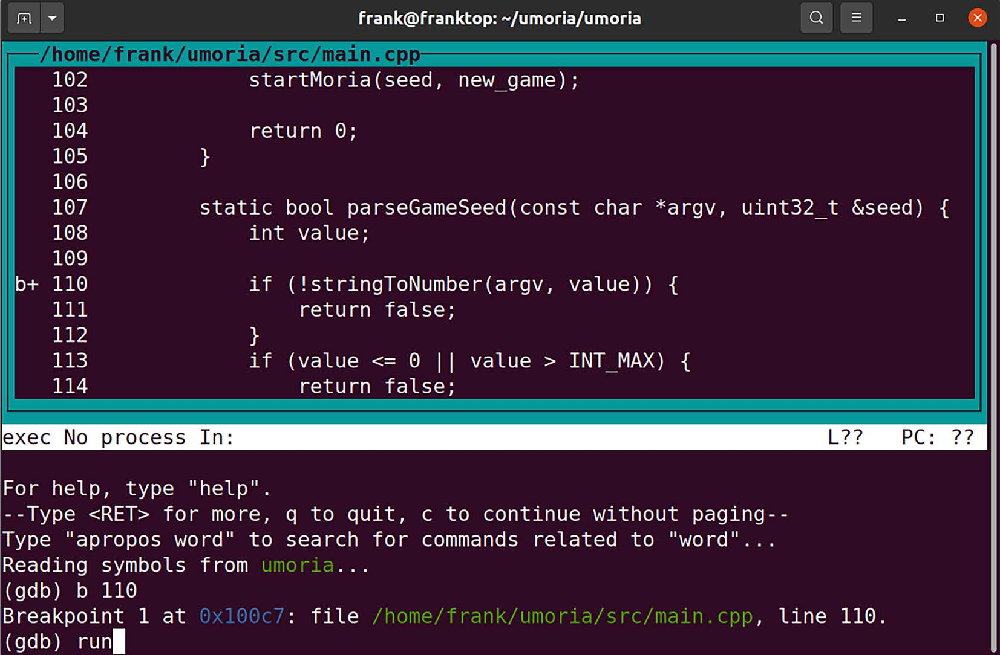
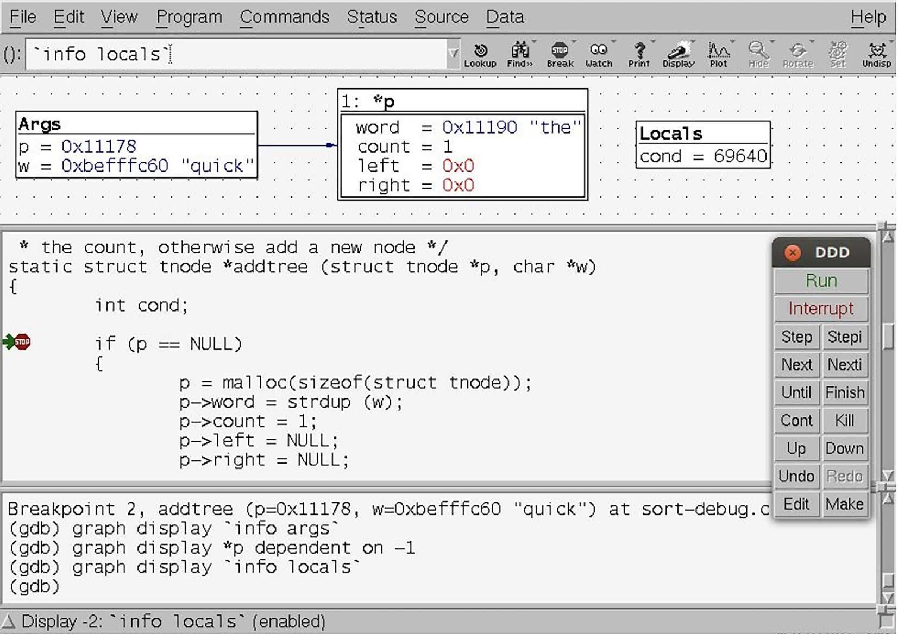
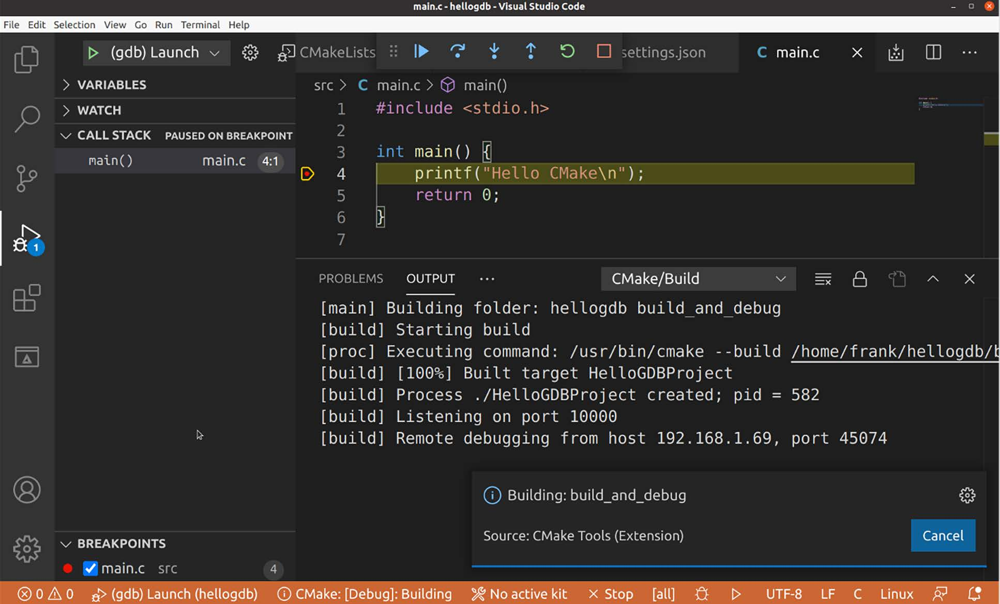

# Chương 19: Debug với GDB (Debugging with GDB)

Bug là chuyện không tránh khỏi. Xác định và sửa chúng là một phần của quá trình phát triển. Có nhiều kỹ thuật khác nhau để tìm và mô tả các khiếm khuyết chương trình, bao gồm phân tích tĩnh và động, review code, tracing, profiling và debug tương tác. Chúng ta sẽ xem xét các tracer và profiler trong chương tiếp theo, nhưng ở đây tôi muốn tập trung vào cách tiếp cận truyền thống là quan sát việc thực thi code thông qua một debugger, mà trong trường hợp của chúng ta là GNU Debugger (GDB). GDB là một công cụ mạnh mẽ và linh hoạt. Bạn có thể dùng nó để debug ứng dụng, kiểm tra các file postmortem (core file) được tạo ra sau khi một chương trình crash, và thậm chí step qua code kernel.

Trong chương này, chúng ta sẽ đề cập các chủ đề sau:

- GNU debugger

- Chuẩn bị để debug

- Debug ứng dụng

- Debug Just-in-time

- Debug fork và thread

- Core file

- Giao diện người dùng của GDB

- Debug code kernel

## Yêu cầu kỹ thuật

Để làm theo các ví dụ, hãy bảo đảm bạn có những thứ sau:

- Một hệ thống host Ubuntu 24.04 hoặc bản LTS mới hơn với ít nhất 90 GB dung lượng đĩa trống

- Bản phát hành Buildroot 2024.02.6 LTS

- Bản phát hành Yocto 5.0 (Scarthgap) LTS

- Một đầu đọc thẻ microSD và thẻ

- balenaEtcher cho Linux

- Một cáp Ethernet và router có cổng trống để kết nối mạng

- Một cáp serial USB to TTL với mức 3.3 V

- Một Raspberry Pi 4

- Một bộ nguồn USB-C 5 V có khả năng cấp 3 A

Lẽ ra bạn đã cài đặt bản phát hành 2024.02.6 LTS của Buildroot cho Chương 6. Nếu chưa, hãy tham khảo phần System requirements của The Buildroot user manual (`https://buildroot.org/downloads/manual/manual.html`) trước khi cài đặt Buildroot trên host Linux theo hướng dẫn từ Chương 6.

Lẽ ra bạn đã build bản phát hành 5.0 (Scarthgap) LTS của Yocto trong Chương 6. Nếu chưa, hãy tham khảo các phần Compatible Linux Distribution và Build Host Packages của Yocto Project Quick Build guide (`https://docs.yoctoproject.org/brief-yoctoprojectqs/`) trước khi build Yocto trên host Linux theo hướng dẫn trong Chương 6.

Code dùng trong chương này có trong thư mục của chương trong GitHub repository của cuốn sách: `https://github.com/PacktPublishing/Mastering-Embedded-Linux-Development/tree/main/Chapter19`.

## GNU debugger

GDB là một debugger source-level cho các ngôn ngữ biên dịch, chủ yếu là C và C++, mặc dù cũng có hỗ trợ cho nhiều ngôn ngữ khác, như Go và Objective-C. Bạn nên đọc ghi chú của phiên bản GDB mà bạn đang dùng để biết tình trạng hỗ trợ các ngôn ngữ khác nhau.

Website của project là `https://www.gnu.org/software/gdb/` và nó chứa nhiều thông tin hữu ích, bao gồm GDB user manual, Debugging with GDB.

Mặc định, GDB có giao diện người dùng command-line mà một số người thấy off-putting (khó chịu), mặc dù trên thực tế nó dễ dùng chỉ sau một chút luyện tập. Nếu bạn không thích giao diện command-line, có rất nhiều giao diện người dùng frontend cho GDB, và tôi sẽ mô tả ba trong số đó ở phần sau của chương này.

## Chuẩn bị để debug

Bạn cần compile code muốn debug với debug symbol. GCC cung cấp hai tùy chọn cho việc này: `-g` và `-ggdb`. Tùy chọn sau thêm thông tin debug đặc thù cho GDB, trong khi tùy chọn trước tạo thông tin theo định dạng phù hợp với bất kỳ hệ điều hành target nào bạn đang dùng, khiến nó là tùy chọn khả chuyển hơn. Vì GDB là debugger mặc định trên Linux, tốt nhất là dùng `-ggdb`. Cả hai tùy chọn đều cho phép bạn chỉ định mức thông tin debug, từ `0` đến `3`:

- `0`: Mức này không tạo thông tin debug nào và tương đương với việc bỏ switch `-g` hoặc `-ggdb`.

- `1`: Mức này tạo thông tin tối thiểu nhưng bao gồm tên hàm và các biến external, đủ để tạo một backtrace.

- `2`: Đây là mức mặc định và bao gồm thông tin về các biến cục bộ và số dòng để bạn có thể debug source-level và single-step qua code.

- `3`: Mức này bao gồm thông tin bổ sung, mà trong số những điều khác, có nghĩa là GDB có thể xử lý đúng các macro expansion.

Trong hầu hết các trường hợp, `-g` là đủ: hãy dành `-g3` hoặc `-ggdb3` cho khi bạn gặp vấn đề khi step qua code, đặc biệt nếu nó chứa macro.

Vấn đề tiếp theo cần xem xét là mức tối ưu code. Tối ưu của trình biên dịch có xu hướng phá hủy mối quan hệ giữa các dòng source code và machine code, khiến việc step qua source trở nên khó đoán. Nếu bạn gặp các vấn đề như vậy, nhiều khả năng bạn sẽ cần compile không tối ưu, bỏ switch compile `-O`, hoặc dùng `-Og`, vốn bật các tối ưu không cản trở việc debug.

Một vấn đề liên quan là các stack-frame pointer, thứ mà GDB cần để tạo backtrace của các lời gọi hàm cho tới hàm hiện tại. Trên một số kiến trúc, GCC sẽ không tạo stack-frame pointer ở các mức tối ưu cao hơn (`-O2` trở lên). Nếu bạn rơi vào tình huống thực sự phải compile với `-O2` nhưng vẫn muốn có backtrace, bạn có thể ghi đè hành vi mặc định bằng `-fno-omit-frame-pointer`. Ngoài ra, hãy để ý code đã được hand-optimized để bỏ frame pointer thông qua việc thêm `-fomit-frame-pointer`: bạn có thể muốn tạm thời loại bỏ những phần đó.

## Debug ứng dụng

Bạn có thể dùng GDB để debug ứng dụng theo một trong hai cách: nếu bạn đang phát triển code để chạy trên desktop và server, hoặc thực ra bất kỳ môi trường nào mà bạn compile và chạy code trên cùng một máy, thì chạy GDB native là điều tự nhiên. Tuy nhiên, hầu hết việc phát triển nhúng được thực hiện bằng một cross toolchain, và do đó bạn muốn debug code chạy trên thiết bị nhưng điều khiển nó từ môi trường cross-development, nơi bạn có source code và các công cụ. Tôi sẽ tập trung vào trường hợp sau, vì đó là kịch bản có khả năng nhất đối với các nhà phát triển nhúng, nhưng tôi cũng sẽ chỉ cho bạn cách thiết lập một hệ thống cho debug native. Tôi sẽ không mô tả những điều cơ bản về cách dùng GDB ở đây vì đã có nhiều tài liệu tham khảo tốt về chủ đề đó, bao gồm GDB user manual và phần Further study được gợi ý ở cuối chương.

### Debug từ xa bằng gdbserver

Thành phần then chốt cho debug từ xa là debug agent, gdbserver, chạy trên target và điều khiển việc thực thi của chương trình đang được debug. `gdbserver` kết nối tới một bản GDB chạy trên máy host qua một kết nối mạng hoặc một giao diện serial.

Debug thông qua `gdbserver` gần như, nhưng không hoàn toàn, giống với debug native. Những khác biệt chủ yếu xoay quanh thực tế là có hai máy tính tham gia, và chúng phải ở đúng trạng thái để việc debug diễn ra. Đây là một số điều cần lưu ý:

- Khi bắt đầu một phiên debug, bạn cần nạp chương trình muốn debug trên target bằng `gdbserver` rồi riêng biệt nạp GDB từ cross toolchain trên host.

- GDB và `gdbserver` cần kết nối với nhau trước khi một phiên debug có thể bắt đầu.

- GDB cần được cho biết tìm debug symbol và source code ở đâu trên host, đặc biệt đối với các shared library.

- Lệnh GDB `run` không được hỗ trợ.

- `gdbserver` sẽ kết thúc khi phiên debug kết thúc, và bạn sẽ cần khởi động lại nó nếu muốn một phiên debug khác.

- Bạn cần debug symbol và source code cho các binary bạn muốn debug trên host, nhưng không cần trên target. Thường thì không có đủ không gian lưu trữ cho chúng trên target, và chúng sẽ cần được strip trước khi triển khai lên target.

- Tổ hợp GDB/`gdbserver` không hỗ trợ tất cả các tính năng của GDB chạy native: ví dụ, `gdbserver` không thể theo process child sau một fork, trong khi GDB native thì có thể.

- Những điều kỳ quặc có thể xảy ra nếu GDB và `gdbserver` thuộc các phiên bản GDB khác nhau hoặc cùng phiên bản nhưng được cấu hình khác nhau. Lý tưởng nhất, chúng nên được build từ cùng một source bằng công cụ build ưa thích của bạn.

Debug symbol làm tăng kích thước file thực thi đáng kể, đôi khi lên gấp 10 lần. Như đã đề cập trong Chương 5, việc loại bỏ debug symbol mà không compile lại mọi thứ có thể hữu ích. Công cụ cho việc này là `strip` từ package `binutils` trong cross toolchain của bạn. Bạn có thể điều khiển mức strip bằng các switch sau:

- `--strip-all`: Switch này loại bỏ tất cả symbol (mặc định).

- `--strip-unneeded`: Switch này loại bỏ các symbol không cần cho việc xử lý relocation.

- `--strip-debug`: Switch này chỉ loại bỏ debug symbol.

LƯU Ý QUAN TRỌNG

Đối với ứng dụng và shared library, `--strip-all` (mặc định) là ổn, nhưng khi nói đến kernel module, bạn sẽ thấy rằng nó sẽ ngăn module được nạp. Hãy dùng `--strip-unneeded` thay thế. Tôi vẫn đang tìm một trường hợp sử dụng cho `–-strip-debug`.

Với điều đó trong đầu, hãy xem các chi tiết cụ thể liên quan đến debug với The Yocto Project và Buildroot.

### Thiết lập The Yocto Project cho debug từ xa

Có hai việc cần làm để debug ứng dụng từ xa khi dùng The Yocto Project: bạn cần thêm `gdbserver` vào target image, và bạn cần tạo một SDK bao gồm GDB và có debug symbol cho các file thực thi mà bạn định debug. Có tài liệu chi tiết về việc thiết lập Yocto cho debug từ xa tại `https://docs.yoctoproject.org/dev-manual/debugging.html#using-the-gdbserver-method`.

Đầu tiên, để đưa `gdbserver` vào target image, bạn có thể thêm package một cách tường minh bằng cách thêm dòng này vào `conf/local.conf`:

```
IMAGE_INSTALL:append = " gdbserver"
```

Khi không có serial console, cũng cần thêm một SSH daemon để bạn có cách nào đó khởi động `gdbserver` trên target:

```
EXTRA_IMAGE_FEATURES:append = " ssh-server-openssh"
```

Ngoài ra, bạn có thể thêm `tools-debug` vào `EXTRA_IMAGE_FEATURES`, điều này sẽ thêm `gdbserver`, `gdb` native và `strace` vào target image (tôi sẽ nói về `strace` trong chương tiếp theo):

```
EXTRA_IMAGE_FEATURES:append = " tools-debug ssh-server-openssh"
```

Sau đó build lại target image:

```
$ bitbake core-image-minimal-dev
```

Đối với phần thứ hai, bạn chỉ cần build một SDK như tôi đã mô tả trong Chương 6:

```
$ bitbake -c populate_sdk core-image-minimal-dev
```

SDK chứa một bản GDB. Nó cũng chứa một `sysroot` cho thetarget với debug symbol cho tất cả các chương trình và thư viện là một phần của target image. Cuối cùng, SDK chứa source code cho các file thực thi. Thay vì SDK, bạn có thể dùng trực tiếp các sysroot bên trong bản build Yocto (`https://docs.yoctoproject.org/sdk-manual/extensible.html#when-using-the-extensible-sdk-directly-in-a-yocto-build`).

SDK được build cho Raspberry Pi 4 cho phiên bản 5.0.\<n\> của The Yocto Project được cài đặt mặc định trong `/opt/poky/5.0.<n>/`. `sysroot` cho target là `/opt/poky/5.0.<n>/sysroots/cortexa72-poky-linux/`. Các chương trình nằm trong `/bin/`, `/sbin/`, `/usr/bin/` và `/usr/sbin/`, tương đối so với `sysroot`, và các thư viện nằm trong `/lib/` và `/usr/lib/`. Trong mỗi thư mục này, bạn sẽ tìm thấy một thư mục con tên `.debug/` chứa symbol cho mỗi chương trình và thư viện. GDB biết tìm trong .`debug`/ khi tìm kiếm thông tin symbol. Source code cho các file thực thi được lưu trong `/usr/src/debug/` tương đối so với `sysroot`.

### Thiết lập Buildroot cho debug từ xa

Buildroot không phân biệt giữa môi trường dùng để build và môi trường dùng để phát triển ứng dụng: không có SDK. Giả sử bạn đang dùng toolchain nội bộ của Buildroot, bạn cần bật các tùy chọn sau để copy GDB sang host và copy `gdbserver` sang target:

- `BR2_TOOLCHAIN_EXTERNAL`, trong Toolchain \| Toolchain type \| External toolchain

- `BR2_TOOLCHAIN_EXTERNAL_GDB_SERVER_COPY`, trong Toolchain \| Copy gdb server to the Target

- `BR2_PACKAGE_GDB`, trong Target packages \| Debugging, profiling and benchmark \| gdb

Cần một toolchain bên ngoài vì toolchain mà Buildroot 2024.02.6 build không thể compile `gdbserver`.

Bạn cũng cần build các file thực thi với debug symbol, việc mà bạn cần bật `BR2_ENABLE_DEBUG`, trong Build options \| build packages with debugging symbols.

Việc này sẽ tạo các thư viện có debug symbol trong `output/host/<arch>/sysroot`.

### Bắt đầu debug

Giờ bạn đã có `gdbserver` được cài đặt trên target và một cross GDB trên host, bạn có thể bắt đầu một phiên debug.

#### Kết nối GDB và gdbserver

Kết nối giữa GDB và `gdbserver` có thể qua mạng hoặc giao diện serial. Trong trường hợp kết nối mạng, bạn khởi chạy `gdbserver` với số cổng TCP để lắng nghe và, tùy chọn, một địa chỉ IP để chấp nhận kết nối. Trong hầu hết các trường hợp, bạn không quan tâm địa chỉ IP nào sẽ kết nối, vì vậy bạn chỉ cần cung cấp số cổng. Trong ví dụ này, `gdbserver` chờ kết nối trên cổng `10000` từ bất kỳ host nào:

```
# gdbserver :10000 /usr/bin/helloworld
Process /usr/bin/helloworld created; pid = 581
Listening on port 10000
```

Tiếp theo, khởi động bản GDB từ toolchain của bạn, trỏ nó tới một bản chưa strip của chương trình để GDB có thể nạp bảng symbol:

```
$ aarch64-poky-linux-gdb helloworld
```

Trong GDB, dùng lệnh target remote để tạo kết nối tới `gdbserver`, đưa cho nó địa chỉ IP hoặc hostname của target và cổng mà nó đang chờ:

```
(gdb) target remote raspberrypi4-64:10000
```

Khi `gdbserver` thấy kết nối từ host, nó in ra như sau:

```
Remote debugging from host 192.168.1.123, port 50696
```

Quy trình tương tự đối với kết nối serial. Trên target, bạn cho `gdbserver` biết dùng serial port nào:

```
# gdbserver /dev/ttyAMA0 /usr/bin/helloworld
```

Bạn có thể cần cấu hình trước baud rate của cổng bằng `stty(1)` hoặc một chương trình tương tự. Một ví dụ đơn giản như sau:

```
# stty -F /dev/ttyAMA0 115200
```

Có nhiều tùy chọn khác cho `stty`, vì vậy hãy đọc manual page để biết thêm chi tiết. Đáng lưu ý là cổng đó không được dùng cho việc gì khác. Ví dụ, bạn không thể dùng một cổng đang được dùng làm system console.

Trên host, bạn tạo kết nối tới `gdbserver` bằng `target remote` cộng với serial device ở đầu cáp phía host. Trong hầu hết các trường hợp, bạn sẽ muốn đặt baud rate của serial port trên host trước, bằng lệnh GDB `set serial baud`:

```
(gdb) set serial baud 115200
(gdb) target remote /dev/ttyUSB0
```

Mặc dù GDB và `gdbserver` giờ đã được kết nối, chúng ta vẫn chưa sẵn sàng đặt breakpoint và bắt đầu step qua source code.

#### Đặt sysroot

GDB cần biết tìm thông tin debug và source code cho chương trình và các shared library mà bạn đang debug ở đâu. Khi debug native, các đường dẫn đã được biết rõ và được tích hợp sẵn vào GDB. Nhưng khi dùng một cross toolchain, GDB không có cách nào đoán được gốc của filesystem target nằm ở đâu. Bạn phải cung cấp thông tin này.

Nếu bạn đã build ứng dụng bằng SDK của The Yocto Project, `sysroot` nằm bên trong SDK, và vì vậy bạn có thể đặt nó trong GDB như sau:

```
(gdb) set sysroot /opt/poky/5.0.<n>/sysroots/cortexa72-poky-linux
```

Nếu bạn đang dùng Buildroot, bạn sẽ thấy rằng `sysroot` nằm trong `output/host/<toolchain>/sysroot`, và `output/staging` là một symbolic link tới nó. Vậy, đối với Buildroot, bạn sẽ đặt `sysroot` như sau:

```
(gdb) set sysroot /home/frank/buildroot/output/staging
```

GDB cũng cần tìm source code cho các file bạn đang debug. GDB có một search path cho các file source, mà bạn có thể xem bằng lệnh `show directories`:

```
(gdb) show directories
Source directories searched: $cdir:$cwd
```

Đây là các giá trị mặc định: `$cwd` là thư mục làm việc hiện tại của instance GDB chạy trên host; `$cdir` là thư mục nơi source được compile. Giá trị sau được mã hóa vào các object file với tag `DW_AT_comp_dir`. Bạn có thể xem các tag này bằng `objdump --dwarf` như sau:

```
$ aarch64-poky-linux-objdump --dwarf helloworld | grep DW_AT_comp_dir
<…>
<23a> DW_AT_comp_dir : (indirect line string, offset: 0xfc): /home/frank/
helloworld
<…>
```

Trong hầu hết các trường hợp, các giá trị mặc định, `$cdir` và `$cwd`, là đủ, nhưng vấn đề phát sinh nếu các thư mục đã bị di chuyển giữa lúc compile và lúc debug. Một trường hợp như vậy xảy ra với The Yocto Project. Xem kỹ hơn các tag `DW_AT_comp_dir` cho một chương trình được compile bằng SDK của The Yocto Project, bạn có thể nhận thấy điều này:

```
$ aarch64-poky-linux-objdump --dwarf helloworld | grep DW_AT_comp_dir
<1e> DW_AT_comp_dir : (indirect string, offset: 0x1b): /usr/src/debug/
glibc/2.39+git/csu
<4f> DW_AT_comp_dir : (indirect line string, offset: 0): /usr/src/debug/
glibc/2.39+git/csu
<1c5> DW_AT_comp_dir : (indirect line string, offset: 0): /usr/src/debug/
glibc/2.39+git/csu
<209> DW_AT_comp_dir : (indirect string, offset: 0x1b): /usr/src/debug/
glibc/2.39+git/csu
<23a> DW_AT_comp_dir : (indirect line string, offset: 0xfc): /usr/src/
debug/helloworld/1.0
<3e0> DW_AT_comp_dir : (indirect string, offset: 0x1b): /usr/src/debug/
glibc/2.39+git/csu
<…>
```

Ở đây, bạn có thể thấy nhiều tham chiếu tới thư mục `/usr/src/debug/glibc/2.39+git`, nhưng nó ở đâu? Câu trả lời là nó nằm trong `sysroot` của SDK, vì vậy đường dẫn đầy đủ là `/opt/poky/5.0.6/sysroots/cortexa72-poky-linux/usr/src/debug/glibc/2.39+git`. SDK chứa source code cho tất cả các chương trình và thư viện trong target image. GDB có một cách đơn giản để xử lý việc toàn bộ một cây thư mục bị di chuyển như thế này: `substitute-path`. Vậy, khi debug với SDK của The Yocto Project, bạn cần dùng các lệnh sau:

```
(gdb) set sysroot /opt/poky/5.0.<n>/sysroots/cortexa72-poky-linux
(gdb) set substitute-path /usr/src/debug /opt/poky/5.0.<n>/sysroots/
cortexa72-poky-linux/usr/src/debug
```

Bạn có thể có thêm các shared library được lưu bên ngoài `sysroot`. Trong trường hợp đó, bạn có thể dùng `set solib-search-path`, có thể chứa một danh sách colon-separated các thư mục để tìm shared library. GDB chỉ tìm trong `solib-search-path` nếu nó không thể tìm thấy binary trong `sysroot`.

Cách thứ ba để cho GDB biết tìm source code ở đâu, cho cả thư viện và chương trình, là dùng lệnh `directory`:

```
(gdb) directory /home/frank//lib_mylib
Source directories searched: /home/frank//lib_mylib:$cdir:$cwd
```

Các đường dẫn được thêm theo cách này được ưu tiên vì chúng được tìm trước các đường dẫn từ `sysroot` hoặc `solib-search-path`.

#### File lệnh GDB

Có một số việc bạn cần làm mỗi lần chạy GDB, như đặt `sysroot`. Thật tiện lợi khi đưa các lệnh như vậy vào một command file và chạy chúng mỗi khi GDB được khởi động. GDB đọc lệnh từ `$HOME/.gdbinit`, rồi từ `.gdbinit` trong thư mục hiện tại, và sau đó từ các file được chỉ định trên command line với tham số `-x`. Tuy nhiên, các phiên bản GDB gần đây sẽ từ chối nạp `.gdbinit` từ thư mục hiện tại vì lý do bảo mật. Bạn có thể ghi đè hành vi đó bằng cách thêm một dòng như sau vào `$HOME/.gdbinit`:

```
set auto-load safe-path /
```

Ngoài ra, nếu bạn không muốn bật auto-loading trên toàn cục, bạn có thể chỉ định một thư mục cụ thể như sau:

```
add-auto-load-safe-path /home/frank/myprog
```

Sở thích cá nhân của tôi là dùng tham số `-x` để trỏ tới command file, điều này làm lộ rõ vị trí của file để tôi không quên nó.

Để giúp bạn thiết lập GDB, Buildroot tạo một command file GDB chứa đúng lệnh `sysroot` trong `output/staging/usr/share/buildroot/gdbinit`. Nó sẽ chứa một dòng giống như sau:

```
set sysroot /home/frank/buildroot/output/host/aarch64-buildroot-linux-gnu/
sysroot
```

Giờ GDB đã chạy và có thể tìm thấy thông tin nó cần, hãy xem một số lệnh chúng ta có thể thực hiện với nó.

#### Tổng quan về các lệnh GDB

GDB còn nhiều lệnh khác nữa, được mô tả trong manual trực tuyến và trong các tài liệu được đề cập ở phần Further study. Để giúp bạn bắt đầu nhanh nhất có thể, đây là danh sách các lệnh được dùng phổ biến nhất. Trong hầu hết các trường hợp, có một dạng viết tắt cho các lệnh, được liệt kê trong các bảng sau.

##### Breakpoint

Đây là các lệnh để quản lý breakpoint:

| Lệnh | Lệnh dạng Short-form | Công dụng |
|---|---|---|
| `break <location>` | `b <location>` | Đặt một breakpoint tại một tên hàm, số dòng hoặc dòng. Ví dụ về các vị trí là `main`, `5` và `sortbug.c:42`. |
| `info breakpoints` | `i b` | Liệt kê các breakpoint. |
| `delete breakpoint <N>` | `d b <N>` | Xóa breakpoint `<N>`. |

##### Chạy và step

Đây là các lệnh để điều khiển việc thực thi của một chương trình:

| Lệnh | Lệnh dạng Short-form | Công dụng |
|---|---|---|
| `run` | `r` | Nạp một bản mới của chương trình vào bộ nhớ và bắt đầu chạy nó. Lệnh này không hoạt động khi debug từ xa bằng gdbserver. |
| `continue` | `c` | Tiếp tục thực thi từ một breakpoint. |
| Ctrl + C | \- | Dừng chương trình đang được debug. |
| `step` | `s` | Step một dòng code, step vào bất kỳ hàm nào được gọi. |
| `next` | `n` | Step một dòng code, step qua một lời gọi hàm. |
| `finish` | \- | Chạy cho đến khi hàm hiện tại trả về. |

##### Lấy thông tin

Đây là các lệnh để lấy thông tin liên quan đến debugger:

| Lệnh | Lệnh dạng Short-form | Công dụng |
|---|---|---|
| `backtrace` | `bt` | Liệt kê call stack. |
| `info threads` | `i th` | Hiển thị thông tin về các thread đang thực thi trong chương trình. |
| `info sharedlibrary` | `i share` | Hiển thị thông tin về các shared library hiện được chương trình nạp. |
| `print <variable>` | `p <variable>` | In giá trị của biến. Ví dụ, `print foo`. |
| `list` | `l` | Liệt kê các dòng code quanh program counter hiện tại. |

Trước khi có thể bắt đầu step qua một chương trình trong một phiên debug, trước tiên chúng ta cần đặt một breakpoint ban đầu.

#### Chạy tới một breakpoint

`gdbserver` nạp chương trình vào bộ nhớ và đặt một breakpoint ở lệnh đầu tiên. Sau đó nó chờ kết nối từ GDB. Khi kết nối được thiết lập, bạn vào một phiên debug. Tuy nhiên, bạn sẽ thấy rằng nếu cố single-step ngay lập tức, bạn sẽ nhận được thông điệp này:

```
Cannot find bounds of current function
```

Điều này là vì chương trình đã dừng tại code viết bằng assembly, vốn tạo môi trường runtime cho các chương trình C/C++. Dòng code C/C++ đầu tiên là hàm `main()`. Để dừng tại `main()`, bạn sẽ đặt một breakpoint ở đó rồi dùng lệnh `continue` (viết tắt `c`) để báo `gdbserver` tiếp tục từ đầu chương trình và dừng tại `main()`:

```
(gdb) break main
Breakpoint 1, main (argc=1, argv=0xbefffe24) at helloworld.c:8
printf("Hello, world!\n");
(gdb) c
```

Tại thời điểm này, bạn có thể thấy như sau:

```
Reading /lib/ld-linux.so.3 from remote target...
warning: File transfers from remote targets can be slow. Use "set sysroot"
to access files locally instead.
```

Với các phiên bản GDB cũ hơn, thay vào đó bạn có thể thấy điều này:

```
warning: Could not load shared library symbols for 2 libraries, e.g. /lib/
libc.so.6.
```

Trong cả hai trường hợp, vấn đề là bạn đã quên đặt `sysroot`! Hãy xem lại phần trước về `sysroot`.

Tất cả điều này rất khác so với việc khởi động một chương trình native, nơi bạn chỉ cần gõ `run`. Thực ra, nếu bạn thử gõ `run` trong một phiên debug từ xa, bạn hoặc sẽ thấy một thông điệp nói rằng remote target không hỗ trợ lệnh `run`, hoặc, trong các phiên bản GDB cũ hơn, nó sẽ chỉ treo mà không có lời giải thích nào.

#### Mở rộng GDB bằng Python

Chúng ta có thể nhúng một Python interpreter đầy đủ vào GDB để mở rộng chức năng của nó. Việc này được thực hiện bằng cách cấu hình GDB với tùy chọn `--with-python` trước khi build. GDB có một API trình bày phần lớn trạng thái bên trong của nó dưới dạng các đối tượng Python. API này cho phép chúng ta định nghĩa các lệnh GDB tùy chỉnh của riêng mình dưới dạng script viết bằng Python. Các lệnh bổ sung này có thể bao gồm các công cụ hỗ trợ debug hữu ích như tracepoint và pretty printer vốn không được tích hợp sẵn vào GDB.

##### Build GDB với hỗ trợ Python

Chúng ta đã đề cập Setting up Buildroot for remote debugging. Có một số bước bổ sung cần thiết để bật hỗ trợ Python bên trong GDB. Chúng ta không thể dùng một toolchain do Buildroot tạo ra để build GDB với hỗ trợ Python vì nó thiếu một số hỗ trợ thread cần thiết.

Để build cross GDB cho host với hỗ trợ Python, hãy thực hiện các bước sau:

1\. Di chuyển tới thư mục nơi bạn đã cài đặt Buildroot:

```
$ cd buildroot
```

2\. Copy file cấu hình cho board mà bạn muốn build image:

```
$ cd configs
$ cp raspberrypi4_64_defconfig rpi4_64_gdb_defconfig
$ cd ..
```

3\. Dọn các build artifact trước đó khỏi thư mục `output`:

```
$ make clean
```

4\. Kích hoạt file cấu hình của bạn:

```
$ make rpi4_64_gdb_defconfig
```

5\. Bắt đầu tùy chỉnh image của bạn:

```
$ make menuconfig
```

6\. Bật việc dùng một toolchain bên ngoài bằng cách đi tới Toolchain \| Toolchain type \| External toolchain và chọn tùy chọn đó.

7\. Thoát ra khỏi External toolchain và mở submenu Toolchain. Chọn một toolchain đã biết là hoạt động được, như Linaro AArch64 2018.05, làm toolchain bên ngoài.

8\. Chọn Build cross gdb for the host từ trang Toolchain và bật cả TUI support lẫn Python support.

9\. Đi sâu vào submenu GDB debugger Version từ trang Toolchain và chọn phiên bản GDB mới nhất có trong Buildroot.

10\. Thoát ra khỏi trang Toolchain và đi sâu vào Build options. Chọn Build packages with debugging symbols.

11\. Thoát ra khỏi trang Build options, đi sâu vào System Configuration và chọn Enable root login with password. Mở Root password và nhập một mật khẩu non-empty vào trường văn bản.

12\. Thoát ra khỏi trang System Configuration và đi sâu vào Target packages \| Debugging, profiling and benchmark. Chọn package gdb để thêm `gdbserver` vào target image.

13\. Thoát ra khỏi Debugging, profiling and benchmark và đi sâu vào Target packages \| Networking applications. Chọn package dropbear để bật truy cập `scp` và `ssh` tới target. Lưu ý rằng `dropbear` không cho phép truy cập `root` bằng `scp` và `ssh` mà không có mật khẩu.

14\. Thêm entropy daemon haveged, có thể được tìm thấy dưới Target packages \| Miscellaneous, để SSH có sẵn nhanh hơn khi boot.

15\. Thêm một package khác vào image để bạn có thứ gì đó để debug. Tôi chọn công cụ binary patch/diff `bsdiff`, được viết bằng C và có thể được tìm thấy dưới Target packages \| Development tools.

16\. Lưu thay đổi và thoát `menuconfig` của Buildroot.

17\. Lưu thay đổi vào file cấu hình của bạn:

```
$ make savedefconfig
```

18\. Build image cho target:

```
$ make
```

Một file `rpi4_64_gdb_defconfig` làm sẵn cho Raspberry Pi 4 có thể được tìm thấy trong code archive của chương này nếu bạn muốn bỏ qua các bước `menuconfig` ở trên. Copy file đó từ `MELD/Chapter19/buildroot/configs/` vào thư mục `buildroot/configs` và chạy `make` trên nó nếu bạn thích.

Khi build xong, sẽ có một file `sdcard.img` có thể boot trong `output/images/` mà bạn có thể ghi lên thẻ microSD bằng Etcher. Cắm thẻ microSD đó vào thiết bị target và boot nó. Kết nối thiết bị target với mạng cục bộ bằng một cáp Ethernet và tìm địa chỉ IP của nó bằng `arp-scan --localnet`. SSH vào thiết bị với `root` và nhập mật khẩu mà bạn đã đặt khi cấu hình image. Tôi đã chỉ định `temppwd` làm mật khẩu `root` cho image `rpi4_64_gdb_defconfig` của mình.

Giờ hãy debug `bsdiff` từ xa bằng GDB:

1\. Trước tiên, di chuyển tới thư mục `/usr/bin` trên target:

```
# cd /usr/bin
```

2\. Sau đó, khởi động `bdiff` với `gdbserver`, như chúng ta đã làm với `helloworld` trước đó:

```
# gdbserver :10000 ./bsdiff /usr/bin/bzless /usr/bin/bzmore ~/
patchfile
Process ./bsdiff created; pid = 197
Listening on port 10000
```

3\. Trên host Linux, copy `tp.py` vào thư mục home của bạn:

```
$ cd ~
$ cp MELD/Chapter19/tp.py .
```

4\. Tiếp theo, khởi động bản GDB từ toolchain của bạn, trỏ nó tới một bản chưa strip của chương trình để GDB có thể nạp bảng symbol:

```
$ cd ~/buildroot/output/build/bsdiff-4.3
$ ~/buildroot/output/host/bin/aarch64-linux-gdb bsdiff
```

5\. Trong GDB, đặt `sysroot` như sau:

```
(gdb) set sysroot ~/buildroot/output/staging
```

6\. Sau đó, dùng lệnh target remote để tạo kết nối tới `gdbserver`, đưa cho nó địa chỉ IP hoặc hostname của target và cổng mà nó đang chờ:

```
(gdb) target remote 192.168.1.127:10000
```

7\. Khi `gdbserver` thấy kết nối từ host, nó in ra như sau:

```
Remote debugging from host 192.168.1.123, port 36980
```

8\. Giờ chúng ta có thể nạp các script lệnh Python như `tp.py` vào GDB và gọi các lệnh này như sau:

```
(gdb) source ~/tp.py
(gdb) tp search
Breakpoint 1 at 0x555b7b9154: file /home/frank/buildroot/output/
build/bsdiff-4.3/bsdiff.c, line 170.
```

   Trong trường hợp này, `tp` là tên của lệnh tracepoint và `search` là tên của một hàm đệ quy trong `bsdiff`.

9\. Đặt một breakpoint tại `main()`:

```
(gdb) break main
Breakpoint 2 at 0x555b7b8e50: file /home/frank/buildroot/output/
build/bsdiff-4.3/bsdiff.c, line 216.
```

10\. Tiếp tục:

```
(gdb) c
Continuing.
Breakpoint 2, main (argc=4, argv=0x7ff2c99ec8) at /home/frank/
buildroot/output/build/bsdiff-4.3/bsdiff.c:216
216             if(argc!=4) errx(1,"usage: %s oldfile newfile
patchfile\n",argv[0]);
```

11\. Tiếp tục lần nữa:

```
(gdb) c
Continuing.
search @ /home/frank/buildroot/output/build/bsdiff-4.3/bsdiff.c:170
        x(off_t: <optimized out>) [8]
        y(off_t: <optimized out>) [8]
<…>
search @ /home/frank/buildroot/output/build/bsdiff-4.3/bsdiff.c:170
        x(off_t: <optimized out>) [8]
        y(off_t: <optimized out>) [8]
[Inferior 1 (process 251) exited normally]
Tracepoint 'search' Count: 10
(gdb)
```

   Chương trình `bsdiff` thực hiện binary diff và nhận ba đối số: `oldfile`, `newfile` và `patchfile`. `patchfile` mà `bsdiff` tạo ra đóng vai trò input cho chương trình `bspatch` để vá binary. Chúng ta khởi động chương trình `bsdiff` trên target với `/usr/bin/bzless`, `/usr/bin/bzmore` và `~/patchfile` làm đối số. Output từ lệnh tracepoint GDB cho biết hàm `search` ở dòng 170 của `bsdiff.c` đã được gọi 10 lần trong suốt quá trình.

Hỗ trợ Python trong GDB cũng có thể được dùng để debug các chương trình Python. GDB có khả năng nhìn vào bên trong CPython mà debugger `pdb` chuẩn cho Python không có. Nó thậm chí có thể inject code Python vào một process Python đang chạy. Điều này cho phép tạo ra các công cụ debug Python mạnh mẽ như các trình phân tích bộ nhớ, vốn nếu không sẽ là không thể.

### Debug native

Chạy một bản GDB native trên target không phổ biến bằng chạy từ xa, nhưng vẫn có thể. Ngoài việc cài đặt GDB vào target image, bạn cũng sẽ cần cài đặt các bản chưa strip của các file thực thi muốn debug và source code tương ứng của chúng. Cả The Yocto Project và Buildroot đều cho phép bạn làm điều này.

LƯU Ý QUAN TRỌNG

Mặc dù debug native không phải là hoạt động phổ biến đối với các nhà phát triển nhúng, chạy các công cụ profile và trace trên target thì rất phổ biến. Các công cụ này thường hoạt động tốt nhất nếu bạn có các binary chưa strip và source code trên target, đó là một nửa câu chuyện tôi đang kể ở đây. Tôi sẽ quay lại chủ đề này trong chương tiếp theo.

#### The Yocto Project

Để bắt đầu, hãy thêm `gdb` vào target image bằng cách thêm dòng này vào `conf/local.conf`:

```
EXTRA_IMAGE_FEATURES:append = "tools-debug dbg-pkgs src-pkgs"
```

Bạn cần thông tin debug cho các package muốn debug. The Yocto Project build các biến thể debug của package, chứa thông tin debug và symbol đã được strip khỏi binary. Bạn có thể thêm có chọn lọc các debug package này vào target image bằng cách thêm `<package name>-dbg` vào `conf/local.conf`. Hoặc, bạn có thể đơn giản cài đặt tất cả các debug package bằng cách thêm `dbg-pkgs` vào `EXTRA_IMAGE_FEATURES` như vừa trình bày. Hãy lưu ý rằng điều này sẽ làm tăng kích thước target image đáng kể, có lẽ thêm vài trăm megabyte.

Tương tự, bạn có thể thêm các source package vào target image bằng cách thêm `<package name>-src` vào `conf/local.conf`. Hoặc, bạn có thể đơn giản cài đặt tất cả các source package bằng cách thêm `src-pkgs` vào `EXTRA_IMAGE_FEATURES`. Một lần nữa, điều này sẽ làm tăng kích thước target image đáng kể. Source code được cài đặt trong `/usr/src/debug/<package name>` trong target image. Điều này có nghĩa là GDB sẽ tìm thấy nó mà không cần chạy `set substitute-path`.

#### Buildroot

Với Buildroot, bạn có thể yêu cầu nó cài đặt một bản GDB native vào target image bằng cách bật tùy chọn này:

- `BR2_PACKAGE_GDB_DEBUGGER` trong Target packages \| Debugging, profiling and benchmark \| Full debugger

Sau đó, để build các binary có thông tin debug và cài đặt chúng vào target image mà không strip, hãy bật tùy chọn thứ nhất và tắt tùy chọn thứ hai trong hai tùy chọn sau:

- `BR2_ENABLE_DEBUG` trong Build options \| Build packages with debugging symbols

- `BR2_STRIP_strip` trong Build options \| Strip target binaries

Đó là tất cả những gì tôi muốn nói về debug native. Một lần nữa, thực hành này không phổ biến trên các thiết bị nhúng vì source code và debug symbol bổ sung làm phình to target image. Tiếp theo, hãy xem một hình thức debug từ xa khác.

## Debug Just-in-time

Đôi khi, một chương trình sẽ bắt đầu hoạt động sai sau khi nó đã chạy một thời gian, và bạn muốn biết nó đang làm gì. Tính năng `attach` của GDB làm chính xác điều này. Tôi gọi nó là debug just-in-time. Nó có sẵn với cả phiên debug native lẫn từ xa.

Trong trường hợp debug từ xa, bạn cần tìm PID của process cần debug và truyền nó cho `gdbserver` với tùy chọn `--attach`. Ví dụ, nếu PID là 109, bạn sẽ gõ như sau:

```
# gdbserver --attach :10000 109
Attached; pid = 109
Listening on port 10000
```

Điều này buộc process dừng lại như thể nó đang ở một breakpoint, cho phép bạn khởi động cross GDB theo cách bình thường và kết nối tới `gdbserver`. Khi xong, bạn có thể detach, cho phép chương trình tiếp tục chạy mà không có debugger:

```
(gdb) detach
Detaching from program: /home/frank/helloworld, process 109
Ending remote debugging.
```

Attach vào một process đang chạy bằng PID chắc chắn tiện lợi, nhưng còn các chương trình multi-process hay multi-threaded thì sao? Cũng có các kỹ thuật để debug các loại chương trình đó với GDB.

## Debug fork và thread

Điều gì xảy ra khi chương trình bạn đang debug fork? Phiên debug theo process parent hay child? Hành vi này được điều khiển bởi `follow-fork-mode`, có thể là `parent` hoặc `child`, với `parent` là mặc định. Thật không may, các phiên bản `gdbserver` hiện tại không hỗ trợ tùy chọn này, vì vậy nó chỉ hoạt động cho debug native. Nếu bạn thực sự cần debug process child trong khi dùng `gdbserver`, một cách khắc phục là sửa code để child lặp trên một biến ngay sau fork, cho bạn cơ hội attach một phiên `gdbserver` mới vào nó rồi đặt biến để nó thoát khỏi vòng lặp.

Khi một thread trong một process multithreaded chạm một breakpoint, hành vi mặc định là tất cả các thread dừng lại. Trong hầu hết các trường hợp, đây là điều tốt nhất nên làm vì nó cho phép bạn xem các biến tĩnh mà không bị các thread khác thay đổi. Khi bạn tiếp tục thực thi thread, tất cả các thread đã dừng đều khởi động lại, ngay cả khi bạn đang single-stepping, và đặc biệt chính trường hợp cuối này có thể gây ra vấn đề. Có một cách để sửa đổi cách GDB xử lý các thread đã dừng, thông qua một tham số gọi là `scheduler-locking`. Thông thường nó là `off`, nhưng nếu bạn đặt nó là `on`, chỉ thread đã dừng tại breakpoint được tiếp tục và các thread khác vẫn dừng, cho bạn cơ hội xem riêng thread đó làm gì mà không bị can thiệp. Điều này tiếp tục như vậy cho đến khi bạn tắt `scheduler-locking`. `gdbserver` hỗ trợ tính năng này.

## Core file

Core file ghi lại trạng thái của một chương trình bị lỗi tại thời điểm nó kết thúc. Bạn thậm chí không cần có mặt cùng một debugger khi bug xuất hiện. Vì vậy, khi bạn thấy `Segmentation` `fault (core dumped)`, đừng nhún vai bỏ qua; hãy điều tra core file và khai thác mỏ vàng thông tin trong đó.

Quan sát đầu tiên là core file không được tạo theo mặc định, mà chỉ khi resource limit về core file cho process là non-zero. Bạn có thể thay đổi nó cho shell hiện tại bằng `ulimit -c`. Để bỏ mọi giới hạn về kích thước core file, hãy gõ lệnh sau:

```
$ ulimit -c unlimited
```

Mặc định, core file có tên `core` và được đặt trong thư mục làm việc hiện tại của process, là thư mục được trỏ tới bởi `/proc/<PID>/cwd`. Có một số vấn đề với cơ chế này. Thứ nhất, khi nhìn vào một thiết bị có nhiều file tên `core`, không rõ chương trình nào đã tạo ra mỗi file. Thứ hai, thư mục làm việc hiện tại của process rất có thể nằm trong một filesystem read-only, có thể không có đủ không gian để lưu core file, hoặc process có thể không có quyền ghi vào thư mục làm việc hiện tại.

Có hai file điều khiển việc đặt tên và vị trí của core file. File thứ nhất là `/proc/sys/kernel/core_uses_pid`. Ghi `1` vào nó khiến số PID của process đang chết được thêm vào tên file, điều khá hữu ích miễn là bạn có thể liên kết số PID với tên chương trình từ các file log.

Hữu ích hơn nhiều là `/proc/sys/kernel/core_pattern`, cho bạn nhiều quyền kiểm soát hơn đối với core file. Mẫu mặc định là core, nhưng bạn có thể đổi nó thành một mẫu gồm các meta character sau:

- `%p`: PID

- `%u`: UID thực của process bị dump

- `%g`: GID thực của process bị dump

- `%s`: Số hiệu của signal gây ra dump

- `%t`: Thời điểm dump biểu diễn bằng số giây kể từ Epoch, 1970-01-01 00:00:00 +0000 (UTC)

- `%h`: Hostname

- `%e`: Tên file thực thi

- `%E`: Đường dẫn của file thực thi với các dấu gạch chéo (/) được thay bằng dấu chấm than (!)

- `%c`: Soft resource limit về kích thước core file của process bị dump

Bạn cũng có thể dùng một mẫu bắt đầu bằng một tên thư mục tuyệt đối để tất cả core file được tập trung vào một chỗ. Ví dụ, mẫu sau đặt tất cả core file vào thư mục `/corefiles` và đặt tên chúng theo tên chương trình và thời điểm crash:

```
# echo /corefiles/core.%e.%t > /proc/sys/kernel/core_pattern
```

Sau một lần core dump, bạn sẽ tìm thấy thứ gì đó như sau:

```
# ls /corefiles
core.sort-debug.1431425613
```

Để biết thêm thông tin, hãy tham khảo manual page `core(5)`.

### Dùng GDB để xem core file

Đây là một phiên GDB mẫu xem một core file:

```
$ arm-poky-linux-gnueabi-gdb sort-debug /home/chris/rootfs/corefiles/core.
sort-debug.1431425613
<…>
Core was generated by './sort-debug'.
Program terminated with signal SIGSEGV, Segmentation fault.
#0 0x000085c8 in addtree (p=0x0, w=0xbeac4c60 "the") at sort-debug.c:41
41 p->word = strdup (w);
```

Điều này cho thấy chương trình đã dừng ở dòng 41. Lệnh list hiển thị code ở vùng lân cận:

```
(gdb) list
37 static struct tnode *addtree (struct tnode *p, char *w)
38 {
39     int cond;
40
41     p->word = strdup (w);
42     p->count = 1;
43     p->left = NULL;
44     p->right = NULL;
45
```

Lệnh `backtrace` (viết tắt là `bt`) cho thấy chúng ta đã đến điểm này như thế nào:

```
(gdb) bt
#0 0x000085c8 in addtree (p=0x0, w=0xbeac4c60 "the") at sort-debug.c:41
#1 0x00008798 in main (argc=1, argv=0xbeac4e24) at sort-debug.c:89
```

Đây là một sai lầm hiển nhiên: `addtree()` đã được gọi với một con trỏ null.

GDB bắt đầu là một debugger command-line và nhiều người vẫn dùng nó theo cách này. Mặc dù debugger LLDB của LLVM Project đang ngày càng phổ biến, GCC và GDB vẫn là trình biên dịch và debugger nổi bật cho Linux. Đến giờ, chúng ta đã tập trung hoàn toàn vào giao diện command-line của GDB. Giờ chúng ta sẽ xem một số frontend cho GDB với giao diện người dùng ngày càng hiện đại hơn.

## Giao diện người dùng của GDB

GDB được điều khiển ở mức thấp thông qua GDB machine interface, GDB/MI, có thể được dùng để bọc GDB trong một giao diện người dùng hoặc như một phần của một chương trình lớn hơn, và nó mở rộng đáng kể phạm vi các lựa chọn có sẵn cho bạn.

Trong phần này, tôi sẽ mô tả ba giao diện rất phù hợp để debug các target nhúng: Terminal User Interface (TUI), Data Display Debugger (DDD) và Visual Studio Code.

### Terminal User Interface

Terminal User Interface (TUI) là một phần tùy chọn của package GDB chuẩn. Tính năng chính là một cửa sổ code hiển thị dòng code sắp được thực thi, cùng với mọi breakpoint. Nó là một cải tiến rõ ràng so với lệnh `list` trong GDB ở chế độ command-line.

Điểm hấp dẫn của TUI là nó hoạt động ngay mà không cần thiết lập thêm, và vì nó ở chế độ văn bản, có thể dùng nó qua một phiên terminal SSH, ví dụ, khi chạy `gdb` native trên target. Hầu hết các cross toolchain cấu hình GDB với TUI. Chỉ cần thêm `-tui` vào command line và bạn sẽ thấy như sau:



Hình 19.1 – TUI

Nếu bạn vẫn thấy TUI còn thiếu sót và thích một frontend đồ họa thực sự cho GDB, GNU project cũng cung cấp một cái như vậy (`https://www.gnu.org/software/ddd`).

### Data Display Debugger

Data Display Debugger (DDD) là một chương trình độc lập đơn giản cho bạn một giao diện người dùng đồ họa tới GDB với ít phiền toái nhất, và mặc dù các control UI trông lỗi thời, nó làm mọi thứ cần thiết.

Tùy chọn `--debugger` báo cho DDD dùng GDB từ toolchain của bạn, và bạn có thể dùng đối số `-x` để đưa đường dẫn tới một command file GDB:

```
$ ddd --debugger aarch64-poky-linux-gdb -x gdbinit sort-debug
```

Ảnh chụp màn hình sau thể hiện một trong những tính năng hay nhất: cửa sổ data, chứa các mục trong một lưới mà bạn có thể sắp xếp lại tùy ý. Nếu bạn double-click vào một con trỏ, nó được mở rộng thành một data item mới và liên kết được hiển thị bằng một mũi tên:



Hình 19.2 – DDD

Nếu không frontend GDB nào trong hai cái này chấp nhận được vì bạn là một nhà phát triển web full stack quen làm việc với các công cụ mới nhất trong ngành, thì chúng tôi vẫn có giải pháp cho bạn.

### Visual Studio Code

Visual Studio Code là một trình soạn thảo code open-source rất phổ biến của Microsoft. Vì nó là một ứng dụng Electron viết bằng TypeScript, Visual Studio Code có cảm giác nhẹ và phản hồi nhanh hơn các IDE full-blown như Eclipse. Có hỗ trợ ngôn ngữ phong phú (code completion, go to definition, v.v.) cho nhiều ngôn ngữ thông qua các extension do cộng đồng người dùng lớn của nó đóng góp. Debug cross GDB từ xa có thể được tích hợp vào Visual Studio Code bằng các extension cho C/C++.



Hình 19.3 – Visual Studio Code

Không có workflow chuẩn nào được quy định cho việc tích hợp Visual Studio Code với Buildroot hay Yocto. Để bật debug GDB từ xa, bạn cần sửa các file project như `settings.json` và `launch.json`. Các file project này trỏ tới toolchain và `sysroot`. Chúng cũng chứa IP của target và thông tin đăng nhập SSH.

## Debug code kernel

Bạn có thể dùng `kgdb` để debug source-level, theo cách tương tự như debug từ xa với `gdbserver`. Cũng có một kernel debugger self-hosted, `kdb`, tiện lợi cho các tác vụ lighter-weight như xem liệu một lệnh có được thực thi hay không và lấy backtrace để tìm ra nó đã đến đó như thế nào. Cuối cùng, có các thông điệp kernel Oops và panic, cho bạn biết rất nhiều về nguyên nhân của một kernel exception.

### Debug code kernel với kgdb

Khi xem code kernel bằng một source debugger, bạn phải nhớ rằng kernel là một hệ thống phức tạp, với các hành vi real-time. Đừng kỳ vọng debug sẽ dễ dàng như đối với ứng dụng. Step qua code thay đổi ánh xạ bộ nhớ hoặc chuyển context có khả năng tạo ra các kết quả kỳ quặc.

kgdb là tên được đặt cho các kernel GDB stub đã là một phần của mainline Linux từ nhiều năm nay. Có một user manual trong kernel DocBook, và bạn có thể tìm thấy phiên bản trực tuyến tại `https://kernel.org/doc/html/v6.6/dev-tools/kgdb.html`.

Trong hầu hết các trường hợp, bạn sẽ kết nối tới `kgdb` qua giao diện serial, thường được dùng chung với serial console. Do đó, cách hiện thực này được gọi là kgdboc, viết tắt của kgdb over console. Để hoạt động, nó đòi hỏi một platform `tty` driver hỗ trợ I/O polling thay vì interrupt, vì `kgdb` phải tắt interrupt khi giao tiếp với GDB. Một vài nền tảng hỗ trợ `kgdb` qua USB, và đã có các phiên bản hoạt động qua Ethernet nhưng, thật không may, chưa cái nào được đưa vào mainline Linux.

Các lưu ý tương tự về tối ưu và stack frame áp dụng cho kernel, với hạn chế là kernel được viết với giả định mức tối ưu ít nhất là `-O1`. Bạn có thể ghi đè các compile flag của kernel bằng cách đặt `KCFLAGS` trước khi chạy `make`.

Vậy, đây là các tùy chọn cấu hình kernel bạn sẽ cần cho việc debug kernel:

- `CONFIG_DEBUG_INFO` nằm trong menu Kernel hacking \| Compile-time checks and compiler options \| Debug information \| Rely on the toolchain’s implicit default DWARF version.

- `CONFIG_FRAME_POINTER` có thể là một tùy chọn cho kiến trúc của bạn và nằm trong menu Kernel hacking \| Compile-time checks and compiler options \| Compile the kernel with frame pointers.

- `CONFIG_KGDB` nằm trong menu Kernel hacking \| Generic Kernel Debugging Instruments \| KGDB: kernel debugger.

- `CONFIG_KGDB_SERIAL_CONSOLE` nằm trong menu Kernel hacking \| Generic Kernel Debugging Instruments \| KGDB: kernel debugger \| KGDB: use kgdb over the serial console.

Kernel image phải ở định dạng ELF object để GDB có thể nạp các symbol vào bộ nhớ. Đây là file tên `vmlinux` được tạo ra trong thư mục nơi Linux được build. Trong Yocto, bạn có thể yêu cầu đưa một bản sao vào target image và SDK. Nó được build thành một package tên `kernel-vmlinux`, mà bạn có thể cài đặt như bất kỳ package nào khác, ví dụ, bằng cách thêm nó vào danh sách `IMAGE_INSTALL`.

File được đặt vào thư mục boot của `sysroot`, với tên giống như sau:

```
/opt/poky/5.0.<n>/sysroots/cortexa72-poky-linux/boot/vmlinux-<version
string>-v8
```

Trong Buildroot, bạn sẽ tìm thấy `vmlinux` trong thư mục nơi kernel được build, tức là trong `output/build/linux-<version string>/vmlinux`.

Bạn cần cho `kgdb` biết dùng serial port nào, hoặc qua kernel command line hoặc lúc runtime qua `sysfs`. Với cách thứ nhất, hãy thêm `kgdboc=<tty>,<baud rate>` vào kernel command line:

```
kgdboc=ttyS0,115200
```

### Một phiên debug mẫu

Cách tốt nhất để cho bạn thấy `kgdb` hoạt động như thế nào là bằng một ví dụ đơn giản. Nhưng trước khi có thể dùng `kgdb`, trước tiên bạn cần build nó. Để build `kgdb` và `kdb`, hãy hoàn thành Building GDB with Python support, rồi thực hiện các bước sau:

1\. Di chuyển tới thư mục nơi bạn đã cài đặt Buildroot:

```
$ cd buildroot
```

2\. Dọn các build artifact trước đó khỏi thư mục output:

```
$ make clean
```

3\. Comment out `dtoverlay` `miniuart-bt` trong `board/raspberrypi4-64/config_4_64bit.txt`:

```
#dtoverlay=miniuart-bt
```

4\. Thêm các dòng sau vào cuối `board/raspberrypi4-64/config_4_64bit.txt`:

```
enable_uart=1
dtoverlay=uart
```

5\. Kích hoạt file cấu hình đã lưu của bạn:

```
$ make rpi4_64_gdb_defconfig
```

6\. Build cấu hình đã lưu của bạn:

```
$ make
```

7\. Bắt đầu tùy chỉnh kernel của bạn:

```
$ make linux-menuconfig
```

8\. Bật kernel debugging bằng cách đi tới Kernel hacking \| Compile-time checks and compiler options \| Debug information và chọn Rely on the toolchain’s implicit default DWARF version.

9\. Bỏ chọn Reduce debugging information.

10\. Thoát ra khỏi Debug information và chọn menu Compile the kernel with frame pointers.

11\. Thoát ra khỏi Compile-time checks and compiler options và đi sâu vào Generic Kernel Debugging Instruments \| KGDB: kernel debugger.

12\. Chọn cả KGDB: use kgdb over the serial console lẫn KGDB\_KDB: include kdb frontend for kgdb.

13\. Thoát ra khỏi Kernel hacking và đi sâu vào Kernel Features.

14\. Bỏ chọn Randomize the address of the kernel image.

15\. Lưu thay đổi và thoát `linux-menuconfig`.

16\. Build lại kernel:

```
$ make linux-rebuild
```

17\. Xóa image thẻ microSD:

```
$ rm output/images/sdcard.img
```

18\. Tạo lại image thẻ microSD:

```
$ make
```

Khi build xong, sẽ có một file `sdcard.img` có thể boot trong `output/images/` mà bạn có thể ghi lên thẻ microSD bằng Etcher. Cắm thẻ microSD đó vào thiết bị target. Nối một cáp serial USB-to-TTL vào Raspberry Pi 4 (`https://learn.adafruit.com/adafruits-raspberry-pi-lesson-5-using-a-console-cable/connect-the-lead`). Boot thiết bị.

Kết nối thiết bị target với mạng cục bộ bằng một cáp Ethernet và tìm địa chỉ IP của nó bằng `arp-scan --localnet`. SSH vào thiết bị với `root` và nhập mật khẩu mà bạn đã đặt khi cấu hình image. Tôi đã chỉ định `temppwd` làm mật khẩu `root` cho image `rpi4_64_gdb_defconfig` của mình. Ghi tên terminal vào file `/sys/module/kgdboc/parameters/kgdboc`:

```
# echo ttyS0 > /sys/module/kgdboc/parameters/kgdboc
```

Lưu ý rằng bạn không thể đặt baud rate theo cách này. Nếu nó là cùng `tty` với console, thì nó đã được đặt rồi. Nếu không, hãy dùng `stty` hoặc một chương trình tương tự.

Giờ bạn có thể khởi động GDB trên host, chọn file `vmlinux` khớp với kernel đang chạy:

```
$ cd buildroot
$ output/host/bin/aarch64-buildroot-linux-gnu-gdb output/build/linux-
custom/vmlinux
```

GDB nạp bảng symbol từ `vmlinux` và chờ input tiếp theo.

Tiếp theo, đóng mọi terminal emulator đang gắn với console: bạn sắp dùng nó cho GDB, và nếu cả hai cùng active một lúc, một số chuỗi debug có thể bị hỏng.

Giờ bạn có thể quay lại GDB và thử kết nối tới `kgdb`. Tuy nhiên, bạn sẽ thấy rằng phản hồi bạn nhận được từ target remote lúc này không có ích gì:

```
(gdb) set serial baud 115200
(gdb) target remote /dev/ttyUSB0
Remote debugging using /dev/ttyUSB0

Ignoring packet error, continuing...
warning: unrecognized item "timeout" in "qSupported" response
```

Vấn đề là `kgdb` không lắng nghe kết nối tại thời điểm này. Bạn cần ngắt kernel trước khi có thể vào một phiên GDB tương tác với nó. Thật không may, chỉ gõ Ctrl + C trong GDB, như bạn làm với một ứng dụng, không hoạt động. Bạn phải ép một trap vào kernel bằng cách khởi chạy một shell khác trên target, ví dụ qua SSH, và ghi `g` vào `/proc/sysrq-trigger` trên target board:

```
# echo g > /proc/sysrq-trigger
```

Target dừng hẳn tại thời điểm này. Giờ bạn có thể kết nối tới `kgdb` qua serial device ở đầu cáp phía host:

```
(gdb) target remote /dev/ttyUSB0
Remote debugging using /dev/ttyUSB0

warning: multi-threaded target stopped without sending a thread-id, using
first non-exited thread
[Switching to Thread 4294967294]
arch_kgdb_breakpoint () at ./arch/arm64/include/asm/kgdb.h:21
21              asm ("brk %0" : : "I" (KGDB_COMPILED_DBG_BRK_IMM));
(gdb)
```

Cuối cùng, GDB đã nắm quyền. Bạn có thể đặt breakpoint, kiểm tra biến, xem backtrace, v.v. Ví dụ, đặt một break trên `__sys_accept4`:

```
(gdb) break __sys_accept4
Breakpoint 1 at 0xffffffc0089ffe40: file net/socket.c, line 1938.
(gdb) c
Continuing.
```

Giờ target sống lại. Thoát khỏi phiên SSH và thử kết nối lại tới thiết bị target. Việc kết nối lại gọi `__sys_accept4` và chạm breakpoint:

```
[New Thread 523]
[Switching to Thread 171]

Thread 79 hit Breakpoint 1, __sys_accept4 (fd=3, upeer_
sockaddr=0x7ffa494848, upeer_addrlen=0x7ffa4946bc, flags=flags@entry=0)
    at net/socket.c:1938
1938    {
(gdb)
```

Nếu bạn đã xong phiên debug và muốn tắt `kgdboc`, chỉ cần đặt terminal `kgdboc` thành null:

```
# echo "" > /sys/module/kgdboc/parameters/kgdboc
```

Giống như attach vào một process đang chạy với GDB, kỹ thuật bẫy kernel và kết nối tới `kgdb` qua serial console này hoạt động một khi kernel đã boot xong. Nhưng nếu kernel không bao giờ boot xong vì một bug thì sao?

### Debug code giai đoạn sớm

Ví dụ trên hoạt động trong các trường hợp mà code bạn quan tâm được thực thi khi hệ thống đã boot xong hoàn toàn. Nếu bạn cần vào sớm, bạn có thể bảo kernel chờ trong quá trình boot bằng cách thêm `kgdbwait` vào command line, sau tùy chọn `kgdboc`:

```
kgdboc=ttyS0,115200 kgdbwait
```

Giờ, khi boot, bạn sẽ thấy điều này trên console:

```
[ 1.103415] console [ttyS0] enabled
[ 1.108216] kgdb: Registered I/O driver kgdboc.
[ 1.113071] kgdb: Waiting for connection from remote gdb...
```

Tại thời điểm này, bạn có thể đóng console và kết nối từ GDB theo cách thông thường.

### Debug module

Debug kernel module đặt ra một thách thức bổ sung vì code được relocate lúc runtime, và vì vậy bạn cần tìm ra nó nằm ở địa chỉ nào. Thông tin được trình bày qua `sysfs`. Các địa chỉ relocation cho mỗi section của module được lưu trong `/sys/module/<module` `name>/sections`. Lưu ý rằng vì các section ELF bắt đầu bằng một dấu chấm (`.`), chúng xuất hiện dưới dạng file ẩn, và bạn sẽ phải dùng `ls -a` nếu muốn liệt kê chúng. Những section quan trọng là `.text`, `.data` và `.bss`.

Lấy ví dụ một module tên `mbx`:

```
# cat /sys/module/mbx/sections/.text
0xffffffc000cd9000
# cat /sys/module/mbx/sections/.bss
0xffffffc000cdb380
```

Giờ bạn có thể dùng các con số này trong `kgdb` để nạp bảng symbol cho module tại các địa chỉ đó:

```
(gdb) add-symbol-file /home/frank/buildroot/output/build/mbx-driver-1.0.0/
mbx.ko 0xffffffc000cd9000 -s .bss 0xffffffc000cdb380
add symbol table from file "/home/frank/buildroot/output/build/mbx-
driver-1.0.0/mbx.ko" at
        .text_addr = 0xffffffc000cd9000
        .bss_addr = 0xffffffc000cdb380
(y or n) y
Reading symbols from /home/frank/buildroot/output/build/mbx-driver-1.0.0/
mbx.ko...
```

Mọi thứ giờ sẽ hoạt động bình thường: bạn có thể đặt breakpoint và kiểm tra các biến toàn cục và cục bộ trong module giống như bạn có thể làm trong `vmlinux`:

```
(gdb) break mbx_write

Breakpoint 1 at 0xffffffc000cd9280: file /home/frank/buildroot/output/
build/mbx-driver-1.0.0/./mbx.c, line 91.
(gdb) c
Continuing.
```

Sau đó, buộc device driver gọi `mbx_write`, và nó sẽ chạm breakpoint:

```
[New Thread 231]
[Switching to Thread 227]

 Thread 97 hit Breakpoint 1, mbx_write (file=0xffffff8041e83300,
buffer=0x559dae9790 "hello\n", length=6, offset=0xffffffc00a083dc0)
    at /home/frank/buildroot/output/build/mbx-driver-1.0.0/./mbx.c:91
91      {
(gdb)
```

Nếu bạn đã dùng GDB để debug code trong user space, thì bạn sẽ cảm thấy hoàn toàn quen thuộc khi debug code kernel và module với `kgdb`. Tiếp theo hãy xem `kdb`.

### Debug code kernel với kdb

Mặc dù `kdb` không có các tính năng của `kgdb` và GDB, nó có công dụng riêng, và vì là selfhosted, không có dependency bên ngoài nào phải lo. `kdb` có một giao diện command-line đơn giản mà bạn có thể dùng trên serial console. Bạn có thể dùng nó để kiểm tra bộ nhớ, thanh ghi, danh sách process và `dmesg` và thậm chí đặt breakpoint để dừng tại một vị trí nhất định.

Để cấu hình kernel để bạn có thể gọi `kdb` qua serial console, hãy bật `kgdb` như đã trình bày trước đó, rồi bật thêm tùy chọn này:

- `CONFIG_KGDB_KDB` trong Kernel hacking \| Generic Kernel Debugging Instruments \| KGDB: kernel debugger \| KGDB\_KDB: include kdb frontend for kgdb

Giờ, khi bạn ép kernel vào một trap, thay vì vào một phiên GDB, bạn sẽ thấy shell `kdb` trên console:

```
# echo g > /proc/sysrq-trigger
Entering kdb (current=0xffffff8041b0be00, pid 176) on processor 2 due to
Keyboard Entry
[2]kdb>
```

Có khá nhiều điều bạn có thể làm trong shell `kdb`. Lệnh `help` sẽ in ra tất cả các tùy chọn. Đây là một bản tổng quan:

- Lấy thông tin:

  - `ps`: Hiển thị các process đang active.

  - `ps A`: Hiển thị tất cả các process.

  - `lsmod`: Liệt kê các module.

  - `dmesg`: Hiển thị kernel log buffer.

- Breakpoint:

  - `bp`: Đặt một breakpoint.

  - `bl`: Liệt kê các breakpoint.

  - `bc`: Xóa một breakpoint.

  - `bt`: In một backtrace.

  - `go`: Tiếp tục thực thi.

- Kiểm tra bộ nhớ và thanh ghi:

  - `md`: Hiển thị bộ nhớ.

  - `rd`: Hiển thị thanh ghi.

Đây là một ví dụ nhanh về việc đặt một breakpoint:

```
[2]kdb> bp __sys_accept4
Instruction(i) BP #0 at 0xffffffc0089ffe40 (__sys_accept4)
    is enabled   addr at ffffffc0089ffe40, hardtype=0 installed=0

[2]kdb> go
```

Kernel sống lại và console hiển thị dấu nhắc shell bình thường. Nếu bạn thử kết nối lại tới target, nó chạm breakpoint và vào `kdb` lần nữa:

```
Entering kdb (current=0xffffff8041b05d00, pid 175) on processor 2 due to
Breakpoint @ 0xffffffc0089ffe40
[2]kdb>
```

`kdb` không phải là một debugger source-level, vì vậy bạn không thể xem source code hay single-step. Tuy nhiên, bạn có thể hiển thị một backtrace bằng lệnh `bt`, điều hữu ích để có ý niệm về luồng chương trình và phân cấp lời gọi.

### Xem một Oops

Khi kernel thực hiện một truy cập bộ nhớ không hợp lệ hoặc thực thi một lệnh bất hợp lệ, một thông điệp kernel Oops được ghi vào kernel log. Phần hữu ích nhất của nó là backtrace, và tôi muốn chỉ cho bạn cách dùng thông tin ở đó để định vị dòng code đã gây ra lỗi. Tôi cũng sẽ giải quyết vấn đề lưu giữ các thông điệp Oops nếu chúng khiến hệ thống crash.

Thông điệp Oops này được tạo ra bằng cách ghi vào mailbox driver trong `MELD/Chapter19/mbx-driver-oops`:

```
Unable to handle kernel NULL pointer dereference at virtual address
0000000000000000
Mem abort info:
  ESR = 0x0000000096000005
  EC = 0x25: DABT (current EL), IL = 32 bits
  SET = 0, FnV = 0
  EA = 0, S1PTW = 0
  FSC = 0x05: level 1 translation fault
Data abort info:
  ISV = 0, ISS = 0x00000005
  CM = 0, WnR = 0
user pgtable: 4k pages, 39-bit VAs, pgdp=0000000041fd3000
[0000000000000000] pgd=0000000000000000, p4d=0000000000000000,
pud=0000000000000000
Internal error: Oops: 0000000096000005 [#1] PREEMPT SMP
Modules linked in: mbx(O) ipv6
CPU: 1 PID: 191 Comm: sh Tainted: G           O       6.1.61-v8 #1
Hardware name: Raspberry Pi 4 Model B Rev 1.1 (DT)
pstate: 80000005 (Nzcv daif -PAN -UAO -TCO -DIT -SSBS BTYPE=--)
pc : mbx_write+0x2c/0xf8 [mbx]
lr : vfs_write+0xd8/0x420
sp : ffffffc00a23bcb0
x29: ffffffc00a23bcb0 x28: ffffff8041f89f00 x27: 0000000000000000
x26: 0000000000000000 x25: 0000000000000000 x24: ffffffc00a23bdc0
x23: 000000558cfee770 x22: 0000000000000000 x21: 0000000000000000
x20: 000000558cfee770 x19: 0000000000000006 x18: 0000000000000000
x17: 0000000000000000 x16: 0000000000000000 x15: 0000000000000000
x14: 0000000000000000 x13: 0000000000000000 x12: 0000000000000000
x11: 0000000000000000 x10: 0000000000000000 x9 : 0000000000000000
x8 : 0000000000000000 x7 : ffffffc00a23c000 x6 : ffffffc00a238000
x5 : ffffffc00a23bda0 x4 : ffffffc000cd9270 x3 : ffffffc00a23bdc0
x2 : 0000000000000006 x1 : 000000558cfee770 x0 : ffffffc008322638
```

Dòng của Oops ghi `pc` ở `mbx_write+0x2c/0xf8 [mbx]` cho bạn biết hầu hết những gì bạn muốn biết: lệnh cuối cùng nằm trong hàm `mbx_write` của một kernel module tên `mbx`. Hơn nữa, nó ở offset `0x2c` byte từ đầu hàm, hàm dài `0xf8` byte.

Tiếp theo, hãy xem backtrace:

```
Call trace:
 mbx_write+0x2c/0xf8 [mbx]
 vfs_write+0xd8/0x420
 ksys_write+0x74/0x100
 __arm64_sys_write+0x24/0x30
 invoke_syscall+0x54/0x120
 el0_svc_common.constprop.3+0x90/0x120
 do_el0_svc+0x3c/0xe0
 el0_svc+0x20/0x60
 el0t_64_sync_handler+0x90/0xc0
 el0t_64_sync+0x15c/0x160
Code: aa0103f4 d503201f f94066b5 f110027f (f94002b6)
---[ end trace 0000000000000000 ]---
```

Trong trường hợp này, chúng ta không biết thêm được nhiều, chỉ biết rằng `mbx_write` được gọi từ hàm của virtual filesystem, `_vfs_write`.

Sẽ rất hay nếu tìm được dòng code liên quan đến `mbx_write+0x2c`, việc mà chúng ta có thể dùng lệnh GDB `disassemble` với modifier `/s` để nó hiển thị cả source và code assembler cùng nhau. Trong ví dụ này, code nằm trong module `mbx.ko`, vì vậy chúng ta nạp nó vào `gdb`:

```
$ output/host/bin/aarch64-buildroot-linux-gnu-gdb output/build/mbx-driver-
oops-1.0.0/mbx.ko
<…>
(gdb) disassemble /s mbx_write
Dump of assembler code for function mbx_write:
/home/frank/buildroot/output/build/mbx-driver-oops-1.0.0/./mbx.c:
96      {
   0x00000000000002a0 <+0>:     stp     x29, x30, [sp, #-48]!
   0x00000000000002a4 <+4>:     mov     x29, sp
   0x00000000000002a8 <+8>:     stp     x19, x20, [sp, #16]
   0x00000000000002ac <+12>:    stp     x21, x22, [sp, #32]
   0x00000000000002b0 <+16>:    mov     x21, x0
   0x00000000000002b4 <+20>:    mov     x0, x30
   0x00000000000002b8 <+24>:    mov     x19, x2
   0x00000000000002bc <+28>:    mov     x20, x1
   0x00000000000002c0 <+32>:    bl      0x2c0 <mbx_write+32>

97              struct mbx_data *m = (struct mbx_data *)file->private_
data;
   0x00000000000002c4 <+36>:    ldr     x21, [x21, #200]

98
99              if (length > MBX_LEN)
   0x00000000000002c8 <+40>:    cmp     x19, #0x400
   0x00000000000002cc <+44>:    ldr     x22, [x21]
   0x00000000000002d0 <+48>:    b.ls    0x344 <mbx_write+164>  // b.plast

101             m->mbx_len = length;
   0x00000000000002d4 <+52>:    mov     w0, #0x400                      //
#1024
   0x00000000000002d8 <+56>:    mov     x1, #0x7ffffffc00               //
#549755812864

100                     length = MBX_LEN;
   0x00000000000002dc <+60>:    mov     x19, #0x400                     //
#1024

101             m->mbx_len = length;
   0x00000000000002e0 <+64>:    str     w0, [x21, #8]
<…>
```

Bạn có thể thấy từ dòng 97 rằng `m` có kiểu struct `mbx_data *`. Đây là nơi cấu trúc đó được định nghĩa:

```
#define MBX_LEN 1024
struct mbx_data {
    char mbx[MBX_LEN];
    int mbx_len;
};
```

Vậy, có vẻ như biến `m` là một con trỏ null, và đó là thứ gây ra Oops. Xem code nơi `m` được khởi tạo, chúng ta có thể thấy rằng thiếu một dòng. Bằng cách khởi tạo con trỏ, như được thể hiện trong khối code sau, Oops được loại bỏ:

```
static int mbx_open(struct inode *inode, struct file *file)
{
    if (MINOR(inode->i_rdev) >= NUM_MAILBOXES) {
        printk("Invalid mbx minor number\n");
        return -ENODEV;
    }
    file->private_data = &mailboxes[MINOR(inode->i_rdev)];  // HERE
    return 0;
}
```

Không phải Oops nào cũng dễ xác định như thế này, đặc biệt nếu nó xảy ra trước khi nội dung của kernel log buffer có thể được hiển thị.

### Lưu giữ Oops

Giải mã một Oops chỉ khả thi nếu bạn có thể ghi lại nó ngay từ đầu. Nếu hệ thống crash trong quá trình boot trước khi console được bật, hoặc sau một lần suspend, bạn sẽ không thấy nó. Có các cơ chế để ghi log kernel Oops và thông điệp vào một phân vùng MTD hoặc vào persistent memory, nhưng đây là một kỹ thuật đơn giản hoạt động trong nhiều trường hợp và cần ít suy tính trước.

Miễn là nội dung bộ nhớ không bị hỏng trong một lần reset (và thường thì không), bạn có thể reboot vào bootloader và dùng nó để hiển thị bộ nhớ. Bạn cần biết vị trí của kernel log buffer, nhớ rằng nó là một ring buffer đơn giản gồm các thông điệp văn bản. Symbol là `__log_buf`. Hãy tra nó trong `System.map` của kernel:

```
$ grep __log_buf output/build/linux-custom/System.map
ffffffc0096ce718 b __log_buf
```

LƯU Ý QUAN TRỌNG

Từ Linux 3.5 trở đi, có một header nhị phân 16-byte cho mỗi dòng trong kernel log buffer, mã hóa một timestamp, một log level và những thứ khác. Có một bài thảo luận về nó trên Linux weekly news có tựa đề Toward more reliable logging, tại `https://lwn.net/Articles/492125/`.

Trong phần này, chúng ta đã xem xét cách code kernel có thể được debug ở mức source bằng `kgdb`. Sau đó chúng ta đã xem cách đặt breakpoint và in backtrace bên trong shell `kdb`. Cuối cùng, chúng ta đã học cách đọc các thông điệp kernel Oops hoặc từ console bằng `dmesg` hoặc từ command line của U-Boot.

## Tóm tắt

Biết cách dùng GDB để debug tương tác là một công cụ hữu ích trong bộ đồ nghề của nhà phát triển hệ thống nhúng. Nó là một thực thể ổn định, well-documented và well-known. Nó có khả năng debug từ xa bằng cách đặt một agent trên target, dù là `gdbserver` cho ứng dụng hay `kgdb` cho code kernel, và mặc dù giao diện người dùng command-line mặc định cần một thời gian để làm quen, có nhiều frontend thay thế. Ba cái tôi đã đề cập là TUI, DDD và Visual Studio Code. Eclipse là một frontend phổ biến khác hỗ trợ debug với GDB thông qua plugin CDT. Tôi sẽ giới thiệu bạn tới các tài liệu tham khảo trong phần Further study để biết thông tin về cách cấu hình CDT làm việc với một cross toolchain và kết nối tới một thiết bị từ xa.

Một cách thứ hai và cũng quan trọng không kém để tiếp cận việc debug là thu thập các báo cáo crash và phân tích chúng offline. Trong loại này, chúng ta đã xem xét core dump của ứng dụng và các thông điệp kernel Oops.

Tuy nhiên, đây chỉ là một cách xác định khiếm khuyết trong chương trình. Trong chương tiếp theo, tôi sẽ nói về profiling và tracing như những cách phân tích và tối ưu chương trình.

## Tìm hiểu thêm

- The Art of Debugging with GDB, DDD, and Eclipse, của Norman Matloff và Peter Jay Salzman

- GDB Pocket Reference, của Arnold Robbins

- Python Interpreter in GNU Debugger, của crazyguitar – `https://www.pythonsheets.com/appendix/python-gdb.html`

- Extending GDB with Python, của Lisa Roach – `https://www.youtube.com/watch?v=xt9v5t4_zvE`

- Getting to grips with Eclipse: cross compiling – `https://2net.co.uk/tutorial/eclipse-cross-compile`

- Getting to grips with Eclipse: remote access and debugging – `https://2net.co.uk/tutorial/eclipse-rse`
