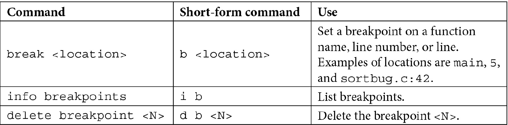
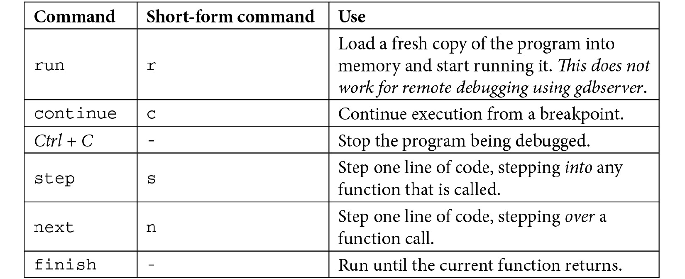
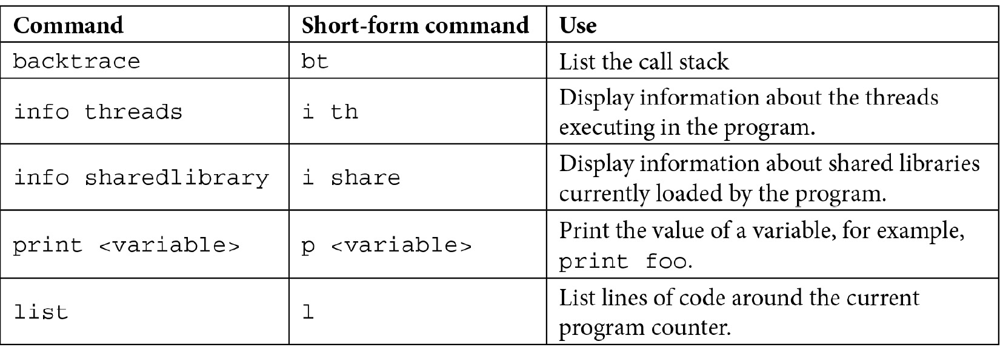
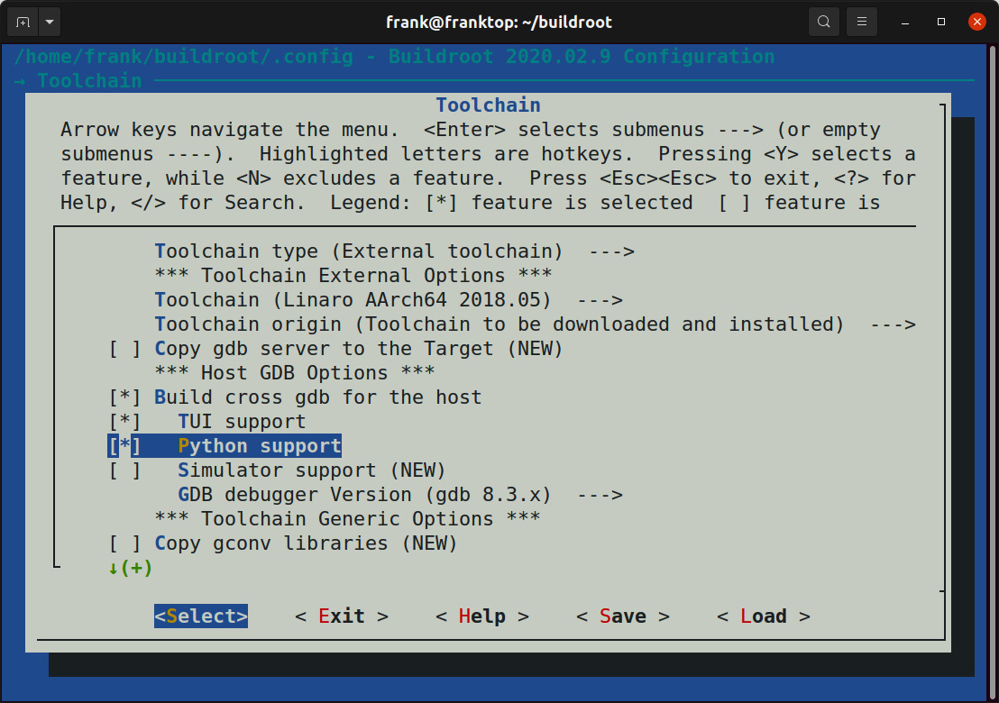
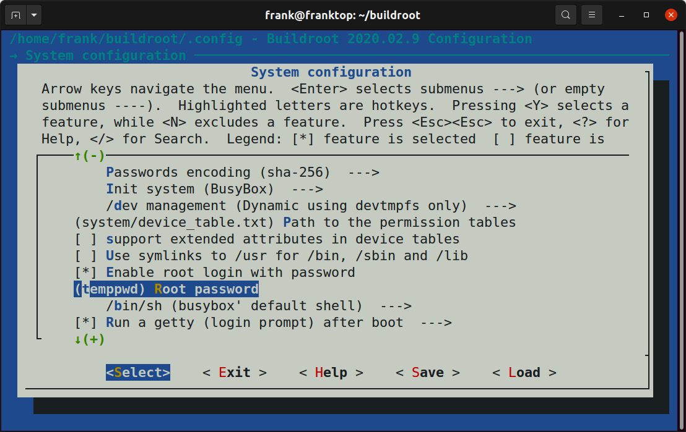
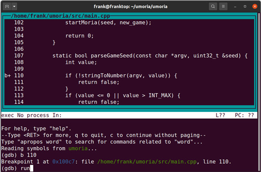
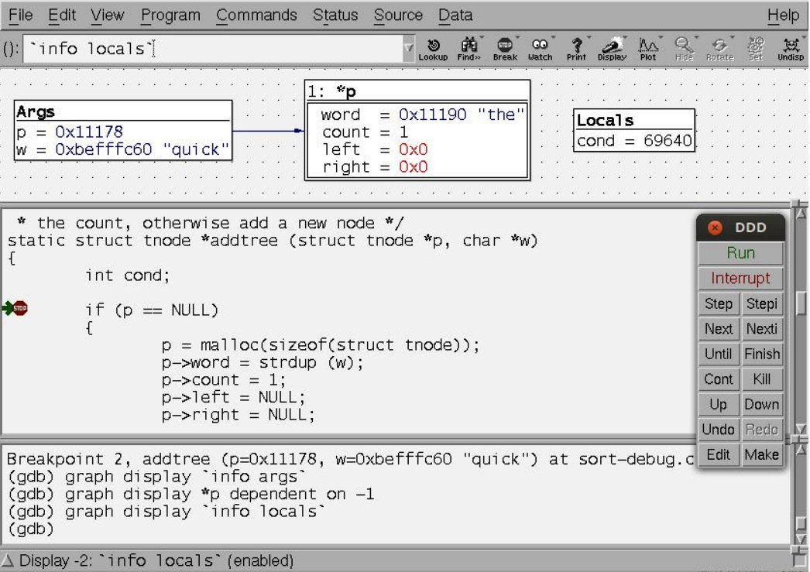
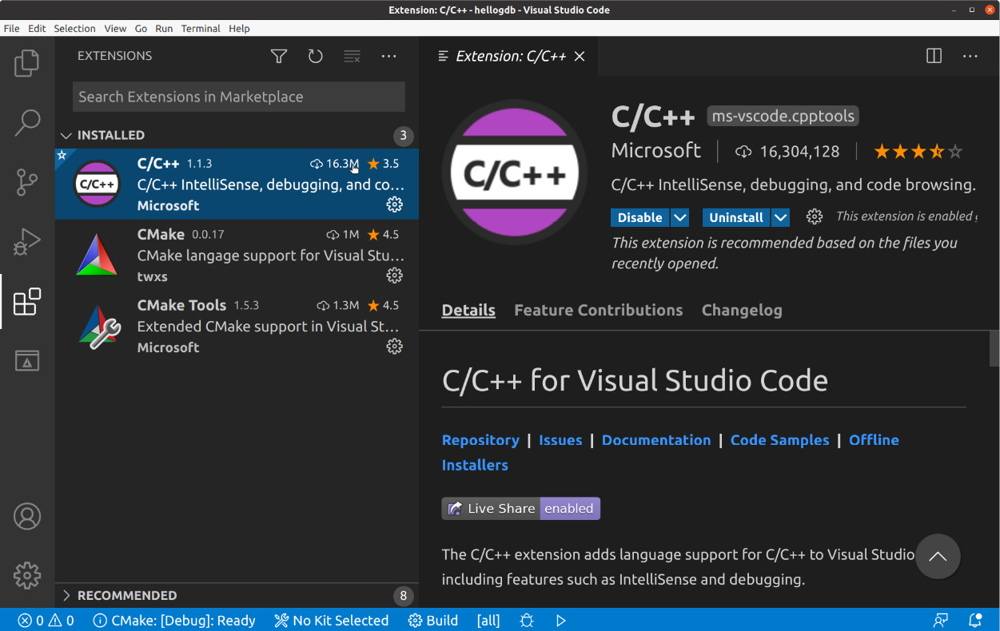
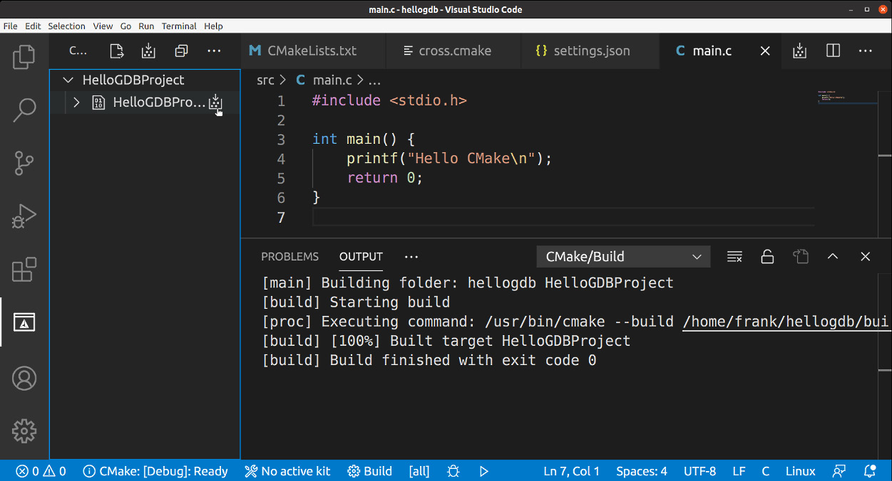
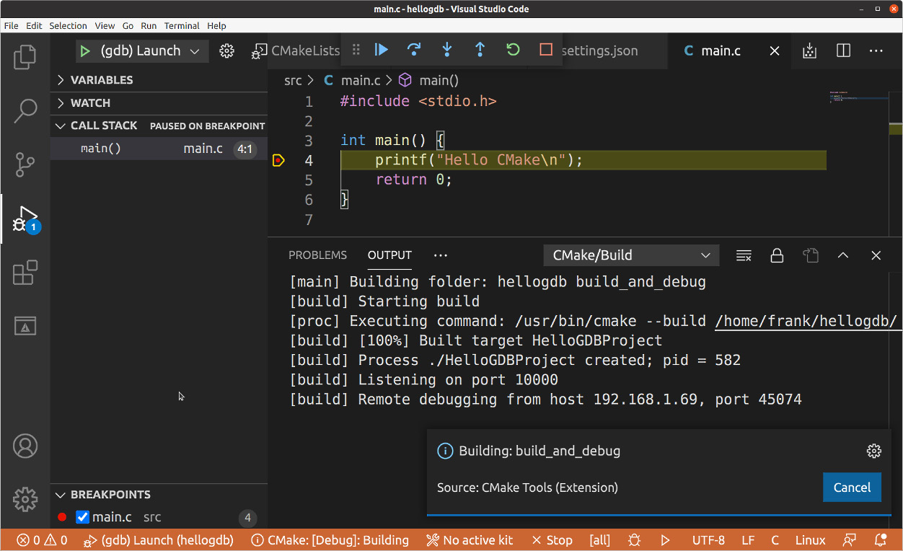

# *Chương 19*: Debug với GDB (Debugging with GDB)

Bug luôn xảy ra. Nhận diện và sửa chúng là một phần của quá trình phát triển. Có nhiều kỹ thuật khác nhau để tìm và mô tả các khiếm khuyết của chương trình, bao gồm phân tích tĩnh và động, code review, tracing, profiling và debug tương tác. Tôi sẽ xem các tracer và profiler ở chương tiếp theo, nhưng ở đây tôi muốn tập trung vào cách tiếp cận truyền thống là quan sát việc thực thi code qua một debugger, mà trong trường hợp của chúng ta là **GNU Project Debugger** (**GDB**). GDB là một công cụ mạnh mẽ và linh hoạt. Bạn có thể dùng nó để debug application, xem xét các file postmortem (core file) được tạo ra sau khi một chương trình crash, và thậm chí step qua code kernel.

Trong chương này, chúng ta sẽ đề cập các chủ đề sau:

- GNU debugger
- Chuẩn bị debug
- Debug application
- Debug Just-in-time
- Debug fork và thread
- Core file
- Giao diện người dùng của GDB
- Debug code kernel

## Yêu cầu kỹ thuật

Để làm theo các ví dụ, hãy bảo đảm bạn có những thứ sau:

- Hệ thống host Linux-based có ít nhất 60 GB dung lượng đĩa trống
- Bản phát hành Buildroot 2020.02.9 LTS
- Bản phát hành Yocto 3.1 (Dunfell) LTS
- Etcher cho Linux
- Đầu đọc thẻ MicroSD và thẻ
- Cáp serial USB to TTL 3.3V
- Raspberry Pi 4
- Nguồn điện USB-C 5V 3A
- Cáp Ethernet và port để kết nối mạng
- BeagleBone Black
- Nguồn điện DC 5V 1A

Lẽ ra bạn đã cài bản phát hành 2020.02.9 LTS của Buildroot cho [*Chương 6*](ch06_selecting_a_build_system.vi.md), *Chọn build system*. Nếu chưa, hãy tham khảo mục *System requirements* của *The Buildroot user manual* ([https://buildroot.org/downloads/manual/manual.html](https://buildroot.org/downloads/manual/manual.html)) trước khi cài Buildroot trên host Linux theo hướng dẫn trong [*Chương 6*](ch06_selecting_a_build_system.vi.md).

Lẽ ra bạn đã cài bản phát hành 3.1 (Dunfell) LTS của Yocto cho [*Chương 6*](ch06_selecting_a_build_system.vi.md), *Chọn build system*. Nếu chưa, hãy tham khảo các mục *Compatible Linux Distribution* và *Build Host Packages* của hướng dẫn *Yocto Project Quick Build* ([https://www.yoctoproject.org/docs/current/brief-yoctoprojectqs/brief-yoctoprojectqs.html](https://www.yoctoproject.org/docs/current/brief-yoctoprojectqs/brief-yoctoprojectqs.html)) trước khi cài Yocto trên host Linux theo hướng dẫn trong [*Chương 6*](ch06_selecting_a_build_system.vi.md).

Toàn bộ code cho chương này có thể được tìm thấy trong thư mục `Chapter19` của repository GitHub của sách: [https://github.com/PacktPublishing/Mastering-Embedded-Linux-Programming-Third-Edition](https://github.com/PacktPublishing/Mastering-Embedded-Linux-Programming-Third-Edition).

## GNU debugger

GDB là một debugger source-level cho các ngôn ngữ biên dịch, chủ yếu là C và C++, dù cũng có hỗ trợ cho nhiều ngôn ngữ khác, chẳng hạn Go và Objective-C. Bạn nên đọc ghi chú của phiên bản GDB bạn đang dùng để biết tình trạng hỗ trợ hiện tại cho các ngôn ngữ khác nhau.

Website của project là [https://www.gnu.org/software/gdb/](https://www.gnu.org/software/gdb/) và nó chứa nhiều thông tin hữu ích, bao gồm hướng dẫn sử dụng GDB, *Debugging with GDB*.

Mặc định, GDB có một giao diện người dùng command-line mà một số người thấy off-putting, dù trên thực tế, nó dễ dùng với một chút luyện tập. Nếu bạn không thích giao diện command-line, có rất nhiều giao diện frontend cho GDB, và tôi sẽ mô tả ba trong số đó ở phần sau của chương này.

## Chuẩn bị debug

Bạn cần biên dịch code bạn muốn debug với debug symbol. GCC cung cấp hai tùy chọn cho việc này: `-g` và `-ggdb`. Tùy chọn sau thêm thông tin debug đặc thù cho GDB, trong khi tùy chọn trước tạo thông tin theo định dạng phù hợp cho hệ điều hành target bạn đang dùng, khiến nó là lựa chọn khả chuyển hơn. Trong trường hợp cụ thể của chúng ta, hệ điều hành target luôn là Linux, và dùng `-g` hay `-ggdb` ít tạo khác biệt. Đáng quan tâm hơn là cả hai tùy chọn đều cho phép bạn chỉ định mức thông tin debug, từ `0` tới `3`:

- `0`: Mức này không tạo thông tin debug nào và tương đương với việc bỏ switch `-g` hay `-ggdb`.
- `1`: Mức này tạo thông tin tối thiểu, nhưng bao gồm tên function và biến bên ngoài, đủ để tạo một backtrace.
- `2`: Đây là mặc định và bao gồm thông tin về biến cục bộ và số dòng để bạn có thể debug source-level và single-step qua code.
- `3`: Mức này bao gồm thêm thông tin mà, cùng những thứ khác, có nghĩa là GDB có thể xử lý macro expansion đúng.

Trong hầu hết trường hợp, `-g` là đủ: hãy dành `-g3` hoặc `-ggdb3` cho khi bạn gặp vấn đề khi step qua code, đặc biệt nếu nó chứa *macro*.

Vấn đề tiếp theo cần xét là mức tối ưu code. Tối ưu của trình biên dịch có xu hướng phá hủy mối quan hệ giữa các dòng source code và machine code, khiến việc step qua source không thể đoán trước. Nếu bạn gặp các vấn đề như vậy, nhiều khả năng bạn sẽ cần biên dịch không tối ưu, bỏ switch biên dịch `-O`, hoặc dùng `-Og`, enable các tối ưu không cản trở việc debug.

Một vấn đề liên quan là stack-frame pointer, thứ GDB cần để tạo một backtrace các lời gọi function cho tới lời gọi hiện tại. Trên một số kiến trúc, GCC sẽ không tạo stack-frame pointer với các mức tối ưu cao hơn (`-O2` trở lên). Nếu bạn thấy mình trong tình huống thực sự phải biên dịch với `-O2`, nhưng vẫn muốn có backtrace, bạn có thể override hành vi mặc định bằng `-fno-omit-frame-pointer`. Cũng hãy để ý code đã được hand-optimized để bỏ frame pointer bằng cách thêm `-fomit-frame-pointer`: bạn có thể muốn tạm thời gỡ những phần đó.

## Debug application

Bạn có thể dùng GDB để debug application theo một trong hai cách: nếu bạn đang phát triển code chạy trên desktop và server, hay thực sự là bất kỳ môi trường nào mà bạn biên dịch và chạy code trên cùng một máy, việc chạy GDB native là tự nhiên. Tuy nhiên, hầu hết việc phát triển nhúng được làm bằng một cross toolchain, và do đó bạn muốn debug code chạy trên thiết bị nhưng điều khiển nó từ môi trường cross-development, nơi bạn có source code và các công cụ. Tôi sẽ tập trung vào trường hợp sau, vì đó là kịch bản có khả năng nhất với lập trình viên nhúng, nhưng tôi cũng sẽ chỉ cho bạn cách thiết lập một hệ thống để debug native. Tôi sẽ không mô tả những điều cơ bản về việc dùng GDB ở đây vì đã có nhiều tài liệu tham khảo tốt về chủ đề đó, bao gồm hướng dẫn sử dụng GDB và mục *Đọc thêm* được đề xuất ở cuối chương.

### Remote debug bằng gdbserver

Component then chốt cho remote debug là debug agent, `gdbserver`, chạy trên target và điều khiển việc thực thi của chương trình đang được debug. `gdbserver` kết nối tới một bản GDB chạy trên máy host qua kết nối mạng hoặc giao diện serial.

Debug qua `gdbserver` gần như, nhưng không hoàn toàn, giống debug native. Các khác biệt chủ yếu xoay quanh việc có hai máy tính tham gia và chúng phải ở đúng trạng thái để việc debug diễn ra. Đây là một số điều cần để ý:

- Ở đầu một phiên debug, bạn cần nạp chương trình bạn muốn debug trên target bằng `gdbserver`, rồi riêng rẽ nạp GDB từ cross toolchain trên host.
- GDB và `gdbserver` cần kết nối với nhau trước khi một phiên debug có thể bắt đầu.
- GDB, chạy trên host, cần được cho biết nơi tìm debug symbol và source code, đặc biệt với shared library.
- Lệnh `run` của GDB không hoạt động như mong đợi.
- `gdbserver` sẽ kết thúc khi phiên debug kết thúc, và bạn sẽ cần khởi động lại nó nếu muốn một phiên debug khác.
- Bạn cần debug symbol và source code cho các binary bạn muốn debug trên host, nhưng không cần trên target. Thường không đủ không gian lưu trữ cho chúng trên target, và chúng sẽ cần được strip trước khi triển khai lên target.
- Tổ hợp GDB/`gdbserver` không hỗ trợ tất cả các tính năng của GDB chạy native: chẳng hạn, `gdbserver` không thể theo child process sau một `fork`, trong khi GDB native có thể.
- Những điều kỳ lạ có thể xảy ra nếu GDB và `gdbserver` thuộc các phiên bản GDB khác nhau, hoặc cùng phiên bản nhưng được cấu hình khác nhau. Lý tưởng nhất, chúng nên được build từ cùng một source bằng build tool yêu thích của bạn.

Debug symbol tăng kích thước file thực thi đáng kể, đôi khi gấp 10 lần. Như đã đề cập trong [*Chương 5*](ch05_building_a_root_filesystem.vi.md), *Xây dựng root filesystem*, có thể hữu ích khi gỡ debug symbol mà không cần biên dịch lại mọi thứ. Công cụ cho việc này là `strip` từ package `binutils` trong cross toolchain của bạn. Bạn có thể điều khiển mức strip bằng các switch sau:

- `--strip-all`: Gỡ tất cả symbol (mặc định).

- `--strip-unneeded`: Gỡ các symbol không cần cho xử lý relocation.

- `--strip-debug`: Chỉ gỡ debug symbol.

  > **Lưu ý quan trọng**
  >
  > Với application và shared library, `--strip-all` (mặc định) là ổn, nhưng khi tới kernel module, bạn sẽ thấy nó ngăn module được nạp. Hãy dùng `--strip-unneeded` thay thế. Tôi vẫn đang tìm một use case cho `–-strip-debug`.

Với điều đó trong đầu, hãy xem các chi tiết cụ thể khi debug với Yocto Project và Buildroot.

### Thiết lập Yocto Project cho remote debug

Có hai việc cần làm để debug application từ xa khi dùng Yocto Project: bạn cần thêm `gdbserver` vào target image, và bạn cần tạo một SDK bao gồm GDB và có debug symbol cho các file thực thi bạn định debug.

Trước tiên, để đưa `gdbserver` vào target image, bạn có thể thêm package một cách tường minh bằng cách thêm dòng này vào `conf/local.conf`:

```
IMAGE_INSTALL_append = " gdbserver"
```

Khi không có serial console, cũng cần thêm một SSH daemon để bạn có cách nào đó khởi động `gdbserver` trên target:

```
EXTRA_IMAGE_FEATURES ?= "ssh-server-openssh"
```

Ngoài ra, bạn có thể thêm `tools-debug` vào `EXTRA_IMAGE_FEATURES`, việc này sẽ thêm `gdbserver`, `gdb` native và `strace` vào target image (tôi sẽ nói về `strace` ở chương tiếp theo):

```
EXTRA_IMAGE_FEATURES ?= "tools-debug ssh-server-openssh"
```

Với phần thứ hai, bạn chỉ cần build một SDK như tôi đã mô tả trong [*Chương 6*](ch06_selecting_a_build_system.vi.md), *Chọn build system*:

```
$ bitbake -c populate_sdk <image>
```

SDK chứa một bản GDB. Nó cũng chứa một `sysroot` cho target với debug symbol cho tất cả các chương trình và thư viện thuộc target image. Cuối cùng, SDK chứa source code cho các file thực thi. Chẳng hạn, xem một SDK được build cho Raspberry Pi 4 và được tạo bởi phiên bản 3.1.5 của Yocto Project, nó được cài mặc định trong `/opt/poky/3.1.5/`. `sysroot` cho target là `/opt/poky/3.1.5/sysroots/aarch64-poky-linux/`. Các chương trình nằm trong `/bin/`, `/sbin/`, `/usr/bin/` và `/usr/sbin/`, tương đối với `sysroot`, và các thư viện nằm trong `/lib/` và `/usr/lib/`. Trong mỗi thư mục này, bạn sẽ tìm thấy một thư mục con tên `.debug/` chứa symbol cho mỗi chương trình và thư viện. GDB biết tìm trong `.debug/` khi tìm thông tin symbol. Source code của các file thực thi được lưu trong `/usr/src/debug/`, tương đối với `sysroot`.

### Thiết lập Buildroot cho remote debug

Buildroot không phân biệt giữa môi trường build và môi trường dùng để phát triển application: không có SDK. Giả sử bạn đang dùng toolchain nội bộ của Buildroot, bạn cần enable các tùy chọn sau để build cross GDB cho host và build `gdbserver` cho target:

- `BR2_PACKAGE_HOST_GDB`, trong **Toolchain | Build cross gdb for the host**
- `BR2_PACKAGE_GDB`, trong **Target packages | Debugging, profiling and benchmark | gdb**
- `BR2_PACKAGE_GDB_SERVER`, trong **Target packages | Debugging, profiling and benchmark | gdbserver**

Bạn cũng cần build các file thực thi với debug symbol, việc này đòi hỏi bạn enable `BR2_ENABLE_DEBUG`, trong **Build options | build packages with debugging symbols**.

Việc này sẽ tạo các thư viện có debug symbol trong `output/host/usr/<arch>/sysroot`.

### Bắt đầu debug

Giờ bạn đã có `gdbserver` được cài trên target và một cross GDB trên host, bạn có thể bắt đầu một phiên debug.

#### Kết nối GDB và gdbserver

Kết nối giữa GDB và `gdbserver` có thể qua mạng hoặc giao diện serial. Trong trường hợp kết nối mạng, bạn khởi chạy `gdbserver` với số port TCP để lắng nghe và, tùy chọn, một địa chỉ IP để chấp nhận kết nối từ đó. Trong hầu hết trường hợp, bạn không quan tâm địa chỉ IP nào sẽ kết nối, nên bạn chỉ cần cung cấp số port. Trong ví dụ này, `gdbserver` chờ kết nối trên port `10000` từ bất kỳ host nào:

```
# gdbserver :10000 ./hello-world
Process hello-world created; pid = 103
Listening on port 10000
```

Tiếp theo, khởi động bản GDB từ toolchain, trỏ nó tới một bản chưa strip của chương trình để GDB có thể nạp symbol table:

```
$ aarch64-poky-linux-gdb hello-world
```

Trong GDB, dùng lệnh `target remote` để kết nối tới `gdbserver`, cho nó địa chỉ IP hoặc hostname của target và port nó đang chờ:

```
(gdb) target remote 192.168.1.101:10000
```

Khi `gdbserver` thấy kết nối từ host, nó in ra như sau:

```
Remote debugging from host 192.168.1.1
```

Quy trình tương tự với kết nối serial. Trên target, bạn cho `gdbserver` biết dùng serial port nào:

```
# gdbserver /dev/ttyO0 ./hello-world
```

Bạn có thể cần cấu hình baud rate của port trước bằng `stty(1)` hoặc một chương trình tương tự. Một ví dụ đơn giản sẽ như sau:

```
# stty -F /dev/ttyO0 115200
```

Có nhiều tùy chọn khác cho `stty`, nên hãy đọc manual page để biết thêm chi tiết. Đáng lưu ý là port không được đang dùng cho việc gì khác. Chẳng hạn, bạn không thể dùng một port đang được dùng làm system console.

Trên host, bạn kết nối tới `gdbserver` bằng `target remote` cộng với serial device ở đầu host của cáp. Trong hầu hết trường hợp, bạn sẽ muốn đặt baud rate của serial port host trước, bằng lệnh GDB `set serial baud`:

```
(gdb) set serial baud 115200
(gdb) target remote /dev/ttyUSB0
```

Dù GDB và `gdbserver` giờ đã kết nối, chúng ta vẫn chưa sẵn sàng đặt breakpoint và bắt đầu step qua source code.

#### Đặt sysroot

GDB cần biết nơi tìm thông tin debug và source code cho chương trình và các shared library bạn đang debug. Khi debug native, các đường dẫn được biết rõ và được tích hợp sẵn trong GDB, nhưng khi dùng một cross toolchain, GDB không có cách nào đoán được gốc của filesystem target nằm ở đâu. Bạn phải cung cấp thông tin này.

Nếu bạn build application bằng Yocto Project SDK, `sysroot` nằm trong SDK, và vì vậy bạn có thể đặt nó trong GDB như thế này:

```
(gdb) set sysroot /opt/poky/3.1.5/sysroots/aarch64-poky-linux
```

Nếu bạn đang dùng Buildroot, bạn sẽ thấy `sysroot` nằm trong `output/host/usr/<toolchain>/sysroot`, và có một symbolic link tới nó trong `output/staging`. Vì vậy, với Buildroot, bạn sẽ đặt `sysroot` như thế này:

```
(gdb) set sysroot /home/chris/buildroot/output/staging
```

GDB cũng cần tìm source code cho các file bạn đang debug. GDB có một search path cho source file, bạn có thể xem bằng lệnh `show directories`:

```
(gdb) show directories
Source directories searched: $cdir:$cwd
```

Đây là các giá trị mặc định: `$cwd` là thư mục làm việc hiện tại của instance GDB chạy trên host; `$cdir` là thư mục nơi source được biên dịch. Giá trị sau được mã hóa vào các object file với tag `DW_AT_comp_dir`. Bạn có thể xem các tag này bằng `objdump --dwarf`, chẳng hạn như thế này:

```
$ aarch64-poky-linux-objdump --dwarf ./helloworld | grep DW_AT_comp_dir
[…]
<160> DW_AT_comp_dir : (indirect string, offset: 0x244): /home/chris/helloworld
[…]
```

Trong hầu hết trường hợp, các giá trị mặc định, `$cdir` và `$cwd`, là đủ, nhưng vấn đề nảy sinh nếu các thư mục đã bị di chuyển giữa lúc biên dịch và lúc debug. Một trường hợp như vậy xảy ra với Yocto Project. Xem kỹ hơn các tag `DW_AT_comp_dir` của một chương trình được biên dịch bằng Yocto Project SDK, bạn có thể để ý thấy điều này:

```
$ aarch64-poky-linux-objdump --dwarf ./helloworld | grep DW_AT_comp_dir
<2f> DW_AT_comp_dir : /usr/src/debug/glibc/2.31-r0/git/csu
<79> DW_AT_comp_dir : (indirect string, offset: 0x139): /usr/src/debug/glibc/2.31-r0/git/csu
<116> DW_AT_comp_dir : /usr/src/debug/glibc/2.31-r0/git/csu
<160> DW_AT_comp_dir : (indirect string, offset: 0x244): /home/chris/helloworld
[…]
```

Ở đây, bạn có thể thấy nhiều tham chiếu tới thư mục `/usr/src/debug/glibc/2.31-r0/git`, nhưng nó ở đâu? Câu trả lời là nó nằm trong `sysroot` của SDK, nên đường dẫn đầy đủ là `/opt/poky/3.1.5/sysroots/aarch64-poky-linux /usr/src/debug/glibc/2.31-r0/git`. SDK chứa source code cho tất cả các chương trình và thư viện trong target image. GDB có một cách đơn giản để đối phó với việc cả một cây thư mục bị di chuyển như thế này: `substitute-path`. Vì vậy, khi debug với Yocto Project SDK, bạn cần dùng các lệnh này:

```
(gdb) set sysroot /opt/poky/3.1.5/sysroots/aarch64-poky-linux
(gdb) set substitute path /usr/src/debug/opt/poky/3.1.5/sysroots/aarch64-poky-linux/usr/src/debug
```

Bạn có thể có thêm các shared library được lưu bên ngoài `sysroot`. Trong trường hợp đó, bạn có thể dùng `set solib-search-path`, có thể chứa một danh sách colon-separated các thư mục để tìm shared library. GDB chỉ tìm `solib-search-path` nếu nó không thể tìm thấy binary trong `sysroot`.

Cách thứ ba để cho GDB biết nơi tìm source code, cho cả thư viện và chương trình, là dùng lệnh `directory`:

```
(gdb) directory /home/chris/MELP/src/lib_mylib
Source directories searched: /home/chris/MELP/src/lib_mylib:$cdir:$cwd
```

Các đường dẫn được thêm theo cách này được ưu tiên vì chúng được tìm *trước* các đường dẫn từ `sysroot` hay `solib-search-path`.

#### File lệnh GDB

Có một số việc bạn cần làm mỗi lần chạy GDB, chẳng hạn đặt `sysroot`. Tiện lợi khi đặt các lệnh như vậy vào một file lệnh và chạy chúng mỗi lần GDB khởi động. GDB đọc lệnh từ `$HOME/.gdbinit`, rồi từ `.gdbinit` trong thư mục hiện tại, và rồi từ các file được chỉ định trên command line với tham số `-x`. Tuy nhiên, các phiên bản GDB gần đây sẽ từ chối nạp `.gdbinit` từ thư mục hiện tại vì lý do bảo mật. Bạn có thể override hành vi đó bằng cách thêm một dòng như thế này vào `$HOME/.gdbinit`:

```
set auto-load safe-path /
```

Ngoài ra, nếu bạn không muốn enable auto-loading toàn cục, bạn có thể chỉ định một thư mục cụ thể như thế này:

```
add-auto-load-safe-path /home/chris/myprog
```

Sở thích cá nhân của tôi là dùng tham số `-x` để trỏ tới file lệnh, cách này làm lộ vị trí của file để tôi không quên nó.

Để giúp bạn thiết lập GDB, Buildroot tạo một file lệnh GDB chứa lệnh `sysroot` đúng trong `output/staging/usr/share/buildroot/gdbinit`. Nó sẽ chứa một dòng tương tự dòng này:

```
set sysroot /home/chris/buildroot/output/host/usr/aarch64-buildroot-linux-gnu/sysroot
```

Giờ GDB đã chạy và có thể tìm thông tin nó cần, hãy xem một số lệnh chúng ta có thể thực hiện với nó.

#### Tổng quan về các lệnh GDB

GDB có nhiều lệnh hơn nữa, được mô tả trong hướng dẫn trực tuyến và trong các tài liệu được đề cập ở mục *Đọc thêm*. Để giúp bạn bắt đầu nhanh nhất có thể, đây là danh sách các lệnh thường dùng nhất. Trong hầu hết trường hợp, có một dạng ngắn cho lệnh, được liệt kê trong các bảng sau.

##### Breakpoint

Đây là các lệnh để quản lý breakpoint:



##### Chạy và step

Đây là các lệnh để điều khiển việc thực thi một chương trình:



##### Lấy thông tin

Đây là các lệnh để lấy thông tin liên quan tới debugger:



Trước khi có thể bắt đầu step qua một chương trình bên trong một phiên debug, trước tiên chúng ta cần đặt một breakpoint ban đầu.

#### Chạy tới một breakpoint

`gdbserver` nạp chương trình vào bộ nhớ và đặt một breakpoint ở lệnh đầu tiên, rồi chờ kết nối từ GDB. Khi kết nối được thiết lập, bạn vào một phiên debug. Tuy nhiên, bạn sẽ thấy rằng nếu cố single-step ngay lập tức, bạn sẽ nhận message này:

```
Cannot find bounds of current function
```

Điều này là vì chương trình đã bị dừng trong code viết bằng assembly, code tạo môi trường runtime cho các chương trình C/C++. Dòng code C/C++ đầu tiên là function `main()`. Giả sử bạn muốn dừng ở `main()`, bạn sẽ đặt một breakpoint ở đó rồi dùng lệnh `continue` (viết tắt `c`) để bảo `gdbserver` tiếp tục từ breakpoint ở đầu chương trình và dừng ở `main()`:

```
(gdb) break main
Breakpoint 1, main (argc=1, argv=0xbefffe24) at helloworld.c:8 printf("Hello, world!\n");
(gdb) c
```

Tại thời điểm này, bạn có thể thấy như sau:

```
Reading /lib/ld-linux.so.3 from remote target...
warning: File transfers from remote targets can be slow. Use "set sysroot" to access files locally instead.
```

Với các phiên bản GDB cũ hơn, thay vào đó bạn có thể thấy:

```
warning: Could not load shared library symbols for 2 libraries, e.g. /lib/libc.so.6.
```

Trong cả hai trường hợp, vấn đề là bạn đã quên đặt `sysroot`! Hãy xem lại mục trước về `sysroot`.

Tất cả điều này rất khác với việc khởi động một chương trình native, nơi bạn chỉ cần gõ `run`. Thực tế, nếu bạn thử gõ `run` trong một phiên remote debug, bạn sẽ hoặc thấy message nói rằng remote target không hỗ trợ lệnh `run`, hoặc với các phiên bản GDB cũ hơn, nó sẽ chỉ treo mà không có giải thích nào.

#### Mở rộng GDB bằng Python

Chúng ta có thể nhúng một Python interpreter đầy đủ vào GDB để mở rộng chức năng của nó. Việc này được làm bằng cách cấu hình GDB với tùy chọn `--with-python` trước khi build. GDB có một API đưa ra phần lớn trạng thái nội bộ của nó dưới dạng các object Python. API này cho phép chúng ta định nghĩa các lệnh GDB tùy biến dưới dạng script viết bằng Python. Các lệnh bổ sung này có thể bao gồm các công cụ hỗ trợ debug hữu ích như tracepoint và pretty printer không được tích hợp sẵn trong GDB.

##### Build GDB với hỗ trợ Python

Chúng ta đã đề cập *Thiết lập Buildroot cho remote debug*. Có một số bước bổ sung cần để enable hỗ trợ Python bên trong GDB. Tại thời điểm viết sách, Buildroot chỉ hỗ trợ nhúng Python 2.7 vào GDB, điều đáng tiếc, nhưng tốt hơn là không có hỗ trợ Python nào. Chúng ta không thể dùng một toolchain do Buildroot tạo để build GDB có hỗ trợ Python vì nó thiếu một số hỗ trợ thread cần thiết.

Để build cross GDB cho host có hỗ trợ Python, thực hiện các bước sau:

1. Điều hướng tới thư mục nơi bạn đã cài Buildroot:

   ```
   $ cd buildroot
   ```

2. Sao chép file cấu hình cho board mà bạn muốn build image:

   ```
   $ cd configs
   $ cp raspberrypi4_64_defconfig rpi4_64_gdb_defconfig
   $ cd ..
   ```

3. Dọn các build artifact trước đó khỏi thư mục `output`:

   ```
   $ make clean
   ```

4. Kích hoạt file cấu hình của bạn:

   ```
   $ make rpi4_64_gdb_defconfig
   ```

5. Bắt đầu tùy biến image:

   ```
   $ make menuconfig
   ```

6. Enable việc dùng một external toolchain bằng cách điều hướng tới **Toolchain | Toolchain type | External toolchain** và chọn tùy chọn đó.

7. Lùi ra khỏi **External toolchain** và mở submenu **Toolchain**. Chọn một toolchain đã biết là hoạt động, chẳng hạn **Linaro AArch64 2018.05**, làm external toolchain.

8. Chọn **Build cross gdb for the host** từ trang **Toolchain** và enable cả **TUI support** lẫn **Python support**:

   

   *Hình 19.1 – Hỗ trợ Python trong GDB*

9. Đi sâu vào submenu **GDB debugger Version** từ trang **Toolchain** và chọn phiên bản GDB mới nhất có trong Buildroot.

10. Lùi ra khỏi trang **Toolchain** và đi sâu vào **Build options**. Chọn **build packages with debugging symbols**.

11. Lùi ra khỏi trang **Build options** và đi sâu vào **System Configuration** và chọn **Enable root login with password**. Mở **Root password** và nhập một mật khẩu non-empty vào trường văn bản:

    

    *Hình 19.2 – Root password*

12. Lùi ra khỏi trang **System Configuration** và đi sâu vào **Target packages | Debugging, profiling and benchmark**. Chọn package **gdb** để thêm `gdbserver` vào target image.

13. Lùi ra khỏi **Debugging, profiling and benchmark** và đi sâu vào **Target packages | Networking applications**. Chọn package **dropbear** để enable truy cập `scp` và `ssh` tới target. Lưu ý rằng `dropbear` không cho phép truy cập `scp` và `ssh` với `root` mà không có mật khẩu.

14. Thêm entropy daemon **haveged**, có thể tìm thấy dưới **Target packages | Miscellaneous** để SSH có sẵn nhanh hơn khi boot.

15. Thêm một package khác vào image để bạn có thứ gì đó để debug. Tôi chọn công cụ binary patch/diff `bsdiff`, được viết bằng C và có thể tìm thấy dưới **Target packages | Development tools**.

16. Lưu các thay đổi và thoát `menuconfig` của Buildroot.

17. Lưu các thay đổi vào file cấu hình:

    ```
    $ make savedefconfig
    ```

18. Build image cho target:

    ```
    $ make
    ```

Một file `rpi4_64_gdb_defconfig` làm sẵn cho Raspberry Pi 4 có thể được tìm thấy trong archive code của chương này nếu bạn muốn bỏ qua các bước `menuconfig` trên. Hãy sao chép file đó từ `MELP/Chapter19/buildroot/configs/` vào thư mục `buildroot/configs` và chạy `make` trên đó nếu bạn thích.

Khi build xong, sẽ có một file `sdcard.img` bootable trong `output/images/` mà bạn có thể ghi ra thẻ microSD bằng Etcher. Cắm thẻ microSD đó vào thiết bị target và boot nó. Kết nối thiết bị target với mạng cục bộ bằng cáp Ethernet và tìm địa chỉ IP của nó bằng `arp-scan`. SSH vào thiết bị với tư cách `root` và nhập mật khẩu bạn đã đặt khi cấu hình image. Tôi đã chỉ định `temppwd` làm mật khẩu `root` cho image `rpi4_64_gdb_defconfig` của mình.

Bây giờ, hãy debug `bsdiff` từ xa bằng GDB:

1. Đầu tiên, điều hướng tới thư mục `/usr/bin` trên target:

   ```
   # cd /usr/bin
   ```

2. Sau đó, khởi động `bsdiff` với `gdbserver`, như chúng ta đã làm với `helloworld` trước đó:

   ```
   # gdbserver :10000 ./bsdiff pcregrep pcretest out
   Process ./bsdiff created; pid = 169
   Listening on port 10000
   ```

3. Tiếp theo, khởi động bản GDB từ toolchain, trỏ nó tới một bản chưa strip của chương trình để GDB có thể nạp symbol table:

   ```
   $ cd output/build/bsdiff-4.3
   $ ~/buildroot/output/host/bin/aarch64-linux-gdb bsdiff
   ```

4. Trong GDB, đặt `sysroot` như thế này:

   ```
   (gdb) set sysroot ~/buildroot/output/staging
   ```

5. Sau đó, dùng lệnh target remote để kết nối tới `gdbserver`, cho nó địa chỉ IP hoặc hostname của target và port nó đang chờ:

   ```
   (gdb) target remote 192.168.1.101:10000
   ```

6. Khi `gdbserver` thấy kết nối từ host, nó in ra như sau:

   ```
   Remote debugging from host 192.168.1.1
   ```

7. Giờ chúng ta có thể nạp các script lệnh Python như `tp.py` vào GDB từ `<data-directory>/python` và dùng các lệnh này như sau:

   ```
   (gdb) source tp.py
   (gdb) tp search
   ```

   Trong trường hợp này, `tp` là tên của lệnh *tracepoint* và `search` là tên của một function đệ quy trong `bsdiff`.

8. Để hiển thị thư mục nơi GDB tìm các script lệnh Python, thực thi lệnh sau:

   ```
   (gdb) show data-directory
   ```

Hỗ trợ Python trong GDB cũng có thể được dùng để debug các chương trình Python. GDB có khả năng nhìn vào bên trong CPython mà debugger `pdb` tiêu chuẩn cho Python không có. Nó thậm chí có thể inject code Python vào một process Python đang chạy. Điều này cho phép tạo ra các công cụ debug mạnh mẽ, như Python 3 memory analyzer này ([https://github.com/facebookincubator/memory-analyzer](https://github.com/facebookincubator/memory-analyzer)) của Facebook.

### Debug native

Chạy một bản GDB native trên target không phổ biến bằng chạy từ xa, nhưng có thể làm được. Ngoài việc cài GDB vào target image, bạn cũng sẽ cần các bản chưa strip của các file thực thi bạn muốn debug và source code tương ứng được cài vào target image. Cả Yocto Project và Buildroot đều cho phép bạn làm điều này.

> **Lưu ý quan trọng**
>
> Dù debug native không phải hoạt động phổ biến với lập trình viên nhúng, chạy các công cụ profile và trace trên target là rất phổ biến. Các công cụ này thường hoạt động tốt nhất nếu bạn có binary chưa strip và source code trên target, đó là một nửa câu chuyện tôi đang kể ở đây. Tôi sẽ quay lại chủ đề này ở chương tiếp theo.

#### Yocto Project

Để bắt đầu, thêm `gdb` vào target image bằng cách thêm dòng này vào `conf/local.conf`:

```
EXTRA_IMAGE_FEATURES ?= "tools-debug dbg-pkgs"
```

Bạn cần thông tin debug cho các package bạn muốn debug. Yocto Project build các biến thể debug của package, chứa binary chưa strip và source code. Bạn có thể thêm các debug package này một cách chọn lọc vào target image bằng cách thêm `<package name>-dbg` vào `conf/local.conf`. Hoặc, bạn có thể đơn giản cài *tất cả* debug package bằng cách thêm `dbg-pkgs` vào `EXTRA_IMAGE_FEATURES`, như vừa được thể hiện. Hãy lưu ý rằng việc này sẽ tăng kích thước target image đáng kể, có lẽ thêm vài trăm megabyte.

Source code được cài vào `/usr/src/debug/<package name>` trong target image. Điều này có nghĩa là GDB sẽ tìm thấy nó mà không cần chạy `set substitute-path`. Nếu bạn không cần source, bạn có thể ngăn nó được cài bằng cách thêm dòng này vào file `conf/local.conf`:

```
PACKAGE_DEBUG_SPLIT_STYLE = "debug-without-src"
```

#### Buildroot

Với Buildroot, bạn có thể bảo nó cài một bản GDB native vào target image bằng cách enable tùy chọn này:

- `BR2_PACKAGE_GDB_DEBUGGER` trong **Target packages | Debugging, profiling and benchmark | Full debugger**

Sau đó, để build binary với thông tin debug và cài chúng vào target image mà không strip, hãy enable tùy chọn thứ nhất và disable tùy chọn thứ hai trong hai tùy chọn sau:

- `BR2_ENABLE_DEBUG` trong **Build options | Build packages with debugging symbols**
- `BR2_STRIP_strip` trong **Build options | Strip target binaries**

Đó là tất cả những gì tôi muốn nói về debug native. Một lần nữa, thực hành này không phổ biến trên thiết bị nhúng vì source code và debug symbol bổ sung làm target image phình to. Tiếp theo, hãy xem một dạng remote debug khác.

## Debug Just-in-time

Đôi khi, một chương trình sẽ bắt đầu hoạt động sai sau khi đã chạy một thời gian, và bạn muốn biết nó đang làm gì. Tính năng *attach* của GDB làm đúng điều này. Tôi gọi nó là debug just-in-time. Nó có sẵn với cả phiên debug native lẫn remote.

Trong trường hợp remote debug, bạn cần tìm PID của process cần debug và truyền nó cho `gdbserver` với tùy chọn `--attach`. Chẳng hạn, nếu PID là `109`, bạn sẽ gõ:

```
# gdbserver --attach :10000 109
Attached; pid = 109
Listening on port 10000
```

Việc này buộc process dừng như thể nó đang ở một breakpoint, cho phép bạn khởi động cross GDB theo cách bình thường và kết nối tới `gdbserver`. Khi xong, bạn có thể `detach`, cho phép chương trình tiếp tục chạy mà không có debugger:

```
(gdb) detach
Detaching from program: /home/chris/MELP/helloworld/helloworld, process 109
Ending remote debugging.
```

Attach vào một process đang chạy theo PID chắc chắn tiện lợi, nhưng còn các chương trình multi-process hay multithreaded thì sao? Cũng có các kỹ thuật để debug những loại chương trình đó bằng GDB.

## Debug fork và thread

Điều gì xảy ra khi chương trình bạn đang debug fork? Phiên debug theo parent process hay child? Hành vi này được điều khiển bởi `follow-fork-mode`, có thể là `parent` hoặc `child`, với `parent` là mặc định. Đáng tiếc, các phiên bản hiện tại (10.1) của `gdbserver` không hỗ trợ tùy chọn này, nên nó chỉ hoạt động khi debug native. Nếu bạn thực sự cần debug child process khi dùng `gdbserver`, một cách lách là sửa code để child lặp trên một biến ngay sau khi fork, cho bạn cơ hội attach một phiên `gdbserver` mới vào nó rồi đặt biến để nó thoát khỏi vòng lặp.

Khi một thread trong một process multithreaded chạm một breakpoint, hành vi mặc định là tất cả thread dừng lại. Trong hầu hết trường hợp, đây là điều tốt nhất nên làm vì nó cho phép bạn xem các biến tĩnh mà không bị các thread khác thay đổi. Khi bạn tiếp tục thực thi thread, tất cả các thread đã dừng đều khởi động lại, ngay cả khi bạn đang single-stepping, và chính trường hợp cuối này có thể gây ra vấn đề. Có một cách để sửa đổi cách GDB xử lý các thread đã dừng, qua một tham số gọi là `scheduler-locking`. Thông thường nó là `off`, nhưng nếu bạn đặt nó thành `on`, chỉ thread đã dừng ở breakpoint được tiếp tục và các thread khác vẫn dừng, cho bạn cơ hội xem riêng thread đó làm gì mà không bị can thiệp. Điều này tiếp tục như vậy cho đến khi bạn tắt `scheduler-locking`. `gdbserver` hỗ trợ tính năng này.

## Core file

Core file ghi lại trạng thái của một chương trình bị lỗi tại thời điểm nó kết thúc. Bạn thậm chí không cần phải có mặt với một debugger khi bug xuất hiện. Vì vậy, khi bạn thấy `Segmentation fault (core dumped)`, đừng nhún vai; hãy điều tra **core file** và khai thác mỏ vàng thông tin trong đó.

Nhận xét đầu tiên là core file không được tạo theo mặc định, mà chỉ khi giới hạn tài nguyên core file cho process là non-zero. Bạn có thể thay đổi nó cho shell hiện tại bằng `ulimit -c`. Để gỡ mọi giới hạn về kích thước core file, gõ lệnh sau:

```
$ ulimit -c unlimited
```

Theo mặc định, core file có tên `core` và được đặt trong thư mục làm việc hiện tại của process, thư mục được trỏ tới bởi `/proc/<PID>/cwd`. Có một số vấn đề với cơ chế này. Thứ nhất, khi xem một thiết bị có vài file tên `core`, không rõ chương trình nào đã tạo ra từng file. Thứ hai, thư mục làm việc hiện tại của process có thể nằm trong một filesystem read-only, có thể không đủ không gian để lưu core file, hoặc process có thể không có quyền ghi vào thư mục làm việc hiện tại.

Có hai file điều khiển việc đặt tên và vị trí của core file. File thứ nhất là `/proc/sys/kernel/core_uses_pid`. Ghi `1` vào nó khiến số PID của process đang chết được nối vào tên file, điều phần nào hữu ích miễn là bạn có thể liên kết số PID với một tên chương trình từ các file log.

Hữu ích hơn nhiều là `/proc/sys/kernel/core_pattern`, file cho bạn nhiều quyền kiểm soát hơn đối với core file. Pattern mặc định là core, nhưng bạn có thể đổi nó thành một pattern gồm các meta character sau:

- `%p`: PID
- `%u`: UID thực của process bị dump
- `%g`: GID thực của process bị dump
- `%s`: Số của signal gây ra dump
- `%t`: Thời điểm dump, biểu diễn bằng số giây kể từ Epoch, 1970-01-01 00:00:00 +0000 (UTC)
- `%h`: Hostname
- `%e`: Tên file thực thi
- `%E`: Đường dẫn của file thực thi, với các dấu gạch chéo (`/`) được thay bằng dấu chấm than (`!`)
- `%c`: Giới hạn tài nguyên mềm cho kích thước core file của process bị dump

Bạn cũng có thể dùng một pattern bắt đầu bằng một tên thư mục tuyệt đối để tất cả core file được gom vào một chỗ. Làm ví dụ, pattern sau đặt tất cả core file vào thư mục `/corefiles` và đặt tên chúng theo tên chương trình và thời điểm crash:

```
# echo /corefiles/core.%e.%t > /proc/sys/kernel/core_pattern
```

Sau một lần `core` dump, bạn sẽ thấy đại loại như thế này:

```
# ls /corefiles
core.sort-debug.1431425613
```

Để biết thêm thông tin, tham khảo manual page `core(5)`.

### Dùng GDB để xem core file

Đây là một phiên GDB mẫu xem một file `core`:

```
$ arm-poky-linux-gnueabi-gdb sort-debug /home/chris/rootfs/corefiles/core.sort-debug.1431425613
[…]
Core was generated by `./sort-debug'.
Program terminated with signal SIGSEGV, Segmentation fault.
#0 0x000085c8 in addtree (p=0x0, w=0xbeac4c60 "the") at sort-debug.c:41
41 p->word = strdup (w);
```

Điều này cho thấy chương trình dừng ở dòng `41`. Lệnh list hiển thị code xung quanh:

```
(gdb) list
37 static struct tnode *addtree (struct tnode *p, char *w)
38 {
39 int cond;
40
41 p->word = strdup (w);
42 p->count = 1;
43 p->left = NULL;
44 p->right = NULL;
45
```

Lệnh `backtrace` (viết tắt `bt`) cho thấy chúng ta tới điểm này như thế nào:

```
(gdb) bt
#0 0x000085c8 in addtree (p=0x0, w=0xbeac4c60 "the") at sort-debug.c:41
#1 0x00008798 in main (argc=1, argv=0xbeac4e24) at sort-debug.c:89
```

Đây là một lỗi hiển nhiên: `addtree()` được gọi với một con trỏ null.

GDB khởi đầu là một debugger command-line và nhiều người vẫn dùng nó theo cách này. Dù debugger LLDB của project LLVM đang ngày càng phổ biến, GCC và GDB vẫn là trình biên dịch và debugger nổi bật cho Linux. Cho đến giờ, chúng ta chỉ tập trung vào giao diện command-line của GDB. Bây giờ chúng ta sẽ xem một số frontend cho GDB với giao diện người dùng ngày càng hiện đại hơn.

## Giao diện người dùng của GDB

GDB được điều khiển ở mức thấp qua GDB machine interface, GDB/MI, có thể được dùng để bọc GDB trong một giao diện người dùng hoặc như một phần của một chương trình lớn hơn, và nó mở rộng đáng kể các lựa chọn có sẵn cho bạn.

Trong mục này, tôi sẽ mô tả ba giao diện rất phù hợp để debug target nhúng: **Terminal User Interface** (**TUI**), **Data Display Debugger** (**DDD**) và Visual Studio Code.

### Terminal User Interface

**Terminal User Interface** (**TUI**) là một phần tùy chọn của package GDB tiêu chuẩn. Tính năng chính là một cửa sổ code hiển thị dòng code sắp được thực thi, cùng với mọi breakpoint. Nó là một cải tiến rõ rệt so với lệnh list trong GDB chế độ command-line.

Điểm hấp dẫn của TUI là nó chỉ việc hoạt động mà không cần thiết lập thêm, và vì nó ở chế độ văn bản, có thể dùng nó qua một phiên terminal SSH, chẳng hạn khi chạy `gdb` native trên target. Hầu hết cross toolchain cấu hình GDB với TUI. Chỉ cần thêm `-tui` vào command line và bạn sẽ thấy như sau:



*Hình 19.3 – TUI*

Nếu bạn vẫn thấy TUI thiếu sót và thích một frontend thực sự đồ họa cho GDB, project GNU cũng cung cấp một cái như vậy ([https://www.gnu.org/software/ddd](https://www.gnu.org/software/ddd)).

### Data Display Debugger

**Data Display Debugger** (**DDD**) là một chương trình standalone đơn giản cho bạn một giao diện người dùng đồ họa cho GDB với tối thiểu phiền phức, và dù các điều khiển UI trông lỗi thời, nó làm mọi thứ cần thiết.

Tùy chọn `--debugger` bảo DDD dùng GDB từ toolchain của bạn, và bạn có thể dùng đối số `-x` để cho đường dẫn tới một file lệnh GDB:

```
$ ddd --debugger arm-poky-linux-gnueabi-gdb -x gdbinit sort-debug
```

Ảnh chụp màn hình sau khoe một trong những tính năng hay nhất: cửa sổ dữ liệu, chứa các mục trong một lưới mà bạn có thể sắp xếp lại tùy ý. Nếu bạn double-click vào một con trỏ, nó được mở rộng thành một mục dữ liệu mới và liên kết được hiển thị bằng một mũi tên:



*Hình 19.4 – DDD*

Nếu không frontend GDB nào trong hai cái này chấp nhận được vì bạn là một lập trình viên web full stack quen làm việc với các công cụ mới nhất trong ngành của mình, thì chúng tôi vẫn có giải pháp cho bạn.

### Visual Studio Code

**Visual Studio Code** là một trình soạn thảo code open source rất phổ biến của Microsoft. Vì nó là một application Electron viết bằng TypeScript, Visual Studio Code cảm giác nhẹ hơn và phản hồi nhanh hơn các IDE full-blown như Eclipse. Có hỗ trợ ngôn ngữ phong phú (code completion, go to definition, v.v.) cho nhiều ngôn ngữ thông qua các extension được cộng đồng người dùng lớn của nó đóng góp. Remote cross GDB debug có thể được tích hợp vào Visual Studio Code bằng các extension cho CMake và C/C++.

#### Cài Visual Studio Code

Cách dễ nhất để cài Visual Studio Code trên một hệ thống Ubuntu Linux là dùng `snap`:

```
$ sudo snap install --classic code
```

Trước khi có thể tạo một project C/C++ mà chúng ta có thể triển khai lên Raspberry Pi 4 và debug từ xa, trước tiên chúng ta cần một toolchain.

#### Cài toolchain

Chúng ta sẽ dùng Yocto để build một SDK cho Raspberry Pi 4. SDK này sẽ bao gồm một toolchain nhắm tới các lõi Arm 64-bit của Raspberry Pi 4. Chúng ta đã dùng Yocto để build một image Arm 64-bit cho Raspberry Pi 4 trong mục *Build một BSP có sẵn* của [*Chương 7*](ch07_developing_with_yocto.vi.md), *Phát triển với Yocto*.

Hãy dùng cùng thư mục output `poky/build-rpi` từ chương đó để build một image `core-image-minimal-dev` mới và SDK tương ứng cho image đó:

1. Đầu tiên, điều hướng tới một cấp phía trên thư mục nơi bạn đã clone Yocto.

2. Tiếp theo, source môi trường build `build-rpi`:

   ```
   $ source poky/oe-init-build-env build-rpi
   ```

3. Sửa `conf/local.conf` để nó bao gồm những dòng sau:

   ```
   MACHINE ?= "raspberrypi4-64"
   IMAGE_INSTALL_append = " gdbserver"
   EXTRA_IMAGE_FEATURES ?= "ssh-server-openssh debug-tweaks"
   ```

   Tính năng `debug-tweaks` loại bỏ nhu cầu mật khẩu `root` để các công cụ command-line như `scp` và `ssh` có thể được dùng để triển khai và chạy các binary vừa build từ host lên target.

4. Sau đó, build development image cho Raspberry Pi 4:

   ```
   $ bitbake core-image-minimal-dev
   ```

5. Dùng Etcher để ghi image `core-image-minimal-dev-raspberrypi4-64.wic.bz2` kết quả từ `tmp/deploy/images/raspberrypi4-64/` ra thẻ microSD và boot nó trên Raspberry Pi 4.

6. Cắm Raspberry Pi 4 vào mạng cục bộ qua Ethernet và dùng `arp-scan` để tìm địa chỉ IP của Raspberry Pi 4. Chúng ta sẽ cần địa chỉ IP này sau khi *Cấu hình CMake* cho remote debug.

7. Cuối cùng, build SDK:

   ```
   $ bitbake -c populate_sdk core-image-minimal-dev
   ```

   > **Lưu ý quan trọng**
   >
   > Đừng bao giờ dùng `debug-tweaks` trong production image. Một pipeline CI/CD tự động cho cập nhật phần mềm OTA là thiết yếu, nhưng phải hết sức cẩn thận để bảo đảm development image không vô tình lọt ra production.

Giờ chúng ta có một trình cài self-extracting tên `poky-glibc-x86_64-core-image-minimal-dev-aarch64-raspberrypi4-64-toolchain-3.1.5.sh` trong thư mục `tmp/deploy/sdk` dưới `poky/build-rpi` mà chúng ta có thể dùng để cài SDK vừa build này trên bất kỳ máy phát triển Linux nào. Tìm trình cài SDK trong `tmp/deploy/sdk` và chạy nó:

```
$ ./poky-glibc-x86_64-core-image-minimal-dev-aarch64-raspberrypi4-64-toolchain-3.1.5.sh
Poky (Yocto Project Reference Distro) SDK installer version 3.1.5
=================================================================
Enter target directory for SDK (default: /opt/poky/3.1.5):
You are about to install the SDK to "/opt/poky/3.1.5". Proceed [Y/n]? Y
[sudo] password for frank:
Extracting SDK..........................................................done
Setting it up...done
SDK has been successfully set up and is ready to be used.
Each time you wish to use the SDK in a new shell session, you need to source the environment setup script e.g.
 $ . /opt/poky/3.1.5/environment-setup-aarch64-poky-linux
```

Hãy để ý rằng SDK đã được cài vào `/opt/poky/3.1.5`. Chúng ta sẽ không source `environment-setup-aarch64-poky-linux` như được chỉ dẫn, nhưng nội dung của file đó sẽ được dùng để điền các file project sắp tới cho Visual Studio Code.

#### Cài CMake

Chúng ta sẽ dùng **CMake** để cross-compile code C mà chúng ta sẽ triển khai và debug trên Raspberry Pi 4. Để cài CMake trên Ubuntu Linux, thực thi lệnh sau:

```
$ sudo apt update
$ sudo apt install cmake
```

Lẽ ra CMake đã được cài trên máy host của bạn như một phần của [*Chương 2*](ch02_learning_about_toolchains.vi.md), *Tìm hiểu về toolchain*.

#### Tạo một project Visual Studio Code

Các project được build bằng CMake có một cấu trúc chuẩn bao gồm một file `CMakeLists.txt` và các thư mục `src` và `build` riêng.

Tạo một project Visual Studio Code tên `hellogdb` trong thư mục home của bạn:

```
$ mkdir hellogdb
$ cd hellogdb
$ mkdir src build
$ code .
```

Lệnh `code .` cuối cùng sẽ khởi chạy Visual Studio Code và mở thư mục `hellogdb`. Một thư mục ẩn `.vscode` chứa `settings.json` và `launch.json` cho một project cũng được tạo khi bạn khởi chạy Visual Studio Code từ một thư mục.

#### Cài các extension Visual Studio Code

Chúng ta cần cài các extension Visual Studio Code sau để cross-compile và debug code bằng toolchain từ SDK:

- C/C++ của Microsoft
- CMake của twxs
- CMake Tools của Microsoft

Click vào biểu tượng **Extensions** ở cạnh trái cửa sổ Visual Studio Code, tìm các extension này trong marketplace và cài chúng. Khi đã cài, sidebar **Extensions** của bạn sẽ trông đại loại như thế này:



*Hình 19.5 – Extensions*

Bây giờ chúng ta sẽ dùng CMake để tích hợp toolchain đi kèm SDK mà chúng ta đã build để cross-compile và debug project `hellogdb`.

#### Cấu hình CMake

Chúng ta cần điền `CMakeLists.txt` và `cross.cmake` để cross-compile project `hellogdb` bằng toolchain của mình:

1. Đầu tiên, sao chép `MELP/Chapter19/hellogdb/CMakeLists.txt` vào thư mục project `hellogdb` trong thư mục home của bạn.

2. Từ bên trong Visual Studio Code, click vào biểu tượng **Explorer** ở góc upper-left của cửa sổ Visual Studio để mở sidebar **Explorer**.

3. Click vào `CMakeLists.txt` trong sidebar **Explorer** để xem nội dung file. Hãy để ý rằng tên project được định nghĩa là `HelloGDBProject` và địa chỉ IP của board target được hardcode là `192.168.1.128`.

4. Đổi nó cho khớp địa chỉ IP của Raspberry Pi 4 của bạn và lưu file `CMakeLists.txt`.

5. Mở rộng thư mục **src** và click vào biểu tượng **New File** trong sidebar **Explorer** để tạo một file tên `main.c` bên trong thư mục `src` của project `hellogdb`.

6. Dán code sau vào source file `main.c` đó và lưu nó:

   ```
   #include <stdio.h>
   int main() {
       printf("Hello CMake\n");
       return 0;
   }
   ```

7. Sao chép `MELP/Chapter19/hellogdb/cross.cmake` vào thư mục project `hellogdb` trong thư mục home của bạn.

8. Cuối cùng, click vào `cross.cmake` trong sidebar **Explorer** để xem nội dung file. Hãy để ý rằng các đường dẫn `sysroot_target` và `tools` được định nghĩa trong `cross.cmake` trỏ tới thư mục `/opt/poky/3.1.5` nơi chúng ta đã cài SDK. Cũng hãy để ý rằng giá trị của các biến `CMAKE_C_COMPILE`, `CMAKE_CXX_COMPILE` và `CMAKE_CXX_FLAGS` được lấy trực tiếp từ script thiết lập môi trường đi kèm SDK.

Với hai file này đã có, chúng ta gần như sẵn sàng build project `hellogdb`.

#### Cấu hình thiết lập project để build

Bây giờ, hãy cấu hình file `settings.json` cho project `hellogdb` để dùng `CMakeLists.txt` và `cross.cmake` cho việc build:

1. Với project `hellogdb` đang mở trong Visual Studio Code, nhấn *Ctrl + Shift + P* để mở trường **Command Palette**.

2. Nhập `>settings.json` vào trường **Command Palette** và chọn **Preferences: Open Workspace Settings (JSON)** từ danh sách tùy chọn.

3. Sửa `.vscode/settings.json` cho `hellogdb` để nó trông đại loại như thế này:

   ```
   {
       "cmake.sourceDirectory": "${workspaceFolder}",
       "cmake.configureArgs": [
           "-DCMAKE_TOOLCHAIN_FILE=${workspaceFolder}/cross.cmake"
       ],
       "C_Cpp.default.configurationProvider": "ms-vscode.cmake-tools"
   }
   ```

   Hãy để ý tham chiếu tới `cross.cmake` trong định nghĩa của `cmake.configureArgs`.

4. Nhấn *Ctrl + Shift + P* để mở lại trường **Command Palette**.

5. Nhập `>CMake: Delete Cache and Configuration` vào trường **Command Palette** và thực thi nó.

6. Click vào biểu tượng **CMake** ở cạnh trái cửa sổ Visual Studio để mở sidebar **CMake**.

7. Click vào binary `HelloGDBProject` trong sidebar **CMake** để build nó:



*Hình 19.6 – Build HelloGDBProject*

Nếu bạn đã cấu hình mọi thứ đúng, nội dung của pane **Output** sẽ trông như thế này:

```
[main] Building folder: hellogdb HelloGDBProject
[build] Starting build
[proc] Executing command: /usr/bin/cmake --build /home/frank/hellogdb/build --config Debug --target HelloGDBProject -- -j 14
[build] [100%] Built target HelloGDBProject
[build] Build finished with exit code 0
```

Giờ chúng ta đã dùng Visual Studio Code để build một binary thực thi nhắm tới Arm 64-bit, hãy triển khai nó lên Raspberry Pi 4 để remote debug.

#### Cấu hình thiết lập launch cho remote debug

Bây giờ, hãy tạo một file `launch.json` để chúng ta có thể triển khai binary `HelloGDBProject` lên Raspberry Pi 4 và debug nó từ xa từ bên trong Visual Studio Code:

1. Click vào biểu tượng **Run** ở cạnh trái cửa sổ Visual Studio Code để mở sidebar **Run**.

2. Click vào **Create a launch.json file** trên sidebar **Run** và chọn **C++ (GDB/LLDB)** cho môi trường.

3. Chọn **Default Configuration** từ danh sách tùy chọn khi được hỏi loại cấu hình debug C/C++.

4. Thêm hoặc sửa các trường sau trong cấu hình `"(gdb) Launch"` bên trong `.vscode/launch.json` như sau:

   ```
   "program": "${workspaceFolder}/build/HelloGDBProject",
   "miDebuggerServerAddress": "192.168.1.128:10000",
   "targetArchitecture": "aarch64",
   "miDebuggerPath": "/opt/poky/3.1.5/sysroots/x86_64-pokysdk-linux/usr/bin/aarch64-poky-linux/aarch64-poky-linux-gdb",
   ```

5. Thay địa chỉ `192.168.1.128` trong `miDebuggerServerAddress` bằng địa chỉ IP của Raspberry Pi 4 của bạn và lưu file.

6. Đặt một breakpoint trong `main.c` ở dòng đầu tiên của thân function `main()`.

7. Click vào **build_and_debug – Utility** mới trong sidebar **Run** để gửi binary `HelloGDBProject` tới Raspberry Pi 4 và khởi động nó với `gdbserver`.

Nếu Raspberry Pi 4 và file `launch.json` được thiết lập đúng, thì nội dung của pane **Output** sẽ trông như thế này:

```
[main] Building folder: hellogdb build_and_debug
[build] Starting build
[proc] Executing command: /usr/bin/cmake --build /home/frank/hellogdb/build --config Debug --target build_and_debug -- -j 14
[build] [100%] Built target HelloGDBProject
[build] Process ./HelloGDBProject created; pid = 552
[build] Listening on port 10000
```

Click vào nút **(gdb) Launch** ở góc upper-left của cửa sổ Visual Studio Code. GDB sẽ chạm breakpoint chúng ta đặt trong `main.c` và một dòng như sau sẽ xuất hiện trong pane **Output**:

```
[build] Remote debugging from host 192.168.1.69, port 44936
```

Đây là hình dạng Visual Studio Code khi GDB chạm breakpoint:



*Hình 19.7 – Remote debug bằng GDB*

Nhấn nút **Continue** màu xanh đang nổi ở trên cùng, và các dòng sau sẽ xuất hiện trong pane output:

```
[build] Hello CMake
[build]
[build] Child exited with status 0
[build] [100%] Built target build_and_debug
[build] Build finished with exit code 0
```

Xin chúc mừng! Bạn đã tích hợp thành công một SDK được build bằng Yocto vào Visual Studio Code bằng CMake để enable remote debug bằng GDB trên một thiết bị target. Đây không phải là kỳ công nhỏ, nhưng giờ bạn đã thấy nó được làm như thế nào, bạn có thể làm tương tự cho các project của riêng mình.

## Debug code kernel

Bạn có thể dùng `kgdb` để debug source-level, theo cách tương tự remote debug với `gdbserver`. Cũng có một kernel debugger self-hosted, `kdb`, tiện cho các tác vụ lighter-weight như xem một lệnh có được thực thi không và lấy backtrace để biết nó tới đó như thế nào. Cuối cùng, có các message kernel *Oops* và panic, cho bạn biết nhiều về nguyên nhân của một kernel exception.

### Debug code kernel bằng kgdb

Khi xem code kernel bằng một source debugger, bạn phải nhớ rằng kernel là một hệ thống phức tạp, với các hành vi real-time. Đừng kỳ vọng việc debug dễ như với application. Step qua code thay đổi ánh xạ bộ nhớ hoặc chuyển context nhiều khả năng sẽ cho kết quả kỳ lạ.

**kgdb** là tên được đặt cho các kernel GDB stub đã là một phần của Linux mainline nhiều năm nay. Có một hướng dẫn sử dụng trong kernel DocBook, và bạn có thể tìm bản trực tuyến tại [https://www.kernel.org/doc/htmldocs/kgdb/index.html](https://www.kernel.org/doc/htmldocs/kgdb/index.html).

Trong hầu hết trường hợp, bạn sẽ kết nối tới `kgdb` qua giao diện serial, thường được dùng chung với serial console. Do đó, hiện thực này được gọi là **kgdboc**, viết tắt của **kgdb over console**. Để hoạt động, nó cần một platform `tty` driver hỗ trợ I/O polling thay vì interrupt, vì `kgdb` phải disable interrupt khi giao tiếp với GDB. Một vài nền tảng hỗ trợ `kgdb` qua USB, và đã có các phiên bản hoạt động qua Ethernet nhưng, đáng tiếc, không phiên bản nào trong số đó vào được Linux mainline.

Các lưu ý tương tự về tối ưu và stack frame áp dụng cho kernel, với hạn chế là kernel được viết để giả định mức tối ưu ít nhất là `-O1`. Bạn có thể override các compile flag của kernel bằng cách đặt `KCFLAGS` trước khi chạy `make`.

Vậy, đây là các tùy chọn cấu hình kernel bạn sẽ cần để debug kernel:

- `CONFIG_DEBUG_INFO` nằm trong menu **Kernel hacking | Compile-time checks and compiler options | Compile the kernel with debug info**.
- `CONFIG_FRAME_POINTER` có thể là một tùy chọn cho kiến trúc của bạn và nằm trong menu **Kernel hacking | Compile-time checks and compiler options | Compile the kernel with frame pointers**.
- `CONFIG_KGDB` nằm trong menu **Kernel hacking | KGDB: kernel debugger**.
- `CONFIG_KGDB_SERIAL_CONSOLE` nằm trong menu **Kernel hacking | KGDB: kernel debugger | KGDB: use kgdb over the serial console**.

Ngoài kernel image nén `zImage` hay `uImage`, kernel image phải ở định dạng object ELF để GDB có thể nạp symbol vào bộ nhớ. Đây là file tên `vmlinux` được tạo trong thư mục nơi Linux được build. Trong Yocto, bạn có thể yêu cầu đưa một bản sao vào target image và SDK. Nó được build dưới dạng một package tên `kernel-vmlinux`, mà bạn có thể cài như bất kỳ package nào khác, chẳng hạn bằng cách thêm nó vào danh sách `IMAGE_INSTALL`.

File được đặt vào thư mục `boot` của sysroot, với tên như thế này:

```
/opt/poky/3.1.5/sysroots/cortexa8hf-neon-poky-linux-gnueabi/boot/vmlinux-5.4.72-yocto-standard
```

Trong Buildroot, bạn sẽ tìm thấy `vmlinux` trong thư mục nơi kernel được build, tức là `output/build/linux-<version string>/vmlinux`.

### Một phiên debug mẫu

Cách tốt nhất để cho bạn thấy nó hoạt động thế nào là bằng một ví dụ đơn giản.

Bạn cần cho `kgdb` biết dùng serial port nào, hoặc qua kernel command line hoặc lúc runtime qua `sysfs`. Với lựa chọn thứ nhất, thêm `kgdboc=<tty>,<baud rate>` vào command line, như được thể hiện ở đây:

```
kgdboc=ttyO0,115200
```

Với lựa chọn thứ hai, boot thiết bị lên và ghi tên terminal vào file `/sys/module/kgdboc/parameters/kgdboc`, như được thể hiện ở đây:

```
# echo ttyO0 > /sys/module/kgdboc/parameters/kgdboc
```

Lưu ý rằng bạn không thể đặt baud rate theo cách này. Nếu nó là cùng `tty` với console, thì nó đã được đặt rồi. Nếu không, hãy dùng `stty` hoặc một chương trình tương tự.

Bây giờ bạn có thể khởi động GDB trên host, chọn file `vmlinux` khớp với kernel đang chạy:

```
$ arm-poky-linux-gnueabi-gdb ~/linux/vmlinux
```

GDB nạp symbol table từ `vmlinux` và chờ input tiếp theo.

Tiếp theo, đóng mọi terminal emulator đang gắn với console: bạn sắp dùng nó cho GDB, và nếu cả hai cùng active, một số chuỗi debug có thể bị hỏng.

Bây giờ, bạn có thể quay lại GDB và cố kết nối tới `kgdb`. Tuy nhiên, bạn sẽ thấy phản hồi bạn nhận được từ `target remote` lúc này không hữu ích:

```
(gdb) set serial baud 115200
(gdb) target remote /dev/ttyUSB0
Remote debugging using /dev/ttyUSB0
Bogus trace status reply from target: qTStatus
```

Vấn đề là `kgdb` không lắng nghe kết nối tại thời điểm này. Bạn cần ngắt kernel trước khi có thể vào một phiên GDB tương tác với nó. Đáng tiếc, chỉ gõ *Ctrl + C* trong GDB, như bạn làm với một application, không hoạt động. Bạn phải ép một trap vào kernel bằng cách khởi chạy một shell khác trên target, chẳng hạn qua SSH, và ghi `g` vào `/proc/sysrq-trigger` trên board target:

```
# echo g > /proc/sysrq-trigger
```

Target dừng hẳn tại thời điểm này. Bây giờ bạn có thể kết nối tới `kgdb` qua serial device ở đầu host của cáp:

```
(gdb) set serial baud 115200
(gdb) target remote /dev/ttyUSB0
Remote debugging using /dev/ttyUSB0
0xc009a59c in arch_kgdb_breakpoint ()
```

Cuối cùng, GDB nắm quyền. Bạn có thể đặt breakpoint, xem biến, xem backtrace, v.v. Làm ví dụ, đặt một break trên `sys_sync`, như sau:

```
(gdb) break sys_sync
Breakpoint 1 at 0xc0128a88: file fs/sync.c, line 103.
(gdb) c
Continuing.
```

Bây giờ target sống lại. Gõ `sync` trên target sẽ gọi `sys_sync` và chạm breakpoint:

```
[New Thread 87]
[Switching to Thread 87]
Breakpoint 1, sys_sync () at fs/sync.c:103
```

Nếu bạn đã xong phiên debug và muốn disable `kgdboc`, chỉ cần đặt terminal `kgdboc` thành `null`:

```
# echo "" > /sys/module/kgdboc/parameters/kgdboc
```

Giống việc attach vào một process đang chạy bằng GDB, kỹ thuật bẫy kernel và kết nối tới `kgdb` qua serial console này hoạt động một khi kernel đã boot xong. Nhưng nếu kernel không bao giờ boot xong vì một bug thì sao?

### Debug code giai đoạn sớm

Ví dụ trên hoạt động trong các trường hợp code bạn quan tâm được thực thi khi hệ thống đã boot hoàn toàn. Nếu bạn cần can thiệp sớm, bạn có thể bảo kernel chờ trong lúc boot bằng cách thêm `kgdbwait` vào command line, sau tùy chọn `kgdboc`:

```
kgdboc=ttyO0,115200 kgdbwait
```

Bây giờ, khi boot, bạn sẽ thấy điều này trên console:

```
[ 1.103415] console [ttyO0] enabled
[ 1.108216] kgdb: Registered I/O driver kgdboc.
[ 1.113071] kgdb: Waiting for connection from remote gdb...
```

Tại thời điểm này, bạn có thể đóng console và kết nối từ GDB theo cách thông thường.

### Debug module

Debug kernel module đặt ra một thách thức bổ sung vì code được relocate lúc runtime, và vì vậy bạn cần tìm ra nó nằm ở địa chỉ nào. Thông tin được trình bày qua `sysfs`. Địa chỉ relocation cho mỗi section của module được lưu trong `/sys/module/<module name>/sections`. Lưu ý rằng vì các section ELF bắt đầu bằng dấu chấm (`.`), chúng xuất hiện như file ẩn, và bạn sẽ phải dùng `ls -a` nếu muốn liệt kê chúng. Các section quan trọng là `.text`, `.data` và `.bss`.

Lấy làm ví dụ một module tên `mbx`:

```
# cat /sys/module/mbx/sections/.text
0xbf000000
# cat /sys/module/mbx/sections/.data
0xbf0003e8
# cat /sys/module/mbx/sections/.bss
0xbf0005c0
```

Bây giờ bạn có thể dùng các số này trong GDB để nạp symbol table cho module tại các địa chỉ đó:

```
(gdb) add-symbol-file /home/chris/mbx-driver/mbx.ko 0xbf000000 \
-s .data 0xbf0003e8 -s .bss 0xbf0005c0
add symbol table from file "/home/chris/mbx-driver/mbx.ko" at
.text_addr = 0xbf000000
.data_addr = 0xbf0003e8
.bss_addr = 0xbf0005c0
```

Mọi thứ giờ sẽ hoạt động bình thường: bạn có thể đặt breakpoint và xem các biến toàn cục và cục bộ trong module giống như trong `vmlinux`:

```
(gdb) break mbx_write
Breakpoint 1 at 0xbf00009c: file /home/chris/mbx-driver/mbx.c, line 93.
(gdb) c
Continuing.
```

Sau đó, buộc device driver gọi `mbx_write`, và nó sẽ chạm breakpoint:

```
Breakpoint 1, mbx_write (file=0xde7a71c0, buffer=0xadf40 "hello\n\n",
length=6, offset=0xde73df80)
at /home/chris/mbx-driver/mbx.c:93
```

Nếu bạn đã dùng GDB để debug code trong user space, thì bạn sẽ thấy rất quen thuộc khi debug code kernel và module bằng `kgdb`. Tiếp theo hãy xem `kdb`.

### Debug code kernel bằng kdb

Dù **kdb** không có các tính năng của `kgdb` và GDB, nó có công dụng riêng, và vì là selfhosted, không có phụ thuộc bên ngoài nào cần lo. `kdb` có một giao diện command-line đơn giản mà bạn có thể dùng trên serial console. Bạn có thể dùng nó để xem bộ nhớ, thanh ghi, danh sách process và `dmesg` và thậm chí đặt breakpoint để dừng ở một vị trí nhất định.

Để cấu hình kernel sao cho bạn có thể gọi `kdb` qua serial console, hãy enable `kgdb` như đã thể hiện trước đó, rồi enable thêm tùy chọn này:

- `CONFIG_KGDB_KDB`, nằm trong menu **KGDB: Kernel hacking | kernel debugger | KGDB_KDB: Include kdb frontend for kgdb**

Bây giờ, khi bạn ép kernel vào một trap, thay vì vào một phiên GDB, bạn sẽ thấy shell `kdb` trên console:

```
# echo g > /proc/sysrq-trigger
[ 42.971126] SysRq : DEBUG
Entering kdb (current=0xdf36c080, pid 83) due to Keyboard Entry
kdb>
```

Có khá nhiều việc bạn có thể làm trong shell `kdb`. Lệnh `help` sẽ in ra tất cả các tùy chọn. Đây là tổng quan:

- **Lấy thông tin**:

  `ps`: Hiển thị các process đang active.

  `ps A`: Hiển thị tất cả process.

  `lsmod`: Liệt kê module.

  `dmesg`: Hiển thị kernel log buffer.

- **Breakpoint**:

  `bp`: Đặt một breakpoint.

  `bl`: Liệt kê breakpoint.

  `bc`: Xóa một breakpoint.

  `bt`: In một backtrace.

  `go`: Tiếp tục thực thi.

- **Xem bộ nhớ và thanh ghi**:

  `md`: Hiển thị bộ nhớ.

  `rd`: Hiển thị thanh ghi.

Đây là một ví dụ nhanh về việc đặt breakpoint:

```
kdb> bp sys_sync
Instruction(i) BP #0 at 0xc01304ec (sys_sync)
is enabled addr at 00000000c01304ec, hardtype=0 installed=0
kdb> go
```

Kernel sống lại và console hiển thị shell prompt bình thường. Nếu bạn gõ `sync`, nó chạm breakpoint và vào lại `kdb`:

```
Entering kdb (current=0xdf388a80, pid 88) due to Breakpoint @0xc01304ec
```

`kdb` không phải là một debugger source-level, nên bạn không thể xem source code hay single-step. Tuy nhiên, bạn có thể hiển thị một backtrace bằng lệnh `bt`, hữu ích để có ý niệm về luồng chương trình và phân cấp lời gọi.

### Xem một Oops

Khi kernel thực hiện một truy cập bộ nhớ không hợp lệ hoặc thực thi một lệnh không hợp lệ, một message kernel **Oops** được ghi vào kernel log. Phần hữu ích nhất của nó là backtrace, và tôi muốn chỉ cho bạn cách dùng thông tin ở đó để định vị dòng code gây ra lỗi. Tôi cũng sẽ đề cập vấn đề lưu giữ các message Oops nếu chúng khiến hệ thống crash.

Message Oops này được tạo ra bằng cách ghi vào mailbox driver trong `MELP/Chapter19/mbx-driver-oops`:

```
Unable to handle kernel NULL pointer dereference at virtual address 00000004
pgd = dd064000
[00000004] *pgd=9e58a831, *pte=00000000, *ppte=00000000
Internal error: Oops: 817 [#1] PREEMPT ARM
Modules linked in: mbx(O)
CPU: 0 PID: 408 Comm: sh Tainted: G O 4.8.12-yocto-standard #1
Hardware name: Generic AM33XX (Flattened Device Tree)
task: dd2a6a00 task.stack: de596000
PC is at mbx_write+0x24/0xbc [mbx]
LR is at __vfs_write+0x28/0x48
pc : [<bf0000f0>] lr : [<c024ff40>] psr: 800e0013
sp : de597f18 ip : de597f38 fp : de597f34
r10: 00000000 r9 : de596000 r8 : 00000000
r7 : de597f80 r6 : 000fda00 r5 : 00000002 r4 : 00000000
r3 : de597f80 r2 : 00000002 r1 : 000fda00 r0 : de49ee40
Flags: Nzcv IRQs on FIQs on Mode SVC_32 ISA ARM Segment none
Control: 10c5387d Table: 9d064019 DAC: 00000051
Process sh (pid: 408, stack limit = 0xde596210)
```

Dòng của Oops đọc là PC is at `mbx_write+0x24/0xbc [mbx]` và cho bạn biết hầu hết những gì bạn muốn biết: lệnh cuối cùng nằm trong function `mbx_write` của một kernel module tên `mbx`. Hơn nữa, nó ở offset `0x24` byte tính từ đầu function, function dài `0xbc` byte.

Tiếp theo, hãy xem backtrace:

```
Stack: (0xde597f18 to 0xde598000)
7f00: bf0000cc 00000002
7f20: 000fda00 de597f80 de597f4c de597f38 c024ff40 bf0000d8 de49ee40 00000002
7f40: de597f7c de597f50 c0250c40 c024ff24 c026eb04 c026ea70 de49ee40 de49ee40
7f60: 000fda00 00000002 c0107908 de596000 de597fa4 de597f80 c025187c c0250b80
7f80: 00000000 00000000 00000002 000fda00 b6eecd60 00000004 00000000 de597fa8
7fa0: c0107700 c0251838 00000002 000fda00 00000001 000fda00 00000002 00000000
7fc0: 00000002 000fda00 b6eecd60 00000004 00000002 00000002 000ce80c 00000000
7fe0: 00000000 bef77944 b6e1afbc b6e73d00 600e0010 00000001 d3bbdad3 d54367bf
[<bf0000f0>] (mbx_write [mbx]) from [<c024ff40>] (__vfs_write+0x28/0x48)
[<c024ff40>] (__vfs_write) from [<c0250c40>] (vfs_write+0xcc/0x158)
[<c0250c40>] (vfs_write) from [<c025187c>] (SyS_write+0x50/0x88)
[<c025187c>] (SyS_write) from [<c0107700>] (ret_fast_syscall+0x0/0x3c)
Code: e590407c e3520b01 23a02b01 e1a05002 (e5842004)
---[ end trace edcc51b432f0ce7d ]---
```

Trong trường hợp này, chúng ta không biết thêm nhiều, chỉ biết rằng `mbx_write` được gọi từ function của virtual filesystem, `_vfs_write`.

Sẽ rất tốt nếu tìm được dòng code liên quan tới `mbx_write+0x24`, việc mà chúng ta có thể dùng lệnh GDB `disassemble` với modifier `/s` để nó hiển thị cả source và assembler code cùng nhau. Trong ví dụ này, code nằm trong module `mbx.ko`, nên chúng ta nạp nó vào `gdb`:

```
$ arm-poky-linux-gnueabi-gdb mbx.ko
[…]
(gdb) disassemble /s mbx_write
Dump of assembler code for function mbx_write:
99 {
0x000000f0 <+0>: mov r12, sp
0x000000f4 <+4>: push {r4, r5, r6, r7, r11, r12, lr, pc}
0x000000f8 <+8>: sub r11, r12, #4
0x000000fc <+12>: push {lr} ; (str lr, [sp, #-4]!)
0x00000100 <+16>: bl 0x100 <mbx_write+16>
100 struct mbx_data *m = (struct mbx_data *)file->private_data;
0x00000104 <+20>: ldr r4, [r0, #124] ; 0x7c
0x00000108 <+24>: cmp r2, #1024 ; 0x400
0x0000010c <+28>: movcs r2, #1024 ; 0x400
101 if (length > MBX_LEN)
102 length = MBX_LEN;
103 m->mbx_len = length;
0x00000110 <+32>: mov r5, r2
0x00000114 <+36>: str r2, [r4, #4]
```

Oops cho chúng ta biết lỗi xảy ra tại `mbx_write+0x24`. Từ bản disassembly, chúng ta có thể thấy `mbx_write` ở địa chỉ `0xf0`. Cộng `0x24` cho ra `0x114`, được tạo ra bởi code ở dòng `103`.

> **Lưu ý quan trọng**
>
> Bạn có thể nghĩ tôi đã chọn nhầm lệnh vì listing ghi `0x00000114 <+36>: str r2, [r4, #4]`. Chắc chắn chúng ta đang tìm `+24`, chứ không phải `+36`? À, nhưng các tác giả của GDB đang cố làm chúng ta bối rối ở đây. Các offset được hiển thị ở hệ thập phân, không phải `hex: 36 = 0x24`, nên rốt cuộc tôi đã chọn đúng!

Bạn có thể thấy từ dòng `100` rằng `m` có kiểu struct `mbx_data *`. Đây là nơi cấu trúc đó được định nghĩa:

```
#define MBX_LEN 1024
struct mbx_data {
    char mbx[MBX_LEN];
    int mbx_len;
};
```

Vậy, có vẻ biến `m` là một con trỏ null, và đó là thứ gây ra Oops. Nhìn vào code nơi `m` được khởi tạo, chúng ta có thể thấy có một dòng bị thiếu. Với driver được sửa để khởi tạo con trỏ, như được tô sáng trong khối code sau, nó hoạt động tốt, không có Oops:

```
static int mbx_open(struct inode *inode, struct file *file)
{
    if (MINOR(inode->i_rdev) >= NUM_MAILBOXES) {
        printk("Invalid mbx minor number\n");
        return -ENODEV;
    }
    file->private_data = &mailboxes[MINOR(inode->i_rdev)];
    return 0;
}
```

Không phải Oops nào cũng dễ xác định chính xác như thế này, đặc biệt nếu nó xảy ra trước khi nội dung của kernel log buffer có thể được hiển thị.

### Lưu giữ Oops

Giải mã một Oops chỉ có thể nếu bạn bắt được nó ngay từ đầu. Nếu hệ thống crash trong lúc boot trước khi console được enable, hoặc sau một lần suspend, bạn sẽ không thấy nó. Có các cơ chế để ghi log kernel Oops và message vào một partition MTD hoặc vào bộ nhớ persistent, nhưng đây là một kỹ thuật đơn giản hoạt động trong nhiều trường hợp và cần ít suy tính trước.

Miễn là nội dung bộ nhớ không bị hỏng trong lúc reset (và thường thì không), bạn có thể reboot vào bootloader và dùng nó để hiển thị bộ nhớ. Bạn cần biết vị trí của kernel log buffer, nhớ rằng nó là một ring buffer đơn giản chứa các message văn bản. Symbol là `__log_buf`. Hãy tra nó trong `System.map` của kernel:

```
$ grep __log_buf System.map
c0f72428 b __log_buf
```

Sau đó, ánh xạ địa chỉ logic kernel đó thành một địa chỉ vật lý mà U-Boot có thể hiểu bằng cách trừ `PAGE_OFFSET` và cộng địa chỉ vật lý bắt đầu của RAM. `PAGE_OFFSET` gần như luôn là `0xc0000000`, và địa chỉ bắt đầu của RAM là `0x80000000` trên BeagleBone, nên phép tính trở thành `c0f72428 - 0xc0000000 + 0x80000000 = 80f72428`.

Bây giờ bạn có thể dùng lệnh `md` của U-Boot để hiển thị log:

```
U-Boot#
md 80f72428
80f72428: 00000000 00000000 00210034 c6000000 ........4.!.....
80f72438: 746f6f42 20676e69 756e694c 6e6f2078 Booting Linux on
80f72448: 79687020 61636973 5043206c 78302055 physical CPU 0x
80f72458: 00000030 00000000 00000000 00730084 0.............s.
80f72468: a6000000 756e694c 65762078 6f697372 ....Linux versio
80f72478: 2e34206e 30312e31 68632820 40736972 n 4.1.10 (chris@
80f72488: 6c697562 29726564 63672820 65762063 builder) (gcc ve
80f72498: 6f697372 2e34206e 20312e39 6f726328 rsion 4.9.1 (cro
80f724a8: 6f747373 4e2d6c6f 2e312047 302e3032 sstool-NG 1.20.0
80f724b8: 20292029 53203123 5720504d 4f206465 ) ) #1 SMP Wed O
80f724c8: 32207463 37312038 3a31353a 47203335 ct 28 17:51:53 G
```

> **Lưu ý quan trọng**
>
> Từ Linux 3.5 trở đi, có một binary header 16-byte cho mỗi dòng trong kernel log buffer mã hóa một timestamp, một log level và những thứ khác. Có một cuộc thảo luận về nó trên Linux weekly news với tiêu đề *Toward more reliable logging*, tại [https://lwn.net/Articles/492125/](https://lwn.net/Articles/492125/).

Trong mục này, chúng ta đã xem code kernel có thể được debug ở mức source bằng `kgdb` như thế nào. Sau đó chúng ta đã xem việc đặt breakpoint và in backtrace bên trong shell `kdb`. Cuối cùng, chúng ta đã học cách đọc các message kernel Oops từ console bằng `dmesg` hoặc từ command line của U-Boot.

## Tóm tắt

Biết cách dùng GDB để debug tương tác là một công cụ hữu ích trong hộp đồ nghề của lập trình viên hệ thống nhúng. Nó là một thực thể ổn định, well-documented và well-known. Nó có khả năng debug từ xa bằng cách đặt một agent trên target, dù là `gdbserver` cho application hay `kgdb` cho code kernel, và dù giao diện command-line mặc định cần thời gian để làm quen, có nhiều frontend thay thế. Ba frontend tôi đã đề cập là TUI, DDD và Visual Studio Code. Eclipse là một frontend phổ biến khác hỗ trợ debug với GDB thông qua plugin CDT. Tôi sẽ giới thiệu bạn tới các tài liệu trong mục *Đọc thêm* để biết thông tin về cách cấu hình CDT làm việc với một cross toolchain và kết nối tới một thiết bị từ xa.

Cách thứ hai và cũng quan trọng không kém để tiếp cận việc debug là thu thập các crash report và phân tích chúng offline. Trong nhóm này, chúng ta đã xem application core dump và các message kernel Oops.

Tuy nhiên, đây chỉ là một cách để nhận diện khiếm khuyết trong chương trình. Trong chương tiếp theo, tôi sẽ nói về profiling và tracing như những cách phân tích và tối ưu chương trình.

## Đọc thêm

Các tài liệu sau có thêm thông tin về các chủ đề đã được giới thiệu trong chương này:

- *The Art of Debugging with GDB, DDD, and Eclipse*, của Norman Matloff và Peter Jay Salzman
- *GDB Pocket Reference*, của Arnold Robbins
- *Python Interpreter in GNU Debugger,* của crazyguitar: [https://www.pythonsheets.com/appendix/python-gdb.html](https://www.pythonsheets.com/appendix/python-gdb.html)
- *Extending GDB with Python,* của Lisa Roach: [https://www.youtube.com/watch?v=xt9v5t4_zvE](https://www.youtube.com/watch?v=xt9v5t4_zvE)
- *Cross-compiling with CMake and VS Code*, của Enes ÖZTÜRK: [https://enes-ozturk.medium.com/cross-compiling-with-cmake-and-vscode-9ca4976fdd1](https://enes-ozturk.medium.com/cross-compiling-with-cmake-and-vscode-9ca4976fdd1)
- *Remote Debugging with GDB*, của Enes ÖZTÜRK: [https://enes-ozturk.medium.com/remote-debugging-with-gdb-b4b0ca45b8c1](https://enes-ozturk.medium.com/remote-debugging-with-gdb-b4b0ca45b8c1)
- *Getting to grips with Eclipse: cross compiling* (Làm chủ Eclipse: cross compiling): [https://2net.co.uk/tutorial/eclipse-cross-compile](https://2net.co.uk/tutorial/eclipse-cross-compile)
- *Getting to grips with Eclipse: remote access and debugging* (Làm chủ Eclipse: truy cập từ xa và debug): [https://2net.co.uk/tutorial/eclipse-rse](https://2net.co.uk/tutorial/eclipse-rse)
