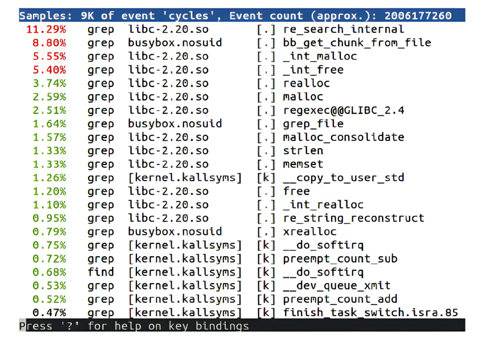
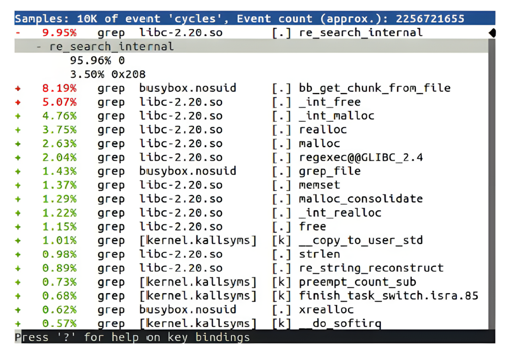
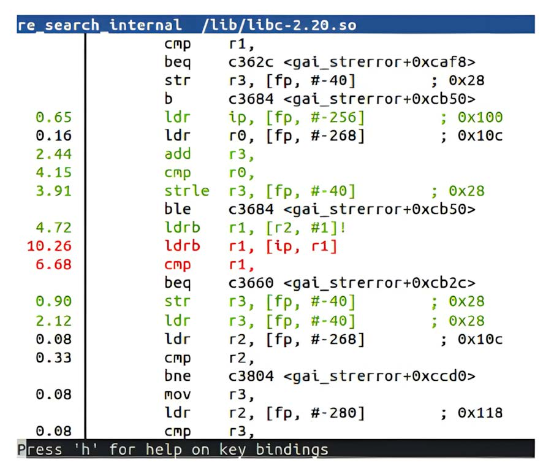
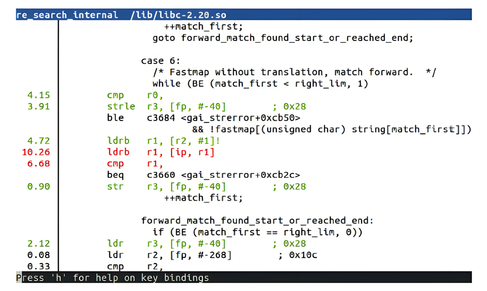

# Chương 20: Profiling và tracing (Profiling and Tracing)

Debug tương tác bằng một debugger source-level, như được mô tả ở chương trước, có thể cho bạn cái nhìn sâu về cách một chương trình hoạt động, nhưng nó giới hạn tầm nhìn của bạn vào một lượng code nhỏ. Trong chương này, chúng ta sẽ nhìn vào bức tranh lớn hơn để xem hệ thống có đang hoạt động như dự định hay không.

Các lập trình viên và nhà thiết kế hệ thống nổi tiếng là đoán tệ về chỗ nghẽn cổ chai nằm ở đâu. Vì vậy, nếu hệ thống của bạn có vấn đề về hiệu năng, khôn ngoan là bắt đầu bằng việc xem xét toàn bộ hệ thống rồi đi dần xuống, dùng các công cụ tinh vi hơn khi tiến triển. Trong chương này, tôi sẽ bắt đầu với lệnh `top` well-known như một phương tiện để có cái nhìn tổng quan. Thường thì vấn đề có thể được khoanh vùng vào một chương trình duy nhất, mà bạn có thể phân tích bằng Linux profiler, `perf`. Nếu vấn đề không được khoanh vùng như vậy và bạn muốn có bức tranh rộng hơn, `perf` cũng có thể làm điều đó. Để chẩn đoán các vấn đề liên quan đến kernel, tôi sẽ mô tả một số công cụ trace—Ftrace, LTTng và eBPF—như một phương tiện thu thập thông tin chi tiết.

Tôi cũng sẽ đề cập Valgrind, công cụ mà nhờ môi trường thực thi sandbox của nó, có thể giám sát một chương trình và báo cáo về code khi nó chạy. Tôi sẽ hoàn thành chương bằng mô tả về một công cụ trace đơn giản, `strace`, công cụ tiết lộ việc thực thi của một chương trình bằng cách trace các system call mà nó thực hiện.

Trong chương này, chúng ta sẽ đề cập các chủ đề sau:

- Observer effect

- Bắt đầu profile

- Profiling với `top`

- Profiling với GDB

- Giới thiệu `perf`

- Tracing sự kiện

- Giới thiệu Ftrace

- Dùng LTTng

- Dùng eBPF

- Dùng Valgrind

- Dùng `strace`

## Yêu cầu kỹ thuật

Để làm theo các ví dụ, hãy bảo đảm bạn có những thứ sau:

- Một hệ thống host Ubuntu 24.04 hoặc bản LTS mới hơn với ít nhất 90 GB dung lượng đĩa trống

- Bản phát hành Buildroot 2024.02.6 LTS

- Một đầu đọc thẻ microSD và thẻ

- balenaEtcher cho Linux

- Một cáp Ethernet và router có cổng trống để kết nối mạng

- Raspberry Pi 4

- Một bộ nguồn USB-C 5 V có khả năng cấp 3 A

Lẽ ra bạn đã cài đặt bản phát hành 2024.02.6 LTS của Buildroot trong Chương 6. Nếu chưa, hãy tham khảo phần System requirements của The Buildroot user manual (`https://buildroot.org/downloads/manual/manual.html`) trước khi cài đặt Buildroot trên host Linux theo hướng dẫn từ Chương 6.

Code dùng trong chương này có trong thư mục của chương trong GitHub repository của cuốn sách: `https://github.com/PacktPublishing/Mastering-Embedded-Linux-Development/tree/main/Chapter20/buildroot`.

## Observer effect

Trước khi đi sâu vào các công cụ, hãy nói về những gì các công cụ sẽ cho bạn thấy. Giống như trong nhiều lĩnh vực, việc đo một thuộc tính nhất định ảnh hưởng đến chính sự quan sát. Đo dòng điện trong một đường cấp nguồn đòi hỏi đo sụt áp trên một điện trở nhỏ. Tuy nhiên, chính điện trở đó ảnh hưởng đến dòng điện. Điều tương tự đúng với profiling: mọi quan sát hệ thống đều có cái giá bằng chu kỳ CPU, và tài nguyên đó không còn được dành cho ứng dụng. Các công cụ đo cũng làm rối hành vi caching, ăn không gian bộ nhớ và ghi xuống đĩa, tất cả đều làm tình hình tệ hơn. Không có phép đo nào mà không có overhead.

Tôi thường nghe các kỹ sư nói rằng kết quả của một đợt profiling hoàn toàn gây hiểu lầm. Đó thường là vì họ đã thực hiện các phép đo trên một thứ không gần với tình huống thực. Hãy luôn cố đo trên target, chạy các bản build release của phần mềm, với một tập dữ liệu hợp lệ tốt nhất là lấy từ thực địa, dùng càng ít service bổ sung càng tốt.

Một bản build release thường ngụ ý build các binary được tối ưu hoàn toàn mà không có debug symbol. Các yêu cầu production này hạn chế nghiêm trọng chức năng của hầu hết các công cụ profiling.

Một khi hệ thống của chúng ta đã chạy, chúng ta sẽ gặp vấn đề ngay lập tức. Mặc dù quan sát hệ thống ở trạng thái tự nhiên là quan trọng, các công cụ thường cần thông tin bổ sung để hiểu được các sự kiện.

Một số công cụ đòi hỏi các tùy chọn kernel đặc biệt. Đối với các công cụ chúng ta xem xét trong chương này, điều này áp dụng cho `perf`, Ftrace, LTTng và eBPF. Do đó, có lẽ bạn sẽ phải build và triển khai một kernel mới cho các bài kiểm thử này.

Debug symbol rất hữu ích trong việc dịch các địa chỉ chương trình thô thành tên hàm và số dòng trong source code. Triển khai các file thực thi có debug symbol không thay đổi việc thực thi của code, nhưng nó đòi hỏi bạn có các bản sao của binary, và một kernel được compile với thông tin debug, ít nhất là cho các thành phần bạn muốn profile. Một số công cụ hoạt động tốt nhất nếu bạn cài đặt chúng trên hệ thống target: ví dụ, `perf`. Các kỹ thuật giống như đối với debug nói chung, như tôi đã thảo luận trong Chương 19.

Nếu bạn muốn một công cụ tạo call graph, bạn có thể phải compile với stack frame được bật. Nếu bạn muốn công cụ gán địa chỉ với số dòng trong source code một cách chính xác, bạn có thể cần compile với các mức tối ưu thấp hơn.

Cuối cùng, một số công cụ đòi hỏi chèn instrumentation vào chương trình để thu thập mẫu, vì vậy bạn sẽ phải compile lại các thành phần đó. Điều này áp dụng cho Ftrace và LTTng đối với kernel.

Hãy lưu ý rằng bạn càng thay đổi hệ thống đang quan sát, càng khó liên hệ các phép đo bạn thực hiện với hệ thống production.

MẸO

Tốt nhất là áp dụng cách tiếp cận wait-and-see, chỉ thực hiện thay đổi khi nhu cầu đã rõ ràng, và lưu tâm rằng mỗi lần làm vậy, bạn sẽ thay đổi thứ mà bạn đang đo.

Vì kết quả profiling có thể rất mơ hồ, hãy bắt đầu với các công cụ đơn giản, easy-to-use có sẵn trước khi tìm đến các công cụ phức tạp và xâm lấn hơn.

## Bắt đầu profile

Khi xem xét toàn bộ hệ thống, một điểm khởi đầu tốt là với một công cụ đơn giản như `top`, cho bạn cái nhìn tổng quan rất nhanh. Nó cho bạn thấy bao nhiêu bộ nhớ đang được dùng, process nào đang ăn chu kỳ CPU, và điều này phân bố thế nào trên các lõi và thời gian khác nhau.

Nếu `top` cho thấy một ứng dụng duy nhất đang dùng hết tất cả chu kỳ CPU trong user space, thì bạn có thể profile ứng dụng đó bằng `perf`.

Nếu hai hoặc nhiều process có mức sử dụng CPU cao, có lẽ có thứ gì đó đang gắn kết chúng với nhau, có thể là truyền thông dữ liệu. Nếu nhiều chu kỳ được dành cho system call hoặc xử lý interrupt, thì có thể có vấn đề với cấu hình kernel hoặc với một device driver. Trong cả hai trường hợp, bạn cần bắt đầu bằng việc lấy profile của toàn bộ hệ thống, một lần nữa bằng `perf`.

Nếu bạn muốn tìm hiểu thêm về kernel và trình tự các sự kiện ở đó, hãy dùng Ftrace, LTTng hoặc eBPF.

Có thể có những vấn đề khác mà `top` sẽ không giúp được bạn. Nếu bạn có code multi-threaded và có vấn đề với lockup, hoặc nếu bạn có dữ liệu bị hỏng ngẫu nhiên, thì `pidstat` (một phần của `sysstat`) hoặc Valgrind cộng với plugin Helgrind có thể hữu ích. Memory leak cũng thuộc loại này; tôi đã đề cập việc chẩn đoán memory-related trong Chương 18.

Trước khi đi vào các công cụ profiling nâng cao hơn này, hãy bắt đầu với công cụ thô sơ nhất có trên hầu hết các hệ thống, kể cả các hệ thống production.

### Profiling với top

Chương trình top là một công cụ đơn giản không đòi hỏi bất kỳ tùy chọn kernel đặc biệt hay bảng symbol nào. Có một phiên bản cơ bản trong BusyBox và một phiên bản nhiều chức năng hơn trong package `procps`, có sẵn trong The Yocto Project và Buildroot. Bạn cũng có thể muốn cân nhắc dùng `htop`, công cụ có chức năng tương tự `top` nhưng giao diện người dùng đẹp hơn nhiều.

Để bắt đầu, hãy tập trung vào dòng tóm tắt của `top`, là dòng thứ hai nếu bạn đang dùng BusyBox và dòng thứ ba nếu bạn đang dùng `top` từ `procps`. Đây là một ví dụ, dùng `top` của BusyBox:

```
Mem: 57044K used, 446172K free, 40K shrd, 3352K buff, 34452K cached
CPU: 58% usr 4% sys 0% nic 0% idle 37% io 0% irq 0% sirq
Load average: 0.24 0.06 0.02 2/51 105
PID PPID USER STAT   VSZ %VSZ %CPU COMMAND
105  104 root    R 27912   6%  61% ffmpeg -i track2.wav
<…>
```

Dòng tóm tắt cho thấy tỷ lệ phần trăm thời gian chạy ở các trạng thái khác nhau, như được thể hiện trong bảng này:

| procps | BusyBox | Mô tả |
|---|---|---|
| `us` | `usr` | Chương trình User-space với giá trị nice mặc định |
| `sy` | `sys` | Code kernel |
| `ni` | `nic` | Chương trình User-space với giá trị nice non-default |
| `id` | `idle` | Rỗi |
| `wa` | `io` | Chờ I/O |
| `hi` | `irq` | Ngắt phần cứng |
| `si` | `sirq` | Ngắt phần mềm |
| `st` | `-` | Steal time: chỉ liên quan trong môi trường ảo |

Bảng 20.1 – top của procps so với top của BusyBox

Trong ví dụ trên, gần như toàn bộ thời gian (58%) được dành cho user mode, với một lượng nhỏ (4%) ở system mode, vì vậy đây là một hệ thống CPU-bound trong user space. Dòng đầu tiên sau dòng tóm tắt cho thấy chỉ một ứng dụng chịu trách nhiệm: `ffmpeg`. Mọi nỗ lực nhằm giảm mức sử dụng CPU nên được hướng vào đó.

Đây là một ví dụ khác:

```
Mem: 13128K used, 490088K free, 40K shrd, 0K buff, 2788K cached
CPU: 0% usr 99% sys 0% nic 0% idle 0% io 0% irq 0% sirq
Load average: 0.41 0.11 0.04 2/46 97
PID PPID USER STAT   VSZ %VSZ %CPU COMMAND
 92   82 root    R  2152   0% 100% cat /dev/urandom
<…>
```

Hệ thống này dành gần như toàn bộ thời gian trong kernel space (99% `sys`), là kết quả của việc `cat` đọc từ `/dev/urandom`. Trong trường hợp nhân tạo này, chỉ riêng việc profile `cat` sẽ không giúp ích, nhưng profile các hàm kernel mà `cat` gọi thì có thể.

Chế độ xem mặc định của `top` chỉ hiển thị process, vì vậy mức sử dụng CPU là tổng của tất cả các thread trong process. Nhấn H để xem thông tin cho từng thread. Tương tự, nó tổng hợp thời gian trên tất cả các CPU. Nếu bạn đang dùng phiên bản `top` của `procps`, bạn có thể xem tóm tắt theo từng CPU bằng cách nhấn phím 1.

Một khi đã xác định được process có vấn đề bằng `top`, chúng ta có thể attach GDB vào nó.

### Profiling với GDB

Bạn có thể profile một ứng dụng chỉ bằng cách dùng GDB để dừng nó tại các khoảng thời gian bất kỳ để xem nó đang làm gì. Đây là profiler của người nghèo. Nó dễ thiết lập và là một cách để thu thập dữ liệu profile.

Quy trình rất đơn giản:

1\. Attach vào process bằng `gdbserver` (cho debug từ xa) hoặc GDB (cho debug native). Process dừng lại.

2\. Quan sát hàm mà nó dừng ở trong. Bạn có thể dùng lệnh GDB `backtrace` để xem call stack.

3\. Gõ `continue` để chương trình tiếp tục.

4\. Sau một lúc, nhấn Ctrl + C để dừng nó lại, và quay lại bước 2.

Nếu bạn lặp lại các bước 2 đến 4 vài lần, bạn sẽ nhanh chóng có ý niệm liệu nó đang lặp hay đang tiến triển, và nếu bạn lặp lại chúng đủ thường xuyên, bạn sẽ có ý niệm về các hotspot trong code nằm ở đâu.

Có cả một trang web dành riêng cho ý tưởng này tại `https://poormansprofiler.org/`, cùng với các script giúp việc này dễ hơn một chút. Tôi đã dùng kỹ thuật này nhiều lần qua các năm với nhiều hệ điều hành và debugger khác nhau.

Đây là một ví dụ về statistical profiling, trong đó bạn lấy mẫu trạng thái chương trình theo các khoảng thời gian. Sau một số mẫu, bạn bắt đầu biết được khả năng thống kê của các hàm đang được thực thi. Thật đáng ngạc nhiên là bạn thực sự cần ít mẫu như thế nào. Các statistical profiler khác là `perf record`, OProfile và `gprof`.

Lấy mẫu bằng một debugger mang tính xâm lấn vì chương trình bị dừng trong một khoảng thời gian đáng kể khi bạn thu thập mẫu. Các công cụ khác có thể lấy mẫu với overhead ít hơn. Một công cụ như vậy là `perf`.

## Giới thiệu perf

perf là viết tắt của Linux performance event counter subsystem, `perf_events`, và cũng là tên của công cụ command-line để tương tác với `perf_events`. Cả hai đã là một phần của kernel kể từ Linux 2.6.31. Có rất nhiều thông tin hữu ích trong cây source Linux tại `tools/perf/Documentation` cũng như tại `https://perfwiki.github.io`.

Động lực ban đầu để phát triển `perf` là cung cấp một cách thống nhất để truy cập các thanh ghi của performance measurement unit (PMU), vốn là một phần của hầu hết các lõi bộ xử lý hiện đại. Một khi API đã được định nghĩa và tích hợp vào Linux, việc mở rộng nó để bao trùm các loại performance counter khác trở nên hợp lý.

Về cốt lõi, `perf` là một tập hợp các event counter với các quy tắc về khi nào chúng tích cực thu thập dữ liệu. Bằng cách đặt các quy tắc, bạn có thể thu thập dữ liệu từ toàn bộ hệ thống, chỉ kernel, hoặc chỉ một process và các process con của nó, và làm điều đó trên tất cả các CPU hoặc chỉ một CPU. Nó rất linh hoạt. Với một công cụ này, bạn có thể bắt đầu bằng việc xem xét toàn bộ hệ thống, rồi nhắm vào một device driver có vẻ đang gây ra vấn đề, một ứng dụng đang chạy chậm, hoặc một hàm thư viện có vẻ mất nhiều thời gian thực thi hơn bạn nghĩ.

Code cho công cụ command-line `perf` là một phần của kernel, trong thư mục `tools/perf`. Công cụ và kernel subsystem được phát triển song hành, nghĩa là chúng phải từ cùng một phiên bản kernel. `perf` có thể làm rất nhiều thứ. Trong chương này, tôi sẽ chỉ xem xét nó như một profiler. Để có mô tả về các khả năng khác của nó, hãy đọc các man page của `perf` và tham khảo tài liệu được đề cập ở đầu phần này.

Ngoài debug symbol, có hai tùy chọn cấu hình chúng ta cần đặt để bật hoàn toàn `perf` trong kernel.

### Cấu hình kernel cho perf

Bạn cần một kernel được cấu hình cho `perf_events`, và bạn cần lệnh `perf` được cross-compiled để chạy trên target. Cấu hình kernel liên quan là `CONFIG_PERF_EVENTS`, có trong menu General setup \| Kernel Performance Events and Counters.

Nếu bạn muốn profile bằng tracepoint—sẽ nói thêm về chủ đề này sau—cũng hãy bật các tùy chọn được mô tả trong phần về Ftrace. Trong khi ở đó, cũng đáng bật `CONFIG_DEBUG_INFO`.

Lệnh `perf` có nhiều dependency, khiến việc cross-compiling nó khá rắc rối. Tuy nhiên, cả The Yocto Project và Buildroot đều có target package cho nó.

Bạn cũng sẽ cần debug symbol trên target cho các binary mà bạn quan tâm profile; nếu không, `perf` sẽ không thể phân giải địa chỉ thành các symbol có ý nghĩa. Lý tưởng nhất, bạn muốn có debug symbol cho toàn bộ hệ thống, bao gồm cả kernel. Đối với kernel, hãy nhớ rằng debug symbol cho kernel nằm trong file `vmlinux`.

### Build perf với The Yocto Project

Nếu bạn đang dùng kernel `linux-yocto` chuẩn, `perf_events` đã được bật sẵn, vì vậy không cần làm gì thêm.

Để build công cụ `perf`, bạn có thể thêm nó một cách tường minh vào các dependency của target image, hoặc bạn có thể thêm tính năng `tools-profile`. Bạn cũng muốn có debug symbol trên target image cũng như kernel image `vmlinux`. Tổng cộng, đây là những gì bạn sẽ cần trong `conf/local.conf`:

```
EXTRA_IMAGE_FEATURES:append = " tools-profile dbg-pkgs src-pkgs"
IMAGE_INSTALL:append = " kernel-vmlinux binutils"
```

Thêm `perf` vào một image Buildroot phức tạp hơn vì một số lý do.

### Build perf với Buildroot

Nhiều cấu hình kernel của Buildroot không bao gồm `perf_events`, vì vậy bạn nên bắt đầu bằng việc kiểm tra rằng kernel của bạn có các tùy chọn được đề cập ở phần trước.

Để cross-compile `perf`, hãy chạy `menuconfig` của Buildroot và chọn những mục sau:

- `BR2_PACKAGE_LINUX_TOOLS_PERF` trong Kernel \| Linux Kernel Tools \| perf

- `BR2_PACKAGE_LINUX_TOOLS_PERF_TUI` trong Kernel \| Linux Kernel Tools \| perf \| Enable perf TUI

Để build các binary có thông tin debug và cài đặt chúng lên target mà không strip, hãy bật tùy chọn thứ nhất và tắt tùy chọn thứ hai trong hai tùy chọn sau:

- `BR2_ENABLE_DEBUG` trong Build options \| Build packages with debugging symbols

- `BR2_STRIP_strip` trong Build options \| Strip target binaries

Để copy file `vmlinux` chưa strip vào target image, hãy chọn những mục sau:

- `BR2_LINUX_KERNEL_VMLINUX` trong Kernel \| Kernel binary format \| vmlinux

- `BR2_LINUX_KERNEL_INSTALL_TARGET` trong Kernel \| Install kernel image to /boot in target

Để tăng kích thước root filesystem nhằm chứa các binary chưa strip và file `vmlinux`:

- Chọn Filesystem images \| ext2/3/4 root filesystem \| Exact size và nhập `960M` vào trường văn bản.

Sau đó chạy `make clean` rồi đến `make`.

Khi đã build xong mọi thứ, bạn sẽ phải copy `vmlinux` vào target image thủ công.

### Profiling với perf

Bạn có thể dùng `perf` để lấy mẫu trạng thái của một chương trình bằng một trong các event counter và tích lũy mẫu trong một khoảng thời gian để tạo một profile. Đây là một ví dụ khác về statistical profiling. Event counter mặc định có tên `cycles`, là một hardware counter chung được ánh xạ tới một thanh ghi PMU biểu diễn số đếm chu kỳ ở tần số clock của lõi.

Tạo một profile bằng `perf` là một quy trình two-stage: lệnh `perf record` thu thập mẫu và ghi chúng vào một file tên `perf.data`, rồi `perf report` phân tích kết quả. Cả hai lệnh đều được chạy trên target. Các mẫu được thu thập được lọc cho process và bất kỳ process con nào của nó. Đây là một ví dụ về việc profile một shell script tìm kiếm chuỗi `linux`:

```
# perf record -a sh -c "find /usr/share | xargs grep linux > /dev/null"
[ perf record: Woken up 1 times to write data ]
[ perf record: Captured and wrote 0.176 MB perf.data (2677 samples) ]
# ls -l perf.data
-rw------- 1 root root 190024 Mar  9 14:28 perf.data
```

Giờ bạn có thể hiển thị kết quả từ `perf.data` bằng lệnh `perf report`.

Có ba giao diện người dùng để lựa chọn:

- `--stdio`: Đây là một giao diện pure-text không có tương tác người dùng. Bạn sẽ phải khởi chạy `perf` `report` và `annotate` cho mỗi chế độ xem của trace.

- `--tui`: Đây là một giao diện menu text-based đơn giản với khả năng di chuyển giữa các màn hình.

- `--gtk`: Đây là một giao diện đồ họa, ngoài ra hoạt động giống như `--tui`.

Mặc định là TUI, như được thể hiện trong ví dụ này:



Hình 20.1 – perf report TUI

`perf` có thể ghi lại các hàm kernel được thực thi thay mặt cho các process vì nó thu thập mẫu trong kernel space.

Danh sách được sắp xếp với các hàm hoạt động nhiều nhất đứng đầu. Trong ví dụ này, tất cả ngoại trừ một hàm được ghi lại khi `grep` đang chạy. Một số nằm trong một thư viện, `libc-2.20`, một số nằm trong một chương trình, `busybox.nosuid`, và một số nằm trong kernel. Chúng ta có tên symbol cho các hàm chương trình và thư viện vì tất cả các binary đã được cài đặt trên target với thông tin debug, và các symbol kernel đang được đọc từ `/boot/vmlinux`. Nếu bạn có `vmlinux` ở một vị trí khác, hãy thêm `-k <path>` vào lệnh `perf report`. Thay vì lưu mẫu trong `perf.data`, bạn có thể lưu chúng vào một file khác bằng `perf record -o <file name>` và phân tích chúng bằng `perf report` `-i` `<file name>`.

Mặc định, `perf record` lấy mẫu ở tần số 1,000 Hz bằng counter `cycles`.

MẸO

Tần số lấy mẫu 1,000 Hz có thể cao hơn mức bạn thực sự cần và có thể là nguyên nhân của observer effect. Hãy thử các tần số thấp hơn; 100 Hz là đủ cho hầu hết các trường hợp. Bạn có thể đặt tần số lấy mẫu bằng tùy chọn `-F`.

Điều này vẫn chưa thực sự khiến mọi thứ dễ dàng; các hàm ở đầu danh sách chủ yếu là các thao tác bộ nhớ low-level, và bạn có thể khá chắc chắn rằng chúng đã được tối ưu. May mắn thay, `perf record` cũng cho chúng ta khả năng leo ngược call stack và xem các hàm này đang được gọi từ đâu.

### Call graph

Sẽ thật hay nếu lùi lại và xem ngữ cảnh xung quanh các hàm tốn kém này. Bạn có thể làm điều đó bằng cách truyền tùy chọn `-g` cho `perf record` để thu thập backtrace từ mỗi mẫu.

Giờ, `perf report` hiển thị một dấu cộng (`+`) ở chỗ hàm là một phần của một call chain. Bạn có thể mở rộng trace để xem các hàm ở thấp hơn trong chuỗi:



Hình 20.2 – perf report (call graph)

LƯU Ý QUAN TRỌNG

Việc tạo call graph dựa vào khả năng trích xuất call frame từ stack, giống như backtrace trong GDB. Thông tin debug cần để unwind stack được mã hóa trong các file thực thi. Call graph không thể được tạo ra cho một số tổ hợp kiến trúc và toolchain vì các binary thiếu thông tin debug cần thiết.

Backtrace thì hay, nhưng assembler, hoặc tốt hơn nữa, source code, cho các hàm này nằm ở đâu?

### perf annotate

Giờ bạn đã biết cần xem các hàm nào, sẽ thật hay nếu bước vào bên trong và xem code và có số lần hit cho mỗi lệnh. Đó là những gì `perf annotate` làm, bằng cách gọi xuống một bản `objdump` được cài đặt trên target. Bạn chỉ cần dùng `perf annotate` thay cho `perf report`.

`perf annotate` đòi hỏi bảng symbol cho các file thực thi và `vmlinux`. Đây là một ví dụ về một hàm được annotate:



Hình 20.3 – perf annotate (assembler)

Nếu bạn muốn xem source code xen kẽ với assembler, bạn có thể copy các file source liên quan sang thiết bị target. Nếu bạn đang dùng The Yocto Project và build với extra image feature `src-pkgs` hoặc đã cài đặt các package `<package>-src` riêng lẻ, thì source sẽ đã được cài đặt sẵn cho bạn trong `/usr/src/debug`. Nếu không, bạn có thể kiểm tra thông tin debug để xem vị trí của source code:

```
$ cd ~/buildroot/output
$ host/aarch64-buildroot-linux-gnu/bin/objdump --dwarf target/lib/libc.
so.6 | grep DW_AT_comp_dir | grep libgcc
<41f4dd> DW_AT_comp_dir : (indirect string, offset: 0x2d355): /home/frank/
buildroot/output/build/host-gcc-initial-12.4.0/build/aarch64-buildroot-
linux-gnu/libgcc
```

Đường dẫn trên target phải chính xác giống với đường dẫn bạn có thể thấy trong `DW_AT_comp_dir`.

Đây là một ví dụ về annotate với source và code assembler:



Hình 20.4 – perf annotate (source code)

Giờ chúng ta có thể thấy source code C tương ứng ở trên `cmp r0` và ở dưới lệnh `str r3, [fp,` `#-40]`.

Đến đây kết thúc phần trình bày về `perf`. Mặc dù có các statistical sampling profiler khác ra đời trước `perf`, như OProfile và `gprof`, các công cụ này đã không còn được ưa chuộng trong những năm gần đây, vì vậy tôi chọn bỏ qua chúng. Tiếp theo, chúng ta sẽ xem xét các event tracer.

## Tracing sự kiện

Các công cụ chúng ta đã thấy đến giờ đều dùng statistical sampling. Bạn thường muốn biết thêm về thứ tự các sự kiện để có thể thấy chúng và liên hệ chúng với nhau. Function tracing liên quan đến việc instrument code bằng các tracepoint thu thập thông tin về sự kiện, và có thể bao gồm một số hoặc tất cả những thứ sau:

- Một timestamp

- Ngữ cảnh, như PID hiện tại

- Tham số hàm và giá trị trả về

- Một call stack

Nó xâm lấn hơn statistical profiling và có thể tạo ra một lượng dữ liệu lớn. Vấn đề sau có thể được giảm nhẹ bằng cách áp dụng bộ lọc khi mẫu được thu thập và, sau đó, khi xem trace.

Tôi sẽ đề cập ba công cụ trace ở đây: các kernel function tracer Ftrace, LTTng và eBPF.

## Giới thiệu Ftrace

Kernel function tracer Ftrace phát triển từ công việc của Steven Rostedt và nhiều người khác khi họ truy tìm nguyên nhân của độ trễ lập lịch cao trong các ứng dụng real-time. Ftrace xuất hiện trong Linux 2.6.27 và đã được phát triển tích cực kể từ đó. Có một số tài liệu mô tả kernel tracing trong kernel source tại `Documentation/trace`.

Ftrace gồm một số tracer có thể ghi log nhiều loại hoạt động khác nhau trong kernel. Ở đây, tôi sẽ nói về các tracer `function` và `function_graph` và các event tracepoint. Trong Chương 21, tôi sẽ quay lại Ftrace khi nói về độ trễ real-time.

Tracer `function` instrument mỗi hàm kernel để các lời gọi có thể được ghi lại và gắn timestamp. Nó compile kernel với switch `-pg` để chèn instrumentation. Tracer `function_graph` đi xa hơn và ghi lại cả lúc vào lẫn lúc ra của các hàm để có thể tạo một call graph. Tính năng event tracepoint ghi lại các tham số gắn với lời gọi.

Ftrace có một giao diện người dùng rất embedded-friendly được triển khai hoàn toàn thông qua các file ảo trong filesystem `debugfs`, nghĩa là bạn không cần cài đặt bất kỳ công cụ nào trên target để nó hoạt động. Tuy vậy, có các giao diện người dùng khác nếu bạn thích: `trace-cmd` là một công cụ command-line ghi lại và xem trace và có sẵn trong Buildroot (`BR2_PACKAGE_TRACE_CMD`) và The Yocto Project (`trace-cmd`). Có một trình xem trace đồ họa tên KernelShark có sẵn dưới dạng package cho The Yocto Project.

Giống như `perf`, bật Ftrace đòi hỏi đặt một số tùy chọn cấu hình kernel nhất định.

### Chuẩn bị dùng Ftrace

Ftrace và các tùy chọn khác nhau của nó được cấu hình trong menu cấu hình kernel. Bạn sẽ cần tối thiểu những thứ sau:

- `CONFIG_FUNCTION_TRACER` từ menu Kernel hacking \| Tracers \| Kernel Function Tracer.

Bạn cũng nên bật các tùy chọn sau:

- `CONFIG_FUNCTION_GRAPH_TRACER` trong menu Kernel hacking \| Tracers \| Kernel Function Tracer \| Kernel Function Graph Tracer

- `CONFIG_DYNAMIC_FTRACE` trong menu Kernel hacking \| Tracers \| Kernel Function Tracer \| Enable/disable function tracing dynamically

- `CONFIG_FUNCTION_PROFILER` trong menu Kernel hacking \| Tracers \| Kernel Function Tracer \| Kernel function profiler

Vì toàn bộ mọi thứ được host trong kernel, không có cấu hình user-space nào cần thực hiện.

### Dùng Ftrace

Trước khi có thể dùng Ftrace, bạn phải mount filesystem `debugfs`, được đặt trong thư mục `/sys/kernel/debug`:

```
# mount -t debugfs none /sys/kernel/debug
```

Tất cả các control của Ftrace nằm trong thư mục `/sys/kernel/debug/tracing`; thậm chí có một `HOWTO` mini trong file `README` ở đó.

Đây là danh sách các tracer có sẵn trong kernel:

```
# cat /sys/kernel/debug/tracing/available_tracers
blk function_graph function nop
```

Tracer đang active được hiển thị bởi `current_tracer`. Ban đầu, nó sẽ là null tracer, `nop`.

Để thu thập một trace, hãy chọn tracer bằng cách ghi tên của một trong các `available_tracers` vào `current_tracer`. Sau đó, bật tracing trong một khoảng thời gian ngắn:

```
# echo function > /sys/kernel/debug/tracing/current_tracer
# echo 1 > /sys/kernel/debug/tracing/tracing_on
# sleep 1
# echo 0 > /sys/kernel/debug/tracing/tracing_on
```

Trong một giây đó, trace buffer sẽ đã được lấp đầy với chi tiết của mọi hàm được kernel gọi. Định dạng của trace buffer là văn bản thuần, như được mô tả trong `Documentation/trace/ftrace.txt`. Bạn có thể đọc trace buffer từ file `trace`:

```
# cat /sys/kernel/debug/tracing/trace
# tracer: function
#
# entries-in-buffer/entries-written: 40051/40051   #P:1
#
#                   _-----=> irqs-off
#                  / _----=> need-resched
#                 | / _---=> hardirq/softirq
#                 || / _--=> preempt-depth
#                 ||| /     delay
# TASK-PID  CPU#  |||| TIMESTAMP  FUNCTION
#    | |      |   ||||    |         |
    sh-361  [000] ...1 992.990646: mutex_unlock <-rb_simple_write
    sh-361  [000] ...1 992.990658: __fsnotify_parent <-vfs_write
    sh-361  [000] ...1 992.990661: fsnotify <-vfs_write
    sh-361  [000] ...1 992.990663: __srcu_read_lock <-fsnotify
    sh-361  [000] ...1 992.990666: preempt_count_add <-__srcu_read_lock
    sh-361  [000] ...2 992.990668: preempt_count_sub <-__srcu_read_lock
    sh-361  [000] ...1 992.990670: __srcu_read_unlock <-fsnotify
    sh-361  [000] ...1 992.990672: __sb_end_write <-vfs_write
    sh-361  [000] ...1 992.990674: preempt_count_add <-__sb_end_write
<…>
```

Bạn có thể thu thập một lượng lớn điểm dữ liệu chỉ trong một giây—trong trường hợp này, hơn 40,000.

Giống như với profiler, rất khó hiểu được một danh sách hàm phẳng như thế này. Nếu bạn chọn tracer `function_graph`, Ftrace thu thập call graph như sau:

```
# tracer: function_graph
#
# CPU   DURATION               FUNCTION CALLS
# |      |   |                  |   |   |   |
 0) + 63.167 us   |              } /* cpdma_ctlr_int_ctrl */
 0) + 73.417 us   |            } /* cpsw_intr_disable */
 0)               |            disable_irq_nosync() {
 0)               |              __disable_irq_nosync() {
 0)               |                __irq_get_desc_lock() {
 0)   0.541 us    |                  irq_to_desc();
 0)   0.500 us    |                  preempt_count_add();
 0) + 16.000 us   |                }
 0)               |                __disable_irq() {
 0)   0.500 us    |                  irq_disable();
 0)   8.208 us    |                }
 0)               |                __irq_put_desc_unlock() {
 0)   0.459 us    |                  preempt_count_sub();
 0)   8.000 us    |                }
 0) + 55.625 us   |              }
 0) + 63.375 us   |            }
```

Giờ bạn có thể thấy sự lồng nhau của các lời gọi hàm, được phân định bởi dấu ngoặc nhọn, `{` và `}`. Tại dấu ngoặc đóng, có một phép đo thời gian thực hiện trong hàm, được chú thích bằng dấu cộng (`+`) nếu mất hơn 10 µs và dấu chấm than (`!`) nếu mất hơn 100 µs.

Bạn thường chỉ quan tâm đến hoạt động kernel do một process hoặc thread duy nhất gây ra, trong trường hợp đó bạn có thể giới hạn trace cho một thread bằng cách ghi thread ID vào `set_ftrace_pid`.

### Dynamic Ftrace và trace filter

Bật `CONFIG_DYNAMIC_FTRACE` cho phép Ftrace sửa đổi các function trace site lúc runtime, điều mang lại một vài lợi ích. Thứ nhất, nó kích hoạt xử lý build-time bổ sung cho các trace function probe, cho phép subsystem Ftrace định vị chúng lúc boot và ghi đè chúng bằng các lệnh `nop`, do đó giảm overhead của code function trace xuống gần như bằng không. Sau đó bạn có thể bật Ftrace trong các kernel production hoặc near-production mà không ảnh hưởng đến hiệu năng.

Ưu điểm thứ hai là bạn có thể bật có chọn lọc các function trace site thay vì trace mọi thứ. Danh sách các hàm được đặt vào `available_filter_functions`. Bạn có thể bật có chọn lọc các function trace khi cần bằng cách copy tên từ `available_filter_functions` sang `set_ftrace_filter.` Để dừng trace hàm đó, hãy ghi tên của nó vào `set_ftrace_notrace`. Bạn cũng có thể dùng wildcard và nối thêm tên vào danh sách. Ví dụ, giả sử bạn quan tâm đến việc xử lý `tcp`:

```
# cd /sys/kernel/debug/tracing
# echo "tcp*" > set_ftrace_filter
# echo function > current_tracer
# echo 1 > tracing_on
```

Chạy một số bài kiểm thử rồi xem `trace`:

```
# cat trace
# tracer: function
#
# entries-in-buffer/entries-written: 590/590   #P:1
#
#                     _-----=> irqs-off
#                   / _----=> need-resched
#                  | / _---=> hardirq/softirq
#                  || / _--=> preempt-depth
#                  ||| /     delay
#   TASK-PID CPU#  ||||   TIMESTAMP  FUNCTION
#      | |     |   ||||      |         |
dropbear-375 [000] ...1 48545.022235: tcp_poll <-sock_poll
dropbear-375 [000] ...1 48545.022372: tcp_poll <-sock_poll
dropbear-375 [000] ...1 48545.022393: tcp_sendmsg <-inet_sendmsg
dropbear-375 [000] ...1 48545.022398: tcp_send_mss <-tcp_sendmsg
dropbear-375 [000] ...1 48545.022400: tcp_current_mss <-tcp_send_mss
<…>
```

Hàm `set_ftrace_filter` cũng có thể chứa các lệnh để bắt đầu và dừng tracing khi một số hàm nhất định được thực thi. Không có đủ chỗ để đi vào các chi tiết này ở đây, nhưng nếu bạn muốn tìm hiểu thêm, hãy đọc phần Filter commands trong `Documentation/trace/ftrace.txt`.

### Trace event

Các tracer `function` và `function_graph` chỉ ghi lại thời điểm hàm được thực thi. Tính năng trace event còn ghi lại các tham số gắn với lời gọi, khiến trace dễ đọc và giàu thông tin hơn. Ví dụ, thay vì chỉ ghi lại rằng hàm `kmalloc` đã được gọi, một trace event sẽ ghi lại số byte được yêu cầu và con trỏ được trả về. Trace event được dùng trong `perf` và LTTng cũng như Ftrace, nhưng việc phát triển subsystem trace event được thúc đẩy bởi project LTTng.

Các nhà phát triển kernel phải bỏ công sức để tạo trace event. Chúng được định nghĩa trong source code bằng macro `TRACE_EVENT`; hiện có hơn một nghìn trace event. Bạn có thể xem danh sách các event có sẵn lúc runtime trong `/sys/kernel/debug/tracing/available_events`. Chúng được đặt tên là \<`subsystem>:<function>` (ví dụ, `kmem:kmalloc`). Mỗi event cũng được biểu diễn bởi một thư mục con trong `tracing/events/<subsystem>/<function>`:

```
# ls events/kmem/kmalloc
enable filter format id trigger
```

Các file là:

- `enable`: Bạn ghi `1` vào file này để bật event.

- `filter`: Đây là một biểu thức phải được đánh giá là `true` để event được trace.

- `format`: Đây là định dạng của event và các tham số.

- `id`: Đây là một định danh dạng số.

- `trigger`: Đây là một lệnh được thực thi khi event xảy ra, dùng cú pháp được định nghĩa trong phần Filter commands của `Documentation/trace/ftrace.txt`.

Tôi sẽ chỉ cho bạn một ví dụ đơn giản liên quan đến `kmalloc` và `kfree`. Event tracing không phụ thuộc vào các function tracer, vì vậy hãy bắt đầu bằng việc chọn tracer `nop`:

```
# echo nop > current_tracer
```

Tiếp theo, chọn các event cần trace bằng cách bật từng event riêng lẻ:

```
# echo 1 > events/kmem/kmalloc/enable
# echo 1 > events/kmem/kfree/enable
```

Bạn cũng có thể ghi tên các event vào `set_event`, như được thể hiện ở đây:

```
# echo "kmem:kmalloc kmem:kfree" > set_event
```

Giờ, khi bạn đọc trace, bạn có thể thấy các hàm và tham số của chúng:

```
# tracer: nop
#
# entries-in-buffer/entries-written: 359/359   #P:1
#
#                      _-----=> irqs-off
#                     / _----=> need-resched
#                    | / _---=> hardirq/softirq
#                    || / _--=> preempt-depth
#                    ||| /     delay
#   TASK-PID   CPU#  ||||   TIMESTAMP  FUNCTION
#      | |       |   ||||      |         |
     cat-382   [000] ...1  2935.586706: kmalloc:call_site=c0554644
ptr=de515a00 bytes_req=384 bytes_alloc=512 gfp_flags=GFP_ATOMIC|GFP_
NOWARN|GFP_NOMEMALLOC
     cat-382   [000] ...1  2935.586718: kfree: call_site=c059c2d8
ptr=(null)
```

Chính xác cùng các trace event đó có thể nhìn thấy trong `perf` dưới dạng tracepoint event.

Vì không có thành phần user-space cồng kềnh nào cần build, Ftrace rất phù hợp để triển khai lên hầu hết các target nhúng. Tiếp theo, chúng ta sẽ xem một event tracer phổ biến khác có nguồn gốc còn có trước Ftrace.

## Dùng LTTng

Project Linux Trace Toolkit (LTT) được Karim Yaghmour khởi xướng như một phương tiện trace hoạt động kernel và là một trong những công cụ trace đầu tiên có sẵn rộng rãi cho Linux kernel. Sau đó, Mathieu Desnoyers tiếp nhận ý tưởng này và re-implemented nó thành một công cụ trace next-generation, LTTng. Sau đó nó được mở rộng để bao trùm cả các trace user-space cũng như kernel. Website của project ở `https://lttng.org/` và chứa một user manual toàn diện.

LTTng gồm ba thành phần:

- Một core session manager

- Một kernel tracer được triển khai như một nhóm kernel module

- Một user-space tracer được triển khai như một thư viện

Ngoài những thứ đó, bạn sẽ cần một trình xem trace như Babeltrace (`https://babeltrace.org/`) hoặc plugin Eclipse Trace Compass để hiển thị và lọc dữ liệu trace thô trên host hoặc target.

LTTng đòi hỏi một kernel được cấu hình với `CONFIG_TRACEPOINTS`, được bật khi bạn chọn Kernel hacking \| Tracers \| Kernel Function Tracer.

Mô tả sau đây đề cập đến LTTng phiên bản 2.13. Các phiên bản khác có thể khác.

### LTTng và The Yocto Project

Bạn cần thêm các package sau vào các dependency của target trong `conf/local.conf`:

```
IMAGE_INSTALL:append = " lttng-tools lttng-modules lttng-ust"
```

Nếu bạn muốn chạy Babeltrace trên target, hãy thêm cả package `babeltrace2`.

### LTTng và Buildroot

Bạn cần bật những mục sau:

- `BR2_PACKAGE_LTTNG_MODULES` trong menu Target packages \| Debugging, profiling and benchmark \| lttng-modules

- `BR2_PACKAGE_LTTNG_TOOLS` trong menu Target packages \| Debugging, profiling and benchmark \| lttng-tools

Để trace user-space, hãy bật những mục sau:

- `BR2_PACKAGE_UTIL_LINUX_UUIDD` trong menu Target packages \| System tools \| util-linux \| uuidd

- `BR2_PACKAGE_LTTNG_LIBUST` trong menu Target packages \| Libraries \| Other \| lttng-libust

- `BR2_PACKAGE_HOST_BABELTRACE2` trong menu Host utilities \| host babeltrace2

Có một package tên `babletrace2` cho target. Buildroot cài đặt `babeltrace2` cho host vào `output/host/usr/bin/babeltrace2`.

### Dùng LTTng để trace kernel

LTTng có thể dùng tập các sự kiện Ftrace được mô tả trước đó làm các tracepoint tiềm năng. Ban đầu, chúng bị tắt.

Giao diện điều khiển cho LTTng là lệnh `lttng`. Bạn có thể liệt kê các kernel probe bằng lệnh sau:

```
# lttng list --kernel
Kernel events:
-------------
writeback_nothread (loglevel: TRACE_EMERG (0)) (type: tracepoint)
writeback_queue (loglevel: TRACE_EMERG (0)) (type: tracepoint)
writeback_exec (loglevel: TRACE_EMERG (0)) (type: tracepoint)
<…>
```

Trace được thu thập trong ngữ cảnh của một session, mà trong ví dụ này có tên `test`:

```
# lttng create test
Session test created.
Traces will be written in /home/root/lttng-traces/test20150824-140942
# lttng list
Available tracing sessions:
1) test (/home/root/lttng-traces/test-20150824-140942) [inactive]
```

Giờ hãy bật một vài event trong session hiện tại. Bạn có thể bật tất cả các kernel tracepoint bằng tùy chọn `--all`, nhưng hãy nhớ cảnh báo về việc tạo ra quá nhiều dữ liệu trace. Hãy bắt đầu với một vài trace event scheduler-related:

```
# lttng enable-event --kernel sched_switch,sched_process_fork
```

Kiểm tra rằng mọi thứ đã được thiết lập:

```
# lttng list test
Tracing session test: [inactive]
    Trace path: /home/root/lttng-traces/test-20150824-140942
    Live timer interval (usec): 0
 === Domain: Kernel ===
 Channels:
-------------
- channel0: [enabled]
 Attributes:
      overwrite mode: 0
      subbufers size: 26214
      number of subbufers: 4
      switch timer interval: 0
      read timer interval: 200000
      trace file count: 0
      trace file size (bytes): 0
      output: splice()
 Events:
      sched_process_fork (loglevel: TRACE_EMERG (0)) (type: tracepoint)
[enabled]
      sched_switch (loglevel: TRACE_EMERG (0)) (type: tracepoint)
[enabled]
```

Giờ hãy bắt đầu tracing:

```
# lttng start
```

Chạy tải kiểm thử, rồi dừng tracing:

```
# lttng stop
```

Trace của session được ghi vào thư mục session, `lttng-traces/<session>/kernel`.

Dùng trình xem Babeltrace để dump dữ liệu trace thô ở định dạng văn bản. Trong trường hợp này, tôi chạy nó trên máy host:

```
$ babeltrace2 lttng-traces/test-20150824-140942/kernel
```

Output quá dài dòng để vừa trang này, vì vậy tôi sẽ để nó như một bài tập để bạn thu thập và hiển thị một trace theo cách này. Output văn bản từ Babeltrace có ưu điểm là dễ tìm chuỗi bằng `grep` và các lệnh tương tự.

Một lựa chọn tốt cho trình xem trace đồ họa là plugin Trace Compass cho Eclipse, giờ là một phần của gói Eclipse IDE for C/C++ developer. Việc import dữ liệu trace vào Eclipse rắc rối như thường lệ. Hãy làm theo các bước sau:

1\. Mở perspective Tracing.

2\. Tạo một project mới bằng cách chọn File \| New \| Tracing project.

3\. Nhập tên project và nhấn Finish.

4\. Right-click vào tùy chọn New Project trong menu Project Explorer và chọn Import.

5\. Mở rộng Tracing, rồi chọn Trace Import.

6\. Duyệt tới thư mục chứa các trace (ví dụ, `test-20150824-140942`), đánh dấu ô để chỉ ra các thư mục con bạn muốn (có thể là kernel), và nhấn Finish.

7\. Mở rộng project, mở rộng Traces\[1\], rồi double-click vào kernel.

Giờ hãy chuyển hướng khỏi LTTng và lao ngay vào event tracer mới nhất và tốt nhất cho Linux.

## Dùng eBPF

Berkeley Packet Filter (BPF) là một công nghệ được giới thiệu lần đầu năm 1992 để thu thập, lọc và phân tích lưu lượng mạng. Năm 2013, Alexi Starovoitov đảm nhận việc viết lại BPF với sự giúp đỡ của Daniel Borkmann. Công việc của họ, khi đó được biết đến với tên eBPF (extended BPF), đã được merge vào kernel năm 2014, nơi nó có sẵn kể từ Linux 3.15. eBPF cung cấp một môi trường thực thi sandbox để chạy các chương trình bên trong Linux kernel. Các chương trình eBPF được viết bằng C và được compile just-in-time (JIT) thành native code. Trước khi điều đó xảy ra, bytecode eBPF trung gian trước tiên phải vượt qua một loạt các kiểm tra an toàn để một chương trình không thể làm crash kernel.

Dù có nguồn gốc từ mạng, eBPF giờ là một máy ảo general-purpose chạy bên trong Linux kernel. Bằng cách giúp dễ dàng chạy các chương trình nhỏ trên các sự kiện cụ thể của kernel và ứng dụng, eBPF nhanh chóng nổi lên như tracer mạnh mẽ nhất cho Linux. Giống như những gì cgroups đã làm cho việc triển khai container hóa, eBPF có tiềm năng cách mạng hóa observability bằng cách cho phép người dùng instrument đầy đủ các hệ thống production. Netflix và Facebook dùng eBPF rộng rãi trên các microservice và hạ tầng cloud của họ để phân tích hiệu năng và ngăn chặn các cuộc tấn công distributed denial-of-service (DDoS).

Công cụ xung quanh eBPF đang phát triển, với BPF Compiler Collection (BCC) và bpftrace khẳng định vị trí là hai frontend nổi bật nhất. Brendan Gregg đã tham gia sâu vào cả hai project và đã viết rất nhiều về eBPF trong cuốn sách BPF Performance Tools: Linux System and Application Observability của ông. Với rất nhiều khả năng bao trùm một phạm vi rộng lớn như vậy, công nghệ mới như eBPF có thể có vẻ choáng ngợp. Nhưng giống như cgroups, chúng ta không cần hiểu eBPF hoạt động thế nào để bắt đầu dùng nó. BCC đi kèm một số công cụ và ví dụ ready-made mà chúng ta có thể đơn giản chạy từ command line.

### Cấu hình kernel cho eBPF

Một package tên ply (`https://github.com/iovisor/ply`) đã được merge vào Buildroot vào ngày 23 tháng Một năm 2021, để đưa vào bản phát hành 2021.02 LTS của Buildroot. ply là một tracer động nhẹ cho Linux tận dụng eBPF để các probe có thể được gắn vào các điểm bất kỳ trong kernel. Khác với `bpftrace`, vốn phụ thuộc vào BCC, `ply` không dựa vào LLVM và không có dependency bên ngoài bắt buộc nào ngoài `libc`. Điều này khiến nó dễ port hơn nhiều sang các kiến trúc CPU nhúng như `arm` và `powerpc`.

Hãy bắt đầu bằng việc cấu hình một kernel eBPF-enabled cho Raspberry Pi 4:

```
$ cd buildroot
$ make clean
$ make raspberrypi4_64_defconfig
$ make linux-configure
```

Lệnh `make linux-configure` sẽ tải về và build một số công cụ host trước khi fetch, giải nén và cấu hình source code kernel. `raspberrypi4_64_defconfig` từ bản phát hành 2024.02.6 LTS của Buildroot trỏ tới một tarball source kernel 6.1 tùy chỉnh từ fork GitHub của Raspberry Pi Foundation. Hãy kiểm tra nội dung của `raspberrypi4_64_defconfig` để xác nhận bạn đang dùng phiên bản kernel nào. Khi `make linux-configure` đã cấu hình kernel, chúng ta có thể cấu hình lại nó cho eBPF:

```
$ make linux-menuconfig
```

Để tìm một tùy chọn cấu hình kernel cụ thể từ menu tương tác, hãy nhấn / và nhập một chuỗi tìm kiếm. Kết quả tìm kiếm sẽ trả về một danh sách các kết quả khớp được đánh số. Nhập một số cho trước sẽ đưa bạn trực tiếp tới tùy chọn cấu hình đó.

Tối thiểu, chúng ta cần chọn những mục sau để bật hỗ trợ kernel cho eBPF:

```
CONFIG_BPF=y
CONFIG_BPF_SYSCALL=y
```

Những mục sau dành cho BCC nhưng thêm chúng vào cũng không hại gì:

```
CONFIG_NET_CLS_BPF=m
CONFIG_NET_ACT_BPF=m
CONFIG_BPF_JIT=y
```

Thêm những mục này để người dùng có thể compile và gắn các chương trình eBPF vào các event `kprobe`, `uprobe` và `tracepoint`:

```
CONFIG_HAVE_EBPF_JIT=y
CONFIG_BPF_EVENTS=y
```

Những mục này cần được chọn để `ply` hoạt động:

```
CONFIG_KPROBES=y
CONFIG_TRACEPOINTS=y
CONFIG_FTRACE=y
CONFIG_DYNAMIC_FTRACE=y
CONFIG_KPROBE_EVENTS_ON_NOTRACE=y
```

Hãy bảo đảm lưu thay đổi khi thoát `make` `linux-menuconfig` để chúng được áp dụng vào `output/build/linux-custom/.config` trước khi build kernel eBPF-enabled của bạn.

### Build ply với Buildroot

Hãy build `ply` và cài đặt công cụ cùng với một số script ví dụ. Các script `ply` được gói cùng nhau bên trong một package `ebpf` dưới thư mục `MELD/Chapter20/` để dễ cài đặt. Để copy chúng sang bản cài đặt Buildroot 2024.02.06 LTS của bạn:

```
$ cd ~
$ cp -a MELD/Chapter20/buildroot/* buildroot
```

Giờ hãy build image `ply` cho Raspberry Pi 4:

```
$ cd buildroot
$ make rpi4_64_ply_defconfig
$ make
```

Nếu phiên bản Buildroot của bạn là 2024.02.06 LTS và bạn đã copy đúng overlay `buildroot` từ `MELD/Chapter20`, thì image `ply` sẽ build thành công. Kernel được build cho image này đã được cấu hình cho eBPF vì vậy không cần thực hiện các bước `linux-menuconfig` trước đó. Image `ply` cũng tự động mount `debugfs` tại `/sys/kernel/debug` nên `ply` sẵn sàng chạy khi boot.

Cắm thẻ microSD đã hoàn thành vào Raspberry Pi 4, cắm nó vào mạng cục bộ bằng một cáp Ethernet và cấp nguồn cho thiết bị. Dùng `arp-scan` để tìm địa chỉ IP của Raspberry Pi 4 và SSH vào nó với `root` bằng mật khẩu bạn đã đặt ở phần trước. Tôi đã dùng `temppwd` làm mật khẩu `root` trong `configs/rpi4_64_ply_defconfig` mà tôi đưa vào overlay `MELD/Chapter20/buildroot` của mình. Giờ chúng ta đã sẵn sàng có trải nghiệm trực tiếp trong việc thử nghiệm với eBPF.

### Dùng ply

Làm gần như bất cứ thứ gì với eBPF, bao gồm chạy công cụ `ply` và các ví dụ, đều đòi hỏi quyền `root`, đó là lý do chúng ta đã bật đăng nhập `root` qua SSH. Một điều kiện tiên quyết khác là mount `debugfs`. Nếu không có mục `debugfs` nào trong `/etc/fstab`, hãy mount `debugfs` từ command line:

```
# mount -t debugfs none /sys/kernel/debug
```

Hãy bắt đầu bằng việc đếm các `syscalls` system-wide theo hàm:

```
# ply 'k:__arm64_sys_* { @syscalls[caller] = count(); }'
^C
@syscalls:
{ __arm64_sys_ppoll }: 1
{ __arm64_sys_rt_sigaction }: 2
{ __arm64_sys_rt_sigreturn }: 3
{ __arm64_sys_writev }: 12
{ __arm64_sys_brk }: 13
{ __arm64_sys_pselect6 }: 19
{ __arm64_sys_perf_event_open }: 174
{ __arm64_sys_epoll_pwait }: 176
{ __arm64_sys_newfstatat }: 188
{ __arm64_sys_close }: 205
{ __arm64_sys_ioctl }: 247
{ __arm64_sys_read }: 370
{ __arm64_sys_openat }: 383
```

Lưu ý rằng phiên `ply` kết thúc, và kết quả trace được hiển thị khi người dùng nhấn Ctrl + C. Bạn có thể cần nhấn Ctrl + C nhiều lần cho đến khi phiên `ply` cuối cùng kết thúc.

Thư mục chứa các script `ply` không nằm trong biến môi trường `PATH`, vì vậy hãy di chuyển tới đó để thực thi dễ hơn:

```
# cd /root
```

Hãy bắt đầu với một script system-wide hiển thị kích thước đọc dưới dạng histogram:

```
# ./read-dist.ply
^C
@:
{ retsize }:
        [   2,    3]           1 ┤▏                               │
        ...
        [   8,   15]           1 ┤▏                               │
        [  16,   31]           1 ┤▏                               │
        ...
        [ 256,  511]         181 ┤███████████████████████████████▌│
```

Script `tcp-send-recv.ply` đếm TCP I/O theo file thực thi và hướng:

```
# ./tcp-send-recv.ply &
# redis-cli --latency
min: 0, max: 1, avg: 0.29 (1033 samples)^C
# fg %1
./tcp-send-recv.ply
^C
@:
{ dropbear       , recv    }: 26
{ redis-cli      , recv    }: 1033
{ redis-cli      , send    }: 1033
{ redis-server   , send    }: 1033
{ redis-server   , recv    }: 1034
{ dropbear       , send    }: 1048
```

Trong trường hợp này, tôi đang trace tất cả các lời gọi tới `tcp_sendmsg` và `tcp_recvmsg` trong khi chạy một bài kiểm thử độ trễ client/ server của Redis. Tôi đã thực hiện kiểm thử từ một terminal SSH nên cũng có TCP I/O được báo cáo cho `dropbear`. Số mẫu được hiển thị tăng từ `0` đến `1033` trong suốt quá trình kiểm thử độ trễ, điều giải thích `1048` lần gửi do `dropbear` thực hiện.

Script `heap-allocs.ply` hiển thị số lần cấp phát heap. Tôi đã chạy một mô phỏng LRU cache gồm 100,000 key trên Redis:

```
# redis-cli flushall
OK
# ./heap-allocs.ply &
# redis-cli --lru-test 100000
40500 Gets/sec | Hits: 18606 (45.94%) | Misses: 21894 (54.06%)
41000 Gets/sec | Hits: 32880 (80.20%) | Misses: 8120 (19.80%)
40250 Gets/sec | Hits: 35996 (89.43%) | Misses: 4254 (10.57%)
41000 Gets/sec | Hits: 38091 (92.90%) | Misses: 2909 (7.10%)
41000 Gets/sec | Hits: 38766 (94.55%) | Misses: 2234 (5.45%)
41000 Gets/sec | Hits: 39277 (95.80%) | Misses: 1723 (4.20%)
41000 Gets/sec | Hits: 39597 (96.58%) | Misses: 1403 (3.42%)
41000 Gets/sec | Hits: 39807 (97.09%) | Misses: 1193 (2.91%)
41000 Gets/sec | Hits: 39916 (97.36%) | Misses: 1084 (2.64%)
^C
# fg %1
./heap-allocs.ply
^C
@heap_allocs:
{ redis-cli      ,   215 }: 1027
```

Lưu ý rằng một instance của `redis-cli` với PID `215` đã thực hiện `1027` lần cấp phát heap. Đến đây kết thúc phần trình bày về các công cụ event tracing của Linux: Ftrace, LTTng và eBPF. Tất cả đều đòi hỏi ít nhất một chút cấu hình kernel để hoạt động. Valgrind cung cấp thêm các công cụ profiling hoạt động hoàn toàn trong sự thoải mái của user space.

## Dùng Valgrind

Tôi đã giới thiệu Valgrind trong Chương 18 như một công cụ để xác định các vấn đề bộ nhớ bằng công cụ `memcheck`. Valgrind có các công cụ hữu ích khác cho việc profiling ứng dụng. Hai công cụ tôi sẽ xem xét ở đây là Callgrind và Helgrind. Vì Valgrind hoạt động bằng cách chạy code trong một sandbox, nó có thể kiểm tra code khi chạy và báo cáo một số hành vi nhất định, điều mà các tracer và profiler native không thể làm.

### Callgrind

Callgrind là một profiler graph-generating (tạo call graph) cũng thu thập thông tin về tỷ lệ hit của cache bộ xử lý và dự đoán rẽ nhánh. Callgrind chỉ hữu ích nếu chỗ nghẽn của bạn là CPU-bound. Nó không hữu ích nếu có I/O nặng hoặc nhiều process tham gia.

Valgrind không đòi hỏi cấu hình kernel, nhưng nó cần debug symbol. Nó có sẵn dưới dạng target package trong cả The Yocto Project và Buildroot (`BR2_PACKAGE_VALGRIND`).

Bạn chạy Callgrind trong Valgrind trên target như sau:

```
# valgrind --tool=callgrind <program>
```

Điều này tạo ra một file tên `callgrind.out.<PID>`, mà bạn có thể copy sang host và phân tích bằng `callgrind_annotate`.

Mặc định là thu thập dữ liệu cho tất cả các thread cùng nhau trong một file duy nhất. Nếu bạn thêm tùy chọn `--separate-threads=yes` khi thu thập, sẽ có profile cho từng thread trong các file tên `callgrind.out.<PID>-<thread id>`.

Callgrind có thể mô phỏng cache L1/L2 của bộ xử lý và báo cáo về cache miss. Hãy thu thập trace với tùy chọn `--simulate-cache=yes`. L2 miss tốn kém hơn nhiều so với L1 miss, vì vậy hãy chú ý tới code có số đếm `D2mr` hoặc `D2mw` cao.

Output thô từ Callgrind có thể choáng ngợp và khó gỡ rối. Một công cụ trực quan hóa như KCachegrind (`https://kcachegrind.github.io/html/Home.html`) có thể giúp bạn điều hướng trong núi dữ liệu mà Callgrind thu thập.

### Helgrind

Helgrind là một thread-error detector để phát hiện lỗi đồng bộ trong các chương trình C, C++ và Fortran có dùng POSIX thread.

Helgrind có thể phát hiện ba loại lỗi. Thứ nhất, nó có thể phát hiện việc dùng sai API. Một số ví dụ là mở khóa một mutex đã được mở khóa, mở khóa một mutex đã bị khóa bởi một thread khác, hoặc không kiểm tra giá trị trả về của một số hàm `pthread` nhất định. Thứ hai, nó giám sát thứ tự mà các thread giành lock để phát hiện các chu trình có thể dẫn đến deadlock (còn được gọi là deadly embrace). Cuối cùng, nó phát hiện data race, có thể xảy ra khi hai thread truy cập một vị trí bộ nhớ dùng chung mà không dùng lock phù hợp hoặc cơ chế đồng bộ khác để bảo đảm truy cập single-threaded.

Dùng Helgrind rất đơn giản; bạn chỉ cần lệnh này:

```
# valgrind --tool=helgrind <program>
```

Nó in ra các vấn đề và vấn đề tiềm ẩn khi tìm thấy chúng. Bạn có thể chuyển hướng các thông điệp này vào một file bằng cách thêm `--log-file=<filename>`.

Callgrind và Helgrind dựa vào việc ảo hóa của Valgrind cho việc profiling và phát hiện deadlock. Cách tiếp cận nặng nề này làm chậm việc thực thi các chương trình của bạn, tăng khả năng xảy ra observer effect.

Đôi khi các bug trong chương trình của chúng ta dễ tái tạo và dễ cô lập đến mức một công cụ đơn giản hơn, ít xâm lấn hơn là đủ để nhanh chóng debug chúng. Công cụ đó thường là `strace`.

## Dùng strace

Tôi bắt đầu chương với một công cụ đơn giản và phổ biến, `top`, và tôi sẽ kết thúc với một công cụ khác: strace. Nó là một tracer rất đơn giản thu thập các system call mà một chương trình và, tùy chọn, các process con của nó thực hiện. Bạn có thể dùng nó để làm những việc sau:

- Biết một chương trình thực hiện những system call nào.

- Tìm những system call thất bại, cùng với mã lỗi. Tôi thấy điều này hữu ích nếu một chương trình không khởi động được nhưng không in ra thông điệp lỗi hoặc nếu thông điệp quá chung chung.

- Tìm những file mà một chương trình mở.

- Tìm ra những `syscalls` mà một chương trình đang chạy đang thực hiện, ví dụ, để xem liệu nó có bị kẹt trong một vòng lặp không.

Có nhiều ví dụ khác trên mạng. Chỉ cần tìm kiếm các mẹo và thủ thuật `strace`. Mỗi người đều có một câu chuyện `strace` yêu thích, ví dụ, `https://alexbilson.dev/plants/technology/debug-a-program-with-strace/`.

`strace` dùng hàm `ptrace(2)` để hook các lời gọi khi chúng được thực hiện từ user space tới kernel. Nếu bạn muốn biết thêm về cách `ptrace` hoạt động, manual page rất chi tiết và dễ đọc một cách đáng ngạc nhiên.

Cách đơn giản nhất để có một trace là chạy lệnh như một tham số cho `strace` (danh sách đã được chỉnh sửa cho rõ ràng):

```
# strace ./helloworld
execve("./helloworld", ["./helloworld"], [/* 14 vars */]) = 0
brk(0)                                  = 0x11000
uname({sys="Linux", node="beaglebone", ...}) = 0
mmap2(NULL, 4096, PROT_READ|PROT_WRITE, MAP_PRIVATE|MAP_ANONYMOUS, -1, 0)
= 0xb6f40000
access("/etc/ld.so.preload", R_OK)      = -1 ENOENT (No such file or
directory)
open("/etc/ld.so.cache", O_RDONLY|O_CLOEXEC) = 3
fstat64(3, {st_mode=S_IFREG|0644, st_size=8100, ...}) = 0
mmap2(NULL, 8100, PROT_READ, MAP_PRIVATE, 3, 0) = 0xb6f3e000
close(3)                                = 0
open("/lib/tls/v7l/neon/vfp/libc.so.6", O_RDONLY|O_CLOEXEC) = -1
ENOENT (No such file or directory)
<…>
open("/lib/libc.so.6", O_RDONLY|O_CLOEXEC) = 3
read(3, "\177ELF\1\1\1\0\0\0\0\0\0\0\0\0\3\0(\0\1\0\0\0$`\1\0004\0\0\0"...
, 512) = 512
fstat64(3, {st_mode=S_IFREG|0755, st_size=1291884, ...}) = 0
mmap2(NULL, 1328520, PROT_READ|PROT_EXEC, MAP_PRIVATE|MAP_DENYWRITE, 3, 0)
= 0xb6df9000
mprotect(0xb6f30000, 32768, PROT_NONE)  = 0
mmap2(0xb6f38000, 12288, PROT_READ|PROT_WRITE,
MAP_PRIVATE|MAP_FIXED|MAP_DENYWRITE, 3, 0x137000) = 0xb6f38000
mmap2(0xb6f3b000, 9608, PROT_READ|PROT_WRITE,
MAP_PRIVATE|MAP_FIXED|MAP_ANONYMOUS, -1, 0) = 0xb6f3b000
close(3)
<…>
write(1, "Hello, world!\n", 14Hello, world!)         = 14
exit_group(0)                           = ?
+++ exited with 0 +++
```

Phần lớn trace cho thấy môi trường runtime được tạo ra như thế nào. Đặc biệt, bạn có thể thấy library loader tìm kiếm `libc.so.6` như thế nào, cuối cùng tìm thấy nó trong `/lib`. Cuối cùng, nó đến việc chạy hàm `main()` của chương trình, hàm in thông điệp của nó và thoát.

Nếu bạn muốn `strace` theo mọi process con hoặc thread được tạo bởi process gốc, hãy thêm tùy chọn `-f`.

MẸO

Nếu bạn đang dùng `strace` để trace một chương trình tạo thread, gần như chắc chắn bạn muốn dùng tùy chọn `-f`. Tốt hơn nữa, hãy dùng `-ff` và -`o <file name>` để output cho mỗi process con hoặc thread được ghi vào một file riêng tên `<filename>.<PID` `| TID>`.

Một công dụng phổ biến của `strace` là khám phá những file mà một chương trình cố mở lúc khởi động. Bạn có thể giới hạn các system call được trace thông qua tùy chọn `-e`, và bạn có thể ghi trace vào một file thay vì `stdout` bằng tùy chọn `-o`:

```
# strace -e open -o ssh-strace.txt ssh localhost
```

Điều này cho thấy các thư viện và file cấu hình mà `ssh` mở khi nó đang thiết lập một kết nối.

Bạn thậm chí có thể dùng `strace` như một công cụ profile cơ bản. Nếu bạn dùng tùy chọn `-c`, nó tích lũy thời gian dành cho các system call và in ra một bản tóm tắt như sau:

```
# strace -c grep linux /usr/lib/* > /dev/null
% time     seconds  usecs/call     calls    errors syscall
------ ----------- ----------- --------- --------- ---------
 78.68    0.012825         1       11098      18    read
 11.03    0.001798         1        3551            write
 10.02    0.001634         8         216      15    open
  0.26    0.000043         0         202            fstat64
  0.00    0.000000         0         201            close
  0.00    0.000000         0          1             execve
  0.00    0.000000         0          1       1     access
  0.00    0.000000         0          3             brk
  0.00    0.000000         0         199            munmap
  0.00    0.000000         0          1             uname
  0.00    0.000000         0          5             mprotect
  0.00    0.000000         0         207            mmap2
  0.00    0.000000         0         15       15    stat64
  0.00    0.000000         0          1             getuid32
  0.00    0.000000         0          1             set_tls
------ ----------- ----------- --------- --------- ----------
100.00    0.016300                 15702      49 total
```

`strace` cực kỳ linh hoạt. Chúng ta mới chỉ chạm đến bề mặt những gì công cụ có thể làm.

Tôi khuyên bạn tải Spying on your programs with strace, một zine miễn phí của Julia Evans có tại `https://wizardzines.com/zines/strace/`.

## Tóm tắt

Không ai có thể phàn nàn rằng Linux thiếu lựa chọn cho profiling và tracing. Chương này đã cho bạn cái nhìn tổng quan về một số lựa chọn phổ biến nhất.

Khi đối mặt với một hệ thống không hoạt động tốt như bạn mong muốn, hãy bắt đầu với `top` và cố xác định vấn đề. Nếu nó hóa ra là một ứng dụng duy nhất, thì bạn có thể dùng `perf record`/ `report` để profile nó. Hãy nhớ rằng bạn sẽ phải cấu hình kernel để bật `perf` và bạn sẽ cần debug symbol cho cả binary và kernel. Nếu vấn đề không được khoanh vùng rõ như vậy, hãy dùng `perf` hoặc `ply` để có cái nhìn system-wide.

Ftrace phát huy tác dụng khi bạn có những câu hỏi cụ thể về hành vi của kernel. Các tracer `function` và `function_graph` cung cấp một cái nhìn chi tiết về mối quan hệ và trình tự các lời gọi hàm. Các event tracer cho phép bạn trích xuất thêm thông tin về các hàm, bao gồm tham số và giá trị trả về.

LTTng thực hiện một vai trò tương tự, tận dụng cơ chế event trace, và thêm các ring buffer high-speed để trích xuất lượng lớn dữ liệu từ kernel.

Valgrind có ưu điểm là chạy code trong một sandbox và có thể báo cáo các lỗi khó truy tìm theo những cách khác. Dùng Callgrind, nó có thể tạo call graph và báo cáo về mức sử dụng cache bộ xử lý, và với Helgrind, nó có thể báo cáo các vấn đề thread-related.

Cuối cùng, đừng quên `strace`. Nó là một công cụ dự phòng tốt để tìm ra một chương trình đang thực hiện những system call nào, từ việc theo dõi các lời gọi mở file đến tìm đường dẫn file và kiểm tra các lần wakeup hệ thống và các signal đến.

Trong suốt quá trình, hãy lưu ý và cố tránh observer effect bằng cách bảo đảm rằng các phép đo của bạn hợp lệ cho một hệ thống production. Trong chương tiếp theo, chúng ta sẽ đi sâu vào các latency tracer giúp chúng ta định lượng hiệu năng real-time của một hệ thống target.

## Tìm hiểu thêm

- Profiling and tracing with perf, của Julia Evans

- Systems Performance: Enterprise and the Cloud, Second Edition, của Brendan Gregg

- BPF Performance Tools: Linux System and Application Observability, của Brendan Gregg

- ply: lightweight eBPF tracing, của Frank Vasquez: `https://www.youtube.com/watch?v=GuEEJlU9Mr8`

- Spying on your programs with strace, của Julia Evans
