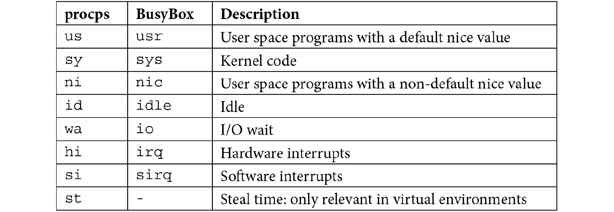
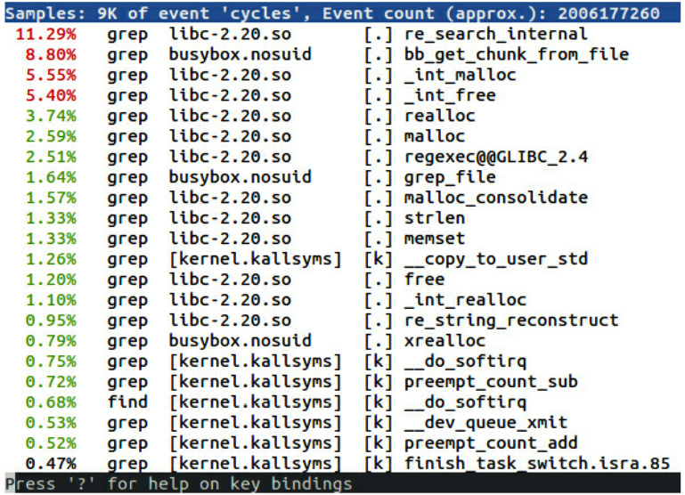
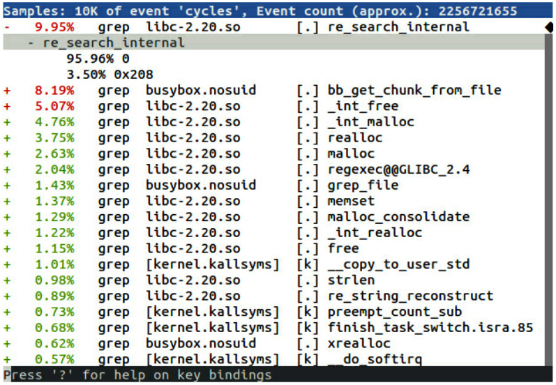
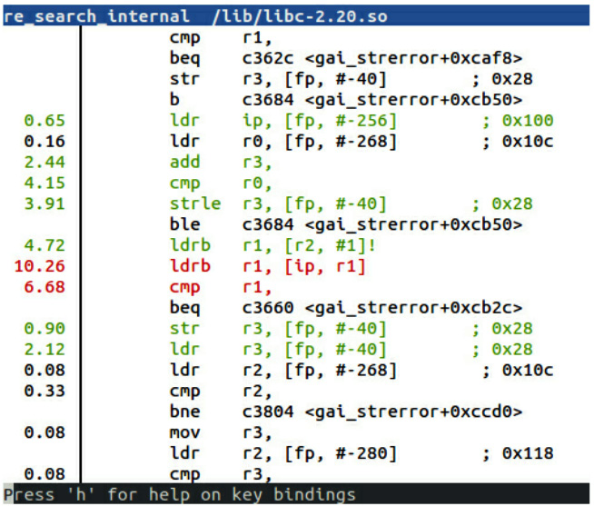
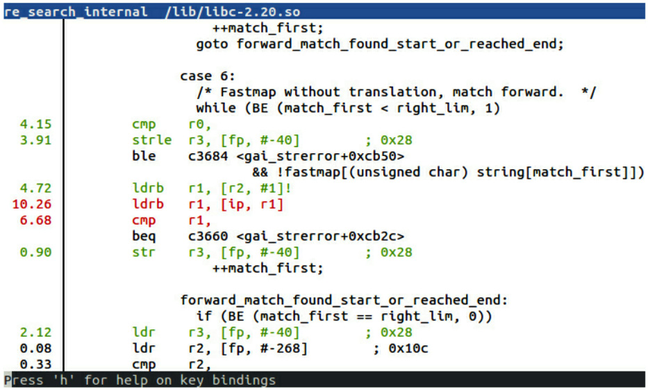
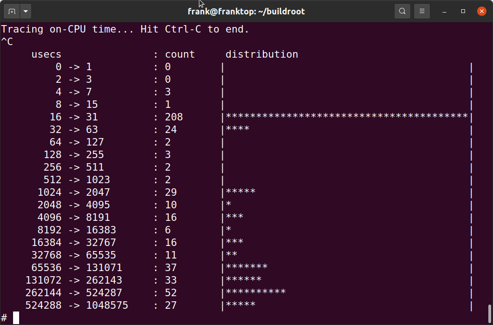
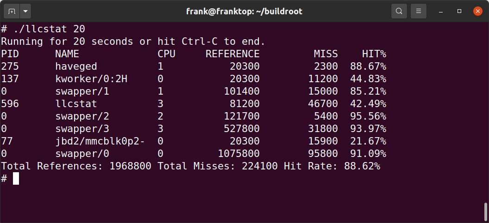
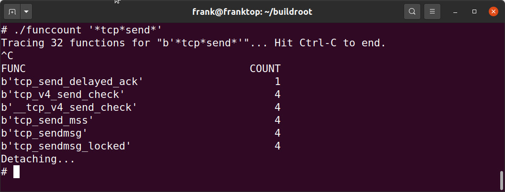
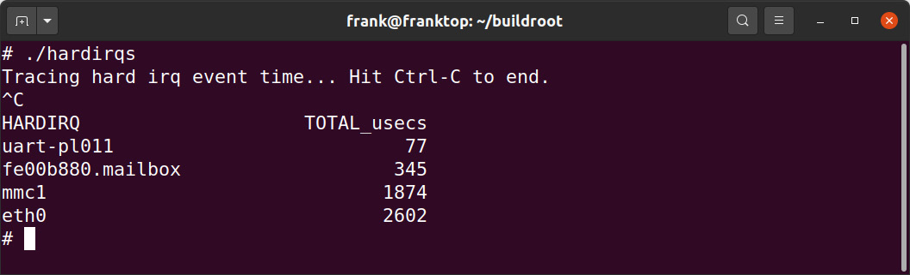

# *Chương 20*: Profiling và tracing (Profiling and Tracing)

Debug tương tác bằng một debugger source-level, như được mô tả ở chương trước, có thể cho bạn hiểu biết về cách một chương trình hoạt động, nhưng nó giới hạn tầm nhìn của bạn vào một phần code nhỏ. Trong chương này, chúng ta sẽ nhìn vào bức tranh lớn hơn để xem hệ thống có hoạt động như dự định hay không.

Lập trình viên và người thiết kế hệ thống nổi tiếng là kém trong việc đoán nút thắt cổ chai nằm ở đâu. Vì vậy nếu hệ thống của bạn có vấn đề hiệu năng, khôn ngoan là bắt đầu bằng việc xem toàn bộ hệ thống rồi đi dần xuống, dùng các công cụ tinh vi hơn khi tiến hành. Trong chương này, tôi sẽ bắt đầu với lệnh well-known `top` như một phương tiện để có cái nhìn tổng quan. Thường thì vấn đề có thể được khoanh vùng vào một chương trình duy nhất, mà bạn có thể phân tích bằng Linux profiler, `perf`. Nếu vấn đề không được khoanh vùng như vậy và bạn muốn có một bức tranh rộng hơn, `perf` cũng có thể làm điều đó. Để chẩn đoán các vấn đề gắn với kernel, tôi sẽ mô tả một số công cụ trace, Ftrace, LTTng và BPF, như một phương tiện thu thập thông tin chi tiết.

Tôi cũng sẽ đề cập Valgrind, công cụ mà, nhờ môi trường thực thi sandbox của nó, có thể giám sát một chương trình và báo cáo về code khi nó chạy. Tôi sẽ hoàn tất chương bằng mô tả về một công cụ trace đơn giản, `strace`, công cụ tiết lộ việc thực thi của một chương trình bằng cách trace các system call mà nó thực hiện.

Trong chương này, chúng ta sẽ đề cập các chủ đề sau:

- Observer effect
- Bắt đầu profile
- Profiling với `top`
- Profiler của người nghèo
- Giới thiệu `perf`
- Trace event
- Giới thiệu Ftrace
- Dùng LTTng
- Dùng BPF
- Dùng Valgrind
- Dùng `strace`

## Yêu cầu kỹ thuật

Để làm theo các ví dụ, hãy bảo đảm bạn có những thứ sau:

- Một hệ thống host Linux-based
- Bản phát hành Buildroot 2020.02.9 LTS
- Etcher cho Linux
- Một đầu đọc thẻ Micro SD và thẻ
- Một Raspberry Pi 4
- Một nguồn điện USB-C 5 V 3A
- Một cáp Ethernet và port để kết nối mạng

Lẽ ra bạn đã cài bản phát hành 2020.02.9 LTS của Buildroot cho [*Chương 6*](ch06_selecting_a_build_system.vi.md), *Chọn build system*. Nếu chưa, hãy tham khảo mục *System requirements* của *The Buildroot user manual* ([https://buildroot.org/downloads/manual/manual.html](https://buildroot.org/downloads/manual/manual.html)) trước khi cài Buildroot trên host Linux theo hướng dẫn trong [*Chương 6*](ch06_selecting_a_build_system.vi.md).

Toàn bộ code cho chương này có thể được tìm thấy trong thư mục `Chapter20` của repository GitHub của sách: [https://github.com/PacktPublishing/Mastering-Embedded-Linux-Programming-Third-Edition](https://github.com/PacktPublishing/Mastering-Embedded-Linux-Programming-Third-Edition).

## Observer effect

Trước khi đi sâu vào các công cụ, hãy nói về những gì các công cụ sẽ cho bạn thấy. Như trong nhiều lĩnh vực, đo một thuộc tính nhất định sẽ ảnh hưởng tới chính việc quan sát. Đo dòng điện trong một đường cấp nguồn đòi hỏi đo độ sụt áp trên một điện trở nhỏ. Tuy nhiên, bản thân điện trở lại ảnh hưởng tới dòng điện. Điều tương tự đúng với profiling: mọi quan sát hệ thống đều có cái giá về chu kỳ CPU, và tài nguyên đó không còn được dùng cho application nữa. Các công cụ đo cũng làm xáo trộn hành vi caching, ngốn không gian bộ nhớ và ghi ra đĩa, tất cả đều làm tình hình tệ hơn. Không có phép đo nào mà không có overhead.

Tôi thường nghe các kỹ sư nói rằng kết quả của một lần profiling hoàn toàn gây hiểu lầm. Điều đó thường là vì họ đang thực hiện phép đo trên thứ gì đó không gần với tình huống thực. Hãy luôn cố đo trên target, dùng các bản build release của phần mềm, với một tập dữ liệu hợp lệ, dùng càng ít service phụ càng tốt.

Một bản build release thường ngụ ý build các binary được tối ưu hoàn toàn mà không có debug symbol. Các yêu cầu production này hạn chế nghiêm trọng chức năng của hầu hết các công cụ profiling.

### Symbol table và compile flag

Một khi hệ thống đã chạy ổn, chúng ta sẽ gặp vấn đề ngay lập tức. Dù quan trọng là quan sát hệ thống ở trạng thái tự nhiên của nó, các công cụ thường cần thêm thông tin để hiểu được các sự kiện.

Một số công cụ cần các tùy chọn kernel đặc biệt. Với các công cụ chúng ta đang xem xét trong chương này, điều này áp dụng cho `perf`, Ftrace, LTTng và BPF. Vì vậy, có lẽ bạn sẽ phải build và triển khai một kernel mới cho các bài test này.

Debug symbol rất hữu ích trong việc chuyển các địa chỉ chương trình thô thành tên function và dòng code. Triển khai các file thực thi có debug symbol không thay đổi việc thực thi của code, nhưng nó đòi hỏi bạn có bản sao của các binary và kernel được biên dịch với thông tin debug, ít nhất cho các component bạn muốn profile. Một số công cụ hoạt động tốt nhất nếu bạn đã cài những thứ này trên hệ thống target: chẳng hạn `perf`. Các kỹ thuật giống như cho việc debug nói chung mà tôi đã thảo luận trong [*Chương 19*](ch19_debugging_with_gdb.vi.md), *Debug với GDB*.

Nếu bạn muốn một công cụ tạo call graph, bạn có thể phải biên dịch với stack frame được enable. Nếu bạn muốn công cụ gán địa chỉ với dòng code chính xác, bạn có thể cần biên dịch với mức tối ưu thấp hơn.

Cuối cùng, một số công cụ cần chèn instrumentation vào chương trình để bắt mẫu, nên bạn sẽ phải biên dịch lại các component đó. Điều này áp dụng cho Ftrace và LTTng với kernel.

Hãy lưu ý rằng bạn càng thay đổi hệ thống đang quan sát nhiều, càng khó liên hệ các phép đo bạn thực hiện với hệ thống production.

> **Mẹo**
>
> Tốt nhất là áp dụng cách tiếp cận wait-and-see, chỉ thực hiện thay đổi khi nhu cầu đã rõ ràng, và lưu tâm rằng mỗi lần bạn làm vậy, bạn sẽ thay đổi thứ bạn đang đo.

Vì kết quả profiling có thể rất mơ hồ, hãy bắt đầu với các công cụ đơn giản, easy-to-use, có sẵn trước khi với tới các công cụ phức tạp và xâm lấn hơn.

## Bắt đầu profile

Khi xem toàn bộ hệ thống, một chỗ tốt để bắt đầu là với một công cụ đơn giản như `top`, cho bạn cái nhìn tổng quan rất nhanh. Nó cho bạn thấy bao nhiêu bộ nhớ đang được dùng, process nào đang ngốn chu kỳ CPU, và điều này được phân bố thế nào giữa các lõi và theo thời gian.

Nếu `top` cho thấy một application duy nhất đang dùng hết các chu kỳ CPU trong user space, thì bạn có thể profile application đó bằng `perf`.

Nếu hai hoặc nhiều process có mức sử dụng CPU cao, có lẽ có gì đó đang gắn kết chúng với nhau, có lẽ là truyền dữ liệu. Nếu nhiều chu kỳ được dùng cho system call hoặc xử lý interrupt, thì có thể có vấn đề với cấu hình kernel hoặc với một device driver. Trong cả hai trường hợp, bạn cần bắt đầu bằng việc lấy profile của toàn bộ hệ thống, lại bằng `perf`.

Nếu bạn muốn tìm hiểu thêm về kernel và trình tự các sự kiện ở đó, hãy dùng Ftrace, LTTng hoặc BPF.

Có thể có các vấn đề khác mà `top` sẽ không giúp được bạn. Nếu bạn có code multi-threaded và có vấn đề treo khóa, hoặc nếu bạn bị hỏng dữ liệu ngẫu nhiên, thì Valgrind cùng plugin Helgrind có thể hữu ích. Memory leak cũng thuộc nhóm này; tôi đã đề cập việc chẩn đoán memory-related trong [*Chương 18*](ch18_managing_memory.vi.md), *Quản lý bộ nhớ*.

Trước khi đi vào các công cụ profiling more-advanced này, hãy bắt đầu với công cụ thô sơ nhất có trên hầu hết các hệ thống, bao gồm cả các hệ thống production.

## Profiling với top

Chương trình **top** là một công cụ đơn giản không cần tùy chọn kernel đặc biệt hay symbol table nào. Có một phiên bản cơ bản trong BusyBox và một phiên bản nhiều chức năng hơn trong package `procps`, có sẵn trong Yocto Project và Buildroot. Bạn cũng có thể muốn cân nhắc dùng `htop`, công cụ có chức năng tương tự `top` nhưng có giao diện người dùng đẹp hơn (theo một số người).

Để bắt đầu, hãy tập trung vào dòng tóm tắt của `top`, là dòng thứ hai nếu bạn đang dùng BusyBox và dòng thứ ba nếu bạn đang dùng `top` từ `procps`. Đây là một ví dụ, dùng `top` của BusyBox:

```
Mem: 57044K used, 446172K free, 40K shrd, 3352K buff, 34452K cached
CPU: 58% usr 4% sys 0% nic 0% idle 37% io 0% irq 0% sirq
Load average: 0.24 0.06 0.02 2/51 105
PID PPID USER STAT VSZ %VSZ %CPU COMMAND
105 104 root R 27912 6% 61% ffmpeg -i track2.wav
[…]
```

Dòng tóm tắt cho thấy phần trăm thời gian chạy ở các trạng thái khác nhau, như được thể hiện trong bảng này:



Trong ví dụ trên, gần như toàn bộ thời gian (58%) được dùng ở user mode, với một lượng nhỏ (4%) ở system mode, nên đây là một hệ thống CPU-bound trong user space. Dòng đầu tiên sau phần tóm tắt cho thấy chỉ một application chịu trách nhiệm: `ffmpeg`. Mọi nỗ lực giảm mức sử dụng CPU nên được hướng vào đó.

Đây là một ví dụ khác:

```
Mem: 13128K used, 490088K free, 40K shrd, 0K buff, 2788K cached
CPU: 0% usr 99% sys 0% nic 0% idle 0% io 0% irq 0% sirq
Load average: 0.41 0.11 0.04 2/46 97
PID PPID USER STAT VSZ %VSZ %CPU COMMAND
92 82 root R 2152 0% 100% cat /dev/urandom
[…]
```

Hệ thống này dành gần như toàn bộ thời gian trong kernel space (99% `sys`), do `cat` đọc từ `/dev/urandom`. Trong trường hợp nhân tạo này, profile riêng `cat` sẽ không giúp được gì, nhưng profile các kernel function mà `cat` gọi thì có thể.

View mặc định của `top` chỉ hiển thị process, nên mức sử dụng CPU là tổng của tất cả các thread trong process. Nhấn *H* để xem thông tin cho từng thread. Tương tự, nó gộp thời gian trên tất cả các CPU. Nếu bạn đang dùng phiên bản `procps` của `top`, bạn có thể xem tóm tắt theo từng CPU bằng cách nhấn phím *1*.

Một khi đã khoanh được process có vấn đề bằng `top`, chúng ta có thể attach GDB vào nó.

## Profiler của người nghèo

Bạn có thể profile một application chỉ bằng cách dùng **GDB** để dừng nó ở các khoảng thời gian tùy ý để xem nó đang làm gì. Đây là **poor man's profiler**. Nó dễ thiết lập và là một cách thu thập dữ liệu profile.

Quy trình rất đơn giản:

1. Attach vào process bằng `gdbserver` (cho remote debug) hoặc GDB (cho debug native). Process dừng lại.
2. Quan sát function nơi nó dừng. Bạn có thể dùng lệnh GDB `backtrace` để xem call stack.
3. Gõ `continue` để chương trình tiếp tục.
4. Sau một lúc, nhấn *Ctrl* + *C* để dừng nó lại, và quay lại *bước 2*.

Nếu bạn lặp lại *bước 2* tới *4* vài lần, bạn sẽ nhanh chóng có ý niệm liệu nó đang lặp hay đang tiến triển, và nếu bạn lặp lại đủ thường xuyên, bạn sẽ có ý niệm các hotspot trong code nằm ở đâu.

Có cả một trang web dành cho ý tưởng này tại [http://poormansprofiler.org](http://poormansprofiler.org), cùng với các script giúp việc này dễ hơn một chút. Tôi đã dùng kỹ thuật này nhiều lần qua nhiều năm với nhiều hệ điều hành và debugger khác nhau.

Đây là một ví dụ về **statistical profiling**, trong đó bạn lấy mẫu trạng thái chương trình theo các khoảng thời gian. Sau một số mẫu, bạn bắt đầu biết được khả năng thống kê của các function đang được thực thi. Thật ngạc nhiên là bạn thực sự cần ít mẫu đến thế nào. Các statistical profiler khác là `perf record`, OProfile và `gprof`.

Lấy mẫu bằng một debugger mang tính xâm lấn vì chương trình bị dừng trong một khoảng thời gian đáng kể khi bạn thu thập mẫu. Các công cụ khác có thể làm điều này với overhead thấp hơn nhiều. Một công cụ như vậy là `perf`.

## Giới thiệu perf

**perf** là viết tắt của Linux **performance event counter subsystem**, `perf_events`, và cũng là tên của công cụ command-line để tương tác với `perf_events`. Cả hai đều là một phần của kernel từ Linux 2.6.31. Có rất nhiều thông tin hữu ích trong cây source Linux ở `tools/perf/Documentation` cũng như tại [https://perf.wiki.kernel.org](https://perf.wiki.kernel.org).

Động lực ban đầu cho việc phát triển `perf` là cung cấp một cách thống nhất để truy cập các thanh ghi của **performance measurement unit** (**PMU**), là một phần của hầu hết các lõi processor hiện đại. Một khi API đã được định nghĩa và tích hợp vào Linux, việc mở rộng nó để bao gồm các loại performance counter khác trở nên hợp lý.

Về cốt lõi, `perf` là một tập event counter với các quy tắc về khi nào chúng chủ động thu thập dữ liệu. Bằng cách đặt các quy tắc, bạn có thể bắt dữ liệu từ toàn bộ hệ thống, chỉ kernel, hoặc chỉ một process và các con của nó, và làm điều đó trên tất cả các CPU hoặc chỉ một CPU. Nó rất linh hoạt. Với một công cụ này, bạn có thể bắt đầu bằng việc xem toàn bộ hệ thống, rồi tập trung vào một device driver có vẻ đang gây vấn đề, một application đang chạy chậm, hoặc một library function có vẻ mất nhiều thời gian thực thi hơn bạn nghĩ.

Code của công cụ command-line `perf` là một phần của kernel, trong thư mục `tools/perf`. Công cụ và kernel subsystem được phát triển song hành, nghĩa là chúng phải thuộc cùng một phiên bản kernel. `perf` có thể làm rất nhiều thứ. Trong chương này, tôi sẽ chỉ xem nó như một profiler. Để có mô tả về các khả năng khác của nó, hãy đọc các man page của `perf` và tham khảo tài liệu được đề cập ở đầu mục này.

Ngoài debug symbol, có hai tùy chọn cấu hình chúng ta cần đặt để enable đầy đủ `perf` trong kernel.

### Cấu hình kernel cho perf

Bạn cần một kernel được cấu hình cho `perf_events`, và bạn cần lệnh `perf` được cross-compiled để chạy trên target. Cấu hình kernel liên quan là `CONFIG_PERF_EVENTS`, có trong menu **General setup** | **Kernel Performance Events and Counters**.

Nếu bạn muốn profile bằng tracepoint—sẽ nói thêm về chủ đề này sau—hãy enable cả các tùy chọn được mô tả trong mục về Ftrace. Nhân tiện đang ở đó, cũng đáng để enable `CONFIG_DEBUG_INFO`.

Lệnh `perf` có nhiều phụ thuộc, khiến việc cross-compiling nó khá lộn xộn. Tuy nhiên, cả Yocto Project và Buildroot đều có target package cho nó.

Bạn cũng sẽ cần debug symbol trên target cho các binary bạn quan tâm profile; nếu không, `perf` sẽ không thể phân giải địa chỉ thành các symbol có nghĩa. Lý tưởng nhất, bạn muốn có debug symbol cho toàn bộ hệ thống, bao gồm cả kernel. Với kernel, hãy nhớ rằng debug symbol của kernel nằm trong file `vmlinux`.

### Build perf với Yocto Project

Nếu bạn đang dùng kernel `linux-yocto` tiêu chuẩn, `perf_events` đã được enable sẵn, nên không cần làm gì thêm.

Để build công cụ `perf`, bạn có thể thêm nó một cách tường minh vào các phụ thuộc của target image, hoặc bạn có thể thêm feature `tools-profile`. Như tôi đã đề cập trước đó, có lẽ bạn sẽ muốn có debug symbol trên target image cũng như image `vmlinux` của kernel. Tổng cộng, đây là những gì bạn sẽ cần trong `conf/local.conf`:

```
EXTRA_IMAGE_FEATURES = "debug-tweaks dbg-pkgs tools-profile"
IMAGE_INSTALL_append = "kernel-vmlinux"
```

Thêm `perf` vào một image Buildroot-based có thể phức tạp hơn tùy theo nguồn của cấu hình kernel mặc định của chúng ta.

### Build perf với Buildroot

Nhiều cấu hình kernel Buildroot không bao gồm `perf_events`, nên bạn nên bắt đầu bằng việc kiểm tra kernel của mình có bao gồm các tùy chọn được đề cập ở mục trước hay không.

Để cross-compile `perf`, chạy `menuconfig` của Buildroot và chọn như sau:

- `BR2_LINUX_KERNEL_TOOL_PERF` trong **Kernel** | **Linux Kernel Tools**

Để build package với debug symbol và cài chúng chưa strip trên target, chọn hai thiết lập sau:

- `BR2_ENABLE_DEBUG` trong menu **Build options** | **build packages with debugging symbols**
- `BR2_STRIP = none` trong menu **Build options** | **strip command for binaries on target**

Sau đó, chạy `make clean`, rồi `make`.

Khi đã build xong mọi thứ, bạn sẽ phải sao chép `vmlinux` vào target image thủ công.

### Profiling với perf

Bạn có thể dùng `perf` để lấy mẫu trạng thái của một chương trình bằng một trong các event counter và tích lũy mẫu trong một khoảng thời gian để tạo một profile. Đây là một ví dụ khác về statistical profiling. Event counter mặc định được gọi là `cycles`, một hardware counter chung được ánh xạ tới một thanh ghi PMU biểu diễn số đếm chu kỳ ở tần số clock lõi.

Tạo một profile bằng `perf` là một quá trình two-stage: lệnh `perf record` bắt mẫu và ghi chúng vào một file tên `perf.data` (mặc định), rồi `perf report` phân tích kết quả. Cả hai lệnh đều chạy trên target. Các mẫu được thu thập được lọc cho process và các con của một lệnh bạn chỉ định. Đây là một ví dụ về profiling một shell script tìm chuỗi `linux`:

```
# perf record sh -c "find /usr/share | xargs grep linux > /dev/null"
[ perf record: Woken up 2 times to write data ]
[ perf record: Captured and wrote 0.368 MB perf.data (~16057 samples) ]
# ls -l perf.data
-rw------- 1 root root 387360 Aug 25 2015 perf.data
```

Bây giờ bạn có thể hiển thị kết quả từ `perf.data` bằng lệnh `perf report`. Có ba giao diện người dùng bạn có thể chọn trên command line:

- `--stdio`: Đây là một giao diện pure-text không có tương tác người dùng. Bạn sẽ phải khởi chạy `perf report` và `annotate` cho mỗi view của trace.
- `--tui`: Đây là một giao diện menu text-based đơn giản với việc di chuyển giữa các màn hình.
- `--gtk`: Đây là một giao diện đồ họa, ngoài ra hoạt động giống `--tui`.

Mặc định là TUI, như được thể hiện trong ví dụ này:



*Hình 20.1 – perf report TUI*

`perf` có thể ghi lại các kernel function được thực thi thay mặt các process vì nó thu thập mẫu trong kernel space.

Danh sách được sắp xếp với các function hoạt động nhiều nhất ở đầu. Trong ví dụ này, tất cả trừ một được bắt trong khi `grep` đang chạy. Một số nằm trong một thư viện, `libc-2.20`, một số nằm trong một chương trình, `busybox.nosuid`, và một số nằm trong kernel. Chúng ta có tên symbol cho các function của chương trình và thư viện vì tất cả các binary đã được cài trên target với thông tin debug, và kernel symbol đang được đọc từ `/boot/vmlinux`. Nếu bạn có `vmlinux` ở một vị trí khác, hãy thêm `-k <path>` vào lệnh `perf report`. Thay vì lưu mẫu trong `perf.data`, bạn có thể lưu chúng vào một file khác bằng `perf record -o <file name>` và phân tích chúng bằng `perf report -i <file name>`.

Theo mặc định, `perf record` lấy mẫu ở tần số 1,000 Hz dùng counter `cycles`.

> **Mẹo**
>
> Tần số lấy mẫu 1,000 Hz có thể cao hơn mức bạn thực sự cần và có thể là nguyên nhân của observer effect. Hãy thử với tốc độ thấp hơn; theo kinh nghiệm của tôi, 100 Hz là đủ cho hầu hết trường hợp. Bạn có thể đặt tần số lấy mẫu bằng tùy chọn `-F`.

Điều này vẫn chưa thực sự làm cuộc sống dễ dàng; các function ở đầu danh sách chủ yếu là các thao tác bộ nhớ low-level, và bạn có thể khá chắc chắn rằng chúng đã được tối ưu. May mắn là `perf record` cũng cho chúng ta khả năng leo lên call stack và xem các function này đang được gọi ở đâu.

### Call graph

Sẽ hay nếu lùi lại và xem bối cảnh xung quanh các function tốn kém này. Bạn có thể làm điều đó bằng cách truyền tùy chọn `-g` cho `perf record` để bắt backtrace từ mỗi mẫu.

Bây giờ, `perf report` hiển thị một dấu cộng (`+`) ở nơi function là một phần của một call chain. Bạn có thể mở rộng trace để xem các function thấp hơn trong chain:



*Hình 20.2 – perf report (call graph)*

> **Lưu ý quan trọng**
>
> Tạo call graph dựa vào khả năng trích các call frame từ stack, giống như cần thiết cho backtrace trong GDB. Thông tin cần để unwind stack được mã hóa trong thông tin debug của các file thực thi, nhưng không phải mọi tổ hợp kiến trúc và toolchain đều có khả năng làm vậy.

Backtrace thì hay, nhưng assembler, hay tốt hơn nữa, source code, của các function này ở đâu?

### perf annotate

Giờ bạn đã biết cần xem function nào, sẽ hay nếu bước vào bên trong và xem code và có số lần hit cho mỗi lệnh. Đó là điều `perf annotate` làm, bằng cách gọi xuống một bản `objdump` được cài trên target. Bạn chỉ cần dùng `perf annotate` thay cho `perf report`.

`perf annotate` cần symbol table cho các file thực thi và `vmlinux`. Đây là một ví dụ về một function được annotate:



*Hình 20.3 – perf annotate (assembler)*

Nếu bạn muốn xem source code xen kẽ với assembler, bạn có thể sao chép các source file liên quan lên thiết bị target. Nếu bạn đang dùng Yocto Project và build với extra image feature `dbg-pkgs`, hoặc đã cài từng package `-dbg`, thì source sẽ đã được cài cho bạn trong `/usr/src/debug`. Nếu không, bạn có thể xem thông tin debug để thấy vị trí của source code:

```
$ arm-buildroot-linux-gnueabi-objdump --dwarf lib/libc-2.19.so | grep DW_AT_comp_dir
<3f> DW_AT_comp_dir : /home/chris/buildroot/output/build/hostgcc-initial-4.8.3/build/arm-buildroot-linux-gnueabi/libgcc
```

Đường dẫn trên target phải *giống hệt* đường dẫn bạn có thể thấy trong `DW_AT_comp_dir`.

Đây là một ví dụ về annotation với source và assembler code:



*Hình 20.4 – perf annotate (source code)*

Giờ chúng ta có thể thấy source code C tương ứng phía trên `cmp r0` và phía dưới lệnh `str r3, [fp, #-40]`.

Như vậy là kết thúc phần đề cập về `perf`. Dù có các statistical sampling profiler khác, chẳng hạn OProfile và `gprof`, có trước `perf`, các công cụ này đã mất ưu thế trong những năm gần đây, nên tôi chọn bỏ qua chúng. Tiếp theo, chúng ta sẽ xem các event tracer.

## Trace event

Các công cụ chúng ta đã thấy cho đến giờ đều dùng statistical sampling. Bạn thường muốn biết thêm về thứ tự các sự kiện để có thể thấy chúng và liên hệ chúng với nhau. Function tracing liên quan tới việc instrument code với các tracepoint bắt thông tin về sự kiện, và có thể bao gồm một số hoặc tất cả những thứ sau:

- Một timestamp
- Bối cảnh, chẳng hạn PID hiện tại
- Tham số function và giá trị trả về
- Một callstack

Nó xâm lấn hơn statistical profiling và có thể tạo ra một lượng lớn dữ liệu. Vấn đề sau có thể được giảm nhẹ bằng cách áp dụng các bộ lọc khi mẫu được bắt và sau đó khi xem trace.

Tôi sẽ đề cập ba công cụ trace ở đây: các kernel function tracer **Ftrace**, **LTTng** và **BPF**.

## Giới thiệu Ftrace

Kernel function tracer **Ftrace** phát triển từ công việc do Steven Rostedt và nhiều người khác thực hiện khi họ lần tìm nguyên nhân của scheduling latency cao trong các application real-time. Ftrace xuất hiện trong Linux 2.6.27 và đã được phát triển tích cực kể từ đó. Có một số tài liệu mô tả kernel tracing trong source kernel ở `Documentation/trace`.

Ftrace gồm một số tracer có thể ghi log nhiều loại hoạt động khác nhau trong kernel. Ở đây, tôi sẽ nói về các tracer `function` và `function_graph` và các event tracepoint. Trong [*Chương 21*](ch21_real_time_programming.vi.md), *Lập trình Real-Time*, tôi sẽ xem lại Ftrace và dùng nó để hiển thị các latency real-time.

Tracer `function` instrument mỗi kernel function để các lời gọi có thể được ghi lại và gắn timestamp. Cũng đáng chú ý, nó biên dịch kernel với switch `-pg` để chèn instrumentation. Tracer `function_graph` đi xa hơn và ghi lại cả lúc vào và lúc ra của function để có thể tạo một call graph. Tính năng event tracepoint cũng ghi lại các tham số gắn với lời gọi.

Ftrace có một giao diện người dùng rất embedded-friendly được hiện thực hoàn toàn qua các file ảo trong filesystem `debugfs`, nghĩa là bạn không phải cài công cụ nào trên target để nó hoạt động. Dù vậy, có các giao diện người dùng khác nếu bạn thích: `trace-cmd` là một công cụ command-line ghi và xem trace và có sẵn trong Buildroot (`BR2_PACKAGE_TRACE_CMD`) và Yocto Project (`trace-cmd`). Có một trace viewer đồ họa tên **KernelShark** có sẵn dưới dạng package cho Yocto Project.

Giống `perf`, enable Ftrace đòi hỏi đặt một số tùy chọn cấu hình kernel nhất định.

### Chuẩn bị dùng Ftrace

Ftrace và các tùy chọn khác nhau của nó được cấu hình trong menu cấu hình kernel. Tối thiểu bạn sẽ cần những thứ sau:

- `CONFIG_FUNCTION_TRACER` từ menu **Kernel hacking** | **Tracers** | **Kernel Function Tracer**

Vì những lý do sẽ trở nên rõ ràng sau, bạn cũng nên bật các tùy chọn này:

- `CONFIG_FUNCTION_GRAPH_TRACER` trong menu **Kernel hacking** | **Tracers** | **Kernel Function Graph Tracer**
- `CONFIG_DYNAMIC_FTRACE` trong menu **Kernel hacking** | **Tracers** | **enable/disable function tracing dynamically**

Vì toàn bộ nằm trong kernel, không có cấu hình user space nào cần làm.

### Dùng Ftrace

Trước khi có thể dùng Ftrace, bạn phải mount filesystem `debugfs`, theo quy ước được đặt trong thư mục `/sys/kernel/debug`:

```
# mount -t debugfs none /sys/kernel/debug
```

Tất cả các điều khiển cho Ftrace nằm trong thư mục `/sys/kernel/debug/tracing`; thậm chí có một `HOWTO` mini trong file `README` ở đó.

Đây là danh sách các tracer có sẵn trong kernel:

```
# cat /sys/kernel/debug/tracing/available_tracers
blk function_graph function nop
```

Tracer đang active được hiển thị bởi `current_tracer`, ban đầu sẽ là null tracer, `nop`.

Để bắt một trace, chọn tracer bằng cách ghi tên của một trong các `available_tracers` vào `current_tracer`, rồi enable tracing trong một lúc ngắn, như được thể hiện ở đây:

```
# echo function > /sys/kernel/debug/tracing/current_tracer
# echo 1 > /sys/kernel/debug/tracing/tracing_on
# sleep 1
# echo 0 > /sys/kernel/debug/tracing/tracing_on
```

Trong một giây đó, trace buffer sẽ đã được điền đầy các chi tiết của mọi function được kernel gọi. Định dạng của trace buffer là văn bản thuần, như được mô tả trong `Documentation/trace/ftrace.txt`. Bạn có thể đọc trace buffer từ file `trace`:

```
# cat /sys/kernel/debug/tracing/trace
# tracer: function
#
# entries-in-buffer/entries-written: 40051/40051   #P:1
#
#                     _-----=> irqs-off
#                    / _----=> need-resched
#                   | / _---=> hardirq/softirq
#                   || / _--=> preempt-depth
#                   ||| /     delay
# TASK-PID   CPU#   ||||   TIMESTAMP   FUNCTION
#   | |       |     ||||       |          |
sh-361 [000] ...1 992.990646: mutex_unlock <-rb_simple_write
sh-361 [000] ...1 992.990658: __fsnotify_parent <-vfs_write
sh-361 [000] ...1 992.990661: fsnotify <-vfs_write
sh-361 [000] ...1 992.990663: __srcu_read_lock <-fsnotify
sh-361 [000] ...1 992.990666: preempt_count_add <-__srcu_read_lock
sh-361 [000] ...2 992.990668: preempt_count_sub <-__srcu_read_lock
sh-361 [000] ...1 992.990670: __srcu_read_unlock <-fsnotify
sh-361 [000] ...1 992.990672: __sb_end_write <-vfs_write
sh-361 [000] ...1 992.990674: preempt_count_add <-__sb_end_write
[…]
```

Bạn có thể bắt một số lượng lớn điểm dữ liệu chỉ trong một giây—trong trường hợp này, hơn 40,000.

Giống với profiler, khó hiểu được một danh sách function phẳng như thế này. Nếu bạn chọn tracer `function_graph`, Ftrace bắt các call graph như thế này:

```
# tracer: function_graph
#
# CPU  DURATION            FUNCTION CALLS
# |     |   |               |   |   |   |
 0) + 63.167 us   |              } /* cpdma_ctlr_int_ctrl */
 0) + 73.417 us   |            } /* cpsw_intr_disable */
 0)               |            disable_irq_nosync() {
 0)               |              __disable_irq_nosync() {
 0)               |                __irq_get_desc_lock() {
 0)   0.541 us    |                  irq_to_desc();
 0)   0.500 us    |                  preempt_count_add();
 0) + 16.000 us   |                }
 0)               |                __disable_irq() {
 0)   0.500 us    |                  irq_disable();
 0)   8.208 us    |                }
 0)               |                __irq_put_desc_unlock() {
 0)   0.459 us    |                  preempt_count_sub();
 0)   8.000 us    |                }
 0) + 55.625 us   |              }
 0) + 63.375 us   |            }
```

Giờ bạn có thể thấy sự lồng nhau của các lời gọi function, được phân cách bởi dấu ngoặc nhọn, `{` và `}`. Ở dấu ngoặc đóng, có một phép đo thời gian dùng trong function, được chú thích bằng dấu cộng (`+`) nếu nó mất hơn 10 µs và dấu chấm than (`!`) nếu nó mất hơn 100 µs.

Bạn thường chỉ quan tâm tới hoạt động kernel gây ra bởi một process hay thread duy nhất, khi đó bạn có thể giới hạn trace vào một thread đó bằng cách ghi thread ID vào `set_ftrace_pid`.

### Dynamic Ftrace và trace filter

Enable `CONFIG_DYNAMIC_FTRACE` cho phép Ftrace sửa đổi các function trace site lúc runtime, điều có một vài lợi ích. Thứ nhất, nó kích hoạt thêm việc xử lý build-time các function trace probe, cho phép subsystem Ftrace định vị chúng lúc boot và ghi đè chúng bằng các lệnh NOP, nhờ đó giảm overhead của code function trace xuống gần như bằng không. Khi đó bạn có thể enable Ftrace trong các kernel production hoặc near-production mà không ảnh hưởng tới hiệu năng.

Ưu điểm thứ hai là bạn có thể enable một cách chọn lọc các function trace site thay vì trace mọi thứ. Danh sách function được đặt vào `available_filter_functions`; có vài chục nghìn function như vậy. Bạn có thể enable chọn lọc các function trace khi cần bằng cách sao chép tên từ `available_filter_functions` vào `set_ftrace_filter` rồi dừng trace function đó bằng cách ghi tên vào `set_ftrace_notrace`. Bạn cũng có thể dùng wildcard và nối tên vào danh sách. Chẳng hạn, giả sử bạn quan tâm tới việc xử lý `tcp`:

```
# cd /sys/kernel/debug/tracing
# echo "tcp*" > set_ftrace_filter
# echo function > current_tracer
# echo 1 > tracing_on
```

Chạy vài bài test rồi xem `trace`:

```
# cat trace
# tracer: function
#
# entries-in-buffer/entries-written: 590/590   #P:1
#
#                     _-----=> irqs-off
#                    / _----=> need-resched
#                   | / _---=> hardirq/softirq
#                   || / _--=> preempt-depth
#                   ||| /     delay
#  TASK-PID   CPU# ||||   TIMESTAMP  FUNCTION
#    | |       |   ||||       |         |
dropbear-375 [000] ...1 48545.022235: tcp_poll <-sock_poll
dropbear-375 [000] ...1 48545.022372: tcp_poll <-sock_poll
dropbear-375 [000] ...1 48545.022393: tcp_sendmsg <-inet_sendmsg
dropbear-375 [000] ...1 48545.022398: tcp_send_mss <-tcp_sendmsg
dropbear-375 [000] ...1 48545.022400: tcp_current_mss <-tcp_send_mss
[…]
```

Function `set_ftrace_filter` cũng có thể chứa các lệnh, chẳng hạn để bắt đầu và dừng tracing khi các function nhất định được thực thi. Không có chỗ để đi vào các chi tiết này ở đây, nhưng nếu muốn tìm hiểu thêm, hãy đọc mục *Filter commands* trong `Documentation/trace/ftrace.txt`.

### Trace event

Các tracer `function` và `function_graph` được mô tả ở mục trước chỉ ghi lại thời điểm function được thực thi. Tính năng trace event cũng ghi lại các tham số gắn với lời gọi, làm trace dễ đọc và nhiều thông tin hơn. Chẳng hạn, thay vì chỉ ghi lại rằng function `kmalloc` đã được gọi, một trace event sẽ ghi lại số byte được yêu cầu và con trỏ trả về. Trace event được dùng trong `perf` và LTTng cũng như Ftrace, nhưng việc phát triển subsystem trace event được thúc đẩy bởi project LTTng.

Tạo trace event đòi hỏi công sức từ các lập trình viên kernel, vì mỗi event đều khác nhau. Chúng được định nghĩa trong source code bằng macro `TRACE_EVENT`; giờ có hơn một nghìn event. Bạn có thể xem danh sách event có sẵn lúc runtime trong `/sys/kernel/debug/tracing/available_events`. Chúng được đặt tên `subsystem:function`, chẳng hạn `kmem:kmalloc`. Mỗi event cũng được biểu diễn bởi một thư mục con trong `tracing/events/[subsystem]/[function]`, như được minh họa ở đây:

```
# ls events/kmem/kmalloc
enable filter format id trigger
```

Các file như sau:

- `enable`: Bạn ghi `1` vào file này để enable event.
- `filter`: Đây là một biểu thức phải được đánh giá thành `true` để event được trace.
- `format`: Đây là định dạng của event và các tham số.
- `id`: Đây là một định danh dạng số.
- `trigger`: Đây là một lệnh được thực thi khi event xảy ra, dùng cú pháp được định nghĩa trong mục *Filter commands* của `Documentation/trace/ftrace.txt`.

Tôi sẽ cho bạn thấy một ví dụ đơn giản liên quan tới `kmalloc` và `kfree`. Event tracing không phụ thuộc vào các function tracer, nên hãy bắt đầu bằng việc chọn tracer `nop`:

```
# echo nop > current_tracer
```

Tiếp theo, chọn các event cần trace bằng cách enable từng event một:

```
# echo 1 > events/kmem/kmalloc/enable
# echo 1 > events/kmem/kfree/enable
```

Bạn cũng có thể ghi tên event vào `set_event`, như được thể hiện ở đây:

```
# echo "kmem:kmalloc kmem:kfree" > set_event
```

Bây giờ, khi đọc trace, bạn có thể thấy các function và tham số của chúng:

```
# tracer: nop
#
# entries-in-buffer/entries-written: 359/359   #P:1
#
#                      _-----=> irqs-off
#                     / _----=> need-resched
#                    | / _---=> hardirq/softirq
#                    || / _--=> preempt-depth
#                    ||| /     delay
#   TASK-PID   CPU#  ||||    TIMESTAMP  FUNCTION
#      | |       |   ||||       |         |
     cat-382   [000] ...1  2935.586706: kmalloc:call_site=c0554644 ptr=de515a00
        bytes_req=384 bytes_alloc=512
        gfp_flags=GFP_ATOMIC|GFP_NOWARN|GFP_NOMEMALLOC
     cat-382   [000] ...1  2935.586718: kfree: call_site=c059c2d8 ptr=(null)
```

Chính xác cùng các trace event này có thể thấy trong `perf` dưới dạng event `tracepoint`.

Vì không có component user space cồng kềnh nào cần build, Ftrace well-suited để triển khai lên hầu hết các target nhúng. Tiếp theo, chúng ta sẽ xem một event tracer phổ biến khác có nguồn gốc còn sớm hơn Ftrace.

## Dùng LTTng

Project **Linux Trace Toolkit** (**LTT**) được Karim Yaghmour khởi đầu như một phương tiện trace hoạt động kernel và là một trong những công cụ trace đầu tiên có sẵn rộng rãi cho Linux kernel. Sau đó, Mathieu Desnoyers tiếp nhận ý tưởng và re-implemented nó thành một công cụ trace next-generation, **LTTng**. Sau đó nó được mở rộng để bao gồm trace user space cũng như kernel. Website của project là [https://lttng.org/](https://lttng.org/) và chứa một hướng dẫn sử dụng toàn diện.

LTTng gồm ba component:

- Một core session manager
- Một kernel tracer được hiện thực như một nhóm kernel module
- Một user space tracer được hiện thực như một thư viện

Ngoài những thứ đó, bạn sẽ cần một trace viewer như **Babeltrace** ([https://babeltrace.org](https://babeltrace.org)) hoặc plugin **Eclipse Trace Compass** để hiển thị và lọc dữ liệu trace thô trên host hoặc target.

LTTng cần một kernel được cấu hình với `CONFIG_TRACEPOINTS`, được enable khi bạn chọn **Kernel hacking** | **Tracers** | **Kernel Function Tracer**.

Mô tả sau đây áp dụng cho LTTng phiên bản 2.5; các phiên bản khác có thể khác.

### LTTng và Yocto Project

Bạn cần thêm các package này vào các phụ thuộc target trong `conf/local.conf`:

```
IMAGE_INSTALL_append = " lttng-tools lttng-modules lttng-ust"
```

Nếu bạn muốn chạy Babeltrace trên target, hãy nối thêm package `babeltrace`.

### LTTng và Buildroot

Bạn cần enable những thứ sau:

- `BR2_PACKAGE_LTTNG_MODULES` trong menu **Target packages** | **Debugging, profiling and benchmark** | **lttng-modules**
- `BR2_PACKAGE_LTTNG_TOOLS` trong menu **Target packages** | **Debugging, profiling and benchmark** | **lttng-tools**

Để trace user space, enable tùy chọn này:

- `BR2_PACKAGE_LTTNG_LIBUST` trong menu **Target packages** | **Libraries** | **Other, enable lttng-libust**

Có một package gọi là `lttng-babeltrace` cho target. Buildroot tự động build `babeltrace` cho host và đặt nó trong `output/host/usr/bin/babeltrace`.

### Dùng LTTng để trace kernel

LTTng có thể dùng tập event `ftrace` được mô tả trước đó làm các tracepoint tiềm năng. Ban đầu, chúng bị disable.

Giao diện điều khiển cho LTTng là lệnh `lttng`. Bạn có thể liệt kê các kernel probe bằng lệnh sau:

```
# lttng list --kernel
Kernel events:
-------------
writeback_nothread (loglevel: TRACE_EMERG (0)) (type: tracepoint)
writeback_queue (loglevel: TRACE_EMERG (0)) (type: tracepoint)
writeback_exec (loglevel: TRACE_EMERG (0)) (type: tracepoint)
[…]
```

Trace được bắt trong bối cảnh của một session, trong ví dụ này tên là `test`:

```
# lttng create test
Session test created.
Traces will be written in /home/root/lttng-traces/test-20150824-140942
# lttng list
Available tracing sessions:
1) test (/home/root/lttng-traces/test-20150824-140942) [inactive]
```

Bây giờ hãy enable vài event trong session hiện tại. Bạn có thể enable tất cả kernel tracepoint bằng tùy chọn `--all`, nhưng hãy nhớ lời cảnh báo về việc tạo quá nhiều dữ liệu trace. Hãy bắt đầu với một vài trace event scheduler-related:

```
# lttng enable-event --kernel sched_switch,sched_process_fork
```

Kiểm tra mọi thứ đã được thiết lập:

```
# lttng list test
Tracing session test: [inactive]
    Trace path: /home/root/lttng-traces/test-20150824-140942
    Live timer interval (usec): 0
 === Domain: Kernel ===
 Channels:
-------------
- channel0: [enabled]
 Attributes:
      overwrite mode: 0
      subbufers size: 26214
      number of subbufers: 4
      switch timer interval: 0
      read timer interval: 200000
      trace file count: 0
      trace file size (bytes): 0
      output: splice()
 Events:
      sched_process_fork (loglevel: TRACE_EMERG (0)) (type: tracepoint) [enabled]
      sched_switch (loglevel: TRACE_EMERG (0)) (type: tracepoint) [enabled]
```

Bây giờ bắt đầu tracing:

```
# lttng start
```

Chạy tải test, rồi dừng tracing:

```
# lttng stop
```

Trace của session được ghi vào thư mục session, `lttng-traces/<session>/kernel`.

Bạn có thể dùng trình xem Babeltrace để dump dữ liệu trace thô ở định dạng văn bản. Trong trường hợp này, tôi đã chạy nó trên máy host:

```
$ babeltrace lttng-traces/test-20150824-140942/kernel
```

Output quá dài dòng để vừa trang này, nên tôi sẽ để bạn tự bắt và hiển thị một trace theo cách này như một bài tập. Output văn bản từ Babeltrace có ưu điểm là dễ tìm chuỗi bằng `grep` và các lệnh tương tự.

Một lựa chọn tốt cho trace viewer đồ họa là plugin **Trace Compass** cho Eclipse, giờ là một phần của gói Eclipse IDE cho lập trình viên C/C++. Import dữ liệu trace vào Eclipse đặc trưng là lắt nhắt rắc rối. Tóm tắt, bạn cần làm theo các bước sau:

1. Mở perspective **Tracing**.
2. Tạo một project mới bằng cách chọn **File** | **New** | **Tracing project**.
3. Nhập tên project và click vào **Finish**.
4. Right-click vào tùy chọn **New Project** trong menu **Project Explorer** và chọn **Import**.
5. Mở rộng **Tracing**, rồi chọn **Trace Import**.
6. Duyệt tới thư mục chứa trace (chẳng hạn `test-20150824-140942`), tích vào ô để chỉ ra thư mục con bạn muốn (có thể là **kernel**), và click vào **Finish**.
7. Mở rộng project và, bên trong đó, mở rộng **Traces[1]**, rồi bên trong đó, double-click vào **kernel**.

Bây giờ, hãy chuyển hướng khỏi LTTng và lao thẳng vào event tracer mới nhất và tuyệt nhất cho Linux.

## Dùng BPF

**BPF (Berkeley Packet Filter)** là một công nghệ được giới thiệu lần đầu năm 1992 để bắt, lọc và phân tích lưu lượng mạng. Năm 2013, Alexei Starovoitov bắt tay viết lại BPF với sự giúp đỡ của Daniel Borkmann. Công việc của họ, khi đó được gọi là **eBPF** (**extended BPF**), được merge vào kernel năm 2014, nơi nó có sẵn từ Linux 3.15. BPF cung cấp một môi trường thực thi sandbox để chạy chương trình bên trong Linux kernel. Các chương trình BPF được viết bằng C và được biên dịch **just-in-time** (**JIT**) thành native code. Trước khi điều đó có thể xảy ra, BPF bytecode trung gian trước tiên phải vượt qua một loạt kiểm tra an toàn để một chương trình không thể làm crash kernel.

Dù có nguồn gốc từ mạng, BPF giờ là một virtual machine general-purpose chạy bên trong Linux kernel. Bằng cách giúp dễ dàng chạy các chương trình nhỏ trên các sự kiện kernel và application cụ thể, BPF đã nhanh chóng nổi lên như tracer mạnh nhất cho Linux. Giống những gì cgroups đã làm cho việc triển khai container hóa, BPF có tiềm năng cách mạng hóa khả năng quan sát bằng cách cho phép người dùng instrument đầy đủ các hệ thống production. Netflix và Facebook dùng BPF rộng rãi trên các microservice và hạ tầng cloud của họ để phân tích hiệu năng và ngăn chặn các cuộc tấn công **distributed denial of service** (**DDoS**).

Hệ công cụ quanh BPF đang phát triển, với **BPF Compiler Collection** (**BCC**) và **bpftrace** khẳng định mình là hai frontend nổi bật nhất. Brendan Gregg đã tham gia sâu vào cả hai project và đã viết rất nhiều về BPF trong cuốn sách *BPF Performance Tools: Linux System and Application Observability*, *Addison-Wesley* của ông. Với quá nhiều khả năng bao trùm một phạm vi rộng lớn như vậy, công nghệ mới như BPF có thể có vẻ choáng ngợp. Nhưng cũng giống cgroups, chúng ta không cần hiểu BPF hoạt động thế nào để bắt đầu dùng nó. BCC đi kèm vài công cụ và ví dụ ready-made mà chúng ta có thể đơn giản chạy từ command line.

### Cấu hình kernel cho BPF

BCC cần một Linux kernel phiên bản 4.1 trở lên. Tại thời điểm viết sách, BCC chỉ hỗ trợ một vài kiến trúc CPU 64-bit, hạn chế nghiêm trọng việc dùng BPF trong hệ thống nhúng. May mắn là một trong các kiến trúc 64-bit đó là `aarch64`, nên chúng ta vẫn có thể chạy BCC trên Raspberry Pi 4. Hãy bắt đầu bằng việc cấu hình một kernel BPF-enabled cho image đó:

```
$ cd buildroot
$ make clean
$ make raspberrypi4_64_defconfig
$ make menuconfig
```

BCC dùng LLVM để biên dịch các chương trình BPF. LLVM là một project C++ rất lớn, nên nó cần một toolchain có wchar, thread và các tính năng khác để build.

> **Mẹo**
>
> Một package tên `ply` ([https://github.com/iovisor/ply](https://github.com/iovisor/ply)) đã được merge vào Buildroot ngày 23 tháng Một năm 2021, và sẽ được đưa vào bản phát hành 2021.02 LTS của Buildroot. `ply` là một dynamic tracer nhẹ cho Linux tận dụng BPF để các probe có thể được gắn vào các điểm tùy ý trong kernel. Khác với BCC, `ply` không dựa vào LLVM và không có phụ thuộc bên ngoài bắt buộc nào ngoài `libc`. Điều này khiến nó dễ port hơn nhiều sang các kiến trúc CPU nhúng như `arm` và `powerpc`.

Trước khi cấu hình kernel cho BPF, hãy chọn một external toolchain và sửa `raspberrypi4_64_defconfig` để phù hợp với BCC:

1. Enable việc dùng một external toolchain bằng cách điều hướng tới **Toolchain** | **Toolchain type** | **External toolchain** và chọn tùy chọn đó.
2. Lùi ra khỏi **External toolchain** và mở submenu **Toolchain**. Chọn toolchain ARM AArch64 mới nhất làm external toolchain.
3. Lùi ra khỏi trang **Toolchain** và đi sâu vào **System configuration** | **/dev management**. Chọn **Dynamic using devtmpfs + eudev**.
4. Lùi ra khỏi **/dev management** và chọn **Enable root login with password**. Mở **Root password** và nhập một mật khẩu non-empty vào trường văn bản.
5. Lùi ra khỏi trang **System configuration** và đi sâu vào **Filesystem images**. Tăng giá trị **exact size** lên `2G` để có đủ không gian cho source code kernel.
6. Lùi ra khỏi **Filesystem images** và đi sâu vào **Target packages** | **Networking applications**. Chọn package **dropbear** để enable truy cập `scp` và `ssh` tới target. Lưu ý rằng `dropbear` không cho phép truy cập `scp` và `ssh` với `root` mà không có mật khẩu.
7. Lùi ra khỏi **Network applications** và đi sâu vào các target package **Miscellaneous**. Chọn package **haveged** để các chương trình không bị block khi chờ `/dev/urandom` khởi tạo trên target.
8. Lưu các thay đổi và thoát `menuconfig`.

Bây giờ, ghi đè `configs/raspberrypi4_64_defconfig` bằng các thay đổi `menuconfig` của bạn và chuẩn bị source Linux kernel để cấu hình:

```
$ make savedefconfig
$ make linux-configure
```

Lệnh `make linux-configure` sẽ tải về và cài external toolchain và build một số công cụ host trước khi fetch, giải nén và cấu hình source code kernel. Tại thời điểm viết sách, `raspberrypi4_64_defconfig` từ bản phát hành 2020.02.9 LTS của Buildroot vẫn trỏ tới một tarball source kernel 4.19 tùy biến từ fork GitHub của Raspberry Pi Foundation. Hãy kiểm tra nội dung của `raspberrypi4_64_defconfig` để xác định bạn đang dùng phiên bản kernel nào. Khi `make linux-configure` đã cấu hình xong kernel, chúng ta có thể cấu hình lại nó cho BPF:

```
$ make linux-menuconfig
```

Để tìm một tùy chọn cấu hình kernel cụ thể từ menu tương tác, nhấn */* và nhập chuỗi tìm kiếm. Kết quả tìm kiếm sẽ trả về một danh sách đánh số các mục khớp. Nhập một số cho trước sẽ đưa bạn thẳng tới tùy chọn cấu hình đó.

Tối thiểu, chúng ta cần chọn những thứ sau để enable hỗ trợ kernel cho BPF:

```
CONFIG_BPF=y
CONFIG_BPF_SYSCALL=y
```

Chúng ta cũng cần thêm những thứ sau cho BCC:

```
CONFIG_NET_CLS_BPF=m
CONFIG_NET_ACT_BPF=m
CONFIG_BPF_JIT=y
```

Các phiên bản Linux kernel 4.1 tới 4.6 cần flag sau:

```
CONFIG_HAVE_BPF_JIT=y
```

Các phiên bản Linux kernel 4.7 trở về sau cần flag này thay thế:

```
CONFIG_HAVE_EBPF_JIT=y
```

Từ Linux kernel phiên bản 4.7 trở đi, thêm những thứ sau để người dùng có thể gắn các chương trình BPF vào các event `kprobe`, `uprobe` và tracepoint:

```
CONFIG_BPF_EVENTS=y
```

Từ Linux kernel phiên bản 5.2 trở đi, thêm dòng sau cho kernel header:

```
CONFIG_IKHEADERS=m
```

BCC cần đọc kernel header để biên dịch các chương trình BPF, nên chọn `CONFIG_IKHEADERS` làm chúng có thể truy cập được bằng cách nạp một module `kheaders.ko`.

Để chạy các ví dụ mạng của BCC, chúng ta cũng cần các module sau:

```
CONFIG_NET_SCH_SFQ=m
CONFIG_NET_ACT_POLICE=m
CONFIG_NET_ACT_GACT=m
CONFIG_DUMMY=m
CONFIG_VXLAN=m
```

Hãy bảo đảm lưu các thay đổi khi thoát `make linux-menuconfig` để chúng được áp dụng vào `output/build/linux-custom/.config` trước khi build kernel BPF-enabled.

### Build bộ công cụ BCC bằng Buildroot

Với hỗ trợ kernel cần thiết cho BPF giờ đã có, hãy thêm các thư viện và công cụ user space vào image. Tại thời điểm viết sách, Jugurtha Belkalem và những người khác đã làm việc chăm chỉ để tích hợp BCC vào Buildroot nhưng các patch của họ vẫn chưa được merge. Dù một package LLVM đã được đưa vào Buildroot, không có tùy chọn để chọn BPF backend mà BCC cần cho việc biên dịch. Các file cấu hình package `bcc` mới và `llvm` đã cập nhật có thể được tìm thấy trong thư mục `MELP/Chapter20/`. Để sao chép chúng vào bản cài Buildroot 2020.02.09 LTS của bạn, hãy làm như sau:

```
$ cp -a MELP/Chapter20/buildroot/* buildroot
```

Bây giờ hãy thêm các package `bcc` và `llvm` vào `raspberrypi4_64_defconfig`:

```
$ cd buildroot
$ make menuconfig
```

Nếu phiên bản Buildroot của bạn là 2020.02.09 LTS và bạn đã sao chép đúng overlay `buildroot` từ `MELP/Chapter20`, thì giờ sẽ có một package `bcc` có sẵn dưới **Debugging, profiling and benchmark**. Để thêm package `bcc` vào system image, thực hiện các bước sau:

1. Điều hướng tới **Target packages** | **Debugging, profiling and benchmark** và chọn **bcc**.
2. Lùi ra khỏi **Debugging, profiling and benchmark** và đi sâu vào **Libraries** | **Other**. Kiểm tra rằng **clang**, **llvm** và **BPF backend** của LLVM đều đã được chọn.
3. Lùi ra khỏi **Libraries** | **Other** và đi sâu vào **Interpreter languages and scripting**. Kiểm tra rằng **python3** đã được chọn để bạn có thể chạy các công cụ và ví dụ khác nhau đi kèm BCC.
4. Lùi ra khỏi **Interpreter languages and scripting** và chọn **Show packages that are also provided by busybox** dưới BusyBox từ trang **Target packages**.
5. Đi sâu vào **System tools** và kiểm tra rằng **tar** đã được chọn để giải nén kernel header.
6. Lưu các thay đổi và thoát `menuconfig`.

Ghi đè lại `configs/raspberrypi4_64_defconfig` bằng các thay đổi `menuconfig` của bạn và build image:

```
$ make savedefconfig
$ make
```

LLVM và Clang sẽ mất nhiều thời gian để biên dịch. Khi image đã build xong, dùng Etcher để ghi file `output/images/sdcard.img` kết quả ra một thẻ micro SD. Cuối cùng, sao chép source kernel từ `output/build/linux-custom` vào một thư mục `/lib/modules/<kernel version>/build` mới trên partition `root` của thẻ micro SD. Bước cuối này then chốt vì BCC cần truy cập source code kernel để biên dịch các chương trình BPF.

Cắm thẻ micro SD đã hoàn thiện vào Raspberry Pi 4, cắm nó vào mạng cục bộ bằng cáp Ethernet và cấp điện cho thiết bị. Dùng `arp-scan` để tìm địa chỉ IP của Raspberry Pi 4 và SSH vào nó với tư cách `root` bằng mật khẩu bạn đã đặt ở mục trước. Tôi đã dùng `temppwd` làm mật khẩu `root` trong `configs/rpi4_64_bcc_defconfig` mà tôi đưa vào overlay `MELP/Chapter20/buildroot` của mình. Giờ chúng ta đã sẵn sàng có trải nghiệm trực tiếp với việc thử nghiệm BPF.

### Dùng các công cụ tracing BPF

Làm gần như bất cứ điều gì với BPF, bao gồm chạy các công cụ và ví dụ BCC, đều cần đặc quyền `root`, đó là lý do chúng ta đã enable đăng nhập `root` qua SSH. Một điều kiện tiên quyết khác là mount `debugfs` như sau:

```
# mount -t debugfs none /sys/kernel/debug
```

Thư mục chứa các công cụ BCC không nằm trong môi trường `PATH`, nên hãy điều hướng tới đó để thực thi dễ hơn:

```
# cd /usr/share/bcc/tools
```

Hãy bắt đầu với một công cụ hiển thị thời gian on-CPU của task dưới dạng histogram:

```
# ./cpudist
```

`cpudist` cho thấy các task đã ở trên CPU bao lâu trước khi bị bỏ lập lịch:



*Hình 20.5 – cpudist*

Nếu thay vì histogram bạn thấy lỗi sau, thì bạn đã quên sao chép source kernel lên thẻ micro SD:

```
modprobe: module kheaders not found in modules.dep
Unable to find kernel headers. Try rebuilding kernel with CONFIG_IKHEADERS=m (module) or installing the kernel development package for your running kernel version.
chdir(/lib/modules/4.19.97-v8/build): No such file or directory
[…]
Exception: Failed to compile BPF module <text>
```

Một công cụ system-wide hữu ích khác là `llcstat`, công cụ trace các event cache reference và cache miss và tóm tắt chúng theo PID và CPU:



*Hình 20.6 – llcstat*

Không phải mọi công cụ BCC đều cần chúng ta nhấn *Ctrl* + *C* để kết thúc. Một số như `llcstat` nhận một khoảng thời gian lấy mẫu làm đối số command-line.

Chúng ta có thể cụ thể hơn và tập trung vào các function cụ thể bằng các công cụ như `funccount`, công cụ nhận một pattern làm đối số command-line:



*Hình 20.7 – funccount*

Trong trường hợp này, chúng ta đang trace tất cả các kernel function có chứa `tcp` theo sau là `send` trong tên. Nhiều công cụ BCC cũng có thể được dùng để trace các function trong user space. Điều đó đòi hỏi hoặc debug symbol hoặc instrument source code bằng các probe **user statically defined tracepoint** (**USDT**).

Đặc biệt đáng quan tâm với lập trình viên nhúng là các công cụ `hardirqs`, đo thời gian kernel dùng để phục vụ hard interrupt:



*Hình 20.8 – hardirqs*

Viết các công cụ tracing BCC general-purpose hay tùy biến của riêng bạn bằng Python dễ hơn bạn có thể nghĩ. Bạn có thể tìm thấy vài ví dụ để đọc và nghịch trong thư mục `/usr/share/bcc/examples/tracing` đi kèm BCC.

Như vậy là kết thúc phần đề cập về các công cụ event tracing của Linux: Ftrace, LTTng và BPF. Tất cả chúng đều cần ít nhất một chút cấu hình kernel để hoạt động. Valgrind cung cấp thêm các công cụ profiling hoạt động hoàn toàn trong sự thoải mái của user space.

## Dùng Valgrind

Tôi đã giới thiệu Valgrind trong [*Chương 18*](ch18_managing_memory.vi.md), *Quản lý bộ nhớ*, như một công cụ để nhận diện các vấn đề bộ nhớ bằng công cụ `memcheck`. Valgrind có các công cụ hữu ích khác cho application profiling. Hai công cụ tôi sẽ xem ở đây là Callgrind và Helgrind. Vì Valgrind hoạt động bằng cách chạy code trong một sandbox, nó có thể kiểm tra code khi code chạy và báo cáo một số hành vi nhất định, điều mà các tracer và profiler native không làm được.

### Callgrind

**Callgrind** là một profiler call graph-generating, cũng thu thập thông tin về tỷ lệ hit của processor cache và dự đoán rẽ nhánh. Callgrind chỉ hữu ích nếu nút thắt cổ chai của bạn là CPU-bound. Nó không hữu ích nếu có I/O nặng hoặc nhiều process tham gia.

Valgrind không cần cấu hình kernel, nhưng nó cần debug symbol. Nó có sẵn dưới dạng target package trong cả Yocto Project và Buildroot (`BR2_PACKAGE_VALGRIND`).

Bạn chạy Callgrind trong Valgrind trên target như sau:

```
# valgrind --tool=callgrind <program>
```

Lệnh này tạo ra một file tên `callgrind.out.<PID>`, mà bạn có thể sao chép sang host và phân tích bằng `callgrind_annotate`.

Mặc định là bắt dữ liệu cho tất cả các thread cùng nhau trong một file duy nhất. Nếu bạn thêm tùy chọn `--separate-threads=yes` khi bắt, sẽ có các profile cho mỗi thread trong các file tên `callgrind.out.<PID>-<thread id>`, chẳng hạn `callgrind.out.122-01` và `callgrind.out.122-02`.

Callgrind có thể giả lập processor cache L1/L2 và báo cáo về cache miss. Bắt trace với tùy chọn `--simulate-cache=yes`. L2 miss tốn kém hơn nhiều so với L1 miss, nên hãy chú ý tới code có số đếm `D2mr` hoặc `D2mw` cao.

Output thô từ Callgrind có thể choáng ngợp và khó gỡ rối. Một công cụ trực quan hóa như **KCachegrind** ([https://kcachegrind.github.io/html/Home.html](https://kcachegrind.github.io/html/Home.html)) có thể giúp bạn điều hướng trong núi dữ liệu mà Callgrind thu thập.

### Helgrind

**Helgrind** là một thread-error detector để phát hiện lỗi đồng bộ trong các chương trình C, C++ và Fortran có dùng POSIX thread.

Helgrind có thể phát hiện ba lớp lỗi. Thứ nhất, nó có thể phát hiện việc dùng sai API. Một số ví dụ là mở khóa một mutex đã được mở khóa, mở khóa một mutex bị khóa bởi một thread khác, hoặc không kiểm tra giá trị trả về của một số function `pthread` nhất định. Thứ hai, nó giám sát thứ tự các thread lấy lock để phát hiện các chu trình có thể dẫn tới deadlock (còn gọi là deadly embrace). Cuối cùng, nó phát hiện data race, có thể xảy ra khi hai thread truy cập một vị trí bộ nhớ dùng chung mà không dùng lock phù hợp hay cơ chế đồng bộ khác để bảo đảm truy cập single-threaded.

Dùng Helgrind rất đơn giản; bạn chỉ cần lệnh này:

```
# valgrind --tool=helgrind <program>
```

Nó in ra các vấn đề và vấn đề tiềm ẩn khi tìm thấy chúng. Bạn có thể hướng các message này vào một file bằng cách thêm `--log-file=<filename>`.

Callgrind và Helgrind dựa vào việc ảo hóa của Valgrind cho profiling và phát hiện deadlock. Cách tiếp cận hạng nặng này làm chậm việc thực thi chương trình của bạn, tăng khả năng xảy ra observer effect.

Đôi khi các bug trong chương trình của chúng ta dễ tái hiện và dễ cô lập đến mức một công cụ đơn giản hơn, ít xâm lấn hơn là đủ để debug chúng nhanh chóng. Công cụ đó thường là `strace`.

## Dùng strace

Tôi đã bắt đầu chương với một công cụ đơn giản và phổ biến, `top`, và tôi sẽ kết thúc với một công cụ khác: **strace**. Nó là một tracer rất đơn giản bắt các system call được một chương trình thực hiện và, tùy chọn, cả các con của nó. Bạn có thể dùng nó để làm những việc sau:

- Biết một chương trình thực hiện những system call nào.
- Tìm các system call thất bại, cùng với mã lỗi. Tôi thấy điều này hữu ích nếu một chương trình không khởi động được nhưng không in message lỗi nào hoặc nếu message quá chung chung.
- Tìm những file nào một chương trình mở.
- Tìm ra những `syscalls` nào một chương trình đang chạy đang thực hiện, chẳng hạn để xem nó có bị kẹt trong một vòng lặp không.

Có nhiều ví dụ hơn nữa trên mạng; chỉ cần tìm *strace tips and tricks*. Ai cũng có câu chuyện yêu thích của riêng mình, chẳng hạn [https://alexbilson.dev/posts/strace-debug/](https://alexbilson.dev/posts/strace-debug/).

`strace` dùng function `ptrace(2)` để hook các lời gọi khi chúng được thực hiện từ user space tới kernel. Nếu bạn muốn biết thêm về cách `ptrace` hoạt động, manual page rất chi tiết và dễ đọc một cách đáng ngạc nhiên.

Cách đơn giản nhất để có một trace là chạy lệnh như một tham số cho `strace`, như được thể hiện ở đây (listing đã được biên tập để rõ ràng hơn):

```
# strace ./helloworld
execve("./helloworld", ["./helloworld"], [/* 14 vars */]) = 0
brk(0)                                  = 0x11000
uname({sys="Linux", node="beaglebone", ...}) = 0
mmap2(NULL, 4096, PROT_READ|PROT_WRITE, MAP_PRIVATE|MAP_ANONYMOUS, -1, 0) = 0xb6f40000
access("/etc/ld.so.preload", R_OK)      = -1 ENOENT (No such file or directory)
open("/etc/ld.so.cache", O_RDONLY|O_CLOEXEC) = 3
fstat64(3, {st_mode=S_IFREG|0644, st_size=8100, ...}) = 0
mmap2(NULL, 8100, PROT_READ, MAP_PRIVATE, 3, 0) = 0xb6f3e000
close(3)                                = 0
open("/lib/tls/v7l/neon/vfp/libc.so.6", O_RDONLY|O_CLOEXEC) = -1
 ENOENT (No such file or directory)
[...]
 open("/lib/libc.so.6", O_RDONLY|O_CLOEXEC) = 3
read(3,
 "\177ELF\1\1\1\0\0\0\0\0\0\0\0\0\3\0(\0\1\0\0\0$`\1\0004\0\0\0"...,
 512) = 512
fstat64(3, {st_mode=S_IFREG|0755, st_size=1291884, ...}) = 0
mmap2(NULL, 1328520, PROT_READ|PROT_EXEC, MAP_PRIVATE|MAP_DENYWRITE,
 3, 0) = 0xb6df9000
mprotect(0xb6f30000, 32768, PROT_NONE)  = 0
mmap2(0xb6f38000, 12288, PROT_READ|PROT_WRITE,
 MAP_PRIVATE|MAP_FIXED|MAP_DENYWRITE, 3, 0x137000) = 0xb6f38000
mmap2(0xb6f3b000, 9608, PROT_READ|PROT_WRITE,
 MAP_PRIVATE|MAP_FIXED|MAP_ANONYMOUS, -1, 0) = 0xb6f3b000
close(3)
[...]
 write(1, "Hello, world!\n", 14Hello, world!
    )         = 14
exit_group(0)                           = ?
+++ exited with 0 +++
```

Phần lớn trace cho thấy môi trường runtime được tạo ra như thế nào. Đặc biệt, bạn có thể thấy library loader săn tìm `libc.so.6` như thế nào, cuối cùng tìm thấy nó trong `/lib`. Cuối cùng, nó tới việc chạy function `main()` của chương trình, function này in message của nó và thoát.

Nếu bạn muốn `strace` theo mọi child process hay thread được tạo bởi process gốc, hãy thêm tùy chọn `-f`.

> **Mẹo**
>
> Nếu bạn đang dùng `strace` để trace một chương trình tạo thread, gần như chắc chắn bạn muốn dùng tùy chọn `-f`. Tốt hơn nữa, hãy dùng `-ff` và `-o <file name>` để output của mỗi child process hay thread được ghi vào một file riêng tên `<filename>.<PID | TID>`.

Một cách dùng phổ biến của `strace` là khám phá những file nào một chương trình cố mở lúc khởi động. Bạn có thể giới hạn các system call được trace qua tùy chọn `-e`, và bạn có thể ghi trace vào một file thay vì `stdout` bằng tùy chọn `-o`:

```
# strace -e open -o ssh-strace.txt ssh localhost
```

Điều này cho thấy các thư viện và file cấu hình mà `ssh` mở khi nó thiết lập một kết nối.

Bạn thậm chí có thể dùng `strace` như một công cụ profile cơ bản. Nếu bạn dùng tùy chọn `-c`, nó tích lũy thời gian dùng trong các system call và in ra một bản tóm tắt như thế này:

```
# strace -c grep linux /usr/lib/* > /dev/null
% time     seconds  usecs/call     calls    errors syscall
------ ----------- ----------- --------- --------- ----------
 78.68    0.012825         1       11098      18    read
 11.03    0.001798         1        3551            write
 10.02    0.001634         8         216      15    open
  0.26    0.000043         0         202            fstat64
  0.00    0.000000         0         201            close
  0.00    0.000000         0          1             execve
  0.00    0.000000         0          1       1     access
  0.00    0.000000         0          3             brk
  0.00    0.000000         0         199            munmap
  0.00    0.000000         0          1             uname
  0.00    0.000000         0          5             mprotect
  0.00    0.000000         0         207            mmap2
  0.00    0.000000         0         15       15    stat64
  0.00    0.000000         0          1             getuid32
  0.00    0.000000         0          1             set_tls
------ ----------- ----------- --------- --------- -----------
100.00    0.016300                 15702      49 total
```

`strace` cực kỳ linh hoạt. Chúng ta mới chỉ chạm vào bề mặt những gì công cụ này có thể làm. Tôi khuyên tải về *Spying on your programs with strace*, một zine miễn phí của Julia Evans có tại [https://wizardzines.com/zines/strace/](https://wizardzines.com/zines/strace/).

## Tóm tắt

Không ai có thể phàn nàn rằng Linux thiếu lựa chọn cho profiling và tracing. Chương này đã cho bạn cái nhìn tổng quan về một số lựa chọn phổ biến nhất.

Khi đối mặt với một hệ thống không hoạt động tốt như bạn muốn, hãy bắt đầu với `top` và cố nhận diện vấn đề. Nếu nó hóa ra là một application duy nhất, thì bạn có thể dùng `perf record`/`report` để profile nó, nhớ rằng bạn sẽ phải cấu hình kernel để enable `perf` và bạn sẽ cần debug symbol cho các binary và kernel. Nếu vấn đề không được khoanh vùng rõ như vậy, hãy dùng `perf` hoặc các công cụ BCC để có cái nhìn system-wide.

Ftrace phát huy sở trường khi bạn có các câu hỏi cụ thể về hành vi của kernel. Các tracer `function` và `function_graph` cung cấp một cái nhìn chi tiết về mối quan hệ và trình tự của các lời gọi function. Các event tracer cho phép bạn trích thêm thông tin về các function, bao gồm tham số và giá trị trả về. LTTng đóng vai trò tương tự, tận dụng cơ chế event trace, và thêm các ring buffer high-speed để trích một lượng lớn dữ liệu từ kernel. Valgrind có ưu điểm là chạy code trong một sandbox và có thể báo cáo các lỗi khó lần ra theo cách khác. Dùng công cụ Callgrind, nó có thể tạo call graph và báo cáo về việc sử dụng processor cache, và với Helgrind, nó có thể báo cáo các vấn đề thread-related.

Cuối cùng, đừng quên `strace`. Nó là một công cụ dự phòng tốt để tìm ra một chương trình đang thực hiện những system call nào, từ việc theo dõi các lời gọi mở file tới tìm đường dẫn file và kiểm tra các lần wake-ups hệ thống và các signal đến.

Trong suốt quá trình, hãy ý thức về, và cố tránh, observer effect; hãy bảo đảm các phép đo bạn đang thực hiện là hợp lệ cho một hệ thống production. Trong chương tiếp theo, tôi sẽ tiếp tục chủ đề này khi chúng ta đi sâu vào các latency tracer giúp chúng ta định lượng hiệu năng real-time của một hệ thống target.

## Đọc thêm

Tôi rất khuyên đọc *Systems Performance: Enterprise and the Cloud*, *Second Edition*, và *BPF Performance Tools: Linux System and Application Observability*, cả hai đều của Brendan Gregg.
