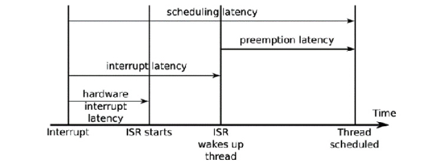
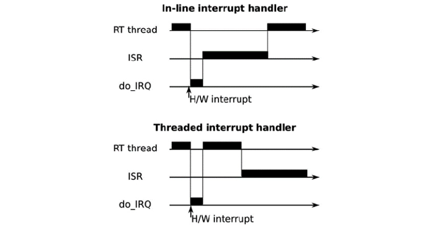
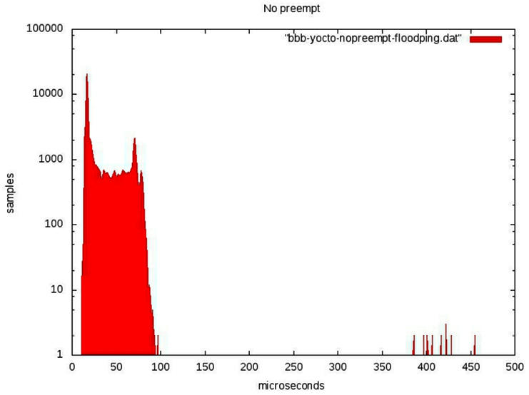
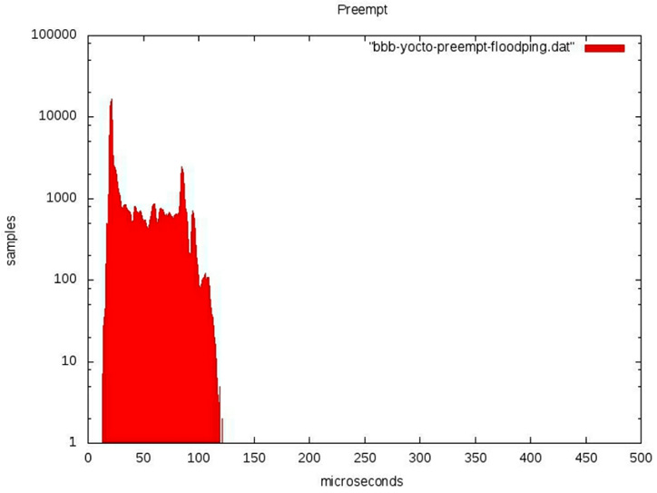
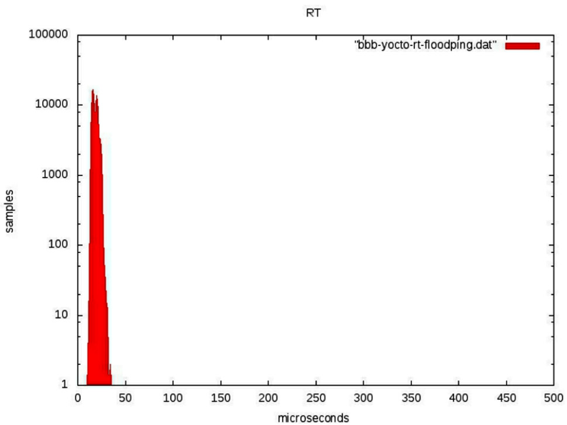

# *Chương 21*: Lập trình Real-Time (Real-Time Programming)

Phần lớn tương tác giữa một hệ thống máy tính và thế giới thực diễn ra theo thời gian thực, và vì vậy đây là một chủ đề quan trọng với lập trình viên hệ thống nhúng. Tôi đã đề cập lập trình real-time ở vài nơi cho đến giờ: trong [*Chương 17*](ch17_learning_about_processes_and_threads.vi.md), *Tìm hiểu về process và thread*, chúng ta đã xem các chính sách lập lịch và priority inversion, và trong [*Chương 18*](ch18_managing_memory.vi.md), *Quản lý bộ nhớ*, tôi đã mô tả các vấn đề với page fault và nhu cầu khóa bộ nhớ. Giờ đã đến lúc gom các chủ đề này lại và xem lập trình real-time ở một mức độ sâu hơn.

Trong chương này, tôi sẽ bắt đầu bằng một cuộc thảo luận về các đặc tính của hệ thống real-time, rồi xem xét các hệ quả đối với thiết kế hệ thống, ở cả mức application và kernel. Tôi sẽ mô tả kernel patch real-time `PREEMPT_RT`, và cho thấy cách lấy nó và áp nó lên một kernel mainline. Các mục cuối sẽ mô tả cách đặc trưng hóa các latency hệ thống bằng hai công cụ: **cyclictest** và **Ftrace**.

Có những cách khác để đạt được hành vi real-time trên một thiết bị embedded Linux, chẳng hạn dùng một microcontroller chuyên dụng hoặc một kernel real-time riêng chạy song song với Linux kernel theo cách Xenomai và RTAI làm. Tôi sẽ không thảo luận những cách này ở đây vì trọng tâm của cuốn sách này là dùng Linux làm lõi cho hệ thống nhúng.

Trong chương này, chúng ta sẽ đề cập các chủ đề sau:

- Real time là gì?
- Nhận diện các nguồn non-determinism
- Hiểu scheduling latency
- Kernel preemption
- Linux kernel real-time (`PREEMPT_RT`)
- Kernel lock có thể preempt
- High-resolution timer
- Tránh page fault
- Interrupt shielding
- Đo scheduling latency

## Yêu cầu kỹ thuật

Để làm theo các ví dụ, hãy bảo đảm bạn có những thứ sau:

- Một hệ thống host Linux-based có ít nhất 60 GB dung lượng đĩa trống
- Bản phát hành Buildroot 2020.02.9 LTS
- Bản phát hành Yocto 3.1 (Dunfell) LTS
- Etcher cho Linux
- Một đầu đọc thẻ microSD và thẻ
- BeagleBone Black
- Một nguồn điện DC 5 V 1 A
- Một cáp Ethernet và port để kết nối mạng

Lẽ ra bạn đã cài bản phát hành 2020.02.9 LTS của Buildroot cho [*Chương 6*](ch06_selecting_a_build_system.vi.md), *Chọn build system*. Nếu chưa, hãy tham khảo mục *System requirements* của *The Buildroot user manual* ([https://buildroot.org/downloads/manual/manual.html](https://buildroot.org/downloads/manual/manual.html)) trước khi cài Buildroot trên host Linux theo hướng dẫn trong [*Chương 6*](ch06_selecting_a_build_system.vi.md).

Lẽ ra bạn đã cài bản phát hành 3.1 (Dunfell) LTS của Yocto cho [*Chương 6*](ch06_selecting_a_build_system.vi.md), *Chọn build system*. Nếu chưa, hãy tham khảo các mục *Compatible Linux Distribution* và *Build Host Packages* của hướng dẫn *Yocto Project Quick Build* ([https://www.yoctoproject.org/docs/current/brief-yoctoprojectqs/brief-yoctoprojectqs.html](https://www.yoctoproject.org/docs/current/brief-yoctoprojectqs/brief-yoctoprojectqs.html)) trước khi cài Yocto trên host Linux theo hướng dẫn trong [*Chương 6*](ch06_selecting_a_build_system.vi.md).

## Real time là gì?

Bản chất của lập trình real-time là một trong những chủ đề mà các kỹ sư phần mềm thích bàn luận dài dòng, thường đưa ra một loạt định nghĩa mâu thuẫn nhau. Tôi sẽ bắt đầu bằng việc trình bày những gì tôi nghĩ là quan trọng về real time.

Một task là task real-time nếu nó phải hoàn thành trước một thời điểm nhất định, được gọi là **deadline**. Sự khác biệt giữa task real-time và non-real-time được thể hiện bằng cách xét điều gì xảy ra khi bạn phát một audio stream trên máy tính trong khi biên dịch Linux kernel. Việc đầu là một task real-time vì có một luồng dữ liệu liên tục tới audio driver, và các khối mẫu âm thanh phải được ghi vào audio interface theo tốc độ phát. Trong khi đó, việc biên dịch không phải real-time vì không có deadline. Bạn chỉ đơn giản muốn nó hoàn tất càng sớm càng tốt; dù nó mất 10 giây hay 10 phút cũng không ảnh hưởng tới chất lượng của kernel binary.

Điều quan trọng khác cần xét là hệ quả của việc lỡ deadline, có thể từ khó chịu nhẹ tới hỏng hệ thống hoặc, trong những trường hợp cực đoan nhất, thương tích hay tử vong. Đây là một số ví dụ:

- **Phát một audio stream**: Có một deadline cỡ hàng chục mili giây. Nếu audio buffer bị underrun, bạn sẽ nghe một tiếng click, gây khó chịu nhưng bạn sẽ vượt qua được.
- **Di chuyển và click chuột**: Deadline cũng cỡ hàng chục mili giây. Nếu bị lỡ, chuột di chuyển thất thường và các lần click nút sẽ bị mất. Nếu vấn đề kéo dài, hệ thống sẽ trở nên không dùng được.
- **In một tờ giấy**: Deadline cho việc nạp giấy nằm trong khoảng mili giây, nếu bị lỡ có thể khiến máy in kẹt giấy, và ai đó sẽ phải đi sửa. Thỉnh thoảng kẹt giấy là chấp nhận được, nhưng không ai sẽ mua một máy in cứ kẹt giấy mãi.
- **In hạn sử dụng (sell-by) lên chai trên dây chuyền sản xuất**: Nếu một chai không được in, toàn bộ dây chuyền sản xuất phải dừng, chai bị loại bỏ, và dây chuyền khởi động lại, việc này tốn kém.
- **Nướng bánh**: Có một deadline khoảng 30 phút. Nếu bạn lỡ vài phút, chiếc bánh có thể hỏng. Nếu bạn lỡ nhiều, ngôi nhà có thể bị cháy.
- **Một hệ thống phát hiện power-surge**: Nếu hệ thống phát hiện một đợt tăng áp đột biến, một cầu dao phải được kích hoạt trong vòng 2 mili giây. Không làm được điều đó sẽ gây hư hại thiết bị và có thể làm bị thương hoặc chết người.

Nói cách khác, việc lỡ deadline có nhiều hệ quả. Chúng ta thường nói về các loại khác nhau sau:

- **Soft real-time**: Deadline là mong muốn nhưng đôi khi bị lỡ mà hệ thống không bị coi là thất bại. Hai ví dụ đầu tiên trong danh sách trên là ví dụ của loại này.
- **Hard real-time**: Ở đây, lỡ deadline có tác động nghiêm trọng. Chúng ta có thể chia nhỏ thêm hard real-time thành các hệ thống mission-critical, trong đó lỡ deadline có cái giá phải trả, như ví dụ thứ tư, và các hệ thống safety-critical, trong đó có nguy hiểm tới tính mạng và thân thể, như hai ví dụ cuối. Tôi đưa ví dụ nướng bánh vào để cho thấy không phải hệ thống hard real-time nào cũng có deadline đo bằng mili giây hay micro giây.

Phần mềm viết cho hệ thống safety-critical phải tuân theo nhiều tiêu chuẩn khác nhau nhằm bảo đảm nó có khả năng hoạt động tin cậy. Rất khó để một hệ điều hành phức tạp như Linux đáp ứng các yêu cầu đó.

Khi nói tới các hệ thống mission-critical, việc Linux được dùng cho nhiều loại hệ thống điều khiển là khả thi, và phổ biến. Các yêu cầu đối với phần mềm phụ thuộc vào tổ hợp giữa deadline và mức độ tin cậy, thứ thường có thể được xác định qua việc test rộng rãi.

Vì vậy, để nói một hệ thống là real-time, bạn phải đo thời gian phản hồi của nó dưới tải tối đa dự kiến và cho thấy nó đáp ứng deadline trong một tỷ lệ thời gian đã được thống nhất. Theo kinh nghiệm, một hệ thống Linux well-configured dùng kernel mainline phù hợp cho các task soft real-time với deadline xuống tới hàng chục mili giây, và một kernel có patch `PREEMPT_RT` phù hợp cho các hệ thống mission-critical soft và hard real-time với deadline xuống tới vài trăm micro giây.

Chìa khóa để tạo một hệ thống real-time là giảm độ biến thiên của thời gian phản hồi để bạn có độ tin cậy cao hơn rằng deadline sẽ không bị lỡ; nói cách khác, bạn cần làm hệ thống tất định hơn. Thường thì điều này được làm với cái giá là hiệu năng. Chẳng hạn, cache làm hệ thống chạy nhanh hơn bằng cách làm thời gian trung bình để truy cập một mục dữ liệu ngắn hơn, nhưng thời gian tối đa dài hơn trong trường hợp cache miss. Cache làm hệ thống nhanh hơn nhưng kém tất định hơn, điều ngược lại với những gì chúng ta muốn.

> **Mẹo**
>
> Một quan niệm sai lầm về tính toán real-time là nó nhanh. Không phải vậy; hệ thống càng tất định, thông lượng tối đa càng thấp.

Phần còn lại của chương này liên quan tới việc nhận diện nguyên nhân của latency và những điều bạn có thể làm để giảm nó.

## Nhận diện các nguồn non-determinism

Về cơ bản, lập trình real-time là việc bảo đảm các thread điều khiển output theo thời gian thực được lập lịch khi cần và vì vậy có thể hoàn thành công việc trước deadline. Bất cứ điều gì ngăn cản điều này đều là vấn đề. Đây là một số khu vực vấn đề:

- **Lập lịch**: Các thread Real-time phải được lập lịch trước các thread khác, và vì vậy chúng phải có một chính sách real-time, `SCHED_FIFO` hoặc `SCHED_RR`. Ngoài ra, chúng nên được gán mức ưu tiên theo thứ tự giảm dần, bắt đầu với thread có deadline ngắn nhất, theo lý thuyết rate monotonic analysis mà tôi đã mô tả trong [*Chương 17*](ch17_learning_about_processes_and_threads.vi.md), *Tìm hiểu về process và thread*.
- **Scheduling latency**: Kernel phải có khả năng lập lịch lại ngay khi một sự kiện như interrupt hay timer xảy ra, và không phải chịu các độ trễ không giới hạn. Giảm scheduling latency là một chủ đề then chốt ở phần sau của chương này.
- **Priority inversion**: Đây là một hệ quả của lập lịch priority-based, dẫn tới các độ trễ không giới hạn khi một thread high-priority bị block trên một mutex được giữ bởi một thread low-priority, như tôi đã mô tả trong [*Chương 17*](ch17_learning_about_processes_and_threads.vi.md), *Tìm hiểu về process và thread*. User space có các mutex priority inheritance và priority ceiling; trong kernel space, chúng ta có RT-mutexes, hiện thực priority inheritance, và tôi sẽ nói về chúng trong mục về kernel real-time.
- **Timer chính xác**: Nếu bạn muốn quản lý deadline trong vùng vài mili giây hay micro giây, bạn cần các timer tương xứng. High-resolution timer là thiết yếu và là một tùy chọn cấu hình trên hầu hết mọi kernel.
- **Page fault**: Một page fault trong khi thực thi một đoạn code then chốt sẽ làm đảo lộn mọi ước lượng thời gian. Bạn có thể tránh chúng bằng cách khóa bộ nhớ, như tôi sẽ mô tả sau.
- **Interrupt**: Chúng xảy ra vào những thời điểm không đoán trước được và có thể dẫn tới overhead xử lý bất ngờ nếu có một cơn lũ interrupt đột ngột. Có hai cách để tránh điều này. Một là chạy interrupt dưới dạng kernel thread, và cách kia, trên các thiết bị multi-core, là che chắn một hoặc nhiều CPU khỏi việc xử lý interrupt. Tôi sẽ thảo luận cả hai khả năng sau.
- **Processor cache**: Chúng cung cấp một buffer giữa CPU và bộ nhớ chính và, giống mọi cache, là một nguồn non-determinism, đặc biệt trên các thiết bị multi-core. Đáng tiếc, điều này nằm ngoài phạm vi cuốn sách này, nhưng bạn có thể muốn tham khảo các tài liệu ở cuối chương để biết thêm chi tiết.
- **Tranh chấp memory bus**: Khi ngoại vi truy cập bộ nhớ trực tiếp qua một kênh DMA, chúng dùng một phần băng thông memory bus, làm chậm truy cập từ lõi CPU (hay các lõi) và vì vậy góp phần vào việc thực thi non-deterministic của chương trình. Tuy nhiên, đây là một vấn đề phần cứng và cũng nằm ngoài phạm vi cuốn sách này.

Tôi sẽ mở rộng về các vấn đề quan trọng nhất và xem có thể làm gì với chúng trong các mục tiếp theo.

## Hiểu scheduling latency

Các thread Real-time cần được lập lịch ngay khi chúng có việc để làm. Tuy nhiên, ngay cả khi không có thread nào khác cùng mức ưu tiên hoặc cao hơn, luôn có một độ trễ từ thời điểm wake-up event xảy ra—một interrupt hay system timer—tới lúc thread bắt đầu chạy. Điều này được gọi là **scheduling latency**. Nó có thể được chia thành vài thành phần, như được thể hiện trong sơ đồ sau:



*Hình 21.1 – Scheduling latency*

Thứ nhất, có hardware interrupt latency từ thời điểm một interrupt được assert cho tới khi **interrupt service routine** (**ISR**) bắt đầu chạy. Một phần nhỏ của điều này là độ trễ trong bản thân phần cứng interrupt, nhưng vấn đề lớn nhất là do interrupt bị disable bằng phần mềm. Giảm thiểu *IRQ off time* này là quan trọng.

Tiếp theo là interrupt latency, là khoảng thời gian cho tới khi ISR đã phục vụ interrupt và đánh thức mọi thread đang chờ sự kiện này. Nó chủ yếu phụ thuộc vào cách ISR được viết. Thông thường, nó chỉ nên mất một thời gian ngắn, đo bằng micro giây.

Độ trễ cuối cùng là preemption latency, là thời gian từ lúc kernel được thông báo rằng một thread sẵn sàng chạy tới lúc scheduler thực sự chạy thread đó. Nó được xác định bởi việc kernel có thể bị preempt hay không. Nếu kernel đang chạy code trong một critical section, thì việc lập lịch lại sẽ phải chờ. Độ dài của độ trễ phụ thuộc vào cấu hình kernel preemption.

## Kernel preemption

Preemption latency xảy ra vì không phải lúc nào cũng an toàn hoặc đáng mong muốn khi preempt luồng thực thi hiện tại và gọi scheduler. Linux mainline có ba thiết lập cho preemption, được chọn qua menu **Kernel Features** | **Preemption Model**:

- `CONFIG_PREEMPT_NONE`: Không preemption.
- `CONFIG_PREEMPT_VOLUNTARY`: Thiết lập này enable thêm các kiểm tra cho yêu cầu preemption.
- `CONFIG_PREEMPT`: Thiết lập này cho phép kernel bị preempt.

Với preemption đặt là `none`, code kernel sẽ tiếp tục mà không lập lịch lại cho đến khi nó hoặc trả về qua một `syscall` về user space, nơi preemption luôn được cho phép, hoặc gặp một lần chờ ngủ dừng thread hiện tại. Vì nó giảm số lần chuyển giữa kernel và user space và có thể giảm tổng số context switch, tùy chọn này cho thông lượng cao nhất với cái giá là preemption latency lớn. Đây là mặc định cho server và một số kernel desktop nơi thông lượng quan trọng hơn khả năng phản hồi.

Tùy chọn thứ hai enable các preemption point tường minh, nơi scheduler được gọi nếu flag `need_resched` được đặt, điều giảm preemption latency worst-case với cái giá là thông lượng thấp hơn một chút. Một số bản phân phối đặt tùy chọn này trên desktop.

Tùy chọn thứ ba làm kernel có thể bị preempt, nghĩa là một interrupt có thể dẫn tới việc lập lịch lại ngay lập tức miễn là kernel không đang thực thi trong một atomic context, điều tôi sẽ mô tả ở mục sau. Điều này giảm preemption latency worst-case và, do đó, tổng scheduling latency xuống cỡ vài mili giây trên phần cứng nhúng điển hình.

Đây thường được mô tả là một tùy chọn soft real-time, và hầu hết kernel nhúng được cấu hình theo cách này. Tất nhiên, có một mức giảm nhỏ về tổng thông lượng, nhưng điều đó thường ít quan trọng hơn việc có lập lịch tất định hơn cho thiết bị nhúng.

### Linux kernel real-time (PREEMPT_RT)

Có một nỗ lực long-standing để giảm latency hơn nữa, mang tên của tùy chọn cấu hình kernel cho các tính năng này, **PREEMPT_RT**. Project được Ingo Molnar, Thomas Gleixner và Steven Rostedt khởi đầu và đã nhận đóng góp từ nhiều lập trình viên khác qua nhiều năm. Các kernel patch nằm tại [https://www.kernel.org/pub/linux/kernel/projects/rt](https://www.kernel.org/pub/linux/kernel/projects/rt), và có một wiki tại [https://wiki.linuxfoundation.org/realtime/start](https://wiki.linuxfoundation.org/realtime/start). Một FAQ, dù đã lỗi thời, cũng có thể được tìm thấy tại [https://rt.wiki.kernel.org/index.php/Frequently_Asked_Questions](https://rt.wiki.kernel.org/index.php/Frequently_Asked_Questions).

Nhiều phần của project đã được đưa vào Linux mainline qua nhiều năm, bao gồm high-resolution timer, kernel mutex và threaded interrupt handler. Tuy nhiên, các patch lõi vẫn nằm ngoài mainline vì chúng khá xâm lấn và (một số người cho rằng) chỉ có lợi cho một tỷ lệ nhỏ trong tổng số người dùng Linux. Có lẽ một ngày nào đó toàn bộ patch set sẽ được merge upstream.

Kế hoạch trung tâm là giảm lượng thời gian kernel chạy trong một **atomic context**, nơi không an toàn để gọi scheduler và chuyển sang một thread khác. Các atomic context điển hình là khi kernel ở các trạng thái sau:

- Đang chạy một interrupt handler hay trap handler.
- Đang giữ một spin lock hoặc đang ở trong một section RCU-critical. Spin lock và RCU là các kernel-locking primitive, chi tiết của chúng không liên quan ở đây.
- Giữa các lời gọi `preempt_disable()` và `preempt_enable()`.
- Hardware interrupt bị disable (**IRQs off**).

Các thay đổi thuộc `PREEMPT_RT` rơi vào hai lĩnh vực chính: một là giảm tác động của interrupt handler bằng cách biến chúng thành kernel thread, và cái kia là làm các lock có thể preempt để một thread có thể ngủ trong khi giữ một lock. Hiển nhiên là có một overhead lớn trong các thay đổi này, khiến việc xử lý interrupt average-case chậm hơn nhưng tất định hơn nhiều, đó là điều chúng ta đang hướng tới.

### Threaded interrupt handler

Không phải interrupt nào cũng là trigger cho task real-time, nhưng mọi interrupt đều lấy cắp chu kỳ từ các task real-time. Threaded interrupt handler cho phép gắn một mức ưu tiên với interrupt và để nó được lập lịch vào thời điểm thích hợp, như được thể hiện trong sơ đồ sau:



*Hình 21.2 – Interrupt handler In-line so với threaded*

Nếu code interrupt handler được chạy như một kernel thread, không có lý do gì nó không thể bị preempt bởi một thread user space có mức ưu tiên cao hơn, và vì vậy interrupt handler không góp phần vào scheduling latency của thread user space. Threaded interrupt handler đã là một tính năng của Linux mainline từ 2.6.30. Bạn có thể yêu cầu một interrupt handler riêng lẻ được threaded bằng cách đăng ký nó bằng `request_threaded_irq()` thay cho `request_irq()` thông thường. Bạn có thể làm threaded IRQ thành mặc định bằng cách cấu hình kernel với `CONFIG_IRQ_FORCED_THREADING=y`, điều biến mọi handler thành thread trừ khi chúng đã ngăn điều này một cách tường minh bằng cách đặt flag `IRQF_NO_THREAD`. Khi bạn áp các patch `PREEMPT_RT`, interrupt mặc định được cấu hình thành thread theo cách này. Đây là một ví dụ về những gì bạn có thể thấy:

```
# ps -Leo pid,tid,class,rtprio,stat,comm,wchan | grep FF
PID TID CLS RTPRIO STAT COMMAND WCHAN
3 3 FF 1 S ksoftirqd/0 smpboot_th
7 7 FF 99 S posixcputmr/0 posix_cpu_
19 19 FF 50 S irq/28-edma irq_thread
20 20 FF 50 S irq/30-edma_err irq_thread
42 42 FF 50 S irq/91-rtc0 irq_thread
43 43 FF 50 S irq/92-rtc0 irq_thread
44 44 FF 50 S irq/80-mmc0 irq_thread
45 45 FF 50 S irq/150-mmc0 irq_thread
47 47 FF 50 S irq/44-mmc1 irq_thread
52 52 FF 50 S irq/86-44e0b000 irq_thread
59 59 FF 50 S irq/52-tilcdc irq_thread
65 65 FF 50 S irq/56-4a100000 irq_thread
66 66 FF 50 S irq/57-4a100000 irq_thread
67 67 FF 50 S irq/58-4a100000 irq_thread
68 68 FF 50 S irq/59-4a100000 irq_thread
76 76 FF 50 S irq/88-OMAP UAR irq_thread
```

Trong trường hợp này, là một BeagleBone chạy `linux-yocto-rt`, chỉ có interrupt `gp_timer` không được threaded. Việc timer interrupt handler được chạy inline là bình thường.

> **Lưu ý quan trọng**
>
> Các interrupt thread đều đã được cho chính sách `SCHED_FIFO` mặc định và mức ưu tiên `50`. Tuy nhiên, không hợp lý khi để chúng ở mặc định; giờ là cơ hội để bạn gán mức ưu tiên theo tầm quan trọng của các interrupt so với các thread user space real-time.

Đây là một thứ tự mức ưu tiên thread giảm dần được đề xuất:

- Thread POSIX timers, `posixcputmr`, nên luôn có mức ưu tiên cao nhất.
- Các hardware interrupt gắn với thread real-time highest-priority.
- Thread real-time highest-priority.
- Các hardware interrupt cho các thread real-time lower-priority dần, theo sau là chính thread đó.
- Thread real-time có mức ưu tiên cao tiếp theo.
- Các hardware interrupt cho các giao diện non-real-time.
- Soft IRQ daemon, `ksoftirqd`, trên kernel RT chịu trách nhiệm chạy các interrupt routine bị trì hoãn và, trước Linux 3.6, chịu trách nhiệm chạy network stack, block I/O layer và những thứ khác. Bạn có thể cần thử nghiệm với các mức ưu tiên khác nhau để đạt được sự cân bằng.

Bạn có thể đổi mức ưu tiên bằng lệnh `chrt` như một phần của boot script, dùng một lệnh như thế này:

```
# chrt -f -p 90 `pgrep irq/28-edma`
```

Lệnh `pgrep` là một phần của package `procps`.

Giờ chúng ta đã được giới thiệu về Linux kernel real-time thông qua threaded interrupt handler, hãy đào sâu hơn vào hiện thực của nó.

## Kernel lock có thể preempt

Làm cho phần lớn kernel lock có thể preempt là thay đổi xâm lấn nhất mà `PREEMPT_RT` thực hiện, và code này vẫn nằm ngoài kernel mainline.

Vấn đề xảy ra với spin lock, được dùng cho phần lớn việc khóa trong kernel. Một spin lock là một mutex busy-wait không cần context switch trong trường hợp có tranh chấp, và vì vậy nó rất hiệu quả miễn là lock được giữ trong thời gian ngắn. Lý tưởng nhất, chúng nên được khóa trong thời gian ít hơn thời gian cần để lập lịch lại hai lần. Sơ đồ sau cho thấy các thread chạy trên hai CPU khác nhau tranh chấp cùng một spin lock. **CPU 0** lấy được nó trước, buộc **CPU 1** phải spin, chờ cho đến khi nó được mở khóa:


*Hình 21.3 – Spin lock*

Thread giữ spin lock không thể bị preempt vì làm vậy có thể khiến thread mới vào cùng code và deadlock khi nó cố khóa cùng spin lock. Do đó, trong Linux mainline, khóa một spin lock sẽ disable kernel preemption, tạo ra một atomic context. Điều này có nghĩa là một thread low-priority giữ spin lock có thể ngăn một thread high-priority được lập lịch, một tình trạng còn được gọi là *priority inversion*.

> **Lưu ý quan trọng**
>
> Giải pháp được `PREEMPT_RT` áp dụng là thay gần như tất cả spin lock bằng RT-mutexes. Một mutex chậm hơn một spin lock, nhưng nó hoàn toàn có thể preempt. Không chỉ vậy, RT-mutexes hiện thực priority inheritance và vì vậy không bị ảnh hưởng bởi priority inversion.

Giờ chúng ta đã có ý niệm về những gì có trong các patch `PREEMPT_RT`. Vậy, làm sao để lấy chúng?

### Lấy các patch PREEMPT_RT

Các lập trình viên RT không tạo patch set cho mọi phiên bản kernel vì khối lượng công sức port cần thiết. Trung bình, họ tạo patch cho mỗi kernel cách một. Các kernel mới nhất được hỗ trợ tại thời điểm viết sách như sau:

- 5.10-rt

- 5.9-rt

- 5.6-rt

- 5.4-rt

- 5.2-rt

- 5.0-rt

- 4.19-rt

- 4.18-rt

- 4.16-rt

- 4.14-rt

- 4.13-rt

- 4.11-rt

  > **Lưu ý quan trọng**
  >
  > Các patch có sẵn tại [https://www.kernel.org/pub/linux/kernel/projects/rt](https://www.kernel.org/pub/linux/kernel/projects/rt).

Nếu bạn đang dùng Yocto Project, đã có sẵn một phiên bản `rt` của kernel. Ngoài ra, có thể nơi bạn lấy kernel đã áp sẵn patch `PREEMPT_RT`. Nếu không, bạn sẽ phải tự áp patch. Trước tiên, hãy bảo đảm phiên bản patch `PREEMPT_RT` và phiên bản kernel của bạn khớp chính xác; nếu không, bạn sẽ không thể áp patch sạch sẽ. Sau đó, bạn áp nó theo cách bình thường, như được thể hiện trong các dòng lệnh sau. Rồi bạn sẽ có thể cấu hình kernel với `CONFIG_PREEMPT_RT_FULL`:

```
$ cd linux-5.4.93
$ zcat patch-5.4.93-rt51.patch.gz | patch -p1
```

Có một vấn đề trong đoạn trên. RT patch sẽ chỉ áp được nếu bạn đang dùng một kernel mainline tương thích. Có lẽ bạn không dùng, vì đó là bản chất của các kernel embedded Linux. Vì vậy, bạn sẽ phải dành thời gian xem các patch thất bại và sửa chúng, rồi phân tích board support cho target của bạn và thêm mọi hỗ trợ real-time còn thiếu. Một lần nữa, các chi tiết này nằm ngoài phạm vi cuốn sách này. Nếu bạn không chắc phải làm gì, bạn nên yêu cầu hỗ trợ từ nhà cung cấp kernel bạn đang dùng và trên các diễn đàn lập trình viên kernel.

### Yocto Project và PREEMPT_RT

Yocto Project cung cấp hai kernel recipe tiêu chuẩn: `linux-yocto` và `linux-yocto-rt`, recipe sau đã được áp sẵn các patch real-time. Giả sử target của bạn được các kernel Yocto hỗ trợ, bạn chỉ cần chọn `linux-yocto-rt` làm kernel ưu tiên và khai báo rằng machine của bạn tương thích, chẳng hạn bằng cách thêm các dòng tương tự những dòng này vào `conf/local.conf`:

```
PREFERRED_PROVIDER_virtual/kernel = "linux-yocto-rt"
COMPATIBLE_MACHINE_beaglebone = "beaglebone"
```

Vậy, giờ chúng ta đã biết lấy một Linux kernel real-time ở đâu, hãy chuyển hướng và nói về timing.

## High-resolution timer

Độ phân giải timer quan trọng nếu bạn có các yêu cầu timing chính xác, điều điển hình với các application real-time. Timer mặc định trong Linux là một clock chạy ở tốc độ có thể cấu hình, thường là 100 Hz cho hệ thống nhúng và 250 Hz cho server và desktop. Khoảng thời gian giữa hai timer tick được gọi là một **jiffy** và, trong các ví dụ đã cho trước đó, là 10 mili giây trên một SoC nhúng và 4 mili giây trên một server.

Linux có được các timer chính xác hơn từ project kernel real-time ở phiên bản 2.6.18, và giờ chúng có sẵn trên mọi nền tảng, miễn là có một nguồn high-resolution timer và device driver cho nó—điều gần như luôn đúng. Bạn cần cấu hình kernel với `CONFIG_HIGH_RES_TIMERS=y`.

Với tùy chọn này được enable, tất cả các clock kernel và user space sẽ chính xác xuống tới độ chi tiết của phần cứng bên dưới. Tìm độ chi tiết clock thực tế rất khó. Câu trả lời hiển nhiên là giá trị do `clock_getres(2)` cung cấp, nhưng nó luôn khẳng định độ phân giải 1 nano giây. Công cụ `cyclictest` mà tôi sẽ mô tả sau có một tùy chọn để phân tích các thời gian do clock báo cáo để đoán độ phân giải:

```
# cyclictest -R
# /dev/cpu_dma_latency set to 0us
WARN: reported clock resolution: 1 nsec
WARN: measured clock resolution approximately: 708 nsec
```

Bạn cũng có thể xem kernel log message để tìm các chuỗi như thế này:

```
# dmesg | grep clock
OMAP clockevent source: timer2 at 24000000 Hz
sched_clock: 32 bits at 24MHz, resolution 41ns, wraps every 178956969942ns
OMAP clocksource: timer1 at 24000000 Hz
Switched to clocksource timer1
```

Hai phương pháp cho ra các con số khá khác nhau, điều mà tôi không có lời giải thích thỏa đáng, nhưng vì cả hai đều dưới 1 micro giây, tôi hài lòng.

High-resolution timer có thể đo các biến thiên latency với độ chính xác đủ. Bây giờ, hãy xem một vài cách để giảm nhẹ non-determinism như vậy.

## Tránh page fault

Một **page fault** xảy ra khi một application đọc hoặc ghi vào bộ nhớ chưa được commit vào bộ nhớ vật lý. Không thể (hoặc rất khó) dự đoán khi nào một page fault sẽ xảy ra, nên chúng là một nguồn non-determinism khác trong máy tính.

May mắn là có một function cho phép bạn commit toàn bộ bộ nhớ được process dùng và khóa nó lại để nó không thể gây ra page fault. Đó là `mlockall(2)`. Đây là hai flag của nó:

- `MCL_CURRENT`: Khóa tất cả các page hiện đang được ánh xạ.
- `MCL_FUTURE`: Khóa các page được ánh xạ về sau.

Bạn thường gọi `mlockall` trong lúc khởi động application với cả hai flag được đặt để khóa tất cả ánh xạ bộ nhớ hiện tại và tương lai.

> **Mẹo**
>
> `MCL_FUTURE` không phải phép màu, theo nghĩa vẫn sẽ có một độ trễ non-deterministic khi cấp phát hoặc giải phóng heap memory bằng `malloc()`/`free()` hoặc `mmap()`. Các thao tác như vậy tốt nhất nên được làm lúc khởi động chứ không phải trong các vòng lặp điều khiển chính.

Bộ nhớ cấp phát trên stack khó xử lý hơn vì nó được làm tự động, và nếu bạn gọi một function làm stack sâu hơn trước, bạn sẽ gặp thêm các độ trễ memory-management. Một cách sửa đơn giản là phát triển stack lên kích thước lớn hơn mức bạn nghĩ mình sẽ từng cần lúc khởi động. Code sẽ trông như thế này:

```
#define MAX_STACK (512*1024)
static void stack_grow (void)
{
      char dummy[MAX_STACK];
      memset(dummy, 0, MAX_STACK);
      return;
}
int main(int argc, char* argv[])
{
      […]
      stack_grow ();
      mlockall(MCL_CURRENT | MCL_FUTURE);
      […]
```

Function `stack_grow()` cấp phát một biến lớn trên stack rồi điền không vào nó để buộc các page bộ nhớ đó được commit cho process này.

Interrupt là một nguồn non-determinism khác mà chúng ta nên đề phòng.

## Interrupt shielding

Dùng threaded interrupt handler giúp giảm nhẹ overhead interrupt bằng cách chạy một số thread ở mức ưu tiên cao hơn các interrupt handler không ảnh hưởng tới task real-time. Nếu bạn đang dùng một processor multi-core, bạn có thể dùng một cách tiếp cận khác và che chắn hoàn toàn một hoặc nhiều lõi khỏi việc xử lý interrupt, cho phép chúng được dành riêng cho các task real-time. Điều này hoạt động với cả kernel Linux thông thường lẫn kernel `PREEMPT_RT`.

Đạt được điều này là việc ghim các thread real-time vào một CPU và các interrupt handler vào một CPU khác. Bạn có thể đặt CPU affinity của một thread hay process bằng công cụ command-line `taskset`, hoặc bạn có thể dùng các function `sched_setaffinity(2)` và `pthread_setaffinity_np(3)`.

Để đặt affinity của một interrupt, trước tiên hãy lưu ý rằng có một thư mục con cho mỗi số interrupt trong `/proc/irq/<IRQ number>`. Các file điều khiển cho interrupt nằm trong đó, bao gồm một CPU mask trong `smp_affinity`. Ghi một bitmask vào file đó với một bit được đặt cho mỗi CPU được phép xử lý IRQ đó.

Phát triển stack và interrupt shielding là các kỹ thuật khéo léo để cải thiện khả năng phản hồi, nhưng làm sao bạn biết chúng có thực sự hoạt động?

## Đo scheduling latency

Mọi cấu hình và tinh chỉnh bạn làm sẽ vô nghĩa nếu bạn không thể cho thấy thiết bị của mình đáp ứng deadline. Bạn sẽ cần benchmark của riêng mình cho bài test cuối cùng, nhưng ở đây tôi sẽ mô tả hai công cụ đo quan trọng: `cyclictest` và Ftrace.

### cyclictest

`cyclictest` ban đầu được viết bởi Thomas Gleixner và giờ có sẵn trên hầu hết các nền tảng trong một package tên `rt-tests`. Nếu bạn đang dùng Yocto Project, bạn có thể tạo một target image bao gồm `rt-tests` bằng cách build image recipe real-time như thế này:

```
$ bitbake core-image-rt
```

Nếu bạn đang dùng Buildroot, bạn cần thêm package `BR2_PACKAGE_RT_TESTS` trong menu **Target packages** | **Debugging, profiling and benchmark** | **rt-tests**.

`cyclictest` đo scheduling latency bằng cách so sánh thời gian thực tế dùng để ngủ với thời gian được yêu cầu. Nếu không có latency, chúng sẽ bằng nhau, và latency được báo cáo sẽ là 0. `cyclictest` giả định độ phân giải timer nhỏ hơn 1 micro giây.

Nó có rất nhiều tùy chọn command-line. Để bắt đầu, bạn có thể thử chạy lệnh này với tư cách `root` trên target:

```
# cyclictest -l 100000 -m -n -p 99
# /dev/cpu_dma_latency set to 0us
policy: fifo: loadavg: 1.14 1.06 1.00 1/49 320
T: 0 ( 320) P:99 I:1000 C: 100000 Min: 9 Act: 13 Avg: 15 Max: 134
```

Các tùy chọn được chọn như sau:

- `-l N`: Lặp `N` lần (mặc định là không giới hạn).
- `-m`: Khóa bộ nhớ bằng `mlockall`.
- `-n`: Dùng `clock_nanosleep(2)` thay vì `nanosleep(2)`.
- `-p N`: Dùng mức ưu tiên real-time `N`.

Dòng kết quả cho thấy như sau, đọc từ trái sang phải:

- `T: 0`: Đây là thread `0`, thread duy nhất trong lần chạy này. Bạn có thể đặt số thread bằng tham số `-t`.
- `(320)`: Đây là PID `320`.
- `P:99`: Mức ưu tiên là `99`.
- `I:1000`: Khoảng thời gian giữa các vòng lặp là 1,000 micro giây. Bạn có thể đặt khoảng thời gian bằng tham số `-i N`.
- `C:100000`: Số vòng lặp cuối cùng cho thread này là 100,000.
- `Min: 9`: Latency tối thiểu là 9 micro giây.
- `Act:13`: Latency thực tế là 13 micro giây. *Actual latency* là phép đo latency gần nhất, chỉ có ý nghĩa nếu bạn đang theo dõi `cyclictest` khi nó chạy.
- `Avg:15`: Latency trung bình là 15 micro giây.
- `Max:134`: Latency tối đa là 134 micro giây.

Kết quả này thu được trên một hệ thống idle chạy kernel `linux-yocto` không sửa đổi như một minh họa nhanh về công cụ. Để có ích thực sự, bạn sẽ chạy test trong khoảng 24-hour hoặc lâu hơn trong khi chạy một tải đại diện cho mức tối đa bạn dự kiến.

Trong các con số do `cyclictest` tạo ra, latency tối đa là thú vị nhất, nhưng sẽ tốt nếu có ý niệm về độ phân tán của các giá trị. Bạn có thể có điều đó bằng cách thêm `-h <N>` để có một histogram các mẫu trễ tối đa `N` micro giây. Dùng kỹ thuật này, tôi đã thu được ba trace cho cùng một board target chạy các kernel không có preemption, có preemption tiêu chuẩn, và có RT preemption trong khi bị tải bằng lưu lượng Ethernet từ một **flood ping**. Command line như được thể hiện ở đây:

```
# cyclictest -p 99 -m -n -l 100000 -q -h 500 > cyclictest.data
```

Sau đó, tôi dùng `gnuplot` để tạo ba đồ thị sau. Nếu bạn tò mò, các file dữ liệu và script lệnh `gnuplot` nằm trong archive code, ở `MELP/Chapter21/plot`.

Sau đây là output được tạo ra khi không có preemption:



*Hình 21.4 – Không preemption*

Không có preemption, hầu hết các mẫu nằm trong vòng 100 micro giây của deadline, nhưng có một số giá trị ngoại lai tới *500 micro giây*, gần đúng như bạn mong đợi.

Đây là output được tạo ra với preemption tiêu chuẩn:



*Hình 21.5 – Preemption tiêu chuẩn*

Với preemption, các mẫu phân tán ở phía thấp, nhưng không có gì vượt quá 120 micro giây.

Đây là output được tạo ra với RT preemption:



*Hình 21.6 – RT preemption*

Kernel RT là người thắng rõ ràng vì mọi thứ tập trung chặt quanh mốc 20-microsecond, và không có gì muộn hơn 35 micro giây.

Vậy, `cyclictest` là một thước đo tiêu chuẩn cho scheduling latency. Tuy nhiên, nó không thể giúp bạn nhận diện và giải quyết các vấn đề cụ thể với kernel latency. Để làm điều đó, bạn cần Ftrace.

### Dùng Ftrace

Kernel function tracer có các tracer giúp lần ra kernel latency—rốt cuộc đó là mục đích ban đầu nó được viết ra. Các tracer này bắt trace cho latency worst-case phát hiện được trong một lần chạy, cho thấy các function gây ra độ trễ.

Các tracer đáng quan tâm, cùng với các tham số cấu hình kernel, như sau:

- `irqsoff`: `CONFIG_IRQSOFF_TRACER` trace code disable interrupt, ghi lại trường hợp xấu nhất.
- `preemptoff`: `CONFIG_PREEMPT_TRACER` tương tự `irqsoff`, nhưng trace thời gian dài nhất mà kernel preemption bị disable (chỉ có trên kernel preemptible).
- `preemptirqsoff`: Kết hợp hai trace trước để ghi lại thời gian dài nhất mà `irqs` và/hoặc preemption bị disable.
- `wakeup`: Trace và ghi lại latency tối đa cần để task highest-priority được lập lịch sau khi nó được đánh thức.
- `wakeup_rt`: Giống `wakeup` nhưng chỉ cho các thread real-time với chính sách `SCHED_FIFO`, `SCHED_RR` hoặc `SCHED_DEADLINE`.
- `wakeup_dl`: Giống vậy nhưng chỉ cho các thread deadline-scheduled với chính sách `SCHED_DEADLINE`.

Hãy lưu ý rằng chạy Ftrace thêm rất nhiều latency, cỡ hàng chục mili giây, mỗi lần nó bắt được một giá trị tối đa mới, điều mà bản thân Ftrace có thể bỏ qua. Tuy nhiên, nó làm lệch kết quả của các tracer user space như `cyclictest`. Nói cách khác, hãy bỏ qua kết quả của `cyclictest` nếu bạn chạy nó trong khi đang bắt trace.

Chọn tracer giống như với function tracer mà chúng ta đã xem trong [*Chương 20*](ch20_profiling_and_tracing.vi.md), *Profiling và tracing*. Đây là một ví dụ về việc bắt một trace cho khoảng thời gian tối đa mà preemption bị disable trong một khoảng `60` giây:

```
# echo preemptoff > /sys/kernel/debug/tracing/current_tracer
# echo 0 > /sys/kernel/debug/tracing/tracing_max_latency
# echo 1 > /sys/kernel/debug/tracing/tracing_on
# sleep 60
# echo 0 > /sys/kernel/debug/tracing/tracing_on
```

Trace kết quả, đã được biên tập nhiều, trông như thế này:

```
# cat /sys/kernel/debug/tracing/trace
# tracer: preemptoff
#
# preemptoff latency trace v1.1.5 on 3.14.19-yocto-standard
# ------------------------------------------------------------
# latency: 1160 us, #384/384, CPU#0 | (M:preempt VP:0, KP:0, SP:0 HP:0)
# -----------------
# | task: init-1 (uid:0 nice:0 policy:0 rt_prio:0)
# -----------------
# => started at: ip_finish_output
# => ended at: __local_bh_enable_ip
#
#
#     _------=> CPU#
#     / _-----=> irqs-off
#     | / _----=> need-resched
#     || / _---=> hardirq/softirq
#     ||| / _--=> preempt-depth
#     |||| / delay
# cmd pid ||||| time | caller
# \ / ||||| \ | /
init-1 0..s. 1us+: ip_finish_output
init-1 0d.s2 27us+: preempt_count_add <-cpdma_chan_submit
init-1 0d.s3 30us+: preempt_count_add <-cpdma_chan_submit
init-1 0d.s4 37us+: preempt_count_sub <-cpdma_chan_submit
[…]
init-1 0d.s2 1152us+: preempt_count_sub <-__local_bh_enable
init-1 0d..2 1155us+: preempt_count_sub <-__local_bh_enable_ip
init-1 0d..1 1158us+: __local_bh_enable_ip
init-1 0d..1 1162us!: trace_preempt_on <-__local_bh_enable_ip
init-1 0d..1 1340us : <stack trace>
```

Ở đây, bạn có thể thấy khoảng thời gian dài nhất mà kernel preemption bị disable trong khi chạy trace là `1160` micro giây. Thực tế đơn giản này có thể biết được bằng cách đọc `/sys/kernel/debug/tracing/tracing_max_latency`, nhưng trace trên đi xa hơn và cho bạn chuỗi các lời gọi kernel function dẫn tới phép đo đó. Cột được đánh dấu `delay` cho thấy điểm trên vệt trace nơi mỗi function được gọi, kết thúc bằng lời gọi `trace_preempt_on()` tại `1162us`, tại thời điểm đó kernel preemption được enable lại. Với thông tin này, bạn có thể nhìn ngược qua call chain và (hy vọng) xác định liệu đây có phải là vấn đề hay không.

Các tracer khác được đề cập hoạt động theo cùng cách.

### Kết hợp cyclictest và Ftrace

Nếu `cyclictest` báo cáo latency dài bất ngờ, bạn có thể dùng tùy chọn `breaktrace` để hủy chương trình và kích hoạt Ftrace để có thêm thông tin.

Bạn gọi `breaktrace` bằng `-b<N>` hoặc `--breaktrace=<N>`, trong đó `N` là số micro giây latency sẽ kích hoạt trace. Bạn chọn tracer Ftrace bằng `-T[tracer name]` hoặc một trong các tùy chọn sau:

- `-C`: Context switch
- `-E`: Event
- `-f`: Function
- `-w`: Wakeup
- `-W`: Wakeup-RT

Chẳng hạn, lệnh này sẽ kích hoạt function tracer của Ftrace khi đo được một latency lớn hơn `100` micro giây:

```
# cyclictest -a -t -n -p99 -f -b100
```

Giờ chúng ta có hai công cụ bổ trợ cho nhau để debug các vấn đề latency. `cyclictest` phát hiện các lần tạm dừng và Ftrace cung cấp chi tiết.

## Tóm tắt

Thuật ngữ *real-time* là vô nghĩa trừ khi bạn định rõ nó bằng một deadline và một tỷ lệ lỡ chấp nhận được. Khi có hai thông tin này, bạn có thể xác định Linux có phải là ứng viên phù hợp cho hệ điều hành hay không và, nếu có, bắt đầu tinh chỉnh hệ thống để đáp ứng các yêu cầu. Tinh chỉnh Linux và application của bạn để xử lý các sự kiện real-time có nghĩa là làm nó tất định hơn để các thread real-time có thể đáp ứng deadline một cách tin cậy. Tính tất định thường đi kèm cái giá là tổng thông lượng, nên một hệ thống real-time sẽ không thể xử lý nhiều dữ liệu bằng một hệ thống non-real-time.

Không thể đưa ra chứng minh toán học rằng một hệ điều hành phức tạp như Linux sẽ luôn đáp ứng một deadline cho trước, nên cách tiếp cận duy nhất là qua việc test rộng rãi bằng các công cụ như `cyclictest` và Ftrace và, quan trọng hơn, dùng các benchmark của riêng bạn cho application của riêng bạn.

Để cải thiện tính tất định, bạn cần xem xét cả application lẫn kernel. Khi viết application real-time, bạn nên tuân theo các hướng dẫn được đưa ra trong chương này về lập lịch, khóa và bộ nhớ.

Kernel có tác động lớn tới tính tất định của hệ thống. May mắn là đã có rất nhiều công sức dành cho việc này qua nhiều năm. Enable kernel preemption là một bước đầu tốt. Nếu bạn vẫn thấy nó lỡ deadline thường xuyên hơn mức bạn muốn, thì bạn có thể muốn cân nhắc các kernel patch `PREEMPT_RT`. Chúng chắc chắn có thể tạo ra latency thấp, nhưng việc chúng chưa nằm trong mainline có nghĩa là bạn có thể gặp vấn đề khi tích hợp chúng với vendor kernel cho board cụ thể của mình. Thay vào đó, hoặc thêm vào đó, bạn có thể cần bắt tay vào việc tìm nguyên nhân của latency bằng Ftrace và các công cụ tương tự.

Điều đó đưa tôi tới phần kết của cuộc mổ xẻ embedded Linux này. Là một kỹ sư hệ thống nhúng đòi hỏi một dải kỹ năng rất rộng, bao gồm kiến thức low-level về phần cứng và cách kernel tương tác với nó. Bạn cần là một kỹ sư hệ thống xuất sắc có khả năng cấu hình các application người dùng và tinh chỉnh chúng để hoạt động hiệu quả. Tất cả những điều này phải được làm với phần cứng thường chỉ vừa đủ khả năng thực hiện nhiệm vụ. Có một câu trích dẫn tóm tắt điều này: *Một kỹ sư có thể làm với một đô la điều mà bất kỳ ai khác làm với hai*. Tôi hy vọng rằng bạn sẽ có thể đạt được điều này với thông tin tôi đã trình bày trong suốt cuốn sách này.

## Đọc thêm

Các tài liệu sau có thêm thông tin về các chủ đề đã được giới thiệu trong chương này:

- *Hard Real-Time Computing Systems: Predictable Scheduling Algorithms and Applications* của Giorgio Buttazzo
- *Multicore Application Programming* của Darryl Gove
