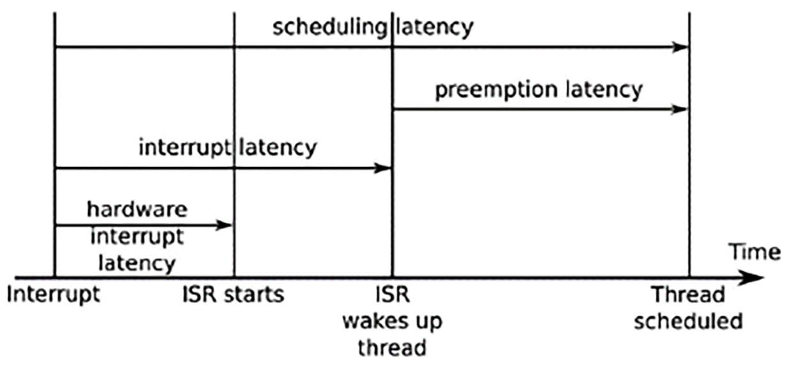
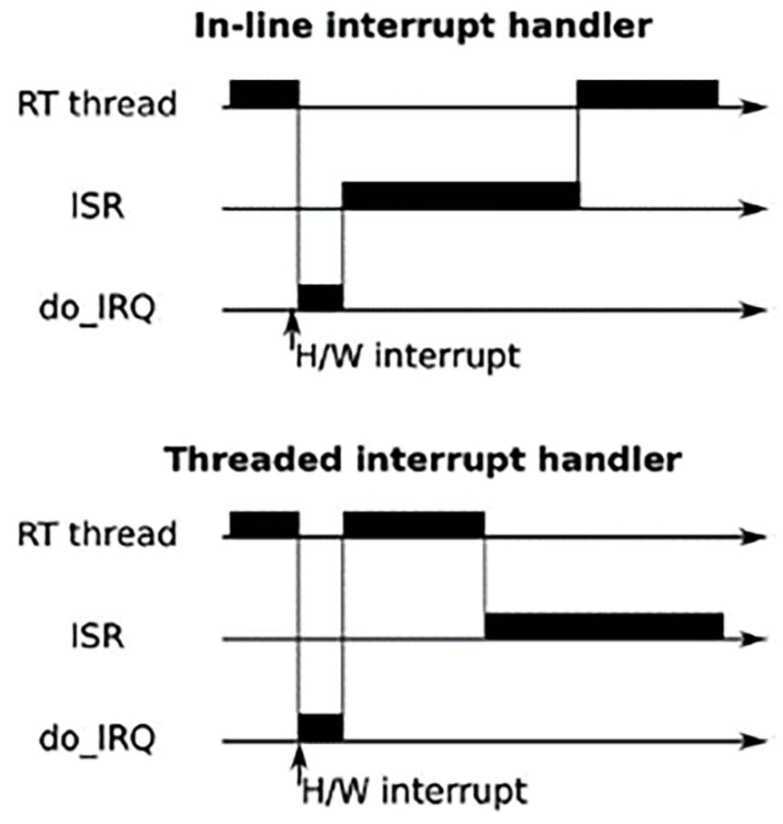
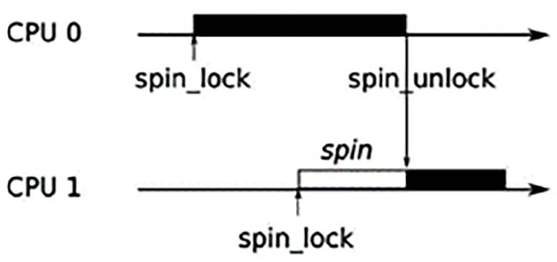

# Chương 21: Lập trình Real-Time (Real-Time Programming)

Phần lớn tương tác giữa một hệ thống máy tính và thế giới thực diễn ra theo thời gian thực, và vì vậy đây là một chủ đề quan trọng đối với các nhà phát triển hệ thống nhúng. Tôi đã chạm đến lập trình real-time ở một vài nơi cho đến giờ: trong Chương 17, chúng ta đã xem xét các scheduling policy và priority inversion, và trong Chương 18, tôi đã mô tả các vấn đề với page fault và nhu cầu khóa bộ nhớ. Giờ là lúc gom các chủ đề này lại và xem xét lập trình real-time một cách sâu hơn.

Trong chương này, tôi sẽ bắt đầu bằng việc thảo luận về các đặc điểm của hệ thống real-time, rồi xem xét các ý nghĩa đối với thiết kế hệ thống, ở cả mức ứng dụng lẫn mức kernel. Tôi sẽ mô tả kernel patch real-time `PREEMPT_RT` và chỉ cách lấy nó và áp dụng nó cho một kernel mainline. Các phần cuối sẽ mô tả cách mô tả đặc tính độ trễ hệ thống bằng hai công cụ: cyclictest và Ftrace.

Có những cách khác để đạt được hành vi real-time trên một thiết bị embedded Linux, ví dụ, dùng một vi điều khiển chuyên dụng hoặc một kernel real-time riêng chạy song song với Linux kernel theo cách mà Xenomai và RTAI làm. Tôi sẽ không thảo luận về chúng ở đây vì trọng tâm của cuốn sách này là dùng Linux làm lõi cho các hệ thống nhúng.

Trong chương này, chúng ta sẽ đề cập các chủ đề sau:

- Real time là gì?

- Xác định các nguồn non-determinism

- Tìm hiểu scheduling latency

- Kernel preemption

- Kernel lock có thể preempt

- High-resolution timer

- Tránh page fault

- Interrupt shielding

- Đo scheduling latency

## Yêu cầu kỹ thuật

Để làm theo các ví dụ, hãy bảo đảm bạn có những thứ sau:

- Một hệ thống host Ubuntu 24.04 hoặc bản LTS mới hơn với ít nhất 90 GB dung lượng đĩa trống

- Bản phát hành Yocto 5.0 (Scarthgap) LTS

- Một đầu đọc thẻ microSD và thẻ

- balenaEtcher cho Linux

- Một cáp Ethernet và router có cổng trống để kết nối mạng

- Một BeaglePlay

- Một bộ nguồn USB-C 5 V có khả năng cấp 3 A

Lẽ ra bạn đã build bản phát hành 5.0 (Scarthgap) LTS của Yocto trong Chương 6. Nếu chưa, hãy tham khảo các phần Compatible Linux Distribution và Build Host Packages của Yocto Project Quick Build guide (`https://docs.yoctoproject.org/brief-yoctoprojectqs/`) trước khi build Yocto trên host Linux theo hướng dẫn trong Chương 6.

## Real time là gì?

Bản chất của lập trình real-time là một trong những chủ đề mà các kỹ sư phần mềm thích bàn luận dài dòng, thường đưa ra một loạt định nghĩa mâu thuẫn nhau. Tôi sẽ bắt đầu bằng việc trình bày những gì tôi nghĩ là quan trọng về real time.

Một task là một task real-time nếu nó phải được hoàn thành trước một thời điểm nhất định, được gọi là deadline. Sự phân biệt giữa task real-time và non-real-time được thể hiện bằng cách xem xét điều gì xảy ra khi bạn phát một luồng âm thanh trên máy tính trong khi đang compile Linux kernel. Việc thứ nhất là một task real-time vì có một luồng dữ liệu liên tục đến audio driver, và các khối mẫu âm thanh phải được ghi vào giao diện âm thanh theo tốc độ phát. Trong khi đó, việc compile không phải real time vì không có deadline. Bạn chỉ đơn giản muốn nó hoàn thành càng sớm càng tốt; dù nó mất 10 giây hay 10 phút cũng không ảnh hưởng đến chất lượng của các binary kernel.

Điều quan trọng khác cần xem xét là hậu quả của việc lỡ deadline, có thể dao động từ sự khó chịu nhẹ đến hỏng hệ thống hoặc, trong những trường hợp cực đoan nhất, thương tích hoặc tử vong. Đây là một số ví dụ:

- Phát một luồng âm thanh: Có một deadline cỡ hàng chục mili giây. Nếu audio buffer bị underrun, bạn sẽ nghe một tiếng click, điều gây khó chịu, nhưng bạn sẽ vượt qua được.

- Di chuyển và nhấn chuột: Deadline cũng cỡ hàng chục mili giây. Nếu bị lỡ, chuột di chuyển thất thường và các lần nhấn nút sẽ bị mất. Nếu vấn đề kéo dài, hệ thống sẽ trở nên không dùng được.

- In một tờ giấy: Các deadline cho việc nạp giấy ở mức mili giây, nếu bị lỡ có thể khiến máy in kẹt giấy, và ai đó sẽ phải đi sửa nó. Thỉnh thoảng kẹt giấy là chấp nhận được, nhưng không ai sẽ mua một máy in cứ kẹt giấy liên tục.

- In hạn sử dụng sell-by lên các chai trên một dây chuyền sản xuất: Nếu một chai không được in, toàn bộ dây chuyền sản xuất phải dừng lại, chai bị lấy ra và dây chuyền khởi động lại, điều rất tốn kém.

- Nướng bánh: Có một deadline khoảng 30 phút. Nếu bạn lỡ nó vài phút, chiếc bánh có thể hỏng. Nếu bạn lỡ nó nhiều, ngôi nhà có thể cháy rụi.

- Hệ thống phát hiện Power-surge (đột biến điện áp): Nếu hệ thống phát hiện một đột biến, một cầu dao phải được kích hoạt trong vòng 2 mili giây. Không làm được điều đó sẽ gây hư hỏng thiết bị và có thể làm bị thương hoặc chết người.

Nói cách khác, có nhiều hậu quả khi lỡ deadline. Chúng ta thường nói về các loại khác nhau sau:

- Soft real-time: Deadline là mong muốn nhưng đôi khi bị lỡ mà hệ thống không bị coi là thất bại. Hai ví dụ đầu tiên trong danh sách trên là ví dụ về loại này.

- Hard real-time: Ở đây, lỡ một deadline có ảnh hưởng nghiêm trọng. Chúng ta có thể chia nhỏ hơn nữa hard real-time thành các hệ thống mission-critical, trong đó việc lỡ deadline có một cái giá, như ví dụ thứ tư, và các hệ thống safety-critical, trong đó có nguy hiểm tới tính mạng và thân thể, như hai ví dụ cuối. Tôi đưa vào ví dụ nướng bánh để cho thấy rằng không phải mọi hệ thống hard real-time đều có deadline được đo bằng mili giây hoặc micro giây.

Phần mềm viết cho các hệ thống safety-critical phải tuân thủ nhiều tiêu chuẩn khác nhau nhằm bảo đảm rằng nó có khả năng hoạt động tin cậy. Rất khó để một hệ điều hành phức tạp như Linux đáp ứng các yêu cầu đó.

Khi nói đến các hệ thống mission-critical, việc Linux được dùng cho một loạt rộng các hệ thống điều khiển là có thể, và phổ biến. Các yêu cầu đối với phần mềm phụ thuộc vào sự kết hợp giữa deadline và mức độ tin cậy, thường có thể được xác định thông qua kiểm thử rộng rãi.

Do đó, để nói rằng một hệ thống là real-time, bạn phải đo thời gian phản hồi của nó dưới tải tối đa dự kiến và cho thấy rằng nó đáp ứng deadline trong một tỷ lệ thời gian đã được thống nhất. Theo kinh nghiệm, một hệ thống Linux well-configured dùng một kernel mainline là tốt cho các task soft real-time với deadline xuống tới hàng chục mili giây, và một kernel với patch `PREEMPT_RT` là tốt cho các hệ thống mission-critical soft và hard real-time với deadline xuống tới vài trăm micro giây.

Chìa khóa để tạo một hệ thống real-time là giảm sự biến thiên trong thời gian phản hồi để bạn có độ tin cậy cao hơn rằng các deadline sẽ không bị lỡ; nói cách khác, bạn cần làm cho hệ thống tất định hơn. Thường thì điều này được thực hiện với cái giá là hiệu năng. Ví dụ, cache làm hệ thống chạy nhanh hơn bằng cách làm cho thời gian trung bình để truy cập một mục dữ liệu ngắn hơn, nhưng thời gian tối đa dài hơn trong trường hợp cache miss. Cache làm một hệ thống nhanh hơn nhưng kém tất định hơn, điều ngược lại với những gì chúng ta muốn.

MẸO

Việc cho rằng tính toán real-time thì nhanh là một huyền thoại. Không phải vậy; một hệ thống càng tất định, thông lượng tối đa càng thấp.

Phần còn lại của chương này liên quan đến việc xác định các nguyên nhân gây ra độ trễ và những điều bạn có thể làm để giảm nó.

## Xác định các nguồn non-determinism

Về cơ bản, lập trình real-time là việc bảo đảm rằng các thread điều khiển output theo thời gian thực được lập lịch khi cần và vì vậy có thể hoàn thành công việc trước deadline. Bất cứ thứ gì ngăn cản điều này đều là một vấn đề. Đây là một số khu vực có vấn đề:

- Lập lịch: Real-time thread phải được lập lịch trước các thread khác, và vì vậy chúng phải có một policy real-time, `SCHED_FIFO` hoặc `SCHED_RR`. Ngoài ra, chúng nên được gán mức ưu tiên theo thứ tự giảm dần, bắt đầu từ thread có deadline ngắn nhất, theo lý thuyết rate monotonic analysis mà tôi đã mô tả trong Chương 17.

- Scheduling latency: Kernel phải có khả năng lập lịch lại ngay khi một sự kiện như interrupt hoặc timer xảy ra và không phải chịu các độ trễ không giới hạn. Giảm scheduling latency là một chủ đề then chốt ở phần sau của chương này.

- Priority inversion: Đây là hệ quả của lập lịch priority-based, dẫn đến các độ trễ không giới hạn khi một thread high-priority bị block trên một mutex do một thread low-priority giữ, như tôi đã mô tả trong Chương 17. User space có các mutex priority inheritance và priority ceiling; trong kernel space, chúng ta có RT-mutexes, hiện thực priority inheritance, và tôi sẽ nói về chúng trong phần về real-time kernel.

- Timer chính xác: Nếu bạn muốn quản lý các deadline ở mức vài mili giây hoặc micro giây, bạn cần các timer tương xứng. High-resolution timer là cực kỳ quan trọng và là một tùy chọn cấu hình trên hầu như mọi kernel.

- Page fault: Một page fault khi đang thực thi một critical section của code sẽ làm đảo lộn mọi ước tính thời gian. Bạn có thể tránh chúng bằng cách khóa bộ nhớ, như tôi sẽ mô tả sau.

- Interrupt: Chúng xảy ra vào những thời điểm không thể đoán trước và có thể dẫn đến overhead xử lý bất ngờ nếu có một cơn lũ interrupt đột ngột. Có hai cách để tránh điều này. Một là chạy interrupt dưới dạng kernel thread, và cách kia, trên các thiết bị multi-core, là che chắn một hoặc nhiều CPU khỏi việc xử lý interrupt. Tôi sẽ thảo luận cả hai khả năng sau.

- Processor cache: Chúng cung cấp một buffer giữa CPU và bộ nhớ chính và, giống như mọi cache, là một nguồn non-determinism, đặc biệt trên các thiết bị multi-core. Thật không may, điều này nằm ngoài phạm vi của cuốn sách này, nhưng bạn có thể muốn tham khảo các tài liệu ở cuối chương để biết thêm chi tiết.

- Tranh chấp memory bus: Khi các thiết bị ngoại vi truy cập bộ nhớ trực tiếp qua một kênh DMA, chúng dùng hết một phần băng thông memory bus, làm chậm việc truy cập từ lõi CPU (hoặc các lõi) và vì vậy góp phần vào việc thực thi non-deterministic của chương trình. Tuy nhiên, đây là một vấn đề phần cứng và cũng nằm ngoài phạm vi của cuốn sách này.

Tôi sẽ mở rộng về các vấn đề quan trọng nhất và xem có thể làm gì với chúng trong các phần tiếp theo.

## Tìm hiểu scheduling latency

Real-time thread cần được lập lịch ngay khi chúng có việc gì đó để làm. Tuy nhiên, ngay cả khi không có thread nào khác có cùng mức ưu tiên hoặc cao hơn, luôn có một độ trễ từ thời điểm sự kiện wakeup xảy ra—một interrupt hoặc system timer—đến thời điểm thread bắt đầu chạy. Điều này được gọi là scheduling latency. Nó có thể được chia thành một số thành phần, như được thể hiện trong sơ đồ sau:



Hình 21.1 – Scheduling latency

Thứ nhất, có hardware interrupt latency từ thời điểm một interrupt được assert cho đến khi interrupt service routine (ISR) bắt đầu chạy. Một phần nhỏ trong đó là độ trễ trong chính phần cứng interrupt, nhưng vấn đề lớn nhất là do interrupt bị tắt trong phần mềm. Giảm thiểu thời gian IRQ off này là quan trọng.

Tiếp theo là interrupt latency, là khoảng thời gian cho đến khi ISR đã phục vụ interrupt và đánh thức mọi thread đang chờ sự kiện này. Nó chủ yếu phụ thuộc vào cách ISR được viết. Thông thường, nó chỉ nên mất một khoảng thời gian ngắn, đo bằng micro giây.

Độ trễ cuối cùng là preemption latency, là thời gian từ thời điểm kernel được thông báo rằng một thread sẵn sàng chạy đến thời điểm scheduler thực sự chạy thread đó. Nó được xác định bởi việc kernel có thể bị preempt hay không. Nếu nó đang chạy code trong một critical section, thì việc lập lịch lại sẽ phải chờ. Độ dài của độ trễ phụ thuộc vào cấu hình kernel preemption.

## Kernel preemption

Preemption latency xảy ra vì không phải lúc nào cũng an toàn hoặc đáng mong muốn khi preempt luồng thực thi hiện tại và gọi scheduler. Linux mainline có ba thiết lập cho preemption, được chọn qua menu Kernel Features \| Preemption Model:

- `CONFIG_PREEMPT_NONE`: Không preemption.

- `CONFIG_PREEMPT_VOLUNTARY`: Bật các kiểm tra bổ sung cho các yêu cầu preemption.

- `CONFIG_PREEMPT`: Cho phép kernel bị preempt.

Với preemption được đặt là `none`, code kernel sẽ tiếp tục mà không lập lịch lại cho đến khi nó hoặc trả về user space qua một `syscall`, nơi preemption luôn được cho phép, hoặc gặp một sleeping wait làm dừng thread hiện tại. Vì nó giảm số lần chuyển đổi giữa kernel và user space và có thể giảm tổng số context switch, tùy chọn này cho thông lượng cao nhất với cái giá là preemption latency lớn. Đây là mặc định cho server và một số kernel desktop nơi thông lượng quan trọng hơn khả năng phản hồi.

Tùy chọn thứ hai bật các preemption point tường minh, nơi scheduler được gọi nếu cờ `need_resched` được đặt, điều này giảm preemption latency worst-case với cái giá là thông lượng thấp hơn một chút. Một số bản phân phối đặt tùy chọn này trên desktop.

Tùy chọn thứ ba làm cho kernel có thể preempt được, nghĩa là một interrupt có thể dẫn đến việc lập lịch lại ngay lập tức miễn là kernel không đang thực thi trong một atomic context, điều mà tôi sẽ mô tả trong phần tiếp theo. Điều này giảm preemption latency worst-case và do đó, scheduling latency tổng thể xuống mức cỡ vài mili giây trên phần cứng nhúng điển hình.

Đây thường được mô tả là một tùy chọn soft real-time, và hầu hết các kernel nhúng được cấu hình theo cách này. Tất nhiên, có một sự giảm nhỏ về thông lượng tổng thể, nhưng điều đó thường ít quan trọng hơn việc có lập lịch tất định hơn cho các thiết bị nhúng.

### Real-time Linux kernel (PREEMPT\_RT) – kernel Linux thời gian thực

Đã có một nỗ lực long-standing để giảm độ trễ hơn nữa, mang tên của tùy chọn cấu hình kernel cho các tính năng này, PREEMPT\_RT. Project được khởi xướng bởi Ingo Molnar, Thomas Gleixner và Steven Rostedt và đã có đóng góp từ nhiều nhà phát triển khác qua các năm. Các kernel patch ở tại `https://www.kernel.org/pub/linux/kernel/projects/rt`, và có một wiki tại `https://wiki.linuxfoundation.org/realtime/start`.

LƯU Ý QUAN TRỌNG

`PREEMPT_RT` đã được merge hoàn toàn và bật trong Linux kernel mainline vào ngày 20 tháng Chín năm 2024. Hỗ trợ `PREEMPT_RT` cho các kiến trúc x86, x86-64, arm64 và riscv đã được đưa vào bản phát hành Linux 6.12 LTS ra mắt vào ngày 17 tháng Mười Một năm 2024.

Kế hoạch trung tâm là giảm lượng thời gian kernel chạy trong một atomic context, là nơi không an toàn để gọi scheduler và chuyển sang một thread khác. Các atomic context điển hình là khi kernel ở các trạng thái sau:

- Đang chạy một interrupt handler hoặc trap handler.

- Đang giữ một spin lock hoặc đang ở trong một section RCU-critical. Spin lock và RCU là các primitive kernel-locking, chi tiết của chúng không liên quan ở đây.

- Giữa các lời gọi `preempt_disable()` và `preempt_enable()`.

- Hardware interrupt bị tắt (IRQs off).

Các thay đổi tạo nên `PREEMPT_RT` có hai mục tiêu chính: một là giảm tác động của các interrupt handler bằng cách biến chúng thành kernel thread, và mục tiêu kia là làm cho các lock có thể preempt được để một thread có thể ngủ trong khi giữ một lock. Rõ ràng là có một overhead lớn trong các thay đổi này, khiến việc xử lý interrupt average-case chậm hơn nhưng tất định hơn nhiều, đó là điều chúng ta đang hướng tới.

### Threaded interrupt handler

Không phải mọi interrupt đều là trigger cho các task real-time, nhưng mọi interrupt đều lấy cắp chu kỳ từ các task real-time. Threaded interrupt handler cho phép một mức ưu tiên được gắn với interrupt và cho phép nó được lập lịch vào một thời điểm thích hợp, như được thể hiện trong sơ đồ sau:



Hình 21.2 – Interrupt handler In-line so với threaded

Nếu code interrupt handler được chạy như một kernel thread, không có lý do gì nó không thể bị preempt bởi một thread user space có mức ưu tiên cao hơn, và vì vậy interrupt handler không góp phần vào scheduling latency của thread user space. Threaded interrupt handler đã là một tính năng của Linux mainline kể từ 2.6.30. Bạn có thể yêu cầu một interrupt handler riêng lẻ được chạy dạng thread bằng cách đăng ký nó với `request_threaded_irq()` thay cho `request_irq()` thông thường. Bạn có thể làm cho threaded IRQ thành mặc định bằng cách cấu hình kernel với `CONFIG_IRQ_FORCED_THREADING=y`, điều này biến tất cả các handler thành thread trừ khi chúng đã ngăn điều này một cách tường minh bằng cách đặt cờ `IRQF_NO_THREAD`. Khi `PREEMPT_RT` được bật, theo mặc định các interrupt được cấu hình thành thread theo cách này. Đây là một ví dụ về những gì bạn có thể thấy:

```
# ps -Leo pid,tid,class,rtprio,stat,comm,wchan | grep FF
  PID   TID CLS RTPRIO STAT COMMAND         WCHAN
   21    21 FF      99 S    migration/0     smpboot_thread_fn
   22    22 FF       1 S    irq_work/0      smpboot_thread_fn
   25    25 FF       1 S    irq_work/1      smpboot_thread_fn
   26    26 FF      99 S    migration/1     smpboot_thread_fn
   32    32 FF       1 S    irq_work/2      smpboot_thread_fn
   33    33 FF      99 S    migration/2     smpboot_thread_fn
   39    39 FF       1 S    irq_work/3      smpboot_thread_fn
   40    40 FF      99 S    migration/3     smpboot_thread_fn
   66    66 FF      50 S    watchdogd       kthread_worker_fn
   78    78 FF      50 S    irq/14-4d000000 irq_thread
  <…>
  103   103 FF      50 S    irq/256-8000000 irq_thread
  107   107 FF      50 S    irq/293-xhci-hc irq_thread
  111   111 FF      50 S    irq/294-mmc0    irq_thread
  112   112 FF      50 S    irq/294-s-mmc0  irq_thread
  119   119 FF      50 S    irq/346-User Ke irq_thread
  120   120 FF      50 S    irq/476-mmc1    irq_thread
  121   121 FF      50 S    irq/476-s-mmc1  irq_thread
  123   123 FF      50 S    irq/295-mmc2    irq_thread
  124   124 FF      50 S    irq/295-s-mmc2  irq_thread
  127   127 FF      50 S    irq/472-fa00000 irq_thread
```

LƯU Ý QUAN TRỌNG

Các interrupt thread đều đã được cấp policy `SCHED_FIFO` mặc định và mức ưu tiên `50`. Tuy nhiên, để chúng ở giá trị mặc định là không hợp lý; giờ là cơ hội để bạn gán mức ưu tiên theo tầm quan trọng của các interrupt so với các thread user space real-time.

Đây là một thứ tự gợi ý của các mức ưu tiên thread giảm dần:

- POSIX timers thread, `posixcputmr`, nên luôn có mức ưu tiên cao nhất.

- Các hardware interrupt gắn với thread real-time highest-priority.

- Thread real-time highest-priority.

- Các hardware interrupt cho các thread real-time lower-priority dần, theo sau là chính thread đó.

- Thread real-time có mức ưu tiên cao kế tiếp.

- Các hardware interrupt cho các giao diện non-real-time.

- Soft IRQ daemon, `ksoftirqd`, vốn trên các kernel RT chịu trách nhiệm chạy các routine interrupt bị trì hoãn và, trước Linux 3.6, chịu trách nhiệm chạy network stack, tầng block I/O và những thứ khác.

Bạn có thể cần thử nghiệm với các mức ưu tiên khác nhau để đạt được sự cân bằng. Bạn có thể thay đổi mức ưu tiên bằng lệnh `chrt` như một phần của boot script với một lệnh như sau:

```
# chrt -f -p 90 `pgrep irq/293-xhci-hcd:usb1`
```

Lệnh `pgrep` là một phần của package `procps`.

Giờ chúng ta đã được giới thiệu về real-time Linux kernel thông qua threaded interrupt handler, hãy đi sâu hơn vào cách hiện thực của nó.

## Kernel lock có thể preempt

Làm cho phần lớn các kernel lock có thể preempt được là thay đổi xâm lấn nhất mà `PREEMPT_RT` thực hiện.

Vấn đề xảy ra với spin lock, vốn được dùng cho phần lớn việc khóa trong kernel. Một spin lock là một mutex busy-wait không đòi hỏi context switch trong trường hợp có tranh chấp, và vì vậy nó rất hiệu quả miễn là lock được giữ trong thời gian ngắn. Lý tưởng nhất, chúng nên được khóa trong khoảng thời gian ít hơn thời gian cần để lập lịch lại hai lần.

Sơ đồ sau cho thấy các thread chạy trên hai CPU khác nhau tranh chấp cùng một spin lock. CPU 0 lấy được nó trước, buộc CPU 1 phải spin, chờ cho đến khi nó được mở khóa:



Hình 21.3 – Spin lock

Thread đang giữ spin lock không thể bị preempt vì làm vậy có thể khiến thread mới đi vào cùng đoạn code và deadlock khi nó cố khóa cùng spin lock. Do đó, trong Linux mainline, việc khóa một spin lock sẽ tắt kernel preemption, tạo ra một atomic context. Điều này có nghĩa là một thread low-priority đang giữ một spin lock có thể ngăn một thread high-priority được lập lịch, một tình trạng còn được biết đến với tên priority inversion.

LƯU Ý QUAN TRỌNG

Giải pháp được `PREEMPT_RT` áp dụng là thay thế gần như tất cả spin lock bằng RT-mutexes. Một mutex chậm hơn một spin lock, nhưng nó hoàn toàn có thể preempt được. Không chỉ vậy, RT-mutexes hiện thực priority inheritance và vì vậy không bị ảnh hưởng bởi priority inversion.

Giờ chúng ta đã có ý niệm về những gì có trong các patch `PREEMPT_RT`. Vậy, làm thế nào để lấy chúng?

### Lấy các patch PREEMPT\_RT

Về mặt lịch sử, các nhà phát triển RT không tạo bộ patch cho mọi phiên bản kernel vì khối lượng công sức port liên quan. Trung bình, họ tạo patch cho mỗi kernel cách một. Thực hành này đã thay đổi bắt đầu từ kernel phiên bản 5.9, sau đó một patch được tạo cho mọi phiên bản kernel. Các kernel mới nhất được hỗ trợ tại thời điểm viết như sau:

- `6.13-rt`

- `6.12-rt`

- `6.11-rt`

- `6.10-rt`

- `6.9-rt`

- `6.8-rt`

- `6.7-rt`

- `6.6-rt`

- `6.5-rt`

- `6.4-rt`

- `6.3-rt`

- `6.1-rt`

LƯU Ý QUAN TRỌNG

Các patch có sẵn tại `https://www.kernel.org/pub/linux/kernel/projects/rt`. Từ `6.12-rt` trở đi, các patch chứa các tính năng và tối ưu chưa được merge vào kernel chính thức.

Nếu bạn đang dùng The Yocto Project, đã có sẵn một phiên bản RT của kernel. Nếu không, có thể nơi bạn lấy kernel đã áp dụng sẵn patch `PREEMPT_RT`. Nếu chưa, bạn sẽ phải tự áp dụng patch. Trước tiên, hãy bảo đảm rằng phiên bản patch `PREEMPT_RT` và phiên bản kernel của bạn khớp chính xác; nếu không, bạn sẽ không thể áp dụng các patch một cách sạch sẽ. Sau đó, bạn áp dụng nó theo cách thông thường, như được thể hiện trong các dòng lệnh sau. Sau đó bạn sẽ có thể cấu hình kernel với `CONFIG_PREEMPT_RT_FULL`:

```
$ cd linux-6.6.74
$ zcat patch-6.6.74-rt48.patch.gz | patch -p1
```

Có một vấn đề trong đoạn trên. Patch `RT` sẽ chỉ áp dụng được nếu bạn đang dùng một kernel mainline tương thích. Có lẽ bạn không dùng, vì đó là bản chất của các kernel embedded Linux. Do đó, bạn sẽ phải dành thời gian xem xét các patch bị lỗi và sửa chúng rồi phân tích board support cho target của bạn và thêm mọi hỗ trợ real-time còn thiếu. Một lần nữa, các chi tiết này nằm ngoài phạm vi của cuốn sách này. Nếu bạn không chắc phải làm gì, bạn nên yêu cầu hỗ trợ từ nhà cung cấp kernel mà bạn đang dùng và trên các diễn đàn nhà phát triển kernel.

### The Yocto Project và PREEMPT\_RT

The Yocto Project cung cấp hai recipe kernel chuẩn: `linux-yocto` và `linux-yocto-rt` với các patch real-time đã được áp dụng sẵn. Giả sử target của bạn được các kernel Yocto hỗ trợ, bạn chỉ cần chọn `linux-yocto-rt` làm kernel ưu tiên và khai báo rằng machine của bạn tương thích.

Vì chúng ta đang dùng layer `meta-ti-bsp` để build một kernel TI cho BeaglePlay, hãy thêm hai dòng này vào `conf/local.conf` để build một kernel real-time:

```
PREFERRED_PROVIDER_virtual/kernel = "linux-ti-staging-rt"
COMPATIBLE_MACHINE_beagleplay-ti = "beagleplay-ti"
```

Vậy, giờ chúng ta đã biết lấy một real-time Linux kernel ở đâu, hãy chuyển hướng và nói về timing.

## High-resolution timer

Độ phân giải timer quan trọng nếu bạn có các yêu cầu thời gian chính xác, điều điển hình cho các ứng dụng real-time. Timer mặc định trong Linux là một clock chạy ở tốc độ có thể cấu hình, thường là 100 Hz cho hệ thống nhúng và 250 Hz cho server và desktop. Khoảng giữa hai timer tick được gọi là một jiffy và, trong các ví dụ được đưa ra trước đó, là 10 mili giây trên một SoC nhúng và 4 mili giây trên một server.

Linux có được các timer chính xác hơn từ project real-time kernel trong phiên bản 2.6.18, và giờ chúng có sẵn trên mọi nền tảng, miễn là có một nguồn high-resolution timer và device driver cho nó—điều gần như luôn đúng. Bạn cần cấu hình kernel với `CONFIG_HIGH_RES_TIMERS=y`.

Khi điều này được bật, tất cả các clock của kernel và user space sẽ chính xác tới độ chi tiết của phần cứng bên dưới. Tìm ra độ chi tiết clock thực tế là khó. Câu trả lời hiển nhiên là giá trị do `clock_getres(2)` cung cấp, nhưng nó luôn khẳng định độ phân giải là 1 nano giây.

Công cụ `cyclictest` có một tùy chọn để phân tích các thời gian được clock báo cáo nhằm đoán độ phân giải:

```
# cyclictest -R
# /dev/cpu_dma_latency set to 0us
WARN: reported clock resolution: 1 nsec
WARN: measured clock resolution approximately: 60 nsec
```

Bạn cũng có thể xem các thông điệp kernel log để tìm các chuỗi clock-related như sau:

```
# dmesg | grep clock
[    0.000000] clocksource: arch_sys_counter: mask: 0x3ffffffffffffff max_
cycles: 0x2e2049d3e8, max_idle_ns: 440795210634 ns60563 Min:     13 Act:
67 Avg:   67 Max:     241
[    0.000001] sched_clock: 58 bits at 200MHz, resolution 5ns, wraps every
4398046511102ns
[    0.028415] clocksource: jiffies: mask: 0xffffffff max_cycles:
0xffffffff, max_idle_ns: 1911260446275000 ns
[    0.058173] PTP clock support registered
[    0.060830] clocksource: Switched to clocksource arch_sys_counter
[    0.685471] clk: Disabling unused clocks
```

Hai phương pháp cho ra các con số khác nhau đáng kể, cả hai đều dưới 1 micro giây. Kernel log cho thấy độ phân giải cơ sở của một timer (ví dụ, jiffies, HPET, TSC) thay vì độ phân giải hiệu dụng sau khi áp dụng các điều chỉnh timekeeping. `cyclictest` đo wakeup latency thực tế, vốn phụ thuộc vào độ trễ wakeup của scheduler, IRQ latency và độ chính xác của phần cứng timer.

High-resolution timer có thể đo các biến thiên về độ trễ với độ chính xác đủ. Giờ hãy xem một vài cách để giảm nhẹ non-determinism như vậy.

## Tránh page fault

Một page fault xảy ra khi một ứng dụng đọc hoặc ghi vào bộ nhớ chưa được gắn vào bộ nhớ vật lý. Không thể (hoặc rất khó) dự đoán khi nào một page fault sẽ xảy ra, vì vậy chúng là một nguồn non-determinism khác trong máy tính.

May mắn thay, có một hàm cho phép bạn gắn toàn bộ bộ nhớ mà process dùng và khóa nó lại để nó không thể gây ra page fault. Đó là `mlockall(2)`. Đây là hai cờ của nó:

- `MCL_CURRENT`: Khóa tất cả các trang hiện đang được ánh xạ.

- `MCL_FUTURE`: Khóa các trang được ánh xạ sau này.

Bạn thường gọi `mlockall` trong quá trình khởi động ứng dụng với cả hai cờ được đặt để khóa mọi ánh xạ bộ nhớ hiện tại và tương lai.

MẸO

`MCL_FUTURE` không phải là phép màu, ở chỗ vẫn sẽ có một độ trễ non-deterministic khi cấp phát hoặc giải phóng bộ nhớ heap bằng `malloc()/free()` hoặc `mmap()`. Các thao tác như vậy tốt nhất nên được thực hiện lúc khởi động chứ không phải trong các vòng lặp điều khiển chính.

Bộ nhớ được cấp phát trên stack phức tạp hơn vì việc đó được thực hiện tự động, và nếu bạn gọi một hàm làm stack sâu hơn trước, bạn sẽ gặp thêm các độ trễ quản lý bộ nhớ. Một cách sửa đơn giản là lúc khởi động hãy tăng stack lên một kích thước lớn hơn mức bạn nghĩ sẽ cần. Code sẽ trông như sau:

```
#define MAX_STACK (512*1024)
static void stack_grow (void)
{
    char dummy[MAX_STACK];
    memset(dummy, 0, MAX_STACK);
    return;
}
int main(int argc, char* argv[])
{
    <…>
    stack_grow ();
    mlockall(MCL_CURRENT | MCL_FUTURE);
    <…>
```

Hàm `stack_grow()` cấp phát một biến lớn trên stack rồi zero hóa (zero out) nó để buộc các trang bộ nhớ đó được gắn vào process này.

Interrupt là một nguồn non-determinism khác mà chúng ta nên đề phòng.

## Interrupt shielding

Dùng threaded interrupt handler giúp giảm nhẹ overhead interrupt bằng cách chạy một số thread ở mức ưu tiên cao hơn các interrupt handler không ảnh hưởng đến các task real-time. Nếu bạn đang dùng một bộ xử lý multi-core, bạn có thể dùng một cách tiếp cận khác và che chắn hoàn toàn một hoặc nhiều lõi khỏi việc xử lý interrupt, cho phép chúng được dành riêng cho các task real-time. Cách này hoạt động với cả kernel Linux thông thường lẫn kernel `PREEMPT_RT`.

Đạt được điều này là vấn đề ghim các thread real-time vào một CPU và các interrupt handler vào một CPU khác. Bạn có thể đặt CPU affinity của một thread hoặc process bằng công cụ command-line taskset, hoặc bạn có thể dùng các hàm `sched_setaffinity(2)` và `pthread_setaffinity_np(3)`.

Để đặt affinity của một interrupt, trước tiên hãy lưu ý rằng có một thư mục con cho mỗi số hiệu interrupt trong `/proc/irq/<IRQ number>`. Các file điều khiển cho interrupt nằm trong đó, bao gồm một CPU mask trong `smp_affinity`. Ghi một bitmask vào file đó với một bit được đặt cho mỗi CPU được phép xử lý IRQ đó.

Tăng stack và interrupt shielding là các kỹ thuật khéo léo để cải thiện khả năng phản hồi, nhưng làm sao bạn biết chúng có thực sự hiệu quả hay không?

## Đo scheduling latency

Mọi cấu hình và tinh chỉnh bạn có thể làm sẽ vô nghĩa nếu bạn không thể cho thấy thiết bị của mình đáp ứng các deadline. Bạn sẽ cần các benchmark của riêng mình cho việc kiểm thử cuối cùng, nhưng tôi sẽ mô tả ở đây hai công cụ đo quan trọng: `cyclictest` và `Ftrace`.

### cyclictest

`cyclictest` ban đầu được viết bởi Thomas Gleixner và giờ có sẵn trên hầu hết các nền tảng trong một package tên `rt-tests`.

Nếu bạn đang build một kernel real-time Yocto, bạn có thể tạo một target image bao gồm `rt-tests` bằng cách build image recipe real-time:

```
$ bitbake core-image-rt
```

Nếu bạn đang build một kernel real-time TI cho BeaglePlay, hãy cấu hình kernel với `CONFIG_ARM_PSCI_IDLE=y` để `cyclictest` có thể ghi vào socket `/dev/cpu_dma_latency`.

Nếu bạn đang build một kernel real-time TI cho BeaglePlay, hãy thêm `rt-tests` vào image bằng cách sửa `conf/local.conf`:

```
IMAGE_INSTALL:append = " rt-tests"
```

Build image recipe minimal để cài đặt `rt-tests` vào một image cho BeaglePlay:

```
$ bitbake core-image-minimal
```

Nếu bạn đang dùng Buildroot, bạn cần thêm package `BR2_PACKAGE_RT_TESTS` trong menu Target packages \| Debugging, profiling and benchmark \| rt-tests.

`cyclictest` đo scheduling latency bằng cách so sánh thời gian thực tế dành cho việc ngủ với thời gian được yêu cầu. Nếu không có độ trễ, chúng sẽ bằng nhau, và độ trễ được báo cáo sẽ là 0. `cyclictest` giả định độ phân giải timer nhỏ hơn 1 micro giây.

Nó có một số lượng lớn các tùy chọn command-line. Để bắt đầu, bạn có thể thử chạy lệnh này với `root` trên target:

```
# cyclictest -l 100000 -m -p 99
# /dev/cpu_dma_latency set to 0us
policy: fifo: loadavg: 0.00 0.00 0.00 1/119 430
T: 0 (  422) P:99 I:1000 C: 100000 Min:      5 Act:    7 Avg:    7 Max:
48
```

Các tùy chọn được chọn như sau:

- `-l N`: Lặp N lần (mặc định là không giới hạn).

- `-m`: Khóa bộ nhớ bằng `mlockall`.

- `-p N`: Dùng mức ưu tiên real-time N.

Dòng kết quả cho thấy những thông tin sau, đọc từ trái sang phải:

- `T: 0`: Đây là thread 0, thread duy nhất trong lần chạy này. Bạn có thể đặt số thread bằng tham số `-t`.

- `( 422)`: Đây là PID 422.

- `P:99`: Mức ưu tiên là 99.

- `I:1000`: Khoảng thời gian giữa các vòng lặp là 1,000 micro giây. Bạn có thể đặt khoảng thời gian bằng tham số `-i N`.

- `C:100000`: Số vòng lặp cuối cùng cho thread này là 100,000.

- `Min: 5`: Độ trễ tối thiểu là 5 micro giây.

- `Act: 7`: Độ trễ thực tế là 7 micro giây. Độ trễ thực tế là phép đo độ trễ gần nhất, chỉ có ý nghĩa nếu bạn đang quan sát `cyclictest` khi nó chạy.

- `Avg: 7`: Độ trễ trung bình là 7 micro giây.

- `Max: 48`: Độ trễ tối đa là 48 micro giây.

Kết quả này có được trên một hệ thống đang rỗi chạy kernel `linux-ti-staging-rt` như một minh họa nhanh về công cụ. Để có ích thực sự, bạn sẽ chạy các bài kiểm thử trong khoảng 24-hour hoặc lâu hơn trong khi chạy một tải đại diện cho mức tối đa bạn dự kiến. `cyclictest` là một thước đo chuẩn cho scheduling latency. Tuy nhiên, nó không thể giúp bạn xác định và giải quyết các vấn đề cụ thể về kernel latency. Để làm điều đó, bạn cần Ftrace.

### Dùng Ftrace

Kernel function tracer có các tracer giúp truy tìm kernel latency—xét cho cùng, đó là mục đích ban đầu nó được viết ra. Các tracer này thu thập trace cho độ trễ worst-case được phát hiện trong một lần chạy, cho thấy các hàm đã gây ra độ trễ.

Các tracer đáng quan tâm, cùng với các tham số cấu hình kernel, như sau:

- `irqsoff`: `CONFIG_IRQSOFF_TRACER` trace code tắt interrupt, ghi lại trường hợp tệ nhất.

- `preemptoff`: `CONFIG_PREEMPT_TRACER` tương tự `irqsoff` nhưng trace khoảng thời gian dài nhất mà kernel preemption bị tắt (chỉ có trên các kernel có thể preempt).

- `preemptirqsoff`: Kết hợp hai trace trước để ghi lại khoảng thời gian dài nhất mà `irqs` và/hoặc preemption bị tắt.

- `wakeup`: Trace và ghi lại độ trễ tối đa mà task có mức ưu tiên cao nhất cần để được lập lịch sau khi nó được đánh thức.

- `wakeup_rt`: Tracer này giống wakeup nhưng chỉ cho các thread real-time với các policy `SCHED_FIFO`, `SCHED_RR` hoặc `SCHED_DEADLINE`.

- `wakeup_dl`: Tracer này cũng tương tự nhưng chỉ cho các thread deadline-scheduled với policy `SCHED_DEADLINE`.

Hãy lưu ý rằng chạy Ftrace thêm vào rất nhiều độ trễ, cỡ hàng chục mili giây, mỗi khi nó ghi lại một giá trị tối đa mới, điều mà chính Ftrace có thể bỏ qua. Tuy nhiên, nó làm lệch kết quả của các tracer user space như `cyclictest`. Nói cách khác, hãy bỏ qua kết quả của `cyclictest` nếu bạn chạy nó trong khi đang thu thập trace.

Việc chọn tracer giống như đối với function tracer mà chúng ta đã xem trong Chương 20. Đây là một ví dụ về việc thu thập trace cho khoảng thời gian tối đa mà preemption bị tắt trong khoảng 60 giây:

```
# echo preemptoff > /sys/kernel/debug/tracing/current_tracer
# echo 0 > /sys/kernel/debug/tracing/tracing_max_latency
# echo 1 > /sys/kernel/debug/tracing/tracing_on
# sleep 60
# echo 0 > /sys/kernel/debug/tracing/tracing_on
```

Trace kết quả, đã được chỉnh sửa nhiều, trông như sau:

```
# cat /sys/kernel/debug/tracing/trace
# tracer: preemptoff
#
# preemptoff latency trace v1.1.5 on 3.14.19-yocto-standard
# -----------------------------------------------------------
# latency: 1160 us, #384/384, CPU#0 | (M:preempt VP:0, KP:0, SP:0 HP:0)
# ----------------
# | task: init-1 (uid:0 nice:0 policy:0 rt_prio:0)
# ----------------
# => started at: ip_finish_output
# => ended at: __local_bh_enable_ip
#
#
#           _------=> CPU#
#          / _-----=> irqs-off
#         | / _----=> need-resched
#         || / _---=> hardirq/softirq
#         ||| / _--=> preempt-depth
#         |||| /     delay
# cmd pid |||||   time | caller
#   \ /   |||||      \ | /
 init-1   0..s.    1us+: ip_finish_output
 init-1   0d.s2   27us+: preempt_count_add <-cpdma_chan_submit
 init-1   0d.s3   30us+: preempt_count_add <-cpdma_chan_submit
 init-1   0d.s4   37us+: preempt_count_sub <-cpdma_chan_submit
 <…>
 init-1   0d.s2 1152us+: preempt_count_sub <-__local_bh_enable
 init-1   0d..2 1155us+: preempt_count_sub <-__local_bh_enable_ip
 init-1   0d..1 1158us+: __local_bh_enable_ip
 init-1   0d..1 1162us!: trace_preempt_on <-__local_bh_enable_ip
 init-1   0d..1 1340us : <stack trace>
```

Ở đây, bạn có thể thấy rằng khoảng thời gian dài nhất mà kernel preemption bị tắt trong khi chạy trace là `1160` micro giây. Thông tin đơn giản này có sẵn bằng cách đọc `/sys/kernel/debug/tracing/tracing_max_latency`, nhưng trace ở trên đi xa hơn và cho bạn chuỗi các lời gọi hàm kernel dẫn đến phép đo đó. Cột được đánh dấu `delay` cho thấy thời điểm trên vết mà mỗi hàm được gọi, kết thúc bằng lời gọi `trace_preempt_on()` ở `1162us`, tại thời điểm đó kernel preemption được bật lại. Với thông tin này, bạn có thể xem ngược lại call chain và (hy vọng là) xác định được đây có phải là vấn đề hay không.

Các tracer khác được đề cập hoạt động theo cùng cách.

### Kết hợp cyclictest và Ftrace

Nếu `cyclictest` báo cáo các độ trễ dài bất ngờ, bạn có thể dùng tùy chọn `breaktrace` để dừng chương trình và kích hoạt Ftrace để có thêm thông tin.

Bạn gọi `breaktrace` bằng `-b<N>` hoặc `--breaktrace=<N>`, trong đó `N` là số micro giây độ trễ sẽ kích hoạt trace. Bạn chọn tracer Ftrace bằng `-T[tracer name]` hoặc một trong các tùy chọn sau:

- `-C`: Context switch

- `-E`: Event

- `-f`: Function

- `-w`: Wakeup

- `-W`: Wakeup-RT

Ví dụ, lệnh sau sẽ kích hoạt function tracer của Ftrace khi đo được một độ trễ lớn hơn `100` micro giây:

```
# cyclictest -a -t -p99 -b100
```

Giờ chúng ta có hai công cụ bổ trợ cho nhau để debug các vấn đề độ trễ. `cyclictest` phát hiện các lần dừng và Ftrace cung cấp chi tiết.

## Tóm tắt

Thuật ngữ real-time là vô nghĩa trừ khi bạn xác định nó bằng một deadline và một tỷ lệ lỡ chấp nhận được. Khi có hai thông tin này, bạn có thể xác định liệu Linux có phải là một ứng viên phù hợp cho hệ điều hành hay không và, nếu có, bắt đầu tinh chỉnh hệ thống để đáp ứng các yêu cầu. Tinh chỉnh Linux và ứng dụng để xử lý các sự kiện real-time có nghĩa là làm cho nó tất định hơn để các thread real-time có thể đáp ứng deadline một cách tin cậy. Tính tất định thường đi kèm cái giá là thông lượng tổng, vì vậy một hệ thống real-time sẽ không thể xử lý nhiều dữ liệu bằng một hệ thống non-real-time.

Không thể đưa ra chứng minh toán học rằng một hệ điều hành phức tạp như Linux sẽ luôn đáp ứng một deadline cho trước, vì vậy cách tiếp cận duy nhất là thông qua kiểm thử rộng rãi bằng các công cụ như `cyclictest` và Ftrace và, quan trọng hơn, bằng các benchmark của riêng bạn cho ứng dụng của riêng bạn.

Để cải thiện tính tất định, bạn cần xem xét cả ứng dụng lẫn kernel. Khi viết các ứng dụng real-time, bạn nên làm theo các hướng dẫn được đưa ra trong chương này về lập lịch, khóa và bộ nhớ.

Kernel có tác động lớn đến tính tất định của hệ thống. May mắn thay, đã có rất nhiều công sức bỏ ra cho việc này qua các năm. Bật kernel preemption là một bước đầu tốt. Nếu bạn vẫn thấy nó lỡ deadline thường xuyên hơn bạn muốn, thì bạn có thể muốn cân nhắc `PREEMPT_RT`. Nó chắc chắn có thể tạo ra độ trễ thấp, nhưng bạn có thể gặp vấn đề khi tích hợp kernel patch `PREEMPT_RT` với một kernel nhà cung cấp cũ hơn (trước 6.12) cho board cụ thể của bạn. Thay vào đó, hoặc thêm vào đó, bạn có thể cần bắt tay vào việc tìm nguyên nhân của các độ trễ bằng Ftrace và các công cụ tương tự.

Điều đó đưa tôi đến phần kết của cuộc mổ xẻ embedded Linux này. Là một kỹ sư hệ thống nhúng đòi hỏi một loạt kỹ năng rất rộng, bao gồm kiến thức low-level về phần cứng và cách kernel tương tác với nó. Bạn cần là một kỹ sư hệ thống xuất sắc, người có thể cấu hình các ứng dụng người dùng và tinh chỉnh chúng để hoạt động một cách hiệu quả. Tất cả điều này phải được thực hiện với phần cứng mà, thường thì, chỉ vừa đủ khả năng thực hiện nhiệm vụ. Có một câu trích dẫn tóm tắt điều này: Một kỹ sư có thể làm với một đô la những gì người khác làm với hai đô la. Tôi hy vọng bạn sẽ có thể đạt được điều này với những thông tin tôi đã trình bày trong suốt cuốn sách này.

## Tìm hiểu thêm

- Hard Real-Time Computing Systems: Predictable Scheduling Algorithms and Applications, của Giorgio Buttazzo

- Multicore Application Programming: for Windows, Linux, and Oracle Solaris, của Darryl Gove

## Tham gia cộng đồng của chúng tôi trên Discord

Tham gia không gian Discord của cộng đồng chúng tôi để thảo luận với các tác giả và những độc giả khác: `https://packt.link/embeddedsystems`
