# Chương 15. Network Interface Card

## Trong chương này

- Driver Data Structure

- Giao tiếp với Protocol Layer

- Quản lý Buffer và điều khiển Concurrency

- Ví dụ Device: Ethernet NIC

- ISA Network Driver

- Asynchronous Transfer Mode

- Network Throughput

- Xem Source

Kết nối đem lại sự thông minh. Ngày nay hiếm gặp computer system không hỗ trợ một dạng networking nào. Trong chương, ta tập trung device driver cho network interface card (NIC) mang Internet Protocol (IP) traffic trên local area network (LAN). Phần lớn nội dung độc lập bus, nhưng khi cần chi tiết bus thì giả định PCI. Để bạn hình dung network technology khác, ta cũng đề cập Asynchronous Transfer Mode (ATM). Chương kết thúc bằng suy xét hiệu năng và throughput.

NIC driver khác driver class khác ở chỗ không dựa vào /dev hoặc /sys để giao tiếp user space. Thay vào đó ứng dụng tương tác với NIC driver qua network interface (ví dụ eth0 cho Ethernet interface đầu tiên), trừu tượng hóa protocol stack bên dưới.

## Driver Data Structure

Khi viết device driver cho NIC, phải thao tác ba class data structure:

1\. Structure tạo building block của network protocol stack. Socket buffer hay `struct sk_buff`, định nghĩa trong include/linux/sk\_buff.h, là structure chủ chốt mà TCP/IP stack của kernel dùng.

2\. Structure định nghĩa interface giữa NIC driver và protocol stack. `struct net_device` trong include/linux/netdevice.h là core structure tạo interface này.

3\. Structure liên quan I/O bus. PCI và biến thể là bus phổ biến NIC ngày nay dùng.

Ta xem chi tiết socket buffer và interface `net_device` trong hai phần tiếp theo. Đã trình bày PCI data structure ở Chương 10, “Peripheral Component Interconnect”, nên không lặp lại.

### Socket Buffer

Các `sk_buff` cung cấp xử lý buffer hiệu quả và cơ chế flow-control cho Linux networking layer. Như DMA descriptor chứa metadata về DMA buffer, các `sk_buff` giữ control information mô tả memory buffer gắn kèm mang network packet (xem Hình 15.1). Các `sk_buff` là structure rất lớn với hàng chục phần tử, nhưng chương chỉ giới hạn thứ network device driver writer quan tâm. Một `sk_buff` liên kết với packet buffer bằng năm field chính:

- `head`, trỏ đầu packet

- `data`, trỏ đầu packet payload

- `tail`, trỏ cuối packet payload

- `end`, trỏ cuối packet

- `len`, lượng dữ liệu packet chứa

Hình 15.1. Operation trên `sk_buff`.

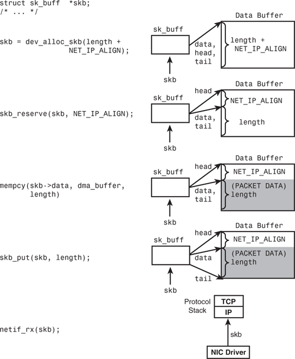

Giả sử `skb` trỏ tới `sk_buff`, các pointer `skb->head`, `skb->data`, `skb->tail` và `skb->end` trượt trên packet buffer tương ứng khi packet đi qua protocol stack theo cả hai hướng. Ví dụ `skb->data` trỏ header của protocol hiện đang xử lý packet. Khi packet đến IP layer qua receive path, `skb->data` trỏ IP header; nhưng khi chuyển tới TCP, `skb->data` dịch đến đầu TCP header. Khi packet đi qua protocol thêm hoặc bỏ header data, `skb->len` cũng cập nhật. Các `sk_buff` còn chứa pointer ngoài bốn cái chính đã nêu. Ví dụ `skb->nh` nhớ vị trí network protocol header bất kể vị trí hiện tại của `skb->data`.

Để minh họa NIC driver làm việc với các `sk_buff`, Hình 15.1 thể hiện chuyển tiếp dữ liệu trên receive data path. Để tiện minh họa, hình giả định đơn giản các operation thực hiện tuần tự. Nhưng để hiệu quả thực tế, hai bước đầu (`dev_alloc_skb()` và `skb_reserve()`) thực hiện khi ban đầu preallocate ring receive buffer; bước ba do NIC hardware làm khi trực tiếp DMA received packet vào `sk_buff;` preallocate; hai bước cuối (`skb_put()` và `netif_rx()`) thực hiện từ receive interrupt handler.

Để tạo `sk_buff` chứa received packet, Hình 15.1 dùng `dev_alloc_skb()`. Đây là routine interrupt-safe cấp phát memory cho `sk_buff` và gắn với packet payload buffer. `dev_kfree_skb()` làm ngược `dev_alloc_skb()`. Tiếp theo Hình 15.1 gọi `skb_reserve()` thêm padding 2-byte giữa đầu packet buffer và đầu payload. Nhờ đó IP header bắt đầu tại boundary 16-byte performance-friendly vì Ethernet header phía trước dài 14 byte. Code statement còn lại điền received packet vào payload buffer và dịch `skb->data`, `skb->tail`, `skb->len` phản ánh operation.

Có thêm access routine của `sk_buff` liên quan một số NIC driver. Ví dụ `skb_clone()` tạo copy của `skb_buff` cho trước mà không copy nội dung packet buffer gắn kèm. Xem net/core/skbuff.c cho đầy đủ library function của `sk_buff`.

### Net Device Interface

NIC driver dùng standard interface tương tác TCP/IP stack. Structure `net_device`, thậm chí lớn hơn `sk_buff`, định nghĩa communication interface. Để chuẩn bị khám phá bên trong structure `net_device`, trước hết theo các bước NIC driver thực hiện lúc khởi tạo. Tham khảo `init_mycard()` trong Listing 15.1 khi đọc:

- Driver cấp phát structure `net_device` bằng `alloc_netdev()`. Thường dùng wrapper phù hợp quanh `alloc_netdev()`. Ví dụ Ethernet NIC driver gọi `alloc_etherdev()`. WiFi driver (chương tiếp theo) gọi `alloc_ieee80211()`, IrDa driver gọi `alloc_irdadev()`. Mọi function nhận size private data area làm đối số, tạo vùng đó ngoài chính `net_device`:

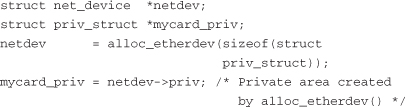

- Tiếp theo driver điền các field của `net_device` vừa cấp phát, đăng ký `net_device` đã điền với network layer bằng `register_netdev(netdev)`.

- Driver đọc Media Access Control (MAC) address của NIC từ EEPROM đi kèm, cấu hình Wake-On-LAN (WOL) nếu cần. Ethernet controller thường có nonvolatile EEPROM đi kèm giữ thông tin như MAC address và WOL pattern như Hình 15.2. MAC address là địa chỉ duy nhất 48-bit gán toàn cầu. WOL pattern là magic sequence; nếu tìm thấy trong received data, nó đánh thức NIC đang suspend mode.

- Nếu NIC cần firmware on-card để chạy, driver tải bằng `request_firmware()`, như phần “Tải Microcode” trong Chương 4, “Đặt nền móng”.

Giờ xem method định nghĩa interface `net_device`. Để đơn giản chia sáu nhóm. Khi liên quan, phần này chỉ tới NIC driver ví dụ trong Listing 15.1 của phần “Ví dụ Device: Ethernet NIC”.

### Kích hoạt

Interface `net_device` cần method thông thường như `open()`, `close()` và `ioctl()`. Kernel mở interface khi kích hoạt bằng công cụ như ifconfig:

```
bash> ifconfig eth0 up
```

`open()` thiết lập receive/transmit DMA descriptor và driver data structure khác. Cũng đăng ký interrupt handler NIC bằng `request_irq()`. Structure `net_device` truyền làm đối số `devid` cho `request_irq()` để interrupt handler truy cập trực tiếp `net_device` tương ứng. (Xem `mycard_open()` và `mycard_interrupt()` trong Listing 15.1 để biết cách làm.)

Kernel gọi `close()` khi đưa active network interface xuống. Làm ngược `open()`.

### Data Transfer

Data transfer method là trọng tâm interface `net_device`. Trong transmit path, driver cung cấp method `hard_start_xmit`, protocol layer gọi để chuyển packet xuống truyền tiếp:

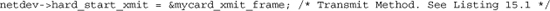

Cho đến gần đây network driver không cung cấp method `net_device` lấy received data. Thay vào đó bất đồng bộ interrupt protocol layer với packet payload. Nhưng interface cũ nhường chỗ New API (NAPI), kết hợp driver push interrupt-driven và protocol pull poll-driver. Vì vậy driver NAPI-aware cần method `poll()` và `weight` tương ứng điều khiển polling fairness:

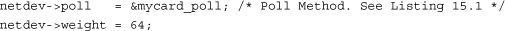

Ta trình bày kỹ method data-transfer trong phần “Giao tiếp với Protocol Layer”.

### Watchdog

Interface `net_device` cung cấp hook đưa NIC không phản hồi về operational state. Nếu protocol layer không thấy transmission trong thời gian định trước, giả định NIC treo và gọi recovery method driver-supplied để reset card. Driver đặt watchdog timeout qua `netdev->watchdog_timeo`, đăng ký địa chỉ recovery function qua `netdev->tx_timeout`:

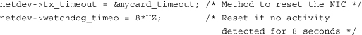

Vì recovery method chạy trong context timer-interrupt, thường schedule task ngoài context đó để reset NIC.

### Thống kê

Để user land thu thập network statistic, NIC driver điền structure `net_device_stats`, cung cấp method `get_stats()` lấy nó. Cơ bản driver làm:

1\. Cập nhật các loại thống kê từ entry point liên quan:

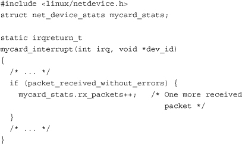

2\. Triển khai method `get_stats()` lấy thống kê:

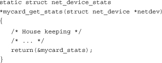

3\. Cung cấp retrieve method cho higher layer:

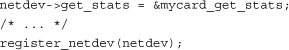

Để lấy thống kê NIC, kích hoạt lời gọi `mycard_get_stats()` bằng user mode command phù hợp. Ví dụ tìm số packet nhận qua eth0:

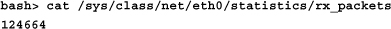

WiFi driver cần theo dõi tham số không liên quan NIC thông thường, nên triển khai method lấy thống kê `get_wireless_stats()` ngoài `get_stats()`. Cơ chế đăng ký `get_wireless_stats()` cho utility user-space WiFi-aware được trình bày phần “WiFi” chương tiếp theo.

### Cấu hình

NIC driver cần hỗ trợ tool user-space chịu trách nhiệm đặt/lấy device parameter. Ethtool cấu hình tham số Ethernet NIC. Để hỗ trợ, NIC driver bên dưới làm:

1\. Điền structure `ethtool_ops`, định nghĩa trong include/linux/ethtool.h, bằng entry point quy định:

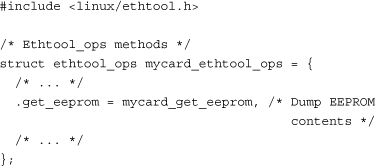

2\. Triển khai method thuộc `ethtool_ops`:

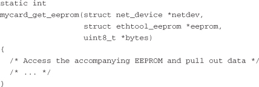

3\. Export địa chỉ `ethtool_ops`:

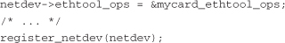

Xong thì ethtool thao tác được Ethernet NIC. Để dump EEPROM content bằng ethtool:

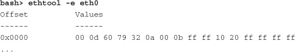

Ethtool đóng gói cùng một số distribution; nếu chưa có tải tại http://sourceforge.net/projects/gkernel/. Tham khảo man page để biết đầy đủ khả năng.

NIC driver còn cung cấp method configuration-related khác cho higher layer. Ví dụ method đổi MTU size network interface. Để hỗ trợ, cung cấp method cho `net_device`:

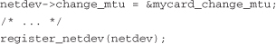

Kernel gọi `mycard_change_mtu()` khi chạy user command phù hợp đổi MTU card:

```
bash> echo 1500 > /sys/class/net/eth0/mtu
```

### Chi tiết Bus

Tiếp theo là chi tiết bus-specific như start address và size memory on-card của NIC. Với PCI NIC driver, cấu hình như:

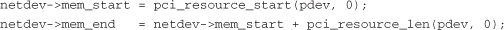

Ta đã trình bày PCI resource function trong Chương 10.

## Giao tiếp với Protocol Layer

Phần trước bạn đã thấy driver method interface `net_device` yêu cầu. Giờ xem kỹ network data đi qua interface thế nào.

### Receive Path

Chương 4 cho biết softirq là bottom half mechanism dùng bởi subsystem performance-sensitive. NIC driver dùng `NET_RX_SOFTIRQ` để offload việc post received data packet tới protocol layer. Thực hiện bằng gọi `netif_rx()` từ receive interrupt handler:

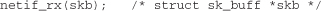

NAPI đã nhắc cải thiện receive algorithm interrupt-driven thông thường để giảm CPU utilization. Khi network load nặng, hệ thống có thể ì ạch vì nhiều interrupt. Chiến lược NAPI dùng polled mode khi network activity nặng, quay về interrupt mode khi traffic nhẹ. Driver NAPI-aware chuyển interrupt/polled mode theo network load. Cách làm:

1\. Trong interrupt mode, interrupt handler post received packet tới protocol layer bằng schedule `NET_RX_SOFTIRQ`. Sau đó tắt NIC interrupt, chuyển polled mode bằng thêm device vào poll list:

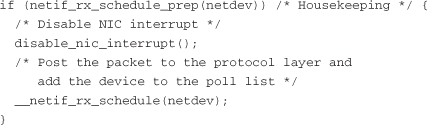

2\. Driver cung cấp method `poll()` qua structure `net_device`. 3. Trong polled mode, method `poll()` xử lý packet trong

ingress queue. Khi queue rỗng, driver re-enables interrupt, trở lại interrupt mode bằng `netif_rx_complete()`.

Xem `mycard_interrupt()`, `init_mycard()` và `mycard_poll()` trong Listing 15.1 để thấy NAPI hoạt động.

### Transmit Path

Với data transmission, tương tác protocol layer và NIC driver đơn giản. Protocol stack gọi method `hard_start_xmit()` của driver với outgoing `sk_buff` làm đối số. Driver gửi packet bằng cách DMA-ing packet data tới NIC. DMA và quản lý data structure liên quan cho PCI NIC driver đã trình bày Chương 10.

Driver lập trình NIC interrupt processor sau khi truyền xong số packet định trước. Chỉ khi interrupt transmit-complete báo operation truyền hoàn tất, driver mới reclaim hoặc giải phóng resource như DMA descriptor, DMA buffer và `sk_buffs` gắn transmitted packet.

### Flow Control

Driver thể hiện sẵn sàng hoặc không muốn nhận protocol data bằng cách lần lượt gọi `netif_start_queue()` và `netif_stop_queue()`.

Trong device `open()`, NIC driver gọi `netif_start_queue()` yêu cầu protocol layer bắt đầu thêm transmit packet vào egress queue. Nhưng khi hoạt động thường, thỉnh thoảng cần dừng egress queuing. Ví dụ khoảng đang bổ sung data structure hoặc đóng device. Throttle downstream flow bằng `netif_stop_queue()`. Để yêu cầu networking stack restart egress queuing, chẳng hạn khi đủ free buffer, NIC driver gọi `netif_wake_queue()`. Để kiểm tra flow-control state hiện tại, gọi `netif_queue_stopped()`.

## Quản lý Buffer và điều khiển Concurrency

NIC driver high-performance là software phức tạp đòi hỏi quản lý data structure tinh vi. Như phần “Data Transfer” Chương 10, NIC driver duy trì linked list (hay “ring”) của transmit/receive DMA descriptor, triển khai free pool và pool in-use để quản lý buffer. Thường dùng chiến lược nhiều hướng duy trì buffer level: preallocate ring DMA descriptor cùng các `sk_buff` khi open device, bổ sung free pool bằng memory mới nếu buffer khả dụng dưới watermark định trước, reclaim used buffer về free pool khi NIC sinh interrupt transmit-complete và receive.

Ví dụ mỗi phần tử receive ring của NIC driver được điền như sau:

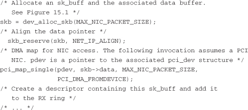

Khi nhận, NIC trực tiếp DMA dữ liệu vào `sk_buff` trong ring preallocate trên, interrupt processor. Receive interrupt handler chuyển packet lên protocol layer cao hơn. Phát triển ring data structure sẽ làm phần thảo luận và driver ví dụ tiếp theo nặng nề, nên tham khảo source Intel PRO/1000 driver trong directory drivers/net/e1000/ cho minh họa đầy đủ.

Bảo vệ concurrent access đi hand-in-hand với quản lý data structure phức tạp trước nhiều execution thread như transmit, receive, interrupt transmit-complete, receive interrupt và NAPI polling. Ta đã nói concurrency control technique ở Chương 2, “Nhìn vào bên trong Kernel”.

## Ví dụ Device: Ethernet NIC

Giờ có nền tảng, đến lúc viết NIC driver bằng ghép các phần đã trình bày. Listing 15.1 triển khai skeletal Ethernet NIC driver, chỉ các method chính của `net_device`. Để phát triển method còn lại, tham khảo e1000 driver đã nêu. Listing 15.1 nhìn chung độc lập I/O bus bên dưới nhưng hơi thiên PCI. Nếu viết PCI NIC driver, phải kết hợp Listing 15.1 với PCI driver ví dụ trong Chương 10.

Listing 15.1. Ethernet NIC Driver

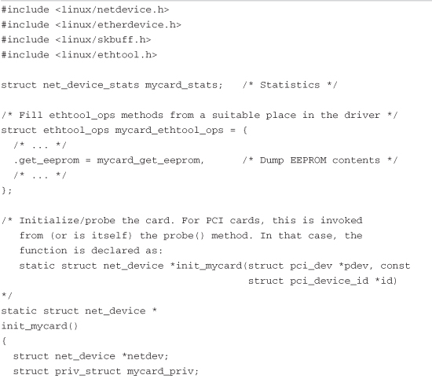

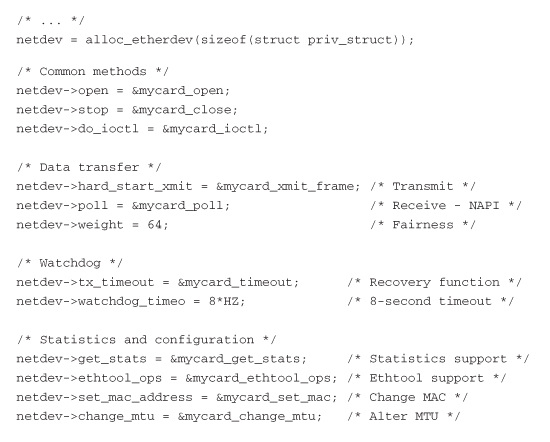

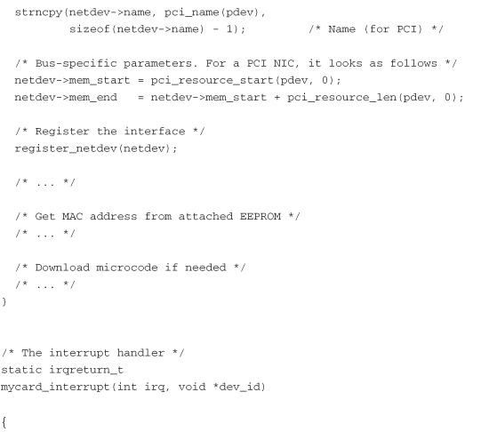

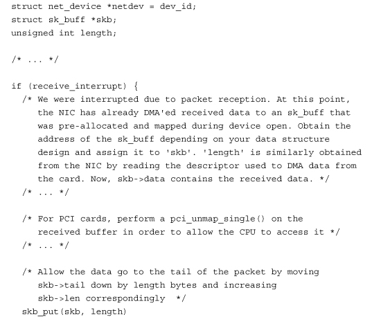

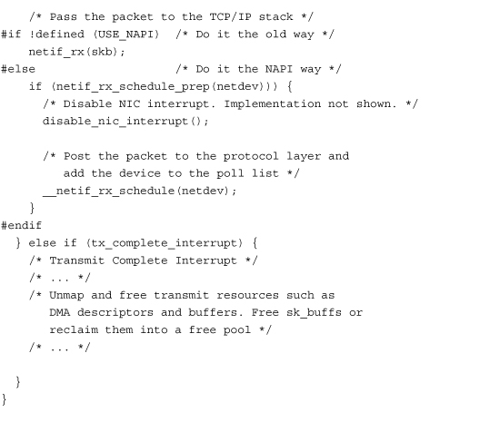

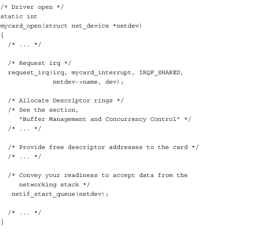

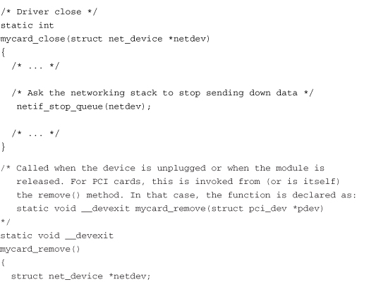

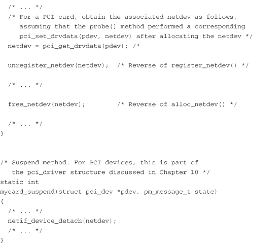

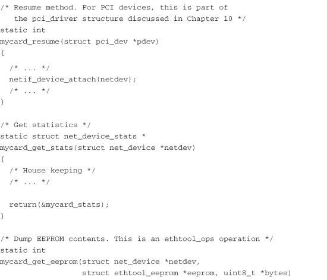

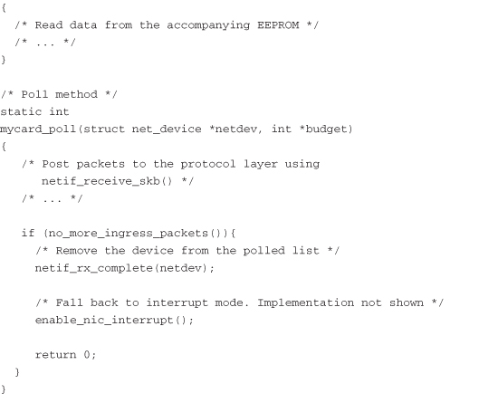

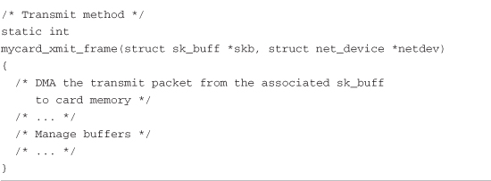

### Ethernet PHY

Ethernet controller triển khai MAC layer, phải dùng cùng Physical layer (PHY) transceiver. MAC tương ứng datalink layer của Open Systems Interconnect (OSI) model, PHY triển khai physical layer. Nhiều SoC có MAC built-in nối external PHY. Media Independent Interface (MII) là standard interface nối Fast Ethernet MAC với PHY. Ethernet device driver giao tiếp PHY qua MII để cấu hình PHY ID, line speed, duplex mode, auto negotiation, v.v. Xem include/linux/mii.h cho MII register definition.

## ISA Network Driver

Giờ xem ISA NIC. CS8900 là Ethernet controller chip 10Mbps của Crystal Semiconductor (nay Cirrus Logic). Thường dùng để Ethernet-enable embedded device, đặc biệt cho debug. Hình 15.2 thể hiện connection diagram quanh CS8900. Tùy processor trên board và chip-select điều khiển, CS8900 register map vào region khác nhau trong I/O address space CPU. Device driver cho controller là driver ISA-type (xem phần “ISA và MCA” trong Chương 20, “Thêm Device và Driver”) probe candidate address region để phát hiện controller. ISA probe method tìm I/O base address bằng signature như chip ID.

Hình 15.2. Connection diagram quanh CS8900 Ethernet controller.

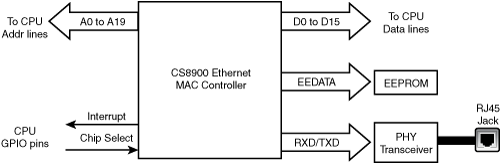

Xem drivers/net/cs89x0.c cho source code CS8900 driver. `cs89x0_probe1()` probe I/O address range để tìm CS8900. Sau đó đọc chip configuration hiện tại. Trong bước này truy cập EEPROM đi kèm CS8900, lấy MAC address controller. Như driver Listing 15.1, cs89x0.c cũng dựng bằng interface routine `netif_*()` và `skb_*()`. Một số platform dùng CS8900 cho DMA. Khác PCI card, ISA device không có DMA mastering capability, cần external DMA controller truyền dữ liệu.

## Asynchronous Transfer Mode

ATM là công nghệ high-speed, connection-oriented, back-bone. Bảo đảm quality of service (QoS) cao và latency thấp nên mang audio/video traffic bên cạnh dữ liệu.

Tóm tắt ATM protocol: giao tiếp theo đơn vị cell 53-byte. Mỗi cell bắt đầu bằng header 5-byte mang virtual path identifier (VPI) và virtual circuit identifier (VCI). ATM connection là switched virtual circuit (SVC) hoặc permanent virtual circuit (PVC). Khi thiết lập SVC, cặp VPI/VCI cấu hình trong ATM switch trung gian để route incoming cell tới egress port phù hợp. Với PVC, cặp VPI/VCI cấu hình cố định trong ATM switch, không setup/teardown cho từng connection.

Có ba cách chạy TCP/IP over ATM, đều được Linux-ATM hỗ trợ:

1\. Classical IP over ATM (CLIP) theo RFC<sup>\[1\]</sup> 1577. 2. Mô phỏng LAN trên ATM network. Gọi là LAN

Emulation (LANE).

3\. Multi Protocol over ATM (MPoA). Routing technique cải thiện hiệu năng.

Linux-ATM là tập thử nghiệm gồm kernel driver, utility user-space và daemon. ATM driver/protocol lần lượt nằm ở drivers/atm/ và net/atm/ trong source tree. http://linux-atm.sourceforge.net/ chứa chương trình user-space cần để dùng Linux-ATM. Linux cũng có ATM socket API gồm SVC socket (`AF_ATMSVC`) và PVC socket (`AF_ATMPVC`).

Protocol tên Multiprotocol Label Switching (MPLS) đang thay ATM. Dự án Linux-MPLS tại http://mpls-linux.sourceforge.net/, chưa thuộc mainline kernel. Phần tiếp theo xem throughput issue ATM-related.

## Network Throughput

Có nhiều công cụ benchmark network performance. Netperf miễn phí từ www.netperf.org thiết lập được TCP/UDP connection scenario phức tạp. Dùng script điều khiển đặc điểm như protocol parameter, số simultaneous session và size data block. Benchmark bằng so throughput đạt được với maximum practical bandwidth networking technology mang lại. Ví dụ ATM adapter 155Mbps cho IP throughput tối đa 135Mbps, tính cả ATM cell header size, overhead do ATM Adaptation Layer (AAL) và maintenance cell thỉnh thoảng physical Synchronous Optical Networking (SONET) layer gửi.

Để throughput tối ưu phải thiết kế NIC driver cho hiệu năng cao. Ngoài ra cần hiểu in-depth network protocol driver vận chuyển.

### Driver Performance

Xem một số driver design issue ảnh hưởng sức mạnh NIC:

- Giảm số instruction trong main data path là tiêu chí chủ chốt thiết kế driver cho NIC nhanh. Xét Ethernet adapter 1Gbps với memory on-board 1MB. Ở line rate, card memory chứa tối đa 8 mili giây received data. Trực tiếp suy ra instruction path length tối đa cho phép. Trong path length đó, incoming packet phải reassemble, DMA-ed tới memory, được driver xử lý, bảo vệ concurrent access và giao higher layer protocol.

- Trong programmed I/O (PIO), dữ liệu đi từ device tới CPU rồi mới ghi memory. Hơn nữa CPU bị interrupt mỗi khi device cần truyền, góp vào latency và context switch delay. DMA không bị bottleneck đó nhưng có thể tốn hơn PIO nếu dữ liệu dưới threshold. Vì DMA nhỏ có relative overhead cao để dựng descriptor và flush processor cache line tương ứng cho data coherency. Device driver performance-sensitive có thể dùng PIO cho packet nhỏ, DMA cho packet lớn sau khi thử nghiệm xác định threshold.

- Với PCI network card có DMA mastering capability, phải xác định optimal DMA burst size, là thời gian card kiểm soát bus mỗi đợt. Burst quá lâu có thể chiếm bus, ngăn processor theo kịp dữ liệu DMA-ed trước đó. PCI driver lập trình burst size qua register trong PCI configuration space. Thường NIC burst size đặt bằng processor cache line size, số byte processor đọc từ system memory mỗi cache miss. Nhưng thực tế có thể cần bus analyzer để xác định burst duration có lợi vì yếu tố như split bus (nhiều bus type ISA và PCI) trên hệ thống ảnh hưởng giá trị tối ưu.

- Nhiều NIC high-speed offload việc tính TCP checksum CPU-intensive khỏi protocol stack. Một số hỗ trợ DMA scatter-gather đã xem ở Chương 10. Driver cần tận dụng để đạt maximum practical bandwidth network bên dưới mang lại.

- Đôi khi tối ưu driver tạo điểm chậm ngoài dự kiến nếu không chú ý chi tiết higher protocol implementation. Xét filesystem NFS-mounted trên computer có NIC high-speed. Giả sử driver chỉ nhận transmit complete interrupt thỉnh thoảng để giảm latency, nhưng NFS server implementation dùng giải phóng transmit buffer làm cơ chế flow-control. Vì driver chỉ giải phóng NFS transmit buffer trong transmit complete interrupt thưa thớt, copy file NFS chậm chạp dù Internet download vẫn nhanh, đạt maximum throughput.

### Protocol Performance

Giờ xem đặc điểm protocol-specific có thể tăng/giảm network throughput:

- TCP window size ảnh hưởng throughput. Window size đo lượng dữ liệu truyền trước acknowledgment. Với NIC nhanh, window nhỏ có thể khiến TCP idle chờ acknowledgment packet đã truyền. Dù window lớn, ít TCP packet mất cũng ảnh hưởng vì lost frame có thể dùng hết window ở line speed. Với UDP, window size không liên quan vì không hỗ trợ acknowledgment. Tuy nhiên packet loss nhỏ có thể thành rate drop lớn vì thiếu cơ chế flow-control.

- Khi block size application data ghi vào TCP socket tăng, số buffer copy từ user space sang kernel space giảm. Giảm processor utilization demand, tốt cho hiệu năng. Nhưng nếu block size vượt MTU tương ứng network protocol, processor cycle phí cho fragmentation. Vì vậy block size mong muốn là outgoing interface MTU, hoặc packet lớn nhất gửi không fragmentation qua IP path nếu Path MTU discovery đang chạy. Ví dụ khi chạy IP over ATM, ATM adaptation layer có MTU 64K nên gần như không có upper bound block size. (RFC 1626 mặc định 9180.) Nhưng nếu chạy IP over ATM LANE, block size phải phản ánh MTU size LAN technology được mô phỏng: 1500 cho standard Ethernet, 8000 cho jumbo Gigabit Ethernet, 18K cho Token Ring 16Mbps.

## Xem Source

Directory drivers/net/ chứa source các NIC driver. Xem drivers/net/e1000/ cho ví dụ. Network protocol implementation trong directory net/. Access routine của `sk_buff` ở net/core/skbuff.c. Library routine hỗ trợ triển khai interface `net_device` của driver ở net/core/dev.c và include/linux/netdevice.h.

### TUN/TAP Driver

TUN/TAP device driver drivers/net/tun.c, dùng protocol tunneling, là ví dụ kết hợp virtual network driver và pseudo char driver. Pseudo char device (/dev/net/tun) làm hardware bên dưới virtual network interface (tunX), nên thay truyền frame tới physical network, TUN network driver gửi tới ứng dụng đọc /dev/net/tun. Tương tự thay nhận từ physical network, TUN driver nhận từ ứng dụng ghi /dev/net/tun. Xem Documentation/networking/tuntap.txt để thêm giải thích và usage scenario. Vì cả phần network/char không phải xử lý hardware interaction phức tạp, đây là driver ví dụ dễ đọc dù đơn giản hóa.

File dưới /sys/class/net/ cho thao tác NIC driver parameter. Dùng node dưới /proc/sys/net/ cấu hình biến protocol-specific. Ví dụ đặt maximum TCP transmit window size bằng echo giá trị mong muốn vào /proc/sys/net/core/wmem\_max. Directory /proc/net/ tập hợp network information system-specific. Xem /proc/net/dev cho thống kê mọi NIC trên hệ thống, /proc/net/arp cho ARP table.

Bảng 15.1 chứa data structure chính dùng trong chương và vị trí trong source tree. Bảng 15.2 liệt kê kernel programming interface chính đã dùng cùng vị trí định nghĩa.

Bảng 15.1. Tổng hợp Data Structure

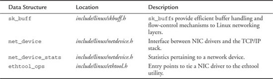

Bảng 15.2. Tổng hợp Kernel Programming Interface

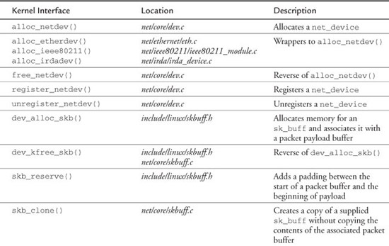

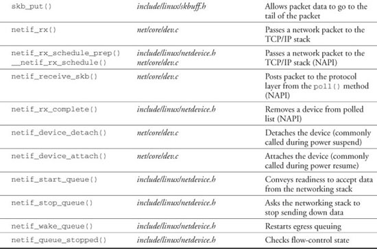
