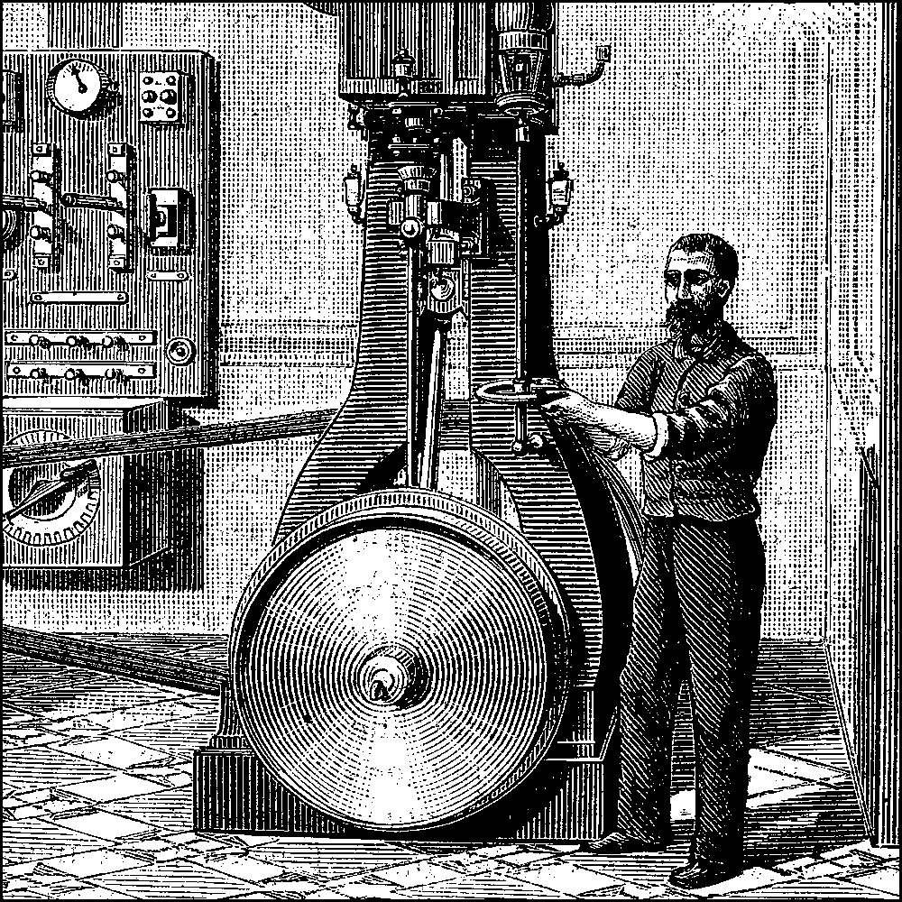
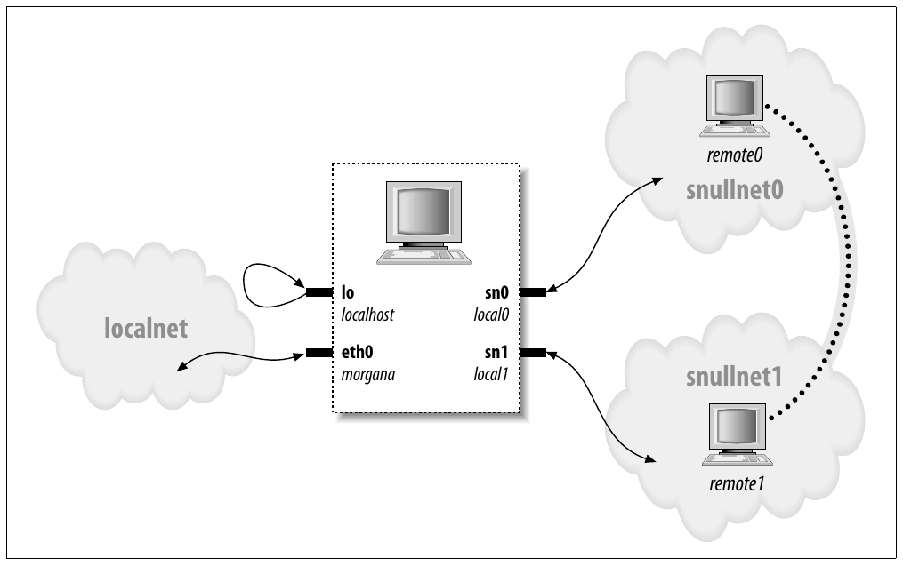

# Chương 17. Network Driver



Sau khi trình bày char driver và block driver, giờ ta sẵn sàng bước sang networking. Network interface là class tiêu chuẩn thứ ba của Linux device; chương này mô tả cách chúng tương tác với phần còn lại của kernel.

Vai trò network interface trong hệ thống giống mounted block device. Block device đăng ký disk và method với kernel, rồi “truyền” và “nhận” block theo yêu cầu bằng request function. Tương tự, network interface phải đăng ký trong kernel data structure cụ thể để được gọi khi trao đổi packet với bên ngoài.

Có vài khác biệt quan trọng giữa mounted disk và packet-delivery interface. Trước hết, disk tồn tại dưới dạng special file trong directory /dev, còn network interface không có entry point như vậy. File operation thông thường (read, write, v.v.) không có ý nghĩa khi áp dụng cho network interface, nên không thể áp dụng cách tiếp cận Unix “mọi thứ đều là file”. Vì vậy network interface tồn tại trong namespace riêng và export tập operation khác.

Dù bạn có thể phản biện rằng ứng dụng dùng system call read và write khi dùng socket, các lời gọi đó tác động lên software object khác biệt với interface. Hàng trăm socket có thể được multiplex trên cùng physical interface.

Nhưng khác biệt quan trọng nhất là block driver chỉ hoạt động đáp ứng request từ kernel, còn network driver nhận packet bất đồng bộ từ bên ngoài. Vì vậy, trong khi block driver được yêu cầu gửi buffer về kernel, network device yêu cầu đẩy incoming packet vào kernel. Kernel interface cho network driver được thiết kế cho mode hoạt động khác biệt này.

Network driver cũng phải sẵn sàng hỗ trợ các tác vụ quản trị như đặt địa chỉ, sửa transmission parameter, duy trì thống kê traffic và lỗi. API cho network driver phản ánh nhu cầu này, do đó hơi khác interface đã thấy đến đây.

Network subsystem của Linux kernel được thiết kế hoàn toàn độc lập protocol. Điều này áp dụng cho cả networking protocol (Internet protocol \[IP\] so với IPX hoặc protocol khác) và hardware protocol (Ethernet so với token ring, v.v.). Tương tác đúng giữa network driver và kernel xử lý mỗi lần một network packet; nhờ đó che giấu vấn đề protocol khỏi driver và che giấu physical transmission khỏi protocol một cách gọn gàng.

Chương này mô tả network interface kết hợp với phần còn lại của Linux kernel và cung cấp ví dụ dưới dạng modularized network interface memory-based, tên là (bạn đoán đúng) snull. Để đơn giản hóa, interface dùng Ethernet hardware protocol và truyền IP packet. Kiến thức từ việc xem snull có thể dễ dàng áp dụng cho protocol ngoài IP; viết driver non-Ethernet chỉ khác ở chi tiết nhỏ liên quan network protocol thực tế.

Chương không nói về IP numbering scheme, network protocol hoặc khái niệm networking tổng quát khác. Chủ đề này (thường) không phải điều driver writer quan tâm, và không thể cung cấp tổng quan thỏa đáng về networking technology trong chưa đến vài trăm trang. Độc giả quan tâm nên tham khảo sách khác về vấn đề networking.

Cần lưu ý thuật ngữ trước khi đi vào network device. Thế giới networking dùng octet để chỉ nhóm tám bit, thường là đơn vị nhỏ nhất networking device và protocol hiểu được. Thuật ngữ byte gần như không gặp trong ngữ cảnh này. Theo cách dùng tiêu chuẩn, ta dùng octet khi nói về networking device.

Thuật ngữ “header” cũng cần nhắc ngắn gọn. Header là tập byte (à, octet) thêm vào đầu packet khi đi qua các layer của networking subsystem. Khi ứng dụng gửi block dữ liệu qua TCP socket, networking subsystem chia dữ liệu thành packet và đặt TCP header ở đầu, mô tả vị trí mỗi packet trong stream. Level thấp hơn đặt IP header, dùng route packet đến destination, phía trước TCP header. Nếu packet đi qua medium Ethernet-like, Ethernet header do hardware diễn giải được đặt trước toàn bộ phần còn lại. Network driver (thường) không cần quan tâm higher-level header nhưng thường phải tham gia tạo hardware-level header.

## Cách thiết kế snull

Phần này trình bày design concept dẫn đến snull network interface. Dù thông tin có vẻ ít hữu ích, không hiểu có thể gây vấn đề khi thử sample code.

Quyết định thiết kế đầu tiên và quan trọng nhất là sample interface độc lập với hardware thực, như phần lớn sample code trong sách. Ràng buộc dẫn đến thứ giống loopback interface. Tuy nhiên snull không phải loopback interface; nó mô phỏng hội thoại với remote host thực để minh họa rõ hơn tác vụ viết network driver. Linux loopback driver thực ra khá đơn giản, nằm trong drivers/net/loopback.c.

Tính năng khác của snull là chỉ hỗ trợ IP traffic. Đây là hệ quả cách interface hoạt động nội bộ—snull phải xem bên trong và diễn giải packet để mô phỏng đúng cặp hardware interface. Interface thực không phụ thuộc protocol đang truyền, và giới hạn này của snull không ảnh hưởng đoạn code trong chương.

### Gán IP Number

Snull module tạo hai interface. Chúng khác loopback đơn giản ở chỗ bất cứ thứ gì truyền qua một interface đều quay về interface kia, thay vì chính nó. Trông như có hai external link nhưng thực ra computer tự trả lời chính mình.

Đáng tiếc, không thể đạt hiệu ứng này chỉ bằng gán IP number vì kernel không gửi qua interface A packet hướng đến interface B của chính nó. Thay vào đó dùng loopback channel, không qua snull. Để thiết lập giao tiếp qua snull interface, source và destination address cần sửa trong lúc truyền dữ liệu. Nói cách khác, packet gửi qua interface này phải được interface kia nhận, nhưng receiver của outgoing packet không được nhận diện là local host. Điều tương tự áp dụng cho source address của received packet.

Để tạo “hidden loopback”, snull interface đảo least significant bit của octet thứ ba trong cả source và destination address; tức đổi cả network number và host number của class C IP number. Hiệu ứng cuối cùng là packet gửi tới network A (nối với `sn0`, interface đầu tiên) xuất hiện trên interface `sn1` dưới dạng packet thuộc network B.

Để tránh quá nhiều số, hãy gán symbolic name cho các IP number liên quan:

- `snullnet0` là network nối với interface `sn0`. Tương tự, `snullnet1` là network nối với `sn1`. Address của chúng chỉ được khác ở least significant bit của octet thứ ba. Các network phải có netmask 24-bit.

- `local0` là IP address gán cho interface `sn0`; thuộc `snullnet0`. Address gắn với `sn1` là `local1`. `local0` và `local1` phải khác ở least significant bit của octet thứ ba và ở octet thứ tư.

- `remote0` là host trong `snullnet0`, có octet thứ tư giống `local1`. Mọi packet gửi tới `remote0` đến `local1` sau khi network address được interface code sửa. Host `remote1` thuộc `snullnet1`, có octet thứ tư giống `local0`.

Hoạt động snull interface thể hiện ở Hình 17-1, hostname gắn với mỗi interface in gần interface name.



Hình 17-1. Cách host nhìn các interface của nó

Sau đây là giá trị có thể dùng cho network number. Khi thêm các dòng vào /etc/networks, có thể gọi network bằng tên. Giá trị được chọn từ dải số dành cho private use.

```c
snullnet0       192.168.0.0
snullnet1       192.168.1.0
```

Sau đây là host number có thể thêm vào /etc/hosts:

```c
192.168.0.1   local0
192.168.0.2   remote0
192.168.1.2   local1
192.168.1.1   remote1
```

Đặc điểm quan trọng là host portion của `local0` giống `remote1`, host portion của `local1` giống `remote0`. Có thể dùng số hoàn toàn khác miễn giữ quan hệ này.

Tuy nhiên hãy cẩn thận nếu computer đã nối mạng. Số chọn có thể là Internet hoặc intranet number thực; gán chúng cho interface ngăn giao tiếp với host thực. Ví dụ dù số trên không phải routable Internet number, private network có thể đã dùng chúng.

Dù chọn số nào, có thể thiết lập interface đúng để hoạt động bằng các lệnh:

```c
ifconfig sn0 local0
ifconfig sn1 local1
```

Có thể cần thêm tham số `netmask 255.255.255.0` nếu address range được chọn không thuộc class C.

Lúc này có thể đến đầu “remote” của interface. Screendump sau cho thấy host đến `remote0` và `remote1` qua snull interface:

```c
morgana% ping -c 2 remote0
64 bytes from 192.168.0.99: icmp_seq=0 ttl=64 time=1.6 ms
64 bytes from 192.168.0.99: icmp_seq=1 ttl=64 time=0.9 ms
2 packets transmitted, 2 packets received, 0% packet loss

morgana% ping -c 2 remote1
64 bytes from 192.168.1.88: icmp_seq=0 ttl=64 time=1.8 ms
64 bytes from 192.168.1.88: icmp_seq=1 ttl=64 time=0.9 ms
2 packets transmitted, 2 packets received, 0% packet loss
```

Lưu ý không thể đến “host” khác thuộc hai network vì computer loại packet sau khi sửa address và nhận packet. Ví dụ packet tới 192.168.0.32 đi ra qua `sn0`, xuất hiện lại tại `sn1` với destination address 192.168.1.32, không phải local address của host computer.

### Physical Transport của Packet

Xét data transport, snull interface thuộc Ethernet class.

Snull mô phỏng Ethernet vì phần lớn network hiện có—ít nhất segment workstation nối vào—dựa trên Ethernet technology, dù là 10base-T, 100base-T hay Gigabit. Hơn nữa kernel cung cấp hỗ trợ tổng quát cho Ethernet device, không có lý do không dùng. Lợi thế làm Ethernet device lớn đến mức cả plip interface (interface dùng printer port) cũng khai báo là Ethernet device.

Lợi thế cuối của việc dùng Ethernet setup cho snull là có thể chạy tcpdump trên interface để xem packet đi qua. Quan sát interface bằng tcpdump là cách hữu ích để thấy hai interface hoạt động.

Như đã nói, snull chỉ làm việc với IP packet. Giới hạn do snull xem bên trong và thậm chí sửa packet để code hoạt động. Code sửa source, destination và checksum trong IP header của mỗi packet mà không kiểm tra có thực sự mang IP information không.

Sửa dữ liệu quick-and-dirty này phá hỏng packet non-IP. Muốn giao protocol khác qua snull phải sửa source code của module.

## Kết nối với Kernel

Ta bắt đầu xem structure của network driver bằng cách phân tích snull source. Có sẵn source code của vài driver giúp theo dõi và thấy Linux network driver real-world hoạt động thế nào. Để bắt đầu, đề xuất loopback.c, plip.c và e100.c theo độ phức tạp tăng dần. Tất cả nằm trong drivers/net thuộc kernel source tree.

### Đăng ký Device

Khi driver module load vào kernel đang chạy, nó yêu cầu resource và cung cấp chức năng; không có gì mới. Cách yêu cầu resource cũng không mới. Driver phải probe device và vị trí hardware (I/O port và IRQ line)—nhưng chưa đăng ký—như mô tả trong “Cài đặt Interrupt Handler” ở Chương 10. Cách network driver được module initialization function đăng ký khác char driver và block driver. Vì không có thứ tương đương major/minor number cho network interface, network driver không yêu cầu số như vậy. Thay vào đó chèn data structure cho mỗi interface mới phát hiện vào global list network device.

Mỗi interface được mô tả bằng một `struct net_device`, định nghĩa trong \<linux/netdevice.h\>. Snull driver giữ pointer đến hai structure (cho `sn0` và `sn1`) trong array đơn giản:

```c
struct net_device *snull_devs[2];
```

Structure `net_device`, như nhiều kernel structure khác, chứa kobject nên được reference-counted và export qua sysfs. Như structure tương tự, phải cấp phát động. Kernel function cấp phát là alloc\_netdev, có prototype:

```c
struct net_device *alloc_netdev(int sizeof_priv,
                                const char *name,
                                void (*setup)(struct net_device *));
```

Ở đây `sizeof_priv` là size vùng “private data” của driver; với network device, vùng này cấp phát cùng structure `net_device`. Thực tế cả hai cấp phát chung trong một memory chunk lớn, nhưng driver author nên giả vờ không biết. `name` là tên interface thấy từ user space; có thể chứa `%d` kiểu printf-style. Kernel thay `%d` bằng interface number khả dụng tiếp theo. Cuối cùng, `setup` là pointer tới initialization function được gọi để thiết lập phần còn lại của structure `net_device`. Ta sẽ sớm nói tới initialization function; hiện chỉ cần biết snull cấp phát hai device structure như sau:

```c
snull_devs[0] = alloc_netdev(sizeof(struct snull_priv), "sn%d",
        snull_init);
snull_devs[1] = alloc_netdev(sizeof(struct snull_priv), "sn%d",
        snull_init);
if (snull_devs[0] = = NULL || snull_devs[1] = = NULL)
    goto out;
```

Như luôn luôn, phải kiểm tra return value để bảo đảm cấp phát thành công.

Networking subsystem cung cấp helper function bọc alloc\_netdev cho các interface type. Phổ biến nhất là alloc\_etherdev, định nghĩa trong \<linux/etherdevice.h\>:

```c
struct net_device *alloc_etherdev(int sizeof_priv);
```

Function cấp phát network device dùng `eth%d` cho đối số name. Cung cấp initialization function riêng (ether\_setup), đặt một số field `net_device` bằng giá trị phù hợp Ethernet device. Vì vậy không có initialization function driver-supplied cho alloc\_etherdev; driver chỉ cần tự khởi tạo theo yêu cầu ngay sau cấp phát thành công. Người viết driver cho device type khác có thể dùng helper function như alloc\_fcdev (định nghĩa trong \<linux/fcdevice.h\>) cho fiber-channel device, alloc\_fddidev (\<linux/fddidevice.h\>) cho FDDI device, hoặc alloc\_trdev (\<linux/trdevice.h\>) cho token ring device.

Snull có thể dùng alloc\_etherdev không vấn đề; ta chọn alloc\_netdev để minh họa interface lower-level và kiểm soát tên gán cho interface.

Khi structure `net_device` đã khởi tạo, hoàn tất quá trình chỉ cần truyền structure cho register\_netdev. Trong snull, lời gọi như sau:

```c
for (i = 0; i < 2;  i++)
    if ((result = register_netdev(snull_devs[i])))
        printk("snull: error %i registering device \"%s\"\n",
                result, snull_devs[i]->name);
```

Cảnh báo thông thường áp dụng: ngay khi gọi register\_netdev, driver có thể được gọi thao tác device. Vì vậy không đăng ký device đến khi mọi thứ đã khởi tạo đầy đủ.

### Khởi tạo từng Device

Ta đã xem cấp phát và đăng ký structure `net_device` nhưng bỏ qua bước trung gian khởi tạo hoàn chỉnh. Lưu ý `struct net_device` luôn được dựng tại runtime; không thể thiết lập tại compile time như structure `file_operations` hay `block_device_operations`. Phải khởi tạo xong trước khi gọi register\_netdev. Structure `net_device` lớn và phức tạp; may thay kernel lo một số Ethernetwide default qua function ether\_setup (được alloc\_etherdev gọi).

Vì snull dùng alloc\_netdev, nó có initialization function riêng. Phần core của function (snull\_init) như sau:

```c
ether_setup(dev); /* assign some of the fields */

dev->open            = snull_open;
dev->stop            = snull_release;
dev->set_config      = snull_config;
dev->hard_start_xmit = snull_tx;
dev->do_ioctl        = snull_ioctl;
dev->get_stats       = snull_stats;
dev->rebuild_header  = snull_rebuild_header;
dev->hard_header     = snull_header;
dev->tx_timeout      = snull_tx_timeout;
dev->watchdog_timeo = timeout;
/* keep the default flags, just add NOARP */
dev->flags           |= IFF_NOARP;
dev->features        |= NETIF_F_NO_CSUM;
dev->hard_header_cache = NULL;      /* Disable caching */
```

Code trên khởi tạo structure `net_device` khá thông thường, chủ yếu lưu pointer đến các driver function. Điểm khác thường duy nhất là đặt `IFF_NOARP` trong flag. Chỉ định interface không dùng được Address Resolution Protocol (ARP). ARP là Ethernet protocol low-level; nhiệm vụ chuyển IP address sang Ethernet medium access control (MAC) address. Vì hệ thống “remote” snull mô phỏng không thực sự tồn tại, không ai trả lời ARP request. Thay vì làm phức tạp snull bằng triển khai ARP, ta đánh dấu interface không xử lý protocol đó. Gán `hard_header_cache` cũng vì lý do tương tự: tắt cache ARP reply (không tồn tại) trên interface. Chủ đề trình bày chi tiết trong phần “MAC Address Resolution” phía sau chương.

Initialization code cũng đặt hai field (`tx_timeout` và `watchdog_timeo`) liên quan xử lý transmission timeout. Ta trình bày kỹ trong phần “Transmission Timeout”.

Giờ xem field khác của `struct net_device`, `priv`. Vai trò giống pointer `private_data` đã dùng cho char driver. Khác `fops->private_data`, pointer `priv` này cấp phát cùng structure `net_device`. Cũng không khuyến khích truy cập trực tiếp field `priv` vì hiệu năng và linh hoạt. Khi driver cần private data pointer, phải dùng function netdev\_priv. Vì vậy snull driver đầy khai báo như:

```c
struct snull_priv *priv = netdev_priv(dev);
```

Snull module khai báo data structure `snull_priv` để dùng cho `priv`:

```c
struct snull_priv {
    struct net_device_stats stats;
    int status;
    struct snull_packet *ppool;
    struct snull_packet *rx_queue;  /* List of incoming packets */
    int rx_int_enabled;
    int tx_packetlen;
    u8 *tx_packetdata;
    struct sk_buff *skb;
    spinlock_t lock;
};
```

Structure chứa, bên cạnh thành phần khác, instance `struct net_device_stats`, nơi tiêu chuẩn chứa interface statistic. Các dòng sau trong snull\_init cấp phát và khởi tạo `dev->priv`:

```c
priv = netdev_priv(dev);
memset(priv, 0, sizeof(struct snull_priv));
spin_lock_init(&priv->lock);
snull_rx_ints(dev, 1);      /* enable receive interrupts */
```

### Unload Module

Không có gì đặc biệt khi unload module. Module cleanup function chỉ hủy đăng ký interface, cleanup nội bộ theo yêu cầu và trả structure `net_device` về hệ thống:

```c
void snull_cleanup(void)
{
    int i;

    for (i = 0; i < 2;  i++) {
        if (snull_devs[i]) {
            unregister_netdev(snull_devs[i]);
            snull_teardown_pool(snull_devs[i]);
            free_netdev(snull_devs[i]);
        }
    }
    return;
}
```

Lời gọi unregister\_netdev xóa interface khỏi hệ thống; free\_netdev trả structure `net_device` về kernel. Nếu còn reference đến structure ở đâu đó, nó có thể tiếp tục tồn tại, nhưng driver không cần quan tâm. Khi đã hủy đăng ký interface, kernel không còn gọi method của nó.

Lưu ý cleanup nội bộ (trong snull\_teardown\_pool) không được xảy ra trước khi hủy đăng ký device. Tuy nhiên phải trước khi trả structure `net_device` về hệ thống; khi đã gọi free\_netdev không thể reference thêm tới device hay private area.

## Chi tiết Structure net\_device

Structure `net_device` nằm ở trung tâm network driver layer và đáng được mô tả đầy đủ. Danh sách mô tả mọi field, chủ yếu để tham khảo thay vì học thuộc. Phần còn lại chương mô tả ngắn từng field khi dùng trong sample code, nên không cần liên tục quay lại phần này.

### Thông tin toàn cục

Phần đầu `struct net_device` gồm field sau:

`char name[IFNAMSIZ]`;

Tên device. Nếu tên driver đặt chứa format string `%d`, register\_netdev thay bằng số để tạo tên duy nhất; số gán bắt đầu từ `0`.

`unsigned long state`;

Device state. Field chứa một số flag. Driver thường không thao tác trực tiếp mà dùng tập utility function cung cấp sẵn. Ta sẽ trình bày khi đi vào driver operation.

`struct net_device *next`;

Pointer đến device tiếp theo trong global linked list. Driver không nên chạm vào field.

`int (*init)(struct net_device *dev)`;

Initialization function. Nếu pointer được đặt, register\_netdev gọi function để hoàn tất khởi tạo structure `net_device`. Phần lớn network driver hiện đại không dùng nữa; thay vào đó khởi tạo trước đăng ký interface.

### Thông tin Hardware

Các field sau chứa thông tin hardware low-level cho device tương đối đơn giản. Chúng sót lại từ thời đầu Linux networking; phần lớn driver hiện đại có dùng (có thể trừ `if_port`). Liệt kê ở đây cho đầy đủ.

`unsigned long rmem_end`;

`unsigned long rmem_start`;

`unsigned long mem_end`;

`unsigned long mem_start`;

Thông tin device memory. Field giữ địa chỉ bắt đầu/kết thúc shared memory device dùng. Nếu device có receive và transmit memory khác nhau, field `mem` dùng cho transmit memory, `rmem` cho receive memory. Field `rmem` không được reference ngoài driver. Theo quy ước, field `end` đặt sao cho `end - start` là lượng onboard memory khả dụng.

`unsigned long base_addr`;

I/O base address của network interface. Field này như field trước, được driver gán khi probe device. Lệnh ifconfig hiển thị hoặc sửa giá trị hiện tại. `base_addr` có thể gán rõ ràng trên kernel command line lúc boot (qua tham số `netdev=`) hoặc khi load module. Field này, như memory field trên, không được kernel dùng.

`unsigned char irq`;

Interrupt number được gán. Giá trị `dev->irq` được ifconfig in khi liệt kê interface. Thường đặt tại boot hoặc load time và sửa sau bằng ifconfig.

`unsigned char if_port`;

Port đang dùng trên multiport device. Ví dụ dùng với device hỗ trợ cả Ethernet connection coaxial (`IF_PORT_10BASE2`) và twisted-pair (`IF_PORT_100BASET`). Tập port type đã biết đầy đủ định nghĩa trong \<linux/netdevice.h\>.

`unsigned char dma`;

DMA channel device cấp phát. Chỉ có ý nghĩa với peripheral bus nhất định như ISA. Không dùng ngoài device driver trừ mục đích thông tin (trong ifconfig).

### Thông tin Interface

Phần lớn thông tin interface được function ether\_setup đặt đúng (hoặc setup function khác phù hợp hardware type). Ethernet card có thể dựa vào general-purpose function này cho phần lớn field, nhưng `flags` và `dev_addr` riêng device và phải gán rõ tại initialization time.

Một số interface non-Ethernet dùng helper function tương tự ether\_setup. drivers/net/net\_init.c export một số function như:

`void ltalk_setup(struct net_device *dev)`;

Thiết lập field cho LocalTalk device

`void fc_setup(struct net_device *dev)`;

Khởi tạo field cho fiber-channel device

`void fddi_setup(struct net_device *dev)`;

Cấu hình interface cho Fiber Distributed Data Interface (FDDI) network `void hippi_setup(struct net_device *dev)`; Chuẩn bị field cho High-Performance Parallel Interface (HIPPI) interconnect driver high-speed

`void tr_setup(struct net_device *dev)`;

Xử lý setup cho token ring network interface

Phần lớn device thuộc một class này. Tuy nhiên nếu của bạn hoàn toàn mới và khác biệt, phải tự gán các field:

`unsigned short hard_header_len`;

Hardware header length, tức số octet đứng đầu transmitted packet trước IP header hoặc protocol information khác. Giá trị `hard_header_len` là `14` (`ETH_HLEN`) cho Ethernet interface.

`unsigned mtu`;

Maximum transfer unit (MTU). Network layer dùng field này điều khiển packet transmission. Ethernet có MTU 1500 octet (`ETH_DATA_LEN`). Giá trị đổi được bằng ifconfig.

`unsigned long tx_queue_len`;

Số frame tối đa có thể queue trong transmission queue của device. ether\_setup đặt 1000 nhưng có thể đổi. Ví dụ plip dùng 10 để tránh lãng phí system memory (plip có throughput thấp hơn Ethernet interface thực).

`unsigned short type`;

Hardware type của interface. ARP dùng field `type` xác định hardware address type interface hỗ trợ. Giá trị đúng cho Ethernet interface là `ARPHRD_ETHER`, được ether\_setup đặt. Type được nhận diện định nghĩa trong \<linux/if\_arp.h\>.

`unsigned char addr_len`;

`unsigned char broadcast[MAX_ADDR_LEN]`;

`unsigned char dev_addr[MAX_ADDR_LEN]`;

Hardware (MAC) address length và device hardware address. Ethernet address dài sáu octet (đang nói hardware ID của interface board), broadcast address gồm sáu octet `0xff`; ether\_setup bảo đảm giá trị đúng. Device address phải đọc từ interface board theo cách device-specific, driver copy vào `dev_addr`. Hardware address dùng tạo Ethernet header đúng trước khi giao packet cho driver truyền. Snull device không dùng physical interface, tự tạo hardware address.

`unsigned short flags`;

`int features`;

Interface flag (chi tiết tiếp theo).

Field `flags` là bit mask gồm các bit value sau. Prefix `IFF_` viết tắt “interface flags”. Một số flag do kernel quản lý, số khác được interface đặt tại initialization time để khẳng định capability và feature khác. Flag hợp lệ, định nghĩa trong \<linux/if.h\>, là:

`IFF_UP`

Flag này read-only với driver. Kernel bật khi interface active và sẵn sàng truyền packet.

`IFF_BROADCAST`

Flag này (networking code duy trì) cho biết interface cho broadcast. Ethernet board có hỗ trợ.

`IFF_DEBUG`

Đánh dấu debug mode. Có thể dùng flag điều khiển độ chi tiết lời gọi printk hoặc mục đích debug khác. Dù hiện không driver in-tree nào dùng, user program có thể đặt/xóa qua ioctl và driver của bạn dùng được. Chương trình misc-progs/netifdebug dùng bật tắt flag.

`IFF_LOOPBACK`

Chỉ đặt flag trong loopback interface. Kernel kiểm tra `IFF_LOOPBACK` thay vì hardwire tên `lo` làm special interface.

`IFF_POINTOPOINT`

Flag báo interface nối tới link point-to-point. Driver hoặc đôi khi ifconfig đặt. Ví dụ plip và PPP driver đặt flag.

`IFF_NOARP`

Nghĩa là interface không thực hiện ARP được. Ví dụ interface point-to-point không cần ARP vì chỉ thêm traffic mà không lấy thông tin hữu ích. Snull không có ARP capability nên đặt flag.

`IFF_PROMISC`

Flag được networking code đặt để bật promiscuous operation. Mặc định Ethernet interface dùng hardware filter bảo đảm chỉ nhận broadcast packet và packet hướng tới hardware address của interface. Packet sniffer như tcpdump đặt promiscuous mode để lấy mọi packet đi trên transmission medium của interface.

`IFF_MULTICAST`

Driver đặt flag để đánh dấu interface có khả năng multicast transmission. ether\_setup đặt `IFF_MULTICAST` mặc định; nếu driver không hỗ trợ multicast phải xóa flag tại initialization time.

`IFF_ALLMULTI`

Flag yêu cầu interface nhận mọi multicast packet. Kernel đặt khi host multicast routing, chỉ nếu `IFF_MULTICAST` đặt. `IFF_ALLMULTI` là read-only với driver. Multicast flag dùng trong phần “Multicast” phía sau chương.

`IFF_MASTER`

`IFF_SLAVE`

Load equalization code dùng các flag này. Interface driver không cần biết.

`IFF_PORTSEL`

`IFF_AUTOMEDIA`

Flag báo device có khả năng chuyển giữa nhiều media type; ví dụ unshielded twisted pair (UTP) và coaxial Ethernet cable. Nếu `IFF_AUTOMEDIA` đặt, device tự chọn medium phù hợp. Thực tế kernel không dùng cả hai flag.

`IFF_DYNAMIC`

Driver đặt flag này để chỉ báo address của interface có thể đổi. Hiện kernel không dùng.

`IFF_RUNNING`

Flag chỉ báo interface up và đang chạy. Chủ yếu để tương thích BSD; kernel ít dùng. Phần lớn network driver không cần quan tâm `IFF_RUNNING`.

`IFF_NOTRAILERS`

Linux không dùng flag nhưng giữ để tương thích BSD.

Khi chương trình đổi `IFF_UP`, device method open hoặc stop được gọi. Hơn nữa khi `IFF_UP` hay flag khác sửa, method set\_multicast\_list được gọi. Nếu driver cần hành động đáp ứng sửa flag, phải thực hiện trong set\_multicast\_list. Ví dụ khi đặt/xóa `IFF_PROMISC`, set\_multicast\_list phải thông báo onboard hardware filter. Trách nhiệm device method trình bày trong phần “Multicast”.

Driver đặt field `features` của structure `net_device` để báo kernel về special hardware capability của interface. Ta trình bày vài feature; số khác ngoài phạm vi sách. Tập đầy đủ là:

`NETIF_F_SG`

`NETIF_F_FRAGLIST`

Cả hai flag điều khiển scatter/gather I/O. Nếu interface truyền được packet chia thành nhiều memory segment riêng, nên đặt `NETIF_F_SG`. Dĩ nhiên phải thực sự triển khai scatter/gather I/O (mô tả trong phần “Scatter/Gather I/O”). `NETIF_F_FRAGLIST` cho biết interface xử lý được packet đã fragment; chỉ loopback driver làm vậy trong 2.6.

Lưu ý kernel không thực hiện scatter/gather I/O tới device nếu nó không cung cấp hình thức checksumming nào. Vì nếu kernel phải duyệt fragmented packet (“nonlinear”) để tính checksum thì cũng có thể copy dữ liệu và gộp packet cùng lúc.

`NETIF_F_IP_CSUM`

`NETIF_F_NO_CSUM`

`NETIF_F_HW_CSUM`

Các flag đều báo kernel không cần áp checksum cho một số hoặc mọi packet rời hệ thống qua interface. Đặt `NETIF_F_IP_CSUM` nếu interface checksum được IP packet nhưng không packet khác. Nếu interface không bao giờ cần checksum, đặt `NETIF_F_NO_CSUM`. Loopback driver đặt flag và snull cũng vậy; vì packet chỉ truyền qua system memory, (hy vọng!) không có cơ hội hỏng nên không cần kiểm tra. Nếu hardware tự checksumming, đặt `NETIF_F_HW_CSUM`.

`NETIF_F_HIGHDMA`

Đặt flag nếu device DMA được tới high memory. Không có flag, mọi packet buffer cung cấp cho driver được cấp phát trong low memory.

`NETIF_F_HW_VLAN_TX`

`NETIF_F_HW_VLAN_RX`

`NETIF_F_HW_VLAN_FILTER`

`NETIF_F_VLAN_CHALLENGED`

Option mô tả hardware hỗ trợ 802.1q VLAN packet. VLAN support ngoài nội dung chương. Nếu VLAN packet khiến device rối (thực sự không nên như vậy), đặt flag `NETIF_F_VLAN_CHALLENGED`.

`NETIF_F_TSO`

Đặt flag nếu device thực hiện được TCP segmentation offloading. TSO là feature nâng cao không thể trình bày ở đây.

### Device Method

Như char driver và block driver, mỗi network device khai báo function tác động lên nó. Operation thực hiện trên network interface liệt kê ở đây. Có thể để một số operation `NULL`; số khác thường không chạm tới vì ether\_setup gán method phù hợp.

Device method cho network interface chia hai nhóm: cơ bản và tùy chọn. Method cơ bản gồm thứ cần để dùng interface; method tùy chọn triển khai chức năng nâng cao không bắt buộc. Sau đây là method cơ bản:

`int (*open)(struct net_device *dev)`;

Mở interface. Interface được mở mỗi khi ifconfig kích hoạt. Method open phải đăng ký mọi system resource cần (I/O port, IRQ, DMA, v.v.), bật hardware và setup khác device yêu cầu.

`int (*stop)(struct net_device *dev)`;

Dừng interface. Interface dừng khi được đưa xuống. Function phải đảo ngược operation khi open.

`int (*hard_start_xmit) (struct sk_buff *skb, struct net_device *dev)`;

Method khởi đầu truyền packet. Packet đầy đủ (mọi protocol header) nằm trong socket buffer structure (`sk_buff`). Socket buffer giới thiệu phía sau chương.

`int (*hard_header) (struct sk_buff *skb, struct net_device *dev, unsigned`

`short type, void *daddr, void *saddr, unsigned len)`;

Function (gọi trước hard\_start\_xmit) dựng hardware header từ source và destination hardware address lấy trước đó; nhiệm vụ tổ chức thông tin truyền qua đối số thành hardware header device-specific phù hợp. eth\_header là default function cho interface Ethernet-like, ether\_setup gán field tương ứng.

`int (*rebuild_header)(struct sk_buff *skb)`;

Function dựng lại hardware header sau khi ARP resolution hoàn tất nhưng trước khi truyền packet. Default function Ethernet device dùng ARP support code điền thông tin thiếu vào packet.

`void (*tx_timeout)(struct net_device *dev)`;

Method networking code gọi khi packet transmission không hoàn tất trong khoảng hợp lý, giả định mất interrupt hoặc interface lock up. Phải xử lý vấn đề và tiếp tục packet transmission.

`struct net_device_stats *(*get_stats)(struct net_device *dev)`;

Method được gọi mỗi khi ứng dụng cần interface statistic. Ví dụ khi chạy ifconfig hoặc netstat -i. Triển khai mẫu snull giới thiệu trong phần “Thông tin thống kê”.

`int (*set_config)(struct net_device *dev, struct ifmap *map)`;

Đổi interface configuration. Method là entry point cấu hình driver. I/O address và interrupt number device đổi được tại runtime bằng set\_config. System administrator có thể dùng nếu không probe được interface. Driver hardware hiện đại thường không cần triển khai.

Device operation còn lại là tùy chọn:

`int weight`;

`int (*poll)(struct net_device *dev; int *quota)`;

Method driver NAPI-compliant cung cấp để vận hành interface trong polled mode với interrupt tắt. NAPI (và field `weight`) trình bày trong phần “Giảm Receive Interrupt”.

`void (*poll_controller)(struct net_device *dev)`;

Function yêu cầu driver kiểm tra event trên interface khi interrupt tắt. Dùng cho networking task in-kernel cụ thể như remote console và kernel debugging qua mạng.

`int (*do_ioctl)(struct net_device *dev, struct ifreq *ifr, int cmd)`;

Thực hiện ioctl command interface-specific. (Triển khai mô tả trong phần “Ioctl Command tùy chỉnh”.) Field tương ứng trong `struct net_device` có thể để `NULL` nếu interface không cần command interface-specific.

`void (*set_multicast_list)(struct net_device *dev)`;

Method được gọi khi multicast list của device hoặc flag thay đổi. Xem phần “Multicast” để biết chi tiết và triển khai mẫu.

`int (*set_mac_address)(struct net_device *dev, void *addr)`;

Function có thể triển khai nếu interface hỗ trợ đổi hardware address. Nhiều interface hoàn toàn không hỗ trợ. Số khác dùng triển khai mặc định eth\_mac\_addr (từ drivers/net/net\_init.c). eth\_mac\_addr chỉ copy address mới vào `dev->dev_addr` và chỉ khi interface không chạy. Driver dùng eth\_mac\_addr phải đặt hardware MAC address từ `dev->dev_addr` trong method open.

`int (*change_mtu)(struct net_device *dev, int new_mtu)`;

Function hành động nếu maximum transfer unit (MTU) của interface đổi. Nếu driver cần làm gì đặc biệt khi user đổi MTU, phải khai báo function riêng; nếu không default xử lý đúng. Snull có template nếu bạn quan tâm.

`int (*header_cache) (struct neighbour *neigh, struct hh_cache *hh)`;

header\_cache được gọi điền structure `hh_cache` bằng kết quả ARP query. Gần như mọi driver Ethernet-like dùng được triển khai eth\_header\_cache mặc định.

`int (*header_cache_update) (struct hh_cache *hh, struct net_device *dev`,

`unsigned char *haddr)`;

Method cập nhật destination address trong structure `hh_cache` để đáp ứng thay đổi. Ethernet device dùng eth\_header\_cache\_update.

`int (*hard_header_parse) (struct sk_buff *skb, unsigned char *haddr)`;

Method hard\_header\_parse trích source address từ packet trong `skb`, copy vào buffer tại `haddr`. Function trả độ dài address. Ethernet device thường dùng eth\_header\_parse.

### Utility Field

Data field còn lại của `struct net_device` được interface dùng giữ thông tin status hữu ích. Một số field được ifconfig và netstat dùng cung cấp user thông tin cấu hình hiện tại. Vì vậy interface phải gán giá trị:

`unsigned long trans_start`;

`unsigned long last_rx`;

Field giữ giá trị jiffies. Driver chịu trách nhiệm cập nhật lần lượt khi bắt đầu truyền và khi nhận packet. Networking subsystem dùng `trans_start` phát hiện transmitter lockup. `last_rx` hiện không dùng nhưng driver vẫn nên duy trì cho tương lai.

`int watchdog_timeo`;

Thời gian tối thiểu (theo jiffies) phải qua trước khi networking layer quyết định transmission timeout xảy ra và gọi function tx\_timeout của driver.

`void *priv`;

Tương đương `filp->private_data`. Trong driver hiện đại, alloc\_netdev đặt field, không nên truy cập trực tiếp; dùng netdev\_priv thay thế.

`struct dev_mc_list *mc_list`;

`int mc_count`;

Field xử lý multicast transmission. `mc_count` là số item trong `mc_list`. Xem phần “Multicast” để biết thêm.

`spinlock_t xmit_lock`;

`int xmit_lock_owner`;

`xmit_lock` tránh nhiều lời gọi đồng thời tới function hard\_start\_xmit của driver. `xmit_lock_owner` là số CPU đã lấy `xmit_lock`. Driver không nên sửa các field.

Có field khác trong `struct net_device` nhưng network driver không dùng.

## Mở và đóng

Driver có thể probe interface khi load module hoặc boot kernel. Tuy nhiên trước khi interface mang packet, kernel phải mở và gán address. Kernel mở/đóng interface đáp ứng lệnh ifconfig.

Khi ifconfig gán address cho interface, thực hiện hai tác vụ. Đầu tiên gán address bằng `ioctl(SIOCSIFADDR)` (Socket I/O Control Set Interface Address). Sau đó đặt bit `IFF_UP` trong `dev->flag` bằng `ioctl(SIOCSIFFLAGS)` (Socket I/O Control Set Interface Flags) để bật interface.

Đối với device, `ioctl(SIOCSIFADDR)` không làm gì. Không driver function nào được gọi—tác vụ độc lập device, kernel thực hiện. Tuy nhiên lệnh sau (`ioctl(SIOCSIFFLAGS)`) gọi method open của device.

Tương tự khi tắt interface, ifconfig dùng `ioctl(SIOCSIFFLAGS)` xóa `IFF_UP`, method stop được gọi.

Cả hai device method trả `0` khi thành công và giá trị âm thông thường khi lỗi.

Về code thực tế, driver phải làm nhiều tác vụ giống char/block driver. Open yêu cầu system resource cần và bảo interface đi lên; stop tắt interface và giải phóng resource. Tuy nhiên network driver phải làm thêm vài bước khi open.

Đầu tiên phải copy hardware (MAC) address từ hardware device vào `dev->dev_addr` trước khi interface giao tiếp bên ngoài. Sau đó có thể copy hardware address vào device khi open. Snull software interface gán trong open; chỉ giả hardware number bằng ASCII string dài `ETH_ALEN`, độ dài Ethernet hardware address.

Method open cũng phải khởi động transmit queue của interface (cho phép nhận packet để truyền) khi sẵn sàng gửi dữ liệu. Kernel cung cấp function khởi động queue:

```c
void netif_start_queue(struct net_device *dev);
```

Code open của snull như sau:

```c
int snull_open(struct net_device *dev)
{
    /* request_region( ), request_irq( ), ....  (like fops->open) */

    /*
     * Assign the hardware address of the board: use "\0SNULx", where
     * x is 0 or 1. The first byte is '\0' to avoid being a multicast
     * address (the first byte of multicast addrs is odd).
     */
    memcpy(dev->dev_addr, "\0SNUL0", ETH_ALEN);
    if (dev = = snull_devs[1])
        dev->dev_addr[ETH_ALEN-1]++; /* \0SNUL1 */
    netif_start_queue(dev);
    return 0;
}
```

Như thấy, không có hardware thực thì method open ít việc. Method stop tương tự, chỉ đảo operation của open. Vì vậy function triển khai stop thường gọi close hoặc release.

```c
int snull_release(struct net_device *dev)
{
    /* release ports, irq and such -- like fops->close */

    netif_stop_queue(dev); /* can't transmit any more */
    return 0;
}
```

Function:

```c
void netif_stop_queue(struct net_device *dev);
```

ngược với netif\_start\_queue; đánh dấu device không truyền thêm packet được. Phải gọi khi đóng interface (trong method stop), nhưng cũng dùng tạm dừng truyền như phần tiếp theo.

## Packet Transmission

Tác vụ quan trọng nhất của network interface là truyền/nhận dữ liệu. Ta bắt đầu truyền vì dễ hiểu hơn một chút.

Transmission là gửi packet qua network link. Mỗi khi kernel cần truyền data packet, gọi method hard\_start\_transmit của driver để đặt dữ liệu lên outgoing queue. Mỗi packet kernel xử lý nằm trong socket buffer structure (`struct sk_buff`), định nghĩa ở \<linux/skbuff.h\>. Structure lấy tên từ Unix abstraction biểu diễn network connection là socket. Dù interface không liên quan socket, mỗi network packet thuộc socket trong network layer cao hơn; input/output buffer của socket là list structure `struct sk_buff`. Cùng structure `sk_buff` chứa network data xuyên suốt mọi Linux network subsystem, nhưng với interface socket buffer chỉ là packet.

Pointer đến `sk_buff` thường gọi `skb`, ta theo cách này trong sample code lẫn văn bản.

Socket buffer là structure phức tạp, kernel cung cấp function thao tác. Mô tả phía sau trong phần “Socket Buffer”; hiện vài thông tin cơ bản về `sk_buff` đủ viết driver hoạt động.

Socket buffer truyền tới hard\_start\_xmit chứa physical packet đúng như xuất hiện trên media, đầy đủ header transmission-level. Interface không cần sửa dữ liệu truyền. `skb->data` trỏ packet đang truyền, `skb->len` là độ dài theo octet. Phức tạp hơn nếu driver xử lý scatter/gather I/O; ta trình bày phần “Scatter/Gather I/O”.

Sau đây là snull packet transmission code; bộ phận physical transmission tách thành function khác vì mỗi interface driver phải triển khai theo hardware cụ thể đang điều khiển:

```c
int snull_tx(struct sk_buff *skb, struct net_device *dev)
{
    int len;
    char *data, shortpkt[ETH_ZLEN];
    struct snull_priv *priv = netdev_priv(dev);

    data = skb->data;
    len = skb->len;
    if (len < ETH_ZLEN) {
        memset(shortpkt, 0, ETH_ZLEN);
        memcpy(shortpkt, skb->data, skb->len);
        len = ETH_ZLEN;
        data = shortpkt;
    }
    dev->trans_start = jiffies; /* save the timestamp */

    /* Remember the skb, so we can free it at interrupt time */
    priv->skb = skb;

    /* actual deliver of data is device-specific, and not shown here */
    snull_hw_tx(data, len, dev);

    return 0; /* Our simple device can not fail */
}
```

Vì vậy transmission function chỉ sanity check packet và truyền dữ liệu qua function hardware-related. Tuy nhiên lưu ý cẩn thận khi packet ngắn hơn minimum length underlying media hỗ trợ (với snull là “Ethernet” ảo). Nhiều Linux network driver (và operating system khác) bị phát hiện leak data khi đó. Thay vì tạo security vulnerability như vậy, ta copy packet ngắn vào array riêng có thể zero-pad rõ ràng tới đủ độ dài media yêu cầu. (Có thể đặt dữ liệu lên stack an toàn vì minimum length—60 byte—khá nhỏ).

Hard\_start\_xmit phải trả `0` khi thành công; khi đó driver nhận trách nhiệm packet, cố bảo đảm truyền thành công và phải giải phóng skb cuối cùng. Giá trị khác 0 chỉ báo hiện không truyền được; kernel thử lại sau. Khi đó driver phải dừng queue đến khi tình huống gây lỗi được giải quyết.

Function truyền “hardware-related” (snull\_hw\_tx) bỏ qua ở đây vì hoàn toàn triển khai thủ thuật snull device, gồm sửa source/destination address, ít hữu ích cho người viết network driver thực. Dĩ nhiên có trong sample source cho người muốn xem hoạt động.

### Điều khiển Transmission Concurrency

Function hard\_start\_xmit được spinlock (`xmit_lock`) trong structure `net_device` bảo vệ khỏi concurrent call. Tuy nhiên ngay khi trả về có thể gọi lại. Function trả khi software đã chỉ dẫn hardware truyền packet xong, nhưng hardware transmission có thể chưa hoàn tất. Snull không gặp vấn đề vì làm mọi việc bằng CPU, nên truyền packet xong trước khi function trả.

Ngược lại hardware interface thực truyền bất đồng bộ, có memory hữu hạn lưu outgoing packet. Khi memory hết (với hardware nhất định chỉ cần một outstanding packet), driver phải báo networking system không bắt đầu transmission nữa đến khi hardware sẵn sàng nhận dữ liệu mới.

Thông báo bằng lời gọi netif\_stop\_queue, function đã giới thiệu để dừng queue. Khi đã dừng, driver phải bố trí restart queue trong tương lai lúc lại nhận packet để truyền được. Phải gọi:

```c
void netif_wake_queue(struct net_device *dev);
```

Function giống netif\_start\_queue nhưng còn thúc networking system bắt đầu truyền packet lại.

Phần lớn network hardware hiện đại duy trì internal queue với nhiều packet cần truyền để đạt hiệu năng mạng tốt nhất. Driver phải hỗ trợ nhiều outstanding transmission tại mỗi thời điểm, nhưng device memory có thể đầy dù hardware hỗ trợ nhiều outstanding transmission hay không. Mỗi khi device memory đầy đến mức không chứa được packet lớn nhất có thể, driver phải dừng queue đến khi lại có chỗ.

Nếu phải tắt packet transmission từ nơi khác function hard\_start\_xmit (có thể đáp ứng reconfiguration request), function cần dùng là:

```c
void netif_tx_disable(struct net_device *dev);
```

Function khá giống netif\_stop\_queue nhưng bảo đảm khi trả về, method hard\_start\_xmit không chạy trên CPU khác. Queue có thể restart bằng netif\_wake\_queue như thường.

### Transmission Timeout

Phần lớn driver làm việc với hardware thực phải chuẩn bị việc đôi khi hardware không phản hồi. Interface có thể quên đang làm gì, hoặc hệ thống mất interrupt. Vấn đề phổ biến với một số device thiết kế cho personal computer.

Nhiều driver xử lý bằng timer; operation chưa xong khi timer hết thì có vấn đề. Network system thực chất là tổ hợp state machine phức tạp do nhiều timer điều khiển. Vì vậy networking code ở vị trí thuận lợi để phát hiện transmission timeout trong hoạt động thường lệ.

Do đó network driver không cần tự phát hiện. Chỉ cần đặt timeout period vào field `watchdog_timeo` của structure `net_device`. Khoảng theo jiffies phải đủ dài tính đến transmission delay bình thường (như collision do congestion trên network media).

Nếu system time hiện tại vượt `trans_start` của device ít nhất timeout period, networking layer cuối cùng gọi method tx\_timeout của driver. Method làm mọi việc cần để giải quyết và bảo đảm hoàn tất đúng transmission đã tiến hành. Đặc biệt driver không được mất dấu socket buffer networking code giao phó.

Snull mô phỏng được transmitter lockup, điều khiển bằng hai tham số load-time:

```c
static int lockup = 0;
module_param(lockup, int, 0);

static int timeout = SNULL_TIMEOUT;
module_param(timeout, int, 0);
```

Nếu load driver với `lockup=n`, mô phỏng lockup mỗi `n` packet truyền, field `watchdog_timeo` đặt bằng `timeout` cho trước. Khi mô phỏng, snull cũng gọi netif\_stop\_queue ngăn thử truyền khác.

Snull transmission timeout handler như sau:

```c
void snull_tx_timeout (struct net_device *dev)
{
    struct snull_priv *priv = netdev_priv(dev);
    PDEBUG("Transmit timeout at %ld, latency %ld\n", jiffies,
            jiffies - dev->trans_start);
        /* Simulate a transmission interrupt to get things moving */
    priv->status = SNULL_TX_INTR;
    snull_interrupt(0, dev, NULL);
    priv->stats.tx_errors++;
    netif_wake_queue(dev);
    return;
}
```

Khi transmission timeout, driver phải đánh dấu lỗi trong interface statistic và bố trí reset device về trạng thái hợp lý để truyền packet mới. Trong snull, driver gọi snull\_interrupt bù interrupt “thiếu” và restart transmit queue bằng netif\_wake\_queue.

### Scatter/Gather I/O

Tạo packet truyền qua mạng đòi hỏi ghép nhiều phần. Packet data thường phải copy từ user space, cũng phải thêm header của các level network stack. Có thể cần copy khá nhiều dữ liệu. Tuy nhiên nếu interface sẽ truyền packet thực hiện được scatter/gather I/O, không cần ghép packet thành một chunk, tránh nhiều copy. Scatter/gather I/O cũng cho phép truyền “zero-copy” network data trực tiếp từ buffer user-space.

Kernel không chuyển scattered packet tới method hard\_start\_xmit trừ khi bit `NETIF_F_SG` được đặt trong field `features` của device structure. Nếu đã đặt, phải xem field “shared info” đặc biệt trong skb để biết packet gồm một hay nhiều fragment và tìm scattered fragment khi cần. Macro đặc biệt truy cập thông tin tên skb\_shinfo. Bước đầu khi truyền packet có thể fragment thường như:

```c
if (skb_shinfo(skb)->nr_frags = = 0) {
    /* Just use skb->data and skb->len as usual */
}
```

Field `nr_frags` cho biết số fragment dùng để dựng packet. Nếu bằng `0`, packet tồn tại nguyên một phần, truy cập qua field `data` như thường. Nếu khác 0, driver phải duyệt và bố trí truyền từng fragment. Field `data` của skb structure trỏ thuận tiện tới fragment đầu (thay vì toàn packet như trường hợp chưa fragment). Độ dài fragment phải tính bằng cách trừ `skb->data_len` khỏi `skb->len` (vẫn chứa độ dài toàn packet). Fragment còn lại nằm trong array `frags` thuộc shared information structure; mỗi entry `frags` là structure `skb_frag_struct`:

```c
struct skb_frag_struct {
    struct page *page;
    __u16 page_offset;
    __u16 size;
};
```

Như thấy, lại làm việc với structure `page` thay kernel virtual address. Driver phải lặp qua fragment, map mỗi cái cho DMA transfer, không quên fragment đầu được skb trỏ trực tiếp. Dĩ nhiên hardware phải ghép fragment và truyền thành một packet. Lưu ý nếu đặt feature flag `NETIF_F_HIGHDMA`, một số hoặc mọi fragment có thể trong high memory.

## Packet Reception

Nhận dữ liệu từ mạng khó hơn truyền vì phải cấp phát `sk`\_`buff` và giao upper layer trong atomic context. Network driver có thể triển khai hai mode nhận: interrupt driven và polled. Phần lớn dùng kỹ thuật interrupt-driven, ta trình bày trước. Một số driver cho adapter high-bandwidth cũng có thể triển khai polled; xem phần “Giảm Receive Interrupt”.

Triển khai snull tách chi tiết “hardware” khỏi housekeeping device-independent. Vì vậy function snull\_rx gọi từ snull “interrupt” handler sau khi hardware nhận packet, đã nằm trong computer memory. Snull\_rx nhận pointer dữ liệu và độ dài packet; trách nhiệm duy nhất là gửi packet cùng thông tin bổ sung tới upper layer của networking code. Code độc lập cách lấy data pointer và length.

```c
void snull_rx(struct net_device *dev, struct snull_packet *pkt)
{
    struct sk_buff *skb;
    struct snull_priv *priv = netdev_priv(dev);

    /*
     * The packet has been retrieved from the transmission
     * medium. Build an skb around it, so upper layers can handle it
     */
    skb = dev_alloc_skb(pkt->datalen + 2);
    if (!skb) {
        if (printk_ratelimit( ))
            printk(KERN_NOTICE "snull rx: low on mem - packet dropped\n");
        priv->stats.rx_dropped++;
        goto out;
    }
    memcpy(skb_put(skb, pkt->datalen), pkt->data, pkt->datalen);

    /* Write metadata, and then pass to the receive level */
    skb->dev = dev;
    skb->protocol = eth_type_trans(skb, dev);
    skb->ip_summed = CHECKSUM_UNNECESSARY; /* don't check it */
    priv->stats.rx_packets++;
    priv->stats.rx_bytes += pkt->datalen;
    netif_rx(skb);
  out:
    return;
}
```

Function đủ tổng quát để làm template cho network driver bất kỳ, nhưng cần giải thích trước khi tái dùng tự tin.

Bước đầu cấp phát buffer chứa packet. Lưu ý buffer allocation function (dev\_alloc\_skb) cần biết data length. Function dùng thông tin để cấp phát chỗ buffer. dev\_alloc\_skb gọi kmalloc với atomic priority nên dùng an toàn tại interrupt time. Kernel có interface khác cấp phát socket-buffer nhưng không cần giới thiệu tại đây; socket buffer giải thích chi tiết trong phần “Socket Buffer”.

Dĩ nhiên phải kiểm tra return value dev\_alloc\_skb, snull có làm. Tuy nhiên gọi printk\_ratelimit trước khi báo lỗi. Sinh hàng trăm/nghìn console message mỗi giây dễ làm hệ thống chậm hoàn toàn và che nguồn lỗi thực; printk\_ratelimit giúp ngăn bằng cách trả `0` khi quá nhiều output ra console và cần chậm lại.

Khi có pointer `skb` hợp lệ, packet data copy vào buffer bằng memcpy; function skb\_put cập nhật end-of-data pointer và trả pointer đến vùng mới tạo.

Nếu viết driver high-performance cho interface làm được full bus-mastering I/O, có tối ưu đáng cân nhắc. Một số driver cấp phát socket buffer cho incoming packet trước khi nhận, rồi chỉ dẫn interface đặt packet data trực tiếp vào vùng socket buffer. Networking layer hợp tác bằng cách cấp phát mọi socket buffer trong vùng DMA-capable (có thể high memory nếu device đặt flag `NETIF_F_HIGHDMA`). Cách này tránh copy riêng để điền socket buffer nhưng phải cẩn thận buffer size vì chưa biết incoming packet lớn bao nhiêu. Triển khai method change\_mtu cũng quan trọng, cho phép driver đáp ứng thay đổi maximum packet size.

Network layer cần thông tin rõ ràng để hiểu packet. Vì vậy phải gán field `dev` và `protocol` trước khi chuyển buffer lên trên. Ethernet support code export helper function (eth\_type\_trans) tìm giá trị phù hợp đặt vào `protocol`. Sau đó cần chỉ định cách checksumming sẽ hoặc đã thực hiện (snull không cần checksum). Policy có thể cho `skb->ip_summed` là:

`CHECKSUM_HW`

Device đã checksum bằng hardware. Ví dụ hardware checksum là SPARC HME interface.

`CHECKSUM_NONE`

Checksum chưa được xác minh, system software phải thực hiện. Đây là mặc định của buffer mới cấp phát.

`CHECKSUM_UNNECESSARY`

Không checksum. Policy trong snull và loopback interface.

Có thể bạn tự hỏi vì sao phải chỉ định checksum status tại đây khi đã đặt flag trong field `features` của structure `net_device`. Vì flag `features` báo kernel cách device xử lý outgoing packet. Không dùng cho incoming packet, chúng phải được đánh dấu riêng.

Cuối cùng driver cập nhật statistics counter ghi nhận đã nhận packet. Statistics structure có nhiều field; quan trọng nhất là `rx_packets`, `rx_bytes`, `tx_packets` và `tx_bytes`, chứa số packet nhận/truyền và tổng octet chuyển. Mọi field mô tả kỹ trong phần “Thông tin thống kê”.

Bước cuối nhận packet do netif\_rx thực hiện, giao socket buffer cho upper layer. netif\_rx thực tế trả integer; `NET_RX_SUCCESS` (`0`) nghĩa là nhận thành công; giá trị khác báo vấn đề. Ba return value (`NET_RX_CN_LOW`, `NET_RX_CN_MOD` và `NET_RX_CN_HIGH`) báo congestion tăng dần trong networking subsystem; `NET_RX_DROP` nghĩa là packet bị drop. Driver có thể dùng để ngừng đưa packet vào kernel khi congestion cao, nhưng thực tế phần lớn bỏ qua return value netif\_rx. Nếu viết driver cho device high-bandwidth và muốn phản ứng đúng congestion, tốt nhất triển khai NAPI, được trình bày sau phần ngắn về interrupt handler.

## Interrupt Handler

Phần lớn hardware interface điều khiển qua interrupt handler. Hardware interrupt processor để báo một trong hai event: packet mới đến hoặc truyền outgoing packet hoàn tất. Network interface cũng sinh interrupt báo lỗi, link status change, v.v.

Interrupt routine thông thường phân biệt interrupt new-packet-arrived và thông báo done-transmitting bằng kiểm tra status register trên physical device. Snull tương tự nhưng status word triển khai bằng software trong `dev->priv`. Interrupt handler cho network interface như sau:

```c
static void snull_regular_interrupt(int irq, void *dev_id, struct pt_regs *regs)
{
    int statusword;
    struct snull_priv *priv;
    struct snull_packet *pkt = NULL;
    /*
     * As usual, check the "device" pointer to be sure it is
     * really interrupting.
     * Then assign "struct device *dev"
     */
    struct net_device *dev = (struct net_device *)dev_id;
    /* ... and check with hw if it's really ours */

    /* paranoid */
    if (!dev)
        return;

    /* Lock the device */
    priv = netdev_priv(dev);
    spin_lock(&priv->lock);

    /* retrieve statusword: real netdevices use I/O instructions */
    statusword = priv->status;
    priv->status = 0;
    if (statusword & SNULL_RX_INTR) {
        /* send it to snull_rx for handling */
        pkt = priv->rx_queue;
        if (pkt) {
            priv->rx_queue = pkt->next;
            snull_rx(dev, pkt);
        }
    }
    if (statusword & SNULL_TX_INTR) {
        /* a transmission is over: free the skb */
        priv->stats.tx_packets++;
        priv->stats.tx_bytes += priv->tx_packetlen;
        dev_kfree_skb(priv->skb);
    }

    /* Unlock the device and we are done */
    spin_unlock(&priv->lock);
    if (pkt) snull_release_buffer(pkt); /* Do this outside the lock! */
    return;
}
```

Tác vụ đầu handler là lấy pointer tới `struct net_device` đúng. Pointer thường từ `dev_id` nhận làm đối số.

Phần thú vị của handler xử lý tình huống “transmission done”. Khi đó cập nhật thống kê, gọi dev\_kfree\_skb trả socket buffer (không cần nữa) về hệ thống. Thực tế có ba variant có thể gọi:

`dev_kfree_skb(struct sk_buff *skb)`;

Dùng version này khi biết code không chạy trong interrupt context. Vì snull không có hardware interrupt thực, ta dùng version này.

`dev_kfree_skb_irq(struct sk_buff *skb)`;

Nếu biết giải phóng buffer trong interrupt handler, dùng version tối ưu cho trường hợp đó.

`dev_kfree_skb_any(struct sk_buff *skb)`;

Dùng version này nếu code liên quan có thể chạy trong interrupt hoặc noninterrupt context.

Cuối cùng nếu driver tạm dừng transmission queue, thường restart ở đây bằng netif\_wake\_queue.

Nhận packet khác truyền, không cần xử lý interrupt đặc biệt. Chỉ cần gọi snull\_rx (đã thấy).

## Giảm Receive Interrupt

Khi viết network driver như trên, processor bị interrupt cho mỗi packet interface nhận. Trong nhiều trường hợp đó là mode mong muốn, không vấn đề. Tuy nhiên interface High-bandwidth có thể nhận hàng nghìn packet mỗi giây. Với interrupt load đó, overall system performance có thể giảm.

Để cải thiện Linux performance trên hệ thống high-end, developer networking subsystem tạo interface thay thế (NAPI)[^1] dựa trên polling. “Polling” có thể là từ xấu với driver developer, thường coi kỹ thuật này không đẹp và kém hiệu quả. Nhưng chỉ kém hiệu quả nếu poll interface lúc không có việc. Khi hệ thống có interface high-speed xử lý heavy traffic, luôn còn packet để xử lý. Không cần interrupt processor trong tình huống này; chỉ cần định kỳ lấy packet mới từ interface.

Dừng receive interrupt giảm đáng kể processor load. Driver NAPI-compliant cũng có thể được yêu cầu không đưa packet vào kernel nếu packet chỉ bị networking code drop do congestion, giúp hiệu năng khi cần nhất. Vì nhiều lý do NAPI driver cũng ít làm sai thứ tự packet hơn.

Tuy nhiên không phải mọi device dùng được NAPI mode. Interface NAPI-capable phải lưu được nhiều packet (trên card hoặc DMA ring in-memory). Interface phải tắt được interrupt cho received packet trong khi vẫn interrupt cho truyền thành công và event khác. Còn vấn đề tinh tế khác khiến viết driver NAPI-compliant khó hơn; xem Documentation/networking/NAPI\_HOWTO.txt trong kernel source tree để biết chi tiết.

Tương đối ít driver triển khai NAPI interface. Tuy nhiên nếu viết driver cho interface có thể sinh rất nhiều interrupt, dành thời gian triển khai NAPI có thể đáng giá.

Snull driver hoạt động trong NAPI mode khi load với tham số `use_napi` khác 0. Tại initialization time phải đặt thêm hai field `struct net_device`:

```c
if (use_napi) {
    dev->poll        = snull_poll;
    dev->weight      = 2;
}
```

Field `poll` phải đặt bằng polling function của driver; ta sắp xem snull\_poll. Field `weight` mô tả tầm quan trọng tương đối của interface: nhận bao nhiêu traffic khi resource eo hẹp. Không có quy tắc chặt đặt tham số `weight`; theo quy ước Ethernet interface 10 MBps đặt `weight` bằng `16`, interface nhanh hơn dùng `64`. Không đặt `weight` lớn hơn số packet interface lưu được. Trong snull đặt `weight` bằng hai để minh họa deferred packet reception.

Bước tiếp theo tạo driver NAPI-compliant là đổi interrupt handler. Khi interface (phải bắt đầu với receive interrupt bật) báo packet đến, interrupt handler không xử lý packet. Thay vào đó tắt receive interrupt tiếp theo và báo kernel bắt đầu poll interface. Trong snull “interrupt” handler, code đáp ứng packet reception interrupt đổi thành:

```c
if (statusword & SNULL_RX_INTR) {
    snull_rx_ints(dev, 0);  /* Disable further interrupts */
    netif_rx_schedule(dev);
}
```

Khi interface báo có packet, interrupt handler để packet trong interface; chỉ cần gọi netif\_rx\_schedule, khiến method poll được gọi lúc nào đó sau này.

Method poll có prototype:

```c
int (*poll)(struct net_device *dev, int *budget);
```

Triển khai method poll của snull như sau:

```c
static int snull_poll(struct net_device *dev, int *budget)
{
    int npackets = 0, quota = min(dev->quota, *budget);
    struct sk_buff *skb;
    struct snull_priv *priv = netdev_priv(dev);
    struct snull_packet *pkt;

    while (npackets < quota && priv->rx_queue) {
        pkt = snull_dequeue_buf(dev);
        skb = dev_alloc_skb(pkt->datalen + 2);
        if (! skb) {
            if (printk_ratelimit( ))
                printk(KERN_NOTICE "snull: packet dropped\n");
            priv->stats.rx_dropped++;
            snull_release_buffer(pkt);
            continue;
        }
        memcpy(skb_put(skb, pkt->datalen), pkt->data, pkt->datalen);
        skb->dev = dev;
        skb->protocol = eth_type_trans(skb, dev);
        skb->ip_summed = CHECKSUM_UNNECESSARY; /* don't check it */
        netif_receive_skb(skb);

            /* Maintain stats */
        npackets++;
        priv->stats.rx_packets++;
        priv->stats.rx_bytes += pkt->datalen;
        snull_release_buffer(pkt);
    }
    /* If we processed all packets, we're done; tell the kernel and reenable ints */
    *budget -= npackets;
    dev->quota -= npackets;
    if (! priv->rx_queue) {
        netif_rx_complete(dev);
        snull_rx_ints(dev, 1);
        return 0;
    }
    /* We couldn't process everything. */
    return 1;
}
```

Phần trung tâm function tạo skb chứa packet; code giống đã thấy trong snull\_rx. Tuy nhiên có khác biệt:

- Tham số `budget` cung cấp số packet tối đa được phép chuyển vào kernel. Trong device structure, field `quota` cho giới hạn khác; method poll phải tôn trọng giới hạn thấp hơn. Cũng phải giảm cả `dev->quota` và `*budget` theo số packet thực nhận. Giá trị `budget` là số packet tối đa CPU hiện tại nhận từ mọi interface, còn `quota` là giá trị per-interface thường bắt đầu bằng `weight` gán tại initialization time.

- Phải đưa packet vào kernel bằng netif\_receive\_skb thay netif\_rx.

- Nếu method poll xử lý được mọi packet khả dụng trong giới hạn cho trước, phải re-enable receive interrupt, gọi netif\_rx\_complete tắt polling và trả `0`. Return value `1` báo còn packet chờ xử lý.

Networking subsystem bảo đảm method poll của device không bị gọi đồng thời trên nhiều processor. Tuy nhiên lời gọi poll vẫn có thể đồng thời với device method khác.

## Thay đổi Link State

Network connection theo định nghĩa làm việc với thế giới ngoài local system. Vì vậy thường chịu external event, có thể tạm thời. Networking subsystem cần biết khi network link up/down, cung cấp function để driver chuyển thông tin.

Phần lớn networking technology có kết nối vật lý thực cung cấp carrier state; có carrier nghĩa là hardware hiện diện và sẵn sàng. Ví dụ Ethernet adapter cảm nhận carrier signal trên dây; khi user vấp cable, carrier mất, link down. Mặc định giả định network device có carrier signal. Tuy nhiên driver có thể đổi rõ trạng thái bằng function:

```c
void netif_carrier_off(struct net_device *dev);
void netif_carrier_on(struct net_device *dev);
```

Nếu driver phát hiện thiếu carrier trên device, phải gọi netif\_carrier\_off báo kernel. Khi carrier trở lại gọi netif\_carrier\_on. Một số driver cũng gọi netif\_carrier\_off khi thay cấu hình lớn (như media type); khi adapter reset xong, carrier mới được phát hiện và traffic tiếp tục.

Cũng có integer function:

```c
int netif_carrier_ok(struct net_device *dev);
```

Dùng kiểm tra carrier state hiện tại (phản ánh trong device structure).

## Socket Buffer

Ta đã trình bày phần lớn vấn đề network interface. Còn thiếu thảo luận chi tiết hơn về structure `sk_buff`. Structure ở trung tâm network subsystem Linux kernel, giờ giới thiệu field chính và function thao tác.

Dù không bắt buộc hiểu internals của `sk_buff`, xem được nội dung hữu ích khi truy tìm vấn đề và tối ưu code. Ví dụ xem loopback.c có tối ưu dựa trên hiểu `sk_buff` internals. Cảnh báo thông thường áp dụng: nếu viết code tận dụng hiểu biết structure `sk_buff`, phải sẵn sàng thấy hỏng trong kernel release tương lai. Tuy nhiên đôi khi lợi thế hiệu năng đáng chi phí bảo trì thêm.

Ta không mô tả toàn structure, chỉ field có thể dùng trong driver. Muốn thêm xem \<linux/skbuff.h\>, nơi định nghĩa structure và prototype function. Dễ tìm thêm cách dùng field/function bằng grep trong kernel source.

### Field quan trọng

Field giới thiệu ở đây là thứ driver có thể cần truy cập. Không liệt kê theo thứ tự đặc biệt.

`struct net_device *dev`;

Device nhận hoặc gửi buffer này.

`union { /*... */ } h`;

`union { /*... */ } nh`;

`union { /*... */} mac`;

Pointer tới các level header trong packet. Mỗi field union là pointer tới data structure type khác. `h` giữ pointer tới transport layer header (ví dụ `struct tcphdr *th`); `nh` chứa network layer header (như `struct iphdr *iph`); `mac` tập hợp pointer tới header link-layer (như `struct ethdr *ethernet`).

Nếu driver cần source/destination address của TCP packet, tìm trong `skb->h.th`. Xem header file cho đầy đủ header type truy cập theo cách này.

Lưu ý network driver chịu trách nhiệm đặt pointer `mac` cho incoming packet. Thường eth\_type\_trans xử lý, nhưng driver non-Ethernet phải đặt trực tiếp `skb->mac.raw` như phần “Header Non-Ethernet”.

`unsigned char *head`;

`unsigned char *data`;

`unsigned char *tail`;

`unsigned char *end`;

Pointer định vị dữ liệu trong packet. `head` trỏ đầu vùng cấp phát, `data` là đầu octet hợp lệ (thường lớn hơn `head` một chút), `tail` là cuối octet hợp lệ, `end` trỏ địa chỉ tối đa `tail` đạt tới. Cách nhìn khác là buffer space khả dụng bằng `skb->end - skb->head`, data space hiện dùng bằng `skb->tail - skb->data`.

`unsigned int len`;

`unsigned int data_len`;

`len` là độ dài đầy đủ dữ liệu packet, `data_len` là độ dài phần lưu trong fragment riêng. Field `data_len` bằng `0` trừ khi dùng scatter/gather I/O.

`unsigned char ip_summed`;

Checksum policy cho packet. Driver đặt field trên incoming packet như phần “Packet Reception”.

`unsigned char pkt_type`;

Packet classification dùng khi giao packet. Driver chịu trách nhiệm đặt thành `PACKET_HOST` (packet cho tôi), `PACKET_OTHERHOST` (không, không cho tôi), `PACKET_BROADCAST` hoặc `PACKET_MULTICAST`. Ethernet driver không sửa rõ `pkt_type` vì eth\_type\_trans làm thay.

`shinfo(struct sk_buff *skb)`;

`unsigned int shinfo(skb)->nr_frags`;

`skb_frag_t shinfo(skb)->frags`;

Vì hiệu năng, một số skb information lưu trong structure riêng ngay sau skb trong memory. “Shared info” (vì có thể chia sẻ giữa các copy của skb trong networking code) phải truy cập qua macro shinfo. Structure có nhiều field nhưng phần lớn ngoài phạm vi. Ta đã thấy `nr_frags` và `frags` trong phần “Scatter/Gather I/O”.

Field còn lại không đặc biệt thú vị. Dùng duy trì buffer list, accounting memory thuộc socket sở hữu buffer, v.v.

### Function thao tác Socket Buffer

Network device dùng structure `sk_buff` thao tác qua official interface function. Nhiều function thao tác socket buffer; sau đây là thứ đáng chú ý nhất:

`struct sk_buff *alloc_skb(unsigned int len, int priority)`;

`struct sk_buff *dev_alloc_skb(unsigned int len)`;

Cấp phát buffer. Function alloc\_skb cấp phát buffer và khởi tạo cả `skb->data`, `skb->tail` bằng `skb->head`. Function dev\_alloc\_skb là shortcut gọi alloc\_skb với priority `GFP_ATOMIC`, reserve vùng giữa `skb->head` và `skb->data`. Vùng dữ liệu này dùng tối ưu trong network layer, driver không nên chạm.

`void kfree_skb(struct sk_buff *skb)`;

`void dev_kfree_skb(struct sk_buff *skb)`;

`void dev_kfree_skb_irq(struct sk_buff *skb)`;

`void dev_kfree_skb_any(struct sk_buff *skb)`;

Giải phóng buffer. Kernel dùng nội bộ kfree\_skb. Driver nên dùng một dạng dev\_kfree\_skb: dev\_kfree\_skb cho noninterrupt context, dev\_kfree\_skb\_irq cho interrupt context, hoặc dev\_kfree\_skb\_any cho code chạy được cả hai.

`unsigned char *skb_put(struct sk_buff *skb, int len)`;

`unsigned char *__skb_put(struct sk_buff *skb, int len)`;

Cập nhật field `tail` và `len` của structure `sk_buff`; dùng thêm dữ liệu vào cuối buffer. Return value mỗi function là giá trị `skb->tail` trước đó (tức trỏ vùng dữ liệu vừa tạo). Driver dùng để copy dữ liệu bằng `memcpy(skb_put(...), data, len)` hoặc tương đương. Khác biệt là skb\_put kiểm tra dữ liệu vừa buffer, còn \_\_skb\_put bỏ kiểm tra.

`unsigned char *skb_push(struct sk_buff *skb, int len)`;

`unsigned char *__skb_push(struct sk_buff *skb, int len)`;

Function giảm `skb->data` và tăng `skb->len`. Giống skb\_put nhưng thêm dữ liệu vào đầu thay vì cuối packet. Return value trỏ vùng vừa tạo. Dùng thêm hardware header trước khi truyền. Một lần nữa \_\_skb\_push khác ở chỗ không kiểm tra đủ chỗ.

`int skb_tailroom(struct sk_buff *skb)`;

Trả lượng chỗ khả dụng để thêm dữ liệu vào buffer. Driver thêm quá sức chứa khiến system panic. Dù có thể cho rằng printk đủ đánh dấu lỗi, memory corruption nguy hại đến mức developer quyết định hành động dứt khoát. Thực tế không cần kiểm tra chỗ nếu cấp phát đúng. Vì driver thường biết packet size trước cấp phát, chỉ driver hỏng nặng mới thêm quá nhiều dữ liệu, panic có thể coi là hình phạt xứng đáng.

`int skb_headroom(struct sk_buff *skb)`;

Trả lượng chỗ khả dụng trước `data`, tức bao nhiêu octet có thể “push” vào buffer.

`void skb_reserve(struct sk_buff *skb, int len)`;

Tăng cả `data` và `tail`. Dùng reserve headroom trước khi điền buffer. Phần lớn Ethernet interface reserve hai byte trước packet; nhờ vậy IP header align tại boundary 16-byte sau Ethernet header 14-byte. Snull cũng làm, dù instruction không nêu ở “Packet Reception” để tránh thêm khái niệm lúc đó.

`unsigned char *skb_pull(struct sk_buff *skb, int len)`;

Xóa dữ liệu khỏi head của packet. Driver không cần dùng nhưng liệt kê cho đầy đủ. Giảm `skb->len`, tăng `skb->data`; đó là cách bỏ hardware header (Ethernet hoặc tương đương) khỏi đầu incoming packet.

`int skb_is_nonlinear(struct sk_buff *skb)`;

Trả true nếu skb tách thành nhiều fragment cho scatter/gather I/O.

`int skb_headlen(struct sk_buff *skb)`;

Trả độ dài segment đầu của skb (phần `skb->data` trỏ tới).

`void *kmap_skb_frag(skb_frag_t *frag)`;

`void kunmap_skb_frag(void *vaddr)`;

Nếu phải truy cập trực tiếp fragment trong nonlinear skb từ kernel, function map/unmap giúp. Dùng atomic kmap nên không map được hơn một fragment cùng lúc.

Kernel định nghĩa function khác thao tác socket buffer nhưng dành cho networking code layer cao hơn, driver không cần.

## MAC Address Resolution

Vấn đề thú vị của Ethernet communication là gắn MAC address (hardware ID duy nhất của interface) với IP number thế nào. Phần lớn protocol có vấn đề tương tự nhưng tập trung trường hợp Ethernet-like. Để mô tả đầy đủ, trình bày ba tình huống: ARP, Ethernet header không ARP (như plip) và header non-Ethernet.

### Dùng ARP với Ethernet

Cách thông thường xử lý address resolution là Address Resolution Protocol (ARP). May thay kernel quản lý ARP, Ethernet interface không cần làm gì đặc biệt để hỗ trợ. Miễn `dev->addr` và `dev->addr_len` gán đúng khi open, driver không cần lo resolve IP number thành MAC address; ether\_setup gán device method đúng cho `dev->hard_header` và `dev->rebuild_header`.

Dù kernel thường xử lý chi tiết address resolution (và cache kết quả), vẫn gọi interface driver hỗ trợ dựng packet. Driver biết chi tiết physical layer header, còn tác giả networking code cố cách ly phần còn lại kernel khỏi kiến thức đó. Vì vậy kernel gọi method hard\_header của driver bố trí packet bằng kết quả ARP query. Thường người viết Ethernet driver không cần biết—common Ethernet code lo mọi thứ.

### Override ARP

Network interface point-to-point đơn giản như plip có thể hưởng lợi dùng Ethernet header mà tránh overhead gửi ARP packet qua lại. Sample code snull cũng thuộc class này. Snull không dùng ARP được vì driver đổi IP address trong packet truyền và ARP packet cũng trao đổi IP address. Dù có thể triển khai simple ARP reply generator dễ dàng, minh họa xử lý header physical-layer trực tiếp có giá trị hơn.

Nếu device muốn dùng hardware header thông thường mà không chạy ARP, cần override default method dev-\>hard\_header. Snull triển khai bằng function rất ngắn:

```c
int snull_header(struct sk_buff *skb, struct net_device *dev,
                unsigned short type, void *daddr, void *saddr,
                unsigned int len)
{
    struct ethhdr *eth = (struct ethhdr *)skb_push(skb,ETH_HLEN);

    eth->h_proto = htons(type);
    memcpy(eth->h_source, saddr ? saddr : dev->dev_addr, dev->addr_len);
    memcpy(eth->h_dest,   daddr ? daddr : dev->dev_addr, dev->addr_len);
    eth->h_dest[ETH_ALEN-1]   ^= 0x01;   /* dest is us xor 1 */
    return (dev->hard_header_len);
}
```

Function lấy thông tin kernel cung cấp, format thành standard Ethernet header. Cũng đảo bit trong destination Ethernet address vì lý do nêu sau.

Khi interface nhận packet, eth\_type\_trans dùng hardware header theo vài cách. Ta đã thấy lời gọi trong snull\_rx:

```c
skb->protocol = eth_type_trans(skb, dev);
```

Function trích protocol identifier (`ETH_P_IP` ở đây) từ Ethernet header; cũng gán `skb->mac.raw`, bỏ hardware header khỏi packet data (bằng skb\_pull), đặt `skb->pkt_type`. Mục cuối mặc định `PACKET_HOST` khi cấp phát `skb` (packet hướng host này), eth\_type\_trans đổi phản ánh Ethernet destination address: nếu không khớp address interface nhận thì field `pkt_type` đặt thành `PACKET_OTHERHOST`. Sau đó trừ khi interface ở promiscuous mode hoặc kernel bật packet forwarding, netif\_rx drop mọi packet type `PACKET_OTHERHOST`. Vì vậy snull\_header cẩn thận làm destination hardware address khớp interface “nhận”.

Nếu interface là link point-to-point, bạn không muốn nhận multicast packet ngoài dự kiến. Để tránh, nhớ destination address có octet đầu với `0` ở least significant bit (LSB) hướng tới một host (tức `PACKET_HOST` hoặc `PACKET_OTHERHOST`). Plip driver dùng `0xfc` làm octet đầu hardware address, snull dùng `0x00`. Cả hai tạo link point-to-point Ethernet-like hoạt động.

### Header Non-Ethernet

Ta vừa thấy hardware header chứa thông tin ngoài destination address, quan trọng nhất là communication protocol. Giờ mô tả cách dùng hardware header encapsulate thông tin liên quan. Nếu cần chi tiết, lấy từ kernel source hoặc technical documentation cho transmission medium cụ thể. Phần lớn driver writer có thể bỏ qua và dùng Ethernet implementation.

Lưu ý không phải protocol nào cũng cần cung cấp mọi thông tin. Link point-to-point như plip hoặc snull có thể tránh truyền toàn Ethernet header mà không mất tính tổng quát. Device method hard\_header, trước đó triển khai bằng snull\_header, nhận delivery information—cả protocol-level và hardware address—từ kernel. Cũng nhận protocol number 16-bit trong đối số `type`; ví dụ IP nhận diện bằng `ETH_P_IP`. Driver phải giao đúng cả packet data và protocol number cho receiving host. Link point-to-point có thể bỏ address khỏi hardware header, chỉ truyền protocol number vì giao packet bảo đảm độc lập source/destination address. Link IP-only thậm chí không cần truyền hardware header nào.

Khi lấy packet ở đầu kia link, receiving function trong driver phải đặt đúng field `skb->protocol`, `skb->pkt_type` và `skb->mac.raw`.

`skb->mac.raw` là char pointer dùng bởi cơ chế address-resolution ở networking code layer cao hơn (như net/ipv4/arp.c). Phải trỏ tới machine address khớp `dev->type`. Device type value có thể có định nghĩa trong \<linux/if\_arp.h\>; Ethernet interface dùng `ARPHRD_ETHER`. Ví dụ cách eth\_type\_trans xử lý Ethernet header cho received packet:

```c
skb->mac.raw = skb->data;
skb_pull(skb, dev->hard_header_len);
```

Trong trường hợp đơn giản nhất (link point-to-point không header), `skb->mac.raw` có thể trỏ static buffer chứa hardware address của interface, `protocol` đặt `ETH_P_IP`, `packet_type` giữ mặc định `PACKET_HOST`.

Vì mỗi hardware type riêng biệt, khó khuyên cụ thể hơn điều đã nói. Tuy nhiên kernel đầy ví dụ. Xem AppleTalk driver (drivers/net/appletalk/cops.c), infrared driver (như drivers/net/irda/smc\_ircc.c) hoặc PPP driver (drivers/net/ppp\_generic.c).

## Ioctl Command tùy chỉnh

Ta thấy ioctl system call được triển khai cho socket; `SIOCSIFADDR` và `SIOCSIFMAP` là ví dụ “socket ioctl”. Giờ xem networking code dùng đối số thứ ba của system call thế nào.

Khi gọi ioctl system call trên socket, command number là symbol trong \<linux/sockios.h\>, function sock\_ioctl gọi trực tiếp function protocol-specific (“protocol” chỉ network protocol chính đang dùng, ví dụ IP hoặc AppleTalk).

Ioctl command không được protocol layer nhận diện chuyển sang device layer. Các ioctl command device-related nhận đối số thứ ba từ user space là `struct ifreq *`. Structure định nghĩa trong \<linux/if.h\>. Command `SIOCSIFADDR` và `SIOCSIFMAP` thực sự thao tác structure `ifreq`. Đối số thêm của `SIOCSIFMAP`, dù định nghĩa `ifmap`, chỉ là field của `ifreq`.

Ngoài lời gọi tiêu chuẩn, mỗi interface định nghĩa ioctl command riêng được. Ví dụ plip cho phép sửa internal timeout value qua ioctl. Ioctl implementation cho socket nhận diện 16 command private cho interface: từ `SIOCDEVPRIVATE` tới `SIOCDEVPRIVATE+15`.[^2]

Khi nhận diện một command, `dev->do_ioctl` được gọi trong interface driver liên quan. Function nhận cùng pointer `struct ifreq *` mà ioctl function general-purpose dùng:

```c
int (*do_ioctl)(struct net_device *dev, struct ifreq *ifr, int cmd);
```

Pointer `ifr` trỏ address kernel-space chứa copy structure user truyền. Sau khi do\_ioctl trả, structure copy lại về user space; vì vậy driver dùng private command để cả nhận và trả dữ liệu.

Command device-specific có thể chọn field trong `struct ifreq`, nhưng chúng đã mang ý nghĩa tiêu chuẩn nên khó thích nghi theo nhu cầu driver. Field `ifr_data` là `caddr_t` (pointer) dành cho nhu cầu device-specific. Driver và chương trình gọi ioctl command phải thống nhất dùng `ifr_data`. Ví dụ pppstats dùng command device-specific lấy thông tin từ ppp interface driver.

Không cần trình bày triển khai do\_ioctl ở đây, nhưng với thông tin chương và ví dụ kernel, bạn có thể tự viết khi cần. Tuy nhiên lưu ý triển khai plip dùng `ifr_data` sai, không nên làm ví dụ ioctl implementation.

## Thông tin thống kê

Method cuối driver cần là get\_stats. Trả pointer tới device statistic. Triển khai khá dễ; bản dưới hoạt động ngay cả khi cùng driver quản lý nhiều interface vì statistic nằm trong device data structure.

```c
struct net_device_stats *snull_stats(struct net_device *dev)
{
    struct snull_priv *priv = netdev_priv(dev);
    return &priv->stats;
}
```

Công việc thực sự để trả thống kê có ý nghĩa phân tán khắp driver, tại nơi cập nhật field. Danh sách sau là field đáng chú ý nhất của `struct net_device_stats`:

`unsigned long rx_packets`;

`unsigned long tx_packets`;

Tổng số incoming và outgoing packet interface chuyển thành công.

`unsigned long rx_bytes`;

`unsigned long tx_bytes`;

Số byte interface nhận và truyền.

`unsigned long rx_errors`;

`unsigned long tx_errors`;

Số lần nhận/truyền lỗi. Vô số điều có thể sai khi truyền packet, structure `net_device_stats` có sáu counter cho receive error cụ thể, năm cho transmit error. Xem \<linux/netdevice.h\> để đầy đủ. Nếu có thể, driver nên duy trì error statistic chi tiết vì rất hữu ích cho system administrator truy tìm vấn đề.

`unsigned long rx_dropped`;

`unsigned long tx_dropped`;

Số packet drop khi nhận và truyền. Drop khi không có memory cho packet data. `tx_dropped` hiếm dùng.

`unsigned long collisions`;

Số collision do congestion trên medium.

`unsigned long multicast`;

Số multicast packet nhận.

Cần nhắc lại method get\_stats có thể gọi bất cứ lúc nào—ngay khi interface down—nên driver phải giữ thống kê suốt thời gian structure `net_device` tồn tại.

## Multicast

Multicast packet là network packet dành cho nhiều host nhưng không mọi host. Đạt chức năng bằng gán special hardware address cho nhóm host. Mọi host trong nhóm phải nhận packet hướng đến special address. Với Ethernet, multicast address có least significant bit của address octet đầu được đặt trong destination address, còn mỗi device board xóa bit đó trong hardware address riêng.

Phần khó xử lý host group và hardware address do ứng dụng và kernel thực hiện, interface driver không cần xử lý.

Truyền multicast packet đơn giản vì trông giống packet khác. Interface truyền trên communication medium mà không xem destination address. Kernel phải gán hardware destination address đúng; device method hard\_header, nếu định nghĩa, không cần xem dữ liệu bố trí.

Kernel theo dõi multicast address đang được quan tâm. List đổi thường xuyên vì phụ thuộc ứng dụng đang chạy và quan tâm của user. Driver phải nhận list multicast address quan tâm và giao kernel packet gửi tới chúng. Cách triển khai multicast list phần nào phụ thuộc hardware bên dưới. Về multicast, hardware thường thuộc một trong ba class:

- Interface không xử lý multicast được. Chỉ nhận packet hướng chính hardware address (cùng broadcast packet) hoặc nhận mọi packet. Chỉ nhận multicast được bằng nhận tất cả, có thể làm operating system quá tải với rất nhiều packet “không quan tâm”. Thường không coi là multicast capable, driver không đặt `IFF_MULTICAST` trong `dev->flags`.

Interface Point-to-point là trường hợp riêng vì luôn nhận mọi packet, không hardware filtering.

- Interface phân biệt multicast packet với packet khác (host-to-host hoặc broadcast). Có thể chỉ dẫn nhận mọi multicast packet rồi để software quyết định address có liên quan host không. Overhead chấp nhận được vì multicast packet trên network điển hình ít.

- Interface phát hiện multicast address bằng hardware được. Có thể truyền list multicast address cần nhận, bỏ qua multicast packet khác. Tối ưu với kernel vì không phí processor time drop packet “không quan tâm” interface nhận.

Kernel cố tận dụng tốt nhất capability của interface high-level bằng hỗ trợ device class thứ ba linh hoạt nhất. Vì vậy thông báo driver mỗi khi list multicast address hợp lệ đổi và chuyển list mới để cập nhật hardware filter.

### Kernel hỗ trợ Multicasting

Hỗ trợ multicast packet gồm nhiều thành phần: device method, data structure và device flag:

`void (*dev->set_multicast_list)(struct net_device *dev)`;

Device method gọi mỗi khi list machine address gắn với device đổi. Cũng gọi khi sửa `dev->flags` vì một số flag (như `IFF_PROMISC`) có thể yêu cầu lập trình lại hardware filter. Method nhận pointer `struct net_device` làm đối số, trả `void`. Driver không muốn triển khai có thể để field `NULL`.

`struct dev_mc_list *dev->mc_list`;

Linked list mọi multicast address gắn device. Định nghĩa structure thực tế giới thiệu cuối phần.

`int dev->mc_count`;

Số item trong linked list. Thông tin phần nào dư nhưng so `mc_count` với `0` là shortcut hữu ích kiểm tra list.

`IFF_MULTICAST`

Trừ khi driver đặt flag trong `dev->flags`, interface không được yêu cầu xử lý multicast packet. Tuy nhiên kernel gọi method set\_multicast\_list của driver khi `dev->flags` đổi vì multicast list có thể đã đổi khi interface không active.

`IFF_ALLMULTI`

Networking software đặt flag trong `dev->flags` để bảo driver lấy mọi multicast packet từ mạng. Xảy ra khi bật multicast routing. Nếu flag đặt, không dùng `dev->mc_list` lọc multicast packet.

`IFF_PROMISC`

Flag đặt trong `dev->flags` khi interface vào promiscuous mode. Interface phải nhận mọi packet độc lập `dev->mc_list`.

Thông tin cuối driver developer cần là định nghĩa `struct dev_mc_list` trong \<linux/netdevice.h\>:

```c
struct dev_mc_list {
    struct dev_mc_list   *next;          /* Next address in list */
    __u8                 dmi_addr[MAX_ADDR_LEN]; /* Hardware address */
    unsigned char        dmi_addrlen;    /* Address length */
    int                  dmi_users;      /* Number of users */
    int                  dmi_gusers;     /* Number of groups */
};
```

Vì multicasting và hardware address độc lập truyền packet thực tế, structure portable giữa network implementation, mỗi address nhận diện bằng octet string và length như `dev->dev_addr`.

### Triển khai điển hình

Cách tốt nhất mô tả thiết kế set\_multicast\_list là pseudocode.

Function sau triển khai điển hình trong driver full-featured (`ff`). Đầy đủ tính năng vì interface điều khiển có hardware packet filter phức tạp, giữ table multicast address host cần nhận. Table size tối đa `FF_TABLE_SIZE`.

Mọi function prefix `ff_` là placeholder cho operation hardware-specific:

```c
void ff_set_multicast_list(struct net_device *dev)
{
    struct dev_mc_list *mcptr;

    if (dev->flags & IFF_PROMISC) {
        ff_get_all_packets( );
        return;
    }
    /* If there's more addresses than we handle, get all multicast
    packets and sort them out in software. */
    if (dev->flags & IFF_ALLMULTI || dev->mc_count > FF_TABLE_SIZE) {
        ff_get_all_multicast_packets( );
        return;
    }
    /* No multicast?  Just get our own stuff */
    if (dev->mc_count = = 0) {
        ff_get_only_own_packets( );
        return;
    }
    /* Store all of the multicast addresses in the hardware filter */
    ff_clear_mc_list( );
    for (mc_ptr = dev->mc_list; mc_ptr; mc_ptr = mc_ptr->next)
        ff_store_mc_address(mc_ptr->dmi_addr);
    ff_get_packets_in_multicast_list( );
}
```

Có thể đơn giản nếu interface không lưu được multicast table trong hardware filter cho incoming packet. Khi đó `FF_TABLE_SIZE` giảm về `0`, không cần bốn dòng code cuối.

Như đã nói, ngay interface không xử lý multicast packet cũng cần method set\_multicast\_list để nhận thông báo đổi `dev->flags`. Có thể gọi cách này triển khai “nonfeatured” (`nf`). Rất đơn giản như code:

```c
void nf_set_multicast_list(struct net_device *dev)
{
    if (dev->flags & IFF_PROMISC)
        nf_get_all_packets( );
    else
        nf_get_only_own_packets( );
}
```

Triển khai `IFF_PROMISC` quan trọng vì nếu không user không chạy tcpdump hay network analyzer khác được. Ngược lại nếu interface chạy link point-to-point, hoàn toàn không cần set\_multicast\_list vì user luôn nhận mọi packet.

## Một số chi tiết khác

Phần này trình bày vài chủ đề khác có thể hữu ích cho network driver author. Mỗi trường hợp chỉ cố chỉ đúng hướng. Muốn hiểu đầy đủ có lẽ cũng cần dành thời gian xem kernel source.

### Hỗ trợ Media Independent Interface

Media Independent Interface (MII) là chuẩn IEEE 802.3 mô tả cách Ethernet transceiver interface với network controller; nhiều sản phẩm tuân thủ. Nếu viết driver cho controller MII-compliant, kernel export generic MII support layer có thể giúp dễ hơn.

Để dùng generic MII layer, include \<linux/mii.h\>. Cần điền structure `mii_if_info` bằng thông tin physical ID transceiver, full duplex có hiệu lực không, v.v. Cũng cần hai method cho structure `mii_if_info`:

```c
int (*mdio_read) (struct net_device *dev, int phy_id, int location);
void (*mdio_write) (struct net_device *dev, int phy_id, int location, int val);
```

Như dự đoán, method phải triển khai giao tiếp với MII interface cụ thể.

Generic MII code cung cấp function truy vấn và đổi operating mode của transceiver; nhiều function thiết kế làm việc với tiện ích ethtool (phần tiếp theo). Xem \<linux/mii.h\> và drivers/net/mii.c để biết chi tiết.

### Hỗ trợ Ethtool

Ethtool là tiện ích cho system administrator nhiều quyền kiểm soát hoạt động network interface. Có thể điều khiển interface parameter như speed, media type, duplex operation, DMA ring setup, hardware checksumming, wake-on-LAN operation, v.v., nhưng chỉ nếu driver hỗ trợ ethtool. Tải ethtool từ http://sf.net/projects/gkernel/.

Khai báo liên quan hỗ trợ ethtool trong \<linux/ethtool.h\>. Trung tâm là structure type `ethtool_ops`, chứa đủ 24 method hỗ trợ. Phần lớn tương đối đơn giản; xem \<linux/ethtool.h\> cho chi tiết. Nếu driver dùng MII layer, có thể dùng mii\_ethtool\_gset và mii\_ethtool\_sset triển khai lần lượt method get\_settings và set\_settings.

Để ethtool hoạt động với device, phải đặt pointer tới structure `ethtool_ops` trong structure `net_device`. Nên dùng macro `SET_ETHTOOL_OPS` (định nghĩa trong \<linux/netdevice.h\>). Lưu ý ethtool method có thể gọi cả khi interface down.

### Netpoll

“Netpoll” thêm tương đối muộn (2.6.5) vào network stack; mục đích cho kernel gửi/nhận packet khi có thể không dùng được đầy đủ network và I/O subsystem. Dùng cho feature như remote network console và remote kernel debugging. Hỗ trợ netpoll không bắt buộc nhưng có thể làm device hữu ích hơn trong tình huống nhất định. Phần lớn trường hợp cũng tương đối dễ hỗ trợ.

Driver triển khai netpoll phải triển khai method poll\_controller. Nhiệm vụ theo kịp mọi việc xảy ra trên controller khi không có device interrupt. Gần như mọi method poll\_controller có dạng:

```c
void my_poll_controller(struct net_device *dev)
{
    disable_device_interrupts(dev);
    call_interrupt_handler(dev->irq, dev, NULL);
    reenable_device_interrupts(dev);
}
```

Về bản chất method poll\_controller chỉ mô phỏng interrupt từ device cho trước.

## Tham khảo nhanh

Phần này tham khảo các khái niệm giới thiệu trong chương. Cũng giải thích vai trò mỗi header file driver cần include. Tuy nhiên không lặp lại list field của structure `net_device` và `sk_buff`.

`#include <linux/netdevice.h>`

Header chứa định nghĩa `struct net_device`, `struct net_device_stats`, include vài header khác network driver cần.

`struct net_device *alloc_netdev(int sizeof_priv, char *name, void`

`(*setup)(struct net_device *)`;

`struct net_device *alloc_etherdev(int sizeof_priv)`;

`void free_netdev(struct net_device *dev)`;

Function cấp phát và giải phóng structure `net_device`.

`int register_netdev(struct net_device *dev)`;

`void unregister_netdev(struct net_device *dev)`;

Đăng ký và hủy đăng ký network device.

`void *netdev_priv(struct net_device *dev)`;

Function lấy pointer tới vùng driver-private của network device structure.

`struct net_device_stats`;

Structure giữ device statistic.

`netif_start_queue(struct net_device *dev)`;

`netif_stop_queue(struct net_device *dev)`;

`netif_wake_queue(struct net_device *dev)`;

Function điều khiển chuyển packet tới driver để truyền. Không truyền packet trước khi gọi netif\_start\_queue. netif\_stop\_queue tạm dừng, netif\_wake\_queue restart queue và thúc network layer truyền lại.

`skb_shinfo(struct sk_buff *skb)`;

Macro truy cập phần “shared info” của packet buffer.

`void netif_rx(struct sk_buff *skb)`;

Function có thể gọi (cả tại interrupt time) báo kernel đã nhận packet, encapsulate trong socket buffer.

`void netif_rx_schedule(dev)`;

Function báo kernel có packet và nên bắt đầu polling interface; chỉ driver NAPI-compliant dùng.

`int netif_receive_skb(struct sk_buff *skb)`;

`void netif_rx_complete(struct net_device *dev)`;

Function chỉ driver NAPI-compliant nên dùng. netif\_receive\_skb tương đương netif\_rx trong NAPI; đưa packet vào kernel. Khi driver NAPI-compliant nhận hết packet sẵn có, phải bật lại interrupt, gọi netif\_rx\_complete dừng polling.

`#include <linux/if.h>`

Được netdevice.h include, file khai báo interface flag (macro `IFF_`) và `struct ifmap`, có vai trò lớn trong ioctl implementation cho network driver.

`void netif_carrier_off(struct net_device *dev)`;

`void netif_carrier_on(struct net_device *dev)`;

`int netif_carrier_ok(struct net_device *dev)`;

Hai function đầu có thể báo kernel carrier signal hiện có trên interface không. netif\_carrier\_ok kiểm tra carrier state phản ánh trong device structure.

`#include <linux/if_ether.h>`

`ETH_ALEN`

`ETH_P_IP`

`struct ethhdr`;

Được netdevice.h include, if\_ether.h định nghĩa mọi macro `ETH_` biểu diễn octet length (như address length) và network protocol (như IP). Cũng định nghĩa structure `ethhdr`.

`#include <linux/skbuff.h>`

Định nghĩa `struct sk_buff`, structure liên quan và một số inline function thao tác buffer. Header được netdevice.h include.

`struct sk_buff *alloc_skb(unsigned int len, int priority)`;

`struct sk_buff *dev_alloc_skb(unsigned int len)`;

`void kfree_skb(struct sk_buff *skb)`;

`void dev_kfree_skb(struct sk_buff *skb)`;

`void dev_kfree_skb_irq(struct sk_buff *skb)`;

`void dev_kfree_skb_any(struct sk_buff *skb)`;

Function xử lý cấp phát/giải phóng socket buffer. Driver thường nên dùng variant `dev_` dành cho mục đích này.

`unsigned char *skb_put(struct sk_buff *skb, int len)`;

`unsigned char *__skb_put(struct sk_buff *skb, int len)`;

`unsigned char *skb_push(struct sk_buff *skb, int len)`;

`unsigned char *__skb_push(struct sk_buff *skb, int len)`;

Function thêm dữ liệu vào `skb`; skb\_put đặt cuối `skb`, skb\_push đặt đầu. Version thường kiểm tra đủ chỗ; version double-underscore bỏ kiểm tra.

`int skb_headroom(struct sk_buff *skb)`;

`int skb_tailroom(struct sk_buff *skb)`;

`void skb_reserve(struct sk_buff *skb, int len)`;

Function quản lý chỗ trong `skb`. skb\_headroom và skb\_tailroom cho lượng chỗ khả dụng lần lượt ở đầu và cuối `skb`. skb\_reserve reserve chỗ ở đầu `skb`, phải rỗng.

`unsigned char *skb_pull(struct sk_buff *skb, int len)`;

skb\_pull “xóa” dữ liệu khỏi `skb` bằng điều chỉnh internal pointer.

`int skb_is_nonlinear(struct sk_buff *skb)`;

Function trả true nếu skb chia thành nhiều fragment cho scatter/gather I/O.

`int skb_headlen(struct sk_buff *skb)`;

Trả độ dài segment đầu của skb—phần `skb->data` trỏ tới.

`void *kmap_skb_frag(skb_frag_t *frag)`;

`void kunmap_skb_frag(void *vaddr)`;

Function cung cấp truy cập trực tiếp fragment trong nonlinear skb.

`#include <linux/etherdevice.h>`

`void ether_setup(struct net_device *dev)`;

Function đặt phần lớn device method thành triển khai general-purpose cho Ethernet driver. Cũng đặt `dev->flags`, gán tên `eth`x khả dụng tiếp theo cho `dev->name` nếu ký tự đầu tên là dấu cách hoặc ký tự `NULL`.

`unsigned short eth_type_trans(struct sk_buff *skb, struct net_device *dev)`;

Khi Ethernet interface nhận packet, có thể gọi function để đặt `skb->pkt_type`. Return value là protocol number thường lưu trong `skb->protocol`.

`#include <linux/sockios.h>`

`SIOCDEVPRIVATE`

Command đầu của 16 ioctl command mỗi driver triển khai để dùng riêng. Mọi network ioctl command định nghĩa trong sockios.h.

`#include <linux/mii.h>`

`struct mii_if_info`;

Khai báo và structure hỗ trợ driver của device triển khai MII standard.

`#include <linux/ethtool.h>`

`struct ethtool_ops`;

Khai báo và structure cho device làm việc với tiện ích ethtool.

[^1]: NAPI viết tắt “new API”; networking hacker giỏi tạo interface hơn đặt tên.

[^2]: Lưu ý theo \<linux/sockios.h\>, command `SIOCDEVPRIVATE` deprecated. Tuy nhiên chưa rõ thay bằng gì, nhiều driver in-tree vẫn dùng.
