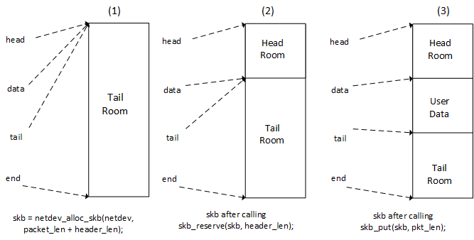

# Chương 22. Network Interface Card Driver

Ta đều biết networking vốn gắn liền với Linux kernel. Vài năm trước Linux chỉ được dùng vì network performance, nhưng giờ đã khác; Linux vượt xa một server và chạy trên hàng tỷ embedded device. Qua năm tháng, Linux có danh tiếng là network operating system tốt nhất. Dù vậy Linux không thể làm mọi thứ. Với vô số Ethernet controller hiện có, Linux không có cách nào khác ngoài expose API cho developer cần viết driver cho network device hoặc phát triển kernel networking nói chung. API cung cấp abstraction layer đủ dùng, bảo đảm tính tổng quát của code phát triển và khả năng port sang architecture khác. Chương này sẽ walk-through phần API phát triển Network Interface Card (NIC) driver và trình bày data structure, method của nó.

Trong chương này, ta trình bày:

- NIC driver data structure và tìm hiểu socket buffer structure chính

- NIC driver architecture, mô tả method, cùng packet transmission và reception

- Phát triển dummy NIC driver để kiểm thử

## Driver Data Structure

Khi làm việc với NIC device, cần thao tác hai data structure:

- Structure `struct sk_buff`, định nghĩa trong `include/linux/skbuff.h`, là data structure nền tảng trong Linux networking code; cần include vào code:

```
#include <linux/skbuff.h>
```

Mỗi packet gửi hoặc nhận đều được xử lý bằng data structure này.

- Structure `struct net_device`; mọi NIC device được biểu diễn trong kernel bằng structure này. Đây là interface nơi dữ liệu đi qua. Định nghĩa trong `include/linux/netdevice.h`, cũng cần include vào code:

```
#include <linux/netdevice.h>
```

File khác cần include là `include/linux/etherdevice.h` cho function liên quan MAC và Ethernet-related (như `alloc_etherdev()`) và `include/linux/ethtool.h` để hỗ trợ `ethtool`:

```
#include <linux/ethtool.h>
#include <linux/etherdevice.h>
```

### Socket Buffer Structure

Structure này bọc mọi packet đi qua NIC:

```
struct sk_buff {
  struct sk_buff * next;
  struct sk_buff * prev;
  ktime_t tstamp;
  struct rb_node     rbnode; /* used in netem & tcp stack */
  struct sock * sk;
  struct net_device * dev;
  unsigned int       len;
  unsigned int       data_len;
  __u16              mac_len;
  __u16              hdr_len;
  unsigned int len;
  unsigned int data_len;
  __u16 mac_len;
  __u16 hdr_len;
  __u32 priority;
  dma_cookie_t dma_cookie;
  sk_buff_data_t tail;
  sk_buff_data_t end;
  unsigned char * head;
  unsigned char * data;
  unsigned int truesize;
  atomic_t users;
};
```

Sau đây giải thích các phần tử:

- `next` và `prev` : Biểu diễn buffer tiếp theo và trước đó trong list.

- `sk`: Socket gắn với packet này.

- `tstamp`: Thời điểm packet đến/đi.

- `rbnode`: Thay thế cho `next`/`prev`, biểu diễn trong red-black tree.

- `dev`: Biểu diễn device mà packet đến từ đó hoặc rời đi qua đó. Field này liên quan đến hai field khác không được liệt kê ở đây là `input_dev` và `real_dev`. Chúng theo dõi các device gắn với packet. Vì vậy, `input_dev` luôn tham chiếu đến device mà packet được nhận từ đó.

- `len`: Tổng số byte trong packet. Socket buffer (SKB) gồm một linear data buffer và, tùy chọn, một tập gồm một hoặc nhiều vùng được gọi là room. Nếu có những room như vậy, `data_len` lưu tổng số byte của data area.

- `mac_len`: Giữ độ dài MAC header.

- `csum`: Chứa checksum của packet.

- `priority`: Biểu diễn packet priority trong QoS.

- `truesize`: Theo dõi số byte system memory packet tiêu thụ, gồm memory của chính structure `struct sk_buff`.

- `users`: Dùng reference counting cho SKB object.

- `Head`: `Head`, `data` và `tail` là pointer tới các region (room) khác nhau trong socket buffer.

- `end`: Trỏ tới cuối socket buffer.

Chỉ vài phần tử của structure được trình bày ở đây. Mô tả đầy đủ trong `include/linux/skbuff.h`., header file cần include để làm việc với socket buffer.

#### Cấp phát Socket Buffer

Cấp phát socket buffer hơi phức tạp vì cần ít nhất ba function khác nhau:

- Trước hết, toàn bộ cấp phát memory phải dùng function `netdev_alloc_skb()`

- Tăng và align header room bằng function `skb_reserve()`

- Mở rộng used data area của buffer (sẽ chứa packet) bằng function `skb_put()`.

Hãy xem sơ đồ sau:



Quy trình cấp phát Socket Buffer

1\. Cấp phát buffer đủ lớn chứa packet cùng Ethernet header bằng function `netdev_alloc_skb()`:

```
struct sk_buff *netdev_alloc_skb(struct net_device *dev,
                                   unsigned int length)
```

Function này trả về `NULL` khi thất bại. Vì vậy, mặc dù thực hiện cấp phát memory, `netdev_alloc_skb()` vẫn có thể được gọi từ atomic context. Do Ethernet header dài 14 byte, cần có sự căn chỉnh để CPU không gặp vấn đề hiệu năng khi truy cập phần buffer đó. Tên phù hợp của parameter `header_len` nên là `header_alignment`, vì parameter này được sử dụng để căn chỉnh. Giá trị thông thường là 2, và đó là lý do kernel định nghĩa macro riêng cho mục đích này, `NET_IP_ALIGN`, trong `include/linux/skbuff.h`:

```
#define NET_IP_ALIGN 2
```

2\. Bước hai reserve aligned memory cho header bằng giảm tail room. Function thực hiện là `skb_reserve()`:

```
void skb_reserve(struct sk_buff *skb, int len)
```

3\. Bước cuối cùng là mở rộng vùng dữ liệu đang sử dụng của buffer để có kích thước bằng packet, thông qua function `skb_put()`. Function này trả về một pointer trỏ đến byte đầu tiên của data area:

```
unsigned char *skb_put(struct sk_buff *skb, unsigned int len)
```

Socket buffer cấp phát phải chuyển tới layer kernel-networking. Đây là bước cuối life cycle của socket buffer. Cần dùng function `netif_rx_ni()`:

```
int netif_rx_ni(struct sk_buff *skb)
```

Ta trình bày cách dùng các bước trên trong phần packet reception của chương.

### Network Interface Structure

Network interface biểu diễn trong kernel bằng instance của structure `struct net_device`, định nghĩa trong `include/linux/netdevice.h`:

```
struct net_device {
   char name[IFNAMSIZ];
   char *ifalias;
   unsigned long mem_end;
   unsigned long mem_start;
   unsigned long base_addr;
   int irq;
   netdev_features_t features;
   netdev_features_t hw_features;
   netdev_features_t  wanted_features;
   int ifindex;
   struct net_device_stats stats;
   atomic_long_t rx_dropped;
   atomic_long_t  tx_dropped;
   const struct net_device_ops *netdev_ops;
   const struct ethtool_ops *ethtool_ops;
   unsigned int flags;
   unsigned int priv_flags;
   unsigned char link_mode;
      unsigned char if_port;
   unsigned char dma;
   unsigned int mtu;
   unsigned short type;
   /* Interface address info. */
   unsigned char perm_addr[MAX_ADDR_LEN];
   unsigned char addr_assign_type;
   unsigned char addr_len;
   unsigned short neigh_priv_len;
   unsigned short dev_id;
   unsigned short dev_port;
   unsigned long last_rx;
   /* Interface address info used in eth_type_trans() */
   unsigned char *dev_addr;

   struct device dev;
   struct phy_device *phydev;
};
```

Structure `struct net_device` thuộc nhóm kernel data structure cần được cấp phát động và có allocation function riêng. Một NIC được cấp phát trong kernel bằng function `alloc_etherdev()`:

```
struct net_device *alloc_etherdev(int sizeof_priv);
```

Function trả về `NULL` khi thất bại. Parameter `sizeof_priv` biểu diễn kích thước memory cần cấp phát cho private data structure gắn với NIC này; structure đó có thể được lấy bằng function `netdev_priv()`:

```
void *netdev_priv(const struct net_device *dev)
```

Với structure `struct priv_struct` là private structure của chúng ta, sau đây là cách triển khai việc cấp phát một network device cùng private data structure:

```
struct net_device *net_dev;
struct priv_struct *priv_net_struct;
net_dev = alloc_etherdev(sizeof(struct priv_struct));
my_priv_struct = netdev_priv(dev);
```

Network device không dùng phải giải phóng bằng function `free_netdev()`, cũng giải phóng memory cho private data. Chỉ gọi sau khi device đã hủy đăng ký khỏi kernel:

```
void free_netdev(struct net_device *dev)
```

Sau khi structure `net_device` được hoàn thiện và điền đầy đủ, bạn cần gọi `register_netdev()` cho nó. Function này được giải thích ở phần sau của chương, trong mục Driver method. Hiện tại, chỉ cần nhớ rằng function đăng ký network device với kernel để device có thể được sử dụng. Vì vậy, bạn cần bảo đảm device thực sự có thể xử lý các network operation trước khi gọi function này:

```
int register_netdev(struct net_device *dev)
```

## Device Method

Network device thuộc loại không xuất hiện trong directory `/dev` (khác block, input hoặc char device). Vì vậy như mọi device loại đó, NIC driver expose tập chức năng để hoạt động. Kernel expose operation thực hiện trên network interface qua structure `struct net_device_ops`, là field của structure `struct net_device` biểu diễn network device (`dev->netdev_ops`). Field `struct net_device_ops` mô tả như sau:

```
struct net_device_ops {
   int (*ndo_init)(struct net_device *dev);
   void (*ndo_uninit)(struct net_device *dev);
   int (*ndo_open)(struct net_device *dev);
   int (*ndo_stop)(struct net_device *dev);
   netdev_tx_t (*ndo_start_xmit) (struct sk_buff *skb,
                              struct net_device *dev);
   void (*ndo_change_rx_flags)(struct net_device *dev, int flags);
   void (*ndo_set_rx_mode)(struct net_device *dev);
   int (*ndo_set_mac_address)(struct net_device *dev, void *addr);
   int (*ndo_validate_addr)(struct net_device *dev);
   int (*ndo_do_ioctl)(struct net_device *dev,
                             struct ifreq *ifr, int cmd);
   int (*ndo_set_config)(struct net_device *dev, struct ifmap *map);
   int (*ndo_change_mtu)(struct net_device *dev, int new_mtu);
   void (*ndo_tx_timeout) (struct net_device *dev);

   struct net_device_stats* (*ndo_get_stats)(
   struct net_device *dev);
};
```

Hãy xem ý nghĩa mỗi phần tử:

- `int (*ndo_init)(struct net_device *dev)` và `void(*ndo_uninit)(struct net_device *dev)`: Lần lượt là function khởi tạo/hủy khởi tạo bổ sung, thực hiện khi driver gọi `register_netdev()`/`unregister_netdev()` để đăng ký/hủy đăng ký network device với kernel. Phần lớn driver không cung cấp vì công việc thực do function `ndo_open()` và `ndo_stop()` làm.

- `int (*ndo_open)(struct net_device *dev)`: Chuẩn bị và mở interface. Interface mở mỗi khi tiện ích `ip` hoặc `ifconfig` kích hoạt. Trong method này driver phải request/map/register system resource cần (I/O port, IRQ, DMA, v.v.), bật hardware và setup khác device yêu cầu.

- `int (*ndo_stop)(struct net_device *dev)`:Kernel thực thi function này khi interface được đưa xuống (ví dụ, `ifconfig <name>` `down`, v.v.). Function này cần thực hiện các thao tác ngược với những gì đã thực hiện trong `ndo_open()`.

- `int (*ndo_start_xmit) (struct sk_buff *skb, struct net_device` `*dev)`: Method gọi mỗi khi kernel muốn gửi packet qua interface này.

- `void (*ndo_set_rx_mode)(struct net_device *dev)`: Method gọi để đổi interface address list filter mode, multicast hoặc promiscuous. Khuyến nghị cung cấp function.

- `void (*ndo_tx_timeout)(struct net_device *dev)`: Kernel gọi khi packet transmission không hoàn tất trong khoảng hợp lý, thường `dev->watchdog` tick. Driver phải kiểm tra chuyện gì xảy ra, xử lý và tiếp tục truyền.

- `struct net_device_stats *(*get_stats)(struct net_device *dev)`: Method trả device statistic. Đây là thông tin thấy khi chạy `netstat -i` hoặc `ifconfig`.

Các mô tả trên chưa đề cập nhiều phần tử. Mô tả đầy đủ của structure nằm trong file `include/linux/netdevice.h`. Thực tế, chỉ `ndo_start_xmit` là bắt buộc, nhưng nên cung cấp nhiều helper hook tương ứng với các feature mà device có.

### Mở và đóng

Function `ndo_open()` được kernel gọi mỗi khi network interface này được người dùng có quyền, chẳng hạn admin, cấu hình bằng các tiện ích user space như `ifconfig` hoặc `ip`.

Như network device operation khác, function `ndo_open()` nhận object `struct` `net_device` làm tham số; từ đó driver phải lấy object device-specific lưu trong field `priv` khi cấp phát object `net_device`.

Network controller thường tạo interrupt mỗi khi nhận packet hoặc hoàn tất việc truyền một packet. Driver cần đăng ký một interrupt handler, được gọi mỗi khi controller tạo interrupt. Driver có thể đăng ký interrupt handler trong routine `init()`/`probe()` hoặc trong function `open`. Một số device cần bật interrupt bằng cách thiết lập một register đặc biệt trong hardware. Trong trường hợp này, có thể yêu cầu interrupt trong function `probe` và chỉ thiết lập hoặc xóa enable bit trong method `open`/`close`.

Tổng hợp việc function `open` cần làm:

1\. Cập nhật interface MAC address (nếu user đổi và device cho phép).

2\. Reset hardware nếu cần và đưa ra khỏi mode low-power.

3\. Request resource cần (I/O memory, DMA channel, IRQ).

4\. Map IRQ và đăng ký interrupt handler.

5\. Kiểm tra interface link status.

6\. Gọi `netif_start_queue()` trên device để kernel biết device sẵn sàng truyền packet.

Ví dụ function `open` như sau:

```
/*
 * This routine should set everything up new at each open, even
 * registers that should only need to be set once at boot, so that
 * there is non-reboot way to recover if something goes wrong.
 */
static int enc28j60_net_open(struct net_device *dev)
{
   struct priv_net_struct *priv = netdev_priv(dev);

   if (!is_valid_ether_addr(dev->dev_addr)) {
         [...] /* Maybe print a debug message ? */
         return -EADDRNOTAVAIL;
   }
   /*
 * Reset the hardware here and take it out of low
 * power mode
 */
   my_netdev_lowpower(priv, false);

   if (!my_netdev_hw_init(priv)) {
         [...] /* handle hardware reset failure */
         return -EINVAL;
   }

   /* Update the MAC address (in case user has changed it)
    * The new address is stored in netdev->dev_addr field
 */
set_hw_macaddr_registers(netdev, MAC_REGADDR_START,
netdev->addr_len, netdev->dev_addr);

   /* Enable interrupts */
   my_netdev_hw_enable(priv);

   /* We are now ready to accept transmit requests from
    * the queueing layer of the networking.
    */
   netif_start_queue(dev);

   return 0;
}
```

`netif_start_queue()` chỉ cho upper layer gọi routine `ndo_start_xmit` của device. Nói cách khác, báo kernel device sẵn sàng xử lý transmit request.

Ngược lại closing method chỉ cần đảo operation thực hiện khi mở device:

```
/* The inverse routine to net_open(). */
static int enc28j60_net_close(struct net_device *dev)
{
   struct priv_net_struct *priv = netdev_priv(dev);
   my_netdev_hw_disable(priv);
   my_netdev_lowpower(priv, true);

    /**
     *   netif_stop_queue - stop transmitted packets
     *
     *   Stop upper layers calling the device ndo_start_xmit routine.
     *   Used for flow control when transmit resources are unavailable.
     */
   netif_stop_queue(dev);

   return 0;
}
```

`netif_stop_queue()` đảo việc `netif_start_queue()` làm, bảo kernel ngừng gọi routine `ndo_start_xmit` của device. Ta không còn xử lý transmit request được.

### Xử lý Packet

Xử lý packet gồm việc truyền và nhận packet. Đây là tác vụ chính của mọi network interface driver. Transmission chỉ việc gửi outgoing frame, còn reception chỉ việc nhận các frame đi vào.

Có hai cách điều khiển việc trao đổi dữ liệu mạng: polling hoặc interrupt. Polling, một dạng interrupt timer-driven, là việc kernel liên tục kiểm tra theo các khoảng thời gian cho trước để phát hiện thay đổi ở device. Ngược lại, trong interrupt mode, kernel không thực hiện công việc đó mà lắng nghe IRQ line và chờ device thông báo thay đổi qua IRQ. Việc trao đổi dữ liệu Interrupt-driven có thể làm tăng system overhead khi traffic cao; đó là lý do một số driver kết hợp hai method. Phần kernel cho phép kết hợp hai method được gọi là New API (NAPI), sử dụng polling khi traffic cao và quản lý bằng interrupt IRQ-driven khi traffic trở lại bình thường. Driver mới nên sử dụng NAPI nếu hardware hỗ trợ. Tuy nhiên, chương này không thảo luận NAPI mà tập trung vào method interrupt-driven.

#### Packet Reception

Khi packet đến network interface card, driver phải tạo một socket buffer mới để chứa nó và sao chép packet vào field `sk_buff->data`. Cách sao chép cụ thể không thực sự quan trọng; cũng có thể sử dụng DMA. Driver thường biết có dữ liệu mới đến thông qua interrupt. Khi NIC nhận một packet, nó tạo interrupt để driver xử lý; driver phải kiểm tra interrupt status register của device và xác định nguyên nhân thực sự gây interrupt (có thể là RX ok, RX error, v.v.). Các bit tương ứng với event gây interrupt sẽ được thiết lập trong status register.

Phần khó là cấp phát và tạo socket buffer. May mắn là chúng ta đã thảo luận điều đó trong mục đầu của chương này. Vì vậy, hãy đi thẳng vào một RX handler mẫu. Driver phải thực hiện số lần cấp phát `sk_buff` bằng số packet mà nó nhận được:

```
/*
 * RX handler
 * This function is called in the work responsible of packet
 * reception (bottom half) handler. We use work because access to
 * our device (which sit on a SPI bus) may sleep
 */
static int my_rx_interrupt(struct net_device *ndev)
{
   struct priv_net_struct *priv = netdev_priv(ndev);
   int pk_counter, ret;

   /* Let's get the number of packet our device received */
   pk_counter = my_device_reg_read(priv, REG_PKT_CNT);
   if (pk_counter > priv->max_pk_counter) {
         /* update statistics */
         priv->max_pk_counter = pk_counter;
   }
   ret = pk_counter;

   /* set receive buffer start */
   priv->next_pk_ptr = KNOWN_START_REGISTER;
   while (pk_counter-- > 0)
         /*
* By calling this internal helper function in a "while"
* loop, packets get extracted one by one from the device
* and forwarder to the network layer.
*/
         my_hw_rx(ndev);

   return ret;
}
```

Helper sau chịu trách nhiệm lấy một packet từ device, chuyển vào kernel network và giảm packet counter:

```
/*
 * Hardware receive function.
 * Read the buffer memory, update the FIFO pointer to
 * free the buffer.
 * This function decrements the packet counter.
 */
static void my_hw_rx(struct net_device *ndev)
{
   struct priv_net_struct *priv = netdev_priv(ndev);
   struct sk_buff *skb = NULL;
   u16 erxrdpt, next_packet, rxstat;
   u8 rsv[RSV_SIZE];
   int packet_len;

   packet_len = my_device_read_current_packet_size();
   /* Can't cross boundaries */
   if ((priv->next_pk_ptr > RXEND_INIT)) {
         /* packet address corrupted: reset RX logic */
         [...]
         /* Update RX errors stats */
         ndev->stats.rx_errors++;
         return;
   }
   /* Read next packet pointer and rx status vector
    * This is device-specific
    */
   my_device_reg_read(priv, priv->next_pk_ptr, sizeof(rsv), rsv);

   /* Check for errors in the device RX status reg,
    * and update error stats accordingly
    */
   if(an_error_is_detected_in_device_status_registers())
         /* Depending on the error,
          * stats.rx_errors++;
          * ndev->stats.rx_crc_errors++;
          * ndev->stats.rx_frame_errors++;
          * ndev->stats.rx_over_errors++;
          */
   } else {
         skb = netdev_alloc_skb(ndev, len + NET_IP_ALIGN);
         if (!skb) {
               ndev->stats.rx_dropped++;
         } else {
               skb_reserve(skb, NET_IP_ALIGN);
               /*
                 * copy the packet from the device' receive buffer
                 * to the socket buffer data memory.
                 * Remember skb_put() return a pointer to the
                 * beginning of data region.
                 */
               my_netdev_mem_read(priv,
                     rx_packet_start(priv->next_pk_ptr),
                     len, skb_put(skb, len));
               /* Set the packet's protocol ID */
               skb->protocol = eth_type_trans(skb, ndev);
               /* update RX statistics */
               ndev->stats.rx_packets++;
               ndev->stats.rx_bytes += len;

               /* Submit socket buffer to the network layer */
               netif_rx_ni(skb);
         }
   }
   /* Move the RX read pointer to the start of the next
    * received packet.
    */
   priv->next_pk_ptr = my_netdev_update_reg_next_pkt();
}
```

Dĩ nhiên, lý do duy nhất chúng ta gọi RX handler từ một deferred job là vì device nằm trên SPI bus. Với MMIO device, tất cả thao tác trên có thể được thực hiện từ bên trong hwriq. Hãy xem NXP FEC driver trong `drivers/net/ethernet/freescale/fec.c` để biết cách thực hiện.

#### Packet Transmission

Khi kernel cần gửi packet ra khỏi interface, nó gọi method `ndo_start_xmit` của driver. Method này cần trả về `NETDEV_TX_OK` khi thành công hoặc `NETDEV_TX_BUSY` khi thất bại; trong trường hợp thất bại, bạn không được làm gì với socket buffer vì nó vẫn thuộc quyền sở hữu của network queuing layer khi lỗi được trả về. Điều này có nghĩa là bạn không thể sửa đổi bất kỳ SKB field nào, giải phóng SKB hoặc thực hiện các thao tác tương tự. Function được một spinlock bảo vệ khỏi các lời gọi đồng thời. Trong phần lớn trường hợp, việc truyền packet diễn ra bất đồng bộ. `sk_buff` của packet được truyền do upper layer điền dữ liệu. Field `data` của nó chứa các packet cần gửi. Driver cần trích xuất packet từ `sk_buff->data` và ghi vào hardware FIFO của device, hoặc đặt vào một temporary TX buffer (nếu device cần một lượng dữ liệu nhất định trước khi gửi) trước khi ghi vào hardware FIFO. Dữ liệu chỉ thực sự được gửi khi FIFO đạt một threshold, thường do driver định nghĩa hoặc được cung cấp trong datasheet, hoặc khi driver chủ động bắt đầu truyền bằng cách thiết lập một bit đóng vai trò trigger trong một register đặc biệt của device. Vì vậy, driver cần thông báo cho kernel không bắt đầu bất kỳ lần truyền nào cho đến khi hardware sẵn sàng nhận dữ liệu mới. Thông báo này được thực hiện bằng function `netif_stop_queue()`:

```
void netif_stop_queue(struct net_device *dev)
```

Sau khi gửi packet, network interface card sẽ tạo interrupt. Interrupt handler cần kiểm tra nguyên nhân gây interrupt. Trong trường hợp transmission interrupt, nó cần cập nhật số liệu thống kê (`net_device->stats.tx_errors` và `net_device->stats.tx_packets`) và thông báo cho kernel rằng device đã sẵn sàng gửi packet mới. Thông báo này được thực hiện bằng `netif_wake_queue()`:

```
void netif_wake_queue(struct net_device *dev)
```

Tóm lại, packet transmission chia hai phần:

- Operation `The ndo_start_xmit`, báo kernel device bận, thiết lập mọi thứ và bắt đầu transfer

- TX interrupt handler, cập nhật TX statistic và báo kernel device lại khả dụng

Function `ndo_start_xmit` cơ bản phải gồm các bước:

1\. Gọi `netif_stop_queue()` trên network device để báo kernel device sẽ bận truyền dữ liệu.

2\. Ghi nội dung `sk_buff->data` vào device FIFO.

3\. Trigger transmission (chỉ dẫn device bắt đầu truyền).

Operation (2) và (3) có thể khiến device trên slow bus sleep (ví dụ SPI), cần defer sang work structure. Đây là trường hợp ví dụ của ta.

Khi packet chuyển xong, TX interrupt handler phải làm:

4\. Tùy device memory mapped hay nằm trên bus có access function có thể sleep, operation sau phải làm trực tiếp trong handler `hwirq` hoặc schedule trong job (hoặc threaded IRQ):

1\. Kiểm tra interrupt có phải transmission interrupt

2\. Đọc transmission descriptor status register, xem packet status

3\. Tăng error statistic nếu truyền gặp vấn đề

4\. Tăng statistic packet truyền thành công

5\. Khởi động transmission queue để kernel gọi lại method `ndo_start_xmit` của driver bằng function `netif_wake_queue()`.

Tổng hợp thành đoạn sample code ngắn:

```
/* Somewhere in the code */
INIT_WORK(&priv->tx_work, my_netdev_hw_tx);

static netdev_tx_t my_netdev_start_xmit(struct sk_buff *skb,
                           struct net_device *dev)
{
   struct priv_net_struct *priv = netdev_priv(dev);

   /* Notify the kernel our device will be busy */
   netif_stop_queue(dev);

   /* Remember the skb for deferred processing */
   priv->tx_skb = skb;

   /* This work will copy data from sk_buffer->data to
    * the hardware's FIFO and start transmission
    */
   schedule_work(&priv->tx_work);

   /* Everything is OK */
   return NETDEV_TX_OK;
}
The work is described below:
/*
 * Hardware transmit function.
 * Fill the buffer memory and send the contents of the
 * transmit buffer onto the network
 */
static void my_netdev_hw_tx(struct priv_net_struct *priv)
{
   /* Write packet to hardware device TX buffer memory */
   my_netdev_packet_write(priv, priv->tx_skb->len,
priv->tx_skb->data);

/*
 * does this network device support write-verify?
 * Perform it
 */
[...];

   /* set TX request flag,
 * so that the hardware can perform transmission.
 * This is device-specific
 */
   my_netdev_reg_bitset(priv, ECON1, ECON1_TXRTS);
}
```

TX interrupt management được trình bày phần tiếp theo.

### Ví dụ Driver

Có thể tổng hợp khái niệm trước đó trong fake Ethernet driver sau:

```
#include <linux/module.h>
#include <linux/kernel.h>
#include <linux/errno.h>
#include <linux/init.h>
#include <linux/netdevice.h>
#include <linux/etherdevice.h>
#include <linux/ethtool.h>
#include <linux/skbuff.h>
#include <linux/slab.h>
#include <linux/of.h>                   /* For DT*/
#include <linux/platform_device.h>      /* For platform devices */

struct eth_struct {
    int bar;
    int foo;
    struct net_device *dummy_ndev;
};
static int fake_eth_open(struct net_device *dev) {
    printk("fake_eth_open called\n");
    /* We are now ready to accept transmit requests from
    * the queueing layer of the networking.
    */
   netif_start_queue(dev);
    return 0;
}

static int fake_eth_release(struct net_device *dev) {
    pr_info("fake_eth_release called\n");
    netif_stop_queue(dev);
    return 0;
}

static int fake_eth_xmit(struct sk_buff *skb, struct net_device *ndev) {
    pr_info("dummy xmit called...\n");
    ndev->stats.tx_bytes += skb->len;
    ndev->stats.tx_packets++;

    skb_tx_timestamp(skb);
   dev_kfree_skb(skb);
   return NETDEV_TX_OK;
}

static int fake_eth_init(struct net_device *dev)
{
    pr_info("fake eth device initialized\n");
    return 0;
};


static const struct net_device_ops my_netdev_ops = {
     .ndo_init = fake_eth_init,
     .ndo_open = fake_eth_open,
     .ndo_stop = fake_eth_release,
     .ndo_start_xmit = fake_eth_xmit,
     .ndo_validate_addr    = eth_validate_addr,
};


static const struct of_device_id fake_eth_dt_ids[] = {
    { .compatible = "packt,fake-eth", },
    { /* sentinel */ }
};


static int fake_eth_probe(struct platform_device *pdev)
{
    int ret;
    struct eth_struct *priv;
    struct net_device *dummy_ndev;

    priv = devm_kzalloc(&pdev->dev, sizeof(*priv), GFP_KERNEL);
    if (!priv)
        return -ENOMEM;

    dummy_ndev = alloc_etherdev(sizeof(struct eth_struct));
    dummy_ndev->if_port = IF_PORT_10BASET;
    dummy_ndev->netdev_ops = &my_netdev_ops;
    /* If needed, dev->ethtool_ops = &fake_ethtool_ops; */

    ret = register_netdev(dummy_ndev);
    if(ret) {
        pr_info("dummy net dev: Error %d initializing card ...", ret);
        return ret;
    }

    priv->dummy_ndev = dummy_ndev;
    platform_set_drvdata(pdev, priv);
    return 0;
}


static int fake_eth_remove(struct platform_device *pdev)
{
    struct eth_struct *priv;
   priv = platform_get_drvdata(pdev);
   pr_info("Cleaning Up the Module\n");
    unregister_netdev(priv->dummy_ndev);
    free_netdev(priv->dummy_ndev);

   return 0;
}

static struct platform_driver mypdrv = {
    .probe      = fake_eth_probe,
    .remove     = fake_eth_remove,
    .driver     = {
        .name     = "fake-eth",
        .of_match_table = of_match_ptr(fake_eth_dt_ids),
        .owner    = THIS_MODULE,
    },
};
module_platform_driver(mypdrv);
MODULE_LICENSE("GPL");
MODULE_AUTHOR("John Madieu <john.madieu@gmail.com>");
MODULE_DESCRIPTION("Fake Ethernet driver");
```

Khi module load và device match, Ethernet interface được tạo trên hệ thống. Trước hết xem lệnh `dmesg` hiển thị:

```
# dmesg
[...]
[146698.060074] fake eth device initialized
[146698.087297] IPv6: ADDRCONF(NETDEV_UP): eth0: link is not ready
```

Nếu chạy `ifconfig -a`, interface được in trên màn hình:

```
# ifconfig -a
[...]
eth0 Link encap:Ethernet HWaddr 00:00:00:00:00:00
BROADCAST MULTICAST MTU:1500 Metric:1
RX packets:0 errors:0 dropped:0 overruns:0 frame:0
TX packets:0 errors:0 dropped:0 overruns:0 carrier:0
collisions:0 txqueuelen:1000
RX bytes:0 (0.0 B) TX bytes:0 (0.0 B)
```

Cuối cùng có thể cấu hình interface, gán IP address để hiển thị bằng `ifconfig`:

```
# ifconfig eth0 192.168.1.45
# ifconfig
[...]
eth0 Link encap:Ethernet HWaddr 00:00:00:00:00:00
inet addr:192.168.1.45 Bcast:192.168.1.255 Mask:255.255.255.0
BROADCAST MULTICAST MTU:1500 Metric:1
RX packets:0 errors:0 dropped:0 overruns:0 frame:0
TX packets:0 errors:0 dropped:0 overruns:0 carrier:0
collisions:0 txqueuelen:1000
RX bytes:0 (0.0 B) TX bytes:0 (0.0 B)
```

### Status và Control

Device control chỉ tình huống kernel cần chủ động thay đổi các thuộc tính của interface hoặc thay đổi để đáp ứng một thao tác của người dùng. Khi đó, kernel có thể sử dụng các operation được cung cấp qua structure `struct net_device_ops` như đã thảo luận, hoặc sử dụng một công cụ điều khiển khác là ethtool. Công cụ này yêu cầu driver bổ sung một tập hook mới mà chúng ta sẽ thảo luận trong mục tiếp theo. Ngược lại, status báo cáo trạng thái của interface.

#### Interrupt Handler

Đến đây, chúng ta mới xử lý hai interrupt khác nhau: khi một packet mới đến và khi việc truyền một outgoing packet hoàn tất. Tuy nhiên, các hardware interface ngày nay trở nên thông minh hơn và có thể báo cáo trạng thái để kiểm tra tính hợp lệ hoặc phục vụ truyền dữ liệu. Vì vậy, network interface cũng có thể tạo interrupt để báo lỗi, thay đổi trạng thái link và các event khác. Tất cả đều cần được xử lý trong interrupt handler.

Handler `hwrirq` như sau:

```
static irqreturn_t my_netdev_irq(int irq, void *dev_id)
{
   struct priv_net_struct *priv = dev_id;

   /*
    * Can't do anything in interrupt context because we need to
    * block (spi_sync() is blocking) so fire of the interrupt
    * handling workqueue.
    * Remember, we access our netdev registers through SPI bus
    * via spi_sync() call.
    */
   schedule_work(&priv->irq_work);

   return IRQ_HANDLED;
}
```

Vì device nằm trên SPI bus, mọi thứ defer vào `work_struct`, định nghĩa như sau:

```
static void my_netdev_irq_work_handler(struct work_struct *work)
{
   struct priv_net_struct *priv =
         container_of(work, struct priv_net_struct, irq_work);
   struct net_device *ndev = priv->netdev;
   int intflags, loop;

   /* disable further interrupts */
   my_netdev_reg_bitclear(priv, EIE, EIE_INTIE);

   do {
         loop = 0;
         intflags = my_netdev_regb_read(priv, EIR);
         /* DMA interrupt handler (not currently used) */
         if ((intflags & EIR_DMAIF) != 0) {
               loop++;
               handle_dma_complete();
               clear_dma_interrupt_flag();
         }
         /* LINK changed handler */
         if ((intflags & EIR_LINKIF) != 0) {
               loop++;
               my_netdev_check_link_status(ndev);
               clear_link_interrupt_flag();
         }
         /* TX complete handler */
         if ((intflags & EIR_TXIF) != 0) {
               bool err = false;
               loop++;
               priv->tx_retry_count = 0;
               if (locked_regb_read(priv, ESTAT) & ESTAT_TXABRT)
                     clear_tx_interrupt_flag();
         /* TX Error handler */
         if ((intflags & EIR_TXERIF) != 0) {
               loop++;
               /*
                * Reset TX logic by setting/clearing appropriate
                 * bit in the right register
                 */
               [...]

               /* Transmit Late collision check for retransmit */
               if (my_netdev_cpllision_bit_set())
                     /* Handlecollision */
                     [...]
         }
         /* RX Error handler */
         if ((intflags & EIR_RXERIF) != 0) {
               loop++;
               /* Check free FIFO space to flag RX overrun */
               [...]
         }
         /* RX handler */
         if (my_rx_interrupt(ndev))
               loop++;
   } while (loop);

   /* re-enable interrupts */
   my_netdev_reg_bitset(priv, EIE, EIE_INTIE);
}
```

#### Hỗ trợ Ethtool

Ethtool là tiện ích nhỏ kiểm tra và tinh chỉnh setting của network interface Ethernet-based. Có thể điều khiển tham số như:

- Speed

- Media type

- Duplex operation

- Lấy/đặt nội dung EEPROM register

- Hardware check summing

- Wake-on-LAN

Driver cần hỗ trợ ethtool phải include `<linux/ethtool.h>`. Việc hỗ trợ dựa trên structure `struct ethtool_ops`, phần cốt lõi của tính năng này, chứa một tập method hỗ trợ ethtool operation. Phần lớn các method tương đối đơn giản; xem `include/linux/ethtool.h` để biết chi tiết.

Để tích hợp đầy đủ khả năng hỗ trợ ethtool vào driver, driver cần điền một structure `ethtool_ops` và gán nó cho field `.ethtool_ops` của structure `struct` `net_device`:

```
my_netdev->ethtool_ops = &my_ethtool_ops;
```

Cũng dùng macro `SET_ETHTOOL_OPS` được. Lưu ý ethtool method có thể gọi cả khi interface down.

Ví dụ các driver sau hỗ trợ ethtool:

- `drivers/net/ethernet/microchip/enc28j60.c`

- `drivers/net/ethernet/freescale/fec.c`

- `drivers/net/usb/rtl8150.c`

## Driver Method

Các driver method là các function `probe()` và `remove()`. Chúng chịu trách nhiệm đăng ký và hủy đăng ký network device với kernel. Driver phải cung cấp chức năng của nó cho kernel thông qua các device method bằng structure `struct` `net_device`. Đây là các operation có thể thực hiện trên network interface:

```
static const struct net_device_ops my_netdev_ops = {
   .ndo_open         = my_netdev_open,
   .ndo_stop         = my_netdev_close,
   .ndo_start_xmit   = my_netdev_start_xmit,
   .ndo_set_rx_mode  = my_netdev_set_multicast_list,
   .ndo_set_mac_address    = my_netdev_set_mac_address,
   .ndo_tx_timeout   = my_netdev_tx_timeout,
   .ndo_change_mtu   = eth_change_mtu,
   .ndo_validate_addr      = eth_validate_addr,
};
```

Operation trên là thứ phần lớn driver triển khai.

### Function probe

Function `probe` khá cơ bản, chỉ cần thực hiện `init` sớm cho device rồi đăng ký network device với kernel.

Nói cách khác function `probe` phải:

1\. Cấp phát network device cùng private data bằng function `alloc_etherdev()` (với hỗ trợ `netdev_priv()`).

2\. Khởi tạo các private data field (mutex, spinlock, work\_queue, v.v.). Bạn nên dùng work queue và mutex nếu device nằm trên bus có các access function có thể sleep, chẳng hạn SPI. Trong trường hợp này, `hwirq` chỉ cần acknowledge kernel code và schedule job sẽ thực hiện các thao tác trên device. Một giải pháp khác là sử dụng threaded IRQ. Nếu device là MMIO, bạn có thể dùng spinlock để bảo vệ critical section và loại bỏ work queue.

3\. Khởi tạo tham số và chức năng bus-specific (SPI, USB, PCI, v.v.).

4\. Request và map resource (I/O memory, DMA channel, IRQ).

5\. Nếu cần, sinh random MAC address và gán cho device.

6\. Điền netdev property bắt buộc (hoặc hữu ích): `if_port`, `irq`, `netdev_ops`, `ethtool_ops`, v.v.

7\. Đưa device vào state low-power (function `open()` đưa ra khỏi mode).

8\. Cuối cùng gọi `register_netdev()` trên device.

Với SPI network device, function `probe` như sau:

```
static int my_netdev_probe(struct spi_device *spi)
{
   struct net_device *dev;
   struct priv_net_struct *priv;
   int ret = 0;

   /* Allocate network interface */
   dev = alloc_etherdev(sizeof(struct priv_net_struct));
   if (!dev)
         [...] /* handle -ENOMEM error */

   /* Private data */
   priv = netdev_priv(dev);

   /* set private data and bus-specific parameter */
   [...]

   /* Initialize some works */
   INIT_WORK(&priv->tx_work, data_tx_work_handler);
   [...]
   /* Devicerealy init, only few things */
   if (!my_netdev_chipset_init(dev))
         [...] /* handle -EIO error */

   /* Generate and assign random MAC address to the device */
   eth_hw_addr_random(dev);
   my_netdev_set_hw_macaddr(dev);

   /* Board setup must set the relevant edge trigger type;
    * level triggers won't currently work.
    */
   ret = request_irq(spi->irq, my_netdev_irq, 0, DRV_NAME, priv);
   if (ret < 0)
         [...]; /* Handle irq request failure */

   /* Fill some netdev mandatory or useful properties */
   dev->if_port = IF_PORT_10BASET;
   dev->irq = spi->irq;
   dev->netdev_ops = &my_netdev_ops;
   dev->ethtool_ops = &my_ethtool_ops;

   /* Put device into sleep mode */
   My_netdev_lowpower(priv, true);

   /* Register our device with the kernel */
   if (register_netdev(dev))
         [...]; /* Handle registration failure error */

   dev_info(&dev->dev, DRV_NAME " driver registered\n");

   return 0;
}
```

Toàn chương lấy nhiều cảm hứng từ enc28j60 của Microchip. Có thể xem code ở `drivers/net/ethernet/microchip/enc28j60.c`.

Function `register_netdev()` nhận một object `struct net_device` hoàn chỉnh và thêm nó vào các interface của kernel; function trả về 0 khi thành công và một error code âm khi thất bại. Object `struct net_device` cần được lưu trong bus device structure để có thể truy cập về sau. Vì vậy, nếu net device thuộc một global private structure, bạn cần đăng ký structure đó.

Lưu ý tên device trùng có thể khiến đăng ký thất bại.

### Unload Module

Đây là cleaning function dựa trên hai function. Driver release function phải như sau:

```
static int my_netdev_remove(struct spi_device *spi)
{
   struct priv_net_struct *priv = spi_get_drvdata(spi);

   unregister_netdev(priv->netdev);
   free_irq(spi->irq, priv);
   free_netdev(priv->netdev);

   return 0;
}
```

Function `unregister_netdev()` loại bỏ interface khỏi hệ thống, khiến kernel không còn có thể gọi các method của nó. `free_netdev()` giải phóng memory dùng cho chính structure `struct net_device`, memory được cấp phát cho private data và mọi memory được cấp phát nội bộ liên quan đến network device. Lưu ý rằng bạn không bao giờ được tự giải phóng `netdev->priv`.

## Tổng kết

Chương này đã giải thích mọi kiến thức cần thiết để viết một NIC device driver. Mặc dù chương dựa trên network interface nằm trên SPI bus, nguyên tắc vẫn giống nhau đối với USB hoặc PCI network interface. Bạn cũng có thể sử dụng dummy driver được cung cấp để kiểm thử. Sau khi đọc chương này, NIC driver sẽ không còn là điều bí ẩn đối với bạn.
