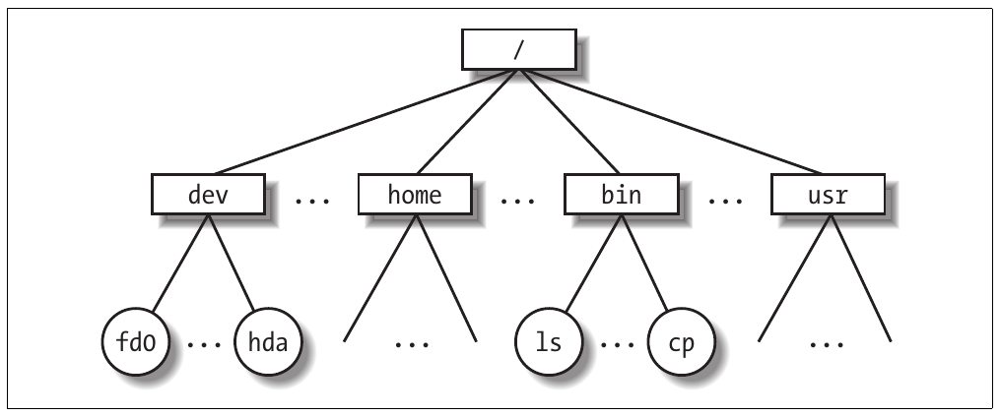
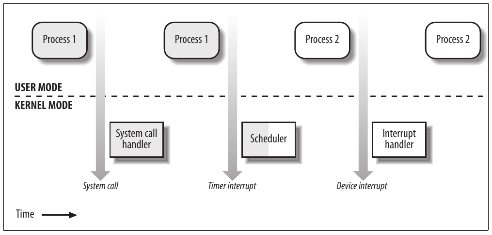
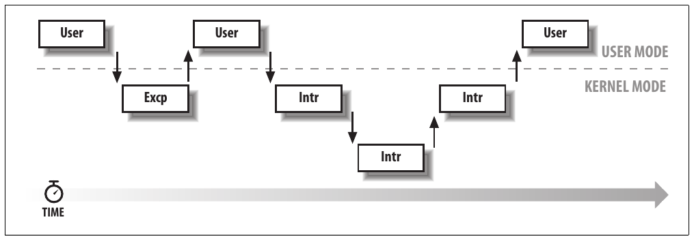
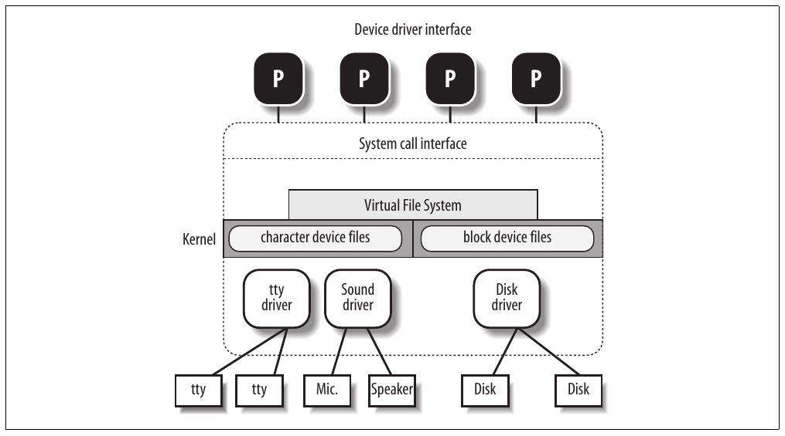

# Chương 1. Giới thiệu


Linux[^1] là thành viên của đại gia đình hệ điều hành Unix-like. Là một thành viên tương đối mới, bất ngờ trở nên cực kỳ phổ biến từ cuối thập niên 1990, Linux đứng cùng các hệ điều hành Unix thương mại nổi tiếng như System V Release 4 (SVR4), do AT\&T phát triển (hiện thuộc sở hữu SCO Group); bản phát hành 4.4 BSD của University of California tại Berkeley (4.4BSD); Digital UNIX của Digital Equipment Corporation (nay là Hewlett-Packard); AIX của IBM; HP-UX của Hewlett-Packard; Solaris của Sun Microsystems; và Mac OS X của Apple Computer, Inc. Ngoài Linux còn có một vài kernel Unix-like open source khác như FreeBSD, NetBSD và OpenBSD.

Linux ban đầu được Linus Torvalds phát triển năm 1991 làm hệ điều hành cho máy tính cá nhân tương thích IBM dựa trên microprocessor Intel 80386. Linus vẫn tham gia sâu vào việc cải tiến Linux, cập nhật nó theo các bước phát triển hardware và điều phối hoạt động của hàng trăm Linux developer trên khắp thế giới. Qua nhiều năm, các developer đã làm việc để đưa Linux lên các architecture khác, bao gồm Alpha của Hewlett-Packard, Itanium của Intel, AMD64 của AMD, PowerPC và zSeries của IBM.

Một lợi ích hấp dẫn của Linux là nó không phải hệ điều hành thương mại: source code theo GNU General Public License (GPL)<sup>†</sup> được công khai và bất kỳ ai cũng có thể nghiên cứu (như chúng ta sẽ làm trong sách này); nếu download code (website chính thức là http://www.kernel.org) hoặc xem source trên Linux CD, bạn có thể khám phá từ đầu đến cuối một trong những hệ điều hành hiện đại thành công nhất. Thực tế, sách giả định bạn có sẵn source code và có thể áp dụng những gì được trình bày vào quá trình tự khám phá.

Về mặt kỹ thuật, Linux là Unix kernel thực thụ, dù không phải hệ điều hành Unix hoàn chỉnh vì không bao gồm mọi Unix application, chẳng hạn filesystem utility, windowing system và graphical desktop, system administrator command, text editor, compiler, v.v. Tuy nhiên, vì phần lớn chương trình này được cung cấp miễn phí theo GPL, chúng có thể được cài đặt trên mọi hệ thống dựa trên Linux.

Vì Linux kernel cần rất nhiều software bổ sung để cung cấp môi trường hữu ích, nhiều người dùng Linux thích dựa vào commercial distribution được cung cấp trên CD-ROM để có code thường có trong hệ thống Unix chuẩn. Ngoài ra, có thể lấy code từ nhiều website khác nhau, chẳng hạn http://www.kernel.org. Một số distribution đặt Linux source code trong thư mục /usr/src/linux. Trong phần còn lại của sách, mọi file pathname đều ngầm tham chiếu thư mục Linux source code.

## Linux so với các kernel Unix-like khác

Các hệ thống Unix-like trên thị trường, trong đó một số có lịch sử lâu dài và dấu hiệu của những cách làm cũ, khác nhau ở nhiều khía cạnh quan trọng. Mọi biến thể thương mại đều bắt nguồn từ SVR4 hoặc 4.4BSD và đều có xu hướng tuân theo một số chuẩn chung như Portable Operating Systems based on Unix (POSIX) của IEEE và Common Applications Environment (CAE) của X/Open.

Các chuẩn hiện tại chỉ quy định application programming interface (API) — tức môi trường được định nghĩa rõ ràng để user program chạy trong đó. Vì vậy, các chuẩn không áp đặt hạn chế nào lên lựa chọn thiết kế nội bộ của kernel tuân thủ chuẩn.[^2]

Để định nghĩa user interface chung, các kernel Unix-like thường chia sẻ ý tưởng và đặc điểm thiết kế nền tảng. Về mặt này, Linux tương đương các hệ điều hành Unix-like khác. Vì vậy, đọc sách và nghiên cứu Linux kernel cũng có thể giúp bạn hiểu các biến thể Unix khác.

Phiên bản 2.6 của Linux kernel hướng tới tuân thủ chuẩn IEEE POSIX. Tất nhiên, điều này có nghĩa phần lớn Unix program hiện có có thể được compile và thực thi trên hệ thống Linux với rất ít công sức hoặc thậm chí không cần patch source code. Hơn nữa, Linux bao gồm mọi tính năng của hệ điều hành Unix hiện đại, như virtual memory, virtual filesystem, lightweight process, Unix signal, SVR4 interprocess communication, hỗ trợ hệ thống Symmetric Multiprocessor (SMP), v.v.

Khi Linus Torvalds viết kernel đầu tiên, ông tham khảo một số sách kinh điển về Unix internals như The Design of the Unix Operating System của Maurice Bach (Prentice Hall, 1986). Thực tế, Linux vẫn phần nào thiên về nền tảng Unix được mô tả trong sách của Bach (tức SVR2). Tuy nhiên, Linux không gắn chặt với biến thể cụ thể nào. Thay vào đó, nó cố gắng tiếp nhận những tính năng và lựa chọn thiết kế tốt nhất của nhiều Unix kernel khác nhau.

Danh sách sau mô tả cách Linux cạnh tranh với một số Unix kernel thương mại nổi tiếng:

Monolithic kernel

Đây là chương trình lớn, phức tạp, tự thực hiện mọi việc, gồm nhiều thành phần khác nhau về logic. Về mặt này, nó khá truyền thống; phần lớn biến thể Unix thương mại là monolithic. (Ngoại lệ đáng chú ý là hệ điều hành Apple Mac OS X và GNU Hurd, cả hai bắt nguồn từ Mach của Carnegie-Mellon và theo cách tiếp cận microkernel.)

Các Unix kernel truyền thống được compile và statically link

Phần lớn kernel hiện đại có thể dynamically load và unload một số phần kernel code (thường là device driver), thường được gọi là module. Linux hỗ trợ module rất tốt vì có thể tự động load và unload module theo nhu cầu. Trong các biến thể Unix thương mại chính, chỉ kernel SVR4.2 và Solaris có tính năng tương tự.

Kernel threading

Một số Unix kernel, như Solaris và SVR4.2/MP, được tổ chức thành tập hợp kernel thread. Kernel thread là execution context có thể được schedule độc lập; nó có thể gắn với user program hoặc chỉ chạy một số kernel function. Context switch giữa các kernel thread thường ít tốn kém hơn nhiều so với context switch giữa các process thông thường, vì kernel thread thường hoạt động trên address space chung. Linux sử dụng kernel thread rất hạn chế để định kỳ thực thi một vài kernel function; tuy nhiên, chúng không đại diện cho abstraction execution context cơ bản. (Đó là chủ đề của mục tiếp theo.)

Hỗ trợ multithreaded application

Phần lớn hệ điều hành hiện đại có một dạng hỗ trợ multithreaded application — tức user program được thiết kế thành nhiều execution flow tương đối độc lập, chia sẻ phần lớn application data structure. Multithreaded user application có thể gồm nhiều lightweight process (LWP), là những process có thể hoạt động trên address space chung, physical memory page chung, opened file chung, v.v. Linux định nghĩa phiên bản lightweight process riêng, khác với loại dùng trên các hệ thống như SVR4 và Solaris. Trong khi mọi biến thể LWP của Unix thương mại đều dựa trên kernel thread, Linux xem lightweight process là execution context cơ bản và xử lý chúng qua system call không chuẩn `clone()`.

Preemptive kernel

Khi compile với option “Preemptible Kernel”, Linux 2.6 có thể tùy ý xen kẽ các execution flow khi chúng ở privileged mode. Ngoài Linux 2.6, một vài hệ thống Unix truyền thống, đa dụng khác như Solaris và Mach 3.0 cũng là fully preemptive kernel. SVR4.2/MP đưa vào một số preemption point cố định để có khả năng preemption hạn chế.

Hỗ trợ multiprocessor

Một số biến thể Unix kernel tận dụng multiprocessor system. Linux 2.6 hỗ trợ symmetric multiprocessing (SMP) cho các memory model khác nhau, bao gồm NUMA: hệ thống có thể dùng nhiều processor và mỗi processor có thể xử lý mọi task — không có phân biệt giữa chúng. Dù một vài phần kernel code vẫn được serialize bằng một “big kernel lock” duy nhất, có thể nói Linux 2.6 tận dụng SMP gần tối ưu.

Filesystem

Các filesystem chuẩn của Linux có nhiều loại. Bạn có thể dùng Ext2 filesystem truyền thống nếu không có nhu cầu cụ thể. Có thể chuyển sang Ext3 nếu muốn tránh kiểm tra filesystem kéo dài sau system crash. Nếu phải xử lý nhiều file nhỏ, ReiserFS filesystem có lẽ là lựa chọn tốt nhất. Ngoài Ext3 và ReiserFS, Linux còn sử dụng được một số journaling filesystem khác, bao gồm Journaling File System (JFS) của IBM AIX và XFS filesystem của Silicon Graphics IRIX. Nhờ công nghệ Virtual File System hướng đối tượng mạnh mẽ (lấy cảm hứng từ Solaris và SVR4), port filesystem từ hệ thống khác sang Linux thường dễ hơn port sang kernel khác.

STREAMS

Linux không có thành phần tương ứng với STREAMS I/O subsystem được giới thiệu trong SVR4, mặc dù hiện nó có trong phần lớn Unix kernel và đã trở thành interface được ưa chuộng để viết device driver, terminal driver và network protocol.

Đánh giá này cho thấy Linux hiện hoàn toàn cạnh tranh được với hệ điều hành thương mại. Hơn nữa, Linux có nhiều tính năng khiến nó trở thành hệ điều hành hấp dẫn. Unix kernel thương mại thường đưa vào tính năng mới để giành thị phần lớn hơn, nhưng các tính năng đó không nhất thiết hữu ích, ổn định hoặc hiệu quả. Thực tế, Unix kernel hiện đại thường khá cồng kềnh. Ngược lại, Linux — cùng các hệ điều hành open source khác — không chịu những hạn chế và chi phối của thị trường, nên có thể tự do phát triển theo ý tưởng của người thiết kế (chủ yếu là Linus Torvalds). Cụ thể, Linux có các lợi thế sau so với đối thủ thương mại:

Linux miễn phí. Bạn có thể cài đặt hệ thống Unix hoàn chỉnh mà không tốn chi phí nào ngoài hardware (tất nhiên).

Linux có thể tùy chỉnh hoàn toàn mọi thành phần. Nhờ compilation option, bạn có thể tùy chỉnh kernel bằng cách chỉ chọn những tính năng thực sự cần thiết. Hơn nữa, nhờ GPL, bạn được tự do đọc và sửa source code của kernel và mọi system program.[^3]

Linux chạy trên hardware platform cấp thấp, rẻ tiền. Bạn có thể xây dựng network server bằng hệ thống Intel 80386 cũ với 4 MB RAM.

Linux mạnh mẽ. Hệ thống Linux rất nhanh vì khai thác triệt để tính năng của các hardware component. Mục tiêu chính của Linux là hiệu quả; thực tế, nhiều lựa chọn thiết kế của biến thể thương mại, như STREAMS I/O subsystem, đã bị Linus bác bỏ vì làm giảm performance.

Linux developer là những lập trình viên xuất sắc. Hệ thống Linux rất ổn định; tỷ lệ hỏng hóc và thời gian bảo trì hệ thống rất thấp.

Linux kernel có thể rất nhỏ gọn. Có thể đặt kernel image, bao gồm một vài system program, vừa trên một floppy disk 1,44 MB duy nhất. Theo hiểu biết của chúng tôi, không biến thể Unix thương mại nào boot được từ một floppy disk duy nhất.

Linux tương thích cao với nhiều hệ điều hành phổ biến. Linux cho phép trực tiếp mount filesystem của mọi phiên bản MS-DOS và Microsoft Windows, SVR4, OS/2, Mac OS X, Solaris, SunOS, NEXTSTEP, nhiều biến thể BSD, v.v. Linux còn hoạt động được với nhiều network layer, như Ethernet (cũng như Fast Ethernet, Gigabit Ethernet và 10 Gigabit Ethernet), Fiber Distributed Data Interface (FDDI), High Performance Parallel Interface (HIPPI), IEEE 802.11 (Wireless LAN) và IEEE 802.15 (Bluetooth). Bằng library phù hợp, hệ thống Linux thậm chí chạy trực tiếp được chương trình viết cho hệ điều hành khác. Ví dụ, Linux có thể thực thi một số application viết cho MS-DOS, Microsoft Windows, SVR3 và R4, 4.4BSD, SCO Unix, Xenix và các hệ thống khác trên platform 80x86.

Linux được hỗ trợ tốt. Tin hay không tùy bạn, lấy patch và update cho Linux có thể dễ hơn nhiều so với mọi hệ điều hành proprietary. Câu trả lời cho vấn đề thường có chỉ vài giờ sau khi gửi message đến newsgroup hoặc mailing list. Hơn nữa, driver cho Linux thường có chỉ vài tuần sau khi sản phẩm hardware mới xuất hiện trên thị trường. Ngược lại, nhà sản xuất hardware chỉ phát hành device driver cho một vài hệ điều hành thương mại — thường là của Microsoft. Vì vậy, mọi biến thể Unix thương mại đều chạy trên tập con hardware component hạn chế.

Với số lượng cài đặt ước tính vài chục triệu, những người quen với một số tính năng tiêu chuẩn trên hệ điều hành khác bắt đầu kỳ vọng Linux có điều tương tự. Về mặt này, yêu cầu đối với Linux developer cũng tăng lên. Tuy nhiên, may mắn là Linux đã phát triển dưới sự chỉ đạo sát sao của Linus và các subsystem maintainer để đáp ứng nhu cầu số đông.

## Sự phụ thuộc hardware

Linux cố gắng duy trì phân biệt rõ ràng giữa source code phụ thuộc hardware và độc lập hardware. Để làm vậy, cả thư mục arch và include đều có 23 subdirectory tương ứng các loại hardware platform được hỗ trợ. Tên chuẩn của các platform là:

alpha

Workstation Alpha của Hewlett-Packard (ban đầu là Digital, sau đó Compaq; không còn được sản xuất)

arm, arm26

Máy tính dựa trên ARM processor như PDA và embedded device

cris

CPU “Code Reduced Instruction Set” được Axis sử dụng trong thin-server, như web camera hoặc development board

frv

Embedded system dựa trên microprocessor thuộc họ FR-V của Fujitsu

h8300

Microprocessor Hitachi h8/300 và h8S RISC 8/16-bit

i386

Máy tính cá nhân tương thích IBM dựa trên microprocessor 80x86

ia64

Workstation dựa trên microprocessor Itanium 64-bit của Intel

m32r

Máy tính dựa trên họ microprocessor Renesas M32R

m68k, m68knommu

Máy tính cá nhân dựa trên microprocessor Motorola MC680×0

mips

Workstation dựa trên microprocessor MIPS, như các sản phẩm do Silicon Graphics bán

parisc

Workstation dựa trên microprocessor Hewlett Packard HP 9000 PA-RISC

ppc, ppc64

Workstation dựa trên microprocessor Motorola-IBM PowerPC 32-bit và 64-bit

s390

Mainframe IBM ESA/390 và zSeries sh, sh64 Embedded system dựa trên microprocessor SuperH do Hitachi và STMicroelectronics phát triển

sparc, sparc64

Workstation dựa trên microprocessor SPARC và Ultra SPARC 64-bit của Sun Microsystems

um

User Mode Linux, virtual platform cho phép developer chạy kernel trong User Mode

v850

Microcontroller NEC V850 tích hợp RISC core 32-bit dựa trên Harvard architecture

x86\_64

Workstation dựa trên microprocessor 64-bit của AMD — như Athlon và Opteron — cùng microprocessor 64-bit ia32e/EM64T của Intel

## Các phiên bản Linux

Đến kernel phiên bản 2.5, Linux nhận diện kernel bằng cách đánh số đơn giản. Mỗi phiên bản được đặc trưng bởi ba số, phân tách bằng dấu chấm. Hai số đầu xác định version; số thứ ba xác định release. Số version đầu, tức 2, không thay đổi từ năm 1996. Số version thứ hai xác định loại kernel: nếu chẵn, biểu thị stable version; nếu không, biểu thị development version.

Đúng như tên gọi, stable version được Linux distributor và kernel hacker kiểm tra kỹ. Stable version mới chỉ được phát hành để xử lý bug và thêm device driver mới. Ngược lại, các development version khác nhau khá đáng kể; kernel developer được tự do thử nghiệm các giải pháp đôi khi dẫn đến thay đổi kernel mạnh mẽ. Người dùng dựa vào development version để chạy application có thể gặp bất ngờ khó chịu khi nâng cấp kernel lên release mới hơn.

Tuy nhiên, trong quá trình phát triển Linux kernel phiên bản 2.6, cách đánh số version đã thay đổi đáng kể. Về cơ bản, số thứ hai không còn phân biệt stable version và development version; do đó, ngày nay kernel developer đưa những thay đổi lớn và quan trọng vào kernel phiên bản 2.6 hiện tại. Kernel branch 2.7 mới chỉ được tạo khi kernel developer phải thử nghiệm thay đổi thực sự gây xáo trộn; branch 2.7 này sẽ dẫn đến kernel version hiện hành mới, được backport về phiên bản 2.6, hoặc cuối cùng đơn giản bị bỏ như hướng đi bế tắc.

Mô hình phát triển Linux mới có nghĩa hai kernel cùng version nhưng khác release number — chẳng hạn 2.6.10 và 2.6.11 — có thể khác nhau đáng kể ngay cả ở core component và algorithm nền tảng. Do đó, khi kernel release mới xuất hiện, nó có khả năng không ổn định và có bug. Để xử lý vấn đề, kernel developer có thể phát hành patched version của bất kỳ kernel nào, được nhận diện bằng số thứ tư trong cách đánh số version. Ví dụ, khi đoạn này được viết, kernel version “stable” mới nhất là 2.6.11.12.

Hãy lưu ý kernel version được mô tả trong sách là Linux 2.6.11.

## Các khái niệm hệ điều hành cơ bản

Mỗi hệ thống máy tính có tập chương trình cơ bản gọi là hệ điều hành. Chương trình quan trọng nhất trong tập đó gọi là kernel. Nó được load vào RAM khi hệ thống boot và chứa nhiều procedure thiết yếu để hệ thống hoạt động. Các chương trình khác là utility ít quan trọng hơn; chúng có thể cung cấp nhiều trải nghiệm tương tác cho người dùng — cũng như thực hiện mọi công việc mà người dùng mua máy tính để làm — nhưng hình thái và khả năng cốt yếu của hệ thống do kernel quyết định. Kernel cung cấp những chức năng chủ chốt cho mọi thành phần khác và quyết định nhiều đặc điểm của software cấp cao hơn. Vì thế, chúng ta thường dùng “hệ điều hành” đồng nghĩa với “kernel”.

Hệ điều hành phải đáp ứng hai mục tiêu chính:

- Tương tác với hardware component, phục vụ mọi thành phần lập trình được ở cấp thấp trong hardware platform.

- Cung cấp execution environment cho application chạy trên hệ thống máy tính (được gọi là user program).

Một số hệ điều hành cho phép mọi user program trực tiếp thao tác hardware component (ví dụ điển hình là MS-DOS). Ngược lại, hệ điều hành Unix-like che giấu mọi chi tiết cấp thấp về tổ chức vật lý của máy tính khỏi application do người dùng chạy. Khi chương trình muốn dùng hardware resource, nó phải gửi request đến hệ điều hành. Kernel đánh giá request và nếu quyết định cấp resource, tương tác với hardware component phù hợp thay mặt user program.

Để thực thi cơ chế này, hệ điều hành hiện đại dựa vào những hardware feature cụ thể cấm user program trực tiếp tương tác hardware component cấp thấp hoặc truy cập memory location tùy ý. Đặc biệt, hardware đưa ra ít nhất hai execution mode khác nhau cho CPU: nonprivileged mode cho user program và privileged mode cho kernel. Unix lần lượt gọi chúng là User Mode và Kernel Mode.

Trong phần còn lại của chương, chúng ta giới thiệu những khái niệm cơ bản thúc đẩy thiết kế Unix trong hai thập kỷ qua, cũng như Linux và các hệ điều hành khác. Dù với tư cách người dùng Linux bạn có lẽ đã quen các khái niệm này, những phần này cố tìm hiểu sâu hơn thông thường một chút để giải thích yêu cầu chúng đặt ra cho kernel của hệ điều hành. Những xem xét tổng quát này áp dụng cho hầu như mọi hệ thống Unix-like. Hy vọng các chương khác sẽ giúp bạn hiểu Linux kernel internals.

### Multiuser system

Multiuser system là máy tính có thể thực thi đồng thời và độc lập nhiều application thuộc từ hai người dùng trở lên. Đồng thời nghĩa là các application có thể hoạt động cùng lúc và tranh chấp các resource như CPU, memory, hard disk, v.v. Độc lập nghĩa là mỗi application có thể làm công việc của mình mà không cần quan tâm application của người dùng khác đang làm gì. Tất nhiên, chuyển từ application này sang application khác làm chậm từng application và ảnh hưởng response time mà người dùng thấy. Nhiều điểm phức tạp của kernel hệ điều hành hiện đại, được xem xét trong sách, nhằm giảm thiểu độ trễ áp đặt lên từng chương trình và phản hồi người dùng nhanh nhất có thể.

Hệ điều hành multiuser phải có một số tính năng:

- Authentication mechanism để xác minh danh tính người dùng

- Protection mechanism chống user program có bug có thể block application khác đang chạy trong hệ thống

- Protection mechanism chống user program độc hại có thể can thiệp hoặc theo dõi hoạt động của người dùng khác

- Accounting mechanism giới hạn lượng resource unit cấp cho mỗi người dùng

Để bảo đảm protection mechanism an toàn, hệ điều hành phải dùng hardware protection gắn với CPU privileged mode. Nếu không, user program có thể truy cập trực tiếp mạch hệ thống và vượt qua giới hạn áp đặt. Unix là multiuser system thực thi hardware protection cho system resource.

### User và group

Trong multiuser system, mỗi người dùng có không gian riêng trên máy; thường có quota disk space để lưu file, nhận mail message riêng, v.v. Hệ điều hành phải bảo đảm phần riêng của không gian người dùng chỉ hiển thị với chủ sở hữu. Đặc biệt, phải bảo đảm không người dùng nào khai thác system application để xâm phạm không gian riêng của người khác.

Mọi người dùng được nhận diện bằng số duy nhất gọi là User ID, hay UID. Thường chỉ số lượng người hạn chế được phép dùng hệ thống máy tính. Khi một người dùng bắt đầu working session, hệ thống yêu cầu login name và password. Nếu không nhập cặp hợp lệ, hệ thống từ chối truy cập. Vì password được giả định là bí mật, quyền riêng tư của người dùng được bảo đảm.

Để chia sẻ có chọn lọc với người dùng khác, mỗi người dùng là thành viên của một hoặc nhiều user group, được nhận diện bằng số duy nhất gọi là user group ID. Mỗi file gắn với đúng một group. Ví dụ, có thể đặt quyền truy cập sao cho người dùng sở hữu file có quyền read và write, group chỉ có quyền read, còn người dùng khác trong hệ thống bị từ chối truy cập file.

Mọi hệ điều hành Unix-like có người dùng đặc biệt tên root hay superuser. System administrator phải login dưới tên root để quản lý user account, thực hiện bảo trì như system backup và program upgrade, v.v. Root user có thể làm gần như mọi thứ vì hệ điều hành không áp dụng protection mechanism thông thường với người dùng này. Đặc biệt, root user có thể truy cập mọi file trên hệ thống và thao tác mọi user program đang chạy.

### Process

Mọi hệ điều hành dùng một abstraction nền tảng: process. Process có thể được định nghĩa là “một instance của chương trình đang thực thi” hoặc “execution context” của chương trình đang chạy. Trong hệ điều hành truyền thống, process thực thi một instruction sequence duy nhất trong address space; address space là tập memory address mà process được phép tham chiếu. Hệ điều hành hiện đại cho phép process có nhiều execution flow — tức nhiều instruction sequence thực thi trong cùng address space.

Multiuser system phải thực thi execution environment trong đó nhiều process có thể hoạt động đồng thời và tranh chấp system resource, chủ yếu là CPU. Hệ thống cho phép các process hoạt động đồng thời được gọi là multiprogramming hoặc multiprocessing.[^4] Cần phân biệt program với process; nhiều process có thể thực thi cùng program đồng thời, trong khi cùng process có thể thực thi nhiều program tuần tự.

Trên uniprocessor system, chỉ một process có thể giữ CPU, nên tại một thời điểm chỉ một execution flow có thể tiến triển. Nhìn chung số CPU luôn hạn chế, do đó chỉ vài process có thể tiến triển cùng lúc. Thành phần hệ điều hành gọi là scheduler chọn process có thể tiến triển. Một số hệ điều hành chỉ cho phép nonpreemptable process, nghĩa là scheduler chỉ được gọi khi process tự nguyện nhường CPU. Nhưng process của multiuser system phải preemptable; hệ điều hành theo dõi thời gian mỗi process giữ CPU và định kỳ kích hoạt scheduler.

Unix là hệ điều hành multiprocessing với preemptable process. Ngay cả khi không người dùng nào login và không application nào chạy, một số system process vẫn theo dõi peripheral device. Đặc biệt, một số process lắng nghe tại system terminal để chờ user login. Khi người dùng nhập login name, listening process chạy chương trình xác minh user password. Nếu danh tính được công nhận, process tạo process khác chạy shell để nhập command. Khi graphical display được kích hoạt, một process chạy window manager và mỗi window trên display thường do process riêng chạy. Khi người dùng tạo graphics shell, một process chạy graphics window và process thứ hai chạy shell để người dùng nhập command. Với mỗi user command, shell process tạo process khác thực thi chương trình tương ứng.

Hệ điều hành Unix-like áp dụng process/kernel model. Mỗi process có ảo tưởng rằng mình là process duy nhất trên máy và có quyền truy cập độc quyền các dịch vụ hệ điều hành. Bất cứ khi nào process thực hiện system call (tức request đến kernel, xem Chương 10), hardware đổi privilege mode từ User Mode sang Kernel Mode và process bắt đầu thực thi kernel procedure với mục đích được giới hạn chặt chẽ. Theo cách này, hệ điều hành hoạt động trong execution context của process để đáp ứng request. Khi request được đáp ứng hoàn toàn, kernel procedure buộc hardware trở lại User Mode và process tiếp tục thực thi từ instruction theo sau system call.

### Kernel architecture

Như đã nói, phần lớn Unix kernel là monolithic: mỗi kernel layer được tích hợp vào toàn bộ kernel program và chạy trong Kernel Mode thay mặt current process. Ngược lại, hệ điều hành microkernel chỉ yêu cầu kernel có tập function rất nhỏ, thường gồm một vài synchronization primitive, scheduler đơn giản và interprocess communication mechanism. Một số system process chạy trên microkernel triển khai các function ở layer hệ điều hành khác như memory allocator, device driver và system call handler.

Dù nghiên cứu học thuật về hệ điều hành hướng đến microkernel, những hệ điều hành này thường chậm hơn monolithic vì explicit message passing giữa các layer hệ điều hành có chi phí. Tuy nhiên, hệ điều hành microkernel có thể có một số lợi thế lý thuyết so với monolithic. Microkernel buộc system programmer dùng cách tiếp cận modularized vì mỗi layer hệ điều hành là chương trình tương đối độc lập phải tương tác với layer khác qua software interface rõ ràng, được định nghĩa tốt. Hơn nữa, hệ điều hành microkernel hiện có có thể được port sang architecture khác khá dễ dàng vì mọi thành phần phụ thuộc hardware thường được đóng gói trong microkernel code. Cuối cùng, hệ điều hành microkernel thường tận dụng random access memory (RAM) tốt hơn monolithic vì system process không triển khai chức năng cần thiết có thể được swap out hoặc hủy.

Để đạt nhiều lợi thế lý thuyết của microkernel mà không làm giảm performance, Linux kernel cung cấp module. Module là object file có code có thể được link vào (và unlink khỏi) kernel lúc runtime. Object code thường gồm tập function triển khai filesystem, device driver hoặc tính năng khác ở upper layer của kernel. Khác với external layer của hệ điều hành microkernel, module không chạy dưới dạng process riêng. Thay vào đó, nó được thực thi trong Kernel Mode thay mặt current process, như mọi kernel function statically linked khác.

Các lợi thế chính khi dùng module gồm:

Cách tiếp cận modularized

Vì mọi module có thể được link và unlink lúc runtime, system programmer phải đưa ra software interface rõ ràng để truy cập data structure do module xử lý. Điều này giúp dễ phát triển module mới.

Độc lập platform

Dù có thể dựa vào hardware feature cụ thể, module không phụ thuộc hardware platform cố định. Ví dụ, disk driver module dựa trên chuẩn SCSI hoạt động tốt trên PC tương thích IBM cũng như trên Alpha của Hewlett-Packard.

Sử dụng main memory tiết kiệm

Module có thể được link vào kernel đang chạy khi cần chức năng và unlink khi không còn hữu ích; điều này rất có ích cho embedded system nhỏ.

Không làm giảm performance

Sau khi được link vào, object code của module tương đương object code của kernel statically linked. Vì vậy, không cần explicit message passing khi gọi các function của module.[^5]

## Tổng quan Unix filesystem

Thiết kế hệ điều hành Unix xoay quanh filesystem với nhiều đặc điểm thú vị. Chúng ta sẽ xem lại những đặc điểm quan trọng nhất vì chúng được nhắc thường xuyên trong các chương tới.

### File

Unix file là nơi chứa thông tin được cấu trúc thành byte sequence; kernel không diễn giải nội dung file. Nhiều programming library triển khai abstraction cấp cao hơn như record được cấu trúc thành field và record addressing dựa trên key. Tuy nhiên, chương trình trong những library này phải dựa vào system call do kernel cung cấp. Từ góc nhìn người dùng, file được tổ chức trong namespace có cấu trúc tree, như Hình 1-1.



Hình 1-1. Ví dụ về directory tree

Mọi node của tree, trừ leaf, biểu thị directory name. Directory node chứa thông tin về file và directory ngay bên dưới. File hoặc directory name gồm sequence các ký tự ASCII tùy ý,[^6] ngoại trừ / và null character \\0. Phần lớn filesystem giới hạn độ dài filename, thường không quá 255 ký tự. Directory tương ứng root của tree gọi là root directory. Theo quy ước, tên nó là dấu gạch chéo (`/`). Các tên phải khác nhau trong cùng directory nhưng có thể dùng cùng tên trong directory khác nhau.

Unix gắn current working directory với mỗi process (xem phần “Process/Kernel Model” sau trong chương); nó thuộc process execution context và xác định directory process đang dùng. Để xác định file cụ thể, process dùng pathname, gồm các dấu gạch chéo xen kẽ sequence directory name dẫn đến file. Nếu phần tử đầu trong pathname là dấu gạch chéo, pathname được gọi là absolute vì điểm bắt đầu là root directory. Ngược lại, nếu phần tử đầu là directory name hoặc filename, pathname được gọi là relative vì điểm bắt đầu là current directory của process.

Khi chỉ định filename, ký hiệu “.” và “..” cũng được dùng. Chúng lần lượt biểu thị current working directory và parent directory. Nếu current working directory là root directory thì “.” và “..” trùng nhau.

### Hard link và soft link

Filename trong directory được gọi là file hard link, hoặc đơn giản là link. Cùng file có thể có nhiều link trong cùng directory hoặc directory khác nhau, nên có thể có nhiều filename.

Unix command:

```c
$ ln p1 p2
```

được dùng để tạo hard link mới có pathname `p2` cho file được xác định bằng pathname `p1`.

Hard link có hai hạn chế:

- Không thể tạo hard link cho directory. Làm vậy có thể biến directory tree thành graph có cycle, khiến không thể định vị file theo tên.

- Chỉ có thể tạo link giữa các file trong cùng filesystem. Đây là hạn chế nghiêm trọng vì hệ thống Unix hiện đại có thể có nhiều filesystem trên disk và/hoặc partition khác nhau, và người dùng có thể không biết các ranh giới vật lý giữa chúng.

Để khắc phục các hạn chế này, soft link (còn gọi là symbolic link) đã được đưa vào từ lâu. Symbolic link là file ngắn chứa pathname tùy ý của file khác. Pathname có thể tham chiếu bất kỳ file hoặc directory nào trong bất kỳ filesystem nào; thậm chí có thể tham chiếu file không tồn tại.

Unix command:

```c
$ ln -s p1 p2
```

tạo soft link mới với pathname `p2` tham chiếu pathname `p1`. Khi command được thực thi, filesystem trích phần directory của `p2` và tạo entry mới trong directory đó có type symbolic link, với tên do `p2` chỉ định. File mới chứa tên do pathname `p1` chỉ định. Bằng cách này, mỗi tham chiếu đến `p2` có thể tự động được chuyển thành tham chiếu đến `p1`.

### File type

Unix file có thể thuộc một trong các type sau:

- Regular file

- Directory

- Symbolic link

- Block-oriented device file

- Character-oriented device file

- Pipe và named pipe (còn gọi là FIFO)

- Socket Ba file type đầu là thành phần của mọi Unix filesystem. Triển khai chúng được mô tả chi tiết trong Chương 18.

Device file liên quan cả I/O device lẫn device driver tích hợp trong kernel. Ví dụ, khi chương trình truy cập device file, nó tác động trực tiếp lên I/O device gắn với file đó (xem Chương 13).

Pipe và socket là special file dùng cho interprocess communication (xem phần “Synchronization và critical region” sau trong chương; xem cả Chương 19).

### File descriptor và inode

Unix phân biệt rõ nội dung file với thông tin về file. Ngoại trừ device file và file của special filesystem, mỗi file gồm byte sequence. File không chứa control information như độ dài hoặc end-of-file (EOF) delimiter.

Mọi thông tin filesystem cần để xử lý file nằm trong data structure gọi là inode. Mỗi file có inode riêng mà filesystem dùng để nhận diện file.

Dù filesystem và kernel function xử lý chúng có thể khác nhau nhiều giữa các hệ thống Unix, chúng luôn phải cung cấp ít nhất các attribute sau, được quy định trong chuẩn POSIX:

- File type (xem phần trước)

- Số hard link gắn với file

- Độ dài file tính bằng byte

- Device ID (tức identifier của device chứa file)

- Inode number xác định file trong filesystem

- UID của chủ sở hữu file

- User group ID của file

- Một số timestamp chỉ định thời điểm inode status thay đổi, thời điểm access gần nhất và thời điểm modify gần nhất

- Access right và file mode (xem phần tiếp theo)

### Access right và file mode

Người dùng có thể truy cập file được chia thành ba class:

- Người dùng sở hữu file

- Người dùng thuộc cùng group với file, không bao gồm chủ sở hữu

- Mọi người dùng còn lại (others) Có ba loại access right — read, write và execute — cho mỗi class này. Vì vậy, tập access right gắn với file gồm chín binary flag khác nhau. Ba flag bổ sung, gọi là suid (Set User ID), sgid (Set Group ID) và sticky, định nghĩa file mode. Các flag có ý nghĩa sau khi áp dụng cho executable file:

`suid`

Process thực thi file thường giữ User ID (UID) của process owner. Tuy nhiên, nếu executable file có flag `suid` được set, process nhận UID của file owner.

`sgid`

Process thực thi file giữ user group ID của process group. Tuy nhiên, nếu executable file có flag `sgid` được set, process nhận user group ID của file.

`sticky`

Executable file có flag `sticky` được set tương ứng request đến kernel để giữ chương trình trong memory sau khi execution kết thúc.[^7]

Khi process tạo file, owner ID của file là UID của process. Owner user group ID có thể là process group ID của process tạo file hoặc user group ID của parent directory, tùy giá trị flag `sgid` của parent directory.

### System call xử lý file

Khi người dùng truy cập nội dung regular file hoặc directory, thực chất họ truy cập data lưu trên hardware block device. Theo nghĩa này, filesystem là góc nhìn user-level về tổ chức vật lý của hard disk partition. Vì process trong User Mode không thể trực tiếp tương tác hardware component cấp thấp, mỗi file operation thực tế phải được thực hiện trong Kernel Mode. Vì vậy, hệ điều hành Unix định nghĩa nhiều system call liên quan xử lý file.

Mọi Unix kernel rất chú trọng xử lý hardware block device hiệu quả để đạt performance tổng thể tốt. Trong các chương sau, chúng ta mô tả chủ đề liên quan xử lý file trong Linux, cụ thể cách kernel phản ứng với system call liên quan file. Để hiểu các mô tả đó, bạn cần biết cách dùng các system call xử lý file chính; chúng được mô tả ở phần tiếp theo.

#### Mở file

Process chỉ có thể truy cập file “đã mở”. Để mở file, process gọi system call:

```c
fd = open(path, flag, mode)
```

Ba parameter có ý nghĩa sau:

`path`

Biểu thị pathname (relative hoặc absolute) của file cần mở.

`flag`

Chỉ định cách mở file (ví dụ read, write, read/write, append). Cũng có thể chỉ định có tạo file chưa tồn tại hay không.

`mode`

Chỉ định access right của file mới tạo.

System call này tạo “open file” object và return identifier gọi là file descriptor. Open file object chứa:

- Một số data structure xử lý file, như tập flag chỉ định cách file được mở, field `offset` biểu thị vị trí hiện tại trong file mà operation tiếp theo bắt đầu (gọi là file pointer), v.v.

- Một số pointer đến kernel function mà process có thể gọi. Tập function được phép phụ thuộc giá trị parameter `flag`.

Chúng ta thảo luận chi tiết open file object trong Chương 12. Ở đây chỉ giới hạn mô tả một số thuộc tính tổng quát do POSIX semantics quy định.

- File descriptor biểu diễn tương tác giữa process và opened file, trong khi open file object chứa data liên quan tương tác đó. Cùng open file object có thể được nhận diện bằng nhiều file descriptor trong cùng process.

- Nhiều process có thể đồng thời mở cùng file. Trong trường hợp này, filesystem cấp file descriptor riêng cho mỗi file, cùng open file object riêng. Khi đó, Unix filesystem không cung cấp bất kỳ synchronization nào giữa các I/O operation do process thực hiện trên cùng file. Tuy nhiên, có nhiều system call như `flock()` cho phép process tự synchronize trên toàn bộ file hoặc một phần file (xem Chương 12).

Để tạo file mới, process cũng có thể gọi system call `creat()`, được kernel xử lý giống hệt `open()`.

##### Truy cập opened file

Regular Unix file có thể được address tuần tự hoặc ngẫu nhiên, trong khi device file và named pipe thường được truy cập tuần tự. Với cả hai kiểu truy cập, kernel lưu file pointer trong open file object — tức vị trí hiện tại nơi read hoặc write operation tiếp theo diễn ra.

Sequential access được ngầm giả định: system call `read()` và `write()` luôn tham chiếu vị trí current file pointer. Để sửa giá trị, chương trình phải gọi tường minh system call `lseek()`. Khi file được mở, kernel đặt file pointer đến vị trí byte đầu tiên trong file (offset 0).

System call `lseek()` yêu cầu các parameter sau:

```c
newoffset = lseek(fd, offset, whence);
```

có ý nghĩa như sau:

`fd`

Chỉ định file descriptor của opened file

`offset`

Chỉ định giá trị signed integer dùng để tính vị trí mới của file pointer

`whence`

Chỉ định có tính vị trí mới bằng cách cộng giá trị `offset` vào số 0 (offset từ đầu file), current file pointer hay vị trí byte cuối (offset từ cuối file)

System call `read()` yêu cầu các parameter sau:

```c
nread = read(fd, buf, count);
```

có ý nghĩa như sau:

`fd`

Chỉ định file descriptor của opened file

`buf`

Chỉ định address của buffer trong address space của process để chuyển data vào

`count`

Biểu thị số byte cần đọc

Khi xử lý system call này, kernel cố đọc `count` byte từ file có file descriptor `fd`, bắt đầu từ giá trị hiện tại của offset field của opened file. Trong một số trường hợp — end-of-file, empty pipe, v.v. — kernel không đọc được đủ `count` byte. Giá trị `nread` trả về chỉ định số byte thực sự đọc được. File pointer cũng được cập nhật bằng cách cộng `nread` vào giá trị trước. Các parameter của `write()` tương tự.

##### Đóng file

Khi process không cần truy cập nội dung file nữa, nó có thể gọi system call:

```c
res = close(fd);
```

để release open file object tương ứng file descriptor `fd`. Khi process kết thúc, kernel đóng mọi opened file còn lại của nó.

##### Đổi tên và xóa file

Để đổi tên hoặc xóa file, process không cần mở file. Thực tế, các operation này không tác động lên nội dung file liên quan mà lên nội dung một hoặc nhiều directory. Ví dụ, system call:

```c
res = rename(oldpath, newpath);
```

đổi tên file link, trong khi system call:

```c
res = unlink(pathname);
```

giảm file link count và loại bỏ directory entry tương ứng. File chỉ bị xóa khi link count đạt giá trị 0.

## Tổng quan Unix kernel

Unix kernel cung cấp execution environment để application chạy. Vì vậy, kernel phải triển khai tập dịch vụ và interface tương ứng. Application dùng các interface này và thường không tương tác trực tiếp hardware resource.

### Process/Kernel Model

Như đã đề cập, CPU có thể chạy trong User Mode hoặc Kernel Mode. Thực tế, một số CPU có hơn hai execution state. Ví dụ, microprocessor 80×86 có bốn execution state khác nhau. Nhưng mọi Unix kernel chuẩn chỉ dùng Kernel Mode và User Mode.

Khi chương trình được thực thi trong User Mode, nó không thể truy cập trực tiếp kernel data structure hoặc kernel program. Tuy nhiên, khi application thực thi trong Kernel Mode, những hạn chế này không còn áp dụng. Mỗi CPU model cung cấp instruction đặc biệt để chuyển từ User Mode sang Kernel Mode và ngược lại. Chương trình thường thực thi trong User Mode và chỉ chuyển sang Kernel Mode khi yêu cầu dịch vụ do kernel cung cấp. Khi kernel đáp ứng xong request, nó đưa chương trình trở lại User Mode.

Process là thực thể động thường có thời gian tồn tại hữu hạn trong hệ thống. Công việc tạo, loại bỏ và synchronize các process hiện có được giao cho nhóm routine trong kernel.

Bản thân kernel không phải process mà là process manager. Process/kernel model giả định process cần kernel service sử dụng programming construct cụ thể gọi là system call. Mỗi system call thiết lập nhóm parameter xác định process request rồi thực thi CPU instruction phụ thuộc hardware để chuyển từ User Mode sang Kernel Mode.

Ngoài user process, hệ thống Unix có một vài privileged process gọi là kernel thread với các đặc điểm sau:

- Chạy trong Kernel Mode trong kernel address space.

- Không tương tác với người dùng, vì vậy không cần terminal device.

- Thường được tạo trong system startup và tồn tại đến khi hệ thống shutdown.

Trên uniprocessor system, tại một thời điểm chỉ một process chạy, trong User Mode hoặc Kernel Mode. Nếu chạy trong Kernel Mode, processor đang thực thi kernel routine nào đó. Hình 1-2 minh họa ví dụ chuyển đổi giữa User Mode và Kernel Mode. Process 1 trong User Mode thực hiện system call, sau đó process chuyển sang Kernel Mode và system call được phục vụ. Process 1 tiếp tục thực thi trong User Mode cho đến khi timer interrupt xảy ra và scheduler được kích hoạt trong Kernel Mode. Process switch diễn ra và Process 2 bắt đầu thực thi trong User Mode cho đến khi hardware device phát interrupt. Do interrupt, Process 2 chuyển sang Kernel Mode và phục vụ interrupt.



Hình 1-2. Chuyển đổi giữa User Mode và Kernel Mode

Unix kernel làm nhiều việc hơn xử lý system call; thực tế kernel routine có thể được kích hoạt theo nhiều cách:

- Process gọi system call.

- CPU đang thực thi process báo exception, là điều kiện bất thường như invalid instruction. Kernel xử lý exception thay mặt process gây ra nó.

- Peripheral device gửi interrupt signal đến CPU để thông báo event như yêu cầu chú ý, status change hoặc hoàn tất I/O operation. Mỗi interrupt signal được xử lý bởi kernel program gọi là interrupt handler. Vì peripheral device hoạt động asynchronously so với CPU, interrupt xảy ra vào thời điểm không thể dự đoán.

- Kernel thread được thực thi. Vì chạy trong Kernel Mode, chương trình tương ứng phải được xem là một phần kernel.

### Triển khai process

Để kernel quản lý process, mỗi process được biểu diễn bằng process descriptor chứa thông tin về current state của process.

Khi kernel dừng execution của process, nó lưu nội dung hiện tại của một số processor register vào process descriptor. Bao gồm:

- Register program counter (PC) và stack pointer (SP)

- General purpose register

- Floating point register

- Processor control register (Processor Status Word) chứa thông tin CPU state

- Memory management register dùng để theo dõi RAM mà process truy cập

Khi kernel quyết định tiếp tục thực thi process, nó dùng process descriptor field phù hợp để load CPU register. Vì giá trị program counter đã lưu trỏ đến instruction sau instruction thực thi cuối cùng, process tiếp tục execution tại nơi bị dừng.

Khi process không thực thi trên CPU, nó đang chờ event nào đó. Unix kernel phân biệt nhiều wait state, thường được triển khai bằng queue chứa process descriptor; mỗi queue (có thể rỗng) tương ứng tập process chờ event cụ thể.

### Reentrant kernel

Mọi Unix kernel đều reentrant. Điều này nghĩa là nhiều process có thể đang thực thi trong Kernel Mode cùng lúc. Tất nhiên, trên uniprocessor system chỉ một process có thể tiến triển, nhưng nhiều process có thể bị block trong Kernel Mode khi chờ CPU hoặc hoàn tất I/O operation. Ví dụ, sau khi phát read đến disk thay mặt process, kernel để disk controller xử lý và tiếp tục thực thi process khác. Interrupt thông báo kernel khi device đáp ứng read, để process trước có thể tiếp tục execution.

Một cách cung cấp reentrancy là viết function chỉ sửa local variable và không thay đổi global data structure. Function như vậy gọi là reentrant function. Nhưng reentrant kernel không chỉ giới hạn ở các reentrant function này (dù một số real-time kernel được triển khai như vậy). Thay vào đó, kernel có thể chứa nonreentrant function và dùng locking mechanism để bảo đảm tại một thời điểm chỉ một process thực thi nonreentrant function.

Nếu hardware interrupt xảy ra, reentrant kernel có thể suspend current running process ngay cả khi process ở Kernel Mode. Khả năng này rất quan trọng vì cải thiện throughput của device controller phát interrupt. Khi device đã phát interrupt, nó chờ đến khi CPU acknowledge. Nếu kernel trả lời nhanh, device controller có thể thực hiện task khác trong khi CPU xử lý interrupt.

Giờ hãy xem kernel reentrancy và tác động của nó đến tổ chức kernel. Kernel control path biểu thị instruction sequence kernel thực thi để xử lý system call, exception hoặc interrupt.

Trong trường hợp đơn giản nhất, CPU thực thi kernel control path tuần tự từ instruction đầu đến cuối. Tuy nhiên, khi một trong các event sau xảy ra, CPU xen kẽ các kernel control path:

- Process đang thực thi trong User Mode gọi system call, kernel control path tương ứng xác minh không thể đáp ứng request ngay; sau đó gọi scheduler để chọn process mới chạy. Kết quả là process switch xảy ra. Kernel control path đầu chưa hoàn tất và CPU tiếp tục execution của kernel control path khác. Trong trường hợp này, hai control path được thực thi thay mặt hai process khác nhau.

- CPU phát hiện exception — ví dụ truy cập page không có trong RAM — khi chạy kernel control path. Control path đầu bị suspend và CPU bắt đầu execution của procedure phù hợp. Trong ví dụ, loại procedure này có thể allocate page mới cho process và đọc nội dung từ disk. Khi procedure kết thúc, control path đầu có thể tiếp tục. Trong trường hợp này, hai control path được thực thi thay mặt cùng process.

- Hardware interrupt xảy ra khi CPU chạy kernel control path với interrupt được enable. Kernel control path đầu chưa hoàn tất và CPU bắt đầu xử lý kernel control path khác để xử lý interrupt. Kernel control path đầu tiếp tục khi interrupt handler kết thúc. Trong trường hợp này, hai kernel control path chạy trong execution context của cùng process và tổng system CPU time được tính cho process đó. Tuy nhiên, interrupt handler không nhất thiết hoạt động thay mặt process.

- Interrupt xảy ra khi CPU chạy với kernel preemption được enable và process có priority cao hơn ở trạng thái runnable. Trong trường hợp này, kernel control path đầu chưa hoàn tất và CPU tiếp tục thực thi kernel control path khác thay mặt process priority cao hơn. Điều này chỉ xảy ra nếu kernel được compile với hỗ trợ kernel preemption.

Hình 1-3 minh họa một vài ví dụ kernel control path không xen kẽ và xen kẽ. Ba CPU state khác nhau được xem xét:

- Chạy process trong User Mode (User)

- Chạy exception handler hoặc system call handler (Excp)

- Chạy interrupt handler (Intr)



Hình 1-3. Xen kẽ các kernel control path

### Process address space

Mỗi process chạy trong address space riêng. Process chạy trong User Mode tham chiếu các vùng stack, data và code riêng. Khi chạy trong Kernel Mode, process address các vùng kernel data và code và dùng stack riêng khác.

Vì kernel reentrant, nhiều kernel control path — mỗi path liên quan process khác nhau — có thể được thực thi lần lượt. Trong trường hợp này, mỗi kernel control path tham chiếu kernel stack riêng.

Dù mỗi process có vẻ được truy cập address space riêng, đôi khi một phần address space được chia sẻ giữa các process. Trong một số trường hợp, process yêu cầu tường minh việc chia sẻ; trong trường hợp khác, kernel tự động thực hiện để giảm memory usage.

Nếu nhiều người dùng cần cùng chương trình đồng thời, chẳng hạn editor, chương trình chỉ được load vào memory một lần và instruction có thể được mọi người dùng cần nó chia sẻ. Tất nhiên, data không được chia sẻ vì mỗi người dùng có data riêng. Kernel tự động thực hiện loại shared address space này để tiết kiệm memory.

Process cũng có thể chia sẻ một phần address space như dạng interprocess communication, sử dụng kỹ thuật “shared memory” được giới thiệu trong System V và được Linux hỗ trợ.

Cuối cùng, Linux hỗ trợ system call `mmap()`, cho phép map một phần file hoặc thông tin lưu trên block device vào một phần process address space. Memory mapping có thể thay thế read và write thông thường để truyền data. Nếu nhiều process chia sẻ cùng file, memory mapping của file được đưa vào address space của mỗi process chia sẻ nó.

### Synchronization và critical region

Triển khai reentrant kernel đòi hỏi sử dụng synchronization. Nếu kernel control path bị suspend khi đang thao tác kernel data structure, không kernel control path nào khác được phép thao tác cùng data structure trừ khi nó đã được đưa về consistent state. Nếu không, tương tác của hai control path có thể làm hỏng thông tin đã lưu.

Ví dụ, giả sử global variable V chứa số item khả dụng của system resource nào đó. Kernel control path đầu, A, đọc variable và xác định chỉ còn một item khả dụng. Lúc này, kernel control path khác, B, được kích hoạt và đọc cùng variable, vẫn chứa giá trị 1. Do đó B giảm V và bắt đầu dùng resource item. Rồi A tiếp tục execution; vì đã đọc giá trị V, nó giả định có thể giảm V và lấy resource item mà B đang dùng. Kết quả cuối cùng V chứa –1 và hai kernel control path dùng cùng resource item với tác động có thể thảm khốc.

Khi kết quả tính toán phụ thuộc cách từ hai process trở lên được schedule, code không đúng. Chúng ta nói có race condition.

Nhìn chung, truy cập global variable an toàn được bảo đảm bằng atomic operation. Trong ví dụ trước, data corruption không thể xảy ra nếu hai control path đọc và giảm V bằng một operation duy nhất, noninterruptible. Tuy nhiên, kernel chứa nhiều data structure không thể truy cập bằng một operation. Ví dụ, thường không thể loại phần tử khỏi linked list bằng một operation vì kernel cần truy cập ít nhất hai pointer cùng lúc. Mọi đoạn code mà mỗi process bắt đầu phải hoàn tất trước khi process khác được vào gọi là critical region.[^8]

Các vấn đề này không chỉ xảy ra giữa kernel control path mà còn giữa process chia sẻ data chung. Nhiều kỹ thuật synchronization đã được áp dụng. Phần sau tập trung cách synchronize kernel control path.

#### Disable kernel preemption

Để cung cấp giải pháp rất đơn giản cho vấn đề synchronization, một số Unix kernel truyền thống là nonpreemptive: khi process thực thi trong Kernel Mode, không thể tùy ý suspend và thay thế bằng process khác. Vì vậy, trên uniprocessor system, kernel truy cập an toàn mọi kernel data structure không được interrupt hoặc exception handler cập nhật.

Tất nhiên process trong Kernel Mode có thể tự nguyện nhường CPU, nhưng trong trường hợp này phải bảo đảm mọi data structure được để ở consistent state. Hơn nữa, khi tiếp tục execution, phải kiểm tra lại giá trị mọi data structure từng truy cập có thể bị thay đổi.

Một synchronization mechanism áp dụng cho preemptive kernel là disable kernel preemption trước khi vào critical region và enable lại ngay sau khi rời region.

Nonpreemptability không đủ cho multiprocessor system vì hai kernel control path chạy trên CPU khác nhau có thể truy cập đồng thời cùng data structure.

##### Disable interrupt

Synchronization mechanism khác cho uniprocessor system là disable mọi hardware interrupt trước khi vào critical region và enable lại ngay sau khi rời khỏi. Dù đơn giản, cơ chế này còn xa mới tối ưu. Nếu critical region lớn, interrupt có thể bị disable khá lâu, có khả năng khiến mọi hardware activity đóng băng.

Hơn nữa, trên multiprocessor system, disable interrupt trên local CPU không đủ và phải dùng kỹ thuật synchronization khác.

##### Semaphore

Cơ chế được dùng rộng rãi, hiệu quả trên cả uniprocessor và multiprocessor system, dựa vào semaphore. Semaphore đơn giản là counter gắn với data structure; mọi kernel thread kiểm tra nó trước khi cố truy cập data structure. Mỗi semaphore có thể được xem là object gồm:

- Integer variable

- List các waiting process

- Hai atomic method: `down()` và `up()`

Method `down()` giảm giá trị semaphore. Nếu giá trị mới nhỏ hơn 0, method thêm running process vào semaphore list rồi block (tức gọi scheduler). Method `up()` tăng giá trị semaphore và nếu giá trị mới lớn hơn hoặc bằng 0, kích hoạt lại một hoặc nhiều process trong semaphore list.

Mỗi data structure cần bảo vệ có semaphore riêng được initialize thành 1. Khi kernel control path muốn truy cập data structure, nó thực thi method `down()` trên semaphore phù hợp. Nếu giá trị mới của semaphore không âm, được cấp quyền truy cập data structure. Nếu không, process đang thực thi kernel control path được thêm vào semaphore list và bị block. Khi process khác thực thi method `up()` trên semaphore đó, một process trong semaphore list được phép tiếp tục.

##### Spin lock

Trong multiprocessor system, semaphore không phải lúc nào cũng là giải pháp tốt nhất cho vấn đề synchronization. Một số kernel data structure cần được bảo vệ khỏi truy cập đồng thời bởi kernel control path chạy trên CPU khác nhau. Trong trường hợp này, nếu thời gian cập nhật data structure ngắn, semaphore có thể rất kém hiệu quả. Để kiểm tra semaphore, kernel phải insert process vào semaphore list rồi suspend. Vì cả hai operation tương đối tốn kém, trong thời gian hoàn tất chúng, kernel control path khác có thể đã release semaphore.

Trong trường hợp này, hệ điều hành multiprocessor dùng spin lock. Spin lock rất giống semaphore nhưng không có process list; khi process thấy lock bị process khác đóng, nó “spin” lặp đi lặp lại, thực thi instruction loop ngắn cho đến khi lock mở.

Tất nhiên spin lock vô dụng trong môi trường uniprocessor. Khi kernel control path cố truy cập data structure đang bị lock, nó bắt đầu endless loop. Vì vậy kernel control path đang cập nhật protected data structure không có cơ hội tiếp tục execution và release spin lock. Kết quả cuối là hệ thống treo.

##### Tránh deadlock

Process hoặc kernel control path synchronize với control path khác dễ đi vào deadlock state. Trường hợp deadlock đơn giản nhất xảy ra khi process p1 có quyền truy cập data structure a và process p2 có quyền truy cập b, nhưng sau đó p1 chờ b và p2 chờ a. Cyclic wait phức tạp hơn giữa nhóm process cũng có thể xảy ra. Tất nhiên deadlock condition khiến process hoặc kernel control path liên quan đóng băng hoàn toàn.

Về thiết kế kernel, deadlock trở thành vấn đề khi số kernel lock được dùng lớn. Trong trường hợp này, có thể rất khó bảo đảm không bao giờ đạt deadlock state với mọi cách xen kẽ kernel control path có thể có. Nhiều hệ điều hành, bao gồm Linux, tránh vấn đề bằng cách yêu cầu lock theo thứ tự định trước.

### Signal và interprocess communication

Unix signal cung cấp cơ chế thông báo system event cho process. Mỗi event có signal number riêng, thường được tham chiếu bằng symbolic constant như `SIGTERM`. Có hai loại system event:

Asynchronous notification

Ví dụ, người dùng có thể gửi interrupt signal `SIGINT` đến foreground process bằng cách nhấn interrupt keycode (thường Ctrl-C) tại terminal.

Synchronous notification

Ví dụ, kernel gửi signal `SIGSEGV` đến process khi process truy cập memory location ở invalid address.

Chuẩn POSIX định nghĩa khoảng 20 signal khác nhau, trong đó 2 signal do người dùng định nghĩa và có thể dùng làm cơ chế sơ khai để communication và synchronization giữa process trong User Mode. Nhìn chung, process có thể phản ứng với signal delivery theo hai cách:

- Bỏ qua signal.

- Thực thi asynchronously procedure được chỉ định (signal handler).

Nếu process không chỉ định một trong hai lựa chọn, kernel thực hiện default action phụ thuộc signal number. Năm default action có thể có là:

- Kết thúc process.

- Ghi execution context và nội dung address space vào file (core dump) và kết thúc process.

- Bỏ qua signal.

- Suspend process.

- Tiếp tục execution của process nếu đã bị dừng.

Kernel signal handling khá phức tạp vì POSIX semantics cho phép process tạm thời block signal. Hơn nữa, signal `SIGKILL` và `SIGSTOP` không thể được process trực tiếp xử lý hoặc bỏ qua.

Unix System V của AT\&T giới thiệu các loại interprocess communication khác giữa process trong User Mode, đã được nhiều Unix kernel tiếp nhận: semaphore, message queue và shared memory. Chúng được gọi chung là System V IPC.

Kernel triển khai các construct này dưới dạng IPC resource. Process lấy resource bằng cách gọi system call `shmget()`, `semget()` hoặc `msgget()`. Giống file, IPC resource có tính persistent: phải được deallocate tường minh bởi process tạo ra, current owner hoặc superuser process.

Semaphore tương tự loại mô tả trong phần “Synchronization và critical region” trước đó trong chương, ngoại trừ được dành cho process trong User Mode. Message queue cho phép process trao đổi message bằng system call `msgsnd()` và `msgrcv()`, lần lượt insert message vào message queue cụ thể và trích message ra.

Chuẩn POSIX (IEEE Std 1003.1-2001) định nghĩa IPC mechanism dựa trên message queue, thường gọi là POSIX message queue. Chúng tương tự message queue của System V IPC nhưng có file-based interface đơn giản hơn nhiều cho application.

Shared memory cung cấp cách nhanh nhất để process trao đổi và chia sẻ data. Process bắt đầu bằng system call `shmget()` để tạo shared memory mới có kích thước yêu cầu. Sau khi có IPC resource identifier, process gọi system call `shmat()`, return starting address của region mới trong process address space. Khi muốn detach shared memory khỏi address space, process gọi system call `shmdt()`. Triển khai shared memory phụ thuộc cách kernel triển khai process address space.

### Process management

Unix phân biệt rõ process với program đang thực thi. Để làm vậy, system call `fork()` và `_exit()` lần lượt được dùng để tạo process mới và kết thúc process, còn system call kiểu `exec()` được gọi để load program mới. Sau khi system call như vậy thực thi, process tiếp tục execution với address space hoàn toàn mới chứa program đã load.

Process gọi `fork()` là parent, còn process mới là child. Parent và child có thể tìm nhau vì data structure mô tả mỗi process chứa pointer đến immediate parent và pointer đến mọi immediate child.

Triển khai đơn giản của `fork()` sẽ đòi hỏi nhân đôi cả data lẫn code của parent và cấp bản sao cho child. Điều này khá tốn thời gian. Kernel hiện tại có thể dựa vào hardware paging unit dùng cách tiếp cận Copy-On-Write, trì hoãn page duplication đến thời điểm cuối cùng (tức đến khi parent hoặc child cần ghi vào page). Chúng ta sẽ mô tả cách Linux triển khai kỹ thuật này trong phần “Copy On Write” của Chương 9.

System call `_exit()` kết thúc process. Kernel xử lý system call bằng cách release resource do process sở hữu và gửi signal `SIGCHLD` đến parent process, mặc định signal này bị bỏ qua.

#### Zombie process

Parent process tìm hiểu việc child kết thúc bằng cách nào? System call `wait4()` cho phép process chờ đến khi một child kết thúc; nó return process ID (PID) của child đã kết thúc.

Khi thực thi system call này, kernel kiểm tra child nào đã kết thúc chưa. Zombie process state đặc biệt được đưa vào để biểu diễn process đã kết thúc: process ở state đó cho đến khi parent process thực thi system call `wait4()` trên nó. System call handler trích data về resource usage từ process descriptor field; process descriptor có thể được release sau khi thu thập data. Nếu chưa child process nào kết thúc khi system call `wait4()` được thực thi, kernel thường đặt process vào wait state đến khi child kết thúc.

Nhiều kernel còn triển khai system call `waitpid()`, cho phép process chờ child process cụ thể. Các biến thể system call `wait4()` khác cũng khá phổ biến.

Kernel giữ thông tin child process đến khi parent gọi `wait4()` là cách làm tốt, nhưng giả sử parent process kết thúc mà không gọi thì sao? Thông tin chiếm các memory slot quý giá có thể dùng để phục vụ process còn sống. Ví dụ, nhiều shell cho phép người dùng bắt đầu command trong background rồi logout. Process đang chạy command shell kết thúc nhưng child tiếp tục execution.

Giải pháp nằm ở system process đặc biệt tên init, được tạo trong system initialization. Khi process kết thúc, kernel thay đổi process descriptor pointer phù hợp của mọi child còn tồn tại của process đã kết thúc để chúng trở thành child của init. Process này theo dõi execution của mọi child và thường xuyên thực hiện system call `wait4()`, có tác dụng phụ là loại bỏ mọi orphaned zombie.

##### Process group và login session

Hệ điều hành Unix hiện đại đưa ra khái niệm process group để biểu diễn abstraction “job”. Ví dụ, để thực thi command line:

```c
$ ls | sort | more
```

shell hỗ trợ process group, như `bash`, tạo group mới cho ba process tương ứng `ls`, `sort` và `more`. Bằng cách này, shell tác động lên ba process như thể là một thực thể duy nhất (chính xác là job). Mỗi process descriptor có field chứa process group ID. Mỗi group process có thể có group leader, là process có PID trùng process group ID. Process mới tạo ban đầu được insert vào process group của parent.

Unix kernel hiện đại còn đưa vào login session. Nói không chính thức, login session chứa mọi process là descendant của process đã bắt đầu working session trên terminal cụ thể — thường là command shell process đầu tiên được tạo cho người dùng. Mọi process trong process group phải thuộc cùng login session. Login session có thể có nhiều process group hoạt động đồng thời; một process group luôn ở foreground, nghĩa là có quyền truy cập terminal. Các process group hoạt động khác ở background. Khi background process cố truy cập terminal, nó nhận signal `SIGTTIN` hoặc `SIGTTOUT`. Trong nhiều command shell, internal command `bg` và `fg` có thể dùng để đặt process group vào background hoặc foreground.

### Memory management

Memory management là hoạt động phức tạp nhất trong Unix kernel, vượt xa các hoạt động khác. Hơn một phần ba sách chỉ dành để mô tả cách Linux xử lý memory management. Phần này minh họa một số vấn đề chính liên quan memory management.

#### Virtual memory

Mọi hệ thống Unix gần đây cung cấp abstraction hữu ích gọi là virtual memory. Virtual memory đóng vai trò logical layer giữa application memory request và hardware Memory Management Unit (MMU). Virtual memory có nhiều mục đích và lợi ích:

- Nhiều process có thể được thực thi đồng thời.

- Có thể chạy application có nhu cầu memory lớn hơn physical memory khả dụng.

- Process có thể thực thi program chỉ có một phần code được load trong memory.

- Mỗi process được phép truy cập tập con của physical memory khả dụng.

- Process có thể chia sẻ một memory image duy nhất của library hoặc program.

- Program có thể relocatable — tức được đặt ở bất kỳ đâu trong physical memory.

- Lập trình viên có thể viết machine-independent code vì không cần quan tâm tổ chức physical memory.

Thành phần chính của virtual memory subsystem là khái niệm virtual address space. Tập memory reference mà process có thể dùng khác với physical memory address. Khi process dùng virtual address,[^9] kernel và MMU phối hợp tìm physical location thực tế của memory item được yêu cầu.

CPU ngày nay có hardware circuit tự động chuyển virtual address thành physical address. Để làm vậy, RAM khả dụng được chia thành page frame — thường dài 4 hoặc 8 KB — và tập Page Table được đưa vào để chỉ định virtual address tương ứng physical address như thế nào. Các circuit này khiến memory allocation đơn giản hơn vì request một block virtual address liên tục có thể được đáp ứng bằng cách allocate nhóm page frame có physical address không liên tục.

##### Sử dụng random access memory

Mọi hệ điều hành Unix phân biệt rõ hai phần random access memory (RAM). Một vài megabyte dành để lưu kernel image (tức kernel code và kernel static data structure). Phần RAM còn lại thường do virtual memory system xử lý và được dùng theo ba cách:

- Đáp ứng kernel request cho buffer, descriptor và dynamic kernel data structure khác

- Đáp ứng process request cho generic memory area và memory mapping của file

- Cải thiện performance của disk và buffered device khác bằng cache

Mỗi loại request đều có giá trị. Mặt khác, vì RAM khả dụng hạn chế, phải cân bằng giữa các loại request, đặc biệt khi còn ít memory khả dụng. Hơn nữa, khi memory khả dụng đạt critical threshold và page-frame-reclaiming algorithm được gọi để giải phóng thêm memory, page frame nào phù hợp nhất để reclaim? Như sẽ thấy trong Chương 17, không có câu trả lời đơn giản và rất ít hỗ trợ từ lý thuyết. Giải pháp duy nhất hiện có là phát triển empirical algorithm được tinh chỉnh cẩn thận.

Vấn đề lớn mà virtual memory system phải giải quyết là memory fragmentation. Lý tưởng là memory request chỉ thất bại khi số free page frame quá ít. Tuy nhiên, kernel thường buộc phải dùng physically contiguous memory area. Vì vậy memory request có thể thất bại dù đủ memory khả dụng nhưng không nằm trong một chunk liên tục.

##### Kernel Memory Allocator

Kernel Memory Allocator (KMA) là subsystem cố gắng đáp ứng request memory area từ mọi phần hệ thống. Một số request đến từ kernel subsystem khác cần memory để kernel sử dụng, một số đến qua system call từ user program để mở rộng address space của process. KMA tốt nên có các đặc điểm sau:

- Phải nhanh. Thực tế đây là attribute thiết yếu nhất vì mọi kernel subsystem đều gọi nó (bao gồm interrupt handler).

- Nên giảm thiểu lượng memory lãng phí.

- Nên cố giảm vấn đề memory fragmentation.

- Nên có khả năng phối hợp với memory management subsystem khác để mượn và trả page frame.

Một số KMA được đề xuất, dựa trên nhiều kỹ thuật algorithm khác nhau, gồm:

- Resource map allocator

- Power-of-two free list

- McKusick-Karels allocator

- Buddy system

- Zone allocator của Mach

- Dynix allocator

- Slab allocator của Solaris

Như sẽ thấy trong Chương 8, KMA của Linux dùng Slab allocator trên buddy system.

##### Xử lý process virtual address space

Address space của process chứa mọi virtual memory address mà process được phép tham chiếu. Kernel thường lưu process virtual address space dưới dạng list memory area descriptor. Ví dụ, khi process bắt đầu execution của program qua system call kiểu `exec()`, kernel cấp virtual address space gồm các memory area cho:

- Executable code của program

- Initialized data của program

- Uninitialized data của program

- Initial program stack (tức User Mode stack)

- Executable code và data của shared library cần thiết

- Heap (memory do program yêu cầu động)

Mọi hệ điều hành Unix gần đây áp dụng memory allocation strategy gọi là demand paging. Với demand paging, process có thể bắt đầu program execution mà chưa có page nào trong physical memory. Khi truy cập nonpresent page, MMU tạo exception; exception handler tìm memory region liên quan, allocate free page và initialize bằng data phù hợp. Tương tự, khi process yêu cầu memory động bằng `malloc()` hoặc system call `brk()` (được `malloc()` gọi bên trong), kernel chỉ cập nhật kích thước heap memory region của process. Page frame chỉ được cấp cho process khi nó tạo exception do cố tham chiếu virtual memory address.

Virtual address space còn cho phép các strategy hiệu quả khác như Copy On Write đã đề cập. Ví dụ, khi process mới được tạo, kernel chỉ cấp page frame của parent vào child address space nhưng đánh dấu read-only. Exception được phát ngay khi parent hoặc child cố sửa nội dung page. Exception handler cấp page frame mới cho process liên quan và initialize bằng nội dung page gốc.

##### Caching

Phần đáng kể physical memory khả dụng được dùng làm cache cho hard disk và block device khác. Lý do là hard drive rất chậm: disk access cần vài millisecond, rất lâu so với RAM access time. Vì vậy disk thường là bottleneck của system performance. Theo quy tắc chung, một policy đã được triển khai từ hệ thống Unix đầu tiên là trì hoãn ghi xuống disk lâu nhất có thể. Kết quả là data từng đọc từ disk và không còn được process nào dùng vẫn tiếp tục ở trong RAM.

Strategy này dựa trên thực tế có khả năng cao process mới sẽ cần data mà process không còn tồn tại đã đọc từ hoặc ghi xuống disk. Khi process yêu cầu truy cập disk, kernel trước tiên kiểm tra data cần có trong cache không. Mỗi khi điều này xảy ra (cache hit), kernel có thể phục vụ process request mà không truy cập disk.

System call `sync()` buộc disk synchronization bằng cách ghi mọi “dirty” buffer (tức buffer có nội dung khác với disk block tương ứng) xuống disk. Để tránh mất data, mọi hệ điều hành đều chú ý định kỳ ghi dirty buffer trở lại disk.

### Device driver

Kernel tương tác I/O device qua device driver. Device driver nằm trong kernel và gồm data structure cùng function điều khiển một hoặc nhiều device như hard disk, keyboard, mouse, monitor, network interface và device nối với SCSI bus. Mỗi driver tương tác phần còn lại của kernel (kể cả driver khác) qua interface cụ thể. Cách tiếp cận này có các lợi ích sau:

- Device-specific code có thể được đóng gói trong module cụ thể.

- Vendor có thể thêm device mới mà không biết kernel source code; chỉ cần biết interface specification.

- Kernel xử lý mọi device thống nhất và truy cập qua cùng interface.

- Có thể viết device driver dưới dạng module được dynamically load vào kernel mà không yêu cầu reboot hệ thống. Cũng có thể dynamically unload module không còn cần, nhờ vậy giảm thiểu kích thước kernel image lưu trong RAM.

Hình 1-4 minh họa cách device driver giao tiếp phần còn lại của kernel và process.



Hình 1-4. Device driver interface

Một số user program (P) muốn thao tác hardware device. Chúng gửi request đến kernel bằng system call liên quan file thông thường và device file thường nằm trong thư mục /dev. Thực tế, device file là phần người dùng thấy được của device driver interface. Mỗi device file tham chiếu device driver cụ thể, được kernel gọi để thực hiện operation yêu cầu trên hardware component.

Khi Unix được giới thiệu, graphical terminal hiếm và đắt, nên Unix kernel chỉ trực tiếp xử lý alphanumeric terminal. Khi graphical terminal phổ biến, application chuyên dụng như X Window System được đưa vào, chạy như process chuẩn và truy cập trực tiếp I/O port của graphics interface cùng RAM video area. Một số Unix kernel gần đây, như Linux 2.6, cung cấp abstraction cho frame buffer của graphic card và cho phép application software truy cập mà không cần biết gì về I/O port của graphics interface (xem phần “Các mức hỗ trợ của kernel” trong Chương 13.)

[^1]: LINUX® là nhãn hiệu đã đăng ký của Linus Torvalds. † GNU project được điều phối bởi Free Software Foundation, Inc. (http://www.gnu.org); mục tiêu là triển khai hệ điều hành hoàn chỉnh mà mọi người được tự do sử dụng. Sự hiện diện của GNU C compiler có ý nghĩa thiết yếu đối với thành công của Linux project.

[^2]: Thực tế, nhiều hệ điều hành không phải Unix như Windows NT và các hậu duệ cũng tuân thủ POSIX.

[^3]: Nhiều công ty thương mại hiện hỗ trợ sản phẩm trên Linux. Tuy nhiên, nhiều sản phẩm không được phân phối theo open source license nên bạn có thể không được phép đọc hoặc sửa source code.

[^4]: Một số hệ điều hành multiprocessing không phải multiuser; ví dụ là Microsoft Windows 98.

[^5]: Có tổn thất performance nhỏ khi module được link và unlink. Tuy nhiên, tổn thất này có thể so sánh với tổn thất do tạo và xóa system process trong hệ điều hành microkernel.

[^6]: Một số hệ điều hành cho phép filename được biểu diễn bằng nhiều bảng chữ cái khác nhau, dựa trên encoding mở rộng 16-bit cho graphical character như Unicode.

[^7]: Flag này đã lỗi thời; hiện dùng cách tiếp cận khác dựa trên chia sẻ code page (xem Chương 9).

[^8]: Vấn đề synchronization đã được mô tả đầy đủ trong các tài liệu khác; bạn đọc quan tâm có thể tham khảo sách về hệ điều hành Unix (xem Tài liệu tham khảo).

[^9]: Các address này có tên gọi khác nhau tùy computer architecture. Như sẽ thấy trong Chương 2, Intel manual gọi chúng là “logical address”.
