# Chương 2. Memory addressing


Chương này trình bày kỹ thuật addressing. May mắn là hệ điều hành không bị buộc phải tự theo dõi toàn bộ physical memory; microprocessor ngày nay có nhiều hardware circuit giúp memory management vừa hiệu quả vừa vững chắc hơn, để lỗi lập trình không thể gây truy cập sai vào memory bên ngoài chương trình.

Như phần còn lại của sách, chương cung cấp chi tiết cách microprocessor 80×86 address memory chip và cách Linux dùng addressing circuit hiện có. Hy vọng bạn sẽ thấy khi học chi tiết triển khai trên platform phổ biến nhất của Linux, bạn hiểu tốt hơn cả lý thuyết paging tổng quát lẫn cách nghiên cứu triển khai trên platform khác.

Đây là chương đầu trong ba chương liên quan memory management; Chương 8 thảo luận cách kernel allocate main memory cho chính nó, còn Chương 9 xem xét cách cấp linear address cho process.

## Memory address

Lập trình viên thường nói memory address là cách truy cập nội dung memory cell. Nhưng khi làm việc với microprocessor 80×86, phải phân biệt ba loại address:

Logical address

Nằm trong machine language instruction để chỉ định address của operand hoặc instruction. Loại address này thể hiện segmented architecture 80×86 quen thuộc, buộc lập trình viên MS-DOS và Windows chia chương trình thành segment. Mỗi logical address gồm segment và offset (hay displacement) biểu thị khoảng cách từ đầu segment đến address thực tế.

Linear address (còn gọi là virtual address)

Một unsigned integer 32-bit duy nhất có thể dùng để address đến 4 GB — tức đến 4.294.967.296 memory cell. Linear address thường được biểu diễn bằng hexadecimal notation; giá trị từ `0x00000000` đến `0xffffffff`.

Physical address

Dùng để address memory cell trong memory chip. Chúng tương ứng electrical signal gửi qua address pin của microprocessor đến memory bus. Physical address được biểu diễn bằng unsigned integer 32-bit hoặc 36-bit.

Memory Management Unit (MMU) biến logical address thành linear address bằng hardware circuit gọi là segmentation unit; sau đó hardware circuit thứ hai gọi là paging unit biến linear address thành physical address (xem Hình 2-1).

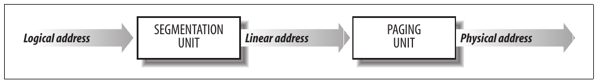

Hình 2-1. Chuyển đổi logical address

Trong multiprocessor system, mọi CPU thường chia sẻ cùng memory; nghĩa là RAM chip có thể được các CPU độc lập truy cập đồng thời. Vì read hoặc write operation trên RAM chip phải thực hiện tuần tự, hardware circuit gọi là memory arbiter được đặt giữa bus và mỗi RAM chip. Vai trò là cấp quyền truy cập cho CPU nếu chip rảnh và trì hoãn nếu chip bận phục vụ request từ processor khác. Ngay cả uniprocessor system cũng dùng memory arbiter vì có processor chuyên dụng gọi là DMA controller hoạt động đồng thời với CPU (xem phần “Direct Memory Access (DMA)” trong Chương 13). Với multiprocessor system, cấu trúc arbiter phức tạp hơn vì có nhiều input port hơn. Ví dụ, dual Pentium duy trì arbiter hai port ở đầu vào mỗi chip và yêu cầu hai CPU trao đổi synchronization message trước khi cố dùng bus chung. Từ góc nhìn lập trình, arbiter được che giấu vì do hardware circuit quản lý.

## Segmentation trong hardware

Từ model 80286, microprocessor Intel thực hiện address translation theo hai cách khác nhau gọi là real mode và protected mode. Các phần tiếp theo tập trung address translation khi protected mode được enable. Real mode chủ yếu tồn tại để duy trì processor compatibility với model cũ và cho phép hệ điều hành bootstrap (xem Phụ lục A để có mô tả ngắn về real mode).

### Segment Selector và segmentation register

Logical address gồm hai phần: segment identifier và offset chỉ định relative address trong segment. Segment identifier là field 16-bit gọi là Segment Selector (xem Hình 2-2), còn offset là field 32-bit. Các field của Segment Selector sẽ được mô tả trong phần “Truy cập nhanh Segment Descriptor” sau trong chương.


Hình 2-2. Format Segment Selector

Để dễ lấy segment selector nhanh, processor cung cấp segmentation register chỉ nhằm giữ Segment Selector; các register này tên `cs`, `ss`, `ds`, `es`, `fs` và `gs`. Dù chỉ có sáu register, chương trình có thể tái sử dụng cùng segmentation register cho mục đích khác nhau bằng cách lưu nội dung vào memory rồi khôi phục sau.

Ba trong sáu segmentation register có mục đích cụ thể:

`cs` Code segment register, trỏ đến segment chứa program instruction

`ss` Stack segment register, trỏ đến segment chứa current program stack

`ds` Data segment register, trỏ đến segment chứa global và static data

Ba segmentation register còn lại là general purpose và có thể tham chiếu data segment tùy ý.

Register `cs` có chức năng quan trọng khác: chứa field 2-bit chỉ định Current Privilege Level (CPL) của CPU. Giá trị 0 biểu thị privilege level cao nhất, còn 3 biểu thị thấp nhất. Linux chỉ dùng level 0 và 3, lần lượt gọi là Kernel Mode và User Mode.

### Segment Descriptor

Mỗi segment được biểu diễn bằng Segment Descriptor 8-byte mô tả đặc điểm segment. Segment Descriptor được lưu trong Global Descriptor Table (GDT) hoặc Local Descriptor Table (LDT).

Thường chỉ định nghĩa một GDT, trong khi mỗi process được phép có LDT riêng nếu cần tạo segment bổ sung ngoài những segment lưu trong GDT. Address và kích thước GDT trong main memory nằm trong control register `gdtr`, còn address và kích thước LDT hiện dùng nằm trong control register `ldtr`.

Hình 2-3 minh họa format Segment Descriptor; ý nghĩa các field được giải thích trong Bảng 2-1.

Bảng 2-1. Các field của Segment Descriptor

| Tên field | Mô tả |
|---|---|
| `Base` | Chứa linear address của byte đầu tiên trong segment. |
| `G` | Granularity flag: nếu được clear (bằng 0), segment size được biểu diễn bằng byte; nếu không, bằng bội số của 4096 byte. |
| `Limit` | Giữ offset của memory cell cuối trong segment, nhờ vậy giới hạn segment length. Khi `G` là 0, kích thước segment có thể từ 1 byte đến 1 MB; nếu không, từ 4 KB đến 4 GB. |
| `S` | System flag: nếu được clear, segment là system segment lưu critical data structure như Local Descriptor Table; nếu không, là code hoặc data segment thông thường. |
| `Type` | Đặc trưng segment type và access right (xem nội dung sau bảng). |
| `DPL` | Descriptor Privilege Level: dùng hạn chế truy cập segment. Biểu diễn CPU privilege level tối thiểu yêu cầu để truy cập segment. Vì vậy, segment có DPL là 0 chỉ truy cập được khi CPL là 0 — tức Kernel Mode — còn segment có DPL là 3 truy cập được với mọi giá trị CPL. |
| `P` | Segment-Present flag: bằng 0 nếu segment hiện không lưu trong main memory. Linux luôn set flag này (bit 47) thành 1 vì không bao giờ swap out toàn bộ segment xuống disk. |
| `D` hoặc `B` | Gọi là `D` hoặc `B` tùy segment chứa code hay data. Ý nghĩa hơi khác giữa hai trường hợp, nhưng cơ bản được set (bằng 1) nếu address dùng làm segment offset dài 32 bit, và được clear nếu dài 16 bit (xem Intel manual để biết thêm). |
| `AVL` | Hệ điều hành có thể sử dụng nhưng Linux bỏ qua. |

Có nhiều segment type, do đó nhiều type Segment Descriptor. Danh sách sau trình bày các type dùng rộng rãi trong Linux.

Code Segment Descriptor

Cho biết Segment Descriptor tham chiếu code segment; có thể nằm trong GDT hoặc LDT. Descriptor có flag `S` được set (nonsystem segment).

Data Segment Descriptor

Cho biết Segment Descriptor tham chiếu data segment; có thể nằm trong GDT hoặc LDT. Descriptor có flag `S` được set. Stack segment được triển khai bằng generic data segment.

Task State Segment Descriptor (TSSD)

Cho biết Segment Descriptor tham chiếu Task State Segment (TSS) — tức segment dùng lưu nội dung processor register (xem phần “Task State Segment” trong Chương 3); chỉ có thể xuất hiện trong GDT. Field `Type` tương ứng có giá trị 11 hoặc 9, tùy process tương ứng có đang thực thi trên CPU hay không. Flag `S` của descriptor như vậy được đặt thành 0.

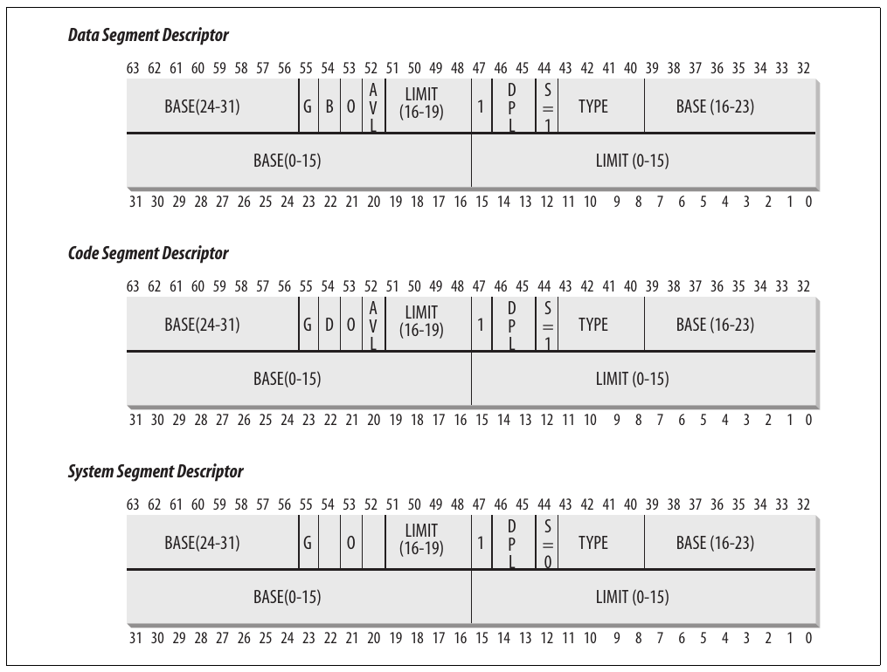

Hình 2-3. Format Segment Descriptor

Local Descriptor Table Descriptor (LDTD)

Cho biết Segment Descriptor tham chiếu segment chứa LDT; chỉ có thể xuất hiện trong GDT. Field `Type` tương ứng có giá trị 2. Flag `S` của descriptor như vậy được đặt thành 0. Phần tiếp theo trình bày cách processor 80×86 quyết định segment descriptor được lưu trong GDT hay LDT của process.

### Truy cập nhanh Segment Descriptor

Hãy nhớ logical address gồm Segment Selector 16-bit và Offset 32-bit, và segmentation register chỉ lưu Segment Selector.

Để tăng tốc chuyển logical address thành linear address, processor 80×86 cung cấp thêm nonprogrammable register — tức register lập trình viên không thể set — cho mỗi register trong sáu programmable segmentation register. Mỗi nonprogrammable register chứa Segment Descriptor 8-byte (mô tả phần trước) do Segment Selector trong segmentation register tương ứng chỉ định. Mỗi khi Segment Selector được load vào segmentation register, Segment Descriptor tương ứng được load từ memory vào nonprogrammable CPU register tương ứng. Từ đó, logical address tham chiếu segment đó có thể được chuyển đổi mà không truy cập GDT hoặc LDT lưu trong main memory; processor chỉ cần tham chiếu trực tiếp CPU register chứa Segment Descriptor. Chỉ cần truy cập GDT hoặc LDT khi nội dung segmentation register thay đổi (xem Hình 2-4).

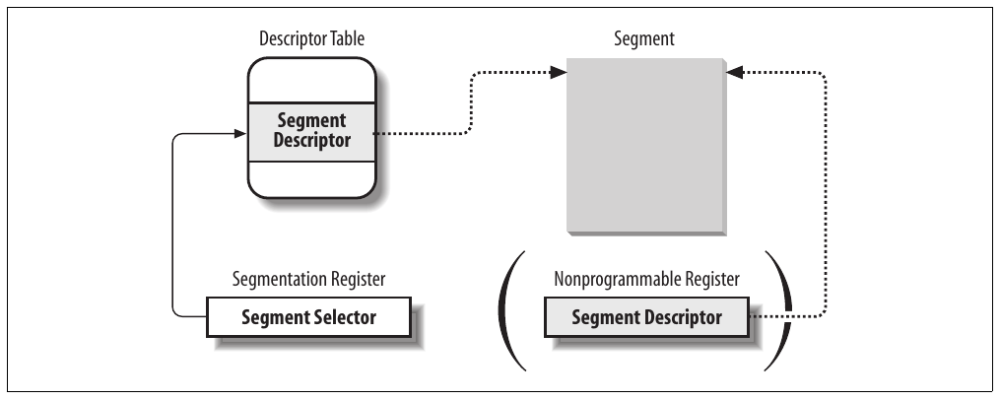

Hình 2-4. Segment Selector và Segment Descriptor

Mọi Segment Selector có ba field được mô tả trong Bảng 2-2.

Bảng 2-2. Các field của Segment Selector

| Tên field | Mô tả |
|---|---|
| `index` | Xác định Segment Descriptor entry trong GDT hoặc LDT (mô tả thêm trong nội dung sau bảng). |
| `TI` | Table Indicator: chỉ định Segment Descriptor nằm trong GDT (TI = 0) hay LDT (TI = 1). |
| `RPL` | Requestor Privilege Level: chỉ định Current Privilege Level của CPU khi Segment Selector tương ứng được load vào register `cs`; cũng có thể dùng để giảm có chọn lọc processor privilege level khi truy cập data segment (xem Intel documentation để biết chi tiết). |

Vì Segment Descriptor dài 8 byte, relative address của nó trong GDT hoặc LDT được lấy bằng cách nhân index field 13-bit của Segment Selector với 8. Ví dụ, nếu GDT ở `0x00020000` (giá trị lưu trong register `gdtr`) và index do Segment Selector chỉ định là 2, address của Segment Descriptor tương ứng là `0x00020000` + `(2` × `8)`, hay `0x00020010`.

Entry đầu của GDT luôn được đặt thành 0. Điều này bảo đảm logical address có null Segment Selector bị xem là invalid, do đó gây processor exception. Số Segment Descriptor tối đa có thể lưu trong GDT là 8.191 (tức 2<sup>13</sup>–1).

### Segmentation unit

Hình 2-5 trình bày chi tiết cách logical address được chuyển thành linear address tương ứng. Segmentation unit thực hiện các operation sau:

- Xem field `TI` của Segment Selector để xác định Descriptor Table nào lưu Segment Descriptor. Field này cho biết Descriptor nằm trong GDT (khi đó segmentation unit lấy base linear address của GDT từ register `gdtr`) hoặc active LDT (khi đó segmentation unit lấy base linear address của LDT đó từ register `ldtr`).

- Tính address của Segment Descriptor từ field `index` của Segment Selector. Field `index` được nhân với 8 (kích thước Segment Descriptor), rồi kết quả được cộng vào nội dung register `gdtr` hoặc `ldtr`.

- Cộng offset của logical address vào field `Base` của Segment Descriptor, nhờ vậy có linear address.

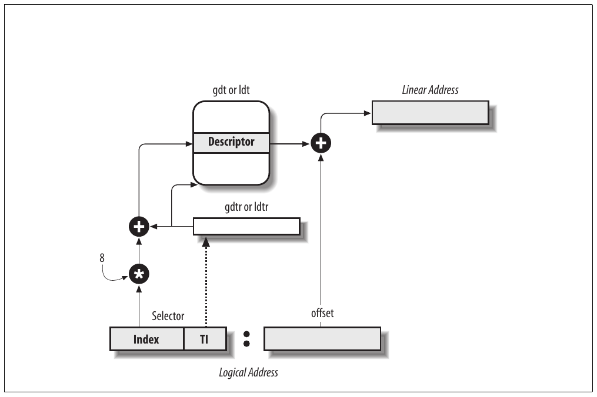

Hình 2-5. Chuyển đổi logical address

Chú ý nhờ nonprogrammable register gắn với segmentation register, chỉ cần thực hiện hai operation đầu khi segmentation register thay đổi.

## Segmentation trong Linux

Segmentation được đưa vào microprocessor 80×86 để khuyến khích lập trình viên chia application thành các thực thể liên quan về logic như subroutine hoặc global và local data area. Tuy nhiên, Linux dùng segmentation rất hạn chế. Thực tế, segmentation và paging phần nào trùng chức năng vì cả hai đều có thể tách physical address space của process: segmentation có thể cấp linear address space khác nhau cho mỗi process, còn paging có thể map cùng linear address space vào các physical address space khác nhau. Linux ưu tiên paging hơn segmentation vì:

- Memory management đơn giản hơn khi mọi process dùng cùng giá trị segment register — tức chia sẻ cùng tập linear address.

- Một mục tiêu thiết kế Linux là portability đến nhiều architecture; đặc biệt RISC architecture hỗ trợ segmentation hạn chế.

Phiên bản 2.6 của Linux chỉ dùng segmentation khi architecture 80×86 yêu cầu.

Mọi Linux process chạy trong User Mode dùng cùng cặp segment để address instruction và data. Chúng lần lượt gọi là user code segment và user data segment. Tương tự, mọi Linux process chạy trong Kernel Mode dùng cùng cặp segment để address instruction và data: lần lượt gọi là kernel code segment và kernel data segment. Bảng 2-3 trình bày giá trị các field Segment Descriptor cho bốn segment thiết yếu này.

Bảng 2-3. Giá trị các field Segment Descriptor cho bốn segment Linux chính

| Segment | Base | G | Limit | S | Type | DPL | D/B | P |
|---|---|---|---|---|---|---|---|---|
| user code | `0x00000000` | 1 | `0xfffff` | 1 | 10 | 3 | 1 | 1 |
| user data | `0x00000000` | 1 | `0xfffff` | 1 | 2 | 3 | 1 | 1 |
| kernel code | `0x00000000` | 1 | `0xfffff` | 1 | 10 | 0 | 1 | 1 |
| kernel data | `0x00000000` | 1 | `0xfffff` | 1 | 2 | 0 | 1 | 1 |

Segment Selector tương ứng lần lượt được định nghĩa bằng macro `__USER_CS`, `__USER_DS`, `__KERNEL_CS` và `__KERNEL_DS`. Ví dụ, để address kernel code segment, kernel chỉ load giá trị do macro `__KERNEL_CS` tạo ra vào segmentation register `cs`.

Chú ý linear address gắn với các segment đó đều bắt đầu từ 0 và đến addressing limit 2<sup>32</sup> –1. Nghĩa là mọi process, trong User Mode hay Kernel Mode, đều có thể dùng cùng logical address.

Hệ quả quan trọng khác của việc mọi segment bắt đầu tại `0x00000000` là trong Linux, logical address trùng linear address; tức giá trị field Offset của logical address luôn trùng giá trị linear address tương ứng.

Như đã nói, Current Privilege Level của CPU cho biết processor ở User Mode hay Kernel Mode và được chỉ định bởi field `RPL` của Segment Selector lưu trong register `cs`. Mỗi khi CPL thay đổi, một số segmentation register phải được cập nhật tương ứng. Ví dụ, khi `CPL` bằng 3 (User Mode), register `ds` phải chứa Segment Selector của user data segment, nhưng khi CPL bằng 0, register `ds` phải chứa Segment Selector của kernel data segment.

Tình huống tương tự xảy ra với register `ss`. Nó phải tham chiếu User Mode stack trong user data segment khi CPL là 3 và Kernel Mode stack trong kernel data segment khi CPL là 0. Khi chuyển từ User Mode sang Kernel Mode, Linux luôn bảo đảm register `ss` chứa Segment Selector của kernel data segment.

Khi lưu pointer đến instruction hoặc data structure, kernel không cần lưu thành phần Segment Selector của logical address vì register `ss` chứa current Segment Selector. Ví dụ, khi kernel gọi function, nó thực thi assembly language instruction `call` chỉ định riêng thành phần Offset của logical address; Segment Selector được chọn ngầm là selector do register `cs` tham chiếu. Vì chỉ có một segment thuộc type “executable in Kernel Mode”, tức code segment được nhận diện bằng `__KERNEL_CS`, chỉ cần load `__KERNEL_CS` vào `cs` mỗi khi CPU chuyển sang Kernel Mode. Lập luận tương tự áp dụng cho pointer đến kernel data structure (ngầm dùng register `ds`) cũng như pointer đến user data structure (kernel dùng tường minh register `es`).

Ngoài bốn segment vừa mô tả, Linux dùng thêm một vài segment chuyên biệt khác. Chúng ta sẽ giới thiệu ở phần tiếp theo khi mô tả Linux GDT.

### Linux GDT

Trong uniprocessor system chỉ có một GDT, còn multiprocessor system có một GDT cho mỗi CPU trong hệ thống. Mọi GDT được lưu trong array `cpu_gdt_table`, còn address và kích thước GDT (dùng khi initialize register `gdtr`) được lưu trong array `cpu_gdt_descr`. Nếu xem Source Code Index, bạn có thể thấy các symbol này được định nghĩa trong file arch/i386/kernel/head.S. Mọi macro, function và symbol khác trong sách được liệt kê trong Source Code Index để bạn nhanh chóng tìm trong source code.

Layout các GDT được biểu diễn sơ lược trong Hình 2-6. Mỗi GDT có 18 segment descriptor và 14 entry null, chưa dùng hoặc dự phòng. Unused entry được cố ý chèn để Segment Descriptor thường truy cập cùng nhau nằm trong cùng line 32-byte của hardware cache (xem phần “Hardware cache” sau trong chương).

18 segment descriptor trong mỗi GDT trỏ đến các segment sau:

- Bốn user và kernel code và data segment (xem phần trước).

- Task State Segment (TSS), khác nhau với mỗi processor trong hệ thống. Linear address space tương ứng TSS là tập con nhỏ của linear address space tương ứng kernel data segment. Các Task State Segment được lưu tuần tự trong array `init_tss`; cụ thể, field `Base` của TSS descriptor cho CPU thứ n trỏ đến thành phần thứ n của array `init_tss`. Flag `G` (granularity) được clear, còn field `Limit` đặt thành `0xeb` vì TSS segment dài 236 byte. Field `Type` đặt thành 9 hoặc 11 (available 32-bit TSS), còn `DPL` đặt thành 0 vì process trong User Mode không được truy cập TSS segment. Chi tiết cách Linux dùng TSS nằm trong phần “Task State Segment” của Chương 3.

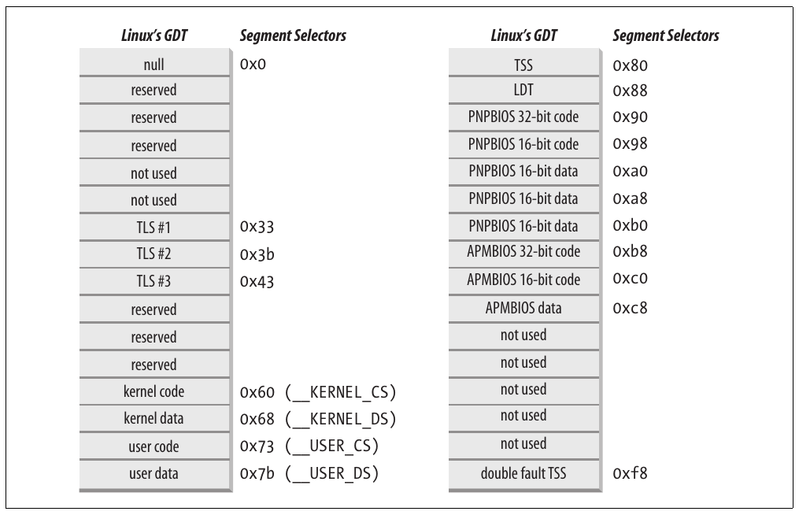

Hình 2-6. Global Descriptor Table

- Segment chứa Local Descriptor Table (LDT) mặc định, thường được mọi process chia sẻ (xem phần tiếp theo).

- Ba Thread-Local Storage (TLS) segment: cơ chế cho phép multithreaded application dùng tối đa ba segment chứa data cục bộ cho mỗi thread. System call `set_thread_area()` và `get_thread_area()` lần lượt tạo và release TLS segment cho process đang thực thi.

- Ba segment liên quan Advanced Power Management (APM): BIOS code dùng segment, nên khi Linux APM driver gọi BIOS function để lấy hoặc đặt status của APM device, có thể dùng code và data segment tùy chỉnh.

- Năm segment liên quan dịch vụ Plug and Play (PnP) BIOS. Như trường hợp trước, BIOS code dùng segment, nên khi Linux PnP driver gọi BIOS function để phát hiện resource do PnP device dùng, có thể dùng code và data segment tùy chỉnh.

- TSS segment đặc biệt được kernel dùng xử lý exception “Double fault” (xem “Exception” trong Chương 4).

Như đã nói, mỗi processor trong hệ thống có bản sao GDT. Mọi bản sao GDT lưu entry giống nhau, trừ một vài trường hợp. Thứ nhất, mỗi processor có TSS segment riêng nên GDT entry tương ứng khác nhau. Hơn nữa, một vài GDT entry có thể phụ thuộc process CPU đang thực thi (LDT và TLS Segment Descriptor). Cuối cùng, đôi khi processor tạm thời sửa entry trong bản sao GDT của nó; ví dụ khi gọi BIOS procedure của APM.

### Linux LDT

Phần lớn Linux User Mode application không dùng Local Descriptor Table, nên kernel định nghĩa LDT mặc định để phần lớn process chia sẻ. Local Descriptor Table mặc định được lưu trong array `default_ldt`. Nó có năm entry nhưng chỉ hai entry thực sự được kernel dùng: call gate cho iBCS executable và call gate cho Solaris/x86 executable (xem phần “Execution domain” trong Chương 20). Call gate là cơ chế microprocessor 80×86 cung cấp để đổi privilege level của CPU khi gọi function định trước; vì không thảo luận thêm ở đây, hãy xem Intel documentation để biết chi tiết.

Tuy nhiên, đôi khi process cần thiết lập LDT riêng. Điều này hữu ích với application (như Wine) thực thi segment-oriented Microsoft Windows application. System call `modify_ldt()` cho phép process làm vậy.

Mọi custom LDT tạo bằng `modify_ldt()` cũng cần segment riêng. Khi processor bắt đầu thực thi process có custom LDT, LDT entry trong bản sao GDT riêng của CPU được đổi tương ứng.

User Mode application cũng có thể allocate segment mới bằng `modify_ldt()`; tuy nhiên kernel không bao giờ dùng các segment này và không cần theo dõi Segment Descriptor tương ứng vì chúng nằm trong custom LDT của process.

## Paging trong hardware

Paging unit chuyển linear address thành physical address. Một nhiệm vụ chính là kiểm tra access type được yêu cầu so với access right của linear address. Nếu memory access không hợp lệ, nó tạo Page Fault exception (xem Chương 4 và Chương 8).

Để hiệu quả, linear address được nhóm thành khoảng có độ dài cố định gọi là page; các linear address liên tục trong page được map vào physical address liên tục. Bằng cách này, kernel có thể chỉ định physical address và access right của page thay vì của mọi linear address trong đó. Theo quy ước thông thường, chúng ta dùng “page” để chỉ cả tập linear address lẫn data chứa trong nhóm address đó.

Paging unit xem toàn bộ RAM được chia thành page frame độ dài cố định (đôi khi gọi là physical page). Mỗi page frame chứa một page — tức độ dài page frame trùng độ dài page. Page frame là thành phần main memory, vì vậy là storage area. Cần phân biệt page với page frame; page chỉ là block data có thể lưu trong bất kỳ page frame nào hoặc trên disk.

Data structure map linear address sang physical address gọi là page table; được lưu trong main memory và phải được kernel initialize đúng trước khi enable paging unit.

Từ 80386, mọi processor 80×86 đều hỗ trợ paging; được enable bằng cách set flag `PG` của control register tên `cr0`. Khi `PG = 0`, linear address được diễn giải là physical address.

### Regular paging

Từ 80386, paging unit của processor Intel xử lý page 4 KB.

32 bit của linear address được chia thành ba field:

Directory

10 bit có trọng số cao nhất

Table

10 bit ở giữa

Offset

12 bit có trọng số thấp nhất

Chuyển đổi linear address được thực hiện qua hai bước, mỗi bước dựa trên một loại translation table. Translation table đầu gọi là Page Directory, bảng thứ hai gọi là Page Table.[^1]

Mục tiêu mô hình hai cấp này là giảm lượng RAM cần cho Page Table của từng process. Nếu dùng Page Table một cấp đơn giản, cần đến 2<sup>20</sup> entry (tức 4 byte mỗi entry, 4 MB RAM) để biểu diễn Page Table của mỗi process (nếu process dùng toàn bộ linear address space 4 GB), dù process không dùng mọi address trong khoảng đó. Mô hình hai cấp giảm memory bằng cách chỉ yêu cầu Page Table cho virtual memory region process thực sự dùng.

Mỗi active process phải được cấp Page Directory. Tuy nhiên, không cần allocate RAM cho mọi Page Table của process cùng lúc; chỉ allocate RAM cho Page Table khi process thực sự cần sẽ hiệu quả hơn.

Physical address của Page Directory đang dùng được lưu trong control register tên `cr3`. Field Directory trong linear address xác định entry của Page Directory trỏ đến Page Table phù hợp. Đến lượt field Table của address xác định entry của Page Table chứa physical address của page frame chứa page. Field Offset xác định relative position trong page frame (xem Hình 2-7). Vì dài 12 bit, mỗi page gồm 4096 byte data.

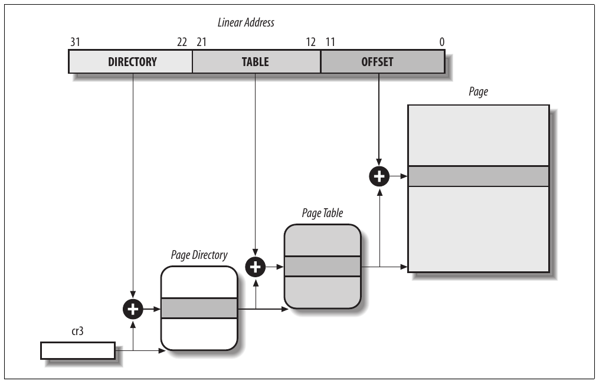

Hình 2-7. Paging của processor 80×86

Cả field Directory và Table dài 10 bit, nên Page Directory và Page Table có thể chứa đến 1.024 entry. Do đó Page Directory có thể address đến 1024× 1024×4096=2<sup>32</sup> memory cell, như kỳ vọng với address 32-bit.

Entry của Page Directory và Page Table có cùng cấu trúc. Mỗi entry gồm các field sau:

Flag `Present`

Nếu được set, page (hoặc Page Table) được tham chiếu nằm trong main memory; nếu flag là 0, page không nằm trong main memory và các bit entry còn lại có thể được hệ điều hành dùng cho mục đích riêng. Nếu entry Page Table hoặc Page Directory cần cho address translation có flag `Present` được clear, paging unit lưu linear address vào control register tên `cr2` và tạo exception 14: Page Fault exception. (Chương 17 sẽ trình bày cách Linux dùng field này.)

Field chứa 20 bit trọng số cao nhất của page frame physical address

Vì mỗi page frame có dung lượng 4-KB, physical address phải là bội của 4096, nên 12 bit trọng số thấp nhất của physical address luôn bằng 0. Nếu field tham chiếu Page Directory, page frame chứa Page Table; nếu tham chiếu Page Table, page frame chứa page data.

Flag `Accessed`

Được set mỗi khi paging unit address page frame tương ứng. Hệ điều hành có thể dùng flag khi chọn page để swap out. Paging unit không bao giờ reset flag này; hệ điều hành phải thực hiện.

Flag `Dirty`

Chỉ áp dụng cho Page Table entry. Được set mỗi khi write operation thực hiện trên page frame. Như flag `Accessed`, hệ điều hành có thể dùng `Dirty` khi chọn page để swap out. Paging unit không bao giờ reset flag này; hệ điều hành phải thực hiện.

Flag `Read/Write`

Chứa access right (Read/Write hoặc Read) của page hoặc Page Table (xem phần “Hardware protection scheme” sau trong chương).

Flag `User/Supervisor`

Chứa privilege level cần để truy cập page hoặc Page Table (xem phần “Hardware protection scheme” sau).

Flag `PCD` và `PWT`

Điều khiển cách hardware cache xử lý page hoặc Page Table (xem phần “Hardware cache” sau trong chương).

Flag `Page Size`

Chỉ áp dụng cho Page Directory entry. Nếu được set, entry tham chiếu page frame dài 2 MB hoặc 4 MB (xem các phần sau).

Flag `Global`

Chỉ áp dụng cho Page Table entry. Flag được đưa vào Pentium Pro để ngăn page thường dùng bị flush khỏi TLB cache (xem phần “Translation Lookaside Buffer (TLB)” sau trong chương). Chỉ hoạt động nếu flag Page Global Enable (`PGE`) của register `cr4` được set.

### Extended paging

Từ model Pentium, microprocessor 80×86 đưa vào extended paging, cho phép page frame có kích thước 4 MB thay vì 4 KB (xem Hình 2-8). Extended paging dùng để chuyển khoảng linear address lớn, liên tục sang physical address tương ứng; trong trường hợp này, kernel không cần Page Table trung gian, nhờ vậy tiết kiệm memory và bảo toàn TLB entry (xem phần “Translation Lookaside Buffer (TLB)”).

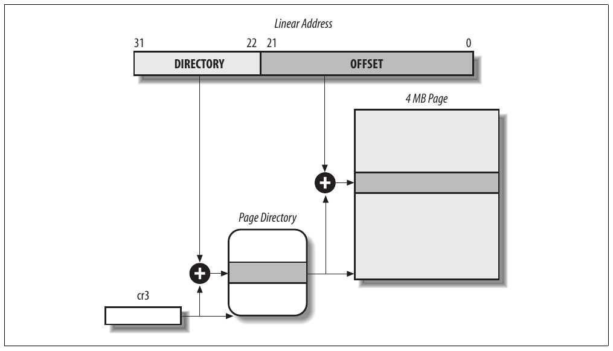

Hình 2-8. Extended paging

Như phần trước đề cập, extended paging được enable bằng cách set flag `Page Size` của Page Directory entry. Khi đó paging unit chia 32 bit linear address thành hai field:

Directory

10 bit có trọng số cao nhất

Offset

22 bit còn lại

Page Directory entry cho extended paging giống normal paging, ngoại trừ:

- Flag `Page Size` phải được set.

- Chỉ 10 bit trọng số cao nhất của physical address field 20-bit có ý nghĩa. Lý do là mỗi physical address được align trên boundary 4-MB nên 22 bit trọng số thấp nhất của address là 0.

Extended paging cùng tồn tại với regular paging; được enable bằng cách set flag `PSE` của processor register `cr4`.

### Hardware protection scheme

Paging unit dùng protection scheme khác segmentation unit. Trong khi processor 80×86 cho phép segment có bốn privilege level, chỉ hai privilege level gắn với page và Page Table vì privilege do flag `User/Supervisor` đề cập trong phần “Regular paging” trước đó điều khiển. Khi flag là 0, page chỉ có thể được address khi `CPL` nhỏ hơn 3 (với Linux nghĩa là khi processor ở Kernel Mode). Khi flag là 1, page luôn có thể được address.

Hơn nữa, thay vì ba loại access right (Read, Write và Execute) gắn với segment, chỉ hai loại access right (Read và Write) gắn với page. Nếu flag `Read/Write` của Page Directory hoặc Page Table entry bằng 0, Page Table hoặc page tương ứng chỉ đọc được; nếu không có thể đọc và ghi.[^2]

### Ví dụ regular paging

Ví dụ đơn giản giúp làm rõ cách regular paging hoạt động. Giả sử kernel cấp linear address space từ `0x20000000` đến `0x2003ffff` cho running process.<sup>†</sup> Không gian này gồm đúng 64 page. Chúng ta không quan tâm physical address của page frame chứa page; thực tế, một số thậm chí có thể không ở main memory. Chúng ta chỉ quan tâm các field còn lại của Page Table entry.

Bắt đầu với 10 bit trọng số cao nhất của linear address được cấp cho process, được paging unit diễn giải là field Directory. Address bắt đầu bằng 2 theo sau bởi các số 0, nên 10 bit đều có cùng giá trị, tức `0x080` hay 128 thập phân. Vì vậy field Directory trong mọi address tham chiếu entry thứ 129<sup>th</sup> của process Page Directory. Entry tương ứng phải chứa physical address của Page Table cấp cho process (xem Hình 2-9). Nếu không cấp linear address nào khác cho process, mọi entry trong 1.023 entry còn lại của Page Directory được điền số 0.

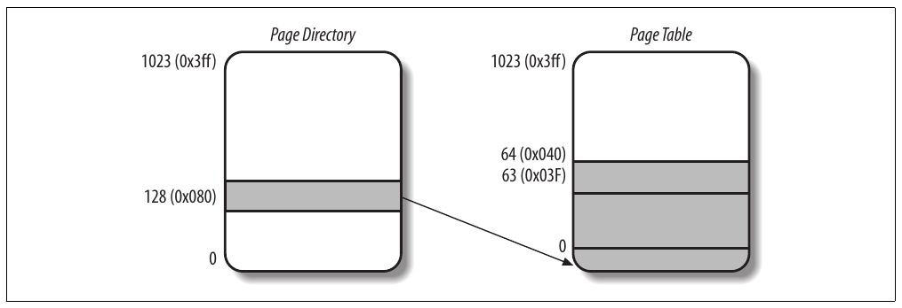

Hình 2-9. Ví dụ paging

Giá trị 10 bit ở giữa (tức giá trị field Table) từ 0 đến `0x03f`, hay 0 đến 63 thập phân. Vì vậy chỉ 64 entry đầu của Page Table hợp lệ. 960 entry còn lại được điền số 0.

Giả sử process cần đọc byte tại linear address `0x20021406`. Paging unit xử lý address như sau:

1\. Field Directory `0x80` được dùng chọn entry `0x80` của Page Directory, trỏ đến Page Table gắn với các page của process.

2\. Field Table `0x21` được dùng chọn entry `0x21` của Page Table, trỏ đến page frame chứa page mong muốn.

3\. Cuối cùng, field Offset `0x406` được dùng chọn byte tại offset `0x406` trong page frame mong muốn.

Nếu flag `Present` của entry `0x21` trong Page Table được clear, page không hiện diện trong main memory; khi đó paging unit phát Page Fault exception lúc chuyển linear address. Cùng exception được phát bất cứ khi nào process cố truy cập linear address ngoài khoảng giới hạn bởi `0x20000000` và `0x2003ffff`, vì Page Table entry không cấp cho process được điền số 0; đặc biệt mọi flag `Present` của chúng đều được clear.

### Cơ chế paging Physical Address Extension (PAE)

Lượng RAM processor hỗ trợ bị giới hạn bởi số address pin nối với address bus. Processor Intel cũ từ 80386 đến Pentium dùng physical address 32-bit. Về lý thuyết, có thể cài đến 4 GB RAM trên hệ thống đó; thực tế, do yêu cầu linear address space của User Mode process, kernel không thể address trực tiếp hơn 1 GB RAM, như sẽ thấy trong phần “Paging trong Linux” sau.

Tuy nhiên, server lớn cần chạy hàng trăm hoặc hàng nghìn process cùng lúc đòi hỏi hơn 4 GB RAM, và trong những năm gần đây điều này tạo áp lực lên Intel mở rộng lượng RAM hỗ trợ trên architecture 80×86 32-bit.

Intel đáp ứng bằng cách tăng số address pin trên processor từ 32 lên 36. Từ Pentium Pro, mọi processor Intel hiện có thể address đến 2<sup>36</sup> = 64 GB RAM. Tuy nhiên, chỉ có thể khai thác khoảng physical address mở rộng bằng cơ chế paging mới chuyển linear address 32-bit thành physical address 36-bit.

Với processor Pentium Pro, Intel giới thiệu cơ chế Physical Address Extension (PAE). Cơ chế khác, Page Size Extension (PSE-36), được đưa vào processor Pentium III, nhưng Linux không dùng và sách không thảo luận thêm.

PAE được kích hoạt bằng cách set flag Physical Address Extension (`PAE`) trong control register `cr4`. Flag Page Size (`PS`) trong page directory entry enable page size lớn (2 MB khi PAE được enable).

Intel đã thay đổi paging mechanism để hỗ trợ PAE.

- 64 GB RAM được chia thành 2<sup>24</sup> page frame riêng biệt, physical address field của Page Table entry được mở rộng từ 20 lên 24 bit. Vì PAE Page Table entry phải chứa 12 flag bit (mô tả trong phần “Regular paging” trước) và 24 physical address bit, tổng cộng 36, kích thước Page Table entry được nhân đôi từ 32 lên 64 bit. Kết quả là PAE Page Table 4-KB có 512 entry thay vì 1.024.

- Page Table level mới gọi là Page Directory Pointer Table (PDPT) gồm bốn entry 64-bit được đưa vào.

- Control register `cr3` chứa field Page Directory Pointer Table base address 27-bit. Vì PDPT được lưu trong 4 GB RAM đầu và align theo bội số 32 byte (2<sup>5</sup>), 27 bit đủ biểu diễn base address của các bảng đó.

- Khi map linear address đến page 4 KB (flag `PS` được clear trong Page Directory entry), 32 bit linear address được diễn giải như sau:

`cr3`

Trỏ đến PDPT

bit 31–30

Trỏ đến 1 trong 4 entry có thể có trong PDPT

bit 29–21

Trỏ đến 1 trong 512 entry có thể có trong Page Directory

bit 20–12

Trỏ đến 1 trong 512 entry có thể có trong Page Table

bit 11–0

Offset của page 4-KB

- Khi map linear address đến page 2-MB (flag `PS` được set trong Page Directory entry), 32 bit linear address được diễn giải như sau:

`cr3`

Trỏ đến PDPT

bit 31–30

Trỏ đến 1 trong 4 entry có thể có trong PDPT

bit 29–21

Trỏ đến 1 trong 512 entry có thể có trong Page Directory

bit 20–0

Offset của page 2-MB

Tóm lại, sau khi `cr3` được set, có thể address đến 4 GB RAM. Nếu muốn address nhiều RAM hơn, phải đặt giá trị mới vào `cr3` hoặc đổi nội dung PDPT. Tuy nhiên, vấn đề chính của PAE là linear address vẫn dài 32 bit. Điều này buộc kernel programmer tái sử dụng cùng linear address để map các RAM area khác nhau. Chúng ta sẽ phác thảo cách Linux initialize Page Table khi enable PAE trong phần “Kernel Page Table cuối cùng khi RAM size lớn hơn 4096 MB” sau. Rõ ràng PAE không mở rộng linear address space của process vì chỉ xử lý physical address. Hơn nữa, chỉ kernel có thể sửa page table của process, do đó process chạy trong User Mode không thể dùng physical address space lớn hơn 4 GB. Mặt khác, PAE cho phép kernel khai thác đến 64 GB RAM, nhờ vậy tăng đáng kể số process trong hệ thống.

### Paging cho architecture 64-bit

Như đã thấy ở các phần trước, two-level paging thường dùng trên microprocessor 32-bit[^3]. Tuy nhiên, two-level paging không phù hợp máy tính dùng architecture 64-bit. Hãy dùng thí nghiệm tư duy để giải thích:

Bắt đầu bằng giả định page size chuẩn 4 KB. Vì 1 KB bao phủ khoảng 2<sup>10</sup> address, 4 KB bao phủ 2<sup>12</sup> address, nên field Offset là 12 bit. Còn đến 52 bit linear address để phân bổ giữa field Table và Directory. Nếu quyết định chỉ dùng 48 trong 64 bit để addressing (hạn chế này vẫn cho address space 256 TB thoải mái!), 48`-`12 = 36 bit còn lại phải chia giữa field Table và Directory. Nếu quyết định dành 18 bit cho mỗi field, cả Page Directory lẫn Page Table của mỗi process phải có 2<sup>18</sup> entry — tức hơn 256.000 entry.

Vì vậy, mọi hardware paging system cho processor 64-bit dùng thêm paging level. Số level phụ thuộc loại processor. Bảng 2-4 tổng hợp đặc điểm chính của hardware paging system dùng trên một số platform 64-bit Linux hỗ trợ. Xem phần “Sự phụ thuộc hardware” trong Chương 1 để có mô tả ngắn về hardware gắn với platform name.

Bảng 2-4. Paging level trong một số architecture 64-bit

| Tên platform | Page size | Số address bit được dùng | Số paging level | Phân chia linear address |
|---|---|---|---|---|
| alpha | 8 KB<sup>a</sup> | 43 | 3 | 10 + 10 + 10 + 13 |
| ia64 | 4 KB<sup>a</sup> | 39 | 3 | 9 + 9 + 9 + 12 |
| ppc64 | 4 KB | 41 | 3 | 10 + 10 + 9 + 12 |
| sh64 | 4 KB | 41 | 3 | 10 + 10 + 9 + 12 |
| x86\_64 | 4 KB | 48 | 4 | 9 + 9 + 9 + 9 + 12 |

<sup>a</sup> Architecture này hỗ trợ page size khác nhau; chúng ta chọn page size điển hình Linux sử dụng.

Như sẽ thấy trong phần “Paging trong Linux” sau trong chương, Linux cung cấp thành công paging model chung phù hợp phần lớn hardware paging system được hỗ trợ.

### Hardware cache

Microprocessor ngày nay có clock rate vài gigahertz, trong khi dynamic RAM (DRAM) chip có access time hàng trăm clock cycle. Nghĩa là CPU có thể bị chậm đáng kể khi thực thi instruction cần lấy operand từ RAM và/hoặc lưu kết quả vào RAM.

Hardware cache memory được đưa vào để giảm chênh lệch tốc độ giữa CPU và RAM. Chúng dựa trên locality principle quen thuộc, đúng với cả program lẫn data structure. Nguyên lý nói rằng do cấu trúc lặp của program và việc đóng gói data liên quan vào linear array, address gần address vừa dùng có xác suất cao được dùng trong tương lai gần. Vì vậy hợp lý khi đưa vào memory nhỏ hơn, nhanh hơn chứa code và data dùng gần nhất. Để làm vậy, đơn vị mới gọi là line được đưa vào architecture 80×86. Nó gồm vài chục byte liên tục truyền theo burst mode giữa DRAM chậm và on-chip static RAM (SRAM) nhanh dùng triển khai cache.

Cache được chia thành subset các line. Ở một cực, cache có thể direct mapped, khi đó line trong main memory luôn được lưu tại đúng cùng vị trí trong cache. Ở cực kia, cache là fully associative, nghĩa là mọi line trong memory có thể được lưu ở bất kỳ vị trí nào trong cache. Nhưng phần lớn cache là N-way set associative ở mức độ nào đó, trong đó mỗi line main memory có thể lưu trong bất kỳ line nào trong N line của cache. Ví dụ, một line memory có thể được lưu ở hai line khác nhau của two-way set associative cache.

Như Hình 2-10, cache unit nằm giữa paging unit và main memory. Nó có cả hardware cache memory và cache controller. Cache memory lưu các line memory thực tế. Cache controller lưu array entry, một entry cho mỗi line cache memory. Mỗi entry gồm tag và vài flag mô tả status của cache line. Tag gồm một số bit cho phép cache controller nhận diện memory location hiện được line map. Bit của physical address memory thường chia thành ba nhóm: bit trọng số cao nhất tương ứng tag, bit ở giữa tương ứng cache controller subset index và bit trọng số thấp nhất tương ứng offset trong line.

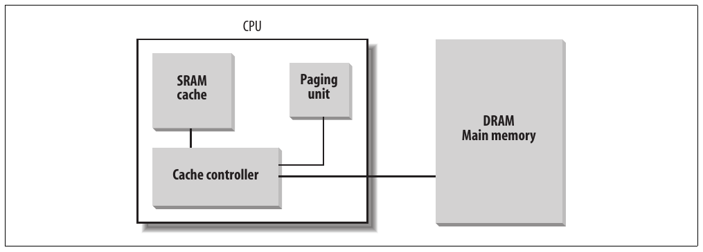

Hình 2-10. Processor hardware cache

Khi truy cập RAM memory cell, CPU trích subset index từ physical address và so tag của mọi line trong subset với high-order bit của physical address. Nếu tìm thấy line có tag giống high-order bit của address, CPU có cache hit; nếu không có cache miss.

Khi cache hit xảy ra, cache controller hoạt động khác nhau tùy access type. Với read operation, controller chọn data từ cache line và truyền vào CPU register; RAM không bị truy cập và CPU tiết kiệm thời gian, chính là lý do cache system được phát minh. Với write operation, controller có thể triển khai một trong hai strategy cơ bản gọi là write-through và write-back. Trong write-through, controller luôn ghi vào cả RAM lẫn cache line, thực chất tắt cache cho write operation. Trong write-back, có hiệu quả tức thời hơn, chỉ cache line được cập nhật còn nội dung RAM không đổi. Tất nhiên, sau write-back cuối cùng RAM phải được cập nhật. Cache controller chỉ ghi cache line trở lại RAM khi CPU thực thi instruction yêu cầu flush cache entry hoặc khi có hardware signal FLUSH (thường sau cache miss).

Khi cache miss xảy ra, cache line được ghi vào memory nếu cần và line đúng được lấy từ RAM vào cache entry.

Multiprocessor system có hardware cache riêng cho mỗi processor, vì vậy cần thêm hardware circuitry để synchronize cache content. Như Hình 2-11, mỗi CPU có local hardware cache riêng. Nhưng giờ cập nhật tốn thời gian hơn: mỗi khi CPU sửa hardware cache của nó, phải kiểm tra cùng data có trong hardware cache khác không; nếu có, phải thông báo CPU kia cập nhật giá trị phù hợp. Hoạt động này thường gọi là cache snooping. May mắn là mọi việc diễn ra ở hardware level và kernel không cần quan tâm.

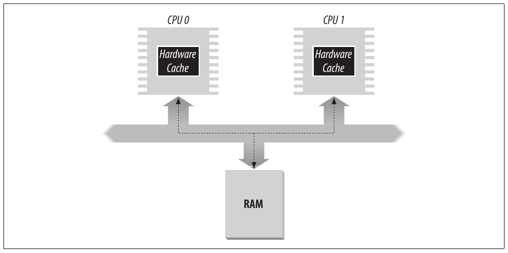

Hình 2-11. Cache trong hệ thống dual processor

Công nghệ cache phát triển nhanh. Ví dụ, model Pentium đầu có một on-chip cache duy nhất gọi là L1-cache. Model mới hơn còn có các on-chip cache lớn hơn, chậm hơn gọi là L2-cache, L3-cache, v.v. Consistency giữa các cache level được triển khai ở hardware level. Linux bỏ qua chi tiết hardware này và giả định chỉ một cache.

Flag `CD` của processor register `cr0` dùng enable hoặc disable cache circuitry. Flag `NW` trong cùng register chỉ định cache dùng write-through hay write-back strategy.

Tính năng thú vị khác của Pentium cache là cho phép hệ điều hành gắn cache management policy khác nhau với mỗi page frame. Để làm vậy, mỗi Page Directory và mỗi Page Table entry có hai flag: `PCD` (Page Cache Disable), chỉ định có enable hay disable cache khi truy cập data trong page frame; và `PWT` (Page Write-Through), chỉ định phải áp dụng write-back hay write-through strategy khi ghi data vào page frame. Linux clear flag `PCD` và `PWT` của mọi Page Directory và Page Table entry; kết quả là caching được enable cho mọi page frame và luôn áp dụng write-back strategy để ghi.

### Translation Lookaside Buffer (TLB)

Ngoài general-purpose hardware cache, processor 80×86 có cache khác gọi là Translation Lookaside Buffer (TLB) để tăng tốc linear address translation. Khi linear address được dùng lần đầu, physical address tương ứng được tính qua các truy cập chậm đến Page Table trong RAM. Sau đó physical address được lưu trong TLB entry để tham chiếu tiếp theo đến cùng linear address có thể được chuyển đổi nhanh.

Trong multiprocessor system, mỗi CPU có TLB riêng, gọi là local TLB của CPU. Khác hardware cache, các entry tương ứng của TLB không cần synchronize vì process chạy trên các CPU hiện có có thể gắn cùng linear address với physical address khác nhau.

Khi control register `cr3` của CPU được sửa, hardware tự động invalidate mọi entry của local TLB vì tập page table mới được dùng còn TLB đang trỏ đến data cũ.

## Paging trong Linux

Linux áp dụng paging model chung phù hợp cả architecture 32-bit và 64-bit. Như giải thích ở phần “Paging cho architecture 64-bit” trước, hai paging level đủ cho architecture 32-bit, còn architecture 64-bit cần nhiều paging level hơn. Đến phiên bản 2.6.10, Linux paging model gồm ba paging level. Từ phiên bản 2.6.11, four-level paging model được áp dụng.[^4] Bốn loại page table minh họa ở Hình 2-12 gọi là:

- Page Global Directory

- Page Upper Directory

- Page Middle Directory

- Page Table

Page Global Directory chứa address của nhiều Page Upper Directory, mỗi Page Upper Directory lại chứa address của nhiều Page Middle Directory, mỗi Page Middle Directory lại chứa address của nhiều Page Table. Mỗi Page Table entry trỏ đến page frame. Vì vậy linear address có thể chia thành tối đa năm phần. Hình 2-12 không ghi số bit vì kích thước mỗi phần phụ thuộc computer architecture.

Với architecture 32-bit không có Physical Address Extension, hai paging level là đủ. Linux thực chất loại bỏ field Page Upper Directory và Page Middle Directory bằng cách xem chúng chứa 0 bit. Tuy nhiên, vị trí Page Upper Directory và Page Middle Directory trong pointer sequence vẫn được giữ để cùng code hoạt động trên architecture 32-bit và 64-bit. Kernel giữ vị trí cho Page Upper Directory và Page Middle Directory bằng cách đặt số entry của chúng thành 1 và map hai entry vào entry phù hợp của Page Global Directory.

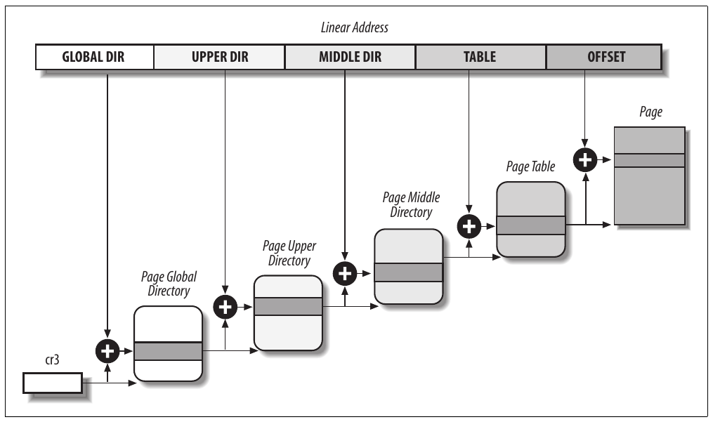

Hình 2-12. Linux paging model

Với architecture 32-bit có Physical Address Extension được enable, dùng ba paging level. Page Global Directory của Linux tương ứng Page Directory Pointer Table của 80×86, Page Upper Directory bị loại bỏ, Page Middle Directory tương ứng Page Directory của 80×86 và Page Table của Linux tương ứng Page Table của 80×86.

Cuối cùng, với architecture 64-bit, dùng ba hoặc bốn paging level tùy cách hardware phân chia bit linear address (xem Bảng 2-4).

Cách Linux xử lý process phụ thuộc nhiều vào paging. Thực tế, tự động chuyển linear address thành physical address khiến các mục tiêu thiết kế sau khả thi:

- Cấp physical address space khác nhau cho mỗi process, bảo đảm bảo vệ hiệu quả trước addressing error.

- Phân biệt page (nhóm data) với page frame (physical address trong main memory). Điều này cho phép cùng page được lưu trong page frame, sau đó lưu xuống disk và về sau load lại vào page frame khác. Đây là thành phần cơ bản của virtual memory mechanism (xem Chương 17).

Trong phần còn lại của chương, để cụ thể chúng ta sẽ tham chiếu paging circuitry dùng trên processor 80×86.

Như sẽ thấy trong Chương 9, mỗi process có Page Global Directory riêng và tập Page Table riêng. Khi process switch xảy ra (xem phần “Process switch” trong Chương 3), Linux lưu control register `cr3` vào descriptor của process thực thi trước đó rồi load `cr3` bằng giá trị lưu trong descriptor của process sẽ thực thi tiếp theo. Vì vậy khi process mới tiếp tục execution trên CPU, paging unit tham chiếu đúng tập Page Table.

Map linear address sang physical address giờ thành công việc máy móc dù vẫn hơi phức tạp. Vài phần tiếp theo là danh sách khá tẻ nhạt các function và macro lấy thông tin kernel cần để tìm address và quản lý bảng; phần lớn function dài một hoặc hai dòng. Lúc này bạn có thể chỉ muốn đọc lướt, nhưng biết vai trò các function và macro rất hữu ích vì bạn sẽ thường thấy chúng trong thảo luận xuyên suốt sách.

### Các field của linear address

Các macro sau đơn giản hóa xử lý Page Table:

`PAGE_SHIFT`

Chỉ định độ dài bằng bit của field Offset; khi áp dụng processor 80×86, cho giá trị 12. Vì mọi address trong page phải vừa field Offset, page size trên hệ thống 80×86 là 2<sup>12</sup> hay 4.096 byte quen thuộc; vì vậy `PAGE_SHIFT` bằng 12 có thể xem là logarithm cơ số 2 của tổng page size. Macro này được `PAGE_SIZE` dùng để return page size. Cuối cùng macro `PAGE_MASK` cho giá trị `0xfffff000` và dùng mask mọi bit field Offset.

`PMD_SHIFT`

Tổng độ dài bằng bit của field Offset và Table trong linear address; nói cách khác, logarithm kích thước area mà một Page Middle Directory entry có thể map. Macro `PMD_SIZE` tính kích thước area được một entry Page Middle Directory map — tức của một Page Table. Macro `PMD_MASK` dùng mask mọi bit field Offset và Table.

Khi PAE bị disable, `PMD_SHIFT` cho giá trị 22 (12 từ Offset cộng 10 từ Table), `PMD_SIZE` cho 2<sup>22</sup> hay 4 MB, còn `PMD_MASK` cho `0xffc00000`. Ngược lại, khi PAE được enable, `PMD_SHIFT` cho giá trị 21 (12 từ Offset cộng 9 từ Table), `PMD_SIZE` cho 2<sup>21</sup> hay 2 MB, còn `PMD_MASK` cho `0xffe00000`.

Large page không dùng page table level cuối, do đó `LARGE_PAGE_SIZE`, cho kích thước large page, bằng `PMD_SIZE` (2`PMD_SHIFT`), còn `LARGE_PAGE_MASK`, dùng mask mọi bit field Offset và Table trong large page address, bằng `PMD_MASK`.

`PUD_SHIFT`

Xác định logarithm kích thước area mà một Page Upper Directory entry có thể map. Macro `PUD_SIZE` tính kích thước area được một entry Page Global Directory map. Macro `PUD_MASK` dùng mask mọi bit field Offset, Table, Middle Air và Upper Air.

Trên processor 80×86, `PUD_SHIFT` luôn bằng `PMD_SHIFT` và `PUD_SIZE` bằng 4 MB hoặc 2 MB.

`PGDIR_SHIFT`

Xác định logarithm kích thước area mà một Page Global Directory entry có thể map. Macro `PGDIR_SIZE` tính kích thước area được một entry Page Global Directory map. Macro `PGDIR_MASK` dùng mask mọi bit field Offset, Table, Middle Air và Upper Air.

Khi PAE bị disable, `PGDIR_SHIFT` cho giá trị 22 (cùng giá trị `PMD_SHIFT` và `PUD_SHIFT`), `PGDIR_SIZE` cho 2<sup>22</sup> hay 4 MB, còn `PGDIR_MASK` cho `0xffc00000`. Ngược lại, khi PAE được enable, `PGDIR_SHIFT` cho giá trị 30 (12 từ Offset cộng 9 từ Table cộng 9 từ Middle Air), `PGDIR_SIZE` cho 2<sup>30</sup> hay 1 GB, còn `PGDIR_MASK` cho `0xc0000000`.

`PTRS_PER_PTE`, `PTRS_PER_PMD`, `PTRS_PER_PUD` và `PTRS_PER_PGD`

Tính số entry trong Page Table, Page Middle Directory, Page Upper Directory và Page Global Directory. Chúng lần lượt cho giá trị 1.024, 1, 1 và 1.024 khi PAE bị disable; và lần lượt 512, 512, 1 và 4 khi PAE được enable.

### Xử lý Page Table

`pte_t`, `pmd_t`, `pud_t` và `pgd_t` lần lượt mô tả format của entry Page Table, Page Middle Directory, Page Upper Directory và Page Global Directory. Chúng là data type 64-bit khi PAE được enable, nếu không là data type 32-bit. `pgprot_t` là data type 64-bit (enable PAE) hoặc 32-bit (disable PAE) khác, biểu diễn protection flag gắn với một entry.

Năm type-conversion macro — `__pte`, `__pmd`, `__pud`, `__pgd` và `__pgprot` — cast unsigned integer thành type cần thiết. Năm type-conversion macro khác — `pte_val`, `pmd_val`, `pud_val`, `pgd_val` và `pgprot_val` — thực hiện reverse casting từ một trong bốn specialized type vừa nêu thành unsigned integer.

Kernel cũng cung cấp nhiều macro và function để đọc hoặc sửa page table entry:

- `pte_none`, `pmd_none`, `pud_none` và `pgd_none` cho giá trị 1 nếu entry tương ứng có giá trị 0; nếu không cho giá trị 0.

- `pte_clear`, `pmd_clear`, `pud_clear` và `pgd_clear` clear entry của page table tương ứng, do đó cấm process dùng linear address được page table entry map. Function `ptep_get_and_clear()` clear Page Table entry và return giá trị trước đó.

- `set_pte`, `set_pmd`, `set_pud` và `set_pgd` ghi giá trị cho trước vào page table entry; `set_pte_atomic` giống `set_pte`, nhưng khi PAE được enable còn bảo đảm giá trị 64-bit được ghi atomically.

- `pte_same(a,b)` return 1 nếu hai Page Table entry `a` và `b` tham chiếu cùng page và chỉ định cùng access privilege, nếu không là 0.

- `pmd_large(e)` return 1 nếu Page Middle Directory entry `e` tham chiếu large page (2 MB hoặc 4 MB), nếu không là 0.

Macro `pmd_bad` được các function dùng kiểm tra Page Middle Directory entry truyền làm input parameter. Cho giá trị 1 nếu entry trỏ đến bad Page Table — tức ít nhất một điều kiện sau áp dụng:

- Page không nằm trong main memory (flag `Present` được clear).

- Page chỉ cho phép Read access (flag `Read/Write` được clear).

- `Accessed` hoặc `Dirty` được clear (Linux luôn buộc set các flag này cho mọi Page Table hiện có).

Macro `pud_bad` và `pgd_bad` luôn cho 0. Không định nghĩa macro `pte_bad` vì Page Table entry tham chiếu page không có trong main memory, không writable hoặc hoàn toàn không accessible là hợp lệ.

Macro `pte_present` cho giá trị 1 nếu flag `Present` hoặc flag `Page Size` của Page Table entry bằng 1, nếu không cho 0. Hãy nhớ flag `Page Size` trong Page Table entry không có ý nghĩa với paging unit của microprocessor; tuy nhiên kernel đánh dấu `Present` bằng 0 và `Page Size` bằng 1 cho page có trong main memory nhưng không có privilege read, write hoặc execute. Bằng cách này, mọi truy cập page đó kích hoạt Page Fault exception vì `Present` được clear, và kernel có thể phát hiện fault không phải do thiếu page bằng cách kiểm tra giá trị `Page Size`.

Macro `pmd_present` cho giá trị 1 nếu flag `Present` của entry tương ứng bằng 1 — tức page hoặc Page Table tương ứng được load trong main memory. Macro `pud_present` và `pgd_present` luôn cho giá trị 1.

Các function trong Bảng 2-5 truy vấn giá trị hiện tại của bất kỳ flag nào trong Page Table entry; ngoại trừ `pte_file()`, các function chỉ hoạt động đúng trên Page Table entry mà `pte_present` return 1.

Bảng 2-5. Function đọc page flag

| Tên function | Mô tả |
|---|---|
| `pte_user()` | Đọc flag `User/Supervisor` |
| `pte_read()` | Đọc flag `User/Supervisor` (page trên processor 80×86 không thể được bảo vệ khỏi read) |
| `pte_write()` | Đọc flag `Read/Write` |
| `pte_exec()` | Đọc flag `User/Supervisor` (page trên processor 80x86 không thể được bảo vệ khỏi code execution) |
| `pte_dirty()` | Đọc flag `Dirty` |
| `pte_young()` | Đọc flag `Accessed` |
| `pte_file()` | Đọc flag `Dirty` (khi flag `Present` được clear và flag `Dirty` được set, page thuộc non-linear disk file mapping; xem Chương 16) |

Nhóm function khác trong Bảng 2-6 đặt giá trị các flag trong Page Table entry.

Bảng 2-6. Function đặt page flag

| Tên function | Mô tả |
|---|---|
| `mk_pte_huge()` | Set flag `Page Size` và `Present` của Page Table entry |
| `pte_wrprotect()` | Clear flag `Read/Write` |
| `pte_rdprotect()` | Clear flag `User/Supervisor` |
| `pte_exprotect()` | Clear flag `User/Supervisor` |
| `pte_mkwrite()` | Set flag `Read/Write` |
| `pte_mkread()` | Set flag `User/Supervisor` |
| `pte_mkexec()` | Set flag `User/Supervisor` |
| `pte_mkclean()` | Clear flag `Dirty` |
| `pte_mkdirty()` | Set flag `Dirty` |
| `pte_mkold()` | Clear flag `Accessed` (làm page thành old) |
| `pte_mkyoung()` | Set flag `Accessed` (làm page thành young) |
| `pte_modify(p,v)` | Đặt mọi access right trong Page Table entry `p` thành giá trị `v` được chỉ định |
| `ptep_set_wrprotect()` | Như `pte_wrprotect()` nhưng tác động lên pointer đến Page Table entry |
| `ptep_set_access_flags()` | Nếu flag `Dirty` được set, đặt access right của page thành giá trị chỉ định và gọi `flush_tlb_page()` (xem phần “Translation Lookaside Buffer (TLB)” sau trong chương) |
| `ptep_mkdirty(`) | Như `pte_mkdirty()` nhưng tác động lên pointer đến Page Table entry |
| `ptep_test_and_clear_dirty()` | Như `pte_mkclean()` nhưng tác động lên pointer đến Page Table entry và return giá trị cũ của flag |
| `ptep_test_and_clear_young()` | Như `pte_mkold()` nhưng tác động lên pointer đến Page Table entry và return giá trị cũ của flag |

Giờ hãy thảo luận macro trong Bảng 2-7 kết hợp page address và nhóm protection flag thành page table entry hoặc thực hiện operation ngược lại là trích page address từ page table entry. Chú ý một số macro tham chiếu page qua linear address của “page descriptor” (xem phần “Page descriptor” trong Chương 8) thay vì linear address của chính page.

Bảng 2-7. Macro thao tác Page Table entry

| Tên macro | Mô tả |
|---|---|
| `pgd_index(addr)` | Cho index (vị trí tương đối) của entry trong Page Global Directory map linear address `addr`. |
| `pgd_offset(mm, addr)` | Nhận parameter là address của memory descriptor `cw` (xem Chương 9) và linear address `addr`. Macro cho linear address của entry trong Page Global Directory tương ứng address `addr`; Page Global Directory được tìm qua pointer trong memory descriptor. |
| `pgd_offset_k(addr)` | Cho linear address của entry trong master kernel Page Global Directory tương ứng address `addr` (xem phần “Kernel Page Table” sau). |
| `pgd_page(pgd)` | Cho page descriptor address của page frame chứa Page Upper Directory do Page Global Directory entry `pgd` tham chiếu. Trong hệ thống paging hai hoặc ba cấp, macro tương đương `pud_page()` áp dụng lên folded Page Upper Directory entry. |
| `pud_offset(pgd, addr)` | Nhận parameter là pointer `pgd` đến Page Global Directory entry và linear address `addr`. Macro cho linear address của entry trong Page Upper Directory tương ứng `addr`. Trong hệ thống paging hai hoặc ba cấp, macro cho `pgd`, address của Page Global Directory entry. |
| `pud_page(pud)` | Cho linear address của Page Middle Directory do Page Upper Directory entry `pud` tham chiếu. Trong hệ thống paging hai cấp, macro tương đương `pmd_page()` áp dụng lên folded Page Middle Directory entry. |
| `pmd_index(addr)` | Cho index (vị trí tương đối) của entry trong Page Middle Directory map linear address `addr`. |
| `pmd_offset(pud, addr)` | Nhận parameter là pointer `pud` đến Page Upper Directory entry và linear address `addr`. Macro cho address của entry trong Page Middle Directory tương ứng `addr`. Trong hệ thống paging hai cấp, cho `pud`, address của Page Global Directory entry. |
| `pmd_page(pmd)` | Cho page descriptor address của Page Table do Page Middle Directory entry `pmd` tham chiếu. Trong hệ thống paging hai cấp, `pmd` thực chất là entry của Page Global Directory. |
| `mk_pte(p,prot)` | Nhận parameter là address của page descriptor `p` và nhóm access right `prot`, rồi tạo Page Table entry tương ứng. |
| `pte_index(addr)` | Cho index (vị trí tương đối) của entry trong Page Table map linear address `addr`. |
| `pte_offset_kernel(dir, addr)` | Cho linear address của Page Table tương ứng linear address `addr` do Page Middle Directory `dir` map. Chỉ dùng trên master kernel page table (xem phần “Kernel Page Table” sau). |
| `pte_offset_map(dir, addr)` | Nhận parameter là pointer `dir` đến Page Middle Directory entry và linear address `addr`; cho linear address của entry trong Page Table tương ứng linear address `addr`. Nếu Page Table được giữ trong high memory, kernel thiết lập temporary kernel mapping (xem phần “Kernel mapping của high-memory page frame” trong Chương 8), được release bằng `pte_unmap`. Macro `pte_offset_map_nested` và `pte_unmap_nested` giống hệt nhưng dùng temporary kernel mapping khác. |
| `pte_page(x)` | Return page descriptor address của page do Page Table entry `x` tham chiếu. |
| `pte_to_pgoff(pte)` | Trích từ nội dung `pte` của Page Table entry file offset tương ứng page thuộc non-linear file memory mapping (xem phần “Non-linear memory mapping” trong Chương 16). |
| `pgoff_to_pte(offset)` | Thiết lập nội dung Page Table entry cho page thuộc non-linear file memory mapping. |

Nhóm function cuối trong danh sách dài này được đưa vào để đơn giản hóa tạo và xóa page table entry.

Khi dùng two-level paging, tạo hoặc xóa Page Middle Directory entry rất đơn giản. Như đã giải thích trước trong phần này, Page Middle Directory chứa một entry trỏ đến Page Table cấp dưới. Vì vậy Page Middle Directory entry cũng chính là entry trong Page Global Directory. Tuy nhiên, khi xử lý Page Table, tạo entry có thể phức tạp hơn vì Page Table dự kiến chứa entry có thể chưa tồn tại. Khi đó cần allocate page frame mới, điền số 0 và thêm entry.

Nếu PAE được enable, kernel dùng three-level paging. Khi kernel tạo Page Global Directory mới, nó cũng allocate bốn Page Middle Directory tương ứng; chúng chỉ được free khi parent Page Global Directory được release.

Khi dùng paging hai hoặc ba cấp, Page Upper Directory entry luôn được map thành entry duy nhất trong Page Global Directory.

Như thường lệ, mô tả function trong Bảng 2-8 tham chiếu architecture 80×86.

Bảng 2-8. Function allocate page

| Tên function | Mô tả |
|---|---|
| `pgd_alloc(mm)` | Allocate Page Global Directory mới; nếu PAE được enable, cũng allocate ba child Page Middle Directory map User Mode linear address. Argument `mm` (address của memory descriptor) bị bỏ qua trên architecture 80x86. |
| `pgd_free(pgd)` | Release Page Global Directory tại address `pgd`; nếu PAE được enable, cũng release ba Page Middle Directory map User Mode linear address. |
| `pud_alloc(mm, pgd, addr)` | Trong hệ thống paging hai hoặc ba cấp, function không làm gì: chỉ return linear address của Page Global Directory entry `pgd`. |
| `pud_free(x)` | Trong hệ thống paging hai hoặc ba cấp, macro không làm gì. |
| `pmd_alloc(mm, pud, addr)` | Được định nghĩa để generic three-level paging system có thể allocate Page Middle Directory mới cho linear address `addr`. Nếu PAE không được enable, function chỉ return input parameter `pud` — tức address của entry trong Page Global Directory. Nếu PAE được enable, function return linear address của Page Middle Directory entry map linear address `addr`. Argument `cw` bị bỏ qua. |
| `pmd_free(x)` | Không làm gì vì Page Middle Directory được allocate và deallocate cùng parent Page Global Directory. |
| `pte_alloc_map(mm, pmd, addr)` | Nhận parameter là address của Page Middle Directory entry `pmd` và linear address `addr`, return address của Page Table entry tương ứng `addr`. Nếu Page Middle Directory entry là null, function allocate Page Table mới bằng cách gọi `pte_alloc_one()`. Nếu Page Table mới được allocate, entry tương ứng `addr` được initialize và flag `User/Supervisor` được set. Nếu Page Table được giữ trong high memory, kernel thiết lập temporary kernel mapping (xem phần “Kernel mapping của high-memory page frame” trong Chương 8), được release bằng `pte_unmap`. |
| `pte_alloc_kernel(mm, pmd, addr)` | Nếu Page Middle Directory entry `pmd` gắn với address `addr` là null, function allocate Page Table mới. Sau đó return linear address của Page Table entry gắn với `addr`. Chỉ dùng cho master kernel page table (xem phần “Kernel Page Table” sau). |
| `pte_free(pte)` | Release Page Table gắn với page descriptor pointer `pte`. |
| `pte_free_kernel(pte)` | Tương đương `pte_free()` nhưng dùng cho master kernel page table. |
| `clear_page_range(mmu, start,end)` | Clear nội dung page table của process từ linear address `start` đến `end` bằng cách lần lượt release các Page Table và clear Page Middle Directory entry. |

### Physical memory layout

Trong initialization phase, kernel phải tạo physical address map chỉ định khoảng physical address nào kernel dùng được và khoảng nào không khả dụng (vì map I/O shared memory của hardware device hoặc vì page frame tương ứng chứa BIOS data).

Kernel xem các page frame sau là reserved:

- Những page frame nằm trong khoảng physical address không khả dụng

- Những page frame chứa kernel code và initialized data structure

Page trong reserved page frame không bao giờ được dynamically assign hoặc swap xuống disk.

Theo quy tắc chung, Linux kernel được cài trong RAM bắt đầu từ physical address `0x00100000` — tức từ megabyte thứ hai. Tổng số page frame cần phụ thuộc cách configure kernel. Configuration điển hình tạo kernel có thể được load vào dưới 3 MB RAM.

Tại sao không load kernel bắt đầu từ megabyte RAM khả dụng đầu tiên? PC architecture có một số đặc thù cần tính đến. Ví dụ:

- Page frame 0 được BIOS dùng lưu system hardware configuration phát hiện trong Power-On Self-Test (POST); hơn nữa BIOS của nhiều laptop ghi data lên page frame này ngay cả sau khi hệ thống initialize.

- Physical address từ `0x000a0000` đến `0x000fffff` thường được dành cho BIOS routine và map internal memory của ISA graphic card. Area này là hole quen thuộc từ 640 KB đến 1 MB trong mọi PC tương thích IBM: physical address tồn tại nhưng được reserved và hệ điều hành không thể dùng page frame tương ứng.

- Computer model cụ thể có thể reserve thêm page frame trong megabyte đầu. Ví dụ IBM ThinkPad map page frame `0xa0` vào `0x9f`.

Ở giai đoạn đầu boot sequence (xem Phụ lục A), kernel truy vấn BIOS và biết physical memory size. Trên máy tính gần đây, kernel còn gọi BIOS procedure để tạo list khoảng physical address và memory type tương ứng.

Sau đó kernel thực thi function `machine_specific_memory_setup()`, tạo physical address map (xem ví dụ ở Bảng 2-9). Tất nhiên kernel tạo bảng dựa trên BIOS list nếu có; nếu không tạo theo default setup thận trọng: mọi page frame có số từ `0x9f` (`LOWMEMSIZE()`) đến `0x100` (`HIGH_MEMORY`) được đánh dấu reserved.

Bảng 2-9. Ví dụ physical address map do BIOS cung cấp

| Bắt đầu | Kết thúc | Type |
|---|---|---|
| `0x00000000` | `0x0009ffff` | Dùng được |
| `0x000f0000` | `0x000fffff` | Dành riêng |
| `0x00100000` | `0x07feffff` | Dùng được |
| `0x07ff0000` | `0x07ff2fff` | ACPI data |
| `0x07ff3000` | `0x07ffffff` | ACPI NVS |
| `0xffff0000` | `0xffffffff` | Dành riêng |

Configuration điển hình cho máy tính có 128 MB RAM được trình bày trong Bảng 2-9. Khoảng physical address từ `0x07ff0000` đến `0x07ff2fff` lưu thông tin hardware device của hệ thống do BIOS ghi trong POST phase; trong initialization phase, kernel sao chép thông tin vào kernel data structure phù hợp rồi xem các page frame này dùng được. Ngược lại, khoảng physical address `0x07ff3000` đến `0x07ffffff` được map đến ROM chip của hardware device. Khoảng physical address bắt đầu từ `0xffff0000` được đánh dấu reserved vì hardware map đến ROM chip của BIOS (xem Phụ lục A). Chú ý BIOS có thể không cung cấp thông tin cho một số khoảng physical address (trong bảng là khoảng `0x000a0000` đến `0x000effff`). Để an toàn, Linux giả định các khoảng đó không dùng được.

Kernel có thể không thấy toàn bộ physical memory BIOS báo cáo: ví dụ kernel chỉ address được 4 GB RAM nếu không compile với PAE support, dù thực tế có nhiều physical memory hơn. Function `setup_memory()` được gọi ngay sau `machine_specific_memory_setup()`: phân tích bảng physical memory region và initialize một vài variable mô tả physical memory layout của kernel. Các variable nằm trong Bảng 2-10.

Bảng 2-10. Variable mô tả physical memory layout của kernel

| Tên variable | Mô tả |
|---|---|
| `num_physpages` | Page frame number của usable page frame cao nhất |
| `totalram_pages` | Tổng số usable page frame |
| `min_low_pfn` | Page frame number của usable page frame đầu tiên sau kernel image trong RAM |
| `max_pfn` | Page frame number của usable page frame cuối cùng |
| `max_low_pfn` | Page frame number của page frame cuối được kernel map trực tiếp (low memory) |
| `totalhigh_pages` | Tổng số page frame không được kernel map trực tiếp (high memory) |
| `highstart_pfn` | Page frame number của page frame đầu không được kernel map trực tiếp |
| `highend_pfn` | Page frame number của page frame cuối không được kernel map trực tiếp |

Để tránh load kernel vào các nhóm page frame không liên tục, Linux ưu tiên bỏ qua megabyte RAM đầu. Rõ ràng page frame không bị PC architecture reserve sẽ được Linux dùng lưu page cấp phát động.

Hình 2-13 cho thấy cách Linux lấp đầy 3 MB RAM đầu. Chúng ta giả định kernel cần dưới 3 MB RAM.

Symbol `_text`, tương ứng physical address `0x00100000`, biểu thị address byte đầu kernel code. Điểm cuối kernel code tương tự được nhận diện bằng symbol `_etext`. Kernel data chia hai nhóm: initialized và uninitialized. Initialized data bắt đầu ngay sau `_etext` và kết thúc tại `_edata`. Uninitialized data theo sau và kết thúc tại `_end`.

Các symbol trong hình không được định nghĩa trong Linux source code; chúng được tạo khi compile kernel.[^5]

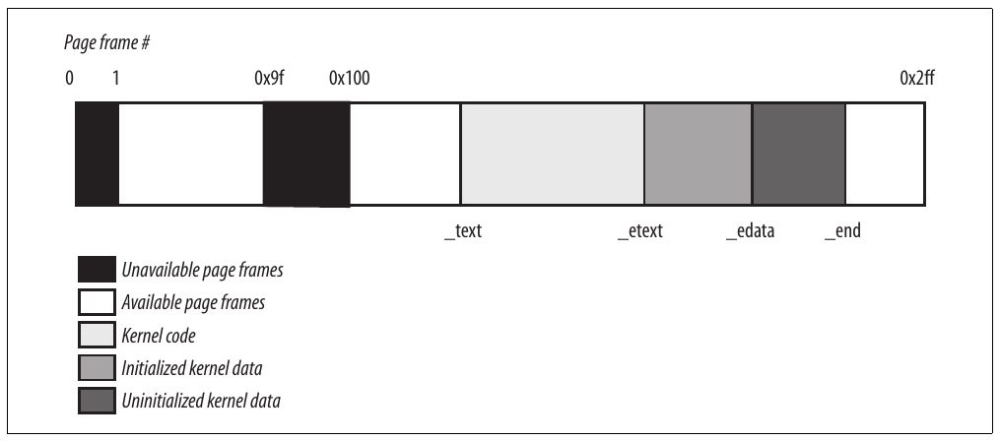

Hình 2-13. 768 page frame đầu (3 MB) trong Linux 2.6

### Process Page Table

Linear address space của process chia thành hai phần:

- Linear address từ `0x00000000` đến `0xbfffffff` có thể được address khi process chạy trong User Mode hoặc Kernel Mode.

- Linear address từ `0xc0000000` đến `0xffffffff` chỉ có thể được address khi process chạy trong Kernel Mode.

Khi process chạy trong User Mode, nó phát linear address nhỏ hơn `0xc0000000`; khi chạy trong Kernel Mode, nó thực thi kernel code và linear address phát ra lớn hơn hoặc bằng `0xc0000000`. Tuy nhiên đôi khi kernel phải truy cập User Mode linear address space để lấy hoặc lưu data.

Macro `PAGE_OFFSET` cho giá trị `0xc0000000`; đây là offset trong linear address space của process nơi kernel nằm. Trong sách, chúng ta thường tham chiếu trực tiếp số `0xc0000000` thay thế.

Nội dung các entry đầu của Page Global Directory map linear address thấp hơn `0xc0000000` (768 entry đầu khi disable PAE hoặc 3 entry đầu khi enable PAE) phụ thuộc process cụ thể. Ngược lại, entry còn lại nên giống nhau cho mọi process và bằng entry tương ứng của master kernel Page Global Directory (xem phần tiếp theo).

### Kernel Page Table

Kernel duy trì tập page table để dùng riêng, có root tại cái gọi là master kernel Page Global Directory. Sau system initialization, tập page table này không bao giờ được process hoặc kernel thread nào dùng trực tiếp; thay vào đó, các entry cao nhất của master kernel Page Global Directory là mô hình tham chiếu cho entry tương ứng của Page Global Directory của mọi regular process trong hệ thống.

Chúng ta giải thích cách kernel bảo đảm thay đổi master kernel Page Global Directory được truyền đến Page Global Directory mà process thực sự dùng trong phần “Linear address của noncontiguous memory area” của Chương 8.

Giờ mô tả cách kernel initialize page table riêng. Đây là hoạt động hai phase. Thực tế ngay sau khi kernel image được load vào memory, CPU vẫn chạy trong real mode; vì vậy paging chưa được enable.

Trong phase đầu, kernel tạo address space hạn chế gồm kernel code và data segment, Page Table ban đầu và 128 KB cho một số dynamic data structure. Address space tối thiểu này chỉ vừa đủ để cài kernel vào RAM và initialize core data structure.

Trong phase thứ hai, kernel tận dụng toàn bộ RAM hiện có và thiết lập page table đúng. Hãy xem cách thực hiện kế hoạch.

#### Kernel Page Table tạm thời

Page Global Directory tạm thời được initialize statically trong kernel compilation, còn Page Table tạm thời được initialize bởi assembly language function `startup_32()` định nghĩa trong arch/i386/kernel/head.S. Chúng ta không nhắc Page Upper Directory và Page Middle Directory nữa vì chúng được đồng nhất với Page Global Directory entry. PAE support chưa được enable ở giai đoạn này.

Page Global Directory tạm thời nằm trong variable `swapper_pg_dir`. Page Table tạm thời được lưu bắt đầu từ `pg0`, ngay sau điểm cuối uninitialized data segment của kernel (symbol `_end` trong Hình 2-13). Để đơn giản, giả sử các segment của kernel, Page Table tạm thời và memory area 128 KB vừa trong 8 MB RAM đầu. Để map 8 MB RAM, cần hai Page Table.

Mục tiêu phase paging đầu là cho phép dễ dàng address 8 MB RAM này trong cả real mode và protected mode. Vì vậy kernel phải tạo mapping từ cả linear address `0x00000000` đến `0x007fffff` và linear address `0xc0000000` đến `0xc07fffff` vào physical address `0x00000000` đến `0x007fffff`. Nói cách khác, trong initialization phase đầu, kernel có thể address 8 MB RAM đầu bằng linear address giống physical address hoặc bằng 8 MB linear address bắt đầu từ `0xc0000000`.

Kernel tạo mapping mong muốn bằng cách điền số 0 vào mọi entry `swapper_pg_dir`, ngoại trừ entry 0, 1, `0x300` (768 thập phân) và `0x301` (769 thập phân); hai entry cuối bao phủ mọi linear address từ `0xc0000000` đến `0xc07fffff`. Các entry 0, 1, `0x300` và `0x301` được initialize như sau:

- Address field của entry 0 và `0x300` đặt thành physical address của `pg0`, còn address field của entry 1 và `0x301` đặt thành physical address của page frame theo sau `pg0`.

- Flag `Present`, `Read/Write` và `User/Supervisor` được set trong cả bốn entry.

- Flag `Accessed`, `Dirty`, `PCD`, `PWD` và `Page Size` được clear trong cả bốn entry.

Assembly language function `startup_32()` cũng enable paging unit. Điều này đạt được bằng cách load physical address của `swapper_pg_dir` vào control register `cr3` và set flag `PG` của control register `cr0`, như code fragment tương đương sau:

```c
movl $swapper_pg_dir-0xc0000000,%eax
movl %eax,%cr3        /* set the page table pointer.. */
movl %cr0,%eax
orl $0x80000000,%eax
movl %eax,%cr0        /* ..and set paging (PG) bit */
```

##### Kernel Page Table cuối cùng khi RAM size nhỏ hơn 896 MB

Mapping cuối cùng do kernel page table cung cấp phải chuyển linear address bắt đầu từ `0xc0000000` thành physical address bắt đầu từ 0.

Macro `__pa` dùng chuyển linear address bắt đầu từ `PAGE_OFFSET` thành physical address tương ứng, còn macro `__va` làm ngược lại.

Master kernel Page Global Directory vẫn lưu trong `swapper_pg_dir`. Nó được initialize bởi function `paging_init()`, thực hiện:

1\. Gọi `pagetable_init()` để thiết lập Page Table entry đúng.

2\. Ghi physical address của `swapper_pg_dir` vào control register `cr3`.

3\. Nếu CPU hỗ trợ PAE và kernel được compile với PAE support, set flag `PAE` trong control register `cr4`.

4\. Gọi `__flush_tlb_all()` để invalidate mọi TLB entry.

Các hành động `pagetable_init()` thực hiện phụ thuộc cả lượng RAM hiện có lẫn CPU model. Bắt đầu với trường hợp đơn giản nhất. Máy tính có dưới 896 MB[^6] RAM, physical address 32-bit đủ address mọi RAM khả dụng và không cần kích hoạt PAE mechanism. (Xem phần “Cơ chế paging Physical Address Extension (PAE)” trước.)

Page Global Directory `swapper_pg_dir` được reinitialize bằng cycle tương đương:

```c
pgd = swapper_pg_dir + pgd_index(PAGE_OFFSET); /* 768 */
phys_addr = 0x00000000;
while (phys_addr < (max_low_pfn * PAGE_SIZE)) {
    pmd = one_md_table_init(pgd); /* returns pgd itself */
    set_pmd(pmd, __pmd(phys_addr | pgprot_val(__pgprot(0x1e3))));
    /* 0x1e3 == Present, Accessed, Dirty, Read/Write,
                Page Size, Global */
    phys_addr += PTRS_PER_PTE * PAGE_SIZE; /* 0x400000 */
    ++pgd;
}
```

Giả định CPU là microprocessor 80×86 gần đây hỗ trợ page 4 MB và “global” TLB entry. Chú ý flag `User/Supervisor` trong mọi Page Global Directory entry tham chiếu linear address trên `0xc0000000` được clear, do đó từ chối process trong User Mode truy cập kernel address space. Cũng chú ý flag `Page Size` được set để kernel có thể address RAM bằng large page (xem phần “Extended paging” trước trong chương).

Identity mapping của những megabyte physical memory đầu (8 MB trong ví dụ) do function `startup_32()` tạo là cần thiết để hoàn tất initialization phase của kernel. Khi mapping không còn cần, kernel clear page table entry tương ứng bằng cách gọi function `zap_low_mappings()`.

Thực tế mô tả này chưa nói toàn bộ sự thật. Như sẽ thấy trong phần “Fix-mapped linear address” sau, kernel còn điều chỉnh entry của Page Table tương ứng “fix-mapped linear address”.

##### Kernel Page Table cuối cùng khi RAM size từ 896 MB đến 4096 MB

Trong trường hợp này, RAM không thể được map toàn bộ vào kernel linear address space. Điều tốt nhất Linux có thể làm trong initialization phase là map RAM window kích thước 896 MB vào kernel linear address space. Nếu program cần address phần khác của RAM hiện có, phải map khoảng linear address khác đến RAM yêu cầu. Điều này có nghĩa thay đổi giá trị một số page table entry. Chúng ta sẽ thảo luận cách dynamic remapping này được thực hiện trong Chương 8.

Để initialize Page Global Directory, kernel dùng cùng code như trường hợp trước.

##### Kernel Page Table cuối cùng khi RAM size lớn hơn 4096 MB

Giờ xét kernel Page Table initialization cho máy tính có hơn 4 GB; chính xác hơn là những trường hợp:

- CPU model hỗ trợ Physical Address Extension (PAE).

- Lượng RAM lớn hơn 4 GB.

- Kernel được compile với PAE support.

Dù PAE xử lý physical address 36-bit, linear address vẫn là address 32-bit. Như trường hợp trước, Linux map RAM window 896-MB vào kernel linear address space; RAM còn lại không được map và được xử lý bằng dynamic remapping như mô tả trong Chương 8. Khác biệt chính so với trường hợp trước là dùng three-level paging model, nên Page Global Directory được initialize bằng cycle tương đương:

```c
pgd_idx = pgd_index(PAGE_OFFSET); /* 3 */
for (i=0; i<pgd_idx; i++)
    set_pgd(swapper_pg_dir + i, __pgd(__pa(empty_zero_page) + 0x001));
    /* 0x001 == Present */
pgd = swapper_pg_dir + pgd_idx;
phys_addr = 0x00000000;
for (; i<PTRS_PER_PGD; ++i, ++pgd) {
    pmd = (pmd_t *) alloc_bootmem_low_pages(PAGE_SIZE);
    set_pgd(pgd, __pgd(__pa(pmd) | 0x001)); /* 0x001 == Present */
    if (phys_addr < max_low_pfn * PAGE_SIZE)
        for (j=0; j < PTRS_PER_PMD /* 512 */
                  && phys_addr < max_low_pfn*PAGE_SIZE; ++j) {
            set_pmd(pmd, __pmd(phys_addr |
                               pgprot_val(__pgprot(0x1e3))));
            /* 0x1e3 == Present, Accessed, Dirty, Read/Write,
                        Page Size, Global */
            phys_addr += PTRS_PER_PTE * PAGE_SIZE; /* 0x200000 */
        }
}
swapper_pg_dir[0] = swapper_pg_dir[pgd_idx];
```

Kernel initialize ba entry đầu của Page Global Directory tương ứng user linear address space bằng address của empty page (`empty_zero_page`). Entry thứ tư được initialize bằng address của Page Middle Directory (`pmd`) allocate qua `alloc_bootmem_low_pages()`. 448 entry đầu trong Page Middle Directory (có 512 entry nhưng 64 entry cuối dành cho noncontiguous memory allocation; xem phần “Quản lý noncontiguous memory area” trong Chương 8) được điền physical address của 896 MB RAM đầu.

Chú ý mọi CPU model hỗ trợ PAE cũng hỗ trợ large page 2-MB và global page. Như trường hợp trước, bất cứ khi nào có thể Linux dùng large page để giảm số Page Table.

Page Global Directory entry thứ tư sau đó được sao chép vào entry đầu để phản chiếu mapping low physical memory trong 896 MB đầu của linear address space. Mapping này cần để hoàn tất initialization của SMP system: khi không còn cần, kernel clear page table entry tương ứng bằng cách gọi function `zap_low_mappings()`, như trường hợp trước.

### Fix-mapped linear address

Đã thấy phần đầu gigabyte thứ tư của kernel linear address map physical memory của hệ thống. Tuy nhiên ít nhất 128 MB linear address luôn được để sẵn vì kernel dùng để triển khai noncontiguous memory allocation và fix-mapped linear address.

Noncontiguous memory allocation chỉ là cách đặc biệt để dynamically allocate và release memory page, được mô tả trong phần “Linear address của noncontiguous memory area” của Chương 8. Trong phần này tập trung fix-mapped linear address.

Về cơ bản, fix-mapped linear address là constant linear address như `0xffffc000` có physical address tương ứng không nhất thiết bằng linear address trừ `0xc000000`, mà là physical address đặt tùy ý. Vì vậy, mỗi fix-mapped linear address map một page frame của physical memory. Như sẽ thấy trong chương sau, kernel dùng fix-mapped linear address thay cho pointer variable không bao giờ đổi giá trị.

Fix-mapped linear address tương tự về khái niệm với linear address map 896 MB RAM đầu. Tuy nhiên, fix-mapped linear address có thể map mọi physical address, còn mapping do linear address trong phần đầu gigabyte thứ tư thiết lập là linear (linear address X map physical address X –`PAGE_OFFSET`).

So với variable pointer, fix-mapped linear address hiệu quả hơn. Thực tế, dereference variable pointer cần thêm một memory access so với dereference immediate constant address. Hơn nữa, kiểm tra giá trị variable pointer trước khi dereference là cách lập trình tốt; ngược lại, constant linear address không bao giờ cần kiểm tra này.

Mỗi fix-mapped linear address được biểu diễn bằng small integer index định nghĩa trong data structure `enum fixed_addresses`:

```c
enum fixed_addresses {
    FIX_HOLE,
    FIX_VSYSCALL,
    FIX_APIC_BASE,
    FIX_IO_APIC_BASE_0,
    [...]
    __end_of_fixed_addresses
};
```

Fix-mapped linear address được đặt ở cuối gigabyte linear address thứ tư. Function `fix_to_virt()` tính constant linear address từ index:

```c
inline unsigned long fix_to_virt(const unsigned int idx)
{
    if (idx >= __end_of_fixed_addresses)
        __this_fixmap_does_not_exist();
    return (0xfffff000UL - (idx << PAGE_SHIFT));
}
```

Giả sử kernel function gọi `fix_to_virt(FIX_IO_APIC_BASE_0)`. Vì function được khai báo “inline”, C compiler không tạo call đến `fix_to_virt()` mà insert code vào calling function. Hơn nữa, kiểm tra index value không bao giờ được thực hiện lúc runtime. Thực tế `FIX_IO_APIC_BASE_0` là constant bằng 3 nên compiler có thể cắt bỏ statement `if` vì condition sai lúc compile. Ngược lại, nếu condition đúng hoặc argument của `fix_to_virt()` không phải constant, compiler báo lỗi trong linking phase vì symbol `__this_fixmap_does_not_exist` không được định nghĩa ở đâu. Cuối cùng compiler tính `0xfffff000-(3<<PAGE_SHIFT)` và thay function call `fix_to_virt()` bằng constant linear address `0xffffc000`.

Để gắn physical address với fix-mapped linear address, kernel dùng macro `set_fixmap(idx,phys)` và `set_fixmap_nocache(idx,phys)`. Cả hai initialize Page Table entry tương ứng linear address `fix_to_virt(idx)` bằng physical address `phys`; tuy nhiên function thứ hai còn set flag `PCD` của Page Table entry, do đó disable hardware cache khi truy cập data trong page frame (xem phần “Hardware cache” trước trong chương). Ngược lại, `clear_fixmap(idx)` loại bỏ liên kết giữa fix-mapped linear address `idx` và physical address.

### Xử lý hardware cache và TLB

Chủ đề memory addressing cuối cùng là cách kernel tận dụng tối ưu hardware cache. Hardware cache và Translation Lookaside Buffer đóng vai trò thiết yếu để tăng performance của computer architecture hiện đại. Kernel developer dùng nhiều kỹ thuật giảm số cache miss và TLB miss.

#### Xử lý hardware cache

Như đã nói trước trong chương, hardware cache được address theo cache line. Macro `L1_CACHE_BYTES` cho kích thước cache line bằng byte. Trên Intel model trước Pentium 4, macro cho giá trị 32; trên Pentium 4, cho 128.

Để tối ưu cache hit rate, kernel cân nhắc architecture khi đưa ra quyết định sau.

- Field dùng thường xuyên nhất của data structure được đặt tại low offset trong data structure để có thể cache trong cùng line.

- Khi allocate tập data structure lớn, kernel cố lưu từng structure trong memory sao cho mọi cache line được dùng đồng đều.

Cache synchronization được microprocessor 80×86 tự động thực hiện nên Linux kernel cho loại processor này không thực hiện hardware cache flushing. Tuy nhiên, kernel có cung cấp cache flushing interface cho processor không synchronize cache.

##### Xử lý TLB

Processor không thể tự synchronize TLB cache vì chính kernel, không phải hardware, quyết định khi nào mapping giữa linear address và physical address không còn hợp lệ.

Linux 2.6 cung cấp nhiều TLB flush method cần áp dụng phù hợp tùy loại page table change (xem Bảng 2-11).

Bảng 2-11. TLB-invalidating method độc lập architecture

| Tên method | Mô tả | Thường dùng khi |
|---|---|---|
| `flush_tlb_all` | Flush mọi TLB entry (bao gồm entry tham chiếu global page, tức page có flag `Global` được set) | Thay đổi kernel page table entry |
| `flush_tlb_kernel_range` | Flush mọi TLB entry trong khoảng linear address cho trước (bao gồm entry tham chiếu global page) | Thay đổi khoảng kernel page table entry |
| `flush_tlb` | Flush mọi TLB entry của non-global page thuộc current process | Thực hiện process switch |
| `flush_tlb_mm` | Flush mọi TLB entry của non-global page thuộc process cho trước | Fork process mới |
| `flush_tlb_range` | Flush TLB entry tương ứng khoảng linear address của process cho trước | Release khoảng linear address của process |
| `flush_tlb_pgtables` | Flush TLB entry của tập con page table liên tục cho trước của process cho trước | Release một số page table của process |
| `flush_tlb_page` | Flush TLB của một Page Table entry của process cho trước | Xử lý Page Fault |

Dù generic Linux kernel cung cấp tập TLB method phong phú, mỗi microprocessor thường cung cấp tập TLB-invalidating assembly language instruction hạn chế hơn nhiều. Về mặt này, một trong những hardware platform linh hoạt hơn là UltraSPARC của Sun. Ngược lại, microprocessor Intel chỉ cung cấp hai kỹ thuật TLB-invalidating:

- Mọi model Pentium tự động flush TLB entry liên quan non-global page khi giá trị được load vào register `cr3`.

- Trong Pentium Pro và model sau, assembly language instruction `invlpg` invalidate một TLB entry map linear address cho trước.

Bảng 2-12 liệt kê Linux macro khai thác các kỹ thuật hardware đó; đây là thành phần cơ bản để triển khai architecture-independent method trong Bảng 2-11.

Bảng 2-12. TLB-invalidating macro cho Intel Pentium Pro và processor sau

| Tên macro | Mô tả | Được dùng bởi |
|---|---|---|
| `__flush_tlb()` | Ghi lại register `cr3` vào chính nó | `flush_tlb, flush_tlb_mm, flush_tlb_range` |
| `__flush_tlb_global()` | Disable global page bằng cách clear flag `PGE` của `cr4`, ghi lại register `cr3` vào chính nó rồi set lại flag `PGE` | `flush_tlb_all`, `flush_tlb_kernel_range` |
| `__flush_tlb_single(addr)` | Thực thi assembly language instruction `invlpg` với parameter `addr` | `flush_tlb_page` |

Chú ý method `flush_tlb_pgtables` không có trong Bảng 2-12: trong architecture 80×86 không cần làm gì khi page table được unlink khỏi parent table, vì vậy function triển khai method này rỗng.

Architecture-independent TLB-invalidating method được mở rộng khá đơn giản sang multiprocessor system. Function chạy trên CPU gửi Interprocessor Interrupt (xem “Xử lý Interprocessor Interrupt” trong Chương 4) đến CPU khác buộc thực thi TLB-invalidating function phù hợp.

Theo quy tắc chung, mọi process switch có nghĩa thay đổi tập active page table. Local TLB entry liên quan page table cũ phải được flush; được thực hiện tự động khi kernel ghi address của Page Global Directory mới vào control register `cr3`. Tuy nhiên kernel tránh được TLB flush trong các trường hợp sau:

- Khi thực hiện process switch giữa hai regular process dùng cùng tập page table (xem phần “Function schedule()” trong Chương 7).

- Khi thực hiện process switch giữa regular process và kernel thread. Thực tế, phần “Memory descriptor của kernel thread” trong Chương 9 sẽ cho thấy kernel thread không có tập page table riêng; thay vào đó dùng tập page table của regular process được schedule thực thi gần nhất trên CPU.

Ngoài process switch, còn trường hợp khác kernel cần flush một số entry trong TLB. Ví dụ, khi kernel cấp page frame cho User Mode process và lưu physical address vào Page Table entry, phải flush mọi local TLB entry tham chiếu linear address tương ứng. Trên multiprocessor system, kernel còn phải flush cùng TLB entry trên CPU đang dùng cùng tập page table, nếu có.

Để tránh TLB flushing vô ích trong multiprocessor system, kernel dùng kỹ thuật lazy TLB mode. Ý tưởng cơ bản như sau: nếu nhiều CPU dùng cùng page table và TLB entry phải được flush trên tất cả CPU đó, đôi khi có thể trì hoãn TLB flushing trên CPU chạy kernel thread.

Thực tế, mỗi kernel thread không có tập page table riêng; thay vào đó dùng tập page table thuộc regular process. Tuy nhiên không cần invalidate TLB entry tham chiếu User Mode linear address vì không kernel thread nào truy cập User Mode address space.[^7]

Khi một số CPU bắt đầu chạy kernel thread, kernel đặt nó vào lazy TLB mode. Khi có request clear một số TLB entry, mỗi CPU trong lazy TLB mode không flush entry tương ứng; tuy nhiên CPU nhớ current process đang chạy trên tập page table có TLB entry cho User Mode address không hợp lệ. Ngay khi CPU trong lazy TLB mode chuyển sang regular process có tập page table khác, hardware tự động flush TLB entry và kernel đưa CPU về non-lazy TLB mode. Tuy nhiên, nếu CPU trong lazy TLB mode chuyển sang regular process sở hữu cùng tập page table kernel thread chạy trước đó dùng, kernel phải thực sự áp dụng mọi TLB invalidation đã trì hoãn. Invalidation “lazy” này thực sự được thực hiện bằng cách flush mọi non-global TLB entry của CPU.

Cần thêm một số data structure để triển khai lazy TLB mode. Variable `cpu_tlbstate` là static array gồm `NR_CPUS` structure (giá trị mặc định macro là 32; biểu thị số CPU tối đa trong hệ thống), gồm field `active_mm` trỏ đến memory descriptor của current process (xem Chương 9) và flag `state` chỉ có thể nhận hai giá trị: `TLBSTATE_OK` (non-lazy TLB mode) hoặc `TLBSTATE_LAZY` (lazy TLB mode). Hơn nữa, mỗi memory descriptor có field `cpu_vm_mask` lưu index của CPU cần nhận Interprocessor Interrupt liên quan TLB flushing. Field chỉ có ý nghĩa khi memory descriptor thuộc process hiện đang thực thi.

Khi CPU bắt đầu thực thi kernel thread, kernel đặt field `state` của phần tử `cpu_tlbstate` tương ứng thành `TLBSTATE_LAZY`; hơn nữa field `cpu_vm_mask` của active memory descriptor lưu index mọi CPU trong hệ thống, gồm cả CPU đang vào lazy TLB mode. Khi CPU khác muốn invalidate TLB entry của mọi CPU liên quan tập page table cho trước, nó gửi Interprocessor Interrupt đến mọi CPU có index nằm trong field `cpu_vm_mask` của memory descriptor tương ứng.

Khi CPU nhận Interprocessor Interrupt liên quan TLB flushing và xác minh ảnh hưởng tập page table của current process, nó kiểm tra field `state` của phần tử `cpu_tlbstate` tương ứng có bằng `TLBSTATE_LAZY` không. Khi đó kernel từ chối invalidate TLB entry và loại CPU index khỏi field `cpu_vm_mask` của memory descriptor. Có hai hệ quả:

- Chừng nào CPU còn trong lazy TLB mode, nó không nhận Interprocessor Interrupt khác liên quan TLB flushing.

- Nếu CPU chuyển sang process khác dùng cùng tập page table với kernel thread đang được thay thế, kernel gọi `__flush_tlb()` để invalidate mọi non-global TLB entry của CPU.

[^1]: Trong thảo luận sau, thuật ngữ “page table” viết thường biểu thị mọi page lưu mapping giữa linear address và physical address, còn thuật ngữ “Page Table” viết hoa biểu thị page ở level cuối của page table.

[^2]: Processor Intel Pentium 4 gần đây có flag `NX` (No eXecute) trong mỗi Page Table entry 64-bit (phải enable PAE, xem phần “Cơ chế paging Physical Address Extension (PAE)” sau trong chương). Linux 2.6.11 hỗ trợ hardware feature này. † Như sẽ thấy trong chương sau, linear address space 3 GB là upper limit, nhưng User Mode process chỉ được phép tham chiếu tập con.

[^3]: Paging level thứ ba trong processor 80<sup>x</sup> 86 có PAE được enable chỉ được đưa vào để giảm số entry trong Page Directory và Page Table từ 1024 xuống 512. Điều này mở rộng Page Table entry từ 32 lên 64 bit để lưu 24 bit trọng số cao nhất của physical address.

[^4]: Thay đổi được thực hiện để hỗ trợ đầy đủ cách phân chia bit linear address của platform x86\_64 (xem Bảng 2-4).

[^5]: Bạn có thể tìm linear address của các symbol này trong file System.map, được tạo ngay sau khi compile kernel.

[^6]: 128 MB linear address cao nhất được để sẵn cho nhiều loại mapping (xem phần “Fix-mapped linear address” sau trong chương và “Linear address của noncontiguous memory area” trong Chương 8). Vì vậy kernel address space còn lại để map RAM là 1 GB – 128 MB = 896 MB.

[^7]: Nhân tiện, method `flush_tlb_all` không dùng lazy TLB mode mechanism; thường được gọi mỗi khi kernel sửa Page Table entry liên quan Kernel Mode address space.
