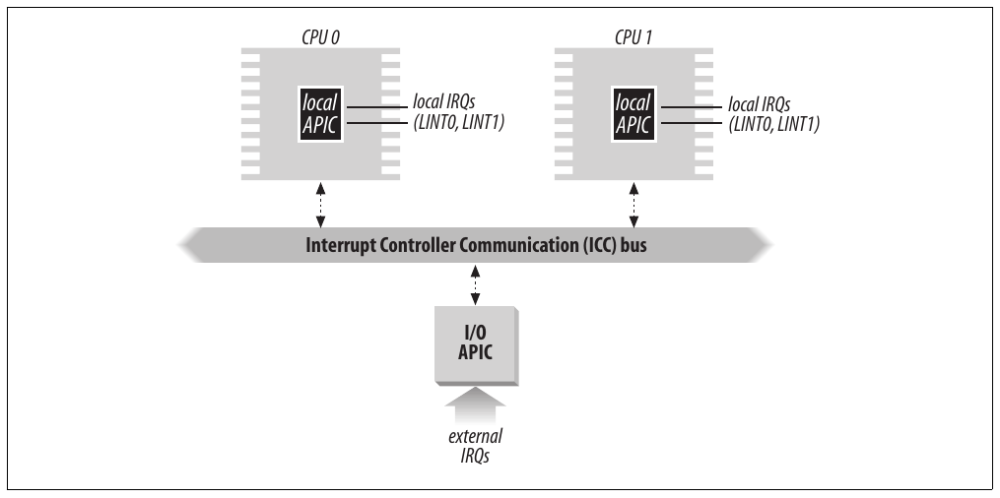
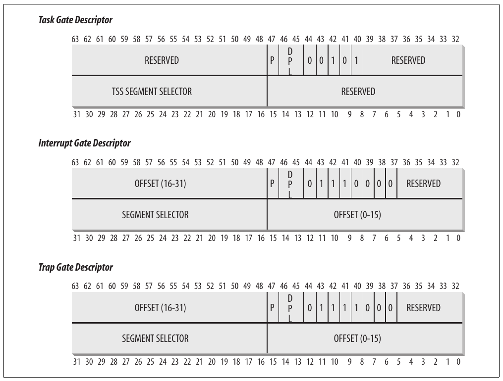
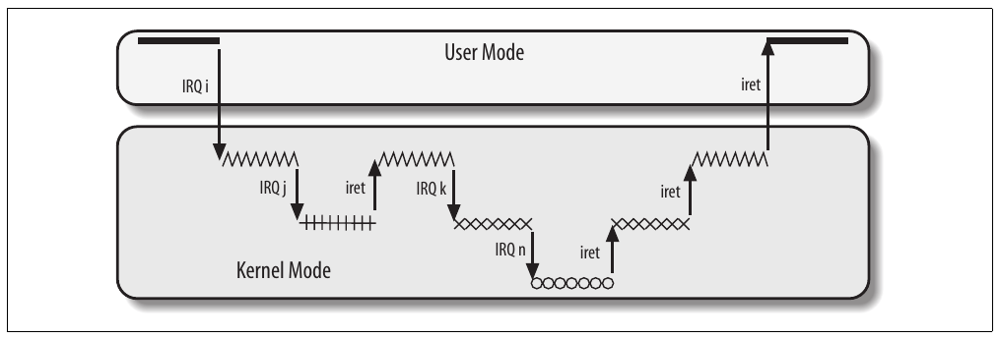
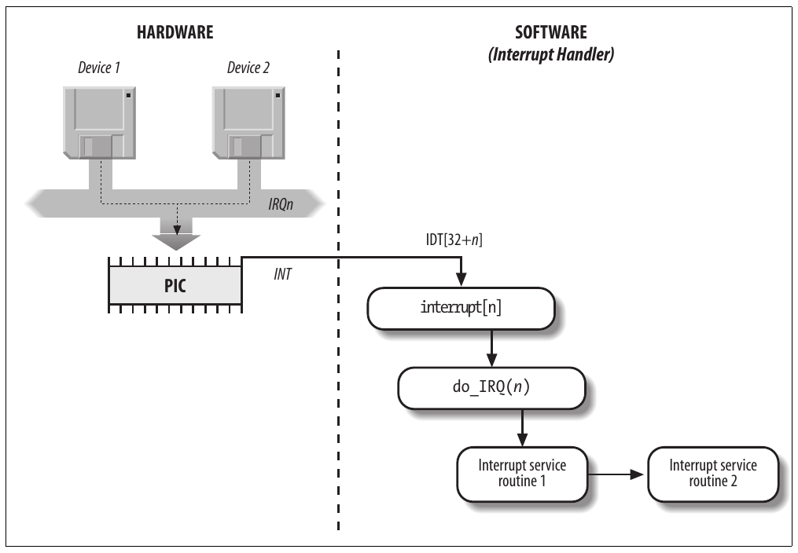
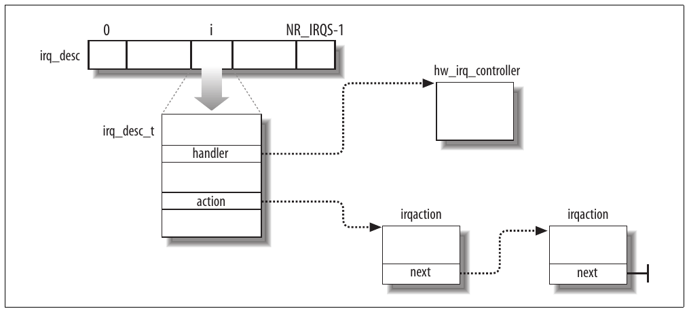
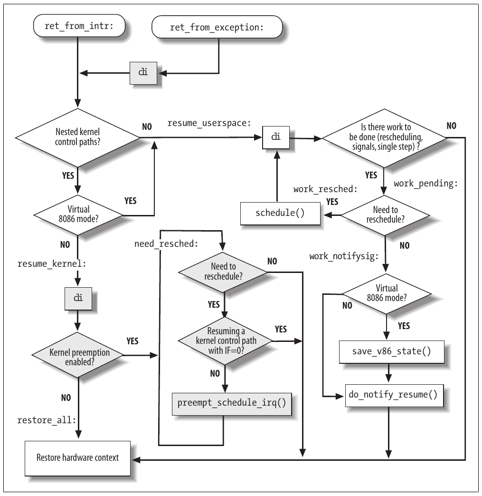

# Chương 4. Interrupt và exception


Interrupt thường được định nghĩa là event thay đổi sequence instruction mà processor thực thi. Các event này tương ứng electrical signal do hardware circuit bên trong và bên ngoài CPU chip tạo ra.

Interrupt thường được chia thành synchronous interrupt và asynchronous interrupt:

- Synchronous interrupt do CPU control unit tạo khi thực thi instruction, được gọi là synchronous vì control unit chỉ phát sau khi hoàn tất execution của instruction.

- Asynchronous interrupt do hardware device khác tạo tại thời điểm tùy ý so với CPU clock signal.

Manual microprocessor Intel lần lượt gọi synchronous interrupt và asynchronous interrupt là exception và interrupt. Chúng ta theo cách phân loại này, dù đôi khi dùng thuật ngữ “interrupt signal” để chỉ chung cả hai loại (synchronous lẫn asynchronous).

Interrupt do interval timer và I/O device phát; chẳng hạn, keystroke từ người dùng đến sẽ kích hoạt interrupt.

Ngược lại, exception do lỗi lập trình hoặc điều kiện bất thường mà kernel phải xử lý gây ra. Trường hợp đầu, kernel xử lý exception bằng cách chuyển đến current process một signal quen thuộc với mọi lập trình viên Unix. Trường hợp thứ hai, kernel thực hiện mọi bước cần để phục hồi từ điều kiện bất thường, như Page Fault hoặc request kernel service qua assembly language instruction như `int` hoặc `sysenter`.

Ở phần tiếp theo, chúng ta bắt đầu mô tả lý do đưa vào các signal này. Sau đó trình bày cách IRQ (Interrupt ReQuest) quen thuộc do I/O device phát tạo interrupt và mô tả chi tiết cách processor 80×86 xử lý interrupt và exception ở hardware level. Tiếp theo, trong phần “Initialize Interrupt Descriptor Table”, minh họa cách Linux initialize mọi data structure mà interrupt architecture 80×86 yêu cầu. Ba phần còn lại mô tả cách Linux xử lý interrupt signal ở software level.

Lưu ý trước khi tiếp tục: chương này chỉ trình bày interrupt “kinh điển” chung cho mọi PC; không trình bày nonstandard interrupt của một số architecture.

## Vai trò của interrupt signal

Như tên gọi, interrupt signal cung cấp cách chuyển hướng processor đến code ngoài control flow bình thường. Khi interrupt signal đến, CPU phải dừng việc đang làm và chuyển sang hoạt động mới; thực hiện bằng cách lưu giá trị program counter hiện tại (tức nội dung register `eip` và `cs`) vào Kernel Mode stack và đặt address liên quan interrupt type vào program counter.

Một số nội dung chương này gợi nhớ context switch ở chương trước, thực hiện khi kernel thay process này bằng process khác. Nhưng có khác biệt chính giữa interrupt handling và process switching: code do interrupt hoặc exception handler thực thi không phải process. Đó là kernel control path chạy bằng thời gian của chính process đang chạy lúc interrupt xảy ra (xem phần “Execution lồng nhau của exception handler và interrupt handler” sau). Là kernel control path, interrupt handler nhẹ hơn process (ít context hơn và cần ít thời gian thiết lập hoặc dỡ bỏ hơn).

Interrupt handling là một trong những task nhạy cảm nhất kernel thực hiện vì phải đáp ứng các ràng buộc sau:

- Interrupt có thể đến bất cứ lúc nào, khi kernel có thể muốn hoàn thành việc khác đang cố làm. Vì vậy mục tiêu kernel là xử lý xong phần interrupt sớm nhất có thể và trì hoãn nhiều processing nhất có thể. Ví dụ, giả sử block data đến trên network line. Khi hardware interrupt kernel, kernel có thể chỉ đánh dấu data đã có, trả processor cho phần đang chạy trước đó và thực hiện processing còn lại sau (như chuyển data vào buffer để recipient process tìm thấy rồi restart process). Vì vậy hoạt động kernel cần thực hiện để đáp ứng interrupt được chia thành phần thiết yếu khẩn cấp thực thi ngay và phần có thể trì hoãn để lại sau.

- Vì interrupt có thể đến bất cứ lúc nào, kernel có thể đang xử lý một interrupt khi interrupt khác (thuộc type khác) xảy ra. Nên cho phép tối đa vì giúp I/O device luôn bận (xem phần “Execution lồng nhau của exception handler và interrupt handler” sau). Do đó interrupt handler phải được viết để kernel control path tương ứng có thể thực thi lồng nhau. Khi kernel control path cuối kết thúc, kernel phải tiếp tục được execution của process bị interrupt hoặc switch sang process khác nếu interrupt signal gây rescheduling.

- Dù kernel có thể nhận interrupt signal mới khi đang xử lý interrupt trước, trong kernel code vẫn có critical region phải disable interrupt. Các critical region phải được hạn chế tối đa vì theo yêu cầu trước, kernel, đặc biệt interrupt handler, nên chạy phần lớn thời gian với interrupt được enable.

## Interrupt và exception

Intel documentation phân loại interrupt và exception như sau:

- Interrupt:

Maskable interrupt

Mọi Interrupt Request (IRQ) do I/O device phát tạo maskable interrupt. Maskable interrupt có thể ở hai state: masked hoặc unmasked; masked interrupt bị control unit bỏ qua chừng nào còn masked.

Nonmaskable interrupt

Chỉ một vài critical event (như hardware failure) tạo nonmaskable interrupt. CPU luôn nhận biết nonmaskable interrupt.

- Exception:

Processor-detected exception

Được tạo khi CPU phát hiện điều kiện bất thường lúc thực thi instruction. Chia tiếp thành ba nhóm tùy giá trị register `eip` lưu trên Kernel Mode stack khi CPU control unit phát exception.

Fault

Nhìn chung có thể sửa; sau khi sửa, chương trình được restart mà không mất tính liên tục. Giá trị `eip` đã lưu là address instruction gây fault nên instruction có thể tiếp tục khi exception handler kết thúc. Như sẽ thấy trong phần “Page Fault Exception Handler” của Chương 9, tiếp tục cùng instruction là cần thiết bất cứ khi nào handler sửa được điều kiện bất thường gây exception.

Trap

Được báo ngay sau execution của trapping instruction; sau khi kernel trả quyền điều khiển cho chương trình, chương trình được tiếp tục execution mà không mất tính liên tục. Giá trị `eip` đã lưu là address instruction nên thực thi sau instruction gây trap. Trap chỉ được kích hoạt khi không cần thực thi lại instruction đã kết thúc. Công dụng chính của trap là debugging. Vai trò interrupt signal trong trường hợp này là thông báo debugger rằng instruction cụ thể đã thực thi (ví dụ đã đến breakpoint trong chương trình). Khi người dùng xem xét data debugger cung cấp, có thể yêu cầu tiếp tục execution chương trình đang debug từ instruction tiếp theo.

Abort

Lỗi nghiêm trọng đã xảy ra; control unit gặp vấn đề và có thể không lưu được vào register `eip` vị trí chính xác của instruction gây exception. Abort dùng báo lỗi nghiêm trọng như hardware failure và giá trị không hợp lệ hoặc không nhất quán trong system table. Interrupt signal do control unit gửi là emergency signal dùng chuyển quyền điều khiển đến abort exception handler tương ứng. Handler này không có lựa chọn ngoài buộc process chịu tác động kết thúc.

Programmed exception

Xảy ra theo yêu cầu lập trình viên. Được kích hoạt bởi instruction `int` hoặc `int3`; instruction `into` (kiểm tra overflow) và `bound` (kiểm tra address bound) cũng tạo programmed exception khi điều kiện đang kiểm tra không đúng. Control unit xử lý programmed exception như trap; thường gọi là software interrupt. Exception này có hai công dụng phổ biến: triển khai system call và thông báo debugger về event cụ thể (xem Chương 10).

Mỗi interrupt hoặc exception được nhận diện bằng số từ 0 đến 255; Intel gọi unsigned number 8-bit này là vector. Vector của nonmaskable interrupt và exception cố định, còn vector maskable interrupt có thể đổi bằng lập trình Interrupt Controller (xem phần tiếp theo).

### IRQ và interrupt

Mỗi hardware device controller có khả năng phát interrupt request thường có một output line gọi là Interrupt ReQuest (IRQ) line.[^1] Mọi IRQ line hiện có nối với input pin của hardware circuit gọi là Programmable Interrupt Controller, thực hiện:

1\. Theo dõi IRQ line, kiểm tra signal được phát. Nếu từ hai IRQ line trở lên được phát, chọn line có pin number thấp hơn.

2\. Nếu signal được phát trên IRQ line:

a. Chuyển signal nhận được thành vector tương ứng.

b. Lưu vector trong I/O port của Interrupt Controller để CPU đọc qua data bus.

c. Gửi signal đến pin INTR của processor — tức phát interrupt.

d. Chờ CPU acknowledge interrupt signal bằng cách ghi vào một I/O port của Programmable Interrupt Controller (PIC); khi xảy ra, clear INTR line.

3\. Quay về bước 1.

IRQ line được đánh số tuần tự từ 0; vì vậy IRQ line đầu thường được ký hiệu IRQ0. Vector mặc định Intel gắn với IRQn là n+32. Như đề cập trước, mapping giữa IRQ và vector có thể sửa bằng cách phát I/O instruction phù hợp đến Interrupt Controller port.

Mỗi IRQ line có thể được disable có chọn lọc. Vì vậy có thể lập trình PIC disable IRQ. Tức yêu cầu PIC ngừng phát interrupt tham chiếu IRQ line cho trước hoặc tiếp tục phát. Interrupt bị disable không bị mất; PIC gửi đến CPU ngay khi được enable lại. Phần lớn interrupt handler dùng tính năng này vì cho phép xử lý IRQ cùng type tuần tự.

Enable/disable IRQ có chọn lọc không giống global masking/unmasking maskable interrupt. Khi flag `IF` của register `eflags` được clear, CPU tạm bỏ qua mỗi maskable interrupt PIC phát. Assembly language instruction `cli` và `sti` lần lượt clear và set flag đó.

PIC truyền thống được triển khai bằng cách nối “cascade” hai external chip kiểu 8259A. Mỗi chip xử lý được tối đa tám IRQ input line khác nhau. Vì INT output line của slave PIC nối với pin IRQ2 của master PIC, số IRQ line khả dụng bị giới hạn ở 15.

#### Advanced Programmable Interrupt Controller (APIC)

Mô tả trước nói về PIC thiết kế cho uniprocessor system. Nếu hệ thống có một CPU, output line của master PIC có thể nối trực tiếp với pin INTR của CPU. Tuy nhiên nếu có từ hai CPU trở lên, cách này không còn hợp lệ và cần PIC tinh vi hơn.

Khả năng chuyển interrupt đến mỗi CPU trong hệ thống là thiết yếu để khai thác đầy đủ tính song song của SMP architecture. Vì vậy từ Pentium III, Intel giới thiệu thành phần mới gọi là I/O Advanced Programmable Interrupt Controller (I/O APIC). Chip là phiên bản nâng cao của Programmable Interrupt Controller 8259A cũ; để hỗ trợ hệ điều hành cũ, motherboard gần đây có cả hai loại chip. Hơn nữa mọi microprocessor 80×86 hiện tại đều có local APIC. Mỗi local APIC có register 32-bit, internal clock; local timer device; và hai IRQ line bổ sung LINT0 và LINT1 dành cho local APIC interrupt. Mọi local APIC nối với external I/O APIC, tạo multi-APIC system.

Hình 4-1 minh họa sơ lược cấu trúc multi-APIC system. APIC bus nối “frontend” I/O APIC với local APIC. IRQ line từ device nối với I/O APIC, do đó I/O APIC đóng vai trò router đối với local APIC. Trong motherboard của Pentium III và processor trước đó, APIC bus là serial bus ba line; từ Pentium 4, APIC bus được triển khai bằng system bus. Tuy nhiên vì APIC bus và message vô hình với software, chúng ta không trình bày thêm chi tiết.



Hình 4-1. Multi-APIC system

I/O APIC gồm tập 24 IRQ line, Interrupt Redirection Table 24-entry, programmable register và message unit để gửi, nhận APIC message qua APIC bus. Khác IRQ pin của 8259A, interrupt priority không liên quan pin number: mỗi Redirection Table entry có thể lập trình riêng để chỉ định interrupt vector và priority, destination processor và cách chọn processor. Thông tin trong Redirection Table dùng chuyển mỗi external IRQ signal thành message đến một hoặc nhiều local APIC unit qua APIC bus.

Interrupt request từ external hardware device có thể phân phối giữa CPU khả dụng theo hai cách:

Static distribution

IRQ signal được chuyển đến local APIC liệt kê trong Redirection Table entry tương ứng. Interrupt được chuyển đến một CPU cụ thể, tập con CPU hoặc mọi CPU cùng lúc (broadcast mode).

Dynamic distribution

IRQ signal được chuyển đến local APIC của processor đang thực thi process có priority thấp nhất.

Mỗi local APIC có programmable task priority register (TPR), dùng tính priority của currently running process. Intel kỳ vọng kernel hệ điều hành sửa register này ở mỗi process switch.

Nếu từ hai CPU trở lên cùng có priority thấp nhất, load được phân phối giữa chúng bằng kỹ thuật arbitration. Mỗi CPU được cấp arbitration priority khác nhau từ 0 (thấp nhất) đến 15 (cao nhất) trong arbitration priority register của local APIC.

Mỗi khi interrupt được chuyển đến CPU, arbitration priority tương ứng tự động đặt thành 0, còn arbitration priority của CPU khác tăng lên. Khi arbitration priority register lớn hơn 15, được đặt bằng arbitration priority trước đó của CPU thắng cộng 1. Vì vậy interrupt được phân phối theo round-robin giữa CPU cùng task priority.[^2]

Ngoài phân phối interrupt giữa processor, multi-APIC system cho phép CPU tạo interprocessor interrupt. Khi CPU muốn gửi interrupt đến CPU khác, lưu interrupt vector và identifier của local APIC đích trong Interrupt Command Register (ICR) của local APIC riêng. Message sau đó được gửi qua APIC bus đến local APIC đích, nhờ vậy phát interrupt tương ứng đến CPU của nó.

Interprocessor interrupt (gọi tắt IPI) là thành phần thiết yếu của SMP architecture. Linux tích cực dùng để trao đổi message giữa CPU (xem sau trong chương).

Nhiều uniprocessor system hiện tại có I/O APIC chip, có thể configure theo hai cách khác nhau:

- Là external PIC chuẩn kiểu 8259A nối CPU. Local APIC bị disable và hai local IRQ line LINT0 và LINT1 lần lượt được configure thành pin INTR và NMI.

- Là external I/O APIC chuẩn. Local APIC được enable và mọi external interrupt nhận qua I/O APIC.

### Exception

Microprocessor 80×86 phát khoảng 20 exception khác nhau.[^3] Kernel phải cung cấp exception handler riêng cho mỗi exception type. Với một số exception, CPU control unit còn tạo hardware error code và push lên Kernel Mode stack trước khi bắt đầu exception handler.

Danh sách sau nêu vector, tên, type và mô tả ngắn các exception trong processor 80×86. Có thể tìm thêm thông tin trong Intel technical documentation.

0 - “Divide error” (fault)

Được phát khi chương trình thực hiện integer division cho 0.

1- “Debug” (trap hoặc fault)

Được phát khi flag `TF` của `eflags` được set (rất hữu ích để triển khai single-step execution của chương trình đang debug) hoặc khi address của instruction hay operand nằm trong khoảng của active debug register (xem phần “Hardware context” trong Chương 3).

2 - Không dùng

Dành cho nonmaskable interrupt (dùng pin NMI).

3 - “Breakpoint” (trap)

Do instruction `int3` (breakpoint) gây ra (thường do debugger insert).

4 - “Overflow” (trap)

Instruction `into` (kiểm tra overflow) đã được thực thi khi flag `OF` (overflow) của `eflags` được set.

5 - “Bounds check” (fault)

Instruction `bound` (kiểm tra address bound) được thực thi với operand ngoài address bound hợp lệ.

6 - “Invalid opcode” (fault)

CPU execution unit phát hiện invalid opcode (phần machine instruction xác định operation thực hiện).

7 - “Device not available” (fault)

Instruction ESCAPE, MMX hoặc SSE/SSE2 đã thực thi với flag `TS` của `cr0` được set (xem phần “Lưu và load register FPU, MMX và XMM” trong Chương 3).

8 - “Double fault” (abort)

Thông thường khi CPU phát hiện exception trong lúc cố gọi handler cho exception trước, hai exception có thể được xử lý tuần tự. Tuy nhiên trong một vài trường hợp processor không thể xử lý tuần tự nên phát exception này.

9 - “Coprocessor segment overrun” (abort)

Vấn đề với external mathematical coprocessor (chỉ áp dụng microprocessor 80386 cũ).

10 - “Invalid TSS” (fault)

CPU đã cố context switch đến process có Task State Segment không hợp lệ.

11 - “Segment not present” (fault)

Đã tham chiếu segment không có trong memory (segment có flag `Segment-Present` của Segment Descriptor được clear). 12 - “Stack segment fault” (fault) Instruction cố vượt stack segment limit hoặc segment được `ss` nhận diện không có trong memory.

13 - “General protection” (fault)

Một protection rule trong protected mode của 80×86 đã bị vi phạm.

14 - “Page Fault” (fault)

Page được address không có trong memory, Page Table entry tương ứng là null hoặc paging protection mechanism bị vi phạm.

15 - Intel dành riêng

16 - “Floating-point error” (fault)

Floating-point unit tích hợp trong CPU chip đã báo error condition như numeric overflow hoặc chia cho 0.[^4]

17 - “Alignment check” (fault)

Address của operand không được align đúng (ví dụ address của long integer không là bội số 4).

18 - “Machine check” (abort)

Machine-check mechanism phát hiện CPU error hoặc bus error.

19 - “SIMD floating point exception” (fault)

SSE hoặc SSE2 unit tích hợp trong CPU chip đã báo error condition trên floating-point operation.

Giá trị từ 20 đến 31 được Intel dành cho phát triển tương lai. Như Bảng 4-1 minh họa, mỗi exception do exception handler cụ thể xử lý (xem phần “Exception handling” sau trong chương), thường gửi Unix signal đến process gây exception.

Bảng 4-1. Signal do exception handler gửi

| \# | Exception | Exception handler | Signal |
|---|---|---|---|
| 0 | Divide error | `divide_error()` | `SIGFPE` |
| 1 | Debug | `debug()` | `SIGTRAP` |
| 2 | NMI | `nmi()` | Không có |
| 3 | Breakpoint | `int3()` | `SIGTRAP` |
| 4 | Overflow | `overflow()` | `SIGSEGV` |
| 5 | Bounds check | `bounds()` | `SIGSEGV` |
| 6 | Invalid opcode | `invalid_op()` | `SIGILL` |
| 7 | Device not available | `device_not_available()` | Không có |
| 8 | Double fault | `doublefault_fn()` | Không có |
| 9 | Coprocessor segment overrun | `coprocessor_segment_overrun()` | `SIGFPE` |
| 10 | Invalid TSS | `invalid_TSS()` | `SIGSEGV` |
| 11 | Segment not present | `segment_not_present()` | `SIGBUS` |
| 12 | Stack segment fault | `stack_segment()` | `SIGBUS` |
| 13 | General protection | `general_protection()` | `SIGSEGV` |
| 14 | Page Fault | `page_fault()` | `SIGSEGV` |
| 15 | Intel dành riêng | Không có | Không có |
| 16 | Floating-point error | `coprocessor_error()` | `SIGFPE` |
| 17 | Alignment check | `alignment_check()` | `SIGBUS` |
| 18 | Machine check | `machine_check()` | Không có |
| 19 | SIMD floating point | `simd_coprocessor_error()` | `SIGFPE` |

### Interrupt Descriptor Table

System table tên Interrupt Descriptor Table (IDT) gắn mỗi interrupt hoặc exception vector với address của interrupt hoặc exception handler tương ứng. IDT phải được initialize đúng trước khi kernel enable interrupt.

Format IDT tương tự GDT và LDT đã xem trong Chương 2. Mỗi entry tương ứng interrupt hoặc exception vector và gồm descriptor 8-byte. Vì vậy cần tối đa 256×8=2048 byte lưu IDT.

CPU register `idtr` cho phép đặt IDT ở bất kỳ đâu trong memory: chỉ định cả IDT base linear address và limit (độ dài tối đa). Phải initialize trước khi enable interrupt bằng assembly language instruction `lidt`.

IDT có thể chứa ba loại descriptor; Hình 4-2 minh họa ý nghĩa 64 bit trong mỗi loại. Cụ thể giá trị field `Type` encode trong bit 40–43 nhận diện descriptor type.



Hình 4-2. Format gate descriptor

Các descriptor là:

Task gate

Chứa TSS selector của process phải thay current process khi interrupt signal xảy ra.

Interrupt gate

Chứa Segment Selector và offset bên trong segment của interrupt hoặc exception handler. Khi chuyển quyền điều khiển đến segment phù hợp, processor clear flag `IF`, do đó disable maskable interrupt tiếp theo.

Trap gate

Tương tự interrupt gate, ngoại trừ khi chuyển quyền điều khiển đến segment phù hợp, processor không sửa flag `IF`.

Như sẽ thấy trong phần “Interrupt gate, trap gate và system gate” sau, Linux dùng interrupt gate xử lý interrupt và trap gate xử lý exception.[^5]

### Hardware xử lý interrupt và exception

Giờ mô tả cách CPU control unit xử lý interrupt và exception. Giả định kernel đã initialize nên CPU hoạt động trong Protected Mode.

Sau khi thực thi instruction, cặp register `cs` và `eip` chứa logical address của instruction tiếp theo cần thực thi. Trước khi xử lý instruction đó, control unit kiểm tra interrupt hoặc exception có xảy ra khi thực thi instruction trước không. Nếu có, control unit thực hiện:

1\. Xác định vector i (0≤i ≤255) gắn với interrupt hoặc exception.

2\. Đọc entry thứ i<sup>th</sup> của IDT do register `idtr` tham chiếu (trong mô tả sau giả định entry chứa interrupt gate hoặc trap gate).

3\. Lấy base address của GDT từ register `gdtr` và tìm trong GDT để đọc Segment Descriptor được selector trong IDT entry nhận diện. Descriptor chỉ định base address của segment chứa interrupt hoặc exception handler.

4\. Bảo đảm interrupt được nguồn có quyền phát. Trước tiên so Current Privilege Level (CPL), lưu trong hai bit trọng số thấp nhất của register `cs`, với Descriptor Privilege Level (DPL) của Segment Descriptor trong GDT. Phát exception “General protection” nếu CPL thấp hơn DPL vì interrupt handler không thể có privilege thấp hơn chương trình gây interrupt. Với programmed exception, thực hiện security check bổ sung: so CPL với DPL của gate descriptor trong IDT và phát exception “General protection” nếu DPL thấp hơn CPL. Kiểm tra cuối cho phép ngăn user application truy cập trap gate hoặc interrupt gate cụ thể.

5\. Kiểm tra có privilege level change không — tức CPL khác DPL của Segment Descriptor đã chọn. Nếu có, control unit phải bắt đầu dùng stack gắn với privilege level mới. Thực hiện các bước:

a. Đọc register `tr` để truy cập TSS segment của running process.

b. Load register `ss` và `esp` bằng giá trị phù hợp cho stack segment và stack pointer gắn với privilege level mới. Giá trị nằm trong TSS (xem phần “Task State Segment” trong Chương 3).

c. Trong stack mới, lưu giá trị trước của `ss` và `esp`, xác định logical address của stack gắn với privilege level cũ.

6\. Nếu fault xảy ra, load `cs` và `eip` bằng logical address của instruction gây exception để có thể thực thi lại.

7\. Lưu nội dung `eflags`, `cs` và `eip` trong stack.

8\. Nếu exception mang hardware error code, lưu trên stack.

9\. Load `cs` và `eip` lần lượt bằng field Segment Selector và Offset của Gate Descriptor lưu trong entry thứ i<sup>th</sup> của IDT. Các giá trị xác định logical address của instruction đầu trong interrupt hoặc exception handler.

Bước cuối control unit thực hiện tương đương jump đến interrupt hoặc exception handler. Nói cách khác, instruction control unit xử lý sau interrupt signal là instruction đầu của handler đã chọn.

Sau khi xử lý interrupt hoặc exception, handler tương ứng phải nhường quyền điều khiển cho interrupted process bằng instruction `iret`, buộc control unit:

1\. Load register `cs`, `eip` và `eflags` bằng giá trị lưu trên stack. Nếu hardware error code được push lên stack trên nội dung `eip`, phải pop trước khi thực thi `iret`.

2\. Kiểm tra CPL của handler có bằng giá trị trong hai bit trọng số thấp nhất của `cs` không (nghĩa là interrupted process đã chạy cùng privilege level với handler). Nếu có, `iret` hoàn tất execution; nếu không đi bước tiếp theo.

3\. Load register `ss` và `esp` từ stack và trở lại stack gắn với privilege level cũ.

4\. Xem nội dung segment register `ds`, `es`, `fs` và `gs`; nếu bất kỳ register nào chứa selector tham chiếu Segment Descriptor có DPL thấp hơn CPL, clear segment register tương ứng. Control unit làm vậy để cấm User Mode program chạy với CPL bằng 3 dùng segment register kernel routine từng dùng (DPL bằng 0). Nếu không clear register, User Mode program độc hại có thể khai thác để truy cập kernel address space.

## Execution lồng nhau của exception handler và interrupt handler

Mỗi interrupt hoặc exception tạo kernel control path hay instruction sequence riêng thực thi trong Kernel Mode thay mặt current process. Ví dụ khi I/O device phát interrupt, instruction đầu của kernel control path tương ứng lưu nội dung CPU register trong Kernel Mode stack, còn instruction cuối khôi phục nội dung register.

Kernel control path có thể lồng nhau tùy ý; interrupt handler có thể bị interrupt handler khác interrupt, tạo execution lồng nhau của kernel control path như Hình 4-3. Vì vậy instruction cuối của kernel control path xử lý interrupt không luôn đưa current process về User Mode: nếu nesting level lớn hơn 1, instruction đưa vào execution kernel control path bị interrupt gần nhất và CPU tiếp tục chạy trong Kernel Mode.



Hình 4-3. Ví dụ execution lồng nhau của kernel control path

Cái giá cho phép kernel control path lồng nhau là interrupt handler không bao giờ được block, tức không process switch nào được diễn ra khi interrupt handler đang chạy. Thực tế toàn bộ data cần để tiếp tục nested kernel control path lưu trong Kernel Mode stack gắn chặt với current process.

Giả định kernel không có bug, phần lớn exception chỉ xảy ra khi CPU trong User Mode. Thật vậy, chúng do lỗi lập trình hoặc debugger kích hoạt. Tuy nhiên exception “Page Fault” có thể xảy ra trong Kernel Mode. Điều này xảy ra khi process cố address page thuộc address space của nó nhưng hiện không trong RAM. Khi xử lý exception này, kernel có thể suspend current process và thay bằng process khác đến khi page yêu cầu có sẵn. Kernel control path xử lý exception “Page Fault” tiếp tục execution ngay khi process lại nhận processor.

Vì exception handler “Page Fault” không bao giờ tạo exception tiếp theo, tối đa hai kernel control path gắn với exception (path đầu do system call invocation, path thứ hai do Page Fault) có thể được stack lên nhau.

Khác exception, interrupt do I/O device phát không tham chiếu data structure riêng của current process, dù kernel control path xử lý chạy thay mặt process đó. Thực tế không thể dự đoán process nào chạy khi interrupt cho trước xảy ra.

Interrupt handler có thể preempt cả interrupt handler khác lẫn exception handler. Ngược lại, exception handler không bao giờ preempt interrupt handler. Exception duy nhất có thể kích hoạt trong Kernel Mode là “Page Fault” vừa mô tả. Nhưng interrupt handler không bao giờ thực hiện operation có thể gây page fault và do đó có khả năng gây process switch.

Linux xen kẽ kernel control path vì hai lý do chính:

- Cải thiện throughput của programmable interrupt controller và device controller. Giả sử device controller phát signal trên IRQ line: PIC chuyển thành external interrupt, rồi cả PIC lẫn device controller đều bị block đến khi PIC nhận acknowledgment từ CPU. Nhờ kernel control path interleaving, kernel gửi được acknowledgment ngay cả khi đang xử lý interrupt trước.

- Triển khai interrupt model không có priority level. Vì mỗi interrupt handler có thể bị handler khác trì hoãn, không cần thiết lập priority định trước giữa hardware device. Điều này đơn giản hóa kernel code và tăng portability.

Trên multiprocessor system, nhiều kernel control path có thể thực thi đồng thời. Hơn nữa kernel control path gắn với exception có thể bắt đầu thực thi trên CPU này rồi migrate sang CPU khác do process switch.

## Initialize Interrupt Descriptor Table

Giờ đã hiểu microprocessor 80×86 làm gì với interrupt và exception ở hardware level, có thể tiếp tục mô tả cách initialize Interrupt Descriptor Table.

Nhớ rằng trước khi kernel enable interrupt, phải load initial address của IDT table vào register `idtr` và initialize mọi entry. Hoạt động này diễn ra trong system initialization (xem Phụ lục A).

Instruction `int` cho phép User Mode process phát interrupt signal có vector tùy ý từ 0 đến 255. Vì vậy phải initialize IDT cẩn thận để chặn interrupt và exception trái phép do User Mode process mô phỏng qua instruction `int`. Có thể làm bằng cách đặt field DPL của Interrupt hoặc Trap Gate Descriptor cụ thể thành 0. Nếu process cố phát một trong các interrupt signal này, control unit kiểm tra CPL so với field DPL và phát exception “General protection”.

Tuy nhiên trong một vài trường hợp, User Mode process phải phát được programmed exception. Để cho phép, chỉ cần đặt field DPL của Interrupt hoặc Trap Gate Descriptor tương ứng thành 3 — tức cao nhất có thể.

Giờ xem Linux triển khai strategy này thế nào.

### Interrupt gate, trap gate và system gate

Như đề cập trong phần “Interrupt Descriptor Table” trước, Intel cung cấp ba loại interrupt descriptor: Task, Interrupt và Trap Gate Descriptor. Linux dùng phân loại và thuật ngữ hơi khác Intel khi phân loại interrupt descriptor trong Interrupt Descriptor Table:

Interrupt gate

Intel interrupt gate mà User Mode process không thể truy cập (field DPL của gate bằng 0). Mọi Linux interrupt handler được kích hoạt qua interrupt gate và đều bị giới hạn trong Kernel Mode.

System gate

Intel trap gate mà User Mode process có thể truy cập (field DPL của gate bằng 3). Ba Linux exception handler gắn với vector 4, 5 và 128 được kích hoạt qua system gate nên ba assembly language instruction `into`, `bound` và `int $0x80` có thể được thực hiện trong User Mode.

System interrupt gate

Intel interrupt gate mà User Mode process có thể truy cập (field DPL của gate bằng 3). Exception handler gắn với vector 3 được kích hoạt qua system interrupt gate nên assembly language instruction `int3` có thể được thực hiện trong User Mode.

Trap gate

Intel trap gate mà User Mode process không thể truy cập (field DPL của gate bằng 0). Phần lớn Linux exception handler được kích hoạt qua trap gate.

Task gate

Intel task gate mà User Mode process không thể truy cập (field DPL của gate bằng 0). Linux handler cho exception “Double fault” được kích hoạt qua task gate.

Các architecture-dependent function sau dùng insert gate vào IDT:

`set_intr_gate(n,addr)`

Insert interrupt gate vào IDT entry thứ n<sup>th</sup>. Segment Selector trong gate được đặt thành Segment Selector của kernel code. Field Offset đặt thành `addr`, là address interrupt handler. Field DPL đặt thành 0.

`set_system_gate(n,addr)`

Insert trap gate vào IDT entry thứ n<sup>th</sup>. Segment Selector trong gate được đặt thành Segment Selector của kernel code. Field Offset đặt thành `addr`, là address exception handler. Field DPL đặt thành 3.

`set_system_intr_gate(n,addr)`

Insert interrupt gate vào IDT entry thứ n<sup>th</sup>. Segment Selector trong gate được đặt thành Segment Selector của kernel code. Field Offset đặt thành `addr`, là address exception handler. Field DPL đặt thành 3.

`set_trap_gate(n,addr)`

Tương tự function trước, ngoại trừ field DPL đặt thành 0.

`set_task_gate(n,gdt)`

Insert task gate vào IDT entry thứ n<sup>th</sup>. Segment Selector trong gate lưu index trong GDT của TSS chứa function cần kích hoạt. Field Offset đặt thành 0, còn field DPL đặt thành 3.

### Initialize IDT sơ bộ

IDT được BIOS routine initialize và dùng khi máy tính còn hoạt động trong Real Mode. Tuy nhiên khi Linux tiếp quản, IDT được chuyển sang RAM area khác và initialize lần thứ hai vì Linux không dùng BIOS routine nào (xem Phụ lục A).

IDT lưu trong bảng `idt_table` gồm 256 entry. Variable `idt_descr` 6-byte lưu cả kích thước IDT lẫn address và dùng trong system initialization phase khi kernel thiết lập register `idtr` bằng assembly language instruction `lidt`.[^6]

Trong kernel initialization, assembly language function `setup_idt()` bắt đầu bằng điền mọi entry trong 256 entry của `idt_table` bằng cùng interrupt gate tham chiếu interrupt handler `ignore_int()`:

```c
setup_idt:
    lea ignore_int, %edx
    movl $(__KERNEL_CS << 16), %eax
    movw %dx, %ax       /* selector = 0x0010 = cs */
    movw $0x8e00, %dx   /* interrupt gate, dpl=0, present */
    lea idt_table, %edi
    mov $256, %ecx
rp_sidt:
    movl %eax, (%edi)
    movl %edx, 4(%edi)
    addl $8, %edi
    dec %ecx
    jne rp_sidt
    ret
```

Interrupt handler `ignore_int()` viết bằng assembly language có thể xem là null handler thực hiện:

1\. Lưu nội dung một số register trong stack.

2\. Gọi function `printk()` in system message “Unknown interrupt”.

3\. Khôi phục nội dung register từ stack.

4\. Thực thi instruction `iret` để restart interrupted program.

Handler `ignore_int()` không bao giờ nên được thực thi. Message “Unknown interrupt” xuất hiện trên console hoặc log file biểu thị hardware problem (I/O device phát interrupt ngoài dự kiến) hoặc kernel problem (interrupt hay exception không được xử lý đúng).

Sau initialization sơ bộ, kernel duyệt IDT lần hai để thay một số null handler bằng trap handler và interrupt handler có ý nghĩa. Khi hoàn tất, IDT chứa interrupt gate, trap gate hoặc system gate chuyên biệt cho mỗi exception khác nhau control unit phát và mỗi IRQ interrupt controller nhận biết.

Hai phần tiếp theo minh họa chi tiết cách làm cho exception và interrupt.

## Exception handling

Phần lớn exception CPU phát được Linux diễn giải là error condition. Khi xảy ra, kernel gửi signal đến process gây exception để thông báo điều kiện bất thường. Ví dụ nếu process chia cho 0, CPU phát exception “Divide error”, exception handler tương ứng gửi signal `SIGFPE` đến current process, sau đó process thực hiện bước cần để phục hồi hoặc abort (nếu không đặt signal handler cho signal đó).

Tuy nhiên có vài trường hợp Linux tận dụng CPU exception để quản lý hardware resource hiệu quả hơn. Trường hợp đầu đã mô tả trong phần “Lưu và load register FPU, MMX và XMM” của Chương 3. Exception “Device not available” dùng cùng flag `TS` của register `cr0` để buộc kernel load floating point register của CPU bằng giá trị mới. Trường hợp thứ hai liên quan exception “Page Fault”, dùng trì hoãn allocate page frame mới cho process đến thời điểm cuối cùng có thể. Handler tương ứng phức tạp vì exception có thể biểu thị hoặc không biểu thị error condition (xem phần “Page Fault Exception Handler” trong Chương 9).

Exception handler có cấu trúc chuẩn gồm ba bước:

1\. Lưu nội dung phần lớn register trong Kernel Mode stack (phần này viết bằng assembly language).

2\. Xử lý exception bằng high-level C function.

3\. Thoát handler bằng function `ret_from_exception()`.

Để tận dụng exception, IDT phải được initialize đúng với exception handler function cho mỗi exception nhận biết. Function `trap_init()` có nhiệm vụ insert giá trị cuối — các function xử lý exception — vào mọi IDT entry tham chiếu nonmaskable interrupt và exception. Thực hiện qua function `set_trap_gate()`, `set_intr_gate()`, `set_system_gate()`, `set_system_intr_gate()` và `set_task_gate()`:

```c
set_trap_gate(0,÷_error);
set_trap_gate(1,&debug);
set_intr_gate(2,&nmi);
set_system_intr_gate(3,&int3);
set_system_gate(4,&overflow);
set_system_gate(5,&bounds);
set_trap_gate(6,&invalid_op);
set_trap_gate(7,&device_not_available);
set_task_gate(8,31);
set_trap_gate(9,&coprocessor_segment_overrun);
set_trap_gate(10,&invalid_TSS);
set_trap_gate(11,&segment_not_present);
set_trap_gate(12,&stack_segment);
set_trap_gate(13,&general_protection);
set_intr_gate(14,&page_fault);
set_trap_gate(16,&coprocessor_error);
set_trap_gate(17,&alignment_check);
set_trap_gate(18,&machine_check);
set_trap_gate(19,&simd_coprocessor_error);
set_system_gate(128,&system_call);
```

Exception “Double fault” được xử lý qua task gate thay vì trap gate hoặc system gate vì biểu thị kernel hoạt động sai nghiêm trọng. Vì vậy exception handler cố in register value không tin giá trị hiện tại của register `esp`. Khi exception xảy ra, CPU lấy Task Gate Descriptor lưu trong entry index 8 của IDT. Descriptor trỏ đến TSS segment descriptor đặc biệt lưu trong entry thứ 32<sup>nd</sup> của GDT. Tiếp theo CPU load register `eip` và `esp` bằng giá trị lưu trong TSS segment tương ứng. Kết quả processor thực thi exception handler `doublefault_fn()` trên stack riêng.

Giờ xem exception handler điển hình làm gì khi được gọi. Mô tả exception handling hơi sơ lược do thiếu không gian. Cụ thể không thể trình bày:

1\. Signal code (xem Bảng 11-8 trong Chương 11) mà một số handler gửi đến User Mode process.

2\. Exception xảy ra khi kernel hoạt động trong MS-DOS emulation mode (vm86 mode), phải xử lý khác.

3\. Exception “Debug”.

### Lưu register cho exception handler

Dùng `handler_name` biểu thị tên generic exception handler. (Tên thực tế mọi exception handler nằm trong danh sách macro phần trước.) Mỗi exception handler bắt đầu bằng assembly language instruction sau:

`handler_name`:

```c
    pushl $0 /* only for some exceptions */
    pushl $do_handler_name
    jmp error_code
```

Nếu control unit không tự insert hardware error code lên stack khi exception xảy ra, assembly language fragment tương ứng có instruction `pushl $0` để đệm stack bằng null value. Sau đó address high-level C function được push lên stack; tên gồm exception handler name với tiền tố `do_`.

Assembly language fragment có label `error_code` giống nhau cho mọi exception handler ngoại trừ handler exception “Device not available” (xem phần “Lưu và load register FPU, MMX và XMM” trong Chương 3). Code thực hiện:

1\. Lưu lên stack register mà high-level C function có thể dùng.

2\. Thực hiện instruction `cld` để clear direction flag `DF` của `eflags`, bảo đảm dùng autoincrease trên register `edi` và `esi` với string instruction.[^7]

3\. Sao chép hardware error code lưu trong stack tại location `esp+36` vào `edx`. Lưu giá trị –1 tại cùng stack location. Như sẽ thấy trong phần “Thực thi lại system call” của Chương 11, giá trị này dùng phân biệt exception `0x80` với exception khác.

4\. Load `edi` bằng address của high-level C function `do_handler_name()` lưu trong stack tại location `esp+32`; ghi nội dung `es` vào stack location đó.

5\. Load vào register `eax` vị trí đỉnh hiện tại của Kernel Mode stack. Address này nhận diện memory cell chứa register value cuối được lưu ở bước 1.

6\. Load user data Segment Selector vào register `ds` và `es`.

7\. Gọi high-level C function có address hiện lưu trong `edi`.

Function được gọi nhận argument từ register `eax` và `edx` thay vì stack. Chúng ta từng gặp function lấy argument từ CPU register: function `__switch_to()`, thảo luận trong phần “Thực hiện process switch” của Chương 3.

### Vào và rời exception handler

Như đã giải thích, tên C function triển khai exception handler luôn gồm tiền tố `do_` theo sau bởi handler name. Phần lớn function gọi function `do_trap()` để lưu hardware error code và exception vector trong process descriptor của `current`, rồi gửi signal phù hợp đến process đó:

```c
current->thread.error_code = error_code;
current->thread.trap_no = vector;
force_sig(sig_number, current);
```

Current process xử lý signal ngay sau exception handler kết thúc. Signal được xử lý trong User Mode bởi signal handler riêng của process (nếu có) hoặc trong Kernel Mode. Trường hợp sau kernel thường kill process (xem Chương 11). Signal exception handler gửi nằm trong Bảng 4-1.

Exception handler luôn kiểm tra exception xảy ra trong User Mode hay Kernel Mode và nếu là Kernel Mode thì có do invalid argument truyền cho system call không. Phần “Dynamic address checking: fix-up code” trong Chương 10 mô tả cách kernel tự bảo vệ trước invalid argument truyền cho system call. Mọi exception khác phát trong Kernel Mode đều do kernel bug. Khi đó exception handler biết kernel hoạt động sai. Để tránh data corruption trên hard disk, handler gọi function `die()`, in nội dung mọi CPU register lên console (dump này gọi là kernel oops) và kết thúc process `current` bằng cách gọi `do_exit()` (xem “Kết thúc process” trong Chương 3).

Khi C function triển khai exception handling kết thúc, code thực hiện instruction `jmp` đến function `ret_from_exception()`. Function được mô tả trong phần “Trở về từ interrupt và exception” sau.

## Interrupt handling

Như giải thích trước, phần lớn exception được xử lý đơn giản bằng gửi Unix signal đến process gây exception. Hành động cần làm vì vậy được trì hoãn đến khi process nhận signal; kết quả kernel xử lý exception nhanh.

Cách này không áp dụng cho interrupt vì interrupt thường đến rất lâu sau khi process liên quan (ví dụ process yêu cầu data transfer) bị suspend và process hoàn toàn không liên quan đang chạy. Vì vậy gửi Unix signal đến current process không có ý nghĩa.

Interrupt handling phụ thuộc interrupt type. Ở đây phân biệt ba class interrupt chính:

I/O interrupt

I/O device cần chú ý; interrupt handler tương ứng phải truy vấn device để xác định hành động phù hợp. Loại này được trình bày trong phần “I/O interrupt handling” sau. Timer interrupt Timer nào đó, local APIC timer hoặc external timer, đã phát interrupt; loại này cho kernel biết khoảng thời gian cố định đã trôi qua. Các interrupt chủ yếu được xử lý như I/O interrupt; Chương 6 thảo luận đặc điểm riêng của timer interrupt.

Interprocessor interrupt

CPU phát interrupt đến CPU khác của multiprocessor system. Loại này được trình bày trong phần “Interprocessor interrupt handling” sau.

### I/O interrupt handling

Nhìn chung I/O interrupt handler phải đủ linh hoạt để phục vụ nhiều device cùng lúc. Ví dụ trong PCI bus architecture, nhiều device có thể chia sẻ cùng IRQ line. Nghĩa là riêng interrupt vector không nói lên tất cả. Trong ví dụ Bảng 4-3, cùng vector 43 được cấp cho USB port và sound card. Tuy nhiên một số hardware device trong PC architecture cũ (như ISA) không hoạt động tin cậy nếu IRQ line chia sẻ với device khác.

Interrupt handler đạt tính linh hoạt theo hai cách riêng biệt trong danh sách sau.

IRQ sharing

Interrupt handler thực thi nhiều interrupt service routine (ISR). Mỗi ISR là function liên quan một device chia sẻ IRQ line. Vì không thể biết trước device cụ thể nào phát IRQ, mỗi ISR được thực thi để xác minh device có cần chú ý không; nếu có, ISR thực hiện mọi operation cần khi device phát interrupt.

IRQ dynamic allocation

IRQ line được gắn với device driver tại thời điểm cuối cùng có thể; ví dụ IRQ line của floppy device chỉ được allocate khi người dùng truy cập floppy disk device. Nhờ vậy nhiều hardware device có thể dùng cùng IRQ vector ngay cả khi không thể chia sẻ IRQ line; tất nhiên không thể dùng hardware device cùng lúc. (Xem thảo luận cuối phần.)

Không phải mọi hành động cần làm khi interrupt xảy ra đều khẩn cấp như nhau. Thực tế bản thân interrupt handler không phù hợp cho mọi loại hành động. Noncritical operation dài nên trì hoãn vì khi interrupt handler chạy, signal trên IRQ line tương ứng tạm bị bỏ qua. Quan trọng nhất, process mà interrupt handler thực thi thay mặt phải luôn ở state `TASK_RUNNING`, nếu không hệ thống có thể đóng băng. Vì vậy interrupt handler không thể thực hiện blocking procedure như disk I/O operation. Linux chia hành động sau interrupt thành ba class:

Critical

Hành động như acknowledge interrupt với PIC, lập trình lại PIC hoặc device controller, hay cập nhật data structure mà cả device lẫn processor truy cập. Chúng thực thi nhanh và thiết yếu vì phải làm sớm nhất có thể. Critical action được thực thi ngay trong interrupt handler với maskable interrupt bị disable. Noncritical Hành động như cập nhật data structure chỉ processor truy cập (ví dụ đọc scan code sau khi nhấn phím). Các hành động cũng hoàn tất nhanh nên được interrupt handler thực thi ngay với interrupt được enable.

Noncritical deferrable

Hành động như sao chép nội dung buffer vào address space của process (ví dụ gửi keyboard line buffer đến terminal handler process). Có thể trì hoãn lâu mà không ảnh hưởng kernel operation; process quan tâm chỉ tiếp tục chờ data. Noncritical deferrable action được thực hiện bằng function riêng, thảo luận trong phần “Softirq và tasklet” sau.

Bất kể loại circuit gây interrupt, mọi I/O interrupt handler thực hiện bốn hành động cơ bản giống nhau:

1\. Lưu IRQ value và nội dung register trên Kernel Mode stack.

2\. Gửi acknowledgment đến PIC phục vụ IRQ line để cho phép phát interrupt tiếp theo.

3\. Thực thi interrupt service routine (ISR) gắn với mọi device chia sẻ IRQ.

4\. Kết thúc bằng jump đến address `ret_from_intr()`.

Cần nhiều descriptor để biểu diễn cả state IRQ line lẫn function thực thi khi interrupt xảy ra. Hình 4-4 biểu diễn sơ lược hardware circuit và software function dùng xử lý interrupt. Các function được thảo luận ở phần tiếp theo.

#### Interrupt vector

Như Bảng 4-2, physical IRQ có thể được cấp bất kỳ vector nào từ 32–238. Tuy nhiên Linux dùng vector 128 triển khai system call.

PC architecture tương thích IBM yêu cầu một số device được nối statically với IRQ line cụ thể. Đặc biệt:

- Interval timer device phải nối IRQ0 line (xem Chương 6).

- Slave 8259A PIC phải nối IRQ2 line (dù hiện dùng PIC tiên tiến hơn, Linux vẫn hỗ trợ PIC kiểu 8259A).



Hình 4-4. I/O interrupt handling

- External mathematical coprocessor phải nối IRQ13 line (dù processor 80×86 gần đây không còn dùng device đó, Linux vẫn hỗ trợ model 80386 bền bỉ).

- Nhìn chung I/O device có thể nối với số IRQ line hạn chế. (Thực tế khi làm việc với PC cũ không thể IRQ sharing, bạn có thể không cài được card mới do IRQ conflict với hardware device đã có.)

Bảng 4-2. Interrupt vector trong Linux

| Khoảng vector | Công dụng |
|---|---|
| 0–19 `(0x0`–`0x13)` | Nonmaskable interrupt và exception |
| 20–31 `(0x14`–`0x1f)` | Intel dành riêng |
| 32–127 `(0x20`–`0x7f)` | External interrupt (IRQ) |
| 128 `(0x80)` | Programmed exception cho system call (xem Chương 10) |
| 129–238 `(0x81`–`0xee)` | External interrupt (IRQ) |
| 239 `(0xef)` | Local APIC timer interrupt (xem Chương 6) |
| 240 (`0xf0`) | Local APIC thermal interrupt (đưa vào model Pentium 4) |
| 241–250 `(0xf1`–`0xfa)` | Linux dành cho sử dụng tương lai |
| 251–253 `(0xfb`–`0xfd)` | Interprocessor interrupt (xem phần “Interprocessor interrupt handling” sau trong chương) |
| 254 (`0xfe`) | Local APIC error interrupt (tạo khi local APIC phát hiện điều kiện lỗi) |
| 255 (`0xff`) | Local APIC spurious interrupt (tạo nếu CPU mask interrupt trong khi hardware device phát interrupt) |

Có ba cách chọn line cho IRQ-configurable device:

- Đặt hardware jumper (chỉ trên device card rất cũ).

- Qua utility program đi cùng device và thực thi khi cài đặt. Program có thể yêu cầu người dùng chọn IRQ number khả dụng hoặc tự probe hệ thống để xác định số khả dụng.

- Qua hardware protocol thực thi ở system startup. Peripheral device khai báo interrupt line sẵn sàng dùng; giá trị cuối được thương lượng để giảm conflict tối đa. Sau khi xong, mỗi interrupt handler có thể đọc IRQ được cấp bằng function truy cập một số I/O port của device. Ví dụ driver cho device tuân thủ chuẩn Peripheral Component Interconnect (PCI) dùng nhóm function như `pci_read_config_byte()` để truy cập device configuration space.

Bảng 4-3 cho thấy sắp xếp device và IRQ khá tùy ý, như có thể gặp trên một PC cụ thể.

Bảng 4-3. Ví dụ cấp IRQ cho I/O device

| IRQ | INT | Hardware device |
|---|---|---|
| 0 | 32 | Timer |
| 1 | 33 | Keyboard |
| 2 | 34 | PIC cascading |
| 3 | 35 | Serial port thứ hai |
| 4 | 36 | Serial port thứ nhất |
| 6 | 38 | Floppy disk |
| 8 | 40 | System clock |
| 10 | 42 | Network interface |
| 11 | 43 | USB port, sound card |
| 12 | 44 | PS/2 mouse |
| 13 | 45 | Mathematical coprocessor |
| 14 | 46 | Chain thứ nhất của EIDE disk controller |
| 15 | 47 | Chain thứ hai của EIDE disk controller |

Kernel phải phát hiện I/O device nào tương ứng IRQ number trước khi enable interrupt. Nếu không, chẳng hạn kernel xử lý signal từ SCSI disk thế nào khi không biết vector tương ứng device? Sự tương ứng được thiết lập khi initialize từng device driver (xem Chương 13).

##### IRQ data structure

Như thường lệ, khi thảo luận operation phức tạp liên quan state transition, hiểu trước nơi lưu key data sẽ hữu ích. Vì vậy phần này giải thích data structure hỗ trợ interrupt handling và cách bố trí trong các descriptor. Hình 4-5 minh họa sơ lược quan hệ giữa descriptor chính biểu diễn state IRQ line. (Hình không minh họa data structure cần để xử lý softirq và tasklet; được thảo luận sau trong chương.) Mỗi interrupt vector có descriptor `irq_desc_t` riêng, field liệt kê trong Bảng 4-4. Mọi descriptor được nhóm trong array `irq_desc`.



Hình 4-5. IRQ descriptor

Bảng 4-4. Descriptor irq\_desc\_t

| Field | Mô tả |
|---|---|
| `handler` | Trỏ đến PIC object (descriptor `hw_irq_controller`) phục vụ IRQ line. |
| `handler_data` | Pointer đến data PIC method dùng. |
| `action` | Nhận diện interrupt service routine cần gọi khi IRQ xảy ra. Field trỏ đến phần tử đầu list descriptor `irqaction` gắn với IRQ. Descriptor `irqaction` được mô tả sau trong chương. |
| `status` | Tập flag mô tả IRQ line status (xem Bảng 4-5). |
| `depth` | Bằng 0 nếu IRQ line được enable, giá trị dương nếu đã bị disable ít nhất một lần. |
| `irq_count` | Counter số lần interrupt xảy ra trên IRQ line (chỉ dùng chẩn đoán). |
| `irqs_unhandled` | Counter số lần unhandled interrupt trên IRQ line (chỉ dùng chẩn đoán). |
| `lock` | Spin lock dùng serialize truy cập IRQ descriptor và PIC (xem Chương 5). |

Interrupt là unexpected nếu kernel không xử lý, tức không có ISR gắn với IRQ line hoặc không ISR nào gắn với line nhận ra interrupt do hardware device của mình phát. Kernel thường kiểm tra số unexpected interrupt nhận trên IRQ line để disable line nếu hardware device lỗi cứ phát interrupt liên tục. Vì IRQ line có thể chia sẻ giữa nhiều device, kernel không disable line ngay khi phát hiện một unhandled interrupt. Thay vào đó kernel lưu tổng số interrupt và số unexpected interrupt lần lượt trong field `irq_count` và `irqs_unhandled` của descriptor `irq_desc_t`; khi interrupt thứ 100.000<sup>th</sup> được phát, kernel disable line nếu số unhandled interrupt trên 99.900 (tức nếu dưới 101 trong 100.000 interrupt nhận gần nhất là expected interrupt từ hardware device chia sẻ line).

Status IRQ line được mô tả bằng flag trong Bảng 4-5.

Bảng 4-5. Flag mô tả IRQ line status

| Tên flag | Mô tả |
|---|---|
| `IRQ_INPROGRESS` | Handler cho IRQ đang được thực thi. |
| `IRQ_DISABLED` | IRQ line đã được device driver cố ý disable. |
| `IRQ_PENDING` | IRQ xảy ra trên line; đã acknowledge với PIC nhưng kernel chưa phục vụ. |
| `IRQ_REPLAY` | IRQ line đã bị disable nhưng IRQ trước chưa được acknowledge với PIC. |
| `IRQ_AUTODETECT` | Kernel đang dùng IRQ line khi thực hiện hardware device probe. |
| `IRQ_WAITING` | Kernel đang dùng IRQ line khi thực hiện hardware device probe; hơn nữa interrupt tương ứng chưa được phát. |
| `IRQ_LEVEL` | Không dùng trên architecture 80×86. |
| `IRQ_MASKED` | Không dùng. |
| `IRQ_PER_CPU` | Không dùng trên architecture 80×86. |

Field `depth` và flag `IRQ_DISABLED` của descriptor `irq_desc_t` chỉ định IRQ line được enable hay disable. Mỗi khi gọi function `disable_irq()` hoặc `disable_irq_nosync()`, field `depth` tăng; nếu `depth` bằng 0, function disable IRQ line và set flag `IRQ_DISABLED`.[^8] Ngược lại, mỗi lời gọi function `enable_irq()` giảm field; nếu `depth` thành 0, function enable IRQ line và clear flag `IRQ_DISABLED`.

Trong system initialization, function `init_IRQ()` đặt field `status` của mỗi IRQ main descriptor thành `IRQ_DISABLED`. Hơn nữa `init_IRQ()` cập nhật IDT bằng cách thay interrupt gate do `setup_idt()` thiết lập (xem phần “Initialize IDT sơ bộ” trước trong chương) bằng gate mới. Thực hiện qua statement sau:

```c
for (i = 0; i < NR_IRQS; i++)
   if (i+32 != 128)
       set_intr_gate(i+32,interrupt[i]);
```

Code tìm trong array `interrupt` để lấy interrupt handler address dùng thiết lập interrupt gate. Mỗi entry n của array `interrupt` lưu address interrupt handler cho IRQn (xem phần “Lưu register cho interrupt handler” sau). Chú ý interrupt gate tương ứng vector 128 không đổi vì dùng cho programmed exception của system call.

Ngoài chip 8259A đề cập gần đầu chương, Linux hỗ trợ nhiều PIC circuit khác như SMP IO-APIC, internal 8259 PIC của Intel PIIX4 và Visual Workstation Cobalt (IO-)APIC của SGI. Để xử lý thống nhất mọi device đó, Linux dùng PIC object gồm PIC name và bảy PIC standard method. Lợi ích của cách hướng đối tượng này là driver không cần biết loại PIC cài trong hệ thống. Mỗi interrupt source mà driver thấy được nối trong suốt đến controller phù hợp. Data structure định nghĩa PIC object gọi là `hw_interrupt_type` (còn gọi là `hw_irq_controller`).

Để cụ thể, giả sử máy tính là uniprocessor với hai 8259A PIC cung cấp 16 IRQ chuẩn. Khi đó field `handler` trong mỗi descriptor trong 16 descriptor `irq_desc_t` trỏ đến variable `i8259A_irq_type` mô tả 8259A PIC. Variable được initialize:

```c
struct hw_interrupt_type i8259A_irq_type = {
    .typename     = "XT-PIC",
    .startup      = startup_8259A_irq,
    .shutdown     = shutdown_8259A_irq,
    .enable       = enable_8259A_irq,
    .disable      = disable_8259A_irq,
    .ack          = mask_and_ack_8259A,
    .end          = end_8259A_irq,
    .set_affinity = NULL
};
```

Field đầu trong structure, `"XT-PIC"`, là PIC name. Tiếp theo là pointer đến sáu function khác nhau dùng lập trình PIC. Hai function đầu lần lượt startup và shutdown IRQ line của chip. Nhưng với chip 8259A, chúng trùng function thứ ba và thứ tư enable và disable line. Function `mask_and_ack_8259A()` acknowledge IRQ nhận bằng cách gửi byte phù hợp đến I/O port của 8259A. Function `end_8259A_irq()` được gọi khi interrupt handler cho IRQ line kết thúc. Method cuối `set_affinity` đặt thành `NULL`: dùng trong multiprocessor system để khai báo “affinity” của CPU với IRQ chỉ định — tức CPU nào được enable để xử lý IRQ cụ thể.

Như mô tả trước, nhiều device có thể chia sẻ một IRQ. Vì vậy kernel duy trì descriptor `irqaction` (xem Hình 4-5 trước trong chương), mỗi descriptor tham chiếu hardware device cụ thể và interrupt cụ thể. Field trong descriptor ở Bảng 4-6, flag ở Bảng 4-7.

Bảng 4-6. Field của descriptor irqaction

| Tên field | Mô tả |
|---|---|
| `handler` | Trỏ đến interrupt service routine cho I/O device. Đây là field chính cho phép nhiều device chia sẻ cùng IRQ. |
| `flags` | Field này chứa một vài field mô tả quan hệ giữa IRQ line và I/O device (xem Bảng 4-7). |
| `mask` | Không dùng. |
| `name` | Tên I/O device (hiển thị khi liệt kê serviced IRQ bằng cách đọc file /proc/interrupts). |
| `dev_id` | Private field cho I/O device. Thường nhận diện chính I/O device (ví dụ có thể bằng major và minor number; xem phần “Device file” trong Chương 13), hoặc trỏ đến data của device driver. |
| `next` | Trỏ đến phần tử tiếp theo trong list descriptor `irqaction`. Phần tử trong list tham chiếu hardware device chia sẻ cùng IRQ. |
| `irq` | IRQ line. |
| `dir` | Trỏ đến descriptor của directory /proc/irq/n gắn với IRQn. |

Bảng 4-7. Flag của descriptor irqaction

| Tên flag | Mô tả |
|---|---|
| `SA_INTERRUPT` | Handler phải thực thi với interrupt bị disable. |
| `SA_SHIRQ` | Device cho phép chia sẻ IRQ line với device khác. |
| `SA_SAMPLE_RANDOM` | Device có thể xem là nguồn event xảy ra ngẫu nhiên; vì vậy kernel random number generator có thể dùng. (Người dùng truy cập tính năng bằng cách lấy random number từ device file /dev/random và /dev/urandom.) |

Cuối cùng array `irq_stat` có `NR_CPUS` entry, mỗi CPU có thể có trong hệ thống một entry. Mỗi entry type `irq_cpustat_t` chứa một vài counter và flag kernel dùng theo dõi mỗi CPU hiện làm gì (xem Bảng 4-8).

Bảng 4-8. Field của structure irq\_cpustat\_t

| Tên field | Mô tả |
|---|---|
| `__softirq_pending` | Tập flag biểu thị pending softirq (xem phần “Softirq” sau trong chương) |
| `idle_timestamp` | Thời điểm CPU trở thành idle (chỉ có ý nghĩa nếu CPU hiện idle) |
| `__nmi_count` | Số lần NMI interrupt xảy ra |
| `apic_timer_irqs` | Số lần local APIC timer interrupt xảy ra (xem Chương 6) |

##### Phân phối IRQ trong multiprocessor system

Linux tuân theo mô hình Symmetric Multiprocessing (SMP); về cơ bản nghĩa là kernel không nên thiên vị CPU nào so với CPU khác.

Vì vậy kernel cố phân phối IRQ signal từ hardware device theo round-robin giữa mọi CPU. Do đó mọi CPU nên dành tỷ lệ execution time gần bằng nhau để phục vụ I/O interrupt.

Trong phần “Advanced Programmable Interrupt Controller (APIC)” trước, đã nói multi-APIC system có cơ chế tinh vi phân phối động IRQ signal giữa CPU.

Trong system bootstrap, booting CPU thực thi function `setup_IO_APIC_irqs()` để initialize I/O APIC chip. 24 entry của Interrupt Redirection Table trong chip được điền để mọi IRQ signal từ I/O hardware device có thể route đến mỗi CPU trong hệ thống theo “lowest priority” scheme (xem phần “IRQ và interrupt” trước). Hơn nữa trong system bootstrap, mọi CPU thực thi function `setup_local_APIC()` để initialize local APIC. Cụ thể task priority register (TPR) của mỗi chip được initialize thành giá trị cố định, nghĩa là CPU sẵn sàng xử lý mọi loại IRQ signal bất kể priority. Linux kernel không bao giờ sửa giá trị sau initialization.

Mọi task priority register chứa cùng giá trị nên mọi CPU luôn cùng priority. Để phân định hòa, multi-APIC system dùng giá trị arbitration priority register của local APIC như giải thích trước. Vì giá trị tự động đổi sau mỗi interrupt, IRQ signal phần lớn được phân phối công bằng giữa mọi CPU.[^9]

Tóm lại khi hardware device phát IRQ signal, multi-APIC system chọn một CPU và chuyển signal đến local APIC tương ứng, đến lượt interrupt CPU của nó. Không CPU nào khác được thông báo event.

Tất cả được hardware thực hiện như phép màu nên kernel không cần quan tâm sau multi-APIC system initialization. Tiếc là đôi khi hardware không phân phối interrupt công bằng giữa microprocessor (ví dụ một số SMP motherboard dựa trên Pentium 4 gặp vấn đề). Vì vậy Linux 2.6 dùng kernel thread đặc biệt tên kirqd để sửa automatic assignment IRQ cho CPU nếu cần.

Kernel thread tận dụng tính năng hay của multi-APIC system gọi là IRQ affinity của CPU: bằng cách sửa Interrupt Redirection Table entry của I/O APIC, có thể route interrupt signal đến CPU cụ thể. Thực hiện bằng function `set_ioapic_affinity_irq()`, thao tác trên hai parameter: IRQ vector cần reroute và mask 32-bit biểu thị CPU có thể nhận IRQ. System administrator còn có thể đổi IRQ affinity của interrupt cho trước bằng cách ghi CPU bitmap mask mới vào file /proc/irq/n/smp\_affinity (n là interrupt vector).

Kernel thread kirqd định kỳ thực thi function `do_irq_balance()`, theo dõi số interrupt mỗi CPU nhận trong khoảng thời gian gần nhất. Nếu function phát hiện IRQ load imbalance giữa CPU tải nặng nhất và nhẹ nhất cao đáng kể, sẽ chọn IRQ để “chuyển” từ CPU này sang CPU khác hoặc luân chuyển mọi IRQ giữa mọi CPU hiện có.

##### Nhiều Kernel Mode stack

Như đề cập trong phần “Nhận diện process” của Chương 3, descriptor `thread_info` của mỗi process gắn với Kernel Mode stack trong data structure `thread_union` gồm một hoặc hai page frame tùy option chọn khi compile kernel. Nếu structure `thread_union` có kích thước 8 KB, Kernel Mode stack của current process dùng cho mọi loại kernel control path: exception, interrupt và deferrable function (xem phần “Softirq và tasklet” sau). Ngược lại, nếu structure `thread_union` có kích thước 4 KB, kernel dùng ba loại Kernel Mode stack:

- Exception stack dùng khi xử lý exception (bao gồm system call). Đây là stack trong per-process data structure `thread_union`, vì vậy kernel dùng exception stack khác nhau cho mỗi process trong hệ thống.

- Hard IRQ stack dùng khi xử lý interrupt. Mỗi CPU trong hệ thống có một hard IRQ stack, mỗi stack nằm trong một page frame.

- Soft IRQ stack dùng khi xử lý deferrable function (softirq hoặc tasklet; xem phần “Softirq và tasklet” sau). Mỗi CPU trong hệ thống có một soft IRQ stack, mỗi stack nằm trong một page frame.

Mọi hard IRQ stack nằm trong array `hardirq_stack`, còn mọi soft IRQ stack nằm trong array `softirq_stack`. Mỗi array element là union type `irq_ctx` chiếm một page. Ở đáy page lưu structure `thread_info`, còn memory location dư dùng cho stack; nhớ mỗi stack phát triển về address thấp hơn. Vì vậy hard IRQ stack và soft IRQ stack rất giống exception stack mô tả trong phần “Nhận diện process” của Chương 3; khác biệt duy nhất là structure `thread_info` gắn với mỗi stack liên quan CPU thay vì process.

Array `hardirq_ctx` và `softirq_ctx` cho kernel nhanh chóng xác định lần lượt hard IRQ stack và soft IRQ stack của CPU cho trước: chứa pointer đến phần tử `irq_ctx` tương ứng.

##### Lưu register cho interrupt handler

Khi CPU nhận interrupt, bắt đầu thực thi code tại address trong gate tương ứng của IDT (xem phần “Hardware xử lý interrupt và exception” trước).

Như context switch khác, nhu cầu lưu register khiến kernel developer phải viết code hơi rối vì phải lưu và khôi phục register bằng assembly language code. Tuy nhiên trong các operation, processor phải gọi và return từ C function. Phần này mô tả công việc assembly language xử lý register; phần tiếp theo trình bày một số thao tác phức tạp cần trong C function được gọi sau đó.

Lưu register là task đầu của interrupt handler. Như đã nói, address interrupt handler cho IRQn ban đầu lưu trong entry `interrupt[n]` rồi sao chép vào interrupt gate trong IDT entry phù hợp.

Array `interrupt` được xây dựng qua một vài assembly language instruction trong file arch/i386/kernel/entry.S. Array có `NR_IRQS` phần tử, macro `NR_IRQS` cho số 224 nếu kernel hỗ trợ I/O APIC chip gần đây,[^10] hoặc số 16 nếu kernel dùng 8259A PIC chip cũ. Phần tử index n trong array lưu address của hai assembly language instruction sau:

```c
    pushl $n-256
    jmp common_interrupt
```

Kết quả là lưu trên stack IRQ number gắn với interrupt trừ 256. Kernel biểu diễn mọi IRQ qua số âm vì dành positive interrupt number để nhận diện system call (xem Chương 10). Sau đó có thể thực thi cùng code cho mọi interrupt handler bằng cách tham chiếu số này. Common code bắt đầu tại label `common_interrupt` và gồm assembly language macro và instruction sau:

```c
common_interrupt:
    SAVE_ALL
    movl %esp,%eax
    call do_IRQ
    jmp ret_from_intr
```

Macro `SAVE_ALL` mở rộng thành fragment sau:

```c
cld
push %es
push %ds
pushl %eax
pushl %ebp
pushl %edi
pushl %esi
pushl %edx
pushl %ecx
pushl %ebx
movl $__USER_DS,%edx
movl %edx,%ds
movl %edx,%es
```

`SAVE_ALL` lưu trên stack mọi CPU register interrupt handler có thể dùng, ngoại trừ `eflags`, `cs`, `eip`, `ss` và `esp` đã được control unit tự lưu (xem phần “Hardware xử lý interrupt và exception” trước). Macro sau đó load user data segment selector vào `ds` và `es`.

Sau khi lưu register, address của current top stack location được lưu trong register `eax`; rồi interrupt handler gọi function `do_IRQ()`. Khi instruction `ret` của `do_IRQ()` được thực thi (khi function kết thúc), quyền điều khiển chuyển đến `ret_from_intr()` (xem phần “Trở về từ interrupt và exception” sau).

##### Function do\_IRQ()

Function `do_IRQ()` được gọi để thực thi mọi interrupt service routine gắn với interrupt. Khai báo:

```c
__attribute__((regparm(3))) unsigned int do_IRQ(struct pt_regs *regs)
```

Keyword `regparm` yêu cầu function đến register `eax` tìm giá trị argument `regs`; như trên, `eax` trỏ đến stack location chứa register value cuối được `SAVE_ALL` push lên.

Function `do_IRQ()` thực hiện:

1\. Thực thi macro `irq_enter()`, tăng counter biểu diễn số nested interrupt handler. Counter lưu trong field `preempt_count` của structure `thread_info` thuộc current process (xem Bảng 4-10 sau trong chương).

2\. Nếu structure `thread_union` có kích thước 4 KB, switch sang hard IRQ stack. Cụ thể function thực hiện các bước nhỏ:

a. Thực thi function `current_thread_info()` lấy address descriptor `thread_info` gắn với Kernel Mode stack do register `esp` address (xem phần “Nhận diện process” trong Chương 3).

b. So address descriptor `thread_info` lấy ở bước trước với address lưu trong `hardirq_ctx[smp_processor_id()]`, tức address descriptor `thread_info` gắn với local CPU. Nếu bằng nhau, kernel đang dùng hard IRQ stack nên jump bước 3. Xảy ra khi IRQ được phát lúc kernel còn xử lý interrupt khác.

c. Ở đây phải switch Kernel Mode stack. Lưu pointer đến current process descriptor trong field `task` của descriptor `thread_info` trong union `irq_ctx` của local CPU. Làm vậy để macro `current` hoạt động như mong đợi khi kernel dùng hard IRQ stack (xem phần “Nhận diện process” trong Chương 3).

d. Lưu giá trị hiện tại của stack pointer register `esp` trong field `previous_esp` của descriptor `thread_info` trong union `irq_ctx` của local CPU (field chỉ dùng khi chuẩn bị function call trace cho kernel oops).

e. Load vào stack register `esp` vị trí đỉnh hard IRQ stack của local CPU (giá trị trong `hardirq_ctx[smp_processor_id()]` cộng 4096); giá trị trước của register `esp` lưu trong register `ebx`.

3\. Gọi function `__do_IRQ()` truyền pointer `regs` và IRQ number lấy từ field `regs->orig_eax` (xem phần tiếp theo).

4\. Nếu hard IRQ stack thực sự được switch ở bước 2e trên, function sao chép original stack pointer từ register `ebx` vào register `esp`, do đó switch về exception stack hoặc soft IRQ stack dùng trước đó.

5\. Thực thi macro `irq_exit()`, giảm interrupt counter và kiểm tra deferrable kernel function có đang chờ thực thi không (xem phần “Softirq và tasklet” sau trong chương).

6\. Kết thúc: quyền điều khiển chuyển đến function `ret_from_intr()` (xem phần “Trở về từ interrupt và exception” sau).

##### Function \_\_do\_IRQ()

Function `__do_IRQ()` nhận parameter là IRQ number (qua register `eax`) và pointer đến structure `pt_regs` nơi lưu User Mode register value (qua register `edx`).

Function tương đương code fragment sau:

```c
spin_lock(&(irq_desc[irq].lock));
irq_desc[irq].handler->ack(irq);
irq_desc[irq].status &= ~(IRQ_REPLAY | IRQ_WAITING);
irq_desc[irq].status |= IRQ_PENDING;
if (!(irq_desc[irq].status & (IRQ_DISABLED | IRQ_INPROGRESS))
        && irq_desc[irq].action) {
    irq_desc[irq].status |= IRQ_INPROGRESS;
    do {
        irq_desc[irq].status &= ~IRQ_PENDING;
        spin_unlock(&(irq_desc[irq].lock));
        handle_IRQ_event(irq, regs, irq_desc[irq].action);
        spin_lock(&(irq_desc[irq].lock));
    } while (irq_desc[irq].status & IRQ_PENDING);
    irq_desc[irq].status &= ~IRQ_INPROGRESS;
}
irq_desc[irq].handler->end(irq);
spin_unlock(&(irq_desc[irq].lock));
```

Trước khi truy cập main IRQ descriptor, kernel acquire spin lock tương ứng. Chương 5 sẽ cho thấy spin lock bảo vệ khỏi concurrent access từ CPU khác nhau. Spin lock cần trong multiprocessor system vì interrupt cùng loại khác có thể được phát và CPU khác có thể xử lý lần interrupt mới. Không có spin lock, main IRQ descriptor bị nhiều CPU truy cập đồng thời. Như sẽ thấy, phải tuyệt đối tránh tình huống này.

Sau khi acquire spin lock, function gọi method `ack` của main IRQ descriptor. Khi dùng 8259A PIC cũ, function `mask_and_ack_8259A()` tương ứng acknowledge interrupt trên PIC và disable IRQ line. Mask IRQ line bảo đảm CPU không nhận thêm interrupt loại này đến khi handler kết thúc. Nhớ function `__do_IRQ()` chạy với local interrupt bị disable; thực tế CPU control unit tự clear flag `IF` của register `eflags` vì interrupt handler được gọi qua interrupt gate của IDT. Tuy nhiên sẽ sớm thấy kernel có thể enable lại local interrupt trước khi thực thi interrupt service routine của interrupt này.

Tuy nhiên khi dùng I/O APIC, mọi thứ phức tạp hơn nhiều. Tùy interrupt type, acknowledge interrupt có thể do method `ack` thực hiện hoặc trì hoãn đến khi interrupt handler kết thúc (tức acknowledgment có thể do method `end` thực hiện). Trong cả hai trường hợp, có thể mặc nhiên hiểu local APIC không nhận interrupt tiếp theo loại này đến khi handler kết thúc, dù CPU khác có thể nhận các lần interrupt tiếp theo cùng loại.

Function `__do_IRQ()` sau đó initialize một vài flag của main IRQ descriptor. Set flag `IRQ_PENDING` vì interrupt đã được acknowledge (đại khái vậy) nhưng chưa thực sự phục vụ; còn clear flag `IRQ_WAITING` và `IRQ_REPLAY` (nhưng lúc này không cần quan tâm).

Giờ \_\_`do_IRQ()` kiểm tra có thực sự phải xử lý interrupt không. Có ba trường hợp không cần làm gì, thảo luận sau.

`IRQ_DISABLED` được set

CPU có thể thực thi function `__do_IRQ()` ngay cả khi IRQ line tương ứng bị disable; phần “Khôi phục interrupt bị mất” sau giải thích trường hợp không trực quan này. Hơn nữa motherboard có bug có thể tạo spurious interrupt ngay cả khi IRQ line bị disable trong PIC.

`IRQ_INPROGRESS` được set

Trong multiprocessor system, CPU khác có thể đang xử lý lần trước của cùng interrupt. Tại sao không giao xử lý lần này cho CPU đó? Linux làm chính xác như vậy. Điều này dẫn đến kernel architecture đơn giản hơn vì interrupt service routine của device driver không cần reentrant (execution được serialize). Hơn nữa CPU được giải phóng có thể nhanh chóng trở lại việc đang làm mà không làm bẩn hardware cache; có lợi cho system performance. Flag `IRQ_INPROGRESS` được set mỗi khi CPU đảm nhận thực thi interrupt service routine của interrupt; vì vậy function `__do_IRQ()` kiểm tra trước khi bắt đầu công việc thực sự.

`irq_desc[irq].action` là `NULL`

Trường hợp này xảy ra khi không interrupt service routine nào gắn với interrupt. Thông thường chỉ xảy ra khi kernel probe hardware device.

Giả sử không trường hợp nào trong ba trường hợp đúng nên phải phục vụ interrupt. Function \_\_`do_IRQ()` set flag `IRQ_INPROGRESS` và bắt đầu loop. Mỗi iteration, function clear flag `IRQ_PENDING`, release interrupt spin lock và thực thi interrupt service routine bằng cách gọi `handle_IRQ_event()` (mô tả sau trong chương). Khi function sau kết thúc, `__do_IRQ()` lại acquire spin lock và kiểm tra giá trị flag `IRQ_PENDING`. Nếu clear, không có lần interrupt tiếp theo được chuyển đến CPU khác nên loop kết thúc. Ngược lại nếu `IRQ_PENDING` được set, CPU khác đã thực thi function `do_IRQ()` cho interrupt type này trong khi CPU này thực thi `handle_IRQ_event()`. Vì vậy `do_IRQ()` thực hiện iteration khác của loop để phục vụ lần interrupt mới.[^11]

Function `__do_IRQ()` giờ sắp kết thúc vì đã thực thi interrupt service routine hoặc không có việc gì. Function gọi method `end` của main IRQ descriptor. Khi dùng 8259A PIC cũ, function `end_8259A_irq()` tương ứng enable lại IRQ line (trừ khi interrupt là spurious). Khi dùng I/O APIC, method `end` acknowledge interrupt (nếu method `ack` chưa thực hiện).

Cuối cùng `__do_IRQ()` release spin lock: công việc nặng nhọc đã xong!

##### Khôi phục interrupt bị mất

Function `__do_IRQ()` nhỏ và đơn giản nhưng hoạt động đúng trong phần lớn trường hợp. Thật vậy flag `IRQ_PENDING`, `IRQ_INPROGRESS` và `IRQ_DISABLED` bảo đảm interrupt xử lý đúng ngay cả khi hardware hoạt động sai. Tuy nhiên mọi thứ có thể không suôn sẻ như vậy trong multiprocessor system.

Giả sử CPU có IRQ line được enable. Hardware device phát IRQ line và multi-APIC system chọn CPU của chúng ta xử lý interrupt. Trước khi CPU acknowledge interrupt, CPU khác mask IRQ line; kết quả flag `IRQ_DISABLED` được set. Ngay sau đó CPU bắt đầu xử lý pending interrupt; vì vậy function `do_IRQ()` acknowledge interrupt rồi return không thực thi interrupt service routine vì thấy flag `IRQ_DISABLED` được set. Do đó dù interrupt xảy ra trước khi IRQ line bị disable, vẫn bị mất.

Để xử lý tình huống này, function `enable_irq()` mà kernel dùng enable IRQ line trước tiên kiểm tra interrupt có bị mất không. Nếu có, function buộc hardware tạo lần mới của interrupt bị mất:

```c
spin_lock_irqsave(&(irq_desc[irq].lock), flags);
if (--irq_desc[irq].depth == 0) {
    irq_desc[irq].status &= ~IRQ_DISABLED;
    if (irq_desc[irq].status & (IRQ_PENDING | IRQ_REPLAY))
           == IRQ_PENDING) {
        irq_desc[irq].status |= IRQ_REPLAY;
        hw_resend_irq(irq_desc[irq].handler,irq);
    }
    irq_desc[irq].handler->enable(irq);
}
spin_lock_irqrestore(&(irq_desc[irq].lock), flags);
```

Function phát hiện interrupt bị mất bằng kiểm tra giá trị flag `IRQ_PENDING`. Flag luôn được clear khi rời interrupt handler; vì vậy nếu IRQ line bị disable và flag được set, một lần interrupt đã acknowledge nhưng chưa phục vụ. Khi đó function `hw_resend_irq()` phát interrupt mới. Thực hiện bằng buộc local APIC tạo self-interrupt (xem phần “Interprocessor interrupt handling” sau). Vai trò flag `IRQ_REPLAY` là bảo đảm tạo đúng một self-interrupt. Nhớ function \_\_`do_IRQ()` clear flag khi bắt đầu xử lý interrupt.

##### Interrupt service routine

Như đề cập trước, interrupt service routine xử lý interrupt bằng operation riêng cho một device type. Khi interrupt handler phải thực thi ISR, gọi function `handle_IRQ_event()`. Function về cơ bản thực hiện:

1\. Enable local interrupt bằng assembly language instruction `sti` nếu flag `SA_INTERRUPT` được clear. 2. Thực thi mỗi interrupt service routine của interrupt qua code sau:

```c
retval = 0;
do {
    retval |= action->handler(irq, action->dev_id, regs);
    action = action->next;
} while (action);
```

Ở đầu loop, `action` trỏ đến đầu list data structure `irqaction` chỉ ra hành động cần thực hiện khi nhận interrupt (xem Hình 4-5 trước trong chương).

3\. Disable local interrupt bằng assembly language instruction `cli`.

4\. Kết thúc bằng return giá trị local variable `retval`, tức 0 nếu không interrupt service routine nào nhận ra interrupt, nếu không là 1 (xem tiếp).

Mọi interrupt service routine thao tác trên cùng parameter (một lần nữa lần lượt truyền qua register `eax`, `edx` và `ecx`):

`irq`

IRQ number

`dev_id`

Device identifier

`regs`

Pointer đến structure `pt_regs` trên Kernel Mode (exception) stack chứa register được lưu ngay sau interrupt xảy ra. Structure `pt_regs` gồm 15 field:

  - Chín field đầu là register value do `SAVE_ALL` push

  - Field thứ mười, tham chiếu qua field tên `orig_eax`, encode IRQ number

  - Field còn lại tương ứng register value control unit tự động push

Parameter đầu cho phép một ISR xử lý nhiều IRQ line, parameter thứ hai cho phép một ISR xử lý nhiều device cùng type, parameter cuối cho phép ISR truy cập execution context của interrupted kernel control path. Thực tế phần lớn ISR không dùng các parameter này.

Mỗi interrupt service routine return 1 nếu interrupt thực sự được xử lý, tức signal do hardware device mà interrupt service routine xử lý phát (không phải device khác chia sẻ cùng IRQ); nếu không return 0. Return code này cho kernel cập nhật counter unexpected interrupt đề cập trong phần “IRQ data structure” trước trong chương.

Flag `SA_INTERRUPT` của main IRQ descriptor xác định có phải enable hay disable interrupt khi function `do_IRQ()` gọi ISR. ISR được gọi với interrupt ở state này được phép đặt sang state ngược lại. Trong uniprocessor system, thực hiện bằng assembly language instruction `cli` (disable interrupt) và `sti` (enable interrupt).

Cấu trúc ISR phụ thuộc đặc điểm device xử lý. Chương 6 và Chương 13 sẽ có một vài ví dụ ISR.

##### Dynamic allocation của IRQ line

Như lưu ý trong phần “Interrupt vector”, một vài vector dành cho device cụ thể, còn vector còn lại xử lý động. Vì vậy có cách để nhiều hardware device dùng cùng IRQ line ngay cả khi không cho phép IRQ sharing. Thủ thuật là serialize activation hardware device để mỗi lúc chỉ một device sở hữu IRQ line.

Trước khi kích hoạt device sẽ dùng IRQ line, driver tương ứng gọi `request_irq()`. Function tạo descriptor `irqaction` mới và initialize bằng parameter value; rồi gọi function `setup_irq()` để insert descriptor vào IRQ list phù hợp. Device driver abort operation nếu `setup_irq()` return error code, thường nghĩa là IRQ line đã được device khác không cho interrupt sharing dùng. Khi device operation hoàn tất, driver gọi function `free_irq()` để remove descriptor khỏi IRQ list và release memory area.

Xem cơ chế hoạt động qua ví dụ đơn giản. Giả sử chương trình muốn address device file /dev/fd0 tương ứng floppy disk đầu trong hệ thống.[^12] Chương trình có thể làm bằng truy cập trực tiếp /dev/fd0 hoặc mount filesystem lên đó. Floppy disk controller thường được cấp IRQ6; khi đó floppy driver có thể đưa ra request:

```c
request_irq(6, floppy_interrupt,
            SA_INTERRUPT|SA_SAMPLE_RANDOM, "floppy", NULL);
```

Như thấy được, interrupt service routine `floppy_interrupt()` phải thực thi với interrupt bị disable (flag `SA_INTERRUPT` được set) và không chia sẻ IRQ (thiếu flag `SA_SHIRQ`). Flag `SA_SAMPLE_RANDOM` được set nghĩa là truy cập floppy disk là nguồn random event tốt cho kernel random number generator. Khi operation trên floppy disk hoàn tất (I/O operation trên /dev/fd0 kết thúc hoặc filesystem được unmount), driver release IRQ6:

```c
free_irq(6, NULL);
```

Để insert descriptor `irqaction` vào list phù hợp, kernel gọi function `setup_irq()`, truyền parameter `irq_nr` là IRQ number và `new` (address của descriptor `irqaction` đã allocate). Function:

1\. Kiểm tra device khác có đang dùng IRQ `irq_nr` không và nếu có, flag `SA_SHIRQ` trong descriptor `irqaction` của cả hai device có chỉ định IRQ line chia sẻ được không. Return error code nếu không dùng được IRQ line.

2\. Thêm `*new` (descriptor `irqaction` mới do `new` trỏ đến) vào cuối list mà `irq_desc[irq_nr]->action` trỏ đến.

3\. Nếu không device khác chia sẻ cùng IRQ, function clear flag `IRQ_DISABLED`, `IRQ_AUTODETECT`, `IRQ_WAITING` và `IRQ_INPROGRESS` trong field `flags` của `*new` và gọi method `startup` của PIC object `irq_desc[irq_nr]->handler` để bảo đảm IRQ signal được enable.

Đây là ví dụ dùng `setup_irq()` lấy từ system initialization. Kernel initialize descriptor `irq0` của interval timer device bằng instruction sau trong function `time_init()` (xem Chương 6):

```c
struct irqaction irq0  =
    {timer_interrupt, SA_INTERRUPT, 0, "timer", NULL, NULL};
setup_irq(0, &irq0);
```

Trước tiên variable `irq0` type `irqaction` được initialize: field `handler` đặt thành address function `timer_interrupt()`, field `flags` thành `SA_INTERRUPT`, field `name` thành `"timer"`, field thứ năm thành `NULL` để cho biết không dùng giá trị `dev_id`. Sau đó kernel gọi `setup_irq()` để insert `irq0` vào list descriptor `irqaction` gắn với IRQ0.

### Interprocessor interrupt handling

Interprocessor interrupt cho phép CPU gửi interrupt signal đến bất kỳ CPU khác trong hệ thống. Như giải thích trong phần “Advanced Programmable Interrupt Controller (APIC)” trước trong chương, interprocessor interrupt (IPI) không chuyển qua IRQ line mà trực tiếp dưới dạng message trên bus nối local APIC của mọi CPU (dedicated bus trong motherboard cũ hoặc system bus trong motherboard dựa trên Pentium 4).

Trên multiprocessor system, Linux dùng ba loại interprocessor interrupt (xem cả Bảng 4-2):

`CALL_FUNCTION_VECTOR` (vector `0xfb`)

Gửi đến mọi CPU trừ sender, buộc các CPU chạy function sender truyền. Interrupt handler tương ứng tên `call_function_interrupt()`. Function (address truyền trong global variable `call_data`) có thể chẳng hạn buộc mọi CPU khác dừng hoặc đặt nội dung Memory Type Range Register (MTRR).[^13] Thường interrupt được gửi đến mọi CPU trừ CPU thực thi calling function bằng facility function `smp_call_function()`.

`RESCHEDULE_VECTOR` (vector `0xfc`)

Khi CPU nhận interrupt type này, handler tương ứng tên `reschedule_interrupt()` chỉ acknowledge interrupt. Rescheduling tự động thực hiện khi trở về từ interrupt (xem phần “Trở về từ interrupt và exception” sau trong chương).

`INVALIDATE_TLB_VECTOR` (vector `0xfd`)

Gửi đến mọi CPU trừ sender, buộc invalidate Translation Lookaside Buffer. Handler tương ứng tên `invalidate_interrupt()` flush một số TLB entry của processor như mô tả trong phần “Xử lý hardware cache và TLB” của Chương 2.

Assembly language code của interprocessor interrupt handler do macro `BUILD_INTERRUPT` tạo: lưu register, push vector number trừ 256 lên stack rồi gọi high-level C function có tên giống low-level handler thêm tiền tố `smp_`. Ví dụ high-level handler của interprocessor interrupt `CALL_FUNCTION_VECTOR` được low-level handler `call_function_interrupt()` gọi tên `smp_call_function_interrupt()`. Mỗi high-level handler acknowledge interprocessor interrupt trên local APIC rồi thực hiện hành động cụ thể do interrupt kích hoạt.

Nhờ nhóm function sau, phát interprocessor interrupt (IPI) trở thành task dễ dàng:

`send_IPI_all()`

Gửi IPI đến mọi CPU (bao gồm sender)

`send_IPI_allbutself()`

Gửi IPI đến mọi CPU trừ sender

`send_IPI_self()`

Gửi IPI đến sender CPU

`send_IPI_mask()`

Gửi IPI đến nhóm CPU chỉ định bằng bit mask

## Softirq và tasklet

Trong phần “Interrupt handling” trước, đã đề cập một số task kernel thực thi không critical: có thể trì hoãn lâu nếu cần. Nhớ interrupt service routine của interrupt handler được serialize và thường không nên có lần interrupt mới đến khi interrupt handler tương ứng kết thúc. Ngược lại, deferrable task có thể thực thi với mọi interrupt được enable. Đưa chúng ra khỏi interrupt handler giúp kernel response time ngắn. Đây là thuộc tính rất quan trọng cho nhiều time-critical application kỳ vọng interrupt request được phục vụ trong vài millisecond.

Linux 2.6 giải quyết bằng hai loại non-urgent interruptible kernel function: cái gọi là deferrable function[^14] (softirq và tasklet) và function thực thi qua work queue (mô tả trong phần “Work queue” sau trong chương).

Softirq và tasklet liên quan chặt chẽ vì tasklet được triển khai trên softirq. Thực tế thuật ngữ “softirq” xuất hiện trong kernel source code thường biểu thị cả hai loại deferrable function. Thuật ngữ khác dùng rộng rãi là interrupt context: chỉ định kernel hiện thực thi interrupt handler hoặc deferrable function.

Softirq được statically allocate (tức định nghĩa lúc compile), còn tasklet cũng có thể được allocate và initialize lúc runtime (ví dụ khi load kernel module). Softirq có thể chạy đồng thời trên nhiều CPU ngay cả cùng type. Vì vậy softirq là reentrant function và phải bảo vệ data structure tường minh bằng spin lock. Tasklet không phải lo điều này vì kernel kiểm soát execution chặt hơn. Tasklet cùng type luôn được serialize: nói cách khác hai CPU không thể thực thi cùng loại tasklet cùng lúc. Tuy nhiên tasklet khác type có thể thực thi đồng thời trên nhiều CPU. Serialize tasklet đơn giản hóa công việc device driver developer vì tasklet function không cần reentrant.

Nhìn chung có bốn loại operation thực hiện trên deferrable function:

Initialization

Định nghĩa deferrable function mới; operation thường thực hiện khi kernel tự initialize hoặc module được load.

Activation

Đánh dấu deferrable function là “pending” — chạy lần tiếp theo kernel schedule vòng execution deferrable function. Activation có thể thực hiện bất cứ lúc nào (ngay cả khi xử lý interrupt).

Masking

Disable có chọn lọc deferrable function để kernel không thực thi ngay cả khi đã activate. Phần “Disable và enable deferrable function” trong Chương 5 sẽ cho thấy disable deferrable function đôi khi thiết yếu.

Execution

Thực thi pending deferrable function cùng mọi pending deferrable function khác cùng type; execution thực hiện tại thời điểm xác định rõ, giải thích sau trong phần “Softirq”.

Activation và execution gắn với nhau: deferrable function được CPU cho trước activate phải thực thi trên cùng CPU. Không có lý do hiển nhiên nào gợi ý quy tắc này có lợi cho system performance. Gắn deferrable function với activating CPU về lý thuyết có thể tận dụng CPU hardware cache tốt hơn. Xét cho cùng có thể activating kernel thread truy cập data structure mà deferrable function cũng sẽ dùng. Tuy nhiên line liên quan dễ không còn trong cache khi deferrable function chạy vì execution có thể trì hoãn lâu. Hơn nữa, gắn function với CPU luôn là operation có khả năng “nguy hiểm” vì một CPU có thể trở nên rất bận còn CPU khác phần lớn idle.

### Softirq

Linux 2.6 dùng số softirq hạn chế. Với phần lớn mục đích, tasklet đủ tốt và dễ viết hơn nhiều vì không cần reentrant.

Thực tế hiện chỉ định nghĩa sáu loại softirq trong Bảng 4-9.

Bảng 4-9. Softirq dùng trong Linux 2.6

| Softirq | Index (priority) | Mô tả |
|---|---|---|
| `HI_SOFTIRQ` | 0 | Xử lý high priority tasklet |
| `TIMER_SOFTIRQ` | 1 | Tasklet liên quan timer interrupt |
| `NET_TX_SOFTIRQ` | 2 | Transmit packet đến network card |
| `NET_RX_SOFTIRQ` | 3 | Receive packet từ network card |
| `SCSI_SOFTIRQ` | 4 | Post-interrupt processing của SCSI command |
| `TASKLET_SOFTIRQ` | 5 | Xử lý regular tasklet |

Index của softirq xác định priority: index thấp hơn nghĩa là priority cao hơn vì softirq function được thực thi bắt đầu từ index 0.

#### Data structure dùng cho softirq

Data structure chính biểu diễn softirq là array `softirq_vec`, có 32 phần tử type `softirq_action`. Priority của softirq là index của phần tử `softirq_action` tương ứng trong array. Như Bảng 4-9, chỉ sáu entry đầu thực sự dùng. Data structure `softirq_action` gồm hai field: pointer `action` đến softirq function và pointer `data` đến generic data structure softirq function có thể cần.

Field quan trọng khác dùng theo dõi cả kernel preemption lẫn nesting kernel control path là field `preempt_count` 32-bit lưu trong field `thread_info` của mỗi process descriptor (xem phần “Nhận diện process” trong Chương 3). Field encode ba counter riêng cộng một flag như Bảng 4-10.

Bảng 4-10. Subfield của field preempt\_count (tiếp)

| Bit | Mô tả |
|---|---|
| 0–7 | Preemption counter (giá trị tối đa = 255) |
| 8–15 | Softirq counter (giá trị tối đa = 255). |
| 16–27 | Hardirq counter (giá trị tối đa = 4096) |
| 28 | Flag `PREEMPT_ACTIVE` |

Counter đầu theo dõi số lần kernel preemption được disable tường minh trên local CPU; giá trị 0 nghĩa là kernel preemption hoàn toàn chưa bị disable tường minh. Counter thứ hai chỉ định độ sâu level của việc disable deferrable function (level 0 nghĩa là deferrable function được enable). Counter thứ ba chỉ định số nested interrupt handler trên local CPU (giá trị tăng bởi `irq_enter()` và giảm bởi `irq_exit()`; xem phần “I/O interrupt handling” trước trong chương).

Có lý do hợp lý cho tên field `preempt_count`: kernel preemptability phải bị disable khi kernel code đã disable tường minh (preemption counter khác 0) hoặc kernel chạy trong interrupt context. Vì vậy để xác định current process có thể preempt không, kernel kiểm tra nhanh field `preempt_count` có bằng 0 không. Kernel preemption được thảo luận sâu trong phần “Kernel preemption” của Chương 5.

Macro `in_interrupt()` kiểm tra hardirq counter và softirq counter trong field `current_thread_info()->preempt_count`. Nếu một trong hai counter dương, macro cho giá trị khác 0, nếu không cho 0. Nếu kernel không dùng nhiều Kernel Mode stack, macro luôn xem field `preempt_count` của descriptor `thread_info` thuộc current process. Tuy nhiên nếu kernel dùng nhiều Kernel Mode stack, macro có thể xem field `preempt_count` trong descriptor `thread_info` chứa trong union `irq_ctx` gắn với local CPU. Khi đó macro return giá trị khác 0 vì field luôn đặt thành giá trị dương.

Data structure thiết yếu cuối để triển khai softirq là per-CPU mask 32-bit mô tả pending softirq; lưu trong field `__softirq_pending` của data structure `irq_cpustat_t` (nhớ mỗi CPU trong hệ thống có một structure như vậy; xem Bảng 4-8). Để lấy và đặt giá trị bit mask, kernel dùng macro `local_softirq_pending()` chọn softirq bit mask của local CPU.

##### Xử lý softirq

Function `open_softirq()` xử lý softirq initialization. Dùng ba parameter: softirq index, pointer đến softirq function cần thực thi và pointer thứ hai đến data structure softirq function có thể yêu cầu. `open_softirq()` chỉ initialize entry phù hợp của array `softirq_vec`.

Softirq được activate bằng function `raise_softirq()`. Function nhận parameter là softirq index `nr`, thực hiện:

1\. Thực thi macro `local_irq_save` để lưu state flag `IF` của register `eflags` và disable interrupt trên local CPU.

2\. Đánh dấu softirq là pending bằng cách set bit tương ứng index `nr` trong softirq bit mask của local CPU.

3\. Nếu `in_interrupt()` cho giá trị 1, jump bước 5. Tình huống cho biết `raise_softirq()` đã được gọi trong interrupt context hoặc softirq hiện bị disable.

4\. Nếu không, gọi `wakeup_softirqd()` để wake up kernel thread ksoftirqd của local CPU nếu cần (xem sau).

5\. Thực thi macro `local_irq_restore` để khôi phục state flag `IF` lưu ở bước 1.

Nên kiểm tra active (pending) softirq định kỳ nhưng không gây quá nhiều overhead. Kiểm tra thực hiện ở một vài điểm trong kernel code. Đây là danh sách điểm quan trọng nhất (lưu ý số lượng và vị trí softirq checkpoint thay đổi theo cả kernel version lẫn hardware architecture hỗ trợ):

- Khi kernel gọi function `local_bh_enable()`[^15] để enable softirq trên local CPU

- Khi function `do_IRQ()` xử lý xong I/O interrupt và gọi macro `irq_exit()`

- Nếu hệ thống dùng I/O APIC, khi function `smp_apic_timer_interrupt()` xử lý xong local timer interrupt (xem phần “Timekeeping architecture trong multiprocessor system” của Chương 6)

- Trong multiprocessor system, khi CPU xử lý xong function do interprocessor interrupt `CALL_FUNCTION_VECTOR` kích hoạt

- Khi một kernel thread đặc biệt ksoftirqd/n được wake up (xem sau)

##### Function do\_softirq()

Nếu phát hiện pending softirq tại checkpoint đó (`local_softirq_pending()` khác 0), kernel gọi `do_softirq()` xử lý. Function thực hiện:

1\. Nếu `in_interrupt()` cho giá trị 1, function return. Tình huống cho biết `do_softirq()` đã được gọi trong interrupt context hoặc softirq hiện bị disable.

2\. Thực thi `local_irq_save` để lưu state flag `IF` và disable interrupt trên local CPU.

3\. Nếu structure `thread_union` có kích thước 4 KB, switch sang soft IRQ stack nếu cần. Bước rất giống bước 2 của `do_IRQ()` trong phần “I/O interrupt handling” trước; tất nhiên dùng array `softirq_ctx` thay `hardirq_ctx`.

4\. Gọi function `__do_softirq()` (xem phần tiếp theo).

5\. Nếu soft IRQ stack thực sự được switch ở bước 3 trên, khôi phục original stack pointer vào register `esp`, do đó switch về exception stack dùng trước đó.

6\. Thực thi `local_irq_restore` khôi phục state flag `IF` (local interrupt enable hoặc disable) lưu ở bước 2 và return.

##### Function \_\_do\_softirq()

Function `__do_softirq()` đọc softirq bit mask của local CPU và thực thi deferrable function tương ứng mỗi bit được set. Trong khi thực thi softirq function, pending softirq mới có thể xuất hiện; để bảo đảm latency time thấp cho deferrable function, `__do_softirq()` tiếp tục chạy đến khi mọi pending softirq thực thi xong. Tuy nhiên cơ chế có thể buộc \_\_`do_softirq()` chạy lâu, trì hoãn đáng kể User Mode process. Vì vậy \_\_`do_softirq()` thực hiện số iteration cố định rồi return. Pending softirq còn lại nếu có sẽ được kernel thread ksoftirqd mô tả phần tiếp theo xử lý đúng lúc. Đây là mô tả ngắn các hành động function thực hiện:

1\. Initialize iteration counter thành 10.

2\. Sao chép softirq bit mask của local CPU (được `local_softirq_pending()` chọn) vào local variable `pending`. 3. Gọi `local_bh_disable()` tăng softirq counter. Hơi không trực quan khi phải disable deferrable function trước khi bắt đầu thực thi, nhưng thực sự rất hợp lý. Vì deferrable function phần lớn chạy với interrupt enable, interrupt có thể phát giữa function `__do_softirq()`. Khi `do_IRQ()` thực thi macro `irq_exit()`, instance khác của function `__do_softirq()` có thể bắt đầu. Phải tránh vì deferrable function phải thực thi tuần tự trên CPU. Vì vậy instance đầu của `__do_softirq()` disable deferrable function để mọi instance mới của function thoát ở bước 1 của `do_softirq()`.

4\. Clear softirq bitmap của local CPU để có thể activate softirq mới (giá trị bit mask đã lưu trong local variable `pending` ở bước 2).

5\. Thực thi `local_irq_enable()` để enable local interrupt.

6\. Với mỗi bit được set trong local variable `pending`, thực thi softirq function tương ứng; nhớ function address của softirq index `n` lưu trong `softirq_vec[n]->action`.

7\. Thực thi `local_irq_disable()` để disable local interrupt.

8\. Sao chép softirq bit mask của local CPU vào local variable `pending` và giảm iteration counter thêm một lần.

9\. Nếu `pending` khác 0 — ít nhất một softirq đã activate từ đầu iteration cuối — và iteration counter còn dương, jump về bước 4.

10\. Nếu còn pending softirq, gọi `wakeup_softirqd()` wake up kernel thread xử lý softirq cho local CPU (xem phần tiếp theo).

11\. Trừ 1 khỏi softirq counter, do đó enable lại deferrable function.

##### Kernel thread ksoftirqd

Trong kernel version gần đây, mỗi CPU có kernel thread ksoftirqd/n riêng (n là logical number của CPU). Mỗi kernel thread ksoftirqd/n chạy function `ksoftirqd()`, về cơ bản thực thi loop sau:

```c
for(;;) {
    set_current_state(TASK_INTERRUPTIBLE);
    schedule();
    /* now in TASK_RUNNING state */
    while (local_softirq_pending()) {
        preempt_disable();
        do_softirq();
        preempt_enable();
        cond_resched();
    }
}
```

Khi được wake up, kernel thread kiểm tra softirq bit mask `local_softirq_pending()` và gọi `do_softirq()` nếu cần. Nếu không pending softirq, function đặt current process vào state `TASK_INTERRUPTIBLE` rồi gọi function `cond_resched()` thực hiện process switch nếu current process yêu cầu (flag `TIF_NEED_RESCHED` của current `thread_info` được set).

Kernel thread ksoftirqd/n là giải pháp cho vấn đề đánh đổi quan trọng.

Softirq function có thể tự reactivate; thực tế cả networking softirq và tasklet softirq đều làm vậy. Hơn nữa external event như packet flooding trên network card có thể activate softirq với tần suất rất cao.

Khả năng xuất hiện luồng softirq khối lượng lớn liên tục tạo vấn đề được giải quyết bằng đưa vào kernel thread. Không có chúng, developer về cơ bản đối mặt hai strategy thay thế.

Strategy đầu là bỏ qua softirq mới xảy ra khi `do_softirq()` chạy. Nói cách khác function `do_softirq()` có thể xác định softirq nào pending khi bắt đầu rồi thực thi function tương ứng. Sau đó kết thúc không kiểm tra lại pending softirq. Giải pháp chưa đủ tốt. Giả sử softirq function được reactivate trong execution của `do_softirq()`. Trường hợp xấu nhất softirq không được thực thi lại đến timer interrupt tiếp theo ngay cả khi máy idle. Kết quả softirq latency time không thể chấp nhận với networking developer.

Strategy thứ hai là liên tục kiểm tra lại pending softirq. Function `do_softirq()` có thể tiếp tục kiểm tra pending softirq và chỉ kết thúc khi không còn. Dù giải pháp có thể thỏa mãn networking developer, chắc chắn có thể khiến người dùng bình thường khó chịu: nếu network card nhận luồng packet tần suất cao hoặc softirq function cứ tự activate, function `do_softirq()` không bao giờ return và User Mode program gần như bị dừng.

Kernel thread ksoftirqd/n cố giải quyết vấn đề đánh đổi khó này. Function `do_softirq()` xác định pending softirq và thực thi function tương ứng. Sau một vài iteration, nếu luồng softirq không dừng, function wake up kernel thread rồi kết thúc (bước 10 của \_\_`do_softirq()`). Kernel thread có priority thấp nên user program có cơ hội chạy; nhưng nếu máy idle, pending softirq được thực thi nhanh.

### Tasklet

Tasklet là cách được ưu tiên để triển khai deferrable function trong I/O driver. Như giải thích, tasklet xây dựng trên hai softirq tên `HI_SOFTIRQ` và `TASKLET_SOFTIRQ`. Nhiều tasklet có thể gắn cùng softirq, mỗi tasklet mang function riêng. Không có khác biệt thực sự giữa hai softirq, ngoại trừ `do_softirq()` thực thi tasklet của `HI_SOFTIRQ` trước tasklet của `TASKLET_SOFTIRQ`.

Tasklet và high-priority tasklet lần lượt lưu trong array `tasklet_vec` và `tasklet_hi_vec`. Cả hai gồm `NR_CPUS` phần tử type `tasklet_head`, mỗi phần tử gồm pointer đến list tasklet descriptor. Tasklet descriptor là data structure type `tasklet_struct`, field ở Bảng 4-11.

Bảng 4-11. Field của tasklet descriptor

| Tên field | Mô tả |
|---|---|
| `next` | Pointer đến descriptor tiếp theo trong list |
| `state` | Status của tasklet |
| `count` | Lock counter |
| `func` | Pointer đến tasklet function |
| `data` | Unsigned long integer mà tasklet function có thể dùng |

Field `state` của tasklet descriptor có hai flag:

`TASKLET_STATE_SCHED`

Khi được set, cho biết tasklet pending (đã được schedule để thực thi); còn nghĩa là tasklet descriptor được insert vào một list trong array `tasklet_vec` và `tasklet_hi_vec`.

`TASKLET_STATE_RUN`

Khi được set, cho biết tasklet đang thực thi; trên uniprocessor system không dùng flag vì không cần kiểm tra tasklet cụ thể có đang chạy không.

Giả sử đang viết device driver và muốn dùng tasklet: cần làm gì? Trước tiên nên allocate data structure `tasklet_struct` mới và initialize bằng `tasklet_init()`; function nhận parameter là address tasklet descriptor, address tasklet function của bạn và optional integer argument.

Có thể disable tasklet có chọn lọc bằng `tasklet_disable_nosync()` hoặc `tasklet_disable()`. Cả hai tăng field `count` của tasklet descriptor nhưng function sau không return đến khi instance đang chạy của tasklet function kết thúc. Để enable lại tasklet, dùng `tasklet_enable()`.

Để activate tasklet, nên gọi function `tasklet_schedule()` hoặc `tasklet_hi_schedule()` tùy priority yêu cầu. Hai function rất giống; mỗi function thực hiện:

1\. Kiểm tra flag `TASKLET_STATE_SCHED`; nếu set, return (tasklet đã được schedule).

2\. Gọi `local_irq_save` để lưu state flag `IF` và disable local interrupt.

3\. Thêm tasklet descriptor vào đầu list do `tasklet_vec[n]` hoặc `tasklet_hi_vec[n]` trỏ đến, `n` biểu thị logical number của local CPU.

4\. Gọi `raise_softirq_irqoff()` để activate softirq `TASKLET_SOFTIRQ` hoặc `HI_SOFTIRQ` (function tương tự `raise_softirq()` ngoại trừ giả định local interrupt đã disable).

5\. Gọi `local_irq_restore` khôi phục state flag `IF`.

Cuối cùng xem tasklet được thực thi thế nào. Từ phần trước biết sau khi activate, softirq function được function `do_softirq()` thực thi. Softirq function gắn với softirq `HI_SOFTIRQ` tên `tasklet_hi_action()`, còn function gắn với `TASKLET_SOFTIRQ` tên `tasklet_action()`. Một lần nữa hai function rất giống; mỗi function:

1\. Disable local interrupt.

2\. Lấy logical number `n` của local CPU.

3\. Lưu address của list do `tasklet_vec[n]` hoặc `tasklet_hi_vec[n]` trỏ đến trong local variable `list`.

4\. Đặt address `NULL` vào `tasklet_vec[n]` hoặc `tasklet_hi_vec[n]`, làm rỗng list scheduled tasklet descriptor.

5\. Enable local interrupt.

6\. Với mỗi tasklet descriptor trong list do `list` trỏ đến:

a. Trong multiprocessor system, kiểm tra flag `TASKLET_STATE_RUN` của tasklet.

  - Nếu set, tasklet cùng type đã chạy trên CPU khác nên function reinsert task descriptor vào list do `tasklet_vec[n]` hoặc `tasklet_hi_vec[n]` trỏ đến và activate lại softirq `TASKLET_SOFTIRQ` hoặc `HI_SOFTIRQ`. Nhờ vậy execution của tasklet trì hoãn đến khi không tasklet khác cùng type chạy trên CPU khác.

  - Nếu không, tasklet không chạy trên CPU khác: set flag để tasklet function không thể thực thi trên CPU khác.

b. Kiểm tra tasklet có bị disable không bằng field `count` của tasklet descriptor. Nếu disable, clear flag `TASKLET_STATE_RUN` và reinsert task descriptor vào list do `tasklet_vec[n]` hoặc `tasklet_hi_vec[n]` trỏ đến; rồi function activate lại softirq `TASKLET_SOFTIRQ` hoặc `HI_SOFTIRQ`. c. Nếu tasklet enable, clear flag `TASKLET_STATE_SCHED` và thực thi tasklet function.

Chú ý trừ khi tasklet function tự reactivate, mỗi tasklet activation kích hoạt tối đa một execution của tasklet function.

## Work queue

Work queue được đưa vào Linux 2.6, thay construct tương tự tên “task queue” dùng trong Linux 2.4. Cho phép kernel function được activate (giống deferrable function) rồi được kernel thread đặc biệt tên worker thread thực thi sau.

Dù tương tự, deferrable function và work queue khác nhau khá nhiều. Khác biệt chính là deferrable function chạy trong interrupt context còn function trong work queue chạy trong process context. Chạy trong process context là cách duy nhất thực thi function có thể block (ví dụ function cần truy cập block data trên disk) vì như quan sát trong phần “Execution lồng nhau của exception handler và interrupt handler” trước trong chương, không process switch nào diễn ra trong interrupt context. Cả deferrable function lẫn function trong work queue không thể truy cập User Mode address space của process. Thực tế deferrable function không thể giả định gì về process hiện chạy khi nó được thực thi. Mặt khác function trong work queue được kernel thread thực thi nên không có User Mode address space để truy cập.

### Work queue data structure

Data structure chính gắn với work queue là descriptor tên `workqueue_struct`, bên cạnh những thứ khác chứa array `NR_CPUS` phần tử, là số CPU tối đa trong hệ thống.[^16] Mỗi phần tử là descriptor type `cpu_workqueue_struct`, field ở Bảng 4-12.

Bảng 4-12. Field của structure cpu\_workqueue\_struct

| Tên field | Mô tả |
|---|---|
| `lock` | Spin lock dùng bảo vệ structure |
| `remove_sequence` | Sequence number do `flush_workqueue()` dùng |
| `insert_sequence` | Sequence number do `flush_workqueue()` dùng |
| `worklist` | Head của list pending function |
| `more_work` | Wait queue nơi worker thread chờ thêm công việc sleep |
| `work_done` | Wait queue nơi process chờ work queue được flush sleep |
| `wq` | Pointer đến structure `workqueue_struct` chứa descriptor này |
| `thread` | Process descriptor pointer của worker thread thuộc structure |
| `run_depth` | Execution depth hiện tại của `run_workqueue()` (field có thể lớn hơn 1 khi function trong work queue list block) |

Field `worklist` của structure `cpu_workqueue_struct` là head của doubly linked list tập hợp pending function của work queue. Mỗi pending function được biểu diễn bằng data structure `work_struct`, field trong Bảng 4-13.

Bảng 4-13. Field của structure work\_struct

| Tên field | Mô tả |
|---|---|
| `pending` | Đặt thành 1 nếu function đã nằm trong work queue list, nếu không là 0 |
| `entry` | Pointer đến phần tử tiếp theo và trước trong list pending function |
| `func` | Address của pending function |
| `data` | Pointer truyền làm parameter cho pending function |
| `wq_data` | Thường trỏ đến parent descriptor `cpu_workqueue_struct` |
| `timer` | Software timer dùng trì hoãn execution của pending function |

#### Work queue function

Function `create_workqueue("foo")` nhận parameter là chuỗi ký tự và return address của descriptor `workqueue_struct` cho work queue mới tạo. Function còn tạo n worker thread (n là số CPU thực sự có trong hệ thống), đặt tên theo chuỗi truyền vào: foo/0, foo/1, v.v. Function `create_singlethread_workqueue()` tương tự nhưng chỉ tạo một worker thread bất kể số CPU trong hệ thống. Để hủy work queue, kernel gọi function `destroy_workqueue()`, nhận parameter là pointer đến array `workqueue_struct`.

`queue_work()` insert function (đã đóng gói trong descriptor `work_struct`) vào work queue; nhận pointer `wq` đến descriptor `workqueue_struct` và pointer `work` đến descriptor `work_struct`. `queue_work()` về cơ bản thực hiện:

1\. Kiểm tra function cần insert đã có trong work queue chưa (field `work->pending` bằng 1); nếu có, kết thúc.

2\. Thêm descriptor `work_struct` vào work queue list và đặt `work->pending` thành 1.

3\. Nếu worker thread đang sleep trong wait queue `more_work` của descriptor `cpu_workqueue_struct` thuộc local CPU, function wake up thread.

Function `queue_delayed_work()` gần giống `queue_work()`, ngoại trừ nhận parameter thứ ba biểu diễn time delay theo system tick (xem Chương 6). Dùng để bảo đảm minimum delay trước execution của pending function. Thực tế `queue_delayed_work()` dựa vào software timer trong field `timer` của descriptor `work_struct` để trì hoãn việc thực sự insert descriptor `work_struct` vào work queue list. `cancel_delayed_work()` hủy work queue function đã schedule trước, với điều kiện descriptor `work_struct` tương ứng chưa được insert vào work queue list.

Mỗi worker thread liên tục thực thi loop trong function `worker_thread()`; phần lớn thời gian thread sleep và chờ công việc được queue. Khi được wake up, worker thread gọi function `run_workqueue()`, về cơ bản remove từng descriptor `work_struct` khỏi work queue list của worker thread và thực thi pending function tương ứng. Vì work queue function có thể block, worker thread có thể được đưa vào sleep và thậm chí migrate sang CPU khác khi tiếp tục.[^17]

Đôi khi kernel phải chờ đến khi mọi pending function trong work queue được thực thi. Function `flush_workqueue()` nhận descriptor address `workqueue_struct` và block calling process đến khi mọi function đang pending trong work queue kết thúc. Tuy nhiên function không chờ pending function được thêm vào work queue sau lời gọi `flush_workqueue()`; field `remove_sequence` và `insert_sequence` của mỗi descriptor `cpu_workqueue_struct` dùng nhận biết pending function mới thêm.

##### Predefined work queue

Trong phần lớn trường hợp, tạo cả tập worker thread để chạy một function là quá mức cần thiết. Vì vậy kernel cung cấp predefined work queue tên events, mọi kernel developer đều được tự do dùng. Predefined work queue chỉ là standard work queue có thể chứa function thuộc kernel layer và I/O driver khác nhau; descriptor `workqueue_struct` được lưu trong array `keventd_wq`. Để dùng predefined work queue, kernel cung cấp function trong Bảng 4-14.

Bảng 4-14. Helper function cho predefined work queue

| Predefined work queue function | Standard work queue function tương đương |
|---|---|
| `schedule_work(w)` | `queue_work(keventd_wq,w)` |
| `schedule_delayed_work(w,d)` | `queue_delayed_work(keventd_wq,w,d)` (trên bất kỳ CPU nào) |
| `schedule_delayed_work_on(cpu,w,d)` | `queue_delayed_work(keventd_wq,w,d)` (trên CPU cho trước) |
| `flush_scheduled_work()` | `flush_workqueue(keventd_wq)` |

Predefined work queue tiết kiệm system resource đáng kể khi function ít được gọi. Mặt khác, function thực thi trong predefined work queue không nên block lâu: vì execution của pending function trong work queue list được serialize trên mỗi CPU, delay dài ảnh hưởng xấu đến nơi dùng predefined work queue khác.

Ngoài general events queue, Linux 2.6 có một vài work queue chuyên biệt. Quan trọng nhất là work queue kblockd do block device layer dùng (xem Chương 14).

## Trở về từ interrupt và exception

Kết thúc chương bằng xem xét termination phase của interrupt handler và exception handler. (Trở về từ system call là trường hợp đặc biệt, mô tả trong Chương 10.) Dù mục tiêu chính rõ ràng — tiếp tục execution của chương trình nào đó — phải cân nhắc nhiều vấn đề trước khi thực hiện:

Số kernel control path đang thực thi đồng thời

Nếu chỉ có một, CPU phải switch về User Mode.

Pending process switch request

Nếu có request, kernel phải thực hiện process scheduling; nếu không, trả quyền điều khiển về current process.

Pending signal

Nếu signal được gửi đến current process, phải xử lý.

Single-step mode

Nếu debugger đang trace execution của current process, phải khôi phục single-step mode trước khi switch về User Mode.

Virtual-8086 mode

Nếu CPU trong virtual-8086 mode, current process đang thực thi legacy Real Mode program nên phải được xử lý đặc biệt.

Một vài flag dùng theo dõi pending process switch request, pending signal và single step execution; lưu trong field `flags` của descriptor `thread_info`. Field còn lưu flag khác nhưng không liên quan trở về từ interrupt và exception. Xem danh sách đầy đủ flag trong Bảng 4-15.

Bảng 4-15. Field flags của descriptor thread\_info (tiếp)

| Tên flag | Mô tả |
|---|---|
| `TIF_SYSCALL_TRACE` | System call đang được trace |
| `TIF_NOTIFY_RESUME` | Không dùng trên platform 80x86 |
| `TIF_SIGPENDING` | Process có pending signal |
| `TIF_NEED_RESCHED` | Phải thực hiện scheduling |
| `TIF_SINGLESTEP` | Khôi phục single step execution khi trở về User Mode |
| `TIF_IRET` | Buộc trở về từ system call qua `iret` thay vì `sysexit` |
| `TIF_SYSCALL_AUDIT` | System call đang được audit |
| `TIF_POLLING_NRFLAG` | Idle process đang poll flag `TIF_NEED_RESCHED` |
| `TIF_MEMDIE` | Process đang bị hủy để reclaim memory (xem phần “Out of Memory Killer” trong Chương 17) |

Kernel assembly language code thực hiện mọi việc này về kỹ thuật không phải function vì quyền điều khiển không bao giờ trả về function gọi nó. Đó là đoạn code với hai entry point khác nhau: `ret_from_intr()` và `ret_from_exception()`. Như tên gọi, kernel vào entry point đầu khi kết thúc interrupt handler, vào entry point sau khi kết thúc exception handler. Chúng ta gọi hai entry point là function để mô tả đơn giản hơn.

Flow diagram tổng quát cùng hai entry point tương ứng được minh họa trong Hình 4-6. Ô xám tham chiếu assembly language instruction triển khai kernel preemption (xem Chương 5); nếu muốn xem kernel làm gì khi compile không hỗ trợ kernel preemption, chỉ cần bỏ qua ô xám. Entry point `ret_from_exception()` và `ret_from_intr()` trông khá giống trong flow diagram. Chỉ có khác biệt nếu chọn hỗ trợ kernel preemption làm compilation option: khi đó local interrupt lập tức bị disable khi trở về từ exception.



Hình 4-6. Trở về từ interrupt và exception

Flow diagram cho ý tưởng sơ lược về bước cần để tiếp tục execution của interrupted program. Giờ đi vào chi tiết bằng thảo luận assembly language code.

### Entry point

Entry point `ret_from_intr()` và `ret_from_exception()` về cơ bản tương đương assembly language code sau:

```c
ret_from_exception:
    cli ; missing if kernel preemption is not supported
ret_from_intr:
    movl $-8192, %ebp ; -4096 if multiple Kernel Mode stacks are used
    andl %esp, %ebp
    movl 0x30(%esp), %eax
    movb 0x2c(%esp), %al
    testl $0x00020003, %eax
    jnz resume_userspace
    jpm resume_kernel
```

Nhớ khi trở về từ interrupt, local interrupt bị disable (xem bước 3 trong mô tả `handle_IRQ_event()` trước); vì vậy assembly language instruction `cli` chỉ thực thi khi trở về từ exception.

Kernel load address của descriptor `thread_info` thuộc `current` vào register `ebp` (xem “Nhận diện process” trong Chương 3).

Tiếp theo giá trị register `cs` và `eflags`, được push lên stack khi interrupt hoặc exception xảy ra, dùng xác định interrupted program có chạy trong User Mode hay flag `VM` của `eflags` có được set không.[^18] Trong cả hai trường hợp, jump đến label `resume_userspace`. Nếu không, jump đến label `resume_kernel`.

#### Tiếp tục kernel control path

Assembly language code tại label `resume_kernel` được thực thi nếu chương trình cần tiếp tục chạy trong Kernel Mode:

```c
resume_kernel:
    cli                 ; these three instructions are
    cmpl $0, 0x14(%ebp) ; missing if kernel preemption
    jz need_resched     ; is not supported
restore_all:
    popl %ebx
    popl %ecx
    popl %edx
    popl %esi
    popl %edi
    popl %ebp
    popl %eax
    popl %ds
    popl %es
    addl $4, %esp
    iret
```

Nếu field `preempt_count` của descriptor `thread_info` bằng 0 (kernel preemption enable), kernel jump đến label `need_resched`. Nếu không phải restart interrupted program. Function load register bằng giá trị lưu khi interrupt hoặc exception bắt đầu, rồi nhường quyền điều khiển bằng instruction `iret`.

##### Kiểm tra kernel preemption

Khi code này được thực thi, không kernel control path chưa hoàn tất nào là interrupt handler, nếu không field `preempt_count` sẽ lớn hơn 0. Tuy nhiên như nêu trong “Execution lồng nhau của exception handler và interrupt handler” trước trong chương, có thể có đến hai kernel control path gắn với exception (ngoài path đang kết thúc).

```c
need_resched:
    movl 0x8(%ebp), %ecx
    testb $(1<<TIF_NEED_RESCHED), %cl
    jz restore_all
    testl $0x00000200,0x30(%esp)
    jz restore_all
    call preempt_schedule_irq
    jmp need_resched
```

Nếu flag `TIF_NEED_RESCHED` trong field `flags` của `current->thread_info` bằng 0, không cần process switch nên jump đến label `restore_all`. Cũng jump đến cùng label nếu kernel control path đang tiếp tục từng chạy với local interrupt bị disable. Khi đó process switch có thể làm hỏng kernel data structure (xem phần “Khi nào cần synchronization” trong Chương 5 để biết thêm).

Nếu cần process switch, function `preempt_schedule_irq()` được gọi: set flag `PREEMPT_ACTIVE` trong field `preempt_count`, tạm đặt big kernel lock counter thành `-`1 (xem phần “Big Kernel Lock” trong Chương 5), enable local interrupt và gọi `schedule()` để chọn process khác chạy. Khi process cũ tiếp tục, `preempt_schedule_irq()` khôi phục giá trị trước của big kernel lock counter, clear flag `PREEMPT_ACTIVE` và disable local interrupt. Function `schedule()` tiếp tục được gọi chừng nào flag `TIF_NEED_RESCHED` của current process còn được set.

##### Tiếp tục User Mode program

Nếu chương trình cần tiếp tục từng chạy trong User Mode, jump đến label `resume_userspace`:

```c
resume_userspace:
    cli
    movl 0x8(%ebp), %ecx
    andl $0x0000ff6e, %ecx
    je restore_all
    jmp work_pending
```

Sau khi disable local interrupt, kiểm tra giá trị field `flags` của `current->thread_info`. Nếu không flag nào được set ngoại trừ `TIF_SYSCALL_TRACE`, `TIF_SYSCALL_AUDIT` hoặc `TIF_SINGLESTEP`, không còn gì phải làm: jump đến label `restore_all`, do đó tiếp tục User Mode program.

##### Kiểm tra rescheduling

Flag trong descriptor `thread_info` cho biết cần thêm công việc trước khi tiếp tục interrupted program.

```c
work_pending:
    testb $(1<<TIF_NEED_RESCHED), %cl
    jz work_notifysig
work_resched:
    call schedule
    cli
    jmp resume_userspace
```

Nếu process switch request đang pending, gọi `schedule()` để chọn process khác chạy. Khi process cũ tiếp tục, jump trở lại `resume_userspace`.

##### Xử lý pending signal, virtual-8086 mode và single stepping

Ngoài process switch request còn công việc khác cần làm:

```c
work_notifysig:
    movl %esp, %eax
    testl $0x00020000, 0x30(%esp)
    je 1f
work_notifysig_v86:
    pushl %ecx
    call save_v86_state
    popl %ecx
    movl %eax, %esp
1:
    xorl %edx, %edx
    call do_notify_resume
    jmp restore_all
```

Nếu control flag `VM` trong register `eflags` của User Mode program được set, gọi function `save_v86_state()` để xây dựng virtual-8086 mode data structure trong User Mode address space. Sau đó gọi function `do_notify_resume()` xử lý pending signal và single stepping. Cuối cùng jump đến label `restore_all` để tiếp tục interrupted program.

[^1]: Device tinh vi hơn dùng nhiều IRQ line. Ví dụ PCI card có thể dùng đến bốn IRQ line.

[^2]: Local APIC của Pentium 4 không có arbitration priority register; arbitration mechanism ẩn trong bus arbitration circuitry. Intel manual nói nếu kernel hệ điều hành không cập nhật task priority register thường xuyên, performance có thể chưa tối ưu vì interrupt có thể luôn do cùng CPU phục vụ.

[^3]: Số chính xác phụ thuộc processor model.

[^4]: Microprocessor 80×86 còn tạo exception này khi thực hiện signed division có kết quả không lưu được dưới dạng signed integer (ví dụ phép chia –2.147.483.648 cho –1).

[^5]: Exception “Double fault” biểu thị một loại kernel misbehavior, là exception duy nhất được xử lý qua task gate (xem phần “Exception handling” sau trong chương.).

[^6]: Một số Pentium model cũ có bug “f00f” nổi tiếng, cho phép User Mode program làm hệ thống đóng băng. Khi thực thi trên CPU đó, Linux dùng workaround dựa trên initialize register `idtr` bằng fix-mapped read-only linear address trỏ đến IDT thực tế (xem phần “Fix-mapped linear address” trong Chương 2).

[^7]: Một assembly language “string instruction” duy nhất như `rep;movsb` có thể thao tác trên toàn block data (string).

[^8]: Khác `disable_irq_nosync()`, `disable_irq(n)` chờ mọi interrupt handler cho IRQn đang chạy trên CPU khác hoàn tất trước khi return.

[^9]: Tuy nhiên có ngoại lệ. Linux thường thiết lập local APIC để ưu tiên focus processor nếu có. Focus process sẽ nhận mọi IRQ cùng type chừng nào đã nhận IRQ type đó và chưa thực thi xong interrupt handler. Tuy nhiên Intel đã bỏ hỗ trợ focus processor trong model Pentium 4.

[^10]: 256 vector là giới hạn architecture của 80×86. 32 vector được CPU dùng hoặc dành riêng nên usable vector space gồm 224 vector.

[^11]: Vì `IRQ_PENDING` là flag thay vì counter, chỉ lần interrupt thứ hai có thể được nhận biết. Các lần tiếp theo trong mỗi iteration của loop `do_IRQ()` đơn giản bị mất.

[^12]: Floppy disk là device “cũ” thường không cho phép IRQ sharing.

[^13]: Từ model Pentium Pro, microprocessor Intel có các register bổ sung này để dễ tùy chỉnh cache operation. Ví dụ Linux có thể dùng register disable hardware cache cho address map frame buffer của PCI/AGP graphic card trong khi duy trì mode “write combining”: paging unit kết hợp write transfer thành chunk lớn hơn trước khi sao chép vào frame buffer.

[^14]: Còn gọi là software interrupt, nhưng chúng ta gọi “deferrable function” để tránh nhầm với programmed exception, được Intel manual gọi là “software interrupt”.

[^15]: Tên `local_bh_enable()` tham chiếu loại deferrable function đặc biệt gọi là “bottom half” không còn tồn tại trong Linux 2.6.

[^16]: Lý do duplicate work queue data structure trong multiprocessor system là per-CPU local data structure tạo code hiệu quả hơn nhiều (xem phần “Per-CPU variable” trong Chương 5).

[^17]: Khá lạ là worker thread có thể được mọi CPU thực thi, không chỉ CPU tương ứng descriptor `cpu_workqueue_struct` mà worker thread thuộc về. Vì vậy `queue_work()` insert function vào queue của local CPU nhưng function có thể được bất kỳ CPU trong hệ thống thực thi.

[^18]: Khi flag này được set, chương trình thực thi trong virtual-8086 mode; xem Pentium manual để biết thêm.
