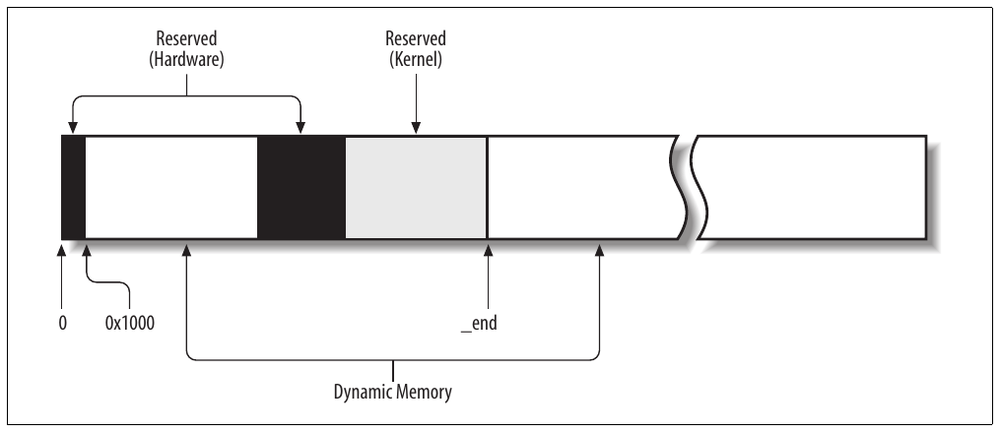
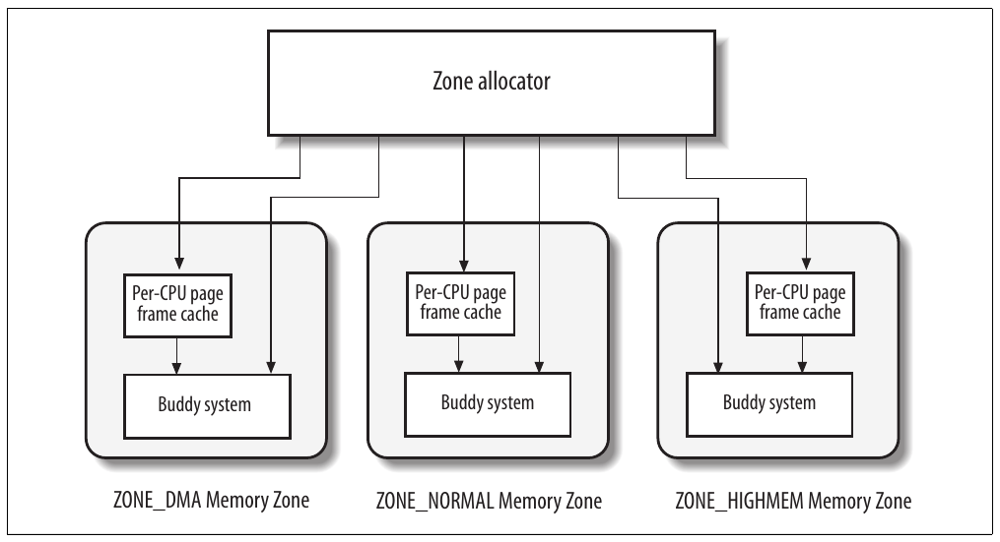
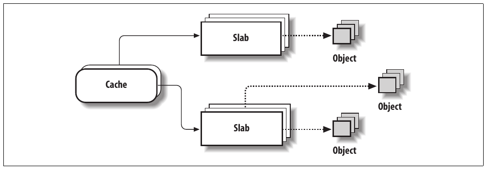
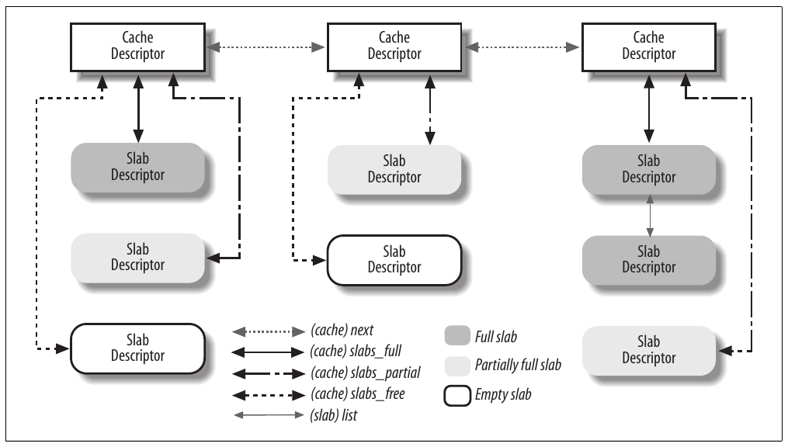
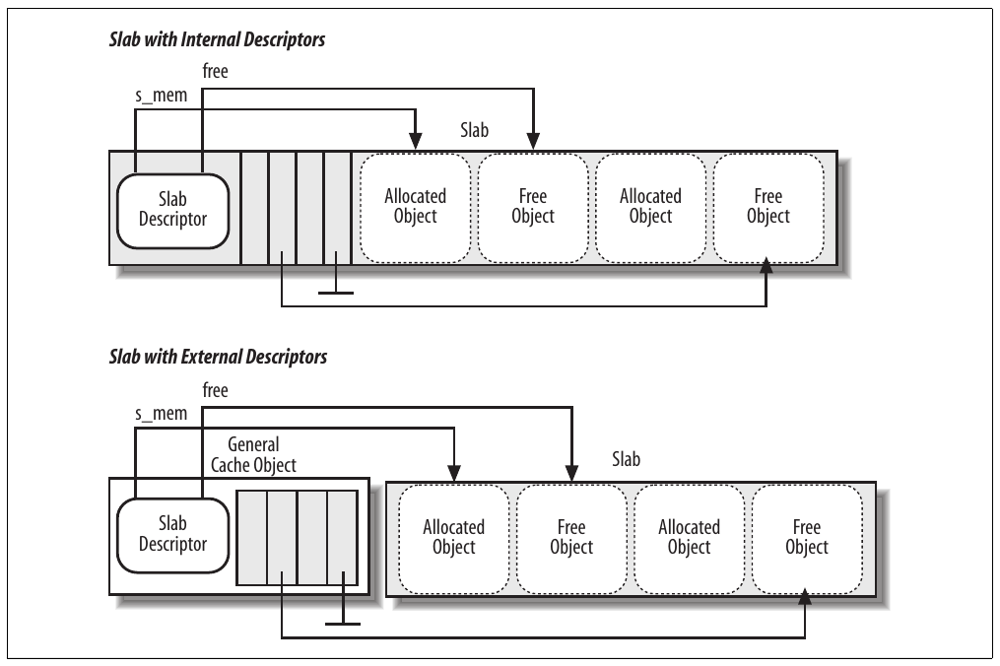
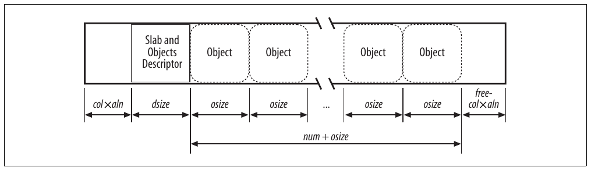
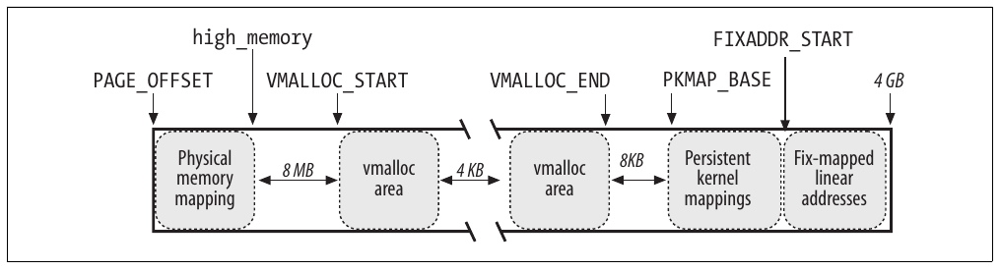

CHƯƠNG 8 Chương 8

# Chương 8. Memory management


Chương 2 đã trình bày cách Linux tận dụng segmentation và paging circuit của 80×86 để chuyển logical address thành physical address. Cũng đã đề cập một phần RAM cấp vĩnh viễn cho kernel, dùng lưu cả kernel code lẫn static kernel data structure.

Phần RAM còn lại gọi là dynamic memory. Đây là resource quý giá, cần cho cả process lẫn chính kernel. Thực tế performance toàn hệ thống phụ thuộc hiệu quả quản lý dynamic memory. Vì vậy mọi hệ điều hành multitasking hiện tại cố tối ưu sử dụng dynamic memory, chỉ cấp khi cần và free sớm nhất có thể. Hình 8-1 biểu diễn sơ lược page frame dùng làm dynamic memory; xem phần “Physical memory layout” trong Chương 2 để biết chi tiết.

Chương gồm ba phần chính, mô tả cách kernel allocate dynamic memory để dùng riêng. Phần “Page frame management” và “Memory area management” minh họa hai kỹ thuật xử lý physically contiguous memory area, còn phần “Quản lý noncontiguous memory area” minh họa kỹ thuật thứ ba xử lý noncontiguous memory area. Trong đó trình bày memory zone, kernel mapping, buddy system, slab cache và memory pool.

## Page frame management

Phần “Paging trong hardware” của Chương 2 đã trình bày processor Intel Pentium dùng hai page frame size khác nhau: 4 KB và 4 MB (hoặc 2 MB nếu PAE enable — xem phần “Cơ chế paging Physical Address Extension (PAE)” trong Chương 2). Linux chọn page frame size 4 KB nhỏ hơn làm standard memory allocation unit. Điều này đơn giản hóa vì hai lý do:

- Page Fault exception do paging circuitry phát dễ diễn giải. Page yêu cầu tồn tại nhưng process không được phép address, hoặc page không tồn tại. Trường hợp thứ hai, memory allocator phải tìm free page frame 4 KB và cấp cho process.

- Dù cả 4 KB và 4 MB là bội mọi disk block size, data transfer giữa main memory và disk phần lớn hiệu quả hơn khi dùng size nhỏ hơn.



Hình 8-1. Dynamic memory

### Page descriptor

Kernel phải theo dõi current status của mỗi page frame. Ví dụ phải phân biệt page frame chứa page thuộc process với page frame chứa kernel code hoặc kernel data structure. Tương tự phải xác định page frame trong dynamic memory có free không. Page frame trong dynamic memory free nếu không chứa data hữu ích. Không free khi chứa data của User Mode process, software cache, dynamically allocated kernel data structure, buffered data của device driver, code của kernel module, v.v.

State information của page frame lưu trong page descriptor type `page`, field trong Bảng 8-1. Mọi page descriptor lưu trong array `mem_map`. Vì mỗi descriptor dài 32 byte, không gian `mem_map` cần hơi dưới 1% toàn RAM. Macro `virt_to_page(addr)` cho address page descriptor gắn với linear address `addr`. Macro `pfn_to_page(pfn)` cho address page descriptor gắn với page frame có number `pfn`.

Bảng 8-1. Field của page descriptor

| Type | Tên | Mô tả |
|---|---|---|
| `unsigned long` | `flags` | Array flag (xem Bảng 8-2). Còn encode zone number page frame thuộc. |
| `atomic_t` | `_count` | Reference counter của page frame. |
| `atomic_t` | `_mapcount` | Số Page Table entry tham chiếu page frame (`-`1 nếu không có). |
| `unsigned long` | `private` | Dành cho kernel component đang dùng page (ví dụ buffer head pointer nếu là buffer page; xem “Block buffer và buffer head” trong Chương 15). Nếu page free, field do buddy system dùng (xem sau trong chương). |
| `struct address_space *` | `mapping` | Dùng khi page insert vào page cache (xem phần “Page cache” trong Chương 15) hoặc thuộc anonymous region (xem phần “Reverse mapping cho anonymous page” trong Chương 17). |
| `unsigned long` | `index` | Được nhiều kernel component dùng với nghĩa khác nhau. Ví dụ nhận diện vị trí data lưu trong page frame trong disk image của page hoặc anonymous region (Chương 15), hoặc lưu swapped-out page identifier (Chương 17). |
| `struct list_head` | `lru` | Chứa pointer đến least recently used doubly linked list của page. |

Hiện chưa cần hiểu đầy đủ vai trò mọi field page descriptor. Trong chương sau thường quay lại field page descriptor. Hơn nữa nhiều field có nghĩa khác tùy page frame free hay kernel component nào đang dùng.

Mô tả chi tiết hơn hai field:

`_count`

Usage reference counter cho page. Nếu đặt thành `-`1, page frame tương ứng free, có thể cấp cho bất kỳ process hoặc chính kernel. Nếu giá trị lớn hơn hoặc bằng 0, page frame cấp cho một hoặc nhiều process hoặc dùng lưu kernel data structure. Function `page_count()` return giá trị field `_count` cộng 1, tức số người dùng page.

`flags`

Chứa tối đa 32 flag (xem Bảng 8-2) mô tả status page frame. Với mỗi flag `PG_`xyz, kernel định nghĩa macro thao tác giá trị. Thường macro `Page`Xyz return flag value, còn macro `SetPage`Xyz và `ClearPage`Xyz lần lượt set và clear bit tương ứng.

Bảng 8-2. Flag mô tả page frame status

| Tên flag | Ý nghĩa |
|---|---|
| `PG_locked` | Page locked; ví dụ tham gia disk I/O operation. |
| `PG_error` | I/O error xảy ra khi transfer page. |
| `PG_referenced` | Page được truy cập gần đây. |
| `PG_uptodate` | Flag set sau khi hoàn tất read operation, trừ khi có disk I/O error. |
| `PG_dirty` | Page đã sửa (xem phần “Triển khai PFRA” trong Chương 17). |
| `PG_lru` | Page trong active hoặc inactive page list (xem phần “Least Recently Used (LRU) list” trong Chương 17). |
| `PG_active` | Page trong active page list (xem phần “Least Recently Used (LRU) list” trong Chương 17). |
| `PG_slab` | Page frame nằm trong slab (xem phần “Memory area management” sau trong chương). |
| `PG_highmem` | Page frame thuộc zone `ZONE_HIGHMEM` (xem phần “Non-Uniform Memory Access (NUMA)” tiếp theo). |
| `PG_checked` | Được một số filesystem như Ext2 và Ext3 dùng (xem Chương 18). |
| `PG_arch_1` | Không dùng trên architecture 80x86. |
| `PG_reserved` | Page frame dành cho kernel code hoặc không dùng được. |
| `PG_private` | Field `private` của page descriptor lưu data có ý nghĩa. |
| `PG_writeback` | Page đang được ghi xuống disk bằng method `writepage` (xem Chương 16). |
| `PG_nosave` | Dùng cho system suspend/resume. |
| `PG_compound` | Page frame xử lý qua extended paging mechanism (xem phần “Extended paging” trong Chương 2). |
| `PG_swapcache` | Page thuộc swap cache (xem phần “Swap cache” trong Chương 17). |
| `PG_mappedtodisk` | Mọi data trong page frame tương ứng block đã allocate trên disk. |
| `PG_reclaim` | Page được đánh dấu ghi xuống disk để reclaim memory. |
| `PG_nosave_free` | Dùng cho system suspend/resume. |

### Non-Uniform Memory Access (NUMA)

Chúng ta quen nghĩ memory máy tính là resource đồng nhất, dùng chung. Bỏ qua vai trò hardware cache, kỳ vọng thời gian CPU truy cập memory location cơ bản như nhau bất kể physical address và CPU. Tiếc là giả định không đúng trong một số architecture, ví dụ một số multiprocessor computer Alpha hoặc MIPS.

Linux 2.6 hỗ trợ mô hình Non-Uniform Memory Access (NUMA), trong đó access time đến memory location khác nhau từ CPU cho trước có thể khác nhau. Physical memory hệ thống chia thành nhiều node. Thời gian CPU cho trước truy cập page trong một node như nhau. Tuy nhiên thời gian có thể khác với hai CPU khác nhau. Với mỗi CPU, kernel cố giảm số access đến costly node bằng chọn cẩn thận nơi lưu kernel data structure CPU tham chiếu thường xuyên nhất.[^1] Physical memory trong mỗi node có thể chia nhiều zone như phần tiếp theo. Mỗi node có descriptor type `pg_data_t`, field trong Bảng 8-3. Mọi node descriptor lưu trong singly linked list có phần tử đầu do variable `pgdat_list` trỏ đến.

Bảng 8-3. Field của node descriptor

| Type | Tên | Mô tả |
|---|---|---|
| `struct zone []` | `node_zones` | Array zone descriptor của node |
| `struct zonelist []` | `node_zonelists` | Array data structure `zonelist` page allocator dùng (xem phần “Memory zone” sau) |
| `int` | `nr_zones` | Số zone trong node |
| `struct page *` | `node_mem_map` | Array page descriptor của node |
| `struct bootmem_data *` | `bdata` | Dùng trong kernel initialization phase |
| `unsigned long` | `node_start_pfn` | Index page frame đầu trong node |
| `unsigned long` | `node_present_pages` | Kích thước memory node không gồm hole (theo page frame) |
| `unsigned long` | `node_spanned_pages` | Kích thước node gồm hole (theo page frame) |
| `int` | `node_id` | Identifier của node |
| `pg_data_t *` | `pgdat_next` | Phần tử tiếp theo trong memory node list |
| `wait_queue_head_t` | `kswapd_wait` | Wait queue cho pageout daemon kswapd (xem phần “Periodic reclaiming” trong Chương 17) |
| `struct task_struct *` | `kswapd` | Pointer đến process descriptor của kernel thread kswapd |
| `int` | `kswapd_max_order` | Logarithmic size của free block kswapd cần tạo |

Như thường lệ chủ yếu quan tâm architecture 80×86. PC tương thích IBM dùng mô hình Uniform Memory Access (UMA), nên không thực sự cần NUMA support. Tuy nhiên ngay cả khi không compile NUMA support vào kernel, Linux dùng một node chứa toàn physical memory hệ thống. Vì vậy variable `pgdat_list` trỏ đến list một phần tử — node 0 descriptor — lưu trong variable `contig_page_data`.

Trên architecture 80×86, nhóm physical memory trong một node có vẻ vô dụng; tuy nhiên cách này làm memory handling code portable hơn vì kernel có thể giả định physical memory chia một hoặc nhiều node trong mọi architecture.[^2]

### Memory zone

Trong computer architecture lý tưởng, page frame là memory storage unit dùng cho bất kỳ việc gì: lưu kernel và user data, buffering disk data, v.v. Mọi loại page data có thể lưu trong page frame không hạn chế.

Tuy nhiên computer architecture thực có hardware constraint có thể hạn chế cách dùng page frame. Cụ thể Linux kernel phải xử lý hai hardware constraint của architecture 80×86:

- Processor Direct Memory Access (DMA) cho ISA bus cũ có hạn chế lớn: chỉ address được 16 MB RAM đầu.

- Trong máy tính 32-bit hiện đại nhiều RAM, CPU không truy cập trực tiếp được toàn physical memory vì linear address space quá nhỏ.

Để xử lý hai hạn chế, Linux 2.6 chia physical memory mỗi memory node thành ba zone. Trong UMA architecture 80×86, zone là:

`ZONE_DMA`

Chứa page frame memory dưới 16 MB

`ZONE_NORMAL`

Chứa page frame memory từ 16 MB trở lên và dưới 896 MB

`ZONE_HIGHMEM`

Chứa page frame memory từ 896 MB trở lên

Zone `ZONE_DMA` chứa page frame device ISA cũ có thể dùng qua DMA. (Phần “Direct Memory Access (DMA)” trong Chương 13 cung cấp thêm chi tiết DMA.)

Zone `ZONE_DMA` và `ZONE_NORMAL` chứa page frame “normal” kernel truy cập trực tiếp qua linear mapping trong gigabyte thứ tư linear address space (xem phần “Kernel Page Table” trong Chương 2). Ngược lại zone `ZONE_HIGHMEM` chứa page frame kernel không thể truy cập trực tiếp qua linear mapping trong gigabyte thứ tư linear address space (xem phần “Kernel mapping của high-memory page frame” sau). Zone `ZONE_HIGHMEM` luôn rỗng trên architecture 64-bit.

Mỗi memory zone có descriptor riêng type `zone`. Field trong Bảng 8-4.

Bảng 8-4. Field của zone descriptor

| Type | Tên | Mô tả |
|---|---|---|
| `unsigned long` | `free_pages` | Số free page trong zone. |
| `unsigned long` | `pages_min` | Số reserved page của zone (xem phần “Pool reserved page frame” sau). |
| `unsigned long` | `pages_low` | Low watermark cho page frame reclaiming; zone allocator còn dùng làm threshold value (xem phần “Zone allocator” sau). |
| `unsigned long` | `pages_high` | High watermark cho page frame reclaiming; zone allocator còn dùng làm threshold value. |
| `unsigned long []` | `lowmem_reserve` | Chỉ định bao nhiêu page frame mỗi zone phải reserve để xử lý critical situation thiếu memory. |
| `struct per_cpu_pageset[]` | `pageset` | Data structure triển khai cache đặc biệt của single page frame (xem phần “Per-CPU page frame cache” sau). |
| `spinlock_t` | `lock` | Spin lock bảo vệ descriptor. |
| `struct free_area []` | `free_area` | Nhận diện block free page frame trong zone (xem phần “Buddy system algorithm” sau). |
| `spinlock_t` | `lru_lock` | Spin lock cho active và inactive list. |
| `struct list head` | `active_list` | List active page trong zone (xem Chương 17). |
| `struct list head` | `inactive_list` | List inactive page trong zone (xem Chương 17). |
| `unsigned long` | `nr_scan_active` | Số active page cần scan khi reclaim memory (xem phần “Low on memory reclaiming” trong Chương 17). |
| `unsigned long` | `nr_scan_inactive` | Số inactive page cần scan khi reclaim memory. |
| `unsigned long` | `nr_active` | Số page trong active list của zone. |
| `unsigned long` | `nr_inactive` | Số page trong inactive list của zone. |
| `unsigned long` | `pages_scanned` | Counter dùng khi page frame reclaiming trong zone. |
| `int` | `all_unreclaimable` | Flag set khi zone đầy unreclaimable page. |
| `int` | `temp_priority` | Priority tạm thời của zone (dùng khi page frame reclaiming). |
| `int` | `prev_priority` | Priority zone từ 12 đến 0 (page frame reclaiming algorithm dùng, xem phần “Low on memory reclaiming” trong Chương 17). |
| `wait_queue_head_t *` | `wait_table` | Hash table wait queue của process chờ một page của zone. |
| `unsigned long` | `wait_table_size` | Kích thước wait queue hash table. |
| `unsigned long` | `wait_table_bits` | Power-of-2 order của kích thước wait queue hash table array. |
| `struct pglist_data *` | `zone_pgdat` | Memory node (xem phần “Non-Uniform Memory Access (NUMA)” trước). |
| `struct page *` | `zone_mem_map` | Pointer đến page descriptor đầu của zone. |
| `unsigned long` | `zone_start_pfn` | Index page frame đầu zone. |
| `unsigned long` | `spanned_pages` | Tổng kích thước zone theo page, gồm hole. |
| `unsigned long` | `present_pages` | Tổng kích thước zone theo page, không gồm hole. |
| `char *` | `name` | Pointer đến tên thông thường của zone: “DMA”, “Normal” hoặc “HighMem”. |

Nhiều field của structure `zone` dùng cho page frame reclaiming, mô tả trong Chương 17.

Mỗi page descriptor có link đến memory node và zone trong node chứa page frame tương ứng. Để tiết kiệm không gian, link không lưu như pointer thông thường mà encode dạng index trong high bit của field `flags`. Thực tế số flag đặc trưng page frame hạn chế nên luôn có thể dành most significant bit của field `flags` encode memory node và zone number phù hợp.[^3] Function `page_zone()` nhận parameter là address page descriptor; đọc most significant bit field `flags` trong page descriptor rồi xác định address zone descriptor tương ứng bằng tìm trong array `zone_table`. Array initialize lúc boot bằng address mọi zone descriptor của mọi memory node.

Khi kernel gọi memory allocation function, phải chỉ định zone chứa page frame yêu cầu. Kernel thường chỉ định zone sẵn sàng dùng. Ví dụ nếu page frame phải map trực tiếp trong gigabyte thứ tư linear address nhưng không dùng cho ISA DMA transfer, kernel yêu cầu page frame trong `ZONE_NORMAL` hoặc `ZONE_DMA`. Tất nhiên chỉ nên lấy từ `ZONE_DMA` nếu `ZONE_NORMAL` không free page frame. Để chỉ định preferred zone trong memory allocation request, kernel dùng data structure `zonelist`, array pointer zone descriptor.

### Pool reserved page frame

Memory allocation request được đáp ứng theo hai cách. Nếu đủ free memory, đáp ứng ngay. Nếu không phải memory reclaiming, kernel control path đưa request bị block đến khi free thêm memory.

Tuy nhiên một số kernel control path không thể block khi yêu cầu memory — ví dụ khi xử lý interrupt hoặc thực thi code trong critical region. Khi đó kernel control path nên đưa atomic memory allocation request (dùng flag `GFP_ATOMIC`; xem phần “Zoned page frame allocator” sau). Atomic request không bao giờ block: nếu không đủ free page, allocation đơn giản thất bại.

Dù không thể bảo đảm atomic memory allocation request không bao giờ thất bại, kernel cố giảm tối đa khả năng sự kiện không may này. Để làm, kernel reserve pool page frame cho atomic memory allocation request, chỉ dùng khi low-on-memory.

Lượng reserved memory (kilobyte) lưu trong variable `min_free_kbytes`. Initial value đặt trong kernel initialization, phụ thuộc lượng physical memory map trực tiếp trong gigabyte thứ tư kernel linear address — tức số page frame trong memory zone `ZONE_DMA` và `ZONE_NORMAL`:

reserved pool size = 16 ×directly mapped memory (kilobyte)

Tuy nhiên ban đầu `min_free_kbytes` không thể thấp hơn 128 hoặc cao hơn 65.536.[^4]

Memory zone `ZONE_DMA` và `ZONE_NORMAL` đóng góp reserved memory bằng số page frame tỷ lệ relative size. Ví dụ nếu zone `ZONE_NORMAL` lớn gấp tám `ZONE_DMA`, bảy phần tám page frame lấy từ `ZONE_NORMAL`, một phần tám từ `ZONE_DMA`.

Field `pages_min` của descriptor `zone` lưu số reserved page frame trong zone. Như Chương 17, field còn có vai trò cho page frame reclaiming algorithm cùng field `pages_low` và `pages_high`. Field `pages_low` luôn đặt bằng 5/4 giá trị `pages_min`, `pages_high` luôn bằng 3/2 giá trị `pages_min`.

### Zoned page frame allocator

Kernel subsystem xử lý memory allocation request cho nhóm contiguous page frame gọi là zoned page frame allocator. Thành phần chính trong Hình 8-2.

Thành phần “zone allocator” nhận request allocation và deallocation dynamic memory. Với allocation request, tìm memory zone chứa nhóm contiguous page frame đáp ứng request (xem phần “Zone allocator” sau). Trong mỗi zone, page frame do thành phần “buddy system” xử lý (xem phần “Buddy system algorithm” sau). Để tăng system performance, một ít page frame giữ trong cache để nhanh đáp ứng allocation request cho single page frame (xem phần “Per-CPU page frame cache” sau).



Hình 8-2. Thành phần zoned page frame allocator

#### Yêu cầu và release page frame

Có thể yêu cầu page frame bằng sáu function và macro hơi khác nhau. Trừ khi nói khác, return linear address của page đầu allocate hoặc `NULL` nếu allocation thất bại.

`alloc_pages(gfp_mask, order)`

Macro yêu cầu 2<sup>order</sup> contiguous page frame. Return address descriptor của page frame đầu allocate hoặc `NULL` nếu allocation thất bại.

`alloc_page(gfp_mask)`

Macro lấy một page frame; mở rộng thành:

```c
alloc_pages(gfp_mask, 0)
```

Return address descriptor của page frame allocate hoặc `NULL` nếu allocation thất bại.

`__get_free_pages(gfp_mask, order)`

Function tương tự `alloc_pages()` nhưng return linear address của page đầu allocate.

`__get_free_page(gfp_mask)`

Macro lấy một page frame; mở rộng thành:

```c
__get_free_pages(gfp_mask, 0)
```

`get_zeroed_page(gfp_mask)`

Function lấy page frame điền số 0; gọi:

```c
alloc_pages(gfp_mask | __GFP_ZERO, 0)
```

và return linear address của page frame lấy được.

`__get_dma_pages(gfp_mask, order)`

Macro lấy page frame phù hợp DMA; mở rộng thành:

```c
__get_free_pages(gfp_mask | __GFP_DMA, order)
```

Parameter `gfp_mask` là nhóm flag chỉ định cách tìm free page frame. Flag dùng được trong `gfp_mask` trong Bảng 8-5.

Bảng 8-5. Flag yêu cầu page frame

| Flag | Mô tả |
|---|---|
| `__GFP_DMA` | Page frame phải thuộc memory zone `ZONE_DMA`. Tương đương `GFP_DMA`. |
| `__GFP_HIGHMEM` | Page frame có thể thuộc memory zone `ZONE_HIGHMEM`. |
| `__GFP_WAIT` | Kernel được phép block current process chờ free page frame. |
| `__GFP_HIGH` | Kernel được phép truy cập pool reserved page frame. |
| `__GFP_IO` | Kernel được phép thực hiện I/O transfer trên low memory page để free page frame. |
| `__GFP_FS` | Nếu clear, kernel không được thực hiện filesystem-dependent operation. |
| `__GFP_COLD` | Page frame yêu cầu có thể “cold” (xem phần “Per-CPU page frame cache” sau). |
| `__GFP_NOWARN` | Memory allocation failure không tạo warning message. |
| `__GFP_REPEAT` | Kernel tiếp tục retry memory allocation đến thành công. |
| `__GFP_NOFAIL` | Giống `__GFP_REPEAT`. |
| `__GFP_NORETRY` | Không retry memory allocation thất bại. |
| `__GFP_NO_GROW` | Slab allocator không cho slab cache mở rộng (xem phần “Slab allocator” sau). |
| `__GFP_COMP` | Page frame thuộc extended page (xem phần “Extended paging” trong Chương 2). |
| `__GFP_ZERO` | Page frame return nếu có phải điền số 0. |

Thực tế Linux dùng predefined combination flag value trong Bảng 8-6; group name là thứ gặp làm argument của sáu page frame allocation function.

Bảng 8-6. Nhóm flag value yêu cầu page frame

| Tên nhóm | Flag tương ứng |
|---|---|
| `GFP_ATOMIC` | `__GFP_HIGH` |
| `GFP_NOIO` | `__GFP_WAIT` |
| `GFP_NOFS` | `__GFP_WAIT \| __GFP_IO` |
| `GFP_KERNEL` | `__GFP_WAIT \| __GFP_IO \| __GFP_FS` |
| `GFP_USER` | `__GFP_WAIT \| __GFP_IO \| __GFP_FS` |
| `GFP_HIGHUSER` | `__GFP_WAIT \| __GFP_IO \| __GFP_FS \| __GFP_HIGHMEM` |

Flag `__GFP_DMA` và `__GFP_HIGHMEM` gọi là zone modifier; chỉ định zone kernel tìm khi tìm free page frame. Field `node_zonelists` của node descriptor `contig_page_data` là array list zone descriptor biểu diễn fallback zone: với mỗi thiết lập zone modifier, list tương ứng gồm memory zone có thể dùng đáp ứng memory allocation request nếu zone gốc thiếu page frame. Trong UMA architecture 80×86, fallback zone như sau:

- Nếu flag `__GFP_DMA` set, page frame chỉ lấy từ memory zone `ZONE_DMA`.

- Nếu không, nếu flag `__GFP_HIGHMEM` không set, page frame chỉ lấy từ memory zone `ZONE_NORMAL` và `ZONE_DMA` theo thứ tự ưu tiên.

- Nếu không (flag `__GFP_HIGHMEM` set), page frame lấy từ memory zone `ZONE_HIGHMEM`, `ZONE_NORMAL` và `ZONE_DMA` theo thứ tự ưu tiên.

Có thể release page frame qua từng function và macro trong bốn mục sau:

`__free_pages(page, order)`

Function kiểm tra page descriptor do `page` trỏ đến; nếu page frame không reserved (tức flag `PG_reserved` bằng 0), giảm field `count` của descriptor. Nếu `count` thành 0, giả định 2<sup>order</sup> contiguous page frame bắt đầu từ page frame tương ứng `page` không còn dùng. Khi đó release page frame như giải thích trong phần “Zone allocator” sau.

`free_pages(addr, order)`

Function tương tự `__free_pages()` nhưng nhận argument là linear address `addr` của page frame đầu cần release.

`__free_page(page)`

Macro release page frame có descriptor do `page` trỏ đến; mở rộng thành:

```c
__free_pages(page, 0)
```

`free_page(addr)`

Macro release page frame có linear address `addr`; mở rộng thành:

```c
free_pages(addr, 0)
```

### Kernel mapping của high-memory page frame

Linear address tương ứng cuối directly mapped physical memory, tức đầu high memory, lưu trong variable `high_memory` đặt thành 896 MB. Page frame trên boundary 896 MB nhìn chung không map trong gigabyte thứ tư kernel linear address space nên kernel không truy cập trực tiếp được. Nghĩa là mỗi page allocator function return linear address của page frame cấp không hoạt động cho high-memory page frame, tức page frame trong memory zone `ZONE_HIGHMEM`.

Ví dụ giả sử kernel gọi `__get_free_pages(GFP_HIGHMEM,0)` allocate page frame high memory. Nếu allocator cấp page frame high memory, `__get_free_pages()` không thể return linear address vì không tồn tại; do đó function return `NULL`. Đến lượt kernel không dùng được page frame; tệ hơn không release được vì kernel mất dấu.

Vấn đề không tồn tại trên hardware platform 64-bit vì linear address space khả dụng lớn hơn nhiều lượng RAM có thể cài — tóm lại zone `ZONE_HIGHMEM` luôn rỗng. Tuy nhiên trên platform 32-bit như architecture 80×86, Linux designer phải tìm cách cho kernel khai thác toàn RAM khả dụng đến 64 GB PAE hỗ trợ. Cách áp dụng:

- Allocation high-memory page frame chỉ qua function `alloc_pages()` và shortcut `alloc_page()`. Không return linear address của page frame đầu allocate vì nếu page frame thuộc high memory, linear address đơn giản không tồn tại. Thay vào đó return linear address của page descriptor của page frame đầu allocate. Linear address này luôn tồn tại vì mọi page descriptor allocate trong low memory một lần vĩnh viễn trong kernel initialization.

- Page frame high memory không có linear address không thể được kernel truy cập. Vì vậy một phần 128 MB cuối kernel linear address space dành map high-memory page frame. Tất nhiên mapping tạm thời, nếu không chỉ 128 MB high memory accessible. Thay vào đó tái sử dụng linear address có thể truy cập toàn high memory dù khác thời điểm.

Kernel dùng ba cơ chế map page frame high memory: permanent kernel mapping, temporary kernel mapping và noncontiguous memory allocation. Phần này trình bày hai kỹ thuật đầu; thứ ba trong phần “Quản lý noncontiguous memory area” sau.

Thiết lập permanent kernel mapping có thể block current process; xảy ra khi không free Page Table entry dùng làm “cửa sổ” trên high-memory page frame. Vì vậy không thiết lập được permanent kernel mapping trong interrupt handler và deferrable function. Ngược lại thiết lập temporary kernel mapping không bao giờ cần block current process; nhược điểm là rất ít temporary kernel mapping có thể thiết lập cùng lúc.

Kernel control path dùng temporary kernel mapping phải bảo đảm không kernel control path khác dùng cùng mapping. Nghĩa là không bao giờ được block, nếu không kernel control path khác có thể dùng cùng window map high memory page khác.

Tất nhiên không kỹ thuật nào cho address toàn RAM đồng thời. Xét cho cùng dưới 128 MB linear address space còn cho map high memory, trong khi PAE hỗ trợ hệ thống đến 64 GB RAM.

#### Permanent kernel mapping

Permanent kernel mapping cho kernel thiết lập mapping lâu dài high-memory page frame vào kernel address space. Dùng Page Table riêng trong master kernel page table. Variable `pkmap_page_table` lưu address Page Table, macro `LAST_PKMAP` cho số entry. Như thường lệ Page Table gồm 512 hoặc 1.024 entry tùy PAE enable hoặc disable (xem phần “Cơ chế paging Physical Address Extension (PAE)” trong Chương 2); vì vậy kernel truy cập tối đa 2 hoặc 4 MB high memory cùng lúc.

Page Table map linear address bắt đầu từ `PKMAP_BASE`. Array `pkmap_count` gồm `LAST_PKMAP` counter, mỗi entry của Page Table `pkmap_page_table` một counter. Phân biệt ba trường hợp:

Counter bằng 0

Page Table entry tương ứng không map high-memory page frame nào và dùng được.

Counter bằng 1

Page Table entry tương ứng không map high-memory page frame nào nhưng không dùng được vì TLB entry tương ứng chưa flush từ lần dùng cuối.

Counter bằng n (lớn hơn 1)

Page Table entry tương ứng map high-memory page frame, được đúng n − 1 kernel component dùng.

Để theo dõi liên kết high memory page frame và linear address do permanent kernel mapping tạo, kernel dùng hash table `page_address_htable`. Bảng chứa một data structure `page_address_map` cho mỗi high-memory page frame hiện mapped. Đến lượt data structure chứa pointer đến page descriptor và linear address cấp cho page frame.

Function `page_address()` return linear address gắn page frame hoặc `NULL` nếu page frame high memory chưa mapped. Nhận parameter là page descriptor pointer `page`, phân biệt hai trường hợp:

1\. Nếu page frame không trong high memory (flag `PG_highmem` clear), linear address luôn tồn tại, lấy bằng tính page frame index, chuyển thành physical address rồi suy ra linear address tương ứng. Thực hiện bằng code:

```c
__va((unsigned long)(page - mem_map) << 12)
```

2\. Nếu page frame nằm trong high memory (flag `PG_highmem` được set), function tìm trong hash table `page_address_htable`. Nếu tìm thấy page frame trong hash table, `page_address()` trả về linear address của nó; ngược lại, trả về `NULL`.

Function `kmap()` thiết lập một permanent kernel mapping. Về cơ bản, nó tương đương với code sau:

```c
void * kmap(struct page * page)
{
    if (!PageHighMem(page))
        return page_address(page);
    return kmap_high(page);
}
```

Function `kmap_high()` được gọi nếu page frame thực sự thuộc high memory. Về cơ bản, function tương đương với code sau:

```c
void * kmap_high(struct page * page)
{
    unsigned long vaddr;
    spin_lock(&kmap_lock);
    vaddr = (unsigned long) page_address(page);
    if (!vaddr)
        vaddr = map_new_virtual(page);
    pkmap_count[(vaddr-PKMAP_BASE) >> PAGE_SHIFT]++;
    spin_unlock(&kmap_lock);
    return (void *) vaddr;
}
```

Function lấy spin lock `kmap_lock` để bảo vệ Page Table khỏi truy cập đồng thời trên hệ thống multiprocessor. Lưu ý rằng không cần disable interrupt, vì interrupt handler và deferrable function không thể gọi `kmap()`. Tiếp theo, function `kmap_high()` kiểm tra page frame đã được map chưa bằng cách gọi `page_address()`. Nếu chưa, function gọi `map_new_virtual()` để chèn physical address của page frame vào một entry của `pkmap_page_table` và thêm một phần tử vào hash table `page_address_htable`. Sau đó, `kmap_high()` tăng counter tương ứng với linear address của page frame để tính đến kernel component mới đã gọi function này. Cuối cùng, `kmap_high()` nhả spin lock `kmap_lock` và trả về linear address map page frame.

Function `map_new_virtual()` về cơ bản thực hiện hai vòng lặp lồng nhau:

```c
    for (;;) {
        int count;
        DECLARE_WAITQUEUE(wait, current);
        for (count = LAST_PKMAP; count > 0; --count) {
            last_pkmap_nr = (last_pkmap_nr + 1) & (LAST_PKMAP - 1);
            if (!last_pkmap_nr) {
                flush_all_zero_pkmaps();
                count = LAST_PKMAP;
            }
            if (!pkmap_count[last_pkmap_nr]) {
                unsigned long vaddr = PKMAP_BASE +
                                      (last_pkmap_nr << PAGE_SHIFT);
                set_pte(&(pkmap_page_table[last_pkmap_nr]),
                        mk_pte(page, __pgprot(0x63)));
                pkmap_count[last_pkmap_nr] = 1;
                set_page_address(page, (void *) vaddr);
                return vaddr;
            }
        }
        current->state = TASK_UNINTERRUPTIBLE;
        add_wait_queue(&pkmap_map_wait, &wait);
        spin_unlock(&kmap_lock);
        schedule();
        remove_wait_queue(&pkmap_map_wait, &wait);
        spin_lock(&kmap_lock);
        if (page_address(page))
            return (unsigned long) page_address(page);
    }
```

Trong vòng lặp bên trong, function quét tất cả counter trong `pkmap_count` cho đến khi tìm thấy giá trị bằng không. Khối `if` lớn chạy khi tìm thấy một entry chưa dùng trong `pkmap_count`. Khối đó xác định linear address tương ứng với entry, tạo một entry cho nó trong Page Table `pkmap_page_table`, đặt count thành 1 vì entry hiện đã được dùng, gọi `set_page_address()` để chèn một phần tử mới vào hash table `page_address_htable`, và trả về linear address.

Function bắt đầu từ vị trí đã dừng ở lần trước, duyệt vòng qua array `pkmap_count`. Nó làm vậy bằng cách giữ index của entry được dùng gần nhất trong Page Table `pkmap_page_table` ở một biến có tên `last_pkmap_nr`. Do đó, việc tìm kiếm bắt đầu từ vị trí đã dừng trong lần gọi function `map_new_virtual()` trước đó.

Khi đến counter cuối cùng trong `pkmap_count`, việc tìm kiếm bắt đầu lại từ counter tại index 0. Tuy nhiên, trước khi tiếp tục, `map_new_virtual()` gọi function `flush_all_zero_pkmaps()`, bắt đầu một lượt quét counter khác để tìm những counter có giá trị 1. Mỗi counter có giá trị 1 biểu thị một entry trong `pkmap_page_table` đang trống nhưng chưa thể dùng vì TLB entry tương ứng chưa được flush. `flush_all_zero_pkmaps()` đặt lại các counter này về không, xóa những phần tử tương ứng khỏi hash table `page_address_htable`, và thực hiện TLB flush trên tất cả entry của `pkmap_page_table`.

Nếu vòng lặp bên trong không tìm thấy counter bằng không trong `pkmap_count`, function `map_new_virtual()` block process hiện tại cho đến khi một process khác giải phóng một entry của Page Table `pkmap_page_table`. Điều này được thực hiện bằng cách chèn `current` vào wait queue `pkmap_map_wait`, đặt state của `current` thành `TASK_UNINTERRUPTIBLE`, và gọi `schedule()` để nhường CPU. Khi process được đánh thức, function kiểm tra một process khác đã map page hay chưa bằng cách gọi `page_address()`; nếu chưa có process nào khác map page, vòng lặp bên trong bắt đầu lại.

Function `kunmap()` hủy một permanent kernel mapping đã được `kmap()` thiết lập trước đó. Nếu page thực sự nằm trong high memory zone, nó gọi function `kunmap_high()`, về cơ bản tương đương với code sau:

```c
void kunmap_high(struct page * page)
{
    spin_lock(&kmap_lock);
    if ((--pkmap_count[((unsigned long)page_address(page)
                        -PKMAP_BASE)>>PAGE_SHIFT]) == 1)
        if (waitqueue_active(&pkmap_map_wait))
            wake_up(&pkmap_map_wait);
    spin_unlock(&kmap_lock);
}
```

Biểu thức trong dấu ngoặc tính index vào array `pkmap_count` từ linear address của page. Counter được giảm và so sánh với 1. Nếu bằng nhau thì không có process nào đang dùng page. Cuối cùng, function có thể đánh thức các process trong wait queue do `map_new_virtual()` đưa vào, nếu có.

##### Temporary kernel mapping

Temporary kernel mapping đơn giản hơn permanent kernel mapping về cách triển khai; hơn nữa, chúng có thể được dùng trong interrupt handler và deferrable function, vì yêu cầu một temporary kernel mapping không bao giờ block process hiện tại.

Mỗi page frame trong high memory có thể được map qua một window trong kernel address space—cụ thể là một Page Table entry dành riêng cho mục đích này. Số window dành cho temporary kernel mapping khá ít.

Mỗi CPU có tập riêng gồm 13 window, được biểu diễn bằng data structure `enum km_type`. Mỗi symbol được định nghĩa trong data structure này—như `KM_BOUNCE_READ`, `KM_USER0`, hoặc `KM_PTE0`—xác định linear address của một window.

Kernel phải đảm bảo cùng một window không bao giờ được hai kernel control path dùng cùng lúc. Vì vậy, mỗi symbol trong structure `km_type` dành riêng cho một kernel component và được đặt tên theo component đó. Symbol cuối cùng, `KM_TYPE_NR`, không trực tiếp biểu diễn một linear address, mà cho biết số window khác nhau mỗi CPU có thể dùng.

Mỗi symbol trong `km_type`, trừ symbol cuối, là một index của fix-mapped linear address (xem phần “Fix-Mapped Linear Addresses” trong Chương 2). Data structure `enum fixed_addresses` bao gồm các symbol `FIX_KMAP_BEGIN` và `FIX_KMAP_END`; symbol sau được gán index `FIX_KMAP_BEGIN + (KM_TYPE_NR * NR_CPUS)-1`. Theo cách này, có `KM_TYPE_NR` fix-mapped linear address cho mỗi CPU trong hệ thống. Hơn nữa, kernel khởi tạo biến `kmap_pte` bằng địa chỉ của Page Table entry tương ứng với linear address `fix_to_virt(FIX_KMAP_BEGIN`.

Để thiết lập một temporary kernel mapping, kernel gọi function `kmap_atomic()`, về cơ bản tương đương với code sau:

```c
void * kmap_atomic(struct page * page, enum km_type type)
{
    enum fixed_addresses idx;
    unsigned long vaddr;

    current_thread_info()->preempt_count++;
    if (!PageHighMem(page))
        return page_address(page);
    idx = type + KM_TYPE_NR * smp_processor_id();
    vaddr = fix_to_virt(FIX_KMAP_BEGIN + idx);
    set_pte(kmap_pte-idx, mk_pte(page, 0x063));
    __flush_tlb_single(vaddr);
    return (void *) vaddr;
}
```

Argument `type` và CPU identifier lấy qua `smp_processor_id()` chỉ định fix-mapped linear address nào phải được dùng để map page được yêu cầu. Function trả về linear address của page frame nếu nó không thuộc high memory; ngược lại, nó thiết lập Page Table entry tương ứng với fix-mapped linear address bằng physical address của page và các bit `Present`, `Accessed`, `Read/ Write`, và `Dirty`. Cuối cùng, function flush TLB entry thích hợp và trả về linear address.

Để hủy một temporary kernel mapping, kernel dùng function `kunmap_atomic()`. Trong kiến trúc 80×86, function này giảm `preempt_count` của process hiện tại; do đó, nếu kernel control path có thể bị preempt ngay trước khi yêu cầu temporary kernel mapping, nó sẽ lại có thể bị preempt sau khi hủy mapping đó. Hơn nữa, `kunmap_atomic()` kiểm tra flag `TIF_NEED_RESCHED` của `current` có được set không và, nếu có, gọi `schedule()`.

### Thuật toán buddy system

Kernel phải thiết lập một chiến lược vững chắc và hiệu quả để cấp phát các nhóm page frame liên tiếp. Khi làm vậy, nó phải xử lý một vấn đề memory management đã biết gọi là external fragmentation: việc thường xuyên yêu cầu và giải phóng các nhóm page frame liên tiếp có kích thước khác nhau có thể dẫn đến tình huống nhiều block page frame trống nhỏ bị “rải rác” bên trong các block page frame đã cấp phát. Kết quả là có thể không cấp phát được một block page frame liên tiếp lớn, ngay cả khi có đủ page trống để đáp ứng yêu cầu.

Về cơ bản có hai cách tránh external fragmentation:

- Dùng paging circuitry để map các nhóm page frame trống không liên tiếp vào các khoảng linear address liên tiếp.

- Phát triển một kỹ thuật phù hợp để theo dõi các block page frame trống liên tiếp hiện có, tránh tối đa việc phải chia một block trống lớn để đáp ứng yêu cầu nhỏ hơn.

Kernel ưu tiên cách thứ hai vì ba lý do xác đáng:

- Trong một số trường hợp, page frame liên tiếp thực sự cần thiết, vì linear address liên tiếp không đủ để đáp ứng yêu cầu. Ví dụ điển hình là yêu cầu memory cho buffer được gán cho một DMA processor (xem Chương 13). Vì hầu hết DMA bỏ qua paging circuitry và truy cập address bus trực tiếp khi truyền nhiều disk sector trong một I/O operation, các buffer được yêu cầu phải nằm trong những page frame liên tiếp.

- Ngay cả khi việc cấp phát page frame liên tiếp không thực sự cần thiết, nó có ưu điểm lớn là giữ nguyên paging table của kernel. Việc sửa Page Table có vấn đề gì? Như đã biết từ Chương 2, sửa Page Table thường xuyên làm tăng thời gian truy cập memory trung bình, vì khiến CPU flush nội dung translation lookaside buffer.

- Kernel có thể truy cập các vùng physical memory liên tiếp lớn thông qua page 4 MB. Điều này giảm translation lookaside buffer miss, qua đó tăng đáng kể tốc độ truy cập memory trung bình (xem phần “Translation Lookaside Buffers (TLB)” trong Chương 2).

Kỹ thuật Linux dùng để giải quyết external fragmentation dựa trên thuật toán buddy system đã biết. Tất cả page frame trống được nhóm vào 11 list block, lần lượt chứa các nhóm 1, 2, 4, 8, 16, 32, 64, 128, 256, 512 và 1024 page frame liên tiếp. Yêu cầu lớn nhất gồm 1024 page frame tương ứng với một vùng RAM liên tiếp 4 MB. Physical address của page frame đầu tiên trong một block là bội số của kích thước nhóm—ví dụ, địa chỉ đầu của block 16 page frame là bội số của 16× 2<sup>12</sup> (2<sup>12</sup> = 4.096, là page size thông thường).

Chúng ta sẽ minh họa cách thuật toán hoạt động qua một ví dụ đơn giản:

Giả sử có yêu cầu một nhóm 256 page frame liên tiếp (tức một megabyte). Trước tiên, thuật toán kiểm tra có block trống trong list 256 page frame hay không. Nếu không, thuật toán tìm block lớn hơn kế tiếp—một block trống trong list 512 page frame. Nếu có block như vậy, kernel cấp phát 256 trong số 512 page frame để đáp ứng yêu cầu và chèn 256 page frame còn lại vào list block trống 256 page frame. Nếu không có block trống 512 page, kernel tìm block lớn hơn kế tiếp (tức một block trống 1024 page frame). Nếu có, nó cấp phát 256 trong số 1024 page frame để đáp ứng yêu cầu, chèn 512 page frame đầu trong số 768 page frame còn lại vào list block trống 512 page frame, và chèn 256 page frame cuối vào list block trống 256 page frame. Nếu list block 1024 page frame rỗng, thuật toán bỏ cuộc và báo một tình trạng lỗi.

Thao tác ngược lại, giải phóng các block page frame, là nguồn gốc tên của thuật toán này. Kernel cố gắng gộp các cặp buddy block trống có kích thước b thành một block duy nhất có kích thước 2b. Hai block được xem là buddy nếu:

- Cả hai block có cùng kích thước, giả sử là b.

- Chúng nằm ở các physical address liên tiếp.

- Physical address của page frame đầu tiên trong block thứ nhất là bội số của 2× b× 2<sup>12</sup>.

Thuật toán có tính lặp; nếu gộp được các block đã giải phóng, nó nhân đôi b và thử lại để tạo các block lớn hơn nữa.

#### Data structure

Linux 2.6 dùng một buddy system khác nhau cho mỗi zone. Vì vậy, trong kiến trúc 80×86 có 3 buddy system: hệ thống thứ nhất xử lý page frame phù hợp với ISA DMA, hệ thống thứ hai xử lý page frame “normal”, và hệ thống thứ ba xử lý high-memory page frame. Mỗi buddy system dựa vào các data structure chính sau:

- Array `mem_map` đã giới thiệu trước đó. Thực tế, mỗi zone liên quan đến một tập con các phần tử `mem_map`. Phần tử đầu tiên trong tập con và số phần tử của nó lần lượt được chỉ định bởi các field `zone_mem_map` và `size` của zone descriptor.

- Một array gồm mười một phần tử kiểu `free_area`, một phần tử cho mỗi kích thước nhóm. Array được lưu trong field `free_area` của zone descriptor.

Xét phần tử thứ k của array `free_area` trong zone descriptor, xác định tất cả block trống có kích thước 2<sup>k</sup>. Field `free_list` của phần tử này là đầu một doubly linked circular list tập hợp các page descriptor gắn với block trống gồm 2<sup>k</sup> page. Chính xác hơn, list này bao gồm page descriptor của page frame đầu mỗi block gồm 2<sup>k</sup> page frame trống; các pointer đến phần tử liền kề trong list được lưu trong field `lru` của page descriptor.[^5]

Ngoài đầu list, phần tử thứ k của array `free_area` còn bao gồm field `nr_free`, chỉ định số block trống có kích thước 2<sup>k</sup> page. Tất nhiên, nếu không có block gồm 2<sup>k</sup> page frame trống, `nr_free` bằng 0 và list `free_list` rỗng (cả hai pointer của `free_list` đều trỏ đến chính field `free_list`).

Cuối cùng, field `private` của descriptor của page đầu tiên trong một block gồm 2<sup>k</sup> page trống lưu order của block, tức số k. Nhờ field này, khi một block page được giải phóng, kernel có thể xác định buddy của block có trống không và, nếu có, gộp hai block thành một block gồm 2<sup>k+1</sup> page. Cần lưu ý rằng cho đến Linux 2.6.10, kernel dùng 10 array flag để mã hóa thông tin này.

##### Cấp phát một block

Function `__rmqueue()` được dùng để tìm một block trống trong một zone. Function nhận hai argument: địa chỉ của zone descriptor, và `order`, biểu thị logarithm kích thước của block page trống được yêu cầu (0 cho block một page, 1 cho block hai page, v.v.). Nếu cấp phát page frame thành công, function \_\_`rmqueue()` trả về địa chỉ của page descriptor của page frame đầu tiên được cấp phát. Ngược lại, function trả về `NULL`.

Function \_\_`rmqueue()` giả định bên gọi đã disable local interrupt và lấy spin lock `zone->lock`, bảo vệ các data structure của buddy system. Nó thực hiện tìm kiếm lần lượt qua từng list để tìm block khả dụng (biểu thị bởi một entry không trỏ đến chính nó), bắt đầu từ list cho `order` được yêu cầu và tiếp tục đến order lớn hơn nếu cần:

```c
struct free_area *area;
unsigned int current_order;

for (current_order=order; current_order<11; ++current_order) {
    area = zone->free_area + current_order;
    if (!list_empty(&area->free_list))
        goto block_found;
}
return NULL;
```

Nếu vòng lặp kết thúc, không tìm thấy block trống phù hợp nên \_\_`rmqueue()` trả về giá trị `NULL`. Ngược lại, đã tìm thấy một block trống phù hợp; trong trường hợp này, descriptor của page frame đầu tiên của nó bị loại khỏi list và giá trị `free_pages` trong zone descriptor được giảm:

```c
block_found:
    page = list_entry(area->free_list.next, struct page, lru);
    list_del(&page->lru);
    ClearPagePrivate(page);
    page->private = 0;
    area->nr_free--;
    zone->free_pages -= 1UL << order;
```

Nếu block tìm được đến từ list có kích thước `curr_order` lớn hơn kích thước `order` được yêu cầu, một vòng lặp `while` được thực hiện. Lý do của các dòng code này như sau: khi cần dùng một block gồm 2<sup>k</sup> page frame để đáp ứng yêu cầu 2<sup>h</sup> page frame (h \< k), chương trình cấp phát 2<sup>h</sup> page frame đầu và lặp lại việc phân phối 2<sup>k</sup> – 2<sup>h</sup> page frame cuối vào các list `free_area` có index từ h đến k:

```c
    size = 1 << curr_order;
    while (curr_order > order) {
        area--;
        curr_order--;
        size >>= 1;
        buddy = page + size;
        /* insert buddy as first element in the list */
        list_add(&buddy->lru, &area->free_list);
        area->nr_free++;
        buddy->private = curr_order;
        SetPagePrivate(buddy);
    }
    return page;
```

Vì function \_\_`rmqueue()` đã tìm thấy một block trống phù hợp, nó trả về địa chỉ `page` của page descriptor gắn với page frame đầu tiên được cấp phát.

##### Giải phóng một block

Function `__free_pages_bulk()` triển khai chiến lược buddy system để giải phóng page frame. Nó dùng ba input parameter cơ bản:[^6]

`page`

Địa chỉ của descriptor của page frame đầu tiên trong block cần giải phóng

`zone`

Địa chỉ của zone descriptor

`order`

Kích thước logarithm của block

Function giả định bên gọi đã disable local interrupt và lấy spin lock `zone->lock`, bảo vệ data structure của buddy system. `__free_pages_bulk()` bắt đầu bằng việc khai báo và khởi tạo một số local variable:

```c
struct page * base = zone->zone_mem_map;
unsigned long buddy_idx, page_idx = page - base;
struct page * buddy, * coalesced;
int order_size = 1 << order;
```

Local variable `page_idx` chứa index của page frame đầu tiên trong block so với page frame đầu tiên của zone.

Local variable `order_size` được dùng để tăng counter page frame trống trong zone:

```c
zone->free_pages += order_size;
```

Function giờ thực hiện một vòng lặp tối đa 10– `order` lần, một lần cho mỗi khả năng gộp một block với buddy của nó. Function bắt đầu với block có kích thước nhỏ nhất và đi lên kích thước lớn nhất:

```c
while (order < 10) {
    buddy_idx = page_idx ^ (1 << order);
    buddy = base + buddy_idx;
    if (!page_is_buddy(buddy, order))
        break;
    list_del(&buddy->lru);
    zone->free_area[order].nr_free--;
    ClearPagePrivate(buddy);
    buddy->private = 0;
    page_idx &= buddy_idx;
    order++;
}
```

Trong thân vòng lặp, function tìm index `buddy_idx` của block là buddy của block có page descriptor index `page_idx`. Hóa ra index này có thể dễ dàng được tính bằng:

```c
buddy_idx = page_idx ^ (1 << order);
```

Thực tế, phép Exclusive OR (XOR) dùng mask `(1<<order`) đảo giá trị bit thứ `order` của `page_idx`. Do đó, nếu bit trước đó bằng không, `buddy_idx` bằng `page_idx` + `order_size`; ngược lại, nếu bit trước đó bằng một, `buddy_idx` bằng `page_idx – order_size`.

Khi đã biết buddy block index, có thể dễ dàng lấy page descriptor của buddy block bằng:

```c
buddy = base + buddy_idx;
```

Giờ function gọi `page_is_buddy()` để kiểm tra `buddy` có mô tả page đầu của một block gồm `order_size` page frame trống hay không.

```c
int page_is_buddy(struct page *page, int order)
{
    if (PagePrivate(buddy) && page->private == order &&
          !PageReserved(buddy) && page_count(page) ==0)
        return 1;
    return 0;
}
```

Như bạn thấy, page đầu của buddy phải trống (field `_count` bằng `-`1), phải thuộc dynamic memory (bit `PG_reserved` clear), field `private` phải có ý nghĩa (bit `PG_private` set), và cuối cùng field `private` phải lưu order của block đang được giải phóng.

Nếu tất cả điều kiện này được đáp ứng, buddy block trống và function loại buddy block khỏi list block trống có order `order`, rồi thực hiện thêm một lượt lặp để tìm buddy block lớn gấp đôi.

Nếu ít nhất một điều kiện trong `page_is_buddy()` không được đáp ứng, function thoát vòng lặp, vì block trống thu được không thể gộp thêm với block trống khác. Function chèn nó vào list thích hợp và cập nhật field `private` của page frame đầu tiên bằng order của kích thước block:

```c
coalesced = base + page_idx;
coalesced->private = order;
SetPagePrivate(coalesced);
list_add(&coalesced->lru, &zone->free_area[order].free_list);
zone->free_area[order].nr_free++;
```

### Per-CPU page frame cache

Như sẽ thấy ở phần sau của chương, kernel thường yêu cầu và giải phóng từng page frame. Để tăng hiệu năng hệ thống, mỗi memory zone định nghĩa một per-CPU page frame cache. Mỗi per-CPU cache bao gồm một số page frame đã cấp phát trước để dùng cho các yêu cầu memory đơn lẻ do local CPU đưa ra.

Thực tế, có hai cache cho mỗi memory zone và mỗi CPU: hot cache, lưu page frame có nội dung nhiều khả năng nằm trong hardware cache của CPU, và cold cache.

Lấy một page frame từ hot cache có lợi cho hiệu năng hệ thống nếu kernel hoặc một User Mode process sẽ ghi vào page frame ngay sau khi cấp phát. Thực tế, mỗi lần truy cập một memory cell của page frame sẽ khiến một line của hardware cache bị “lấy” khỏi một page frame khác—tất nhiên, trừ khi hardware cache đã chứa một line map cell của page frame “hot” vừa được truy cập.

Ngược lại, lấy một page frame từ cold cache thuận tiện nếu page frame sẽ được điền bằng một DMA operation. Trong trường hợp này, CPU không tham gia và không line nào của hardware cache bị sửa đổi. Lấy page frame từ cold cache giữ lại lượng hot page frame dự trữ cho các loại yêu cầu cấp phát memory khác.

Data structure chính triển khai per-CPU page frame cache là một array các data structure `per_cpu_pageset` lưu trong field `pageset` của memory zone descriptor. Array chứa một phần tử cho mỗi CPU; phần tử này lại gồm hai descriptor `per_cpu_pages`, một cho hot cache và một cho cold cache. Các field của descriptor `per_cpu_pages` được liệt kê trong Bảng 8-7.

Bảng 8-7. Các field của descriptor per\_cpu\_pages

| Kiểu | Tên | Mô tả |
|---|---|---|
| `int` | `count` | Số page frame trong cache |
| `int` | `low` | Low watermark để bổ sung cache |
| `int` | `high` | High watermark để rút bớt cache |
| `int` | `batch` | Số page frame cần thêm vào hoặc lấy khỏi cache |
| `struct list_head` | `list` | List descriptor của các page frame trong cache |

Kernel theo dõi kích thước cả hot cache lẫn cold cache bằng hai watermark: nếu số page frame giảm xuống dưới watermark `low`, kernel bổ sung cache thích hợp bằng cách cấp phát `batch` page frame đơn lẻ từ buddy system; ngược lại, nếu số page frame tăng lên trên watermark `high`, kernel trả `batch` page frame trong cache về buddy system. Các giá trị `batch`, `low`, và `high` về cơ bản phụ thuộc vào số page frame trong memory zone.

#### Cấp phát page frame qua per-CPU page frame cache

Function `buffered_rmqueue()` cấp phát page frame trong một memory zone cho trước. Nó dùng per-CPU page frame cache để xử lý yêu cầu một page frame.

Các parameter là địa chỉ của memory zone descriptor, order của yêu cầu cấp phát memory `order`, và allocation flag `gfp_flags`. Nếu flag `__GFP_COLD` được set trong `gfp_flags`, page frame nên được lấy từ cold cache; ngược lại, nên được lấy từ hot cache (flag này chỉ có ý nghĩa với yêu cầu một page frame). Về cơ bản, function thực hiện các thao tác sau:

1\. Nếu `order` khác 0, không thể dùng per-CPU page frame cache: function nhảy đến bước 4.

2\. Kiểm tra local per-CPU cache của memory zone được xác định bởi giá trị flag `__GFP_COLD` có cần bổ sung hay không (field `count` của descriptor `per_cpu_pages` nhỏ hơn hoặc bằng field `low`). Trong trường hợp này, nó thực hiện các bước con sau:

a. Cấp phát `batch` page frame đơn lẻ từ buddy system bằng cách gọi lặp lại function `__rmqueue()`.

b. Chèn descriptor của các page frame đã cấp phát vào list của cache.

c. Cập nhật giá trị `count` bằng cách cộng số page frame thực sự đã cấp phát.

3\. Nếu `count` dương, function lấy một page frame từ list của cache, giảm `count`, và nhảy đến bước 5. (Lưu ý rằng per-CPU page frame cache có thể rỗng; điều này xảy ra khi function `__rmqueue()` được gọi ở bước 2a không cấp phát được page frame nào.)

4\. Tại đây, yêu cầu memory chưa được đáp ứng, hoặc vì yêu cầu trải trên nhiều page frame liên tiếp, hoặc vì page frame cache được chọn đang rỗng. Gọi function `__rmqueue()` để cấp phát các page frame được yêu cầu từ buddy system.

5\. Nếu yêu cầu memory đã được đáp ứng, function khởi tạo page descriptor của page frame (đầu tiên): clear một số flag, đặt field `private` về không, và đặt reference counter của page frame thành một. Hơn nữa, nếu flag `__GPF_ZERO` trong `gfp_flags` được set, nó điền số không vào memory area đã cấp phát. 6. Trả về địa chỉ page descriptor của page frame (đầu tiên), hoặc `NULL` nếu yêu cầu cấp phát memory thất bại.

##### Trả page frame về per-CPU page frame cache

Để trả một page frame đơn lẻ về per-CPU page frame cache, kernel dùng các function `free_hot_page()` và `free_cold_page()`. Cả hai đều là wrapper đơn giản cho function `free_hot_cold_page()`, nhận các parameter là địa chỉ descriptor `page` của page frame cần giải phóng và flag `cold` chỉ định hot cache hay cold cache.

Function `free_hot_cold_page()` thực hiện các thao tác sau:

1\. Lấy từ field `page->flags` địa chỉ của memory zone descriptor chứa page frame (xem phần “Non-Uniform Memory Access (NUMA)” trước đó).

2\. Lấy địa chỉ của descriptor `per_cpu_pages` của cache thuộc zone được flag `cold` chọn.

3\. Kiểm tra có nên rút bớt cache không: nếu `count` lớn hơn hoặc bằng `high`, gọi function `free_pages_bulk()`, truyền vào zone descriptor, số page frame cần giải phóng (field `batch`), địa chỉ list của cache, và số không (cho page frame order 0). Đến lượt function sau gọi lặp lại function `__free_pages_bulk()` để trả số page frame được chỉ định—lấy từ list của cache—về buddy system của memory zone.

4\. Thêm page frame cần giải phóng vào list của cache, và tăng field `count`.

Cần lưu ý rằng trong phiên bản hiện tại của kernel Linux 2.6, không page frame nào được trả về cold cache: kernel luôn giả định page frame được giải phóng là hot đối với hardware cache. Tất nhiên, điều này không có nghĩa cold cache rỗng: cache được `buffered_rmqueue()` bổ sung khi đạt low watermark.

### Zone allocator

Zone allocator là frontend của kernel page frame allocator. Component này phải tìm một memory zone chứa đủ page frame trống để đáp ứng yêu cầu memory. Nhiệm vụ này không đơn giản như thoạt nhìn, vì zone allocator phải đáp ứng nhiều mục tiêu:

- Nó nên bảo vệ pool page frame dự trữ (xem phần “The Pool of Reserved Page Frames” trước đó).

- Nó nên kích hoạt thuật toán page frame reclaiming (xem Chương 17) khi memory khan hiếm và được phép block process hiện tại; khi đã giải phóng một số page frame, zone allocator sẽ thử cấp phát lại.

- Nó nên giữ lại memory zone `ZONE_DMA` nhỏ và quý giá nếu có thể. Ví dụ, zone allocator nên phần nào hạn chế gán page frame trong memory zone `ZONE_DMA` nếu yêu cầu là page frame `ZONE_NORMAL` hoặc `ZONE_HIGHMEM`.

Chúng ta đã thấy trong phần “The Zoned Page Frame Allocator” trước đó rằng mọi yêu cầu một nhóm page frame liên tiếp cuối cùng đều được xử lý bằng cách thực thi macro `alloc_pages`. Đến lượt macro này gọi function `__alloc_pages()`, là phần cốt lõi của zone allocator. Nó nhận ba parameter:

`gfp_mask`

Các flag được chỉ định trong yêu cầu cấp phát memory (xem Bảng 8-5 trước đó)

`order`

Kích thước logarithm của nhóm page frame liên tiếp cần cấp phát

`zonelist`

Pointer đến data structure `zonelist` mô tả các memory zone phù hợp để cấp phát memory, theo thứ tự ưu tiên

Function `__alloc_pages()` quét mọi memory zone trong data structure `zonelist`. Code thực hiện việc này có dạng sau:

```c
for (i = 0; (z=zonelist->zones[i]) != NULL; i++) {
    if (zone_watermark_ok(z, order, ...)) {
        page = buffered_rmqueue(z, order, gfp_mask);
        if (page)
            return page;
    }
}
```

Với mỗi memory zone, function so sánh số page frame trống với một giá trị ngưỡng phụ thuộc vào allocation flag, loại process hiện tại, và số lần function đã kiểm tra zone. Thực tế, nếu memory trống khan hiếm, mỗi memory zone thường được quét nhiều lần, mỗi lần với ngưỡng thấp hơn về lượng memory trống tối thiểu cần để cấp phát. Do đó, khối code trước được lặp lại nhiều lần—với vài khác biệt nhỏ—trong thân function `__alloc_pages()`. Function `buffered_rmqueue()` đã được mô tả trong phần “The Per-CPU Page Frame Cache” trước đó: nó trả về page descriptor của page frame đầu tiên được cấp phát, hoặc `NULL` nếu memory zone không chứa một nhóm page frame liên tiếp có kích thước được yêu cầu.

Auxiliary function `zone_watermark_ok()` nhận nhiều parameter, xác định ngưỡng `min` cho số page frame trống trong memory zone. Cụ thể, function trả về giá trị 1 nếu hai điều kiện sau được đáp ứng:

1\. Ngoài các page frame cần cấp phát, có ít nhất `min` page frame trống trong memory zone, không tính các page frame trong low-on-memory reserve (field `lowmem_reserve` của zone descriptor).

2\. Ngoài các page frame cần cấp phát, có ít nhất min ⁄ 2<sup>k</sup> page frame trống trong các block có order ít nhất là k, với mỗi k từ 1 đến order của yêu cầu cấp phát. Do đó, nếu `order` lớn hơn không, phải có ít nhất `min/2` page frame trống trong các block có kích thước ít nhất 2; nếu `order` lớn hơn một, phải có ít nhất `min/4` page frame trống trong các block có kích thước ít nhất 4; v.v.

Giá trị ngưỡng `min` được `zone_watermark_ok()` xác định như sau:

- Giá trị cơ sở được truyền làm parameter của function và có thể là một trong các watermark `pages_min`, `pages_low`, và `pages_high` của zone (xem phần “The Pool of Reserved Page Frames” trước đó trong chương này).

- Giá trị cơ sở được chia đôi nếu flag `gfp_high` truyền làm parameter được set. Thông thường, flag này bằng một nếu flag `__GFP_HIGHMEM` được set trong `gfp_mask`, tức là nếu page frame có thể được cấp phát từ high memory.

- Giá trị ngưỡng tiếp tục giảm một phần tư nếu flag `can_try_harder` truyền làm parameter được set. Flag này thường bằng một nếu flag `__GFP_WAIT` được set trong `gfp_mask`, hoặc process hiện tại là real-time process và việc cấp phát memory được thực hiện trong process context (bên ngoài interrupt handler và deferrable function).

Function `__alloc_pages()` về cơ bản thực hiện các bước sau:

1\. Thực hiện lượt quét đầu tiên các memory zone (xem khối code trước đó). Trong lượt quét này, ngưỡng `min` được đặt thành `z->pages_low`, với `z` trỏ đến zone descriptor đang được phân tích (các parameter `can_try_harder` và `gfp_high` được đặt bằng không).

2\. Nếu function chưa kết thúc ở bước trước, memory trống còn lại không nhiều: function đánh thức các kernel thread kswapd để bắt đầu reclaim page frame bất đồng bộ (xem Chương 17).

3\. Thực hiện lượt quét thứ hai các memory zone, truyền giá trị `z->pages_min` làm ngưỡng cơ sở. Như đã giải thích, ngưỡng thực tế còn được xác định bởi các flag `can_try_harder` và `gfp_high`. Bước này gần giống bước 1, ngoại trừ function dùng ngưỡng thấp hơn.

4\. Nếu function chưa kết thúc ở bước trước, hệ thống chắc chắn thiếu memory. Nếu kernel control path đưa ra yêu cầu cấp phát memory không phải interrupt handler hay deferrable function và đang cố reclaim page frame (flag `PF_MEMALLOC` hoặc flag `PF_MEMDIE` của `current` được set), function thực hiện lượt quét thứ ba các memory zone, cố cấp phát page frame bỏ qua các ngưỡng low-on-memory—tức không gọi `zone_watermark_ok()`. Đây là trường hợp duy nhất kernel control path được phép dùng cạn low-on-memory reserve gồm các page do field `lowmem_reserve` của zone descriptor chỉ định. Thực tế, trong trường hợp này, kernel control path đưa ra yêu cầu memory cuối cùng đang cố giải phóng page frame, nên nó phải được cấp những gì đã yêu cầu nếu có thể. Nếu không memory zone nào chứa đủ page frame, function trả về `NULL` để báo thất bại cho bên gọi.

5\. Tại đây, kernel control path gọi function không đang cố reclaim memory. Nếu flag `__GFP_WAIT` của `gfp_mask` không được set, function trả về `NULL` để báo cho kernel control path rằng cấp phát memory thất bại: trong trường hợp này, không có cách đáp ứng yêu cầu mà không block process hiện tại.

6\. Tại đây có thể block process hiện tại: gọi `cond_resched()` để kiểm tra process khác có cần CPU không.

7\. Set flag `PF_MEMALLOC` của `current`, biểu thị process sẵn sàng thực hiện memory reclaiming.

8\. Lưu trong `current->reclaim_state` một pointer đến structure `reclaim_state`. Structure này chỉ chứa một field, `reclaimed_slab`, được khởi tạo bằng không (chúng ta sẽ thấy field này được dùng thế nào trong phần “Interfacing the Slab Allocator with the Zoned Page Frame Allocator” ở phần sau chương này).

9\. Gọi `try_to_free_pages()` để tìm một số page frame có thể reclaim (xem phần “Low On Memory Reclaiming” trong Chương 17). Function sau có thể block process hiện tại. Khi function đó trả về, `__alloc_pages()` reset flag `PF_MEMALLOC` của `current` và gọi `cond_resched()` thêm lần nữa.

10\. Nếu bước trước giải phóng được một số page frame, function thực hiện thêm một lượt quét các memory zone giống lượt quét ở bước 3. Nếu yêu cầu cấp phát memory không thể được đáp ứng, function xác định có nên tiếp tục quét memory zone không: nếu flag `__GFP_NORETRY` clear và yêu cầu cấp phát memory gồm tối đa tám page frame, hoặc một trong các flag `__GFP_REPEAT` và `__GFP_NOFAIL` được set, function gọi `blk_congestion_wait()` để cho process sleep một lúc (xem Chương 14), rồi quay lại bước 6. Ngược lại, function trả về `NULL` để báo bên gọi rằng cấp phát memory thất bại.

11\. Nếu không page frame nào được giải phóng ở bước 9, kernel gặp rắc rối nghiêm trọng, vì memory trống thấp đến mức nguy hiểm và không thể reclaim page frame nào. Có lẽ đã đến lúc đưa ra quyết định quan trọng. Nếu kernel control path được phép thực hiện các thao tác phụ thuộc filesystem cần để kill một process (flag `__GFP_FS` trong `gfp_mask` được set) và flag `__GFP_NORETRY` clear, thực hiện các bước con sau:

a. Quét lại các memory zone với ngưỡng bằng `z-> pages_high`.

b. Gọi `out_of_memory()` để bắt đầu giải phóng một phần memory bằng cách kill một victim process (xem “The Out of Memory Killer” trong Chương 17).

c. Quay lại bước 1.

Vì watermark dùng ở bước 11a cao hơn nhiều so với các watermark dùng trong những lượt quét trước, bước đó nhiều khả năng thất bại. Thực tế, bước 11a chỉ thành công nếu một kernel control path khác đã đang kill một process để reclaim memory của nó. Do đó, bước 11a tránh việc hai process vô tội bị kill thay vì một.

#### Giải phóng một nhóm page frame

Zone allocator cũng đảm nhiệm giải phóng page frame; may thay, giải phóng memory dễ hơn cấp phát rất nhiều.

Tất cả macro và function của kernel dùng để giải phóng page frame—được mô tả trong phần “The Zoned Page Frame Allocator” trước đó—đều dựa vào function `__free_pages()`. Nó nhận các parameter là địa chỉ page descriptor của page frame đầu tiên cần giải phóng (`page`), và kích thước logarithm của nhóm page frame liên tiếp cần giải phóng (`order`). Function thực hiện các bước sau:

1\. Kiểm tra page frame đầu tiên thực sự thuộc dynamic memory (flag `PG_reserved` của nó clear); nếu không thì kết thúc.

2\. Giảm usage counter `page->_count`; nếu nó vẫn lớn hơn hoặc bằng không thì kết thúc.

3\. Nếu `order` bằng không, function gọi `free_hot_page()` để trả page frame về per-CPU hot cache của memory zone thích hợp (xem phần “The Per-CPU Page Frame Cache” trước đó).

4\. Nếu `order` lớn hơn không, nó thêm các page frame vào một local list và gọi function `free_pages_bulk()` để trả chúng về buddy system của memory zone thích hợp (xem bước 3 trong mô tả `free_hot_cold_page()` ở phần “The Per-CPU Page Frame Cache” trước đó).

## Quản lý memory area

Phần này bàn về memory area—tức các chuỗi memory cell có physical address liên tiếp và độ dài tùy ý.

Thuật toán buddy system dùng page frame làm memory area cơ bản. Điều này phù hợp khi xử lý các yêu cầu memory tương đối lớn, nhưng chúng ta xử lý các yêu cầu memory area nhỏ, chẳng hạn vài chục hoặc vài trăm byte, như thế nào?

Rõ ràng, cấp phát cả page frame để lưu vài byte sẽ rất lãng phí. Thay vào đó, cách tốt hơn là đưa vào các data structure mới mô tả cách cấp phát memory area nhỏ trong cùng page frame. Khi làm vậy, chúng ta đưa vào một vấn đề mới gọi là internal fragmentation. Nó do sự không khớp giữa kích thước yêu cầu memory và kích thước memory area được cấp phát để đáp ứng yêu cầu.

Một giải pháp cổ điển (được các phiên bản Linux ban đầu áp dụng) là cung cấp memory area có kích thước phân bố theo cấp số nhân; nói cách khác, kích thước phụ thuộc vào lũy thừa của 2 thay vì kích thước dữ liệu cần lưu. Theo cách này, bất kể kích thước yêu cầu memory, chúng ta có thể đảm bảo internal fragmentation luôn nhỏ hơn 50 phần trăm. Theo cách tiếp cận này, kernel tạo 13 list memory area trống có kích thước phân bố theo cấp số nhân, từ 32 đến 131.072 byte. Buddy system được gọi cả để lấy thêm page frame cần để lưu memory area mới và, ngược lại, để giải phóng page frame không còn chứa memory area. Một dynamic list được dùng để theo dõi memory area trống trong mỗi page frame.

### Slab allocator

Chạy một thuật toán cấp phát memory area trên thuật toán buddy không đặc biệt hiệu quả. Một thuật toán tốt hơn bắt nguồn từ mô hình slab allocator được áp dụng lần đầu trong hệ điều hành Solaris 2.4 của Sun Microsystems. Nó dựa trên các tiền đề sau:

- Loại dữ liệu cần lưu có thể ảnh hưởng đến cách cấp phát memory area; ví dụ, khi cấp phát một page frame cho User Mode process, kernel gọi function `get_zeroed_page()`, điền số không vào page.

Khái niệm slab allocator mở rộng ý tưởng này và xem memory area là object gồm cả một tập data structure lẫn một cặp function hoặc method gọi là constructor và destructor. Function đầu khởi tạo memory area trong khi function sau hủy trạng thái khởi tạo của nó.

Để tránh khởi tạo object lặp lại, slab allocator không loại bỏ các object đã được cấp phát rồi giải phóng mà giữ chúng trong memory. Khi một object mới được yêu cầu, có thể lấy nó từ memory mà không cần khởi tạo lại.

- Các function của kernel có xu hướng yêu cầu lặp lại memory area cùng loại. Ví dụ, mỗi khi kernel tạo process mới, nó cấp phát memory area cho một số table có kích thước cố định như process descriptor, open file object, v.v. (xem Chương 3). Khi process kết thúc, các memory area dùng để chứa những table này có thể được tái sử dụng. Vì process được tạo và hủy khá thường xuyên, nếu không có slab allocator, kernel lãng phí thời gian cấp phát và thu hồi lặp lại các page frame chứa cùng memory area; slab allocator cho phép lưu chúng trong cache và tái sử dụng nhanh chóng.

- Yêu cầu memory area có thể được phân loại theo tần suất. Yêu cầu kích thước cụ thể dự kiến xuất hiện thường xuyên có thể được xử lý hiệu quả nhất bằng cách tạo một tập object chuyên dụng có kích thước đúng, qua đó tránh internal fragmentation. Trong khi đó, kích thước hiếm gặp có thể được xử lý qua cơ chế cấp phát dựa trên object có một dãy kích thước phân bố theo cấp số nhân (như kích thước lũy thừa của 2 dùng trong các phiên bản Linux ban đầu), dù cách này dẫn đến internal fragmentation.

- Còn một lợi ích tinh tế khác khi đưa vào object có kích thước không phân bố theo cấp số nhân: địa chỉ đầu của các data structure ít có xu hướng tập trung tại những physical address có giá trị là lũy thừa của 2. Điều này lại giúp cải thiện hiệu năng hardware cache của processor.

- Hiệu năng hardware cache là một lý do bổ sung để hạn chế tối đa việc gọi buddy system allocator. Mỗi lần gọi function của buddy system đều làm “bẩn” hardware cache, qua đó tăng thời gian truy cập memory trung bình. Tác động của một kernel function lên hardware cache gọi là function footprint; nó được định nghĩa là phần trăm cache bị function ghi đè khi function kết thúc. Rõ ràng, footprint lớn khiến code được thực thi ngay sau kernel function chạy chậm hơn, vì lúc này hardware cache đã chứa đầy thông tin vô ích.

Slab allocator nhóm object vào cache. Mỗi cache là một “kho” object cùng loại. Ví dụ, khi mở một file, memory area cần để lưu object “open file” tương ứng được lấy từ một slab allocator cache tên filp (viết tắt của “file pointer”).

Vùng main memory chứa một cache được chia thành slab; mỗi slab gồm một hoặc nhiều page frame liên tiếp chứa cả object đã cấp phát và object trống (xem Hình 8-3).



Hình 8-3. Các component của slab allocator

Như sẽ thấy trong Chương 17, kernel định kỳ quét các cache và giải phóng page frame tương ứng với slab rỗng.

### Cache descriptor

Mỗi cache được mô tả bằng một structure kiểu `kmem_cache_t` (tương đương kiểu `struct kmem_cache_s`), có các field được liệt kê trong Bảng 8-8. Chúng tôi đã bỏ khỏi bảng một số field dùng để thu thập thông tin thống kê và debug.

Bảng 8-8. Các field của descriptor kmem\_cache\_t

| Kiểu | Tên | Mô tả |
|---|---|---|
| `struct array_cache * []` | `array` | Per-CPU array chứa pointer đến local cache của object trống (xem phần “Local Caches of Free Slab Objects” ở phần sau chương này). |
| `unsigned int` | `batchcount` | Số object cần chuyển theo lô vào hoặc ra khỏi local cache. |
| `unsigned int` | `limit` | Số object trống tối đa trong local cache. Có thể điều chỉnh. |
| `struct kmem_list3` | `lists` | Xem bảng tiếp theo. |
| `unsigned int` | `objsize` | Kích thước object trong cache. |
| `unsigned int` | `flags` | Tập flag mô tả các thuộc tính cố định của cache. |
| `unsigned int` | `num` | Số object được đóng gói trong một slab. (Tất cả slab của cache có cùng kích thước.) |
| `unsigned int` | `free_limit` | Giới hạn trên của số object trống trong toàn bộ slab cache. |
| `spinlock_t` | `spinlock` | Spin lock của cache. |
| `unsigned int` | `gfporder` | Logarithm của số page frame liên tiếp trong một slab. |
| `unsigned int` | `gfpflags` | Tập flag truyền cho function của buddy system khi cấp phát page frame. |
| `size_t` | `colour` | Số color cho các slab (xem phần “Slab Coloring” ở phần sau chương này). |
| `unsigned int` | `colour_off` | Alignment offset cơ bản trong các slab. |
| `unsigned int` | `colour_next` | Color dùng cho slab được cấp phát tiếp theo. |
| `kmem_cache_t *` | `slabp_cache` | Pointer đến general slab cache chứa slab descriptor (`NULL` nếu dùng internal slab descriptor; xem phần tiếp theo). |
| `unsigned int` | `slab_size` | Kích thước một slab. |
| `unsigned int` | `dflags` | Tập flag mô tả các thuộc tính động của cache. |
| `void *` | `ctor` | Pointer đến constructor method gắn với cache. |
| `void *` | `dtor` | Pointer đến destructor method gắn với cache. |
| `const char *` | `name` | Character array lưu tên cache. |
| `struct list_head` | `next` | Pointer cho doubly linked list chứa cache descriptor. |

Đến lượt field `lists` của descriptor `kmem_cache_t` là một structure có các field liệt kê trong Bảng 8-9.

Bảng 8-9. Các field của structure kmem\_list3

| Kiểu | Tên | Mô tả |
|---|---|---|
| `struct list_head` | `slabs_partial` | Doubly linked circular list chứa slab descriptor có cả object trống và không trống |
| `struct list_head` | `slabs_full` | Doubly linked circular list chứa slab descriptor không có object trống |
| `struct list_head` | `slabs_free` | Doubly linked circular list chứa slab descriptor chỉ có object trống |
| `unsigned long` | `free_objects` | Số object trống trong cache |
| `int` | `free_touched` | Được thuật toán page reclaiming của slab allocator dùng (xem Chương 17) |
| `unsigned long` | `next_reap` | Được thuật toán page reclaiming của slab allocator dùng (xem Chương 17) |
| `struct array_cache *` | `shared` | Pointer đến một local cache được mọi CPU dùng chung (xem phần “Local Caches of Free Slab Objects” phía sau) |

### Slab descriptor

Mỗi slab của một cache có descriptor riêng kiểu `slab`, minh họa trong Bảng 8-10.

Bảng 8-10. Các field của slab descriptor

| Kiểu | Tên | Mô tả |
|---|---|---|
| `struct list_head` | `list` | Pointer cho một trong ba doubly linked list chứa slab descriptor (list `slabs_full`, `slabs_partial`, hoặc `slabs_free` trong structure `kmem_list3` của cache descriptor) |
| `unsigned long` | `colouroff` | Offset của object đầu tiên trong slab (xem phần “Slab Coloring” ở phần sau chương này) |
| `void *` | `s_mem` | Địa chỉ object đầu tiên (đã cấp phát hoặc trống) trong slab |
| `unsigned int` | `inuse` | Số object trong slab hiện đang được dùng (không trống) |
| `unsigned int` | `free` | Index của object trống tiếp theo trong slab, hoặc `BUFCTL_END` nếu không còn object trống (xem phần “Object Descriptor” ở phần sau chương này) |

Slab descriptor có thể được lưu ở hai vị trí:

External slab descriptor

Lưu bên ngoài slab, trong một general cache không phù hợp với ISA DMA được `cache_sizes` trỏ đến (xem phần tiếp theo).

Internal slab descriptor

Lưu bên trong slab, ở đầu page frame đầu tiên được gán cho slab.

Slab allocator chọn giải pháp thứ hai khi kích thước object nhỏ hơn 512MB hoặc khi internal fragmentation để lại đủ chỗ cho slab descriptor và object descriptor (như mô tả phía sau)—bên trong slab. Flag `CFLGS_OFF_SLAB` trong field `flags` của cache descriptor được set thành một nếu slab descriptor được lưu bên ngoài slab; ngược lại, nó được đặt bằng không.

Hình 8-4 minh họa các mối quan hệ chính giữa cache descriptor và slab descriptor. Slab đầy, slab đầy một phần, và slab trống được nối trong các list khác nhau.

### General cache và specific cache

Cache được chia thành hai loại: general và specific. General cache chỉ được slab allocator dùng cho mục đích riêng, còn specific cache được các phần còn lại của kernel dùng.



Hình 8-4. Quan hệ giữa cache descriptor và slab descriptor

Các general cache là:

- Một cache đầu tiên có tên kmem\_cache, có các object là cache descriptor của những cache còn lại được kernel dùng. Biến `cache_cache` chứa descriptor của cache đặc biệt này.

- Một số cache bổ sung chứa memory area đa dụng. Dải kích thước memory area thường gồm 13 kích thước phân bố theo cấp số nhân. Một table tên `malloc_sizes` (có các phần tử kiểu `cache_sizes`) trỏ đến 26 cache descriptor gắn với memory area có kích thước 32, 64, 128, 256, 512, 1.024, 2.048, 4.096, 8.192, 16.384, 32.768, 65.536, và 131.072 byte. Với mỗi kích thước có hai cache: một phù hợp cho cấp phát ISA DMA và một cho cấp phát thông thường.

Function `kmem_cache_init()` được gọi trong quá trình khởi tạo hệ thống để thiết lập general cache.

Specific cache được function `kmem_cache_create()` tạo. Tùy parameter, trước tiên function xác định cách tốt nhất để xử lý cache mới (ví dụ, đặt slab descriptor bên trong hay bên ngoài slab). Sau đó, nó cấp phát một cache descriptor cho cache mới từ general cache `cache_cache` và chèn descriptor vào list cache descriptor `cache_chain` (việc chèn được thực hiện sau khi lấy semaphore `cache_chain_sem`, bảo vệ list khỏi truy cập đồng thời).

Cũng có thể hủy một cache và loại nó khỏi list `cache_chain` bằng cách gọi `kmem_cache_destroy()`. Function này chủ yếu hữu ích cho module tạo cache riêng khi được load và hủy chúng khi unload. Để tránh lãng phí memory, kernel phải hủy tất cả slab trước khi hủy chính cache. Function `kmem_cache_shrink()` hủy tất cả slab trong một cache bằng cách gọi lặp lại `slab_destroy()` (xem phần “Releasing a Slab from a Cache” phía sau).

Có thể lấy tên tất cả general cache và specific cache tại runtime bằng cách đọc /proc/slabinfo; file này cũng chỉ định số object trống và số object đã cấp phát trong mỗi cache.

### Giao tiếp slab allocator với zoned page frame

### allocator

Khi slab allocator tạo một slab mới, nó dựa vào zoned page frame allocator để lấy một nhóm page frame trống liên tiếp. Cho mục đích này, nó gọi function `kmem_getpages()`, về cơ bản tương đương với đoạn code sau trên hệ thống UMA:

```c
void * kmem_getpages(kmem_cache_t *cachep, int flags)
{
    struct page *page;
    int i;

    flags |= cachep->gfpflags;
    page = alloc_pages(flags, cachep->gfporder);
    if (!page)
        return NULL;
    i = (1 << cache->gfporder);
    if (cachep->flags & SLAB_RECLAIM_ACCOUNT)
        atomic_add(i, &slab_reclaim_pages);
    while (i--)
            SetPageSlab(page++);
    return page_address(page);
}
```

Hai parameter có ý nghĩa như sau:

`cachep`

Trỏ đến cache descriptor của cache cần thêm page frame (số page frame cần thiết được xác định bởi order trong field `cachep->gfporder`).

`flags`

Chỉ định cách yêu cầu page frame (xem phần “The Zoned Page Frame Allocator” trước đó trong chương này). Tập flag này được kết hợp với allocation flag riêng của cache được lưu trong field `gfpflags` của cache descriptor.

Kích thước yêu cầu cấp phát memory được chỉ định bởi field `gfporder` của cache descriptor, mã hóa kích thước một slab trong cache.[^7] Nếu slab cache được tạo với flag `SLAB_RECLAIM_ACCOUNT` được set, page frame gán cho slab được tính là reclaimable page khi kernel kiểm tra có đủ memory để đáp ứng một số yêu cầu User Mode hay không. Function cũng set flag `PG_slab` trong page descriptor của các page frame được cấp phát.

Trong thao tác ngược lại, page frame gán cho một slab có thể được giải phóng (xem phần “Releasing a Slab from a Cache” ở phần sau chương này) bằng cách gọi function `kmem_freepages()`:

```c
void kmem_freepages(kmem_cache_t *cachep, void *addr)
{
    unsigned long i = (1<<cachep->gfporder);
    struct page *page = virt_to_page(addr);

    if (current->reclaim_state)
        current->reclaim_state->reclaimed_slab += i;
    while (i--)
        ClearPageSlab(page++);
    free_pages((unsigned long) addr, cachep->gfporder);
    if (cachep->flags & SLAB_RECLAIM_ACCOUNT)
        atomic_sub(1<<cachep->gfporder, &slab_reclaim_pages);
}
```

Function giải phóng các page frame, bắt đầu từ page frame có linear address `addr`, đã được cấp phát cho slab của cache được `cachep` xác định. Nếu process hiện tại đang thực hiện memory reclaiming (field `current->reclaim_state` khác `NULL`), field `reclaimed_slab` của structure `reclaim_state` được tăng thích hợp, để thuật toán page frame reclaiming có thể tính các page vừa giải phóng (xem phần “Low On Memory Reclaiming” trong Chương 17). Hơn nữa, nếu flag `SLAB_RECLAIM_ACCOUNT` được set (xem trên), biến `slab_reclaim_pages` được giảm thích hợp.

### Cấp phát một slab cho cache

Một cache mới tạo không chứa slab nên không chứa object trống nào. Slab mới chỉ được gán cho cache khi cả hai điều sau đều đúng:

- Một yêu cầu cấp phát object mới đã được đưa ra.

- Cache không chứa object trống.

Trong các tình huống này, slab allocator gán một slab mới cho cache bằng cách gọi `cache_grow()`. Function này gọi `kmem_getpages()` để lấy từ zoned page frame allocator nhóm page frame cần để lưu một slab; sau đó gọi `alloc_slabmgmt()` để lấy slab descriptor mới. Nếu flag `CFLGS_OFF_SLAB` của cache descriptor được set, slab descriptor được cấp phát từ general cache mà field `slabp_cache` của cache descriptor trỏ đến; ngược lại, slab descriptor được cấp phát trong page frame đầu tiên của slab.

Với một page frame cho trước, kernel phải có thể xác định nó có được slab allocator dùng hay không và, nếu có, nhanh chóng suy ra địa chỉ của cache descriptor và slab descriptor tương ứng. Do đó, `cache_grow()` quét tất cả page descriptor của các page frame gán cho slab mới, và nạp vào các subfield `next` và `prev` của field `lru` trong page descriptor lần lượt địa chỉ cache descriptor và slab descriptor. Điều này hoạt động đúng vì field `lru` chỉ được function của buddy system dùng khi page frame trống, trong khi page frame do function của slab allocator xử lý có flag `PG_slab` được set và không trống theo góc nhìn của buddy system.[^8] Câu hỏi ngược lại—với một slab trong cache, những page frame nào triển khai nó?—có thể được trả lời bằng cách dùng field `s_mem` của slab descriptor và field `gfporder` (kích thước một slab) của cache descriptor.

Tiếp theo, `cache_grow()` gọi `cache_init_objs()`, áp dụng constructor method (nếu được định nghĩa) cho tất cả object trong slab mới.

Cuối cùng, `cache_grow()` gọi `list_add_tail()` để thêm slab descriptor `*slabp` vừa lấy được vào cuối list slab hoàn toàn trống của cache descriptor `*cachep`, và cập nhật counter object trống trong cache:

```c
list_add_tail(&slabp->list, &cachep->lists->slabs_free);
cachep->lists->free_objects += cachep->num;
```

### Giải phóng một slab khỏi cache

Slab có thể được hủy trong hai trường hợp:

- Có quá nhiều object trống trong slab cache (xem phần “Releasing a Slab from a Cache” phía sau).

- Một timer function được gọi định kỳ xác định có các slab hoàn toàn chưa dùng có thể giải phóng (xem Chương 17).

Trong cả hai trường hợp, function `slab_destroy()` được gọi để hủy một slab và trả các page frame tương ứng về zoned page frame allocator:

```c
void slab_destroy(kmem_cache_t *cachep, slab_t *slabp)
{
    if (cachep->dtor) {
        int i;
        for (i = 0; i < cachep->num; i++) {
            void* objp = slabp->s_mem+cachep->objsize*i;
            (cachep->dtor)(objp, cachep, 0);
        }
    }
    kmem_freepages(cachep, slabp->s_mem - slabp->colouroff);
    if (cachep->flags & CFLGS_OFF_SLAB)
        kmem_cache_free(cachep->slabp_cache, slabp);
}
```

Function kiểm tra cache có destructor method cho object của nó không (field `dtor` khác `NULL`); nếu có, nó áp dụng destructor cho tất cả object trong slab; local variable `objp` theo dõi object hiện đang được xét. Tiếp theo, nó gọi `kmem_freepages()`, trả tất cả page frame liên tiếp mà slab dùng về buddy system. Cuối cùng, nếu slab descriptor được lưu bên ngoài slab, function giải phóng nó khỏi cache chứa slab descriptor.

Thực tế, function hơi phức tạp hơn. Ví dụ, có thể tạo slab cache với flag `SLAB_DESTROY_BY_RCU`, nghĩa là slab nên được giải phóng trì hoãn bằng cách đăng ký một callback với function `call_rcu()` (xem phần “Read-Copy Update (RCU)” trong Chương 5). Đến lượt callback function gọi `kmem_freepages()` và, có thể, `kmem_cache_free()`, như trường hợp chính ở trên.

### Object descriptor

Mỗi object có một descriptor ngắn kiểu `kmem_bufctl_t`. Object descriptor được lưu trong một array đặt ngay sau slab descriptor tương ứng. Do đó, giống chính slab descriptor, object descriptor của một slab có thể được lưu theo hai cách minh họa trong Hình 8-5.

External object descriptor

Lưu bên ngoài slab, trong general cache mà field `slabp_cache` của cache descriptor trỏ đến. Kích thước memory area, và do đó general cache cụ thể dùng để lưu object descriptor, phụ thuộc vào số object lưu trong slab (field `num` của cache descriptor).

Internal object descriptor

Lưu bên trong slab, ngay trước các object mà chúng mô tả.

Object descriptor đầu tiên trong array mô tả object đầu tiên trong slab, v.v. Object descriptor đơn giản là một unsigned short integer, chỉ có ý nghĩa khi object trống. Nó chứa index của object trống tiếp theo trong slab, qua đó triển khai một list đơn giản chứa object trống bên trong slab. Object descriptor của phần tử cuối trong list object trống được đánh dấu bằng giá trị quy ước `BUFCTL_END` (`0xffff`).



Hình 8-5. Quan hệ giữa slab descriptor và object descriptor

### Căn chỉnh object trong memory

Object do slab allocator quản lý được căn chỉnh trong memory—tức chúng được lưu trong memory cell có physical address đầu là bội số của một hằng số cho trước, thường là lũy thừa của 2. Hằng số này gọi là alignment factor.

Alignment factor lớn nhất mà slab allocator cho phép là 4.096—kích thước page frame. Điều này nghĩa là có thể căn chỉnh object theo physical address hoặc linear address của chúng. Trong cả hai trường hợp, chỉ 12 bit thấp nhất của địa chỉ có thể bị thay đổi do căn chỉnh.

Thông thường, microcomputer truy cập memory cell nhanh hơn nếu physical address được căn chỉnh theo word size (tức độ rộng internal memory bus của máy tính). Do đó, mặc định function `kmem_cache_create()` căn chỉnh object theo word size do macro `BYTES_PER_WORD` chỉ định. Với processor 80×86, macro cho giá trị 4 vì word dài 32 bit.

Khi tạo một slab cache mới, có thể chỉ định các object trong nó được căn chỉnh theo hardware cache cấp một. Để làm vậy, kernel set flag `SLAB_HWCACHE_ALIGN` của cache descriptor. Function `kmem_cache_create()` xử lý yêu cầu như sau:

- Nếu kích thước object lớn hơn nửa cache line, nó được căn chỉnh trong RAM theo bội số của `L1_CACHE_BYTES`—tức tại đầu line.

- Ngược lại, kích thước object được làm tròn lên một ước số của `L1_CACHE_BYTES`; điều này đảm bảo object nhỏ không bao giờ trải trên hai cache line.

Rõ ràng, ở đây slab allocator đang đánh đổi memory lấy thời gian truy cập; nó có hiệu năng cache tốt hơn bằng cách chủ động tăng kích thước object, qua đó gây thêm internal fragmentation.

### Slab coloring

Chúng ta đã biết từ Chương 2 rằng cùng một hardware cache line map nhiều block RAM khác nhau. Trong chương này, chúng ta cũng đã thấy object cùng kích thước cuối cùng được lưu tại cùng offset trong một cache. Object có cùng offset trong các slab khác nhau có xác suất tương đối cao cuối cùng được map vào cùng cache line. Do đó, cache hardware có thể lãng phí memory cycle để chuyển qua lại hai object từ cùng cache line đến các vị trí RAM khác nhau, trong khi các cache line khác chưa được tận dụng hết. Slab allocator cố giảm hành vi cache không mong muốn này bằng chính sách gọi là slab coloring: các giá trị tùy ý khác nhau gọi là color được gán cho slab.

Trước khi xem xét slab coloring, chúng ta phải xem bố trí object trong cache. Xét một cache có object được căn chỉnh trong RAM. Điều này nghĩa là địa chỉ object phải là bội số của một giá trị dương cho trước, giả sử aln. Ngay cả khi tính đến ràng buộc căn chỉnh, vẫn có nhiều cách đặt object trong slab. Các lựa chọn phụ thuộc vào quyết định cho những biến sau:

num

Số object có thể lưu trong một slab (giá trị nằm trong field `num` của cache descriptor).

osize

Kích thước object, bao gồm các byte căn chỉnh.

dsize

Kích thước slab descriptor cộng kích thước tất cả object descriptor, làm tròn lên bội số nhỏ nhất của hardware cache line size. Giá trị bằng 0 nếu slab descriptor và object descriptor được lưu bên ngoài slab.

free

Số byte chưa dùng (byte không gán cho object nào) bên trong slab.

Khi đó, tổng độ dài tính bằng byte của một slab có thể biểu diễn như sau:

độ dài slab = (num×osize) + dsize + free

free luôn nhỏ hơn osize, vì nếu không, có thể đặt thêm object trong slab. Tuy nhiên, free có thể lớn hơn aln.

Slab allocator tận dụng các byte free chưa dùng để gán color cho slab. Thuật ngữ “color” chỉ được dùng để chia slab thành các nhóm và cho phép memory allocator trải object ra các linear address khác nhau. Theo cách này, kernel đạt hiệu năng tốt nhất có thể từ hardware cache của microprocessor.

Slab có color khác nhau lưu object đầu tiên ở các vị trí memory khác nhau, đồng thời đáp ứng ràng buộc căn chỉnh. Số color khả dụng là free⁄aln (giá trị này được lưu trong field `colour` của cache descriptor). Do đó, color đầu tiên được ký hiệu là 0 và color cuối là (free⁄aln)−1. (Trường hợp riêng, nếu free nhỏ hơn aln, `colour` được đặt bằng 0, tuy nhiên mọi slab đều dùng color 0, nên thực ra số color là một.)

Nếu một slab được gán color col, offset của object đầu tiên (so với địa chỉ đầu slab) bằng col×aln + dsize byte. Hình 8-6 minh họa cách vị trí object trong slab phụ thuộc vào color của slab. Về cơ bản, coloring dẫn đến việc chuyển một phần vùng trống của slab từ cuối lên đầu.



Hình 8-6. Slab có color col và alignment aln

Coloring chỉ hoạt động khi free đủ lớn. Rõ ràng, nếu object không yêu cầu căn chỉnh hoặc số byte chưa dùng trong slab nhỏ hơn alignment yêu cầu (free \< aln), slab coloring duy nhất có thể là color 0—gán offset bằng không cho object đầu tiên.

Các color khác nhau được phân phối đều giữa các slab của một loại object bằng cách lưu color hiện tại trong field `colour_next` của cache descriptor. Function `cache_grow()` gán color do `colour_next` chỉ định cho slab mới rồi tăng giá trị field này. Sau khi đạt `colour`, nó quay lại 0. Theo cách này, mỗi slab được tạo với color khác slab trước, cho đến số color khả dụng tối đa. Hơn nữa, function `cache_grow()` lấy giá trị aln từ field `colour_off` của cache descriptor, tính dsize theo số object trong slab, và cuối cùng lưu giá trị col×aln + dsize vào field `colouroff` của slab descriptor.

### Local cache của slab object trống

Cách Linux 2.6 triển khai slab allocator cho hệ thống multiprocessor khác với Solaris 2.4 ban đầu. Để giảm spin lock contention giữa các processor và tận dụng hardware cache tốt hơn, mỗi cache của slab allocator bao gồm một per-CPU data structure gồm một array nhỏ chứa pointer đến object đã giải phóng, gọi là slab local cache. Hầu hết thao tác cấp phát và giải phóng slab object chỉ tác động đến local cache; các data structure của slab chỉ tham gia khi local cache underflow hoặc overflow. Kỹ thuật này khá giống kỹ thuật minh họa trong phần “The Per-CPU Page Frame Cache” trước đó trong chương này.

Field `array` của cache descriptor là một array chứa pointer đến data structure `array_cache`, một phần tử cho mỗi CPU trong hệ thống. Mỗi data structure `array_cache` là một descriptor của local cache chứa object trống, có các field minh họa trong Bảng 8-11.

Bảng 8-11. Các field của structure array\_cache

| Kiểu | Tên | Mô tả |
|---|---|---|
| `unsigned int` | `avail` | Số pointer đến object khả dụng trong local cache. Field cũng đóng vai trò index của slot trống đầu tiên trong cache. |
| `unsigned int` | `limit` | Kích thước local cache—tức số pointer tối đa trong local cache. |
| `unsigned int` | `batchcount` | Kích thước lô để nạp thêm hoặc làm rỗng local cache. |
| `unsigned int` | `touched` | Flag được set thành 1 nếu local cache vừa được dùng gần đây. |

Lưu ý rằng local cache descriptor không chứa địa chỉ của chính local cache; thực tế, local cache được đặt ngay sau descriptor. Tất nhiên, local cache lưu pointer đến object đã giải phóng, không phải chính object, vốn luôn được đặt trong các slab của cache.

Khi tạo slab cache mới, function `kmem_cache_create()` xác định kích thước local cache (lưu giá trị này trong field `limit` của cache descriptor), cấp phát chúng, và lưu pointer của chúng vào field `array` của cache descriptor. Kích thước phụ thuộc vào kích thước object lưu trong slab cache, từ 1 cho object rất lớn đến 120 cho object nhỏ. Hơn nữa, giá trị ban đầu của field `batchcount`, là số object được thêm hoặc loại theo lô khỏi local cache, ban đầu được đặt bằng nửa kích thước local cache.[^9]

Trong hệ thống multiprocessor, slab cache cho object nhỏ còn có thêm một local cache, có địa chỉ lưu trong field `lists.shared` của cache descriptor. Đúng như tên gọi, shared local cache được tất cả CPU dùng chung, và giúp việc chuyển object trống từ local cache này sang local cache khác dễ hơn (xem phần tiếp theo). Kích thước ban đầu bằng tám lần giá trị field `batchcount`.

### Cấp phát một slab object

Có thể lấy object mới bằng cách gọi function `kmem_cache_alloc()`. Parameter `cachep` trỏ đến cache descriptor mà từ đó phải lấy object trống mới, còn parameter `flag` biểu diễn các flag cần truyền cho function của zoned page frame allocator nếu tất cả slab của cache đều đầy.

Function về cơ bản tương đương với code sau:

```c
void * kmem_cache_alloc(kmem_cache_t *cachep, int flags)
{
    unsigned long save_flags;
    void *objp;
    struct array_cache *ac;

    local_irq_save(save_flags);
    ac = cache_p->array[smp_processor_id()];
    if (ac->avail) {
        ac->touched = 1;
        objp = ((void **)(ac+1))[--ac->avail];
    } else
        objp = cache_alloc_refill(cachep, flags);
    local_irq_restore(save_flags);
    return objp;
}
```

Trước tiên, function cố lấy object trống từ local cache. Nếu có object trống, field `avail` chứa index trong local cache của entry trỏ đến object được giải phóng gần nhất. Vì local cache array được lưu ngay sau descriptor `ac`, `((void**)(ac+1))[--ac->avail]` lấy địa chỉ của object trống đó và giảm giá trị `ac->avail`. Function `cache_alloc_refill()` được gọi để bổ sung local cache và lấy object trống khi không có object trống nào trong local cache.

Function `cache_alloc_refill()` về cơ bản thực hiện các bước sau:

1\. Lưu địa chỉ local cache descriptor trong local variable `ac`:

`ac = cachep->array[smp_processor_id()]`; 2. Lấy `cachep->spinlock`.

3\. Nếu slab cache chứa shared local cache, và shared local cache chứa một số object trống, nó bổ sung local cache của CPU bằng cách chuyển tối đa `ac-> batchcount` pointer từ shared local cache. Sau đó, nó nhảy đến bước 6. 4. Cố điền local cache bằng tối đa `ac->batchcount` pointer đến object trống trong các slab của cache:

a. Tìm trong các list `slabs_partial` và `slabs_free` của cache descriptor, và lấy địa chỉ `slabp` của một slab descriptor có slab tương ứng đầy một phần hoặc rỗng. Nếu không có descriptor như vậy, function chuyển đến bước 5.

b. Với mỗi object trống trong slab, function tăng field `inuse` của slab descriptor, chèn địa chỉ object vào local cache, và cập nhật field `free` để lưu index của object trống tiếp theo trong slab:

```c
slabp->inuse++;
((void**)(ac+1))[ac->avail++] =
                slabp->s_mem + slabp->free * cachep->obj_size;
slabp->free = ((kmem_bufctl_t*)(slabp+1))[slabp->free];
```

c. Nếu cần, chèn slab đã lấy bớt object trống vào list thích hợp, là list `slab_full` hoặc `slab_partial`.

5\. Tại đây, số pointer thêm vào local cache được lưu trong field `ac->avail`: function giảm field `free_objects` của structure `kmem_list3` cùng một lượng để chỉ rõ các object không còn trống.

6\. Nhả `cachep->spinlock`.

7\. Nếu field `ac->avail` giờ lớn hơn 0 (đã có bổ sung cache), nó đặt field `ac->touched` thành 1 và trả về pointer đến object trống được chèn cuối cùng vào local cache:

```c
return ((void**)(ac+1))[--ac->avail];
```

8\. Ngược lại, không có bổ sung cache: gọi `cache_grow()` để lấy slab mới, và do đó có object trống mới.

9\. Nếu `cache_grow()` thất bại, nó trả về `NULL`; ngược lại, quay lại bước 1 để lặp lại quy trình.

### Giải phóng một slab object

Function `kmem_cache_free()` giải phóng một object mà slab allocator trước đó đã cấp phát cho một kernel function. Các parameter là `cachep`, địa chỉ cache descriptor, và `objp`, địa chỉ object cần giải phóng:

```c
void kmem_cache_free(kmem_cache_t *cachep, void *objp)
{
    unsigned long flags;
    struct array_cache *ac;

    local_irq_save(flags);
    ac = cachep->array[smp_processor_id()];
    if (ac->avail == ac->limit)
        cache_flusharray(cachep, ac);
    ((void**)(ac+1))[ac->avail++] = objp;
    local_irq_restore(flags);
}
```

Trước tiên, function kiểm tra local cache có chỗ cho thêm một pointer đến object trống không. Nếu có, pointer được thêm vào local cache và function trả về. Ngược lại, trước tiên nó gọi `cache_flusharray()` để rút bớt local cache rồi thêm pointer vào local cache.

Function `cache_flusharray()` thực hiện các thao tác sau:

1\. Lấy spin lock `cachep->spinlock`.

2\. Nếu slab cache chứa shared local cache, và shared local cache chưa đầy, nó bổ sung shared local cache bằng cách chuyển tối đa `ac->batchcount` pointer từ local cache của CPU. Sau đó, nó nhảy đến bước 4.

3\. Gọi function `free_block()` để trả về slab allocator tối đa `ac-> batchcount` object hiện nằm trong local cache. Với mỗi object tại địa chỉ `objp`, function thực hiện các bước sau:

a. Tăng field `lists.free_objects` của cache descriptor.

b. Xác định địa chỉ của slab descriptor chứa object:

```c
slabp = (struct slab *)(virt_to_page(objp)->lru.prev);
```

(Nhớ rằng field `lru.prev` của descriptor của slab page trỏ đến slab descriptor tương ứng.)

c. Loại slab descriptor khỏi list của slab cache (là `cachep->lists. slabs_partial` hoặc `cachep->lists.slabs_full`). d. Tính index của object trong slab:

```c
objnr = (objp - slabp->s_mem) / cachep->objsize;
```

e. Lưu vào object descriptor giá trị hiện tại của `slabp->free`, và đặt vào `slabp->free` index của object (object được giải phóng cuối cùng sẽ là object đầu tiên được cấp phát lại):

```c
((kmem_bufctl_t *)(slabp+1))[objnr] = slabp->free;
slabp->free = objnr;
```

f. Giảm field `slabp->inuse`.

g. Nếu `slabp->inuse` bằng không—tất cả object trong slab đều trống—và số object trống trong toàn bộ slab cache (`cachep->lists.free_objects`) lớn hơn giới hạn lưu trong field `cachep->free_limit`, function trả các page frame của slab về zoned page frame allocator:

```c
cachep->lists.free_objects -= cachep->num;
slab_destroy(cachep, slabp);
```

Giá trị lưu trong field `cachep->free_limit` thường bằng `cachep->num` + (1+N)×`cachep->batchcount`, với N là số CPU của hệ thống.

h. Ngược lại, nếu `slab->inuse` bằng không nhưng số object trống trong toàn bộ slab cache nhỏ hơn `cachep->free_limit`, nó chèn slab descriptor vào list `cachep->lists.slabs_free`.

i. Cuối cùng, nếu `slab->inuse` lớn hơn không, slab đầy một phần, nên function chèn slab descriptor vào list `cachep->lists.slabs_partial`.

4\. Nhả spin lock `cachep->spinlock`.

5\. Cập nhật field `avail` của local cache descriptor bằng cách trừ số object đã chuyển vào shared local cache hoặc trả về slab allocator.

6\. Chuyển tất cả pointer hợp lệ trong local cache lên đầu array của local cache. Bước này cần thiết vì các object pointer đầu tiên đã bị loại khỏi local cache, nên những pointer còn lại phải được chuyển lên.

### Object đa dụng

Như đã nêu trong phần “The Buddy System Algorithm”, các yêu cầu memory area ít xuất hiện được xử lý qua một nhóm general cache có object mang kích thước phân bố theo cấp số nhân từ tối thiểu 32 đến tối đa 131.072 byte.

Object loại này được lấy bằng cách gọi function `kmalloc()`, về cơ bản tương đương với đoạn code sau:

```c
void * kmalloc(size_t size, int flags)
{
    struct cache_sizes *csizep = malloc_sizes;
    kmem_cache_t * cachep;
    for (; csizep->cs_size; csizep++) {
        if (size > csizep->cs_size)
            continue;
        if (flags & __GFP_DMA)
            cachep = csizep->cs_dmacachep;
        else
            cachep = csizep->cs_cachep;
        return kmem_cache_alloc(cachep, flags);
    }
    return NULL;
}
```

Function dùng table `malloc_sizes` để tìm kích thước lũy thừa của 2 gần nhất với kích thước yêu cầu. Sau đó, nó gọi `kmem_cache_alloc()` để cấp phát object, truyền vào cache descriptor cho page frame dùng được với ISA DMA hoặc cache descriptor cho page frame “normal”, tùy bên gọi có chỉ định flag `__GFP_DMA` hay không.

Object lấy được bằng cách gọi `kmalloc()` có thể được giải phóng bằng cách gọi `kfree()`:

```c
void kfree(const void *objp)
{
    kmem_cache_t * c;
    unsigned long flags;
    if (!objp)
        return;
    local_irq_save(flags);
    c = (kmem_cache_t *)(virt_to_page(objp)->lru.next);
    kmem_cache_free(c, (void *)objp);
    local_irq_restore(flags);
}
```

Cache descriptor thích hợp được xác định bằng cách đọc subfield `lru.next` của descriptor của page frame đầu tiên chứa memory area. Memory area được giải phóng bằng cách gọi `kmem_cache_free()`.

### Memory pool

Memory pool là tính năng mới của Linux 2.6. Về cơ bản, memory pool cho phép một kernel component—như block device subsystem—cấp phát một phần dynamic memory chỉ để dùng trong trường hợp khẩn cấp thiếu memory.

Không nên nhầm memory pool với page frame dự trữ mô tả trong phần “The Pool of Reserved Page Frames” trước đó. Thực tế, những page frame đó chỉ có thể được dùng để đáp ứng atomic memory allocation request do interrupt handler đưa ra hoặc từ bên trong critical region. Trong khi đó, memory pool là một lượng dynamic memory dự trữ chỉ có thể được dùng bởi một kernel component cụ thể, chính là “owner” của pool. Bình thường owner không dùng lượng dự trữ; tuy nhiên, nếu dynamic memory trở nên khan hiếm đến mức mọi yêu cầu cấp phát memory thông thường đều sẽ thất bại, kernel component có thể, như phương án cuối cùng, gọi các function memory pool đặc biệt để lấy từ lượng dự trữ và nhận memory cần thiết. Vì vậy, tạo memory pool tương tự giữ sẵn thực phẩm đóng hộp dự trữ và chỉ dùng dụng cụ mở hộp khi không có thực phẩm tươi.

Thông thường, memory pool được đặt trên slab allocator—tức dùng để giữ một lượng slab object dự trữ. Tuy nhiên, nói chung memory pool có thể được dùng để cấp phát mọi loại dynamic memory, từ toàn bộ page frame đến memory area nhỏ cấp phát bằng `kmalloc()`. Do đó, chúng ta sẽ gọi chung các đơn vị memory do memory pool xử lý là “memory element”.

Memory pool được mô tả bằng một object `mempool_t`, có các field trong Bảng 8-12.

Bảng 8-12. Các field của object mempool\_t

| Kiểu | Tên | Mô tả |
|---|---|---|
| `spinlock_t` | `lock` | Spin lock bảo vệ các field của object |
| `int` | `min_nr` | Số element tối đa trong memory pool |
| `int` | `curr_nr` | Số element hiện tại trong memory pool |
| `void **` | `elements` | Pointer đến một array chứa pointer đến các element dự trữ |
| `void *` | `pool_data` | Private data dành cho owner của pool |
| `mempool_alloc_t *` | `alloc` | Method cấp phát một element |
| `mempool_free_t *` | `free` | Method giải phóng một element |
| `wait_queue_head_t` | `wait` | Wait queue dùng khi memory pool rỗng |

Field `min_nr` lưu số element ban đầu trong memory pool. Nói cách khác, giá trị lưu trong field này biểu thị số memory element mà owner của memory pool chắc chắn lấy được từ memory allocator. Field `curr_nr`, luôn nhỏ hơn hoặc bằng `min_nr`, lưu số memory element hiện có trong memory pool. Chính các memory element được tham chiếu bằng một array pointer, có địa chỉ lưu trong field `elements`.

Các method `alloc` và `free` giao tiếp với memory allocator bên dưới để lần lượt lấy và giải phóng một memory element. Cả hai method có thể là function tùy chỉnh do kernel component sở hữu memory pool cung cấp.

Khi memory element là slab object, các method `alloc` và `free` thường được triển khai bằng function `mempool_alloc_slab()` và `mempool_free_slab()`, vốn chỉ lần lượt gọi function `kmem_cache_alloc()` và `kmem_cache_free()`. Trong trường hợp này, field `pool_data` của object `mempool_t` lưu địa chỉ của slab cache descriptor.

Function `mempool_create()` tạo memory pool mới; nó nhận số memory element `min_nr`, địa chỉ các function triển khai method `alloc` và `free`, và giá trị tùy chọn cho field `pool_data`. Function cấp phát memory cho object `mempool_t` và array pointer đến memory element, rồi gọi lặp lại method `alloc` để lấy `min_nr` memory element. Ngược lại, function `mempool_destroy()` giải phóng tất cả memory element trong pool, rồi giải phóng chính array element và object `mempool_t`.

Để cấp phát một element từ memory pool, kernel gọi function `mempool_alloc()`, truyền vào địa chỉ object `mempool_t` và allocation flag (xem Bảng 8-5 và Bảng 8-6 trước đó trong chương này). Về cơ bản, function cố cấp phát một memory element từ memory allocator bên dưới bằng cách gọi method `alloc`, theo allocation flag được chỉ định làm parameter. Nếu cấp phát thành công, function trả về memory element lấy được mà không đụng đến memory pool. Ngược lại, nếu cấp phát thất bại, memory element được lấy từ memory pool. Tất nhiên, quá nhiều lần cấp phát trong tình trạng thiếu memory có thể làm cạn memory pool: trong trường hợp này, nếu flag `__GFP_WAIT` không được set, `mempool_alloc()` block process hiện tại cho đến khi một memory element được trả về memory pool.

Ngược lại, để trả một element về memory pool, kernel gọi function `mempool_free()`. Nếu memory pool chưa đầy (`curr_min` nhỏ hơn `min_nr`), function thêm element vào memory pool. Ngược lại, `mempool_free()` gọi method `free` để trả element về memory allocator bên dưới.

## Quản lý noncontiguous memory area

Chúng ta đã biết nên map memory area vào các tập page frame liên tiếp, qua đó tận dụng cache tốt hơn và đạt thời gian truy cập memory trung bình thấp hơn. Tuy nhiên, nếu yêu cầu memory area ít xuất hiện, có lý khi cân nhắc cơ chế cấp phát dựa trên page frame không liên tiếp được truy cập qua linear address liên tiếp. Ưu điểm chính của cơ chế này là tránh external fragmentation, còn nhược điểm là cần chỉnh sửa Page Table của kernel. Rõ ràng, kích thước noncontiguous memory area phải là bội số của 4.096. Linux dùng noncontiguous memory area theo nhiều cách—ví dụ, để cấp phát data structure cho active swap area (xem phần “Activating and Deactivating a Swap Area” trong Chương 17), cấp phát không gian cho module (xem Phụ lục B), hoặc cấp phát buffer cho một số I/O driver. Hơn nữa, noncontiguous memory area cung cấp thêm một cách dùng high memory page frame (xem phần “Allocating a Noncontiguous Memory Area” phía sau).

### Linear address của noncontiguous memory area

Để tìm một dải linear address trống, chúng ta có thể tìm trong vùng bắt đầu từ `PAGE_OFFSET` (thường là `0xc0000000`, đầu gigabyte thứ tư). Hình 8-7 cho thấy cách dùng linear address trong gigabyte thứ tư:

- Đầu vùng bao gồm linear address map 896 MB RAM đầu tiên (xem phần “Process Page Tables” trong Chương 2); linear address tương ứng với cuối physical memory được map trực tiếp được lưu trong biến `high_memory`.

- Cuối vùng chứa fix-mapped linear address (xem phần “Fix-Mapped Linear Addresses” trong Chương 2).

- Bắt đầu từ `PKMAP_BASE`, chúng ta tìm thấy các linear address dùng cho persistent kernel mapping của high-memory page frame (xem phần “Kernel Mappings of High-Memory Page Frames” trước đó trong chương này).

- Các linear address còn lại có thể được dùng cho noncontiguous memory area. Một khoảng an toàn kích thước 8 MB (macro `VMALLOC_OFFSET`) được chèn giữa cuối physical memory mapping và memory area đầu tiên; mục đích là “bắt” truy cập memory ngoài giới hạn. Vì cùng lý do, các khoảng an toàn bổ sung kích thước 4 KB được chèn để phân cách các noncontiguous memory area.



Hình 8-7. Khoảng linear address bắt đầu từ PAGE\_OFFSET

Macro `VMALLOC_START` định nghĩa địa chỉ bắt đầu của linear space dành cho noncontiguous memory area, còn `VMALLOC_END` định nghĩa địa chỉ kết thúc.

### Descriptor của noncontiguous memory area

Mỗi noncontiguous memory area gắn với một descriptor kiểu `vm_struct`, có các field liệt kê trong Bảng 8-13.

Bảng 8-13. Các field của descriptor vm\_struct

| Kiểu | Tên | Mô tả |
|---|---|---|
| `void *` | `addr` | Linear address của memory cell đầu tiên trong vùng |
| `unsigned long` | `size` | Kích thước vùng cộng 4.096 (khoảng an toàn giữa các vùng) |
| `unsigned long` | `flags` | Loại memory được noncontiguous memory area map |
| `struct page **` | `pages` | Pointer đến array gồm `nr_pages` pointer đến page descriptor |
| `unsigned int` | `nr_pages` | Số page mà vùng chiếm |
| `unsigned long` | `phys_addr` | Đặt bằng 0 trừ khi vùng được tạo để map I/O shared memory của hardware device |
| `struct vm_struct *` | `next` | Pointer đến structure `vm_struct` tiếp theo |

Các descriptor này được chèn vào một list đơn giản thông qua field `next`; địa chỉ phần tử đầu list được lưu trong biến `vmlist`. Truy cập list này được bảo vệ bằng read/write spin lock `vmlist_lock`. Field `flags` xác định loại memory mà vùng map: `VM_ALLOC` cho page lấy qua `vmalloc()`, `VM_MAP` cho page đã cấp phát được map qua `vmap()` (xem phần tiếp theo), và `VM_IOREMAP` cho on-board memory của hardware device được map qua `ioremap()` (xem Chương 13).

Function `get_vm_area()` tìm một dải linear address trống giữa `VMALLOC_START` và `VMALLOC_END`. Function này nhận hai parameter: kích thước (`size`) tính bằng byte của memory region cần tạo, và một flag (`flag`) chỉ định loại region (xem trên). Các bước thực hiện như sau:

1\. Gọi `kmalloc()` để lấy memory area cho descriptor mới kiểu `vm_struct`. 2. Lấy lock `vmlist_lock` để ghi và quét list descriptor kiểu `vm_struct` để tìm một dải linear address trống gồm ít nhất `size+ 4096` địa chỉ (4096 là kích thước khoảng an toàn giữa memory area). 3. Nếu có khoảng như vậy, function khởi tạo các field của descriptor, nhả lock `vmlist_lock`, và kết thúc bằng cách trả về địa chỉ đầu của noncontiguous memory area.

4\. Ngược lại, `get_vm_area()` giải phóng descriptor lấy trước đó, nhả lock `vmlist_lock`, và trả về `NULL`.

### Cấp phát một noncontiguous memory area

Function `vmalloc()` cấp phát một noncontiguous memory area cho kernel. Parameter `size` biểu thị kích thước vùng được yêu cầu. Nếu function có thể đáp ứng yêu cầu, nó trả về linear address đầu của vùng mới; ngược lại, trả về `NULL` pointer:

```c
void * vmalloc(unsigned long size)
{
    struct vm_struct *area;
    struct page **pages;
    unsigned int array_size, i;
    size = (size + PAGE_SIZE - 1) & PAGE_MASK;
    area = get_vm_area(size, VM_ALLOC);
    if (!area)
        return NULL;
    area->nr_pages = size >> PAGE_SHIFT;
    array_size = (area->nr_pages * sizeof(struct page *));
    area->pages = pages = kmalloc(array_size, GFP_KERNEL);
    if (!area_pages) {
        remove_vm_area(area->addr);
        kfree(area);
        return NULL;
    }
    memset(area->pages, 0, array_size);
    for (i=0; i<area->nr_pages; i++) {
        area->pages[i] = alloc_page(GFP_KERNEL|__GFP_HIGHMEM);
        if (!area->pages[i]) {
            area->nr_pages = i;
    fail:   vfree(area->addr);
            return NULL;
       }
    }
    if (map_vm_area(area, __pgprot(0x63), &pages))
        goto fail;
    return area->addr;
}
```

Function bắt đầu bằng cách làm tròn giá trị parameter `size` lên bội số của 4.096 (kích thước page frame). Sau đó, `vmalloc()` gọi `get_vm_area()`, tạo descriptor mới và trả về các linear address gán cho memory area. Field `flags` của descriptor được khởi tạo bằng flag `VM_ALLOC`, nghĩa là các page frame không liên tiếp sẽ được map vào một dải linear address qua function `vmalloc()`. Sau đó, function `vmalloc()` gọi `kmalloc()` để yêu cầu một nhóm page frame liên tiếp đủ lớn để chứa một array pointer đến page descriptor. Function `memset()` được gọi để đặt tất cả pointer này thành `NULL`. Tiếp theo, function `alloc_page()` được gọi lặp lại, một lần cho mỗi page trong `nr_pages` page của region, để cấp phát page frame và lưu địa chỉ page descriptor tương ứng trong array `area->pages`. Lưu ý rằng cần dùng array `area->pages` vì page frame có thể thuộc memory zone `ZONE_HIGHMEM`, nên ngay lúc này chúng không nhất thiết được map vào một linear address.

Giờ đến phần phức tạp. Đến đây, đã lấy được một khoảng linear address liên tiếp mới và đã cấp phát một nhóm page frame không liên tiếp để map các linear address này. Bước quan trọng cuối cùng là chỉnh sửa các page table entry mà kernel dùng để chỉ rõ mỗi page frame cấp phát cho noncontiguous memory area giờ gắn với một linear address nằm trong khoảng linear address liên tiếp mà `vmalloc()` cung cấp. Đây là việc `map_vm_area()` thực hiện.

Function `map_vm_area()` dùng ba parameter:

`area`

Pointer đến descriptor `vm_struct` của vùng.

`prot`

Các protection bit của page frame được cấp phát. Nó luôn được đặt thành `0x63`, tương ứng với `Present`, `Accessed`, `Read/Write`, và `Dirty`.

`pages`

Địa chỉ của một biến trỏ đến array pointer đến page descriptor (do đó, `struct page ***` được dùng làm data type!).

Function bắt đầu bằng cách gán linear address đầu và cuối vùng lần lượt cho local variable `address` và `end`:

```c
address = area->addr;
end = address + (area->size - PAGE_SIZE);
```

Nhớ rằng `area->size` lưu kích thước thực của vùng cộng khoảng an toàn 4 KB giữa các vùng. Sau đó, function dùng macro `pgd_offset_k` để suy ra entry trong master kernel Page Global Directory liên quan đến linear address đầu của vùng; tiếp theo, nó lấy kernel Page Table spin lock:

```c
pgd = pgd_offset_k(address);
spin_lock(&init_mm.page_table_lock);
```

Sau đó, function thực hiện vòng lặp sau:

```c
int ret = 0;
for (i = pgd_index(address); i < pgd_index(end-1); i++) {
    pud_t *pud = pud_alloc(&init_mm, pgd, address);
    ret = -ENOMEM;
    if (!pud)
        break;
    next = (address + PGDIR_SIZE) & PGDIR_MASK;
    if (next < address || next > end)
        next = end;
    if (map_area_pud(pud, address, next, prot, pages))
        break;
    address = next;
    pgd++;
    ret = 0;
}
spin_unlock(&init_mm.page_table_lock);
flush_cache_vmap((unsigned long)area->addr, end);
return ret;
```

Trong mỗi lượt lặp, trước tiên nó gọi `pud_alloc()` để tạo Page Upper Directory cho vùng mới và ghi physical address của nó vào entry thích hợp của kernel Page Global Directory. Sau đó, nó gọi `map_area_pud()` để cấp phát tất cả page table gắn với Page Upper Directory mới. Nó cộng kích thước dải linear address mà một Page Upper Directory bao phủ—hằng số 2<sup>30</sup> nếu PAE được enable, 2<sup>22</sup> nếu không—vào giá trị hiện tại của `address`, và tăng pointer `pgd` đến Page Global Directory.

Vòng lặp được lặp lại cho đến khi tất cả Page Table entry tham chiếu noncontiguous memory area được thiết lập.

Function `map_area_pud()` thực hiện vòng lặp tương tự cho tất cả page table mà một Page Upper Directory trỏ đến:

```c
do {
    pmd_t * pmd = pmd_alloc(&init_mm, pud, address);
    if (!pmd)
        return -ENOMEM;
    if (map_area_pmd(pmd, address, end-address, prot, pages))
        return -ENOMEM;
    address = (address + PUD_SIZE) & PUD_MASK;
    pud++;
} while (address < end);
```

Function `map_area_pmd()` thực hiện vòng lặp tương tự cho tất cả Page Table mà một Page Middle Directory trỏ đến:

```c
do {
    pte_t * pte = pte_alloc_kernel(&init_mm, pmd, address);
    if (!pte)
        return -ENOMEM;
    if (map_area_pte(pte, address, end-address, prot, pages))
        return -ENOMEM;
    address = (address + PMD_SIZE) & PMD_MASK;
    pmd++;
} while (address < end);
```

Function `pte_alloc_kernel()` (xem phần “Page Table Handling” trong Chương 2) cấp phát một Page Table mới và cập nhật entry tương ứng trong Page Middle Directory. Tiếp theo, `map_area_pte()` cấp phát tất cả page frame tương ứng với các entry trong Page Table. Giá trị `address` được tăng thêm 2<sup>22</sup>—kích thước khoảng linear address mà một Page Table bao phủ—và vòng lặp được lặp lại.

Vòng lặp chính của `map_area_pte()` là:

```c
do {
    struct page * page = **pages;
    set_pte(pte, mk_pte(page, prot));
    address += PAGE_SIZE;
    pte++;
    (*pages)++;
} while (address < end);
```

Địa chỉ page descriptor `page` của page frame cần map được đọc từ entry của array mà biến tại địa chỉ `pages` trỏ đến. Physical address của page frame mới được ghi vào Page Table bằng các macro `set_pte` và `mk_pte`. Vòng lặp được lặp lại sau khi cộng hằng số 4.096 (độ dài page frame) vào `address`.

Lưu ý rằng `map_vm_area()` không đụng đến Page Table của process hiện tại. Do đó, khi một process trong Kernel Mode truy cập noncontiguous memory area, một Page Fault xảy ra vì các entry trong Page Table của process tương ứng với vùng đều bằng không. Tuy nhiên, Page Fault handler kiểm tra linear address gây lỗi với master kernel Page Table (là Page Global Directory `init_mm.pgd` và các page table con của nó; xem phần “Kernel Page Tables” trong Chương 2). Khi handler phát hiện một master kernel Page Table chứa entry khác không cho địa chỉ đó, nó sao chép giá trị vào Page Table entry tương ứng của process và tiếp tục thực thi process bình thường. Cơ chế này được mô tả trong phần “Page Fault Exception Handler” trong Chương 9.

Bên cạnh function `vmalloc()`, noncontiguous memory area có thể được cấp phát bằng function `vmalloc_32()`, rất giống `vmalloc()` nhưng chỉ cấp phát page frame từ các memory zone `ZONE_NORMAL` và `ZONE_DMA`.

Linux 2.6 còn có function `vmap()`, map các page frame đã được cấp phát vào một noncontiguous memory area: về cơ bản, function này nhận một array pointer đến page descriptor làm parameter, gọi `get_vm_area()` để lấy descriptor `vm_struct` mới, rồi gọi `map_vm_area()` để map các page frame. Vì vậy, function giống `vmalloc()`, nhưng không cấp phát page frame.

### Giải phóng một noncontiguous memory area

Function `vfree()` giải phóng noncontiguous memory area do `vmalloc()` hoặc `vmalloc_32()` tạo, còn function `vunmap()` giải phóng memory area do `vmap()` tạo. Cả hai function có một parameter—địa chỉ của linear address đầu vùng cần giải phóng; cả hai đều dựa vào function `__vunmap()` để thực hiện công việc thực sự.

Function `__vunmap()` nhận hai parameter: địa chỉ `addr` của linear address đầu vùng cần giải phóng, và flag `deallocate_pages`, được set nếu page frame map trong vùng cần được trả về zoned page frame allocator (lời gọi từ `vfree()`), và clear nếu không (lời gọi từ `vunmap()`). Function thực hiện các thao tác sau:

1\. Gọi function `remove_vm_area()` để lấy địa chỉ `area` của descriptor `vm_struct` và clear các page table entry của kernel tương ứng với linear address trong noncontiguous memory area.

2\. Nếu flag `deallocate_pages` được set, nó quét array `area->pages` chứa pointer đến page descriptor; với mỗi phần tử array, gọi function `__free_page()` để trả page frame về zoned page frame allocator. Hơn nữa, thực hiện `kfree(area->pages)` để giải phóng chính array.

3\. Gọi `kfree(area)` để giải phóng descriptor `vm_struct`.

Function `remove_vm_area()` thực hiện vòng lặp sau:

```c
write_lock(&vmlist_lock);
for (p = &vmlist ; (tmp = *p) ; p = &tmp->next) {
    if (tmp->addr == addr) {
        unmap_vm_area(tmp);
        *p = tmp->next;
        break;
    }
}
write_unlock(&vmlist_lock);
return tmp;
```

Chính vùng được giải phóng bằng cách gọi `unmap_vm_area()`. Function này nhận một parameter duy nhất, là pointer `area` đến descriptor `vm_struct` của vùng. Nó thực hiện vòng lặp sau để đảo ngược các thao tác do `map_vm_area()` thực hiện:

```c
address = area->addr;
end = address + area->size;
pgd = pgd_offset_k(address);
for (i = pgd_index(address); i <= pgd_index(end-1); i++) {
    next = (address + PGDIR_SIZE) & PGDIR_MASK;
    if (next <= address || next > end)
        next = end;
    unmap_area_pud(pgd, address, next - address);
    address = next;
    pgd++;
}
```

Đến lượt `unmap_area_pud()` đảo ngược các thao tác của `map_area_pud()` trong vòng lặp:

```c
do {
    unmap_area_pmd(pud, address, end-address);
    address = (address + PUD_SIZE) & PUD_MASK;
    pud++;
} while (address && (address < end));
```

Function `unmap_area_pmd()` đảo ngược các thao tác của `map_area_pmd()` trong vòng lặp:

```c
do {
    unmap_area_pte(pmd, address, end-address);
    address = (address + PMD_SIZE) & PMD_MASK;
    pmd++;
} while (address < end);
```

Cuối cùng, `unmap_area_pte()` đảo ngược các thao tác của `map_area_pte()` trong vòng lặp:

```c
do {
    pte_t page = ptep_get_and_clear(pte);
    address += PAGE_SIZE;
    pte++;
    if (!pte_none(page) && !pte_present(page))
        printk("Whee... Swapped out page in kernel page table\n");
} while (address < end);
```

Trong mỗi lượt của vòng lặp, page table entry mà `pte` trỏ đến được macro `ptep_get_and_clear` đặt về 0.

Cũng như với `vmalloc()`, kernel sửa các entry của master kernel Page Global Directory và các page table con của nó (xem phần “Kernel Page Tables” trong Chương 2), nhưng giữ nguyên các entry của process page table map gigabyte thứ tư. Điều này phù hợp vì kernel không bao giờ reclaim Page Upper Directory, Page Middle Directory, và Page Table bắt nguồn từ master kernel Page Global Directory.

Ví dụ, giả sử một process trong Kernel Mode đã truy cập noncontiguous memory area sau đó được giải phóng. Các entry của Page Global Directory của process bằng những entry tương ứng của master kernel Page Global Directory, nhờ cơ chế giải thích trong phần “Page Fault Exception Handler” trong Chương 9; chúng trỏ đến cùng Page Upper Directory, Page Middle Directory, và Page Table. Function `unmap_area_pte()` chỉ clear các entry của page table (không reclaim chính page table). Những lần process tiếp tục truy cập noncontiguous memory area đã giải phóng sẽ kích hoạt Page Fault do page table entry bằng không. Tuy nhiên, handler sẽ xem truy cập như vậy là bug, vì master kernel page table không chứa entry hợp lệ.

[^1]: Hơn nữa, Linux kernel dùng NUMA ngay cả cho một số hệ thống uniprocessor đặc biệt có các “lỗ hổng” lớn trong physical address space. Kernel xử lý những kiến trúc này bằng cách gán các dải con physical address hợp lệ liên tiếp cho các memory node khác nhau.

[^2]: Chúng ta có một ví dụ khác về kiểu lựa chọn thiết kế này: Linux dùng bốn cấp Page Table ngay cả khi kiến trúc hardware chỉ định nghĩa hai cấp (xem phần “Paging in Linux” trong Chương 2).

[^3]: Số bit dành cho index phụ thuộc vào việc kernel có hỗ trợ mô hình NUMA và kích thước field `flags`. Nếu không hỗ trợ NUMA, field `flags` có hai bit cho zone index và một bit—luôn được đặt bằng không—cho node index. Trên kiến trúc NUMA 32-bit, `flags` có hai bit cho zone index và sáu bit cho node number. Cuối cùng, trên kiến trúc NUMA 64-bit, field `flags` 64-bit có 2 bit cho zone index và 10 bit cho node number.

[^4]: Lượng memory dự trữ có thể được system administrator thay đổi sau đó bằng cách ghi vào file /proc/sys/vm/min\_free\_kbytes hoặc thực hiện một system call `sysctl()` phù hợp.

[^5]: Như sẽ thấy phía sau, field `lru` của page descriptor có thể được dùng với ý nghĩa khác khi page không trống.

[^6]: Vì lý do hiệu năng, inline function này còn dùng một parameter khác; tuy nhiên, giá trị của nó có thể được xác định bởi ba parameter cơ bản trong phần nội dung.

[^7]: Lưu ý rằng không thể cấp phát page frame từ memory zone `ZONE_HIGHMEM`, vì function `kmem_getpages()` trả về linear address do function `page_address()` cung cấp; như giải thích trong phần “Kernel Mappings of High-Memory Page Frames” trước đó trong chương này, function này trả về `NULL` cho high-memory page frame chưa được map.

[^8]: Như sẽ thấy trong Chương 17, field `lru` còn được thuật toán page frame reclaiming dùng.

[^9]: System administrator có thể điều chỉnh—cho mỗi cache—kích thước local cache và giá trị field `batchcount` bằng cách ghi vào file /proc/slabinfo.
