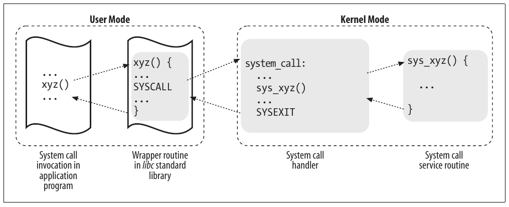

CHƯƠNG 10 Chương 10

# Chương 10. System call


Hệ điều hành cung cấp cho process chạy trong User Mode một tập interface để tương tác với hardware device như CPU, disk và printer. Đặt thêm một lớp giữa ứng dụng và hardware có nhiều lợi ích. Thứ nhất, nó giúp lập trình dễ hơn bằng cách giải phóng người dùng khỏi việc nghiên cứu đặc điểm lập trình cấp thấp của hardware device. Thứ hai, nó tăng đáng kể tính bảo mật hệ thống, vì kernel có thể kiểm tra tính đúng đắn của yêu cầu ở cấp interface trước khi cố đáp ứng. Cuối cùng nhưng không kém phần quan trọng, các interface này giúp chương trình có tính khả chuyển cao hơn, vì có thể compile và thực thi đúng trên mọi kernel cung cấp cùng tập interface.

Hệ thống Unix triển khai phần lớn interface giữa User Mode process và hardware device bằng system call gửi đến kernel. Chương này xem xét chi tiết cách Linux triển khai system call mà User Mode program gửi đến kernel.

## POSIX API và system call

Hãy bắt đầu bằng việc nhấn mạnh khác biệt giữa application programmer interface (API) và system call. Cái đầu là định nghĩa function chỉ rõ cách nhận một dịch vụ cho trước, còn cái sau là yêu cầu tường minh gửi đến kernel qua software interrupt.

Hệ thống Unix chứa nhiều function library cung cấp API cho lập trình viên. Một số API do standard C library libc định nghĩa tham chiếu đến wrapper routine (routine chỉ có mục đích thực hiện system call). Thông thường, mỗi system call có wrapper routine tương ứng, định nghĩa API mà application program nên dùng.

Tuy nhiên, chiều ngược lại không đúng—API không nhất thiết tương ứng với một system call cụ thể. Trước hết, API có thể cung cấp dịch vụ trực tiếp trong User Mode. (Với thứ trừu tượng như math function, có thể không có lý do thực hiện system call.) Thứ hai, một API function có thể thực hiện nhiều system call. Hơn nữa, nhiều API function có thể thực hiện cùng system call nhưng bổ sung chức năng bao quanh nó. Ví dụ, trong Linux, các API `malloc()`, `calloc()`, và `free()` được triển khai trong library libc. Code trong library này theo dõi yêu cầu cấp phát và thu hồi, và dùng system call `brk()` để mở rộng hoặc thu nhỏ heap của process (xem phần “Managing the Heap” trong Chương 9).

Chuẩn POSIX nói đến API chứ không phải system call. Một hệ thống có thể được chứng nhận tuân thủ POSIX nếu cung cấp tập API thích hợp cho application program, bất kể cách triển khai các function tương ứng. Thực tế, nhiều hệ thống không phải Unix đã được chứng nhận tuân thủ POSIX, vì cung cấp mọi dịch vụ Unix truyền thống trong User Mode library.

Theo góc nhìn lập trình viên, phân biệt API và system call không quan trọng—những gì quan trọng chỉ là tên function, kiểu parameter và ý nghĩa return code. Tuy nhiên, theo góc nhìn người thiết kế kernel, sự phân biệt có ý nghĩa vì system call thuộc kernel, còn User Mode library thì không.

Phần lớn wrapper routine trả về giá trị integer, có ý nghĩa phụ thuộc system call tương ứng. Giá trị trả về –1 thường cho biết kernel không thể đáp ứng yêu cầu của process. Thất bại trong system call handler có thể do parameter không hợp lệ, thiếu resource khả dụng, vấn đề hardware, v.v. Error code cụ thể nằm trong biến `errno`, được định nghĩa trong library libc.

Mỗi error code được định nghĩa là macro constant, cho giá trị integer dương tương ứng. Chuẩn POSIX chỉ định tên macro của một số error code. Trong Linux, trên hệ thống 80×86, các macro này được định nghĩa trong header file include/asm-i386/errno.h. Để cho phép C program có tính khả chuyển giữa hệ thống Unix, header file include/asm-i386/errno.h lại được include trong C library header file chuẩn /usr/include/errno.h. Các hệ thống khác có subdirectory chuyên biệt riêng chứa header file.

## System call handler và service routine

Khi User Mode process gọi system call, CPU chuyển sang Kernel Mode và bắt đầu thực thi kernel function. Như sẽ thấy trong phần tiếp theo, trong kiến trúc 80×86 có thể gọi Linux system call theo hai cách khác nhau. Tuy nhiên, kết quả cuối của cả hai cách là nhảy đến assembly language function gọi là system call handler.

Vì kernel triển khai nhiều system call khác nhau, User Mode process phải truyền parameter gọi là system call number để xác định system call được yêu cầu; Linux dùng register `eax` cho mục đích này. Như sẽ thấy trong phần “Parameter Passing” ở phần sau chương này, parameter bổ sung thường được truyền khi gọi system call.

Mọi system call đều trả về giá trị integer. Quy ước cho giá trị trả về này khác với wrapper routine. Trong kernel, giá trị dương hoặc 0 biểu thị system call kết thúc thành công, còn giá trị âm biểu thị tình trạng lỗi. Trong trường hợp sau, giá trị là số đối của error code phải được trả cho application program trong biến `errno`. Kernel không đặt hay dùng biến `errno`. Thay vào đó, wrapper routine đảm nhiệm đặt biến này sau khi system call trả về.

System call handler, có cấu trúc tương tự các exception handler khác, thực hiện các thao tác sau:

- Lưu nội dung phần lớn register trong Kernel Mode stack (thao tác này chung cho mọi system call và được viết bằng assembly language).

- Xử lý system call bằng cách gọi C function tương ứng gọi là system call service routine.

- Thoát handler: register được nạp giá trị đã lưu trong Kernel Mode stack, và CPU chuyển từ Kernel Mode trở lại User Mode (thao tác này chung cho mọi system call và được viết bằng assembly language).

Tên service routine gắn với system call `xyz()` thường là `sys_xyz()`; tuy nhiên, có một vài ngoại lệ cho quy tắc này.

Hình 10-1 minh họa quan hệ giữa application program gọi system call, wrapper routine tương ứng, system call handler và system call service routine. Mũi tên biểu thị luồng thực thi giữa các function. Các thuật ngữ “`SYSCALL`” và “`SYSEXIT`” là placeholder cho assembly language instruction thực tế lần lượt chuyển CPU từ User Mode sang Kernel Mode và từ Kernel Mode sang User Mode.



Hình 10-1. Gọi system call

Để liên kết mỗi system call number với service routine tương ứng, kernel dùng system call dispatch table, được lưu trong array `sys_call_table` và có `NR_syscalls` entry (289 trong kernel Linux 2.6.11). Entry thứ n chứa địa chỉ service routine của system call có number n.

Macro `NR_syscalls` chỉ là giới hạn tĩnh về số system call tối đa có thể triển khai; nó không cho biết số system call thực sự được triển khai. Thực tế, mỗi entry của dispatch table có thể chứa địa chỉ function `sys_ni_syscall()`, là service routine cho system call “chưa triển khai”; nó chỉ trả về error code `-ENOSYS`.

## Vào và thoát system call

Native application[^1] có thể gọi system call theo hai cách khác nhau:

- Thực thi assembly language instruction `int $0x80`; trong phiên bản Linux kernel cũ, đây là cách duy nhất chuyển từ User Mode sang Kernel Mode.

- Thực thi assembly language instruction `sysenter`, được đưa vào microprocessor Intel Pentium II; instruction này hiện được kernel Linux 2.6 hỗ trợ.

Tương tự, kernel có thể thoát system call—qua đó chuyển CPU trở lại User Mode—theo hai cách:

- Thực thi assembly language instruction `iret`.

- Thực thi assembly language instruction `sysexit`, được đưa vào microprocessor Intel Pentium II cùng instruction `sysenter`.

Tuy nhiên, hỗ trợ hai cách khác nhau để vào kernel không đơn giản như có vẻ, vì:

- Kernel phải hỗ trợ cả library cũ chỉ dùng instruction `int $0x80` lẫn library mới hơn có dùng instruction `sysenter`.

- Standard library dùng instruction `sysenter` phải có thể làm việc với kernel cũ chỉ hỗ trợ instruction `int $0x80`.

- Kernel và standard library phải có thể chạy cả trên processor cũ không có instruction `sysenter` lẫn processor mới hơn có instruction này.

Chúng ta sẽ thấy cách Linux kernel giải quyết các vấn đề tương thích này trong phần “Issuing a System Call via the sysenter Instruction” ở phần sau chương này.

### Thực hiện system call qua instruction int $0x80

Cách “truyền thống” để gọi system call dùng assembly language instruction `int`, đã được bàn trong phần “Hardware Handling of Interrupts and Exceptions” ở Chương 4.

Vector 128—ở dạng hexadecimal là `0x80`—gắn với kernel entry point. Function `trap_init()`, được gọi trong kernel initialization, thiết lập Interrupt Descriptor Table entry tương ứng với vector 128 như sau:

```c
set_system_gate(0x80, &system_call);
```

Lời gọi nạp các giá trị sau vào các field của gate descriptor (xem phần “Interrupt, Trap, and System Gates” trong Chương 4):

Segment Selector

Segment Selector `__KERNEL_CS` của kernel code segment.

Offset

Pointer đến system call handler `system_call()`.

Type

Đặt thành 15. Cho biết exception là Trap và handler tương ứng không disable maskable interrupt.

DPL (Descriptor Privilege Level)

Đặt thành 3. Điều này cho phép process trong User Mode gọi exception handler (xem phần “Hardware Handling of Interrupts and Exceptions” trong Chương 4).

Do đó, khi User Mode process thực hiện instruction `int $0x80`, CPU chuyển sang Kernel Mode và bắt đầu thực thi instruction từ địa chỉ `system_call`.

#### Function system\_call()

Function `system_call()` bắt đầu bằng cách lưu system call number và mọi CPU register mà exception handler có thể dùng lên stack—ngoại trừ `eflags`, `cs`, `eip`, `ss`, và `esp`, vốn đã được control unit tự động lưu (xem phần “Hardware Handling of Interrupts and Exceptions” trong Chương 4). Macro `SAVE_ALL`, đã được bàn trong phần “I/O Interrupt Handling” ở Chương 4, còn nạp Segment Selector của kernel data segment vào `ds` và `es`:

```c
system_call:
  pushl %eax
  SAVE_ALL
  movl $0xffffe000, %ebx /* or 0xfffff000 for 4-KB stacks */
  andl %esp, %ebx
```

Sau đó, function lưu địa chỉ data structure `thread_info` của process hiện tại vào `ebx` (xem phần “Identifying a Process” trong Chương 3). Việc này được thực hiện bằng cách lấy giá trị kernel stack pointer và làm tròn lên bội số của 4 hoặc 8 KB (xem phần “Identifying a Process” trong Chương 3).

Tiếp theo, function `system_call()` kiểm tra một trong các flag `TIF_SYSCALL_TRACE` và `TIF_SYSCALL_AUDIT` trong field `flags` của structure `thread_info` có được set không—tức các lần gọi system call của chương trình được thực thi có đang được debugger trace không. Nếu có, `system_call()` gọi function `do_syscall_trace()` hai lần: một ngay trước và một ngay sau khi thực thi system call service routine (như mô tả phía sau). Function này dừng `current`, qua đó cho phép debugging process thu thập thông tin về nó.

Sau đó, kiểm tra tính hợp lệ của system call number do User Mode process truyền. Nếu lớn hơn hoặc bằng số entry trong system call dispatch table, system call handler kết thúc:

```c
  cmpl $NR_syscalls, %eax
  jb nobadsys
  movl $(-ENOSYS), 24(%esp)
  jmp resume_userspace
nobadsys:
```

Nếu system call number không hợp lệ, function lưu giá trị `-ENOSYS` vào vị trí stack đã lưu register `eax`—tức tại offset 24 từ đỉnh stack hiện tại. Sau đó nhảy đến `resume_userspace` (xem bên dưới). Theo cách này, khi process tiếp tục thực thi trong User Mode, nó sẽ thấy return code âm trong `eax`.

Cuối cùng, service routine cụ thể gắn với system call number trong `eax` được gọi:

```c
  call *sys_call_table(0, %eax, 4)
```

Vì mỗi entry trong dispatch table dài 4 byte, kernel tìm địa chỉ service routine cần gọi bằng cách nhân system call number với 4, cộng địa chỉ đầu dispatch table `sys_call_table`, và lấy pointer đến service routine từ slot đó trong table.

##### Thoát system call

Khi system call service routine kết thúc, function `system_call()` lấy return code từ `eax` và lưu vào vị trí stack đã lưu giá trị User Mode của register `eax`:

```c
  movl %eax, 24(%esp)
```

Do đó, User Mode process sẽ thấy return code của system call trong register `eax`.

Sau đó, function `system_call()` disable local interrupt và kiểm tra các flag trong structure `thread_info` của `current`:

```c
  cli
  movl 8(%ebp), %ecx
  testw $0xffff, %cx
  je restore_all
```

Field `flags` ở offset 8 trong structure `thread_info`; mask `0xffff` chọn các bit tương ứng với mọi flag liệt kê trong Bảng 4-15 ngoại trừ `TIF_POLLING_NRFLAG`. Nếu không flag nào được set, function nhảy đến label `restore_all`: như mô tả trong phần “Returning from Interrupts and Exceptions” ở Chương 4, code này khôi phục nội dung register đã lưu trên Kernel Mode stack và thực thi assembly language instruction `iret` để tiếp tục User Mode process. (Bạn có thể tham khảo flow diagram trong Hình 4-6.)

Nếu có flag được set, vẫn có việc cần làm trước khi trở về User Mode. Nếu flag `TIF_SYSCALL_TRACE` được set, function `system_call()` gọi function `do_syscall_trace()` lần thứ hai, rồi nhảy đến label `resume_userspace`. Ngược lại, nếu flag `TIF_SYSCALL_TRACE` không được set, function nhảy đến label `work_pending`.

Như giải thích trong phần “Returning from Interrupts and Exceptions” ở Chương 4, code tại các label `resume_userspace` và `work_pending` kiểm tra rescheduling request, virtual-8086 mode, pending signal và single stepping; rồi cuối cùng nhảy đến label `restore_all` để tiếp tục thực thi User Mode process.

### Thực hiện system call qua instruction sysenter

Assembly language instruction `int` vốn chậm vì thực hiện nhiều kiểm tra tính nhất quán và bảo mật. (Instruction được mô tả chi tiết trong phần “Hardware Handling of Interrupts and Exceptions” ở Chương 4.)

Instruction `sysenter`, được tài liệu Intel gọi là “Fast System Call”, cung cấp cách nhanh hơn để chuyển từ User Mode sang Kernel Mode.

#### Instruction sysenter

Assembly language instruction `sysenter` dùng ba register đặc biệt phải được nạp thông tin sau:[^2]

`SYSENTER_CS_MSR`

Segment Selector của kernel code segment

`SYSENTER_EIP_MSR`

Linear address của kernel entry point

`SYSENTER_ESP_MSR`

Kernel stack pointer Khi instruction `sysenter` được thực thi, CPU control unit:

1\. Sao chép nội dung `SYSENTER_CS_MSR` vào `cs`.

2\. Sao chép nội dung `SYSENTER_EIP_MSR` vào `eip`.

3\. Sao chép nội dung `SYSENTER_ESP_MSR` vào `esp`.

4\. Cộng 8 vào giá trị `SYSENTER_CS_MSR`, và nạp giá trị này vào `ss`.

Do đó, CPU chuyển sang Kernel Mode và bắt đầu thực thi instruction đầu tiên của kernel entry point. Như đã thấy trong phần “The Linux GDT” ở Chương 2, kernel stack segment trùng kernel data segment, và descriptor tương ứng nằm sau descriptor của kernel code segment trong Global Descriptor Table; vì vậy, bước 4 nạp Segment Selector thích hợp vào register `ss`.

Ba model-specific register được function `enable_sep_cpu()` khởi tạo, được mỗi CPU trong hệ thống thực thi một lần trong quá trình kernel initialization. Function thực hiện các bước sau:

1\. Ghi Segment Selector của kernel code (`__KERNEL_CS`) vào register `SYSENTER_CS_MSR`. 2. Ghi linear address của function `sysenter_entry()` mô tả bên dưới vào register `SYSENTER_CS_EIP`.

3\. Tính linear address cuối local TSS, và ghi giá trị này vào register `SYSENTER_CS_ESP`.[^3]

Cách đặt register `SYSENTER_CS_ESP` cần được giải thích thêm. Khi system call bắt đầu, kernel stack rỗng, nên register `esp` phải trỏ đến cuối memory area 4 hoặc 8 KB chứa kernel stack và descriptor của process hiện tại (xem Hình 3-2). User Mode wrapper routine không thể đặt register này đúng vì không biết địa chỉ memory area; mặt khác, phải đặt giá trị register trước khi chuyển sang Kernel Mode. Vì thế, kernel khởi tạo register để mã hóa địa chỉ Task State Segment của local CPU. Như đã mô tả ở bước 3 của function `__switch_to()` (xem phần “Performing the Process Switch” trong Chương 3), tại mỗi process switch, kernel lưu kernel stack pointer của process hiện tại trong field `esp0` của local TSS. Do đó, system call handler đọc register `esp`, tính địa chỉ field `esp0` của local TSS, và nạp kernel stack pointer thích hợp vào chính register `esp` đó.

##### Vsyscall page

Wrapper function trong standard library libc chỉ có thể dùng instruction `sysenter` nếu cả CPU lẫn Linux kernel hỗ trợ.

Vấn đề tương thích này đòi hỏi giải pháp khá tinh vi. Về cơ bản, trong giai đoạn khởi tạo, function `sysenter_setup()` xây dựng một page frame gọi là vsyscall page chứa ELF shared object nhỏ (tức ELF dynamic library rất nhỏ). Khi process thực hiện system call `execve()` để bắt đầu thực thi ELF program, code trong vsyscall page được dynamic link vào process address space (xem phần “The exec Functions” trong Chương 20). Code trong vsyscall page dùng instruction tốt nhất sẵn có để thực hiện system call.

Function `sysenter_setup()` cấp phát page frame mới cho vsyscall page và liên kết physical address của nó với fix-mapped linear address `FIX_VSYSCALL` (xem phần “Fix-Mapped Linear Addresses” trong Chương 2). Sau đó, function sao chép vào page một trong hai ELF shared object định sẵn:

- Nếu CPU không hỗ trợ `sysenter`, function xây dựng vsyscall page chứa code:

```c
__kernel_vsyscall:
  int $0x80
  ret
```

- Ngược lại, nếu CPU hỗ trợ `sysenter`, function xây dựng vsyscall page chứa code:

```c
__kernel_vsyscall:
  pushl %ecx
  pushl %edx
  pushl %ebp
  movl %esp, %ebp
  sysenter
```

Khi wrapper routine trong standard library phải gọi system call, nó gọi function `__kernel_vsyscall()`, bất kể function này là phiên bản nào.

Vấn đề tương thích cuối cùng đến từ các phiên bản Linux kernel cũ không hỗ trợ instruction `sysenter`; tất nhiên, trong trường hợp này, kernel không xây dựng vsyscall page và function `__kernel_vsyscall()` không được link vào address space của User Mode process. Khi standard library mới nhận ra điều này, chúng chỉ thực thi instruction `int $0x80` để gọi system call.

##### Vào system call

Chuỗi bước thực hiện khi system call được gọi qua instruction `sysenter` như sau:

1\. Wrapper routine trong standard library nạp system call number vào register `eax` và gọi function `__kernel_vsyscall()`.

2\. Function `__kernel_vsyscall()` lưu nội dung `ebp`, `edx`, và `ecx` trên User Mode stack (các register này sẽ được system call handler dùng), sao chép user stack pointer vào `ebp`, rồi thực thi instruction `sysenter`.

3\. CPU chuyển từ User Mode sang Kernel Mode, và kernel bắt đầu thực thi function `sysenter_entry()` (được register `SYSENTER_EIP_MSR` trỏ đến).

4\. Assembly language function `sysenter_entry()` thực hiện các bước sau:

a. Thiết lập kernel stack pointer:

```c
movl -508(%esp), %esp
```

Ban đầu, register `esp` trỏ đến vị trí đầu tiên sau local TSS, có độ dài 512 byte. Do đó, instruction nạp vào register `esp` nội dung field tại offset 4 trong local TSS, tức nội dung field `esp0`. Như đã giải thích, field `esp0` luôn lưu kernel stack pointer của process hiện tại.

b. Enable local interrupt:

```c
sti
```

c. Lưu trong Kernel Mode stack Segment Selector của user data segment, user stack pointer hiện tại, register `eflags`, Segment Selector của user code segment, và địa chỉ instruction cần thực thi khi thoát system call:

```c
pushl $(__USER_DS)
pushl %ebp
pushfl
pushl $(__USER_CS)
pushl $SYSENTER_RETURN
```

Lưu ý các instruction này mô phỏng một số thao tác do assembly language instruction `int` thực hiện (bước 5c và 7 trong mô tả `int` ở phần “Hardware Handling of Interrupts and Exceptions” trong Chương 4).

d. Khôi phục trong `ebp` giá trị gốc của register do wrapper routine truyền:

```c
movl (%ebp), %ebp
```

Instruction này thực hiện được việc đó vì `__kernel_vsyscall()` đã lưu giá trị gốc của `ebp` trên User Mode stack rồi nạp vào `ebp` giá trị hiện tại của user stack pointer.

e. Gọi system call handler bằng cách thực thi chuỗi instruction giống chuỗi bắt đầu tại label `system_call` mô tả trong phần “Issuing a System Call via the int $0x80 Instruction” trước đó.

##### Thoát system call

Khi system call service routine kết thúc, function `sysenter_entry()` thực hiện về cơ bản cùng thao tác với function `system_call()` (xem phần trước). Trước tiên, nó lấy return code của system call service routine từ `eax` và lưu vào vị trí kernel stack đã lưu giá trị User Mode của register `eax`. Sau đó, function disable local interrupt và kiểm tra các flag trong structure `thread_info` của `current`.

Nếu có flag được set, vẫn có việc cần làm trước khi trở về User Mode. Để tránh lặp code, trường hợp này được xử lý chính xác như trong function `system_call()`, nên function nhảy đến label `resume_userspace` hoặc `work_pending` (xem flow diagram trong Hình 4-6 ở Chương 4). Cuối cùng, assembly language instruction `iret` lấy từ Kernel Mode stack năm argument mà function `sysenter_entry()` đã lưu ở bước 4c, qua đó chuyển CPU trở lại User Mode và bắt đầu thực thi code tại label `SYSENTER_RETURN` (xem bên dưới).

Nếu function `sysenter_entry()` xác định các flag đều clear, nó trở về User Mode nhanh:

```c
movl 40(%esp), %edx
movl 52(%esp), %ecx
xorl %ebp, %ebp
sti
sysexit
```

Các register `edx` và `ecx` được nạp hai giá trị stack mà `sysenter_entry()` đã lưu ở bước 4c trong phần trước: `edx` nhận địa chỉ label `SYSENTER_RETURN`, còn `ecx` nhận user data stack pointer hiện tại.

##### Instruction sysexit

Assembly language instruction `sysexit` là instruction đi cùng `sysenter`: nó cho phép chuyển nhanh từ Kernel Mode sang User Mode. Khi instruction được thực thi, CPU control unit thực hiện các bước sau:

1\. Cộng 16 vào giá trị trong register `SYSENTER_CS_MSR`, và nạp kết quả vào register `cs`. 2. Sao chép nội dung register `edx` vào register `eip`.

3\. Cộng 24 vào giá trị trong register `SYSENTER_CS_MSR`, và nạp kết quả vào register `ss`.

4\. Sao chép nội dung register `ecx` vào register `esp`.

Vì register `SYSENTER_CS_MSR` được nạp Segment Selector của kernel code, register `cs` được nạp Segment Selector của user code, còn register `ss` được nạp Segment Selector của user data segment (xem phần “The Linux GDT” trong Chương 2).

Kết quả là CPU chuyển từ Kernel Mode sang User Mode và bắt đầu thực thi instruction có địa chỉ lưu trong register `edx`.

##### Code SYSENTER\_RETURN

Code tại label `SYSENTER_RETURN` được lưu trong vsyscall page, và được thực thi khi system call đã vào qua `sysenter` đang kết thúc, bằng instruction `iret` hoặc instruction `sysexit`.

Code chỉ khôi phục nội dung gốc của các register `ebp`, `edx`, và `ecx` đã lưu trong User Mode stack, và trả quyền điều khiển cho wrapper routine trong standard library:

```c
SYSENTER_RETURN:
  popl %ebp
  popl %edx
  popl %ecx
  ret
```

## Truyền parameter

Giống function thông thường, system call thường cần một số input/output parameter, có thể gồm giá trị thực (tức số), địa chỉ biến trong address space của User Mode process, hoặc thậm chí địa chỉ data structure chứa pointer đến User Mode function (xem phần “System Calls Related to Signal Handling” trong Chương 11).

Vì các function `system_call()` và `sysenter_entry()` là entry point chung cho mọi system call trong Linux, mỗi function có ít nhất một parameter: system call number truyền trong register `eax`. Ví dụ, nếu application program gọi wrapper routine `fork()`, register `eax` được đặt thành 2 (tức `__NR_fork`) trước khi thực thi assembly language instruction `int $0x80` hoặc `sysenter`. Vì register được wrapper routine trong library libc đặt, lập trình viên thường không quan tâm system call number.

System call `fork()` không yêu cầu parameter khác. Tuy nhiên, nhiều system call cần parameter bổ sung, phải được application program truyền tường minh. Ví dụ, system call `mmap()` có thể cần tối đa sáu parameter bổ sung (ngoài system call number).

Parameter của C function thông thường thường được truyền bằng cách ghi giá trị vào program stack đang hoạt động (User Mode stack hoặc Kernel Mode stack). Vì system call là loại function đặc biệt chuyển từ user sang kernel, không thể dùng User Mode stack hay Kernel Mode stack. Thay vào đó, parameter của system call được ghi vào CPU register trước khi thực hiện system call. Sau đó, kernel sao chép parameter lưu trong CPU register lên Kernel Mode stack trước khi gọi system call service routine, vì routine này là C function thông thường.

Tại sao kernel không sao chép parameter trực tiếp từ User Mode stack sang Kernel Mode stack? Trước hết, làm việc với hai stack cùng lúc phức tạp; thứ hai, dùng register giúp cấu trúc system call handler giống các exception handler khác.

Tuy nhiên, để truyền parameter trong register, phải đáp ứng hai điều kiện:

- Độ dài mỗi parameter không được vượt độ dài register (32 bit).[^4]

- Số parameter không được vượt sáu, ngoài system call number truyền trong `eax`, vì processor 80×86 có số register rất hạn chế.

Điều kiện đầu luôn đúng vì theo chuẩn POSIX, parameter lớn không thể lưu trong register 32-bit phải được truyền bằng reference. Ví dụ điển hình là system call `settimeofday()`, phải đọc structure 64-bit.

Tuy nhiên, có system call cần hơn sáu parameter. Trong những trường hợp này, một register được dùng để trỏ đến memory area trong process address space chứa giá trị parameter. Tất nhiên, lập trình viên không phải quan tâm cách xử lý này. Như mọi lời gọi C function, parameter được tự động lưu trên stack khi wrapper routine được gọi. Routine này sẽ tìm cách thích hợp để truyền parameter cho kernel.

Các register dùng để lưu system call number và parameter, theo thứ tự tăng dần, là `eax` (cho system call number), `ebx`, `ecx`, `edx`, `esi`, `edi`, và `ebp`. Như đã thấy, `system_call()` và `sysenter_entry()` lưu giá trị các register này trên Kernel Mode stack bằng macro `SAVE_ALL`. Do đó, khi system call service routine truy cập stack, nó thấy return address đến `system_call()` hoặc `sysenter_entry()`, tiếp theo là parameter lưu trong `ebx` (parameter đầu của system call), parameter lưu trong `ecx`, v.v. (xem phần “Saving the registers for the interrupt handler” trong Chương 4). Bố trí stack này chính xác giống lời gọi function thông thường, nên service routine có thể dễ dàng tham chiếu parameter bằng cấu trúc C language thông thường.

Hãy xem ví dụ. Service routine `sys_write()`, xử lý system call `write()`, được khai báo như sau:

```c
int sys_write (unsigned int fd, const char * buf, unsigned int count)
```

C compiler tạo assembly language function dự kiến tìm thấy các parameter `fd`, `buf`, và `count` trên đỉnh stack, ngay dưới return address, tại các vị trí lần lượt dùng để lưu nội dung các register `ebx`, `ecx`, và `edx`.

Trong một vài trường hợp, ngay cả khi system call không dùng parameter, service routine tương ứng cần biết nội dung CPU register ngay trước khi system call được thực hiện. Ví dụ, function `do_fork()` triển khai `fork()` cần biết giá trị register để nhân đôi chúng trong field `thread` của child process (xem phần “The thread field” trong Chương 3). Trong các trường hợp này, một parameter duy nhất kiểu `pt_regs` cho phép service routine truy cập giá trị do macro `SAVE_ALL` lưu trong Kernel Mode stack (xem phần “The do\_IRQ() function” trong Chương 4):

```c
int sys_fork (struct pt_regs regs)
```

Giá trị trả về của service routine phải được ghi vào register `eax`. C compiler tự động thực hiện việc này khi instruction `return n`; được thực thi.

### Kiểm tra parameter

Mọi parameter của system call phải được kiểm tra cẩn thận trước khi kernel cố đáp ứng yêu cầu người dùng. Loại kiểm tra phụ thuộc cả system call lẫn parameter cụ thể. Hãy quay lại system call `write()` đã giới thiệu: parameter `fd` phải là file descriptor xác định file cụ thể, nên `sys_write()` phải kiểm tra `fd` thực sự là file descriptor của file đã mở trước đó và process có được phép ghi vào file không (xem phần “File-Handling System Calls” trong Chương 1). Nếu bất cứ điều kiện nào không đúng, handler phải trả về giá trị âm—trong trường hợp này là error code `–EBADF`.

Tuy nhiên, có một loại kiểm tra chung cho mọi system call. Bất cứ khi nào parameter chỉ định địa chỉ, kernel phải kiểm tra nó có trong process address space không. Có hai cách thực hiện kiểm tra này:

- Kiểm tra linear address thuộc process address space và, nếu có, memory region chứa nó có access right thích hợp.

- Chỉ kiểm tra linear address thấp hơn `PAGE_OFFSET` (tức không nằm trong dải địa chỉ dành cho kernel).

Linux kernel ban đầu thực hiện loại kiểm tra thứ nhất. Nhưng nó khá tốn thời gian vì phải thực hiện cho mỗi address parameter trong system call; hơn nữa, thường vô ích vì chương trình lỗi không phổ biến lắm.

Vì vậy, từ phiên bản 2.2, Linux dùng loại kiểm tra thứ hai. Cách này hiệu quả hơn nhiều vì không cần quét process memory region descriptor. Rõ ràng, đây là kiểm tra rất sơ bộ: xác minh linear address nhỏ hơn `PAGE_OFFSET` là điều kiện cần nhưng chưa đủ cho tính hợp lệ. Nhưng giới hạn kernel ở loại kiểm tra này không có rủi ro vì các lỗi khác sẽ được bắt phía sau.

Do đó, cách tiếp cận là trì hoãn kiểm tra thực sự đến thời điểm muộn nhất có thể—tức khi Paging Unit chuyển linear address thành physical address. Chúng ta sẽ bàn trong phần “Dynamic Address Checking: The Fix-up Code” ở phần sau chương này về cách Page Fault exception handler phát hiện được những địa chỉ sai được dùng trong Kernel Mode mà User Mode process đã truyền làm parameter.

Đến đây có thể thắc mắc tại sao vẫn thực hiện kiểm tra sơ bộ. Loại kiểm tra này thực sự thiết yếu để bảo vệ cả process address space lẫn kernel address space khỏi truy cập trái phép. Chúng ta đã thấy trong Chương 2 rằng RAM được map bắt đầu từ `PAGE_OFFSET`. Điều này nghĩa là kernel routine có thể truy cập mọi page hiện diện trong memory. Vì thế, nếu không kiểm tra sơ bộ, User Mode process có thể truyền địa chỉ thuộc kernel address space làm parameter rồi có thể đọc hoặc ghi mọi page hiện diện trong memory mà không gây Page Fault exception.

Kiểm tra địa chỉ truyền cho system call được macro `access_ok()` thực hiện, nhận hai parameter: `addr` và `size`. Macro kiểm tra khoảng địa chỉ giới hạn bởi `addr` và `addr + size – 1`. Về cơ bản, nó tương đương C function sau:

```c
int access_ok(const void * addr, unsigned long size)
{
    unsigned long a = (unsigned long) addr;
    if (a + size < a ||
        a + size > current_thread_info()->addr_limit.seg)
        return 0;
    return 1;
}
```

Trước tiên, function kiểm tra `addr + size`, địa chỉ cao nhất cần kiểm tra, có lớn hơn 2<sup>32</sup>–1 không; vì GNU C compiler (`gcc`) biểu diễn unsigned long integer và pointer bằng số 32-bit, điều này tương đương kiểm tra overflow. Function còn kiểm tra `addr + size` có vượt giá trị lưu trong field `addr_limit.seg` của structure `thread_info` của `current` không. Field này thường có giá trị `PAGE_OFFSET` với process thông thường và `0xffffffff` với kernel thread. Giá trị field `addr_limit.seg` có thể được thay đổi động bằng các macro `get_fs` và `set_fs`; điều này cho phép kernel bỏ qua các kiểm tra bảo mật do `access_ok()` thực hiện, để có thể gọi system call service routine và truyền trực tiếp địa chỉ trong kernel data segment cho chúng.

Function `verify_area()` thực hiện cùng kiểm tra như macro `access_ok()`; dù function này được xem là lỗi thời, nó vẫn được dùng rộng rãi trong source code.

### Truy cập process address space

System call service routine thường cần đọc hoặc ghi dữ liệu trong address space của process. Linux chứa một tập macro giúp truy cập này dễ hơn. Chúng ta sẽ mô tả hai macro, gọi là `get_user()` và `put_user()`. Macro đầu có thể dùng để đọc 1, 2 hoặc 4 byte liên tiếp từ địa chỉ, còn macro sau có thể dùng để ghi dữ liệu có kích thước đó vào địa chỉ.

Mỗi function nhận hai argument, giá trị `x` cần truyền và biến `ptr`. Biến thứ hai cũng xác định số byte cần truyền. Do đó, trong `get_user(x,ptr)`, kích thước biến mà `ptr` trỏ đến khiến function được mở rộng thành assembly language function `__get_user_1()`, `__get_user_2()`, hoặc `__get_user_4()`. Hãy xét một trong số đó, `__get_user_2()`:

```c
__get_user_2:
    addl $1, %eax
    jc bad_get_user
    movl $0xffffe000, %edx /* or 0xfffff000 for 4-KB stacks */
    andl %esp, %edx
    cmpl 24(%edx), %eax
    jae bad_get_user
2:  movzwl -1(%eax), %edx
    xorl %eax, %eax
    ret
bad_get_user:
    xorl %edx, %edx
    movl $-EFAULT, %eax
    ret
```

Register `eax` chứa địa chỉ `ptr` của byte đầu cần đọc. Sáu instruction đầu về cơ bản thực hiện cùng kiểm tra với macro `access_ok()`: đảm bảo 2 byte cần đọc có địa chỉ nhỏ hơn 4 GB cũng như nhỏ hơn field `addr_limit.seg` của process `current`. (Field này lưu tại offset 24 trong structure `thread_info` của `current`, xuất hiện trong operand đầu của instruction `cmpl`.)

Nếu địa chỉ hợp lệ, function thực thi instruction `movzwl` để lưu dữ liệu cần đọc vào hai byte thấp nhất của register `edx`, đồng thời đặt các byte cao của `edx` thành 0; sau đó đặt return code 0 trong `eax` và kết thúc. Nếu địa chỉ không hợp lệ, function clear `edx`, đặt giá trị `-EFAULT` vào `eax`, và kết thúc.

Macro `put_user(x,ptr)` giống macro đã bàn, ngoại trừ ghi giá trị `x` vào process address space bắt đầu từ địa chỉ `ptr`. Tùy kích thước `x`, nó gọi macro `__put_user_asm()` (kích thước 1, 2 hoặc 4 byte) hoặc macro `__put_user_u64()` (kích thước 8 byte). Cả hai macro trả về giá trị 0 trong register `eax` nếu ghi thành công, và `-EFAULT` nếu không.

Có một số function và macro khác để truy cập process address space trong Kernel Mode; chúng được liệt kê trong Bảng 10-1. Lưu ý nhiều function và macro còn có biến thể với tiền tố hai dấu gạch dưới (\_\_). Những cái không có gạch dưới ở đầu dành thêm thời gian kiểm tra tính hợp lệ của khoảng linear address được yêu cầu, còn những cái có gạch dưới bỏ qua kiểm tra đó. Bất cứ khi nào kernel phải truy cập lặp lại cùng memory area trong process address space, kiểm tra địa chỉ một lần ở đầu rồi truy cập vùng của process mà không kiểm tra thêm sẽ hiệu quả hơn.

Bảng 10-1. Function và macro truy cập process address space

| Function | Thao tác |
|---|---|
| `get_user __get_user` | Đọc giá trị integer từ user space (1, 2 hoặc 4 byte) |
| `put_user __put_user` | Ghi giá trị integer vào user space (1, 2 hoặc 4 byte) |
| `copy_from_user __copy_from_user` | Sao chép block kích thước tùy ý từ user space |
| `copy_to_user __copy_to_user` | Sao chép block kích thước tùy ý vào user space |
| `strncpy_from_user __strncpy_from_user` | Sao chép null-terminated string từ user space |
| `strlen_user strnlen_user` | Trả về độ dài null-terminated string trong user space |
| `clear_user __clear_user` | Điền số không vào memory area trong user space |

### Kiểm tra địa chỉ động: fixup code

Như đã thấy, `access_ok()` kiểm tra sơ bộ tính hợp lệ của linear address truyền làm parameter cho system call. Kiểm tra này chỉ đảm bảo User Mode process không cố can thiệp kernel address space; tuy nhiên, linear address truyền làm parameter vẫn có thể không thuộc process address space. Trong trường hợp này, Page Fault exception sẽ xảy ra khi kernel cố dùng bất kỳ địa chỉ sai nào như vậy.

Trước khi mô tả cách kernel phát hiện loại lỗi này, hãy xác định ba trường hợp Page Fault exception có thể xảy ra trong Kernel Mode. Page Fault handler phải phân biệt các trường hợp này vì hành động cần thực hiện rất khác nhau.

1\. Kernel cố truy cập page thuộc process address space, nhưng page frame tương ứng không tồn tại hoặc kernel cố ghi read-only page. Trong các trường hợp này, handler phải cấp phát và khởi tạo page frame mới (xem các phần “Demand Paging” và “Copy On Write” trong Chương 9).

2\. Kernel truy cập page thuộc address space của nó, nhưng Page Table entry tương ứng chưa được khởi tạo (xem phần “Handling Noncontiguous Memory Area Accesses” trong Chương 9). Trong trường hợp này, kernel phải thiết lập đúng một số entry trong Page Table của process hiện tại.

3\. Một số kernel function chứa bug lập trình khiến exception phát sinh khi chương trình đó được thực thi; hoặc exception có thể do lỗi hardware thoáng qua. Khi điều này xảy ra, handler phải thực hiện kernel oops (xem phần “Handling a Faulty Address Inside the Address Space” trong Chương 9).

4\. Trường hợp được giới thiệu trong chương này: system call service routine cố đọc hoặc ghi memory area có địa chỉ được truyền làm system call parameter, nhưng địa chỉ đó không thuộc process address space.

Page Fault handler có thể dễ dàng nhận ra trường hợp đầu bằng cách xác định linear address gây lỗi có nằm trong một memory region thuộc process hay không.

Nó cũng có thể phát hiện trường hợp thứ hai bằng cách kiểm tra master kernel Page Table entry tương ứng có chứa entry khác không thích hợp map địa chỉ đó hay không. Giờ hãy giải thích cách handler phân biệt hai trường hợp còn lại.

### Exception table

Chìa khóa xác định nguồn Page Fault nằm ở phạm vi hẹp các lời gọi mà kernel dùng để truy cập process address space. Chỉ nhóm nhỏ function và macro mô tả trong phần trước được dùng để truy cập address space này; vì vậy, nếu exception do parameter không hợp lệ, instruction gây ra nó phải nằm trong một function đó hoặc được tạo bằng cách mở rộng một macro đó. Số instruction truy cập user space khá ít.

Do đó, không tốn nhiều công sức để đưa địa chỉ mỗi kernel instruction truy cập process address space vào structure gọi là exception table. Nếu làm được điều này, phần còn lại rất dễ. Khi Page Fault exception xảy ra trong Kernel Mode, handler `do_page_fault()` kiểm tra exception table: nếu table chứa địa chỉ instruction kích hoạt exception, lỗi do system call parameter sai; ngược lại, do bug nghiêm trọng hơn.

Linux định nghĩa một số exception table. Main exception table được C compiler tự động tạo khi build kernel program image. Nó được lưu trong section `__ex_table` của kernel code segment, và địa chỉ đầu, cuối được xác định bằng hai symbol do C compiler tạo: `__start___ex_table` và `__stop___ex_table`.

Hơn nữa, mỗi dynamically loaded module của kernel (xem Phụ lục B) chứa local exception table riêng. Table này được C compiler tự động tạo khi build module image, và được load vào memory khi module được chèn vào kernel đang chạy.

Mỗi entry của exception table là structure `exception_table_entry` có hai field:

`insn`

Linear address của instruction truy cập process address space

`fixup`

Địa chỉ assembly language code cần gọi khi xảy ra Page Fault exception do instruction nằm tại `insn` kích hoạt

Fixup code gồm một vài assembly language instruction giải quyết vấn đề do exception kích hoạt. Như sẽ thấy phía sau trong phần này, cách khắc phục thường gồm chèn chuỗi instruction buộc service routine trả error code cho User Mode process. Các instruction này, thường được định nghĩa trong cùng macro hoặc function truy cập process address space, được C compiler đặt vào section riêng của kernel code segment gọi là `.fixup`.

Function `search_exception_tables()` được dùng để tìm địa chỉ chỉ định trong tất cả exception table: nếu địa chỉ nằm trong một table, function trả về pointer đến structure `exception_table_entry` tương ứng; ngược lại, trả về `NULL`. Do đó, Page Fault handler `do_page_fault()` thực thi các statement sau:

```c
if ((fixup = search_exception_tables(regs->eip))) {
    regs->eip = fixup->fixup;
    return 1;
}
```

Field `regs->eip` chứa giá trị register `eip` đã lưu trên Kernel Mode stack khi exception xảy ra. Nếu giá trị trong register (instruction pointer) nằm trong exception table, `do_page_fault()` thay giá trị đã lưu bằng địa chỉ tìm thấy trong entry do `search_exception_tables()` trả về. Sau đó, Page Fault handler kết thúc và chương trình bị interrupt tiếp tục bằng cách thực thi fixup code.

### Tạo exception table và fixup code

Directive `.section` của GNU Assembler cho phép lập trình viên chỉ định section nào của executable file chứa code phía sau. Như sẽ thấy trong Chương 20, executable file chứa code segment, và code segment có thể được chia thành section. Do đó, các assembly language instruction sau thêm một entry vào exception table; attribute `"a"` chỉ định section phải được load vào memory cùng phần còn lại của kernel image:

```c
.section __ex_table, "a"
```

`.long faulty_instruction_address, fixup_code_address`

```c
.previous
```

Directive `.previous` buộc assembler chèn code phía sau vào section đang hoạt động khi gặp directive `.section` gần nhất.

Hãy xét lại các function `__get_user_1()`, `__get_user_2()`, và `__get_user_4()` đã đề cập. Instruction truy cập process address space là những instruction có label `1`, `2`, và `3`:

```c
__get_user_1:
    [...]
1:  movzbl (%eax), %edx
    [...]
__get_user_2:
    [...]
2:  movzwl -1(%eax), %edx
    [...]
__get_user_4:
    [...]
3:  movl -3(%eax), %edx
    [...]
bad_get_user:
    xorl %edx, %edx
    movl $-EFAULT, %eax
    ret
.section __ex_table,"a"
    .long 1b, bad_get_user
    .long 2b, bad_get_user
    .long 3b, bad_get_user
.previous
```

Mỗi exception table entry gồm hai label. Label đầu là numeric label có hậu tố `b` để chỉ label ở “phía trước đó”; nói cách khác, nó xuất hiện ở một dòng trước trong chương trình. Fixup code dùng chung cho ba function và có label `bad_get_user`. Nếu Page Fault exception được tạo bởi instruction tại label `1`, `2`, hoặc `3`, fixup code được thực thi. Nó chỉ trả error code `–EFAULT` cho process thực hiện system call.

Các kernel function khác thao tác trong User Mode address space dùng kỹ thuật fixup code. Ví dụ, xét macro `strlen_user(string)`. Macro này trả về độ dài null-terminated string truyền làm parameter trong system call hoặc giá trị 0 khi có lỗi. Về cơ bản, macro tạo các assembly language instruction sau:

```c
    movl $0, %eax
    movl $0x7fffffff, %ecx
    movl %ecx, %ebx
    movl string, %edi
0:  repne; scasb
    subl %ecx, %ebx
    movl %ebx, %eax
1:
.section .fixup,"ax"
2:  xorl %eax, %eax
    jmp 1b
.previous
.section __ex_table,"a"
    .long 0b, 2b
.previous
```

Các register `ecx` và `ebx` được khởi tạo bằng giá trị `0x7fffffff`, biểu thị độ dài tối đa cho phép của string trong User Mode address space. Các assembly language instruction `repne;scasb` quét lặp string mà register `edi` trỏ đến, tìm giá trị 0 (ký tự kết thúc string `\0`) trong `eax`. Vì `scasb` giảm register `ecx` ở mỗi lượt lặp, cuối cùng register `eax` lưu tổng số byte đã quét trong string (tức độ dài string).

Fixup code của macro được chèn vào section `.fixup`. Các attribute `"ax"` chỉ định section phải được load vào memory và chứa executable code. Nếu Page Fault exception được tạo bởi instruction tại label `0`, fixup code được thực thi; nó chỉ nạp giá trị 0 vào `eax`—qua đó buộc macro trả error code 0 thay vì độ dài string—rồi nhảy đến label `1`, tương ứng với instruction sau macro.

Directive `.section` thứ hai thêm entry chứa địa chỉ instruction `repne; scasb` và địa chỉ fixup code tương ứng vào section `__ex_table`.

## Kernel wrapper routine

Dù system call chủ yếu được User Mode process dùng, kernel thread cũng có thể gọi chúng vì không thể dùng library function. Để đơn giản hóa khai báo wrapper routine tương ứng, Linux định nghĩa tập bảy macro tên từ `_syscall0` đến `_syscall6`.

Trong tên mỗi macro, các số 0 đến 6 tương ứng số parameter mà system call dùng (không tính system call number). Macro được dùng để khai báo wrapper routine chưa có trong standard library libc (ví dụ vì Linux system call chưa được library hỗ trợ); tuy nhiên, không thể dùng chúng để định nghĩa wrapper routine cho system call có hơn sáu parameter (không tính system call number) hoặc system call cho giá trị trả về không chuẩn.

Mỗi macro yêu cầu chính xác 2 + 2 × n parameter, với n là số parameter của system call. Hai parameter đầu chỉ định return type và tên system call; mỗi cặp parameter bổ sung chỉ định kiểu và tên system call parameter tương ứng. Do đó, ví dụ, wrapper routine của system call `fork()` có thể được tạo bằng:

```c
_syscall0(int,fork)
```

còn wrapper routine của system call `write()` có thể được tạo bằng:

```c
_syscall3(int,write,int,fd,const char *,buf,unsigned int,count)
```

Trong trường hợp sau, macro tạo code sau:

```c
int write(int fd,const char * buf,unsigned int count)
{
    long __res;
    asm("int $0x80"
        : "=a" (__res)
        : "0" (__NR_write), "b" ((long)fd),
          "c" ((long)buf), "d" ((long)count));
    if ((unsigned long)__res >= (unsigned long)-129) {
        errno = -__res;
        __res = -1;
    }
    return (int) __res;
}
```

Macro `__NR_write` được suy ra từ parameter thứ hai của `_syscall3`; nó mở rộng thành system call number của `write()`. Khi compile function trước đó, assembly language code sau được tạo:

```c
write:
     pushl %ebx              ; push ebx into stack
     movl 8(%esp), %ebx      ; put first parameter in ebx
     movl 12(%esp), %ecx     ; put second parameter in ecx
     movl 16(%esp), %edx     ; put third parameter in edx
     movl $4, %eax           ; put __NR_write in eax
     int $0x80               ; invoke system call
     cmpl $-125, %eax        ; check return code
     jbe .L1                 ; if no error, jump
     negl %eax               ; complement the value of eax
     movl %eax, errno        ; put result in errno
     movl $-1, %eax          ; set eax to -1
.L1: popl %ebx               ; pop ebx from stack
     ret                     ; return to calling program
```

Lưu ý cách parameter của function `write()` được nạp vào CPU register trước khi instruction `int $0x80` được thực thi. Giá trị trả về trong `eax` phải được diễn giải là error code nếu nằm từ –1 đến –129 (kernel giả định error code lớn nhất định nghĩa trong include/generic/errno.h là 129). Nếu đúng vậy, wrapper routine lưu giá trị `–eax` trong `errno` và trả về –1; ngược lại, trả về giá trị của `eax`.

[^1]: Như sẽ thấy trong phần “Execution Domains” ở Chương 20, Linux có thể thực thi chương trình được compile cho hệ điều hành “ngoại lai”. Vì thế, kernel cung cấp compatibility mode để vào system call: User Mode process thực thi chương trình iBCS và Solaris/x86 có thể vào kernel bằng cách nhảy vào call gate thích hợp trong Local Descriptor Table mặc định (xem phần “The Linux LDTs” trong Chương 2).

[^2]: “MSR” là viết tắt của “Model-Specific Register” và chỉ register chỉ hiện diện trong một số model của microprocessor 80×86.

[^3]: Cách mã hóa địa chỉ local TSS ghi trong `SYSENTER_ESP_MSR` xuất phát từ việc register phải trỏ đến stack thực, mở rộng về địa chỉ thấp hơn. Trong thực tế, khởi tạo register bằng giá trị bất kỳ cũng hoạt động, miễn có thể lấy địa chỉ local TSS từ giá trị đó.

[^4]: Như thường lệ, chúng ta đang nói đến kiến trúc 32-bit của processor 80×86. Thảo luận trong phần này không áp dụng cho kiến trúc 64-bit.
